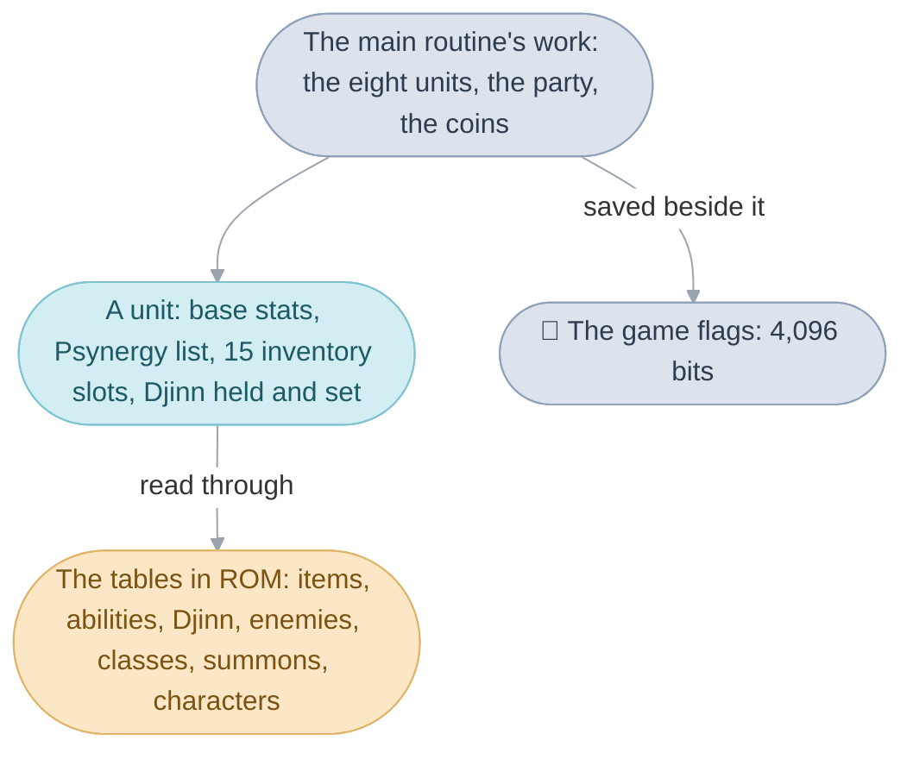
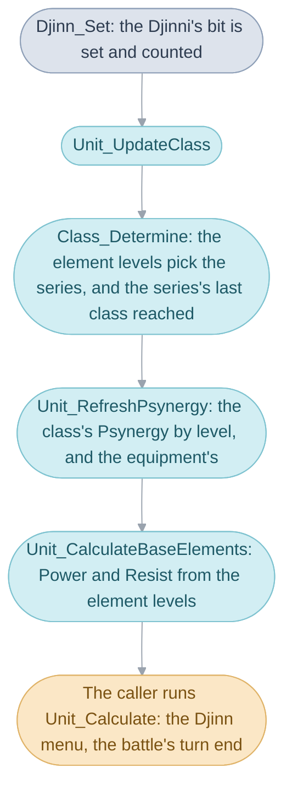
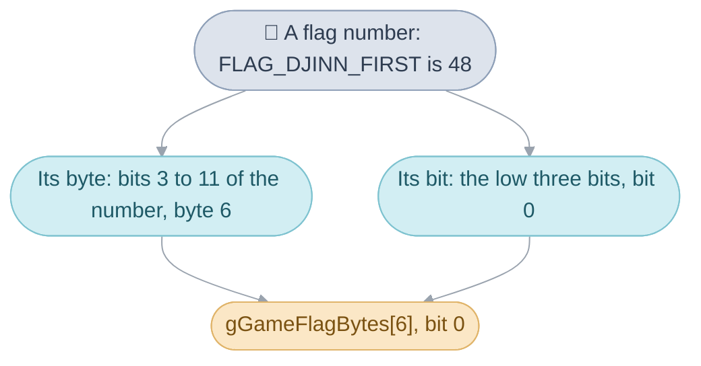

# Game rules


The Status screen says Isaac's Attack is 121. A shop says the Long Sword
costs 200 coins, and that Ivan `Can't equip` it. A Djinni joins, and the
save file counts one more. A chest the party has opened stays open.

Every one of those facts is asked of one part of the code, the game rules.
The
[field](../../glossary.md#field), the [battle](../../glossary.md#battle),
the menus and the shops all ask it the same questions, and it keeps the
only copy of the answers.

It works in ten mechanisms. The first three say what the game knows, and
the rest say what it does with that.

1. A [unit](../../glossary.md#unit) holds one character or one enemy: its
   stats, its [Psynergy](../../glossary.md#psynergy-and-pp), its items and
   its Djinn.
2. The tables describe every item, ability, Djinni, enemy, class, summon and
   character, each a row found by a number, and that number also finds the
   row's name in the game's text.
3. An item's row says what the item is, and a slot of a unit's inventory
   says which item the unit carries, in what state and how many.
4. A unit's stats are worked out from scratch whenever anything feeding
   them changes.
5. Setting a Djinni changes a character's class, and the class changes its
   Psynergy and its stats.
6. Experience raises a level, and a level up adds to the base stats.
7. The party is the characters travelling together, with their coins.
8. The [game flags](../../glossary.md#game-flag) remember every yes or no.
9. The rare item counters say what the shops may still sell.
10. The battle arithmetic turns stats into damage, healing and chances.



The units, the party and the coins live in the
[main routine's work](../../glossary.md#main-routines-work). A save file
keeps that work together with the game flags, so everything a unit holds
survives a save and a load.

The tables live in the cartridge, as they were written, and never change.

## The unit

A unit is one fighter. A character and an enemy are held in the same shape,
so that a battle can treat both sides alike.

The game keeps a unit for each of the eight characters of both games,
Isaac to Piers, for the whole game, whether or not the character is in the
party. The enemies of a battle are six more units, filled when the battle
starts and gone when it ends.

A unit keeps two copies of each stat. The base stats are what the character
has earned, and change only when it levels up. The stats the player sees
are worked out from the base stats and everything on top of them, and are
rewritten whenever any of that changes
([Stats](#why-stats-are-always-worked-out-from-scratch)).

Beside the stats sit the Psynergy list, with room for 32, the inventory of
15 slots, the Djinn the unit holds and which of them are set, and what a
battle leaves on a fighter: poison, sleep, a raised or lowered stat.

An enemy's unit is filled from its row of the enemy table when the battle
starts. The row gives its stats, the items it carries, its levels,
[Power and Resist](../../glossary.md#power-and-resist) in each element, and
its name, with a number after it when the
[formation](../../glossary.md#formation) holds more of its kind
(`Gryphon1`).

An enemy has no class. That is how the code tells an enemy from a character
wherever the two are treated differently.

| Cap                               | Value |
| --------------------------------- | ----- |
| level                             | 99    |
| Attack, Defense and Agility       | 999   |
| a character's maximum HP and PP   | 1,999 |
| an enemy's maximum HP and PP      | 9,999 |

## How one number finds a row and its name

The Healing Ring costs 800 coins, heals like Cure when used, and is called
`Healing Ring` on screen. Those facts sit in different places, the price in
the item table and the name in the game's text, and what joins them is a
number: the ring is item 265.

Every item, ability, Djinni, enemy and class is one row of a table in the
cartridge, and the number of the row is the only name the code has for it.
No column says which item a row is. An item's number is simply its place in
the table, counting from 0.

The names work the same way. Every line of the game's text is a numbered
message, and each table's names are a run of messages in the table's order.
The name of item 265 is the 265th message after the first item name:

```
name message = MsgItemName + item id
             = 386 + 265 = 651 for the Healing Ring
```

So the tables and the text of the six languages are parallel lists, tied
only by position. A row inserted into the item table would give every later
item the next one's name.

In the code each id has a name, so that it reads `ITEM_HEALING_RING` and
never 265, and each row of a table has a comment giving the English name
its message holds.

| Table      | Rows | What a row is                                        |
| ---------- | ---- | ---------------------------------------------------- |
| items      | 324  | a thing carried: its price, type, bonuses and use    |
| abilities  | 519  | anything a unit can do when it acts                  |
| Djinn      | 80   | 20 to an element: the ability and the stat bonus     |
| enemies    | 165  | an enemy's stats, items, weaknesses and spoils       |
| classes    | 203  | stat multipliers and the Psynergy learned by level   |
| summons    | 16   | the ability and the standby Djinn it needs           |
| characters | 8    | growth, starting level and items, element bonus      |

Ability is the widest word of the five. Psynergy, what a Djinni or a summon
does, what an item does when used and an enemy's move are all rows of the
ability table. A Djinni's row, a summon's row and an item's row each name
the ability they play. [Battles](../battle/README.md) follows an
ability from these tables to its damage.

## An item's row


Everything the player learns about an item in a shop or on the Item screen
comes from its row of the item table. The Long Sword's row says 200 coins,
a weapon, 14 to Attack, for Isaac, Garet and Felix. That is why the shop
shows `Can't equip` for Ivan, and compares the sword with Isaac's and
Garet's own.

```c
// Long Sword
{
    .price = 200,
    .type = ITEM_TYPE_WEAPON,
    .equipMask = EQUIP_CHARACTER(ISAAC) | EQUIP_CHARACTER(GARET) | EQUIP_CHARACTER(FELIX),
    .icon = 1,
    .primaryBonus = 14,
    .element = ELEMENT_NONE,
},
```

The type says what the item is: a weapon, armor, a shield, a helm, boots,
a shirt, a ring, or one of the Psynergy items. A unit wears one item of
each type at a time, so equipping a second sword takes the first off.

The eight Psynergy items, from the Orb of Force to the Catch Beads, are the
exception. Any number may be worn together, and while one is worn, the
Psynergy it names is on its owner's list.

A row also says what using the item costs:

| Using it                | Examples                    |
| ----------------------- | --------------------------- |
| costs nothing           | equipment                   |
| uses one up             | Herb, Antidote              |
| may break it, one time in eight | the rings and staffs |
| leaves an Empty Bottle  | Hermes' Water               |

A broken item can be mended by a smith
([Shops](../shop/README.md#repairing)).

Then come the yes-or-no marks a row carries: cursed, cannot be taken off,
rare, kept in a stack, and important, which means never dropped and worth
nothing to a shop.

Beside the plain bonus to Attack or Defense, a row holds up to four effects
the item has while worn, each a kind and an amount: add to maximum HP,
scale Agility, raise the chance of an unleash.

An unleash is a weapon's own attack, which sometimes replaces a plain blow.
A weapon's row names that ability and its chance, in steps of five percent.

When an item is used in battle, the battle builds an
[action](../../glossary.md#turns-and-actions) from the ability the row
names ([Battles](../battle/README.md#how-an-ability-resolves)).

## What an inventory slot holds


Each character carries up to 15 things, and the Item screen shows for each
whether it is equipped (a small E), whether it is broken (a red cross) and
how many there are of a stackable item such as Herbs.

A slot is one number that packs all four together: the item, an equipped
mark, a broken mark and a count. That is why an item moves from one
character to another with its state.

It also means the same sword equipped and unequipped is two different
numbers. So code that asks which item a slot holds sets the marks and the
count aside first.

A stack holds up to 30 of one item. Giving a unit an item adds it to the
unit's first stack of that item, or else puts it in the first empty slot.
A full stack refuses the item even when another slot is free.

The slots are kept closed up. When the last of an item leaves its slot,
the slots after it move up, so the list on the Item screen has no gaps and
the first empty slot is always its end.


Giving the party an item tries each party member in order, which is how a
chest's item or a battle's spoils lands on whoever has room. With Isaac's
slots full, a chest's Small Jewel goes to Garet.
[game/inventory.c](game/inventory.c) has the code.

## Why stats are always worked out from scratch


When the player points at Remove on Isaac's Machete, the status panel shows
his Attack falling from 24 to 17 before anything is chosen.

The game never adjusts a stat. Whenever something that feeds a stat changes
(equipment, a Djinni, a level, the class), it works every stat out again
from the base stats.

A menu's preview is that same calculation. The menu copies the unit, makes
the change, reads the new numbers and puts the copy back.

The calculation takes its steps in a fixed order, and the order is why the
numbers come out as they do:

1. The additions come first: what each equipped item adds, then the bonus
   of each Djinni that is set.
2. The class multiplies every stat by its own figure in tenths. A Squire's
   row says 11 for Attack, so Attack becomes eleven tenths of the sum,
   rounded down.
3. The equipment that scales a stat multiplies in the same way.
4. Last come the changes a battle has made, such as a raised Attack. Each
   step up or down is an eighth of the stat.
5. Every stat is then held to its cap and written to the unit.

An enemy skips the equipment, the Djinn and the class, having none.

The Machete adds 6 to Attack, but the panel shows 7 less, because the class
multiplies the sum and the result rounds down. With an Attack of 16 before
the class, and a class that multiplies by 11 tenths:

```
with the Machete     (16 + 6) * 11 / 10 = 24
without it                 16 * 11 / 10 = 17
```

Working stats out from scratch means no sequence of changes can leave a
stat a point off. Taking the Machete off and putting it back always gives
24 again.

Current HP and PP need more care, since they are the two numbers that
cannot be worked out from anything else. The unit remembers each as a
share of its maximum. When the maximum changes, the current value is
rebuilt from the share. So a character at half HP is still at half HP after
putting on armor that raises the maximum, and a character with any HP left
never falls to 0.

Two more things happen in the same pass. A cursed item marks its wearer as
cursed. And once the lighthouse of a character's own element is lit, the
character regains 4 more PP each turn.
[game/units.c](game/units.c) has the calculation, `Unit_Calculate`.

## Djinn and classes


Putting Flint on standby takes Isaac from Knight to Squire, his HP from 178
to 141 and his Attack from 121 to 107. One Djinni does all that.

A [Djinni](../../glossary.md#djinn) set on a character raises its stats and
helps decide its class. The class in turn decides what Psynergy the
character knows and how far its stats are multiplied. Standby undoes all of
it at once.

There are 80 Djinn in the table, 20 to an element. Each row names the
ability the Djinni unleashes and the stat bonus it gives while set, so Flint
adds 8 HP, 4 PP and 3 Attack. A unit remembers which Djinn it holds and
which of those are set. A character holds at most ten of one element.

Setting a Djinni, or putting it on standby, sets off a chain, each link
needing the one before:



The Djinni changes the character's element levels, the levels choose the
class, the class rebuilds the Psynergy list, and the stats are then worked
out from scratch as the section above describes. The next three sections
take the links in turn.

### Element levels

A character's level in each of the
[four elements](../../glossary.md#the-four-elements) is the number the
Status screen shows beside the element. It comes from two things: the
Djinn set in that element, and a bonus of the character's own from its row
of the character table.

The game counts the levels in tenths. A set Djinni is worth 10, one whole
level. Isaac's own bonus is 54 in Venus and 3, 1 and 2 in the others. With
no Djinn set he is therefore at 5.4 in Venus, which the Status screen shows
as 5, and each Venus Djinni set raises that by one.

The levels also give the character's base Power and Resist in each
element. At level 0 they are 75 and 85, and each level adds 5 to both,
except that level 14 adds 10 to Resist; the tenths of the level are added
on top. Neither goes above 200.

An enemy sets no Djinn. Its levels, Power and Resist are fixed numbers
that its row of the enemy table points to.

### Which class a character has

The class is chosen from the element levels alone. The two strongest
elements pick a class series. Venus alone is the Squire's series, Mars
alone the Guard's, Mercury alone the Water Seer's and Jupiter alone the
Wind Seer's, and a mixed pair picks a mixed series. A second element counts
only once it reaches level 1.

Within the series, the character gets the highest class whose requirements
it meets. Each class's row says the level it needs in each element. A
Squire needs Venus 5 and a Knight Venus 7. With Flint and Granite set,
Isaac stands at 7.4 and is a Knight. With Flint on standby he is at 6.4, a
Squire.

That is where the recording's numbers come from. Flint's own bonus leaves
the sum, and the Squire's multipliers, 11 tenths for HP and for Attack,
replace the Knight's 13 and 12:

```
HP      Flint set       137 * 13 / 10 = 178
        on standby      (137 - 8) * 11 / 10 = 141
Attack  Flint set       101 * 12 / 10 = 121
        on standby      (101 - 3) * 11 / 10 = 107
```

Three characters have fixed classes: Isaac and Garet as children in the
prologue, and Jenna, the Flame User.

### The Psynergy list

The class decides most of what the character can cast. Its row lists up to
16 abilities with the level each is learned at. The Squire and the Knight
list the same ones, Quake at level 2 and Earthquake at level 4 among them,
which is why the panel says `No change` when Isaac drops to Squire.

The list is rebuilt whenever the class, the level or the equipment changes,
from three sources in order: the class's abilities the character's level
has reached, then the Psynergy of each Psynergy item worn, and after them
the Psynergy an [event](../../glossary.md#event) taught for good, such as
Isaac's Move and Retreat after the prologue. Each entry carries a mark
saying which source it came from, so a rebuild can throw away the class's
and the items' entries and keep the taught ones.

## Levels and experience


A battle's spoils add experience to each party member, and the character
gains a level when its experience reaches the next level's threshold. Each
character has its own list of 99 thresholds. Isaac's level 2 needs 24
points and his level 10 needs 2,910.

After a battle the spoils check each party member again and again until its
experience falls short, so one battle can give several levels.

A level up adds a little to each base stat. The character's row holds a
growth curve for each stat, drawn through six points: the stat's value at
levels 0, 20, 40, 60, 80 and 100. Each level inside a band of twenty adds a
twentieth of the band's rise.

Stats are whole numbers, though. So the game adds a random 0 to 19 before
dividing by 20, and the rounding comes out right on average:

```
gain = (the band's rise + a random 0 to 19) / 20, rounded down
```

A band in which HP rises by 152 gives 7 or 8 HP a level, and close to 152
over its twenty levels. That is why two games' Isaacs at the same level
differ by a few points.

After the gains, the level up rebuilds the Psynergy list and the stats, so
`Mastered the Squire's Spire!` comes with the level that teaches it.

A new game is the same mechanism run from nothing. Each character is given
the items in its row, already equipped, and its class is worked out. Then
it is raised to its starting level one level at a time: 1 for Isaac and
Garet, 4 for Ivan, 10 for Mia.

Level 1 also adds the curve's first point, Isaac's 30 HP. So a new game
starts him at 37 or 38 base HP, which the Squire's multiplier makes 40 or
41.

## The party and its coins

The [party](../../glossary.md#the-party) is the characters travelling
together, and the game keeps it twice. A game flag for each character says
whether it is in the party, and a list holds the members in order, which is
the order the menus and the battle show them in. Joining sets the flag and
adds the character to the end of the list. Leaving clears the flag and
closes the gap.

The party's coins are one number, kept between 0 and 999,999. The shops,
the inn, the sanctum, the spoils and Lucky Dice all change it through one
function, which holds it in that range. The shops keep two more counters
the same way: the coins the party has spent in them, which earn Game
Tickets, and the tickets given so far ([Shops](../shop/README.md)).

The party's average level, rounded down, decides which enemies a random
battle brings and what Lucky Dice pays.

## The game flags


The game remembers what has happened (a chest opened, a Djinni found, an
event already played) as 4,096 yes-or-no flags.

When Granite joins, its found flag is set. The next visit to Kolima reads
the flag and puts no one where Granite stood. Each save file's summary
counts the found flags to say how many Djinn the party has, and the Title
offers its Battle option only once some save file counts at least one.

A flag is a number, and the number says where the flag is kept. The flags
are stored eight to a byte, in 512 bytes, so dividing the number by 8 gives
the byte and the remainder gives the bit within it. The first Djinni's
found flag is number 48: byte 6, bit 0.



Some runs of flags have a job of their own. The flag numbers are written
in hex, as the game's own debug flag editor shows them:

| Flags                | What they hold                                         |
| -------------------- | ------------------------------------------------------ |
| `0x000` to `0x007`   | who is in the party, one flag a character              |
| `0x020`              | the prologue: Isaac and Garet are children             |
| `0x030` to `0x07f`   | the 80 Djinn's found flags, 20 to an element           |
| `0x200` to `0x2ff`   | a [scene](../../glossary.md#scene)'s scratch flags, cleared each time the party walks into a scene |
| `0x300` to `0x3ff`   | an [area](../../glossary.md#area)'s scratch flags, cleared when the party enters another area |

The Djinn's flags are in the Djinn table's order, so Granite, the second
Venus Djinni, has the second of them.

Coming back from a battle leaves the scene's scratch flags alone, so a
puzzle half solved is still half solved after a fight.
[Scenes](../scene/README.md#state-that-cleans-itself-up) shows how a scene
uses the two scratch ranges.

Eight flags in a row, read together, also hold a small number, such as the
Battle Arena's count of wins. A new game clears every flag. The named flags
are in `flags.h`, each with the evidence for its name.

## Rare item counters


A shop never runs out of Herbs, but it can sell a rare item such as the
Witch's Wand only while that item's counter is above zero
([Shops](../shop/README.md#artifacts) shows what the player sees of it).

There are 128 counters, each kept between 0 and 99, and a table says which
counter, if any, each item uses. Buying a rare item takes one from its
counter, and selling or dropping one puts one back. That is why a sold
Witch's Wand can be bought again.

## Battle arithmetic


The arithmetic that turns stats into the numbers on the screen is kept
with the stats, so that the battle and the menus, which show what Cure
would heal, get the same answers.

### The element multiplier

Every damage formula rewards Power over Resist through one multiplier. The
game takes the difference between the attacker's Power and the target's
Resist in the ability's element and holds it between -200 and 200. Then it
turns the difference into a multiplier on a straight line: no difference is
one times, 200 is twice, and -200 is nothing.

### Damage and healing

| What                | How much                                                    |
| ------------------- | ----------------------------------------------------------- |
| Psynergy damage     | power × (1 + difference / 200)                              |
| an attack's damage  | ((Attack − Defense) / 2 + added power) × (1 + difference / 400) |
| healing             | power × the healer's Power / 100                            |

The power is the ability's own, from its row. With Power 20 above the
target's Resist the multiplier is 1.1, and a little is lost to rounding
down: a Psynergy of power 160 comes to 175.

An attack counts the difference half as much, so its multiplier runs from a
half to one and a half. Attack less Defense never counts as less than 0.
With no difference in the element, an Attack 80 above the target's Defense
does 40, plus whatever power the ability adds.

Healing has no target to resist it, so only the healer's Power counts. A
healer with 100 Power heals the ability's power exactly, and one with 120
about a fifth more.

These are the base numbers. The battle goes on to scale and adjust them,
and [Battles](../battle/README.md#how-an-ability-resolves) puts the
formulas in the order the battle uses them.

### The unleash roll

A weapon unleashes when a roll comes in under its chance: five percent for
each step in the weapon's row, plus whatever the wearer's equipment adds.
The roll is made once for each Attack command.

The roll uses the battle's own random numbers, a separate run from the
field's. In a link battle the two consoles exchange its starting point
before each turn, so that both roll the same.

### Whether an added effect lands

An ability's added effect (poison, sleep, a stat drop) lands by a roll
against a chance. It fails at once when there is nothing for it to do: a
revive on a standing unit, a cure for a poison the target has not got.
Otherwise the chance starts from the effect's base rate:

| Effect                            | Base rate |
| --------------------------------- | --------- |
| a Resist drop                     | 75%       |
| a Defense drop                    | 70%       |
| Delusion, an HP drain             | 65%       |
| an Attack drop, a PP drain, the curse | 60%   |
| Poison, Venom, a Psynergy seal    | 55%       |
| Sleep                             | 45%       |
| Stun                              | 40%       |
| Confusion                         | 35%       |
| Charm                             | 30%       |
| Haunt                             | 25%       |
| instant death                     | 20%       |

Three things move the rate. Each level the caster leads the target by in
the ability's element adds 3 points, and each level it trails takes 3 off.
The target's Luck counts against it as half a level a point. And a
weakness adds 25: each enemy's row and each class's row lists up to three
effects it is weak to.

Sleep cast by a character one level ahead of a target with 6 Luck starts
at 45, gains 3 for the level, loses 9 for the Luck and stands at about 39
in a hundred. Against a target weak to Sleep it is about 64.

The ability then scales the result by a factor of its own.

Effects with no base rate in the table, such as a stat boost, start from a
fixed 100. The revives have fixed chances too, which levels, Luck and
weaknesses leave alone. Luff's seal gets three tries.

## Design

The game rules keep one copy of every rule so that the field, the battle,
the menus and the shops agree. A shop's preview of a sword runs the same
calculation the battle will run, and a menu's check of who can wear it is
the same check the equip command makes.

Working the stats out from scratch is what makes that safe. Any code may
change a base stat, equip an item or set a Djinni and then ask for one
calculation, and every stat comes out right. The cost is that a change to
one stat recomputes all of them, which the game pays only at the moments
the player makes a change.

Enemies share the characters' unit, so a battle's code reads one shape for
both sides.

Tying a row to its name by position alone costs nothing to store and
nothing to look up. The price is that the tables and the text of all six
languages must keep exactly the same order.

## How it fits with the rest of the game

The game rules are a [bank](../../glossary.md#bank) of their own, which
the other banks reach by [far calls](../../glossary.md#far-call). They are
only ever asked. Nothing in them runs from frame to frame.

The units, the party and the flags are what a save file keeps
([System](../../system.md#saving)). The battle reads the ability table
beside tables of its own, which choose how an ability is drawn
([Battle](../../battle.md)). The menus and the shops show the numbers this
code works out ([Menus](../menu/README.md), [Shops](../shop/README.md)).

## Limits

- An item's number has room for 0 to 511; the item table has 324 rows.
- A unit has 15 inventory slots, and a stack holds 30.
- A Psynergy list holds 32 entries.
- A flag number past 4,095 wraps round onto a lower flag.
- Levels go up to 99.
- Coins stop at 999,999.

## Words used here

- [Unit](../../glossary.md#unit), [party](../../glossary.md#the-party),
  [game flag](../../glossary.md#game-flag) and
  [Djinn](../../glossary.md#djinn) are in the glossary. A **party member**
  is a unit whose character is in the party.
- A **base stat** is a stat as the character has earned it by levelling
  up, before equipment, Djinn and class.
- An **inventory slot** is one of a unit's 15 places for an item, holding
  the item, its state and its count.
- An **ability** is a row of the ability table: Psynergy, what a Djinni or
  summon does, an item's use and an enemy's move are all abilities.
- A character's **element levels** are the Djinn set on it plus its own
  element bonus, counted in tenths.
- A Djinni is **set** on the unit that holds it or on **standby**; the
  Djinn a summon uses recover for some turns before they can be set again.
- A **class series** is the run of classes a character's two strongest
  elements select; the character has the highest class of the series that
  its element levels reach.
- A **rare item counter** is one of the 128 counts of how many of a rare
  item the shops may still sell.

## Evidence

The tables' comments give each row the English name from
`games/tbs/text/en.po`, by the message the row's number reaches. The 80
flags from `FLAG_DJINN_FIRST` are the Djinn's found flags because the code
that gives the party a Djinni sets flag `FLAG_DJINN_FIRST` + 20 × element +
index.

The Machete's arithmetic is the one multiplier in `class_table.c` that
gives both numbers the recording shows. The sums 137 and 101 in Flint's
arithmetic are worked back the same way, from the recording's numbers and
the Knight's and Squire's rows of `class_table.c`; Flint's bonus is its
row of `djinn_table.c` and Isaac's element bonus his row of
`character_table.c`.

Rows 269 to 323 of the item table are 55 copies of one row: a weapon only
Isaac can equip, priced 100 coins, with 11 to Attack, no icon and no name.
Nothing in the game gives one: no shop stocks an item past the Cleric's
Ring, number 268, no event gives one, and no enemy carries or drops one.
The last enemy row has no name either.

The two class rows before Jenna's have no name. They are the classes Isaac
and Garet have as children, while `FLAG_CHILDHOOD` is set.
