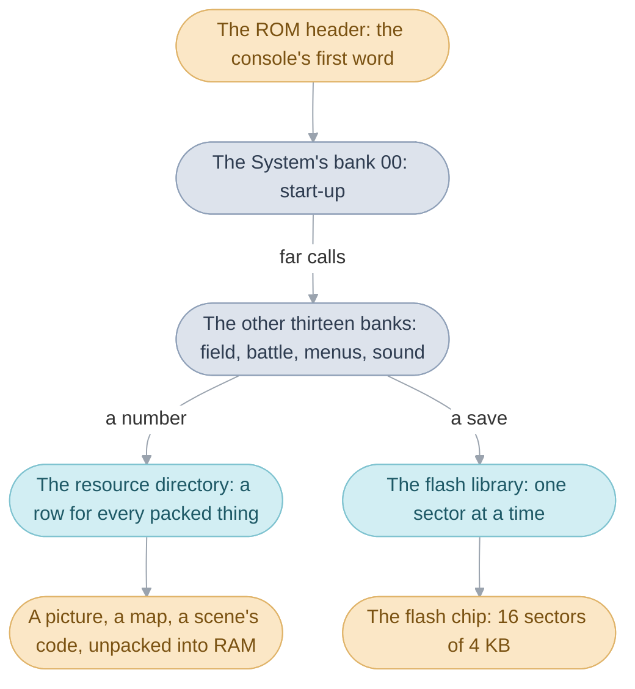
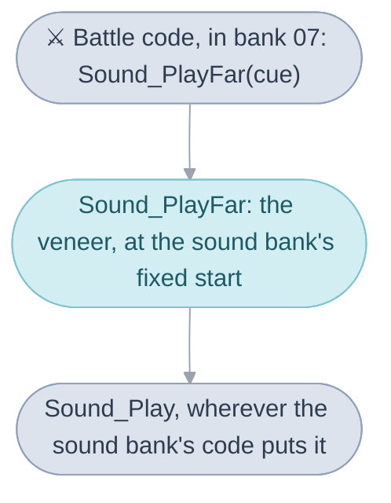
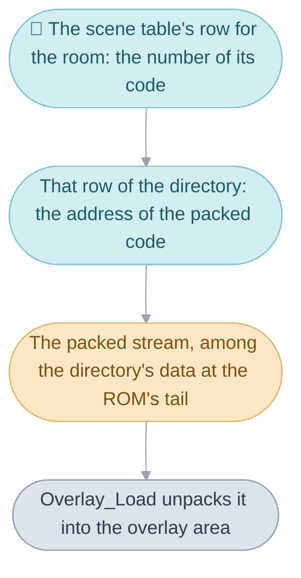
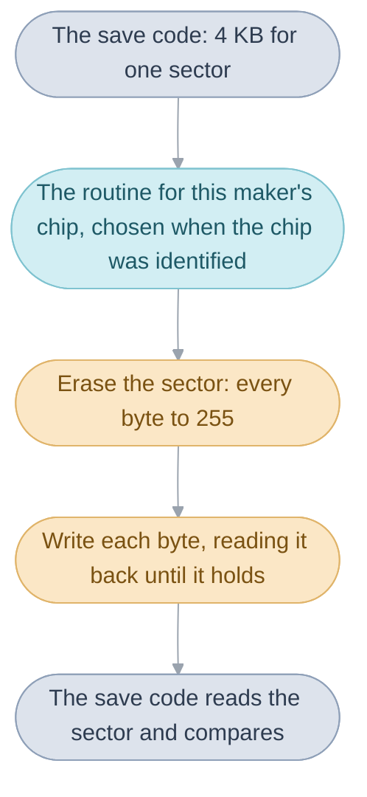
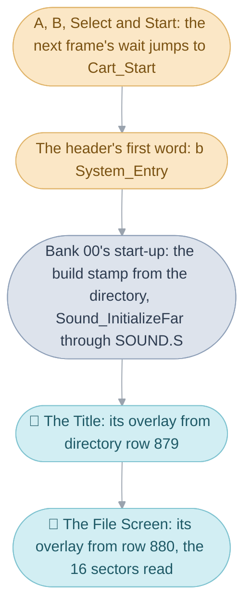

# The Game Pak

Switch the console on and the logos come up; walk into a house and the room
is there; save, switch off, and the save is still there the next day. Each of
those is the cartridge at work. The [Game Pak](../../glossary.md#game-pak) is
the cartridge as hardware: an 8 MB ROM that holds the whole game, and a small
flash chip beside it that the saves are written to. The console can read any
byte of the ROM at any moment, so most of the code runs from it directly, and
every picture, map, tune and piece of scene code is fetched from it when
needed. The files here are the four things that make the cartridge usable
from the code:

1. The ROM header, the block the console reads first, whose first word
   starts the game.
2. The [banks](../../glossary.md#bank) the code is cut into, and the
   [far-call](../../glossary.md#far-call) tables through which one bank
   reaches another.
3. The [resource directory](../../glossary.md#resource-directory), the one
   list through which a packed picture, map or piece of scene code is found
   by its number.
4. The [flash chip](../../glossary.md#flash-chip), 64 KB written in 16
   sectors of 4 KB, and the code that writes a save into it and reads it
   back.

What the game keeps in RAM, and how a scene's code is unpacked there, is
[System code](../system/README.md).

## The ROM header

The header is the first 192 bytes of the cartridge, a block the console reads
before it runs anything, with the game's first instruction at its very start.

When the console is switched on, its own built-in program reads the
cartridge's header, checks it, draws the Nintendo logo it holds, and then
jumps to the cartridge's first word. That word is a jump to the start of the
[System](../../glossary.md#system)'s start-up code, and from there the game
runs ([System code](../system/README.md#start-up)). A reset with A, B,
Select and Start jumps to the same first word, so the game starts over as if
the console had just been switched on.

The rest of the header is data the console checks or shows: 156 bytes of
the Nintendo logo, the game's title, a four-letter game code, a maker code,
and a check sum over the title and the codes.

The title and the game code differ by [edition](../../glossary.md#editions).
The title is `OugonTaiyo_A` in Japanese, `Golden_Sun_A` in English and
`GOLDEN_SUN_A` in the other four languages. The game code is `AGS` followed
by a letter for the language: `J`, `E`, `D` for German, `S`, `F` or `I`. The
maker code, `01`, is Nintendo's. The game itself reads one thing from its
header: the Spanish and Italian editions look at the language letter where
the battle's target selection and its status display lay out their text.

## Why the main image is cut into banks

The [main image](../../glossary.md#main-image) is the code the processor runs
straight from the cartridge, and it is laid out as fourteen banks, each
starting at a fixed address with room to spare after its code, so that one
bank can grow or shrink without moving anything another bank holds.

Code in one bank calls a function in another through a far call
([System](../../system.md#banks-and-far-calls) introduces them). Each bank
opens with a far-call table, a list of
[veneers](../../glossary.md#veneer), one for each of its functions other
banks call. The far call goes to the veneer, and the veneer jumps on to the
function. Since the table sits at the bank's fixed start, the veneer's
address stays right however the bank's code behind it moves. `Sound_PlayFar`
is the sound bank's veneer for `Sound_Play`, and the battle asks for its
music by calling it.

Bank 00 is the exception. The other banks call its functions directly, by
their plain names, and its table serves only the
[overlays](../../glossary.md#overlay), the scenes' code, which is unpacked
into RAM and reaches every bank through an
[import table](../../glossary.md#entry-table-and-import-table) of its own
([System
code](../system/README.md#how-an-overlay-reaches-the-rest-of-the-game)).

### A veneer

A veneer is 8 bytes and does one thing: it loads the function's address,
which is stored in the veneer itself, and jumps there. The load needs
somewhere to put the address, and it uses a register, one of the
processor's few working values, that the game's code never expects to
survive a call.

The processor has two sets of instructions, a compact one that most of the
game is written in and a full one that the routines copied into
[IWRAM](../../glossary.md#iwram-and-ewram) use. The veneer's jump can
switch from one to the other, so the same 8 bytes reach either kind of
function.

### The tables

A table's rows keep their order for good. An overlay's import table holds
the address of a row, so a row added in the middle of a table would move
every row after it and send every overlay's calls to the wrong function. A
row that no code calls by name therefore still keeps its place.

| Bank | Holds                                   | Rows in its table |
| ---- | --------------------------------------- | ----------------- |
| 00   | the System; only the overlays use its table | 96            |
| 01   | the field                               | 87                |
| 02   | the windows                             | 134               |
| 03   | the game rules                          | 100               |
| 04   | the main routine and the field sequence | 192               |
| 05   | the menus                               | 10                |
| 06   | the shops                               | 14                |
| 07   | the battle                              | 39                |
| 08   | the battle effects                      | 9                 |
| 09   | the credits                             | 1                 |
| 10   | the Title                               | 5                 |
| 11   | Lucky Dice                              | 1                 |
| 12   | Lucky Wheels                            | 1                 |
| 13   | the sound                               | 16                |

A fifteenth table sits after the sound driver at the ROM's tail and belongs
to no bank. Its one row leads to the lookup of a sprite's animations
([Graphics](../graphics/README.md#sprites-and-their-animations)).

The banks' starts differ by edition, since each language's code is a
different size. [Source](../README.md#banks-and-folders) lists which folder
holds each bank's code; the tables are in `far_call/`, one file for each
bank.

## The resource directory and table order

The resource directory is one table of addresses, a row for every packed
thing on the cartridge, so that code can ask for a picture, a map or a
scene's code by a number and get back where its bytes start.

When the party walks through that door, the
[scene table](../../glossary.md#scene) gives the room's code as a number, and
the number picks a row of the directory. The row holds the address of the
packed code, which is then unpacked into the overlay area. Pictures, maps,
tilesets and the battle effects' sheets are found the same way: each caller
holds a number, looks up its row, and reads from the address the row gives.
A row is one address, and a resource's number is its position in the table,
so the lookup is a single read.

The directory has 1,000 rows, and they run in groups:

1. Nineteen rows that point at pieces of the main image itself: the header,
   the directory, the build stamp and the far-call tables. The game reads
   only one of them, the build stamp's.
2. The windows' tiles and the small font, the Title's pictures and logos,
   and the 34 battle backgrounds.
3. Lucky Wheels and Lucky Dice, the battle effects' sheets and palettes, the
   field's default tables, the World Map's tiles, the Colosso's paths, the
   menu cursor's eight pictures and the Interface's icons.
4. The 54 monsters.
5. Every tileset with its maps: one row for each map drawn with it, then
   the set's palette and its sheets of tiles, up to four. A map that only
   recolours the set before it has its row and a palette alone.
6. The 96 overlays, in rows 879 to 974.
7. 25 empty rows that nothing reads.

Since a number is a position, a row added or moved renumbers every row after
it. Most code names a resource by a name that follows a moved row, but in a
few places the numbers travel bare: the scene table names each scene's code
by its number, the maps are counted on from the first map's row, and the
settings menu's marker steps through eight pictures from the first. The
empty rows at the end are where a new row fits without renumbering any
other. The directory is `resource_directory.s`.

### The build stamp

The build stamp is twelve digits that say when each edition was built: the
year, month, day, hour, minute and second, two digits each. Start-up finds
it through the directory and copies it into IWRAM, and nothing in the game
reads the copy again.

| Edition  | Stamp          | Built                         |
| -------- | -------------- | ----------------------------- |
| Japanese | `010628184502` | 28 June 2001, 18:45:02        |
| English  | `010918151347` | 18 September 2001, 15:13:47   |
| French   | `011219190202` | 19 December 2001, 19:02:02    |
| German   | `020109152237` | 9 January 2002, 15:22:37      |
| Spanish  | `020205181231` | 5 February 2002, 18:12:31     |
| Italian  | `020206164027` | 6 February 2002, 16:40:27     |

## The flash chip

The flash chip is the 64 KB of memory on the cartridge that keeps a save
after the power goes, and the library here is the code that erases, writes
and reads it, for whichever maker's chip the cartridge holds.

A flash chip is written in sectors: 16 of them, 4 KB each. A sector must be
erased before it is written, which sets every one of its bytes to 255, and
writing can then only be done slowly, a byte at a time. The chip is not
written like ordinary memory either. It takes commands, each a short fixed
sequence of writes to two places within it, and after a command the library
waits, reading a byte back again and again until it holds what was written.

Each of the three save [files](../../glossary.md#file-and-part) is two parts,
each part one sector, and a new copy of a part is written into a free sector
before the old one is given up, so that a power cut never loses a save. How
the sectors are chosen and read back is
[Saving](../system/README.md#saving); the library's part is the chip itself.

### Finding out which chip the cartridge holds

Cartridges were built with chips from four makers, SST, Atmel, Macronix and
Panasonic, and each wants its own commands and its own waiting times. So
before every save, load, copy or delete the library asks the chip who made
it (`IdentifyFlash`): it puts the chip into a mode in which it answers with
its maker and its model, and picks the matching entry from a table of
chips. An entry holds that chip's routines, to write a sector, to erase a
sector and to erase the whole chip, and its time limits.

A chip no entry matches is treated as an SST chip, and the caller is told.
The save code asks up to eight times, a frame apart, before it reports that
no chip answered.

| Chip      | Writing a sector                                        | Limit for a write | For erasing a sector | For erasing the chip |
| --------- | ------------------------------------------------------- | ----------------- | -------------------- | -------------------- |
| SST       | erase, check it is blank, erase again, then the bytes   | 10 ms             | 40 ms                | 200 ms               |
| Atmel     | 32 small sectors of 128 bytes, each in one command      | 40 ms             | 40 ms                | 40 ms                |
| Macronix  | erase, then the bytes                                   | 10 ms             | 2,000 ms             | 2,000 ms             |
| Panasonic | erase, then the bytes                                   | 10 ms             | 500 ms               | 500 ms               |
| any other | as SST                                                  | 10 ms             | 40 ms                | 200 ms               |

### Writing a sector

Writing a sector is erasing it and then writing its 4 KB, and the save code
reads the sector again afterwards to check it. The four makers' chips differ
in the middle step:

- **Macronix and Panasonic.** The sector is erased, and then each of its
  4,096 bytes is sent with a write command and waited for until it reads
  back.
- **SST.** The same, with more care over the erasing. The sector is erased
  and checked to be blank, up to 81 times over, and then erased again
  before the bytes are written: once more if the first check found it
  blank, six times more if a check had failed.
- **Atmel.** This chip's own sectors are small: 512 of 128 bytes, each
  written whole by one command, with no erase first. The 4 KB go in as 32
  of them, each tried at most twice, with the interrupts switched off while
  a small sector is sent.

Whichever chip it is, the save code then compares the sector with the 4 KB
it was written from, and the save counts only when they match.

While the flash code works, it sets the pace at which the console reads the
chip to the one that chip needs, and puts the usual pace back when it is
done. A routine reports either success or which step failed: a sector
number above 15, a byte, a sector erase or a chip erase that did not come
through in time, or an SST sector that would not read blank.

### Waiting for the chip

Every wait on the chip is the same routine. It reads one byte of the chip
again and again until the byte holds the value expected, under a time limit,
so that a chip that never answers cannot hang the game.

The limit is kept by one of the console's hardware timers, which the save
code hands to the library when it sets up. The timer interrupts about once
a millisecond, the library counts the chip's limit down in those
interrupts, and when the count runs out the wait makes one last read before
giving up. A Macronix chip is then sent its reset command.

The reading itself runs from RAM. The library copies its small routine that
reads one byte into a buffer on the stack and reads through that copy, so
the chip can be polled while it is busy with a write. The copy lasts only
until the function that made it returns.

Four of the library's variables hold the credits' state while the credits
roll. No save runs then, and the library sets them afresh the next time it
identifies the chip
([Menus](../menu/README.md#taking-over-the-display)).

## From the restart to the File Screen

Pressing A, B, Select and Start together in Vale brings the logos back, and
behind them the File Screen with the saved files. Each step of it is the work
of one of the four parts of the Game Pak.

**The header.** The four buttons ask for a reset, and at the end of its
frame [`wait()`](../../glossary.md#wait) jumps to the cartridge's first
word. That word is the header's jump into bank 00's start-up, and the old
game is gone.

**The directory and a far call.** Start-up reads the directory once, for
row 2, the build stamp, and copies the twelve digits. Then it starts the
sound driver, and since the driver is in bank 13, the call is a far call
through the sound bank's table. Its last call is another, into bank 04 for
the main routine, which sets the Title as what runs next.

**The directory again.** The scene table gives the Title's code as number
879. The main routine reads row 879 of the directory and unpacks the code
at the address it finds into the overlay area, and the Title shows its
logos. When the Title ends, the File Screen's code comes the same way from
row 880. Each overlay calls back into the banks through its import table,
whose entries hold the addresses of rows in the far-call tables.

**The flash chip.** To list the files, the File Screen has the save code
hand a timer to the flash library, ask the chip who made it, and read all
16 sectors to find the newest copy of each part. The three files on the
screen are what those sectors held.

## Design

Distance is not why the banks exist: a direct call reaches 4 MB either way,
and the main image is under 1 MB. The banks exist so that a bank can grow
without moving an address another bank holds, and each language's edition
fixes its own starts for the same reason. The overlays pay for the same
independence with two veneers per call, their own and the bank's.

The directory keeps every lookup to a single read by making a resource's
number its position, and pays for it with the renumbering that a moved row
causes; the 25 empty rows at the end are the room that leaves.

The flash library is written for chips it has never seen: it identifies the
chip at every use, carries a default for a chip it cannot name, times every
wait with a hardware timer, and reads the sector back after writing it, so a
cartridge with any of the four makers' chips, or a chip that answers slowly,
still keeps its saves.

## How it fits with the rest of the game

The header hands the console to the [System](../../system.md#start-up), whose
bank 00 the other banks call directly; every other bank is reached through
its table here, and every overlay through its import table and then these
tables. Code everywhere loads its pictures, maps and scene code through the
resource directory, and [saving](../system/README.md#saving) writes each part
of a file through the flash library.

## Limits

- A bank has the space up to the next bank's fixed start.
- A far-call table's rows keep their order: a row added in the middle would
  move every veneer after it.
- The resource directory ends with 25 empty rows nothing reads; a row added
  anywhere else renumbers every row after it.
- 16 flash sectors of 4 KB; a sector number above 15 is refused.
- A flash wait gives up after the chip's time limit, from 10 ms for a byte to
  2,000 ms for a Macronix erase.

## Words used here

- **far-call table**: the list of veneers at a bank's fixed start, one row
  for each of its functions other banks call, in a fixed order.
- **row**: one entry of a far-call table (8 bytes, a veneer) or of the
  resource directory (4 bytes, an address).
- **sector**: one of the flash chip's 16 stretches of 4 KB, erased and
  written as a whole; an Atmel chip's own sectors are 128 bytes.
- **build stamp**: the twelve digits of an edition's build time, a row of the
  directory read at start-up.

Bank, far call, veneer, overlay, resource directory, flash chip, file and
part are in the [glossary](../../glossary.md).

## Evidence

The folder is named for Nintendo's word for the cartridge, the Game Pak, as
GBATEK writes "GamePak ROM", "GamePak SRAM" and "GamePak Waitstates". The
far-call tables are named for the bank they open, the veneers for their
target with `Far` added, and the overlays by their directory number. The flash
library's files are named for the chip makers (`flashat`, `flashmx`,
`flashsst`) or in plain English (`flash`, `program_flash_sector`); its routine
names and `gFlash_ChipDefault` follow pret's agb_flash, whose DefaultFlash
is the same last entry.

What the ROM leaves open, why the directory's first nineteen rows point at
the main image and whether its empty rows were kept for later resources, why
the SST routine erases a sector that already reads blank, and why the other
banks call bank 00 directly, is noted at the code it is about, in
`resource_directory.s`, `sst.c` and `SYSTEM.S`.
