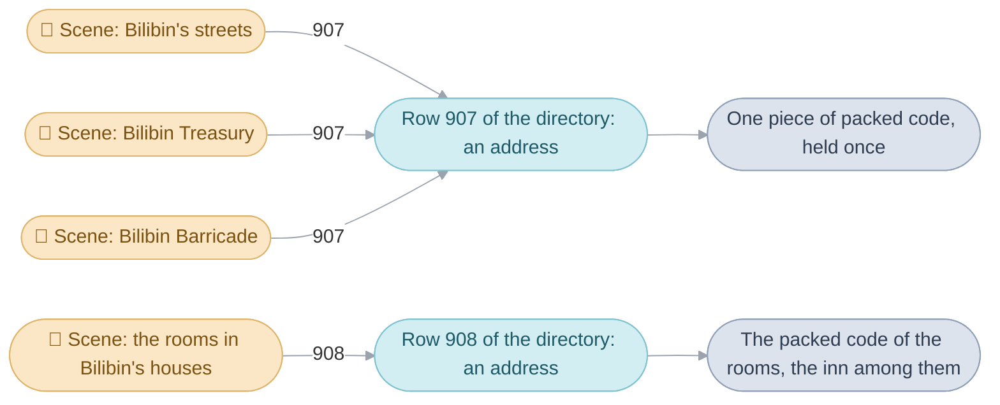
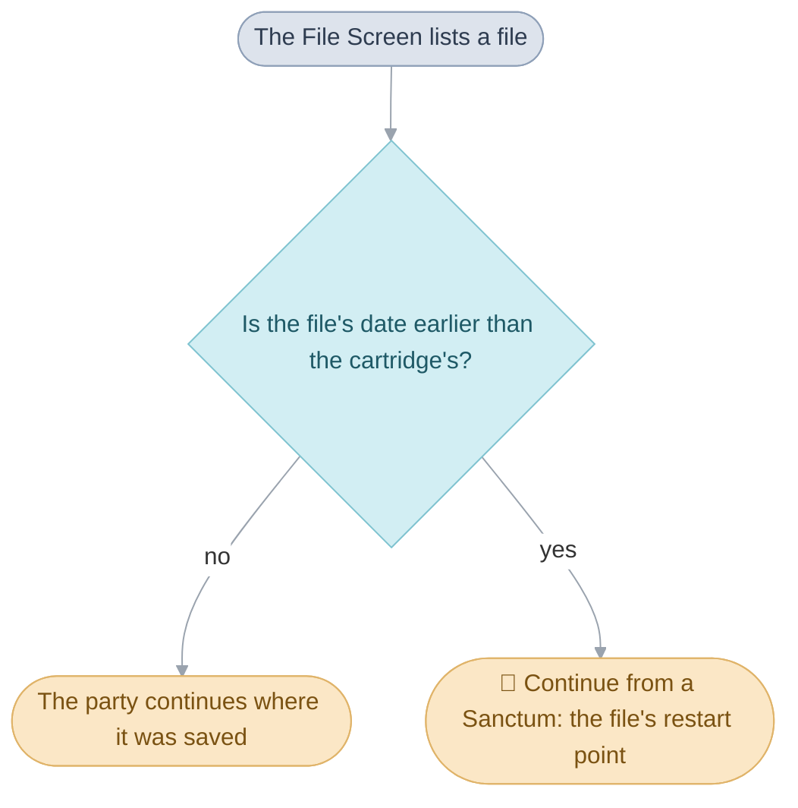
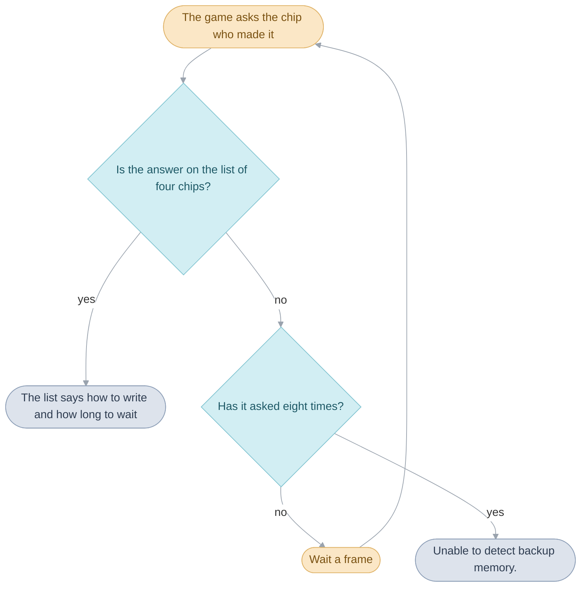
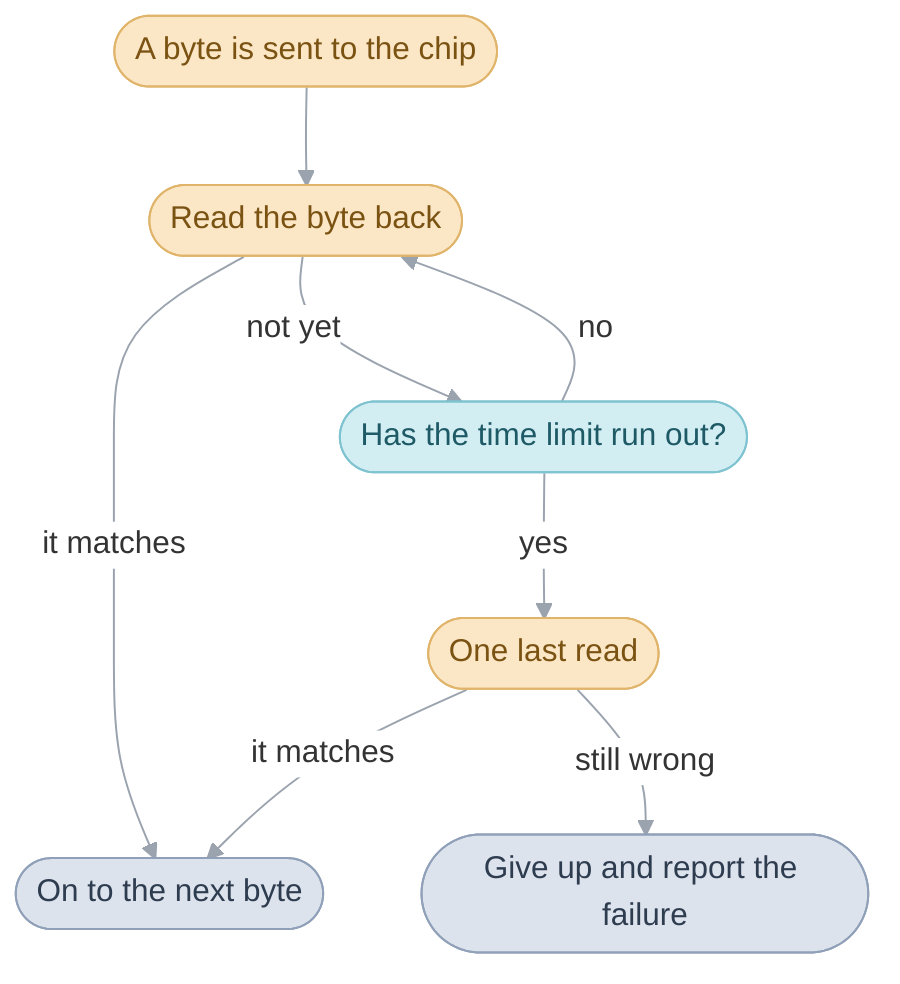
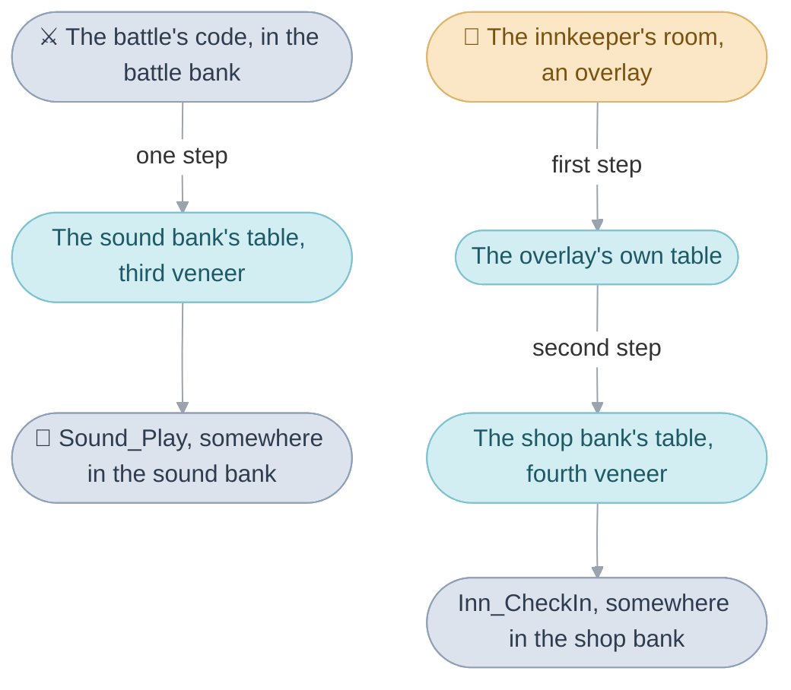

# The Game Pak

Switch the console on and the logos come up. Walk into Bilibin's inn and the
room is there, innkeeper and all. Save by Vale's river, switch off, and the
file is still there the next day.

All three depend on the cartridge, which Nintendo calls the
[Game Pak](../../glossary.md#game-pak). Inside it are two chips that matter
here.

The big one holds the whole game: every picture, map, tune and line of text,
and all of the game's code, the instructions that tell the console what to
do. It is a ROM, memory that can be read but never changed. Its size is
8 MB. A byte is the unit all of this is counted in, one small number from 0
to 255, and 8 MB is a little over eight million of them.

The small one is the [flash chip](../../glossary.md#flash-chip). It holds
only 65,536 bytes, but it can be written to, and it keeps what is written
with the power off. The three save files live there.

The console has [memory of its own](../../glossary.md#iwram-and-ewram) as
well, which the game works in while it runs. Things are fetched from the
cartridge and laid out there. It is emptied when the power goes.

Four things the player can notice lead into the cartridge:

1. Switching on, and the first few bytes the console reads
   ([The ROM header](#the-rom-header)).
2. Walking through a door, and how the game finds the room on the cartridge
   ([The resource directory](#the-resource-directory-and-table-order)).
3. Saving, and why `Saving...` stays up for a moment
   ([The flash chip](#the-flash-chip)).
4. A sound in a battle, and how one part of the game's code finds another
   ([Banks](#why-the-main-image-is-cut-into-banks)).

What the game keeps in that memory is in
[System code](../system/README.md).

## The ROM header

When the console is switched on, the game is not the first thing to run. The
console has a small program of its own built in. It looks at the very start
of the cartridge, checks what it finds, shows the Nintendo logo, and only
then lets the game go.

What it looks at is the header: the first 192 bytes of the cartridge. They
are laid out the same way on every Game Boy Advance game:

- 4 bytes: the game's first instruction. An instruction is one step of code,
  such as "add these two numbers" or "carry on from over there".
- 156 bytes: the Nintendo logo, as a picture.
- 12 bytes: the game's title.
- 4 bytes: a game code.
- 2 bytes: a maker code. This game's is `01`, Nintendo's.
- 14 more bytes, among them a version number and a check sum, a number the
  console works out again to make sure the header is undamaged.

The first instruction is a jump, the "carry on from over there" kind. It
leaps over the rest of the header to the game's start-up code, and from
there the game runs ([System code](../system/README.md#start-up)).

That jump is used a second time. Hold A, B, Select and Start, as in the
recording above, and a moment later the game jumps to the cartridge's first
instruction again. Everything starts over exactly as if the console had just
been switched on, because the game is taking the same first step.

### What the header says about each language

The game was released in six languages, and each is a cartridge of its own,
an [edition](../../glossary.md#editions). Their headers differ in two places.

| Edition  | Title          | Game code |
| -------- | -------------- | --------- |
| Japanese | `OugonTaiyo_A` | `AGSJ`    |
| English  | `Golden_Sun_A` | `AGSE`    |
| German   | `GOLDEN_SUN_A` | `AGSD`    |
| Spanish  | `GOLDEN_SUN_A` | `AGSS`    |
| French   | `GOLDEN_SUN_A` | `AGSF`    |
| Italian  | `GOLDEN_SUN_A` | `AGSI`    |

The last letter of the game code is the language. It is the one thing in the
header that the running game ever reads, and only the Spanish and Italian
cartridges do. In a battle, when they lay out the list of targets and a
fighter's status, they look up their own letter to decide how the words
should be placed.

## The resource directory and table order

Walk Isaac into the inn at Bilibin. The screen fades out, and when it fades
back the party is standing in the inn, just as Isaac steps into a house in
Vale in the recording. During the fade the game fetched the inn from the
cartridge.

It did not go looking. Every stored thing on the cartridge has a number, and
the game found the inn by number, in two steps.

First it asks what the new place needs. The game keeps a list of all its
[scenes](../../glossary.md#scene), the towns, rooms and dungeon floors the
party can stand in. The entry for the rooms inside Bilibin's houses says
their code is number 908. That code is the instructions that make those
rooms work: who stands where, what the innkeeper says, what happens when you
talk to him.

Then it looks number 908 up in the
[resource directory](../../glossary.md#resource-directory). The directory is
one long list of 1,000 rows, and each row holds one thing only: a position
on the cartridge, counted in bytes from its start. Such a position is called
an address. Row 908 holds the address where the inn's code begins.

The code is stored packed, squeezed so that it takes less room. The game
reads it from that address, unpacks it into the console's memory, and runs it
there. A scene's unpacked code is called an
[overlay](../../glossary.md#overlay).

The room's map and its pictures come the same way, each from its own row.
So does the background of a battle, an enemy's picture, the icons in the
menus. Whichever part of the game wants one holds its number, reads that
row, and goes to the address it finds.

The town outside shows something neat about this. Bilibin's streets are
number 907. So are Bilibin Treasury and Bilibin Barricade: three entries in
the scene list name the same row. One piece of code serves all three places,
and the cartridge holds it once.

### What the 1,000 rows hold

The rows run in groups, and reading down them is a tour of the game:

1. Nineteen rows that point at parts of the game's own code, such as the
   header and the directory itself. The game reads one of them, row 2, the
   [build stamp](#the-build-stamp).
2. The windows' border pieces and the small font, the title's pictures and
   logos, and the 34 battle backgrounds.
3. The pictures for Lucky Wheels and Lucky Dice, the pictures and colours of
   the battle effects, the World Map, Colosso, the menu cursor's eight
   pictures and the menu icons.
4. The pictures of 54 enemies.
5. The maps, grouped by the set of pictures they are drawn with. Each group
   has a row for every map, then a row of colours and up to four rows of
   pictures. Many maps borrow the pictures of the group before and bring
   only colours of their own.
6. The 96 overlays, in rows 879 to 974. Row 879 is the title and row 880 is
   the File Screen.
7. 25 empty rows.

### Why the order matters

A thing's number is simply how far down the list its row is. That makes a
lookup very quick: one read, no searching.

It also means the list can never be reshuffled. Suppose a new picture were
squeezed in at row 500. Every row below would slide down by one. The scene
list would still say 908 for Bilibin's rooms, but row 908 would now hold
what used to be 907, and the door of the inn would open onto the street.

So anything new has to go at the end. The 25 empty rows there are the room
for it: a row filled in there moves nothing.

### The build stamp

Each edition carries the moment it was put together, as twelve digits:
year, month, day, hour, minute and second, two digits each.

| Edition  | Stamp          | Built                       |
| -------- | -------------- | --------------------------- |
| Japanese | `010628184502` | 28 June 2001, 18:45:02      |
| English  | `010918151347` | 18 September 2001, 15:13:47 |
| French   | `011219190202` | 19 December 2001, 19:02:02  |
| German   | `020109152237` | 9 January 2002, 15:22:37    |
| Spanish  | `020205181231` | 5 February 2002, 18:12:31   |
| Italian  | `020206164027` | 6 February 2002, 16:40:27   |

Read down the dates and you can see the translations being finished one
after another, the last two a day apart.

The stamp is more than a souvenir. Every save file remembers the date of the
game that wrote it. When the game saves, it takes the date from its stamp,
the first six digits, and stores it in the file.

When the File Screen lists the files, it compares each file's date with the
cartridge's own. A file with an earlier date was written by an older version
of the game. In place of its usual line the list shows
`(Continue from a Sanctum)`. Choose it, and the party does not start where
it was saved. It starts at the file's restart point, usually the last
Sanctum visited.

A cartridge never changes, so the files it wrote itself carry its own date
and continue where they were saved. The line is there for a file that an
older version of the game left behind.

## The flash chip

Choose a file to save to and three things happen. The save jingle plays.
`Saving...` appears. Then, after a moment, it is replaced by
`Your game was saved.`

The moment in between is the flash chip being written, and it takes a while
because the chip is awkward to write to.

A flash chip is divided into sectors. This one has 16, of 4,096 bytes each.
A sector cannot be changed a little at a time. It has to be erased whole
first, which sets every byte in it to 255, and then filled in again from the
beginning.

Nor can the game simply put a byte there, the way it does in the console's
memory. The chip takes commands. To write one byte, the game first sends
three fixed bytes to two fixed spots on the chip, like a knock on a door,
and then the byte itself. Then it waits. It reads the byte back, again and
again, until the chip answers with the value that was sent.

That is done for every byte of the sector, all 4,096 of them.

A save is more than one sector. Each of the three save
[files](../../glossary.md#file-and-part) is kept as two parts, and each part
fills one sector. The game writes a new copy of a part into a spare sector
before it gives up the old one, and giving up the old one means writing that
sector again, labelled as empty. So saving over a file ordinarily writes
four sectors, 16,384 bytes.

After each sector the game reads all 4,096 bytes back and compares them with
what it meant to write. The save counts only if every byte matches. If
anything went wrong, the player reads `Failed to save.`

Three files of two parts fill six of the sixteen sectors. The other ten are
the spare ones a new copy is written into. How the game chooses one, and how
it tells the newest copy from an old one, is in
[Saving](../system/README.md#saving).

### Which chip is in the cartridge

Not every cartridge holds the same flash chip. The game knows four, made by
SST, Atmel, Macronix and Panasonic, and they do not all take the same
commands or need the same patience.

So before every save, load, copy or erase, the game asks the chip who made
it. It sends a command that makes the chip answer with two bytes, one for
its maker and one for its model, and looks the answer up in a list of the
four chips it knows. The list says how to write to that chip and how long to
wait for it.

If the answer is not on the list, the game waits a
[frame](../../glossary.md#frame), the time the console takes to draw the
screen once, about a sixtieth of a second. Then it asks again, up to eight
times. If it still has no answer it knows, it does not write at all, and the
player is told: `Unable to detect backup memory.`

### How long the game waits

A chip that never answered would leave the game waiting for ever, with
`Saving...` on the screen. So every wait has a time limit.

The limits show how different the chips are. For a single byte, the game
gives a Macronix chip 10 thousandths of a second. For erasing a sector it
gives the same chip two whole seconds, and an SST chip a fiftieth of that.

The one last read is a small kindness to a slow chip. The byte may have
arrived in the same instant the time ran out.

## Why the main image is cut into banks

A fighter raises a hand to cast Psynergy, and a sound plays as the hand goes
up. Two different parts of the game's code made that moment. The battle code
decided it was time. The sound code played it.

Those two parts are far apart on the cartridge. So how does the battle code
know where the sound code is?

Some words first. The game's code is made of thousands of small pieces, each
one a list of instructions for one job, such as "play this sound". A piece
like that is called a function. When one function needs another's job done,
it calls it: the game jumps to the other function's address, runs it, and
comes back.

Most of the game's code runs straight from the cartridge, without being
unpacked first. That code is called the
[main image](../../glossary.md#main-image). It is about a million bytes, and
it is cut into fourteen stretches called [banks](../../glossary.md#bank).
The battle has a bank. The sound has a bank. So do the windows, the menus,
the shops, and even Lucky Dice.

### The problem banks solve

Every bank starts at an address that is fixed. In the English edition the
sound bank starts exactly 1,019,904 bytes into the cartridge. If a bank's
code does not fill the space up to the next bank's start, the rest stays
empty.

That way one bank can change without disturbing the others. The sound code
can grow or shrink, and every other bank stays exactly where it was.

But inside the sound bank, things do move. Change one function and every
function after it in the bank shifts along. So the battle code cannot simply
remember the address of the function that plays a sound, which is called
`Sound_Play`. That address might be different tomorrow.

### The table at the front of each bank

The answer is a table at the very start of each bank, the one address that
never moves. It is a row of [veneers](../../glossary.md#veneer), one for
each function in the bank that other banks may call. A veneer is a few bytes
of code that do one thing: send whoever arrives on to where its function
really is.

The sound bank's table has 16 veneers. The third is for `Sound_Play`. The
battle code calls the third veneer, the veneer jumps to `Sound_Play`, and
the sound plays. However the sound bank's code is rearranged, the third
veneer is in the same spot, and only the veneer has to know where
`Sound_Play` went.

A bank's row of veneers is its far-call table. A call that goes through one
is a [far call](../../glossary.md#far-call)
([System](../../system.md#banks-and-far-calls) introduces them).

### A veneer

A veneer is tiny, 8 bytes. The first 4 are the instruction "jump to the
address written next", and the last 4 are that address.

Every veneer is the same 8 bytes except for the address. So the third one in
a table is always 16 bytes from the table's start, and the sound bank's
whole table of 16 is 128 bytes.

### The innkeeper takes two steps

Back to Bilibin's inn. Talk to the innkeeper, and the code of his room asks
the shops' code to run the inn's counter: name the price, take the coins,
put the party to bed.

His room's code is an overlay, unpacked into the console's memory, so it is
in no bank at all. It carries a small table of veneers of its own, with one
for each function on the cartridge that it calls. Those veneers do not point
at functions. They point at veneers in the banks' tables.

So the innkeeper's call takes two steps. His own table sends it to the
fourth veneer of the shop bank's table, and that veneer sends it to the
function that runs the counter, `Inn_CheckIn`
([System
code](../system/README.md#how-an-overlay-reaches-the-rest-of-the-game)).

A bank's table has the same weakness as the resource directory: its order
can never change. The innkeeper's room knows the fourth veneer only by its
position. Put a new one in ahead of it and his room would call whatever is
fourth now.

The game shows the rule being kept. One bank's table has 191 veneers in
the Japanese and English editions. The German, French, Spanish and Italian
editions needed one more, and theirs has 192. The new one went at the very
end, where it moves nothing.

### The fourteen banks

The banks follow the game's parts. Lucky Dice, Lucky Wheels and the credits
each have a bank whose table is a single veneer: the one thing the rest of
the game ever asks of them is to run. The windows' bank has 134.

The first bank, bank 00, is the odd one out. It holds the
[System](../../glossary.md#system), the groundwork every other part of the
game stands on, and the other banks call its functions at their real
addresses, with no veneer in between. Its table is used only by the
overlays. Nothing on the cartridge says why it was built this way.

The editions do not all cut the cartridge at the same places, because the
translated code is not all the same size. There are four sets of bank
starts: one for Japanese, one for German, one shared by Spanish and French,
and one shared by English and Italian.

## From the restart to the File Screen

In the recording at the top, Isaac is standing in Vale and the four buttons
are pressed. The logos follow, and after them the File Screen with the saved
files. The header, the directory, the banks and the flash chip are each used
on the way.

1. **The header.** The four buttons ask for a restart, and the game jumps to
   the cartridge's first instruction, the header's jump into start-up.
   Whatever was happening in Vale is gone.
2. **The directory.** Start-up reads row 2 of the resource directory, the
   build stamp.
3. **A far call.** Start-up switches the sound on. The sound code is in its
   own bank, so start-up calls through the sound bank's table. Its last act
   is another far call, to the function that runs the game from then on.
4. **The directory again.** The scene list says the title's code is number
   879. Row 879 gives its address, the code is unpacked, and the logos play.
   When the title ends, the File Screen's code comes the same way from row
   880.
5. **The flash chip.** To list the files, the File Screen's code asks the
   chip who made it, then reads all 16 sectors to find the newest copy of
   each part. The three files on the screen are what those sectors held.

## Design

The banks are not there because the cartridge is too big to cross. A
function can call another from up to 4 million bytes away, and all the banks
together are about one million. The banks are there so that one part of the
game can be changed without moving any other. The cost falls on rooms like
the innkeeper's, where every call out takes two jumps.

The directory is built for speed. The game looks things up at every door and
at the start of every battle, and a number that is a position needs no
searching.

The flash chip is handled with suspicion. The game asks which chip is there
before every use, puts a time limit on every wait, and reads every sector
back after writing it. A save is the one thing on the cartridge the player
made, and the one thing that cannot be fetched again if it is lost.

## How it fits with the rest of the game

The Game Pak draws no picture and moves no character. It is how everything
else gets found.

When a battle starts in Kolima Forest, the battle's code asks the directory
for the forest's background and each enemy's picture. When a villager speaks,
the code of the room reaches the windows' code through two veneers. When the
player saves, [the save code](../system/README.md#saving) decides what goes
in which sector and hands each sector over to be written to the chip.

At switch-on the header hands the console to the
[System's start-up](../../system.md#start-up).

## Limits

- The whole game has to fit in 8 MB, and three save files in the flash
  chip's sixteen sectors.
- A bank cannot grow past the next bank's start. If the battle's code
  outgrew its bank, every bank after it would need a new start.
- The directory and the banks' tables can only grow at the end.
- A flash chip the game cannot name is never written to.

## Words used here

- **far-call table**: the row of veneers at the start of a bank. The sound
  bank's has 16, and `Sound_Play` is behind the third.
- **build stamp**: the twelve digits that say when an edition was built. The
  English one is `010918151347`.

Bank, far call, veneer, overlay, resource directory, flash chip, file and
part are in the [glossary](../../glossary.md).

## For readers of the code

Everything from here on is for someone reading the files in this folder.

The header is `rom_header.s`, the directory is `resource_directory.s`, the
banks' tables are in `far_call/`, one file for each bank, and the flash
routines are in `flash/`. [Source](../README.md#banks-and-folders) lists
which folder holds each bank's code.

### The directory

Most code names a row by a name that is worked out from the row's position,
so it would follow a row that moved. Three places hold a bare number
instead: the scene list, the maps, which are counted on from one map's row,
and the settings menu's marker, whose eight pictures are counted on from the
first.

Start-up also copies the build stamp's twelve digits into
[IWRAM](../../glossary.md#iwram-and-ewram), the console's fastest memory.
Nothing reads that copy.

### The tables

In the code a veneer is named after its function with `Far` added, so the
battle code calls `Sound_PlayFar`. An overlay's table of veneers is its
[import table](../../glossary.md#entry-table-and-import-table).

The processor understands two sets of instructions, a compact one that most
of the game is written in and a full one used by the few routines copied
into IWRAM for speed. A veneer's jump can switch between them, so the same 8
bytes reach either kind of function.

| Bank | Holds                                              | Rows |
| ---- | -------------------------------------------------- | ---- |
| 00   | the System                                         | 96   |
| 01   | the field: people moving, the map drawn            | 87   |
| 02   | the windows                                        | 134  |
| 03   | the tables of items, Psynergy, enemies and classes | 100  |
| 04   | the routine that runs the game, chests, talking    | 191 or 192 |
| 05   | the menus                                          | 10   |
| 06   | the shops                                          | 14   |
| 07   | the battle                                         | 39   |
| 08   | the battle effects                                 | 9    |
| 09   | the credits                                        | 1    |
| 10   | the title                                          | 5    |
| 11   | Lucky Dice                                         | 1    |
| 12   | Lucky Wheels                                       | 1    |
| 13   | the sound                                          | 16   |

Five rows of bank 00's table lead to functions that are empty and that
nothing calls. They keep their places all the same.

A fifteenth table belongs to no bank. It sits further along the cartridge,
past the sound bank, and has a single row, which leads to the lookup of how
a character's picture is animated
([Graphics](../graphics/README.md#sprites-and-their-animations)).

The field's bank starts 36,864 bytes into the English cartridge and 34,816
into the German one.

### The flash routines

Asking the chip who made it is `IdentifyFlash`. Its list ends with a fifth
entry for a chip that matches none of the four, holding the SST routines and
limits. `IdentifyFlash` selects it and reports that the chip was not
recognised, and the save code then gives up.

The chips are written in three ways:

- **Macronix and Panasonic.** Erase the sector, then send its 4,096 bytes
  one at a time.
- **SST.** The same, with more care over the erasing. After each erase the
  whole sector is read to check that every byte is 255. If the erase or the
  check fails it is done again, 81 attempts in all. Then the sector is
  erased again before writing: once more if the first attempt passed, six
  times more if one had failed.
- **Atmel.** This chip has 512 small sectors of 128 bytes, and takes all 128
  bytes after a single command, with no erase first. The 4,096 bytes go in
  as 32 of these, each tried at most twice, with interrupts switched off
  while one is sent.

The time limits, in thousandths of a second:

| Chip      | One write | Erasing a sector |
| --------- | --------- | ---------------- |
| SST       | 10        | 40               |
| Atmel     | 40        | none of its own  |
| Macronix  | 10        | 2,000            |
| Panasonic | 10        | 500              |

For Atmel, one write is a small sector of 128 bytes, and it erases by
writing 255s under the same limit. Each chip also has a limit for erasing
the whole chip, which nothing in the game does.

The limit is kept by one of the console's four timers. The save code gives
the flash routines timer 2, set to interrupt about once a millisecond, and
each interrupt counts the limit down by one. A Macronix chip whose wait runs
out is sent its reset command.

While a flash routine works, it changes how fast the console reads the chip
to the speed that chip needs, and sets the usual speed back when it is done.

The code that reads a byte back is not run from the cartridge. Each routine
first copies that small piece of code into RAM and reads through the copy,
so the chip can be polled while it is busy with a write. The copy lasts only
until the routine finishes.

A routine reports either success or which step failed: a sector number
above 15, a byte that did not read back in time, a sector erase or a chip
erase that did not finish in time, or an SST sector that would not read as
erased.

Four of the flash routines' variables have a second job. They hold the
credits' place while the credits roll, when no save can be running. Three of
them are set afresh each time the chip is asked who made it, and the fourth
each time a sector is written
([Menus](../menu/README.md#taking-over-the-display)).

## Evidence

The folder is named for Nintendo's word for the cartridge, the Game Pak, as
GBATEK writes "GamePak ROM", "GamePak SRAM" and "GamePak Waitstates". The
far-call tables are named for the bank they open, the veneers for their
function with `Far` added, and the overlays by their directory number.

The flash routines' files are named for the chip makers (`flashat`,
`flashmx`, `flashsst`) or in plain English (`flash`,
`program_flash_sector`). The routine names and `gFlash_ChipDefault` follow
pret's agb_flash, whose DefaultFlash is the same last entry.

The cartridge leaves some questions open:

- Why do the directory's first nineteen rows point at the game's own code,
  when only the build stamp's is read?
- Were the 25 empty rows left for things that were never added?
- Why does the SST routine erase a sector again when it already reads as
  erased?
- Why do the other banks call bank 00 directly?

Each is noted at the code it is about, in `resource_directory.s`, `sst.c`
and `SYSTEM.S`.
