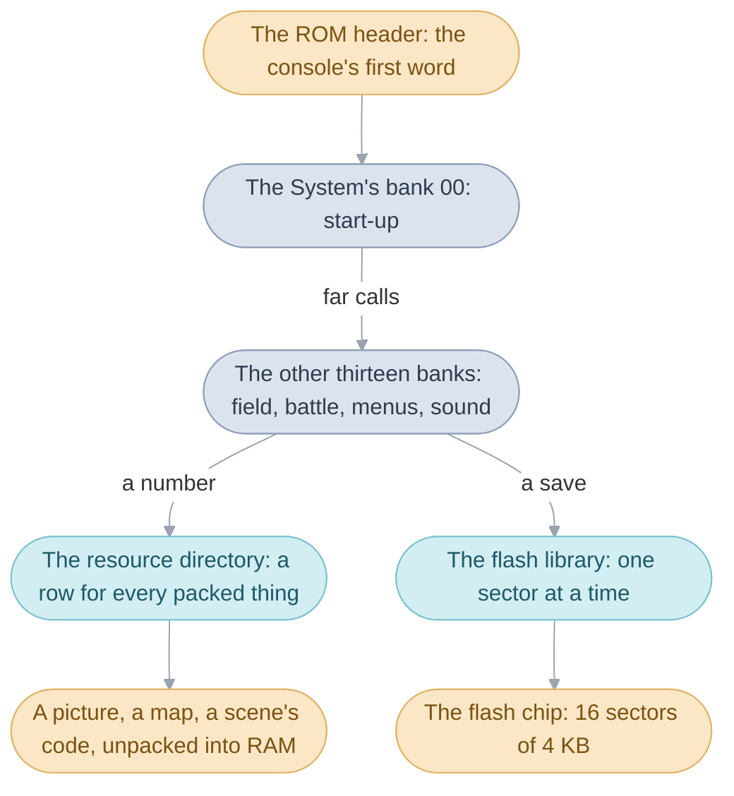
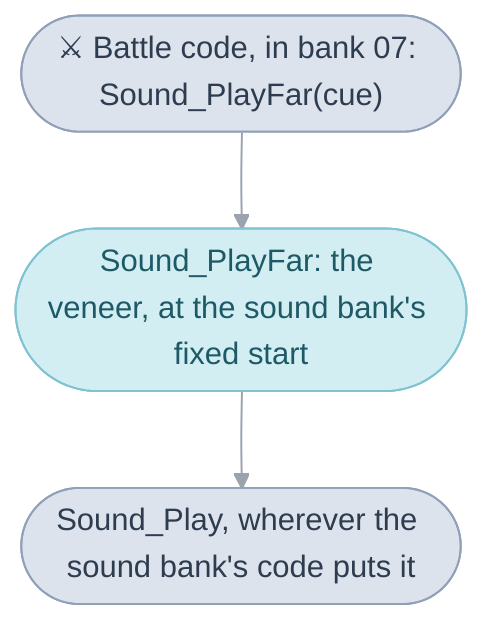
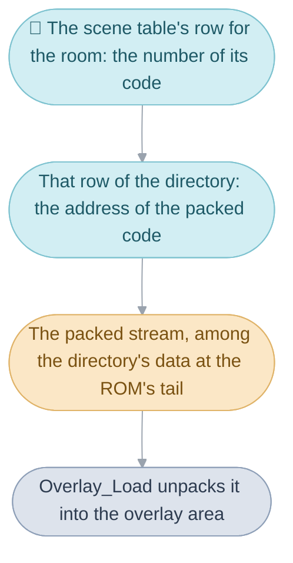
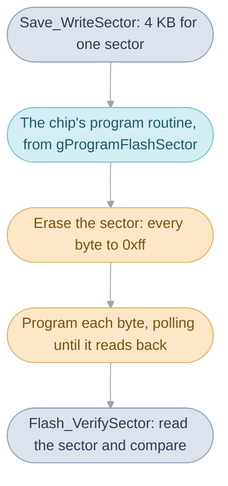
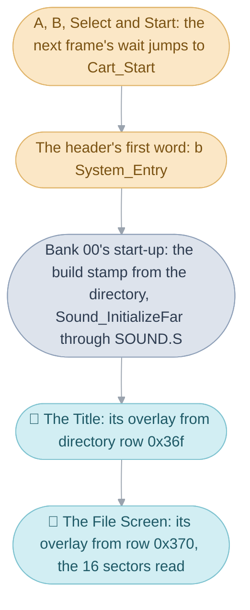

# The Game Pak


Switch the console on and the logos come up; walk into a house and the room
is there; save, switch off, and the save is still there the next day. Each of
those is the cartridge at work. The [Game Pak](../../glossary.md#game-pak) is
the cartridge as hardware: an 8 MB ROM that holds the whole game, and a small
flash chip beside it that the saves are written to. The console can read any
byte of the ROM at any moment, so most of the code runs from it directly, and
every picture, map, tune and piece of scene code is fetched from it when
needed. The files here are the four things that make the cartridge usable
from the code:

1. The ROM header, the block the console reads first, whose first word
   starts the game.
2. The [banks](../../glossary.md#bank) the code is cut into, and the
   [far-call](../../glossary.md#far-call) tables through which one bank
   reaches another.
3. The [resource directory](../../glossary.md#resource-directory), the one
   list through which a packed picture, map or piece of scene code is found
   by its number.
4. The [flash chip](../../glossary.md#flash-chip), 64 KB written in 16
   sectors of 4 KB, and the code that writes a save into it and reads it
   back.



The page takes the four in the order the console meets them, from the first
word it reads to the chip a save ends up in, and then follows one moment, a
restart of the game, through all four. What the game keeps in RAM, and how a
scene's code is unpacked there, is [System code](../system/README.md).

## The ROM header

The header is the first 192 bytes of the cartridge, a block the console reads
before it runs anything, with the game's first instruction at its very start.

When the console is switched on, its BIOS reads the cartridge's header,
checks it, draws the Nintendo logo it holds, and then jumps to the
cartridge's first word. That word is a branch to `System_Entry`, the start of
the [System](../../glossary.md#system)'s start-up code, and from there the
game runs ([System](../../system.md#start-up)). The rest of the header is
data the console checks: 156 bytes of the Nintendo logo, the game's title,
its four-letter game code, a maker code, a fixed byte and a complement check,
a sum over the title and the codes that the console checks.

The restart goes the same way. Pressing A, B, Select and Start together asks
for a reset, and the next [frame](../../glossary.md#frame)'s
[`wait()`](../../glossary.md#wait) jumps to the cartridge's first word, so
the game starts over from its header as if the console had just been
switched on.

The build writes the title and the codes from the source and leaves the logo
and the complement check empty; `tools/ags-header` fills both in on the
finished image, as [pret](../../glossary.md#pret)'s gbafix does, so no logo
bytes are kept in the source. The header is `Rom_Start` in `rom_header.s`,
the branch target
`System_Entry`, the edition's letter `gRom_LanguageCode`, and the restart's
jump `Cart_Start`, the fixed address the first word is at
(`include/gamepak/rom_header.h`).

| Field         | Value                                                    | Meaning                                                  |
| ------------- | -------------------------------------------------------- | -------------------------------------------------------- |
| first word    | `b System_Entry`                                         | the game's first instruction                             |
| logo          | 156 bytes                                                | the Nintendo logo the console draws; `ags-header` writes it |
| title         | `OugonTaiyo_A`, `Golden_Sun_A` or `GOLDEN_SUN_A`         | Japanese, English, or the other four languages            |
| game code     | `AGS` and `J`, `E`, `D`, `S`, `F` or `I`                 | the game, and the edition's language                     |
| maker code    | `01`                                                     | Nintendo                                                 |
| `Cart_Start`  | `0x08000000`                                             | where the cartridge begins; the restart jumps here       |

## Why the main image is cut into banks

The [main image](../../glossary.md#main-image) is the code the processor runs
straight from the cartridge, and it is laid out as fourteen banks, each
starting at a fixed address with room to spare after its code, so that one
bank can grow or shrink without moving anything another bank holds.

A bank is a stretch of the main image with a fixed start. The
[System](../../glossary.md#system)'s bank 00 comes first, then the field, the
windows, the game rules, the main routine and the field sequence, the menus,
the shops, the battle, the battle effects, the credits, the Title, Lucky
Dice, Lucky Wheels and the sound, bank 13. Every bank is always in place.
[Source](../README.md#banks-and-folders) lists
which folder holds each bank's code.

Code in one bank calls a function in another through a far call, which goes
to the function's [veneer](../../glossary.md#veneer) in the callee bank's
far-call table, the list at the bank's fixed start of one veneer for each of
its functions other banks call
([System](../../system.md#banks-and-far-calls) introduces them). Since the
table sits at the bank's fixed start, a caller's address for the veneer
stays right however the bank's code behind it moves: `Sound_PlayFar` is the
sound bank's veneer for `Sound_Play`, and the battle asks for its music by
calling it.



Bank 00 is the exception. The other banks call its functions directly, by
their plain names, and its table serves only the
[overlays](../../glossary.md#overlay), the scenes' code, which is unpacked
into RAM and reaches every bank through an
[import table](../../glossary.md#entry-table-and-import-table) of its own
([System
code](../system/README.md#how-an-overlay-reaches-the-rest-of-the-game)).

### A veneer

A veneer is 8 bytes: a load of the function's address into `r4`, a jump to
that address, and the address itself in the word after. It is the
`overlay_veneer` macro in `far_call/veneer.s`:

```asm
ldr r4, .Loverlay_target\@
bx r4
.balign 4
.Loverlay_target\@:
.4byte \target
```

It may overwrite `r4` because the game's own C is compiled with
`-fcall-used-r4` (the `Makefile` leaves the option off only for the sound
driver's and the flash chip's files), so no caller expects `r4` to survive a
call. The `bx` also
switches the processor to ARM when the target is ARM code, so the same veneer
reaches the ARM routines copied into
[IWRAM](../../glossary.md#iwram-and-ewram).

### The tables

Each bank's table is a file in `far_call/` named for the bank in capitals,
`SOUND.S` for the sound bank, and `far_call/table.inc` is every table's head.
A row is `export Sound_PlayFar, Sound_Play`: the veneer's name and its
target. A row no code calls by name stays in its place as a bare
`overlay_veneer` row, because the rows keep their order: an overlay's import
table holds the address of a row, so a row added in the middle would move
every row after it. The C declarations of each table's veneers are the
headers in `include/gamepak/far_call/`, one per table in the same order.

A fifteenth table, `SPRITE.S`, sits after the sound driver at the ROM's tail
rather than in a bank: its one row is `Resource_GetMetadataRecordFar`, the
lookup of a sprite's animations in the sprite bank
([Graphics](../graphics/README.md#sprites-and-their-animations)).

| Table               | Rows | Of them bare | Opens                                         |
| ------------------- | ---- | ------------ | --------------------------------------------- |
| `SYSTEM.S`          | 96   | 57           | bank 00, the System; only the overlays use it |
| `FIELD.S`           | 87   | 16           | bank 01, the field                            |
| `WINDOW.S`          | 134  | 35           | bank 02, the windows                          |
| `GAME.S`            | 100  | 14           | bank 03, the game rules                       |
| `FIELD_SEQUENCE.S`  | 192  | 47           | bank 04, the main routine and the field sequence |
| `MENU.S`            | 10   | 1            | bank 05, the menus                            |
| `SHOP.S`            | 14   | 0            | bank 06, the shops                            |
| `BATTLE.S`          | 39   | 9            | bank 07, the battle                           |
| `BATTLE_EFFECT.S`   | 9    | 0            | bank 08, the battle effects                   |
| `CREDITS.S`         | 1    | 0            | bank 09, the credits                          |
| `TITLE.S`           | 5    | 2            | bank 10, the Title                            |
| `LUCKY_DICE.S`      | 1    | 0            | bank 11, Lucky Dice                           |
| `LUCKY_WHEELS.S`    | 1    | 0            | bank 12, Lucky Wheels                         |
| `SOUND.S`           | 16   | 8            | bank 13, the sound                            |
| `SPRITE.S`          | 1    | 0            | the sprite bank, in the ROM's tail            |

The banks' starts differ by [edition](../../glossary.md#editions), since each
language's code is a different size; `main.ld` fixes them. In the English
edition bank 01 starts at `0x08009000`, bank 02 at `0x08015000`, bank 04 at
`0x0808a000`, bank 07 at `0x080b5000` and bank 13, the last, at
`0x080f9000`; the sound driver follows bank 13, the sprite bank starts at
`0x08185000` and the directory's data at `0x08320000`.

## The resource directory and table order


The resource directory is one table of addresses, a row for every packed
thing on the cartridge, so that code can ask for a picture, a map or a
scene's code by a number and get back where its bytes start.

When the party walks through that door, the
[scene table](../../glossary.md#scene) gives the room's code as a number, and
the number picks a row of the directory; the row holds the address of the
packed stream, and `Overlay_Load` unpacks it into the overlay area. Pictures,
maps, tilesets and the battle effects' sheets are found the same way: each
caller holds a number, looks up its row, and reads from the address the row
gives. A row is one word, and a resource's number is its position in the
table, so the lookup is one load and nothing more.



Since a number is a position, a row added or moved renumbers every row after
it. Code names a resource by a symbol, which follows a moved row, but in a
few places the numbers travel bare: the scene table names each scene's code
by its number, the maps are counted on from the first map's row
(`MapGrid_LoadMap`), and the settings menu's marker steps through eight
pictures from the first (`settings_menu.c`). The directory ends with 25 empty
rows that nothing reads, where a row fits without renumbering any other.

The rows run in groups. The first nineteen point at pieces of the main image
itself: the header, the directory, the build stamp (the twelve digits of the
edition's build time, below) and the far-call tables;
of these, start-up reads the build stamp's row, and the far-call rows are
passed only to stubs that do nothing with them (`Stub_NoOpHook`,
`Stub_ReturnZero`). Then come the windows' tiles and the small font, the
Title's pictures and logos, the 34 battle backgrounds, Lucky Wheels and Lucky
Dice, the battle effects' sheets and palettes, the field's default tables, the
World Map's tiles, the Colosso's paths, the menu cursor's eight pictures, the
Interface's icons, the 54 monsters, and then every tileset with its maps:
one row for each map drawn with it, then the set's palette and its sheets of
tiles, up to four, or, for a map that only recolours the set before it, its
row and a palette alone. The 96
overlays come last, in the order of their numbers, before the empty rows.

The directory is `Resource_DirectoryTable` in `resource_directory.s`, 1,000
rows, each written with one of its macros: `resource NAME, PLACE` for one row,
which defines `ResourceId_NAME` as the row's position, `group` for a run of
named rows, `tileset` and `recolor` for a map's rows, `overlays` for a run of
scene code, and `unused`. `Resource_GetTableEntry` reads a row, and
`Overlay_Load` unpacks a scene's code from the address it returns
([System
code](../system/README.md#how-an-overlay-reaches-the-rest-of-the-game)).

| Name                            | Value   | Meaning                                                  |
| ------------------------------- | ------- | -------------------------------------------------------- |
| a row                           | 4 bytes | the address of the resource's first byte                 |
| `ResourceId_NAME`               | the row's position | the number code asks for the resource by      |
| `ResourceId_BuildStamp`         | row 2   | the build stamp, read at start-up                        |
| `ResourceId_Map001`             |         | the first map; the maps are counted on from it           |
| `ResourceId_MenuCursorPictures` |         | the first of the settings menu's eight marker pictures   |
| the overlays                    | rows `0x36f` to `0x3ce` | the 96 scenes' code, in the scene table's numbering |
| empty rows                      | 25      | the last rows, which nothing reads                       |

### The build stamp

The build stamp is twelve digits that say when each edition was built, the
year, month, day, hour, minute and second, two digits each. Start-up copies
them into IWRAM (`System_CopyBuildStamp`), and nothing in the game reads the
copy again; the stamp is `Resource_BuildStamp`, and it is the one row of the
main image the directory is read for.

| Edition  | Stamp          | Built                         |
| -------- | -------------- | ----------------------------- |
| Japanese | `010628184502` | 28 June 2001, 18:45:02        |
| English  | `010918151347` | 18 September 2001, 15:13:47   |
| French   | `011219190202` | 19 December 2001, 19:02:02    |
| German   | `020109152237` | 9 January 2002, 15:22:37      |
| Spanish  | `020205181231` | 5 February 2002, 18:12:31     |
| Italian  | `020206164027` | 6 February 2002, 16:40:27     |

## The flash chip


The flash chip is the 64 KB of memory on the cartridge that keeps a save
after the power goes, and the library here is the code that erases, writes
and reads it, for whichever maker's chip the cartridge holds.

A flash chip is written in sectors: 16 of them, 4 KB each, and a sector must
be erased, every byte set to `0xff`, before it is written. Writing is slow and
a byte at a time, and the chip answers commands written to two fixed places
within it rather than plain stores, so the library talks to it in command
sequences and then waits, polling a byte until it reads back what was written.
The chip appears in the console's memory at `FLASH_BASE`, `0x0E000000`, and
its command addresses are `0x5555` and `0x2AAA` into it.

Each of the three save [files](../../glossary.md#file-and-part) is two parts,
each part one sector, and a new copy of a part is written into a free sector
before the old one is given up, so that a power cut never loses a save. How
the sectors are chosen and read back is
[Saving](../system/README.md#saving); the library's part is the chip itself.

### Finding out which chip the cartridge holds

Cartridges were built with chips from four makers, SST, Atmel, Macronix and
Panasonic, and each wants its own command sequences and its own waiting
times, so the library asks the chip who made it before every save, load,
copy or delete. `IdentifyFlash` puts the chip into its identification mode,
reads its maker and device codes, and picks the matching entry of
`gFlash_Chips`, which holds the chip's three routines, to program a sector,
erase a sector and erase the chip, its wait routine, its time limits and its
sector size. A chip no entry matches gets the last entry, `gFlash_ChipDefault`,
SST's routines with an id of 0, and the caller is told. The save code asks up
to eight times, a frame apart, before it reports that no chip answered
(`Save_InitializeWork`).

| Chip      | Id       | Program a sector                      | Program limit | Sector erase limit | Chip erase limit |
| --------- | -------- | ------------------------------------- | ------------- | ------------------ | ---------------- |
| SST       | `0xd4bf` | erase, check it is blank, erase again, then the bytes | 10 ms | 40 ms        | 200 ms           |
| Atmel     | `0x3d1f` | 32 small sectors of 128 bytes, each in one command | 40 ms | 40 ms, by writing `0xff` | 40 ms      |
| Macronix  | `0x1cc2` | erase, then the bytes                 | 10 ms         | 2,000 ms           | 2,000 ms         |
| Panasonic | `0x1b32` | erase, then the bytes                 | 10 ms         | 500 ms             | 500 ms           |
| any other | `0`      | SST's                                 | 10 ms         | 40 ms              | 200 ms           |

### Writing a sector

Writing a sector is erasing it and then programming its 4 KB one byte at a
time, each byte polled until it reads back, and the save code reads the
sector again afterwards to check it.

`Save_WriteSector` calls the chip's program routine through
`gProgramFlashSector`, the cell `IdentifyFlash` filled in. For a Macronix or
Panasonic chip that is `ProgramFlashSector`: erase the sector, then for each
byte send the program command and the byte and wait for it to read back
(`EraseFlashSector`, `ProgramFlashByte`). The SST routine,
`ProgramFlashSectorWithEraseRetry`, erases and then checks that every byte
reads `0xff`, trying up to 81 times, and then erases the sector again, once
when the first try was blank and six times when a try had failed, before
programming it. The Atmel chip has 512 sectors of 128 bytes of its own, and
its routine, `ProgramAtmelFlashBlock`, programs the 4 KB as 32 of them, each
in one command with interrupts off, trying each twice. Whichever chip it is,
`Flash_VerifySector` then compares the sector with the 4 KB it was written
from, and the save counts only when they match.



While the flash code works it sets the save area's wait, the low two bits
of `REG_WAITCNT`, to the chip's own, and puts the usual wait,
`WAITCNT_SRAM_8`, back when it is done. A routine reports 0 when the sector is
written, or an error code: `0x80ff` for a sector number above 15, `0xc001`,
`0xc002` or `0xc003` when a byte, a sector erase or a chip erase did not come
through in time, and `0x8004` when an SST sector would not read blank.

### Waiting for the chip

Every wait on the chip is the same routine, `WaitForFlashWrite`: it polls one
byte of the chip until it holds the value expected, under a time limit kept
by a hardware timer, so that a chip that never answers cannot hang the game.

The polling runs from RAM. The library copies its one-byte reader,
`ReadFlashByte`, into a buffer on the caller's stack
(`CopyFlashReadRoutineToRam`) and reads through that copy, so the cartridge
can be polled while the chip is busy with a write; the reader is good only
until that caller returns. The limit comes from the chip's time table: timer
2 is set to interrupt about once a millisecond (`StartFlashTimer`, an
interrupt every 67 timer counts of 256 cycles), `FlashTimerIntr` counts the
milliseconds down, and when they run out the wait makes one last read before
giving up; a Macronix chip is then sent its reset command. The save code hands
the timer to the library once, with `SetFlashTimerIntr`, when it sets up.

The library is `flash.c`, `sst.c`, `atmel.c` and `program_flash_sector.c`,
with the chips' tables in `flashsst.s`, `flashat.s`, `flashmx.s` and
`flashtab.s`, each entry in `flashset.s`'s `flash_setup` form. It is compiled
with `old_agbcc` ([The compilers](../../glossary.md#the-compilers)), the
`FLASH_C` route of the `Makefile`, and its version string is `FLASH_V123`.
Four of its cells hold the credits' state while the credits roll, since no
save runs then and `IdentifyFlash` sets them again before the chip is next
used ([Menus](../menu/README.md#taking-over-the-display)).

| Name                            | Value     | Meaning                                                  |
| ------------------------------- | --------- | -------------------------------------------------------- |
| the chip                        | 64 KB     | 16 sectors                                               |
| a sector                        | 4 KB      | one part of a save file                                  |
| `FLASH_BASE`                    | `0x0E000000` | where the chip appears in memory                      |
| `SAVE_FLASH_IDENTIFY_ATTEMPTS`  | 8         | tries to identify the chip, a frame apart                |
| `SAVE_FLASH_TIMER`              | 2         | the hardware timer the waits are kept by                 |
| an Atmel small sector           | 128 bytes | 32 to a 4 KB sector                                      |
| SST erase tries                 | 81        | erases and blank checks before giving up                 |
| `Flash_Version`                 | `FLASH_V123` | the library's version string                          |

## From the restart to the File Screen


Pressing A, B, Select and Start together in Vale brings the logos back, and
behind them the File Screen with the saved files. Each step of it is the work
of one of the four parts of the Game Pak.



### The first word

The keypad interrupt sees the four keys held and asks for a reset
(`Input_HandleKeyInterrupt`), and at its next frame `wait()` jumps to
`Cart_Start`, the cartridge's first word. That word is the header's
`b System_Entry`, so the processor lands in bank 00's start-up and the old
game is gone.

### Start-up reads the directory and calls a bank

`System_Initialize` copies the resident code into IWRAM, then reads the
directory for the one row of the main image it needs: `System_CopyBuildStamp`
asks `Resource_GetTableEntry` for `ResourceId_BuildStamp` and copies the
twelve digits. Then it starts the sound driver with `Sound_InitializeFar`, a
far call: bank 00 calls bank 13 through the row of `SOUND.S` that names it.
Last it calls `MainRoutine_RunFar`, the second row of `FIELD_SEQUENCE.S`, and
the main routine sets the Title as what runs next.

### The Title and the File Screen come from the directory

The main routine loads the Title's code: `Scene_LoadOverlay` takes the
scene table's number for the Title, `0x36f`, and `Overlay_Load` reads that
row of the directory and unpacks the stream at its address into the overlay
area. The Title shows the logos, and when it ends the File Screen's overlay
comes the same way from row `0x370`. Each overlay calls back into the banks
through its import table, whose rows hold the addresses of the far-call
tables' veneers.

### The File Screen reads the chip

To list the files, the File Screen calls `Save_ScanFileSummaries`, which
opens the save workspace with `Save_InitializeWork`: it hands timer 2 to the
library and asks `IdentifyFlash` which chip the cartridge holds, and then
reads all 16 sectors with `ReadFlash`, each through a reader copied into RAM,
to find the newest copy of each part. The three files on the screen are
what those sectors held.

### The same moment, mechanism by mechanism

| Step                                     | Mechanism                                                  |
| ---------------------------------------- | ---------------------------------------------------------- |
| The keys restart the game                | the header: `Cart_Start`, the first word, `b System_Entry` |
| The build stamp is copied                | the resource directory, read for `ResourceId_BuildStamp`   |
| The sound driver starts                  | a far call from bank 00 into bank 13 through `SOUND.S`     |
| The main routine starts                  | a far call into bank 04 through `FIELD_SEQUENCE.S`         |
| The Title's code arrives                 | the directory's row `0x36f`, unpacked by `Overlay_Load`    |
| The Title calls the banks                | its import table, pointing at the far-call tables' veneers |
| The chip is identified                   | the flash library, `IdentifyFlash` and `gFlash_Chips`      |
| The files are listed                     | the flash library, `ReadFlash` over the 16 sectors         |

## Design

A call can reach every bank from every other, since a Thumb `bl` spans 4 MB
and the main image is under 1 MB; the banks exist so that a bank can grow
without moving an address another bank holds, and each language's edition
fixes its own starts for the same reason. The overlays pay for the same
independence with two veneers per call, their own and the bank's.

The directory keeps every lookup to one load by making a resource's number
its position, and pays for it with the renumbering that a moved row causes;
the 25 empty rows at the end are the room that leaves.

The flash library is written for chips it has never seen: it identifies the
chip at every use, carries a default for a chip it cannot name, times every
wait with a hardware timer, and reads the sector back after writing it, so a
cartridge with any of the four makers' chips, or a chip that answers slowly,
still keeps its saves.

## How it fits with the rest of the game

The header hands the console to the [System](../../system.md#start-up), whose
bank 00 the other banks call directly; every other bank is reached through
its table here, and every overlay through its import table and then these
tables. Code everywhere loads its pictures, maps and scene code through the
resource directory, and [saving](../system/README.md#saving) writes each part
of a file through the flash library.

## Limits

- A bank has the space up to the next bank's fixed start.
- A far-call table's rows keep their order: a row added in the middle would
  move every veneer after it.
- The resource directory ends with 25 empty rows nothing reads; a row added
  anywhere else renumbers every row after it.
- 16 flash sectors of 4 KB; a sector number above 15 is refused with
  `0x80ff`.
- A flash wait gives up after the chip's time limit, from 10 ms for a byte to
  2,000 ms for a Macronix erase.

## Words used here

- **far-call table**: the list of veneers at a bank's fixed start, one row
  for each of its functions other banks call, in a fixed order.
- **row**: one entry of a far-call table (8 bytes, a veneer) or of the
  resource directory (4 bytes, an address).
- **sector**: one of the flash chip's 16 stretches of 4 KB, erased and
  written as a whole; an Atmel chip's own sectors are 128 bytes.
- **program**: the flash chip's word for writing bytes into an erased
  sector; the chip's program routine is the one `IdentifyFlash` installs.
- **build stamp**: the twelve digits of an edition's build time, a row of the
  directory read at start-up.

## Evidence

The folder is named for Nintendo's word for the cartridge, the Game Pak, as
GBATEK writes "GamePak ROM", "GamePak SRAM" and "GamePak Waitstates". The
far-call tables are named for the bank they open, the veneers for their
target with `Far` added, and the overlays by their directory number. The flash
library's files are named for the chip makers (`flashat`, `flashmx`,
`flashsst`) or in plain English (`flash`, `program_flash_sector`); its routine
names and `gFlash_ChipDefault` follow pret's agb_flash, whose DefaultFlash
is the same last entry.

What the ROM leaves open, why the directory's first nineteen rows point at
the main image and whether its empty rows were kept for later resources, why
the SST routine erases a sector that already reads blank, and why the other
banks call bank 00 directly, is noted at the code it is about, in
`resource_directory.s`, `sst.c` and `SYSTEM.S`.
