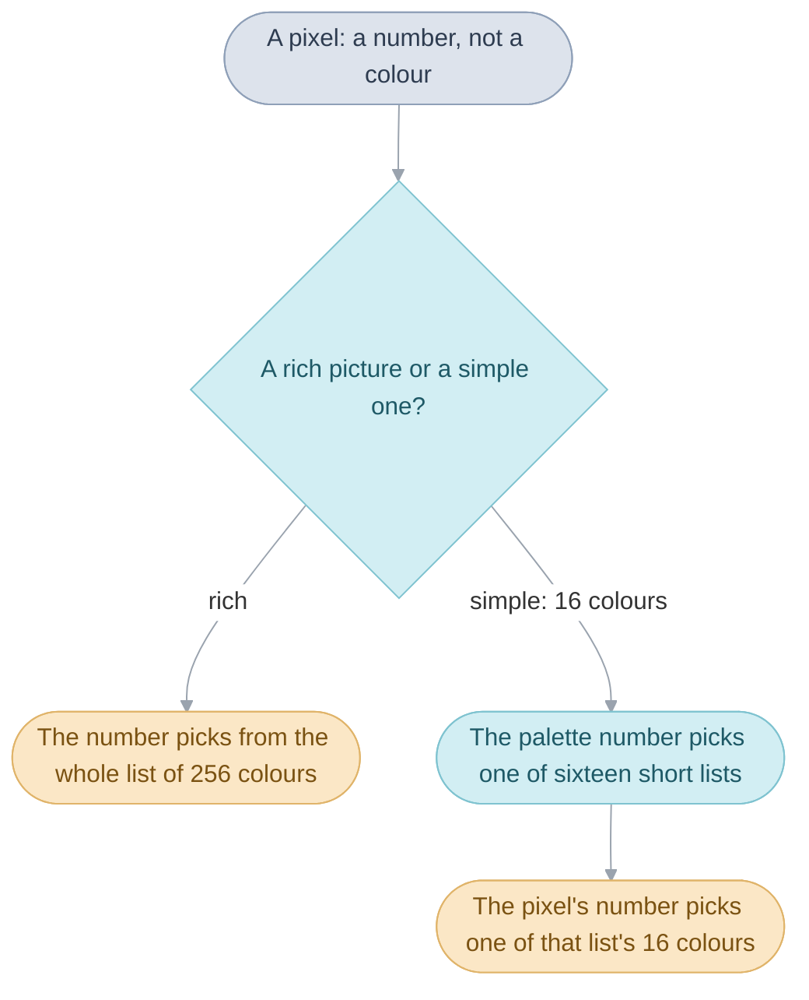
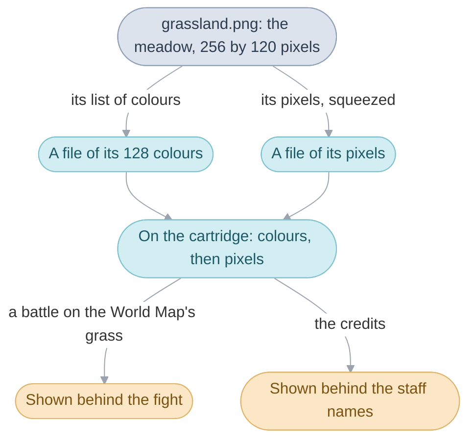
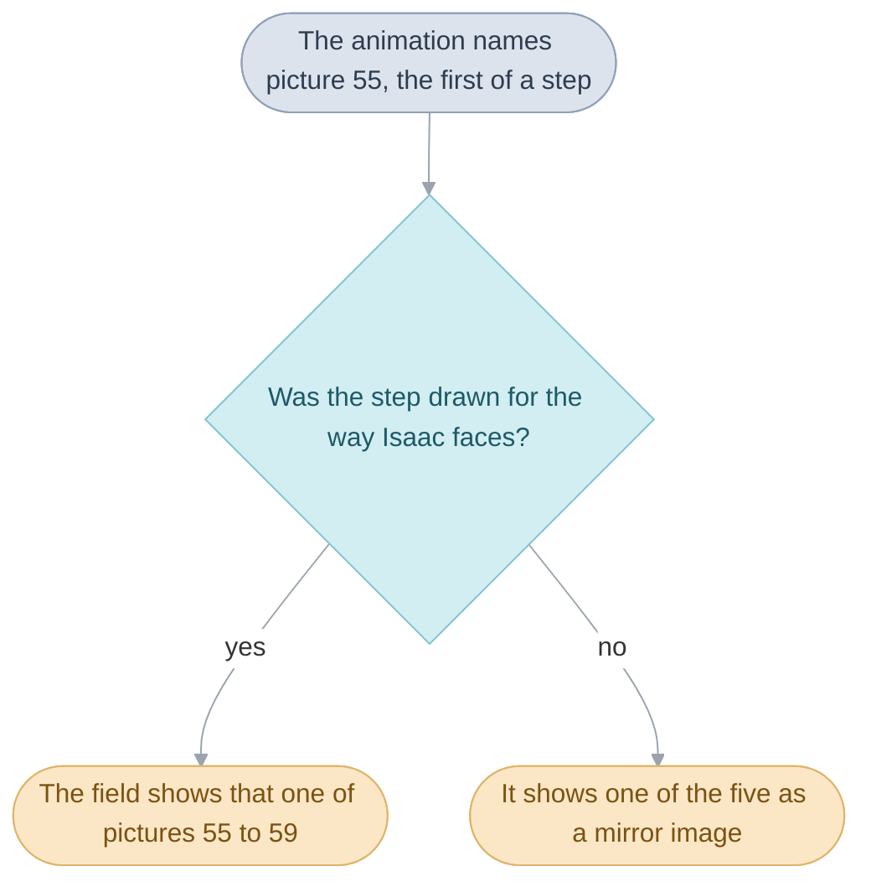
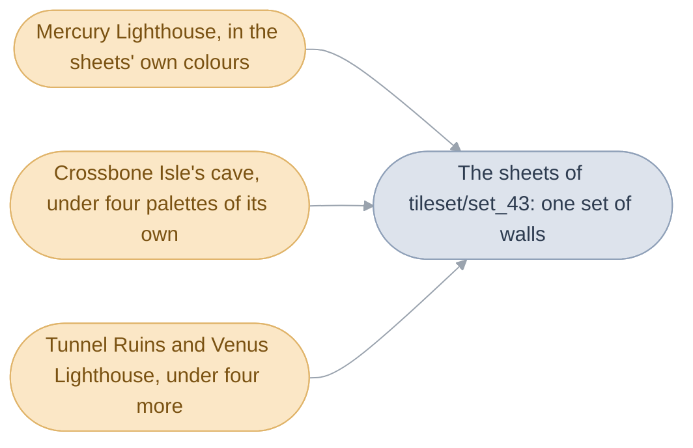
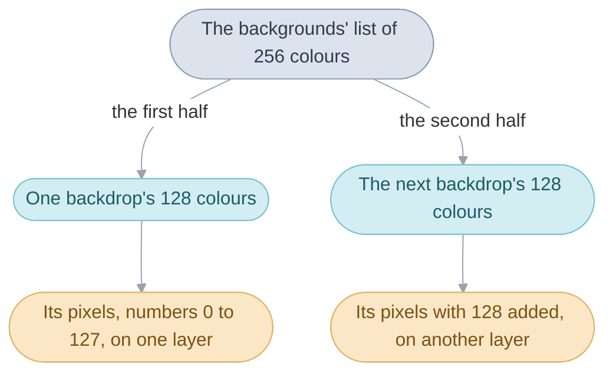

# Graphics


Get into a fight on the open grass of the World Map and there is a meadow
behind it: bright grass, hazy hills and a big leafy tree.

That meadow is a single picture, and you can open it. It is the file
`battle_backgrounds/grassland.png` in this folder. A PNG is an ordinary
picture file, the kind any image editor opens.

Everything the player sees is kept this way. The clouds and the mountain of
the title intro are pictures here. So are the pieces Vale is built from,
Isaac and everyone he meets, the Skeleton, and the letters of every message. The
folder holds 2,107 PNG files.

The cartridge does not hold PNGs, though. It holds each picture in a shape
the console can draw from, usually squeezed small to save room.

Turning the one into the other is part of building the game. Building is
what this project does on a computer today: a set of small programs reads
every file here and produces a copy of the cartridge. So a PNG that is
changed before a build is changed in the game that comes out.

This page follows a picture from the PNG to the screen:

1. [How the console draws a picture](#how-the-console-draws-a-picture): a
   list of colours and a set of small squares.
2. [How an image is built and placed](#how-an-image-is-built-and-placed): the
   meadow's trip from its PNG into the game.
3. [Sprites and their animations](#sprites-and-their-animations): how Isaac
   walks.
4. [Tilesets](#tilesets), the sheets of squares the towns and dungeons are
   built from.
5. [Backdrops, monsters, effects and fonts](#backdrops-monsters-effects-and-fonts).
6. [The credits](#the-credits), which borrow the battle's pictures.

The page ends with notes [for readers of the code](#for-readers-of-the-code).

## How the console draws a picture


Watch the title intro fade in. The clouds, the mountain and the sun all
brighten together, out of a dark red. The fade takes a second, and it never
touches a dot of the picture.

It can do that because of how the console stores a picture. The screen is a
grid of dots, called pixels, 240 across and 160 down. A picture does not
store a colour for each pixel. It stores a number, and a separate list says
which colour each number stands for. That list is the palette.

Think of painting by numbers. The picture is the outline with a number in
every patch, and the palette is the row of paint pots. Swap the pots and the
whole painting changes colour, though nobody has touched the outline.

That is the fade. Every pot starts as the same dark red, and for 60
[frames](../../glossary.md#frame), one second, each is stirred a little
closer to its proper colour
([Menus](../menu/README.md#the-title-intros-own-palette-fade)). The field's
[palette fade](../../glossary.md#palette-fade) brings a town in the same way.

The console has room for 256 colours for its backgrounds and another 256 for
its sprites. A colour is mixed from red, green and blue, each at one of 32
strengths.

A picture uses that room in one of two ways. A rich picture, like the title
intro's mountain, has numbers that run over the whole list of 256, though it
need not use them all. The meadow uses 128, half the list.

A simple picture makes do with 16 colours. The list of 256 is cut into
sixteen short lists of 16, and a
[palette number](../../glossary.md#palette-number) beside the picture says
which short list it uses.



### Tiles

A picture's pixels are not stored as one big sheet either. They are cut into
squares of 8 by 8 pixels, called tiles.

The console draws its
[background layers](../../glossary.md#background-layer), the flat sheets a
town or a title screen is made of, as grids of tile numbers
([How the console draws a picture](#how-the-console-draws-a-picture)). A tile is stored once and can
be named in the grid as often as the artist likes. One square of grass can
cover a whole field.

A [sprite](../../glossary.md#sprite-and-oam) is a small picture the console
can put anywhere on top of the layers: Isaac, a chest, a letter of text. It
is a block of tiles, from one tile up to 8 by 8 of them, which is 64 pixels
on a side. The game also uses the word for a whole figure with all its
poses, so Isaac is a sprite, and so is the Skeleton.

So on the cartridge a picture comes down to two things: its colours and its
tiles.

## How an image is built and placed

Take the meadow again. `battle_backgrounds/grassland.png` is 256 pixels wide
and 120 tall, and it uses 128 colours.

It is a special kind of PNG, the paint-by-numbers kind. Each pixel in the
file is a number, and the file carries its own list of colours. That is
exactly what the console wants. So an image editor shows the meadow as the
game does, and repainting a patch of grass in the PNG repaints it in the
game.

There is one rule to mind. The console has only 32 strengths of red, green
and blue, so the PNG may only use colours the console can show. A colour in
between is refused when the game is built, so that a colour never quietly
comes out as a different one.

### From the PNG to the cartridge

When the game is built, the meadow is split in two. Its list of 128 colours
goes into one file. Its 30,720 pixels go into another, squeezed to a little
over half their size. Both are put on the cartridge side by side, the
colours first.



### How the game finds a picture

The game finds a picture in one of two ways.

Some pictures are always shown by the same part of the game. The letters of
a message are only ever drawn by the part that makes the text boxes, which
the game calls windows. So that part knows where its font is and goes
straight to it.

Other pictures are chosen while the game runs. Which backdrop a battle needs
depends on where the party is standing. For those, the cartridge carries a
numbered list of everything packed on it, the
[resource directory](../../glossary.md#resource-directory)
([The Game Pak](../gamepak/README.md#the-resource-directory-and-table-order)).
The meadow has a number in that list, and a battle on the World Map's grass
asks for that number.

### Pictures that change with the language

A picture with words in it is drawn once for each language that needs its
own. `title/to_be_continued.png` has German, Spanish, French and Italian
versions beside it, `to_be_continued_de.png` and so on. Each of those
[editions](../../glossary.md#editions) of the game is built with its own.

## Sprites and their animations


Walk Isaac across Vale. His legs go through six poses, over and over, and it
looks like walking.

All of Isaac is in one file, `sprite/spr_000.png`. It is a tall strip, one
[picture](../../glossary.md#picture) wide: 32 pixels across and 6,720 down.
That is 210 pictures of Isaac, each 32 pixels square, stacked from top to
bottom. Standing, walking, running, nodding and pushing are all somewhere
down the strip.

A strip like this is called a sheet.

### How Isaac walks

Beside the sheet is a small file of plain text, `spr_000.tsv`, and each line
of it is
one [animation](../../glossary.md#sprite-animation): a list of which
pictures to show and for how long. Isaac's walk is the third line:

```
picture 55 6, picture 30 6, picture 35 6, picture 40 6, picture 45 6, picture 50 6, loop
```

`picture 55 6` means: show picture 55 for 6 frames. Six pictures at 6 frames
each make 36 frames, a little over half a second, and `loop` starts the list
again. That is one full stride.

His run is the same idea played faster. It has six pictures too, but each
stays for 4 frames.

### Why the numbers go up in fives

The walk uses pictures 55, 30, 35, 40, 45 and 50. Nothing in between is ever
named, and that is on purpose.

Isaac can face any way, and each pose was drawn five times, once for each of
five directions. Picture 55 is really pictures 55 to 59: the same step seen
from five sides. So the six steps of the walk fill pictures 30 to 59, and
the cycle simply begins on the last of them.

The animation names the first picture of a step. The field, the part of the
game that runs the towns and dungeons, then picks one of the five to match
the way Isaac is facing. For a direction nobody drew, it shows one of the
five as a mirror image
([Field code](../field/README.md#sprites-and-their-animation)).



So the list is written once, as if Isaac always faced one way, and it works
for every direction.

### The other commands

An animation is built from a handful of commands:

| Command        | What it does                                             |
| -------------- | -------------------------------------------------------- |
| `picture 55 6` | shows picture 55 for 6 frames                            |
| `wait 6`       | holds the current picture 6 frames longer                |
| `blank 6`      | shows nothing for 6 frames                               |
| `loop`         | starts the animation again                               |
| `play 1`       | switches to animation 1                                  |
| `hold`         | stays on the last picture                                |
| `kind 17`      | changes the rule for which way a picture faces           |

Isaac's nod shows `play` at work:

```
picture 60 2, picture 65 6, picture 70 8, play 1
```

Three pictures, 16 frames, and then `play 1` hands over to animation 1, which
is Isaac standing. He nods once and goes back to standing.

`kind` changes the five-directions rule. The game has a few such rules,
each with a number, for figures drawn from one side, two sides and so on.
No rule has the number 17, and that is the point of it: with no rule, the
picture named is shown exactly as drawn, whichever way Isaac faces. Some of
his poses were drawn only once, pictures 135 to 143 among them, and the
animations that use them begin with `kind 17`.

### The sprite table

Every figure the field and the battle draw has a number, and Isaac's is 0.
Garet is 1, Ivan 2, Mia 3.

The table that holds them all is the sprite table. For each number it gives
the figure's size, its pictures and its animations. To draw anyone, the
field or the battle looks a number up in it. The table has 367 figures.

One of them differs by language. Sprite 21 is the little bubble that pops up
over someone's head, with a heart or an exclamation mark in it. The Japanese
and Italian editions each have a sheet of their own for it.

## Tilesets


Vale is a big place, far bigger than the screen. Nobody painted it as one
picture. It is put together from small squares: a patch of grass, a corner
of roof, a piece of fence.

Those squares, with their colours, are a
[tileset](../../glossary.md#tileset). The [map](../../glossary.md#map) is
the plan that says which square goes where
([Maps](../map/README.md#cells)).

A tileset is a folder here, `tileset/set_00/` to `tileset/set_68/`. Most
hold five pictures:

- `palette.png`, the colours: 14 short lists of 16, out of the sixteen the
  backgrounds have.
- `tiles_a.png`, `tiles_b.png` and `tiles_c.png`, three sheets of tiles for
  the map's layers to draw from. A sheet is 256 pixels by 128, which is 512
  tiles.
- `tiles_d.png`, in most folders a sheet of spares. A map can swap a few of
  its tiles for
  others on a timer, which is how Vale's waterfall keeps falling, and the
  spares are what it swaps in
  ([Maps](../map/README.md#tileset-animation-and-blend-scripts)).

### Maps share their tiles

A map does not name a tileset as a whole. It names five things, one by one:
a palette, three sheets and a sheet of spares.

That lets maps borrow from each other. Many maps name exactly the same five.
Others take two sheets from one folder and the third from another. Some
folders hold a single sheet, because the maps that use it take the rest
from somewhere else.

So the game's 182 maps are drawn from just 69 folders of tiles.


The cheapest borrowing of all is to take another map's tiles and bring only
new colours. It is the painting by numbers again: same outlines, different
pots.

The walls and pillars of Mercury Lighthouse are well traveled. They are
`tileset/set_43/`, and Mercury Lighthouse uses them in their own colours.

Crossbone Isle's cave then uses the very same sheets. Its rooms with the ice
pillars, the keys, the statues and the Djinni Bane each name those sheets
and a palette of their own, four palettes in all. The room of keys and
Bane's room are even the same plan: one map, shown in two sets of colours.

Tunnel Ruins and Venus Lighthouse use the sheets again, under four more
palettes. One set of walls was drawn, and it comes out in nine colour
schemes across four places.



A palette that comes with no tiles of its own is a small PNG in
`tileset/palettes/`. There are 54 of them.

When the party walks into a map, the game unpacks its palette and its
sheets for the console to draw from
([Maps](../map/README.md#loading-a-map)).

## Backdrops, monsters, effects and fonts

The remaining pictures are each shown by one part of the game, and each kind
has a folder named for what it is.

### Battle backgrounds


A [battle background](../../glossary.md#battle-background), or backdrop, is
the picture behind a fight. There are 34 in `battle_backgrounds/`, each
named for where
it is used: `grassland.png`, `goma_cave.png`, `sol_sanctum.png`. The battle
picks one by where the party was standing when the fight began.

All 34 are the same size as the meadow, 256 by 120 pixels, and all use 128
colours, a number [the credits](#the-credits) depend on.

A backdrop is not cut into tiles the way a town is. Its pixels are stored
one after another, row by row.

The battle draws it on a layer the console can zoom
([Battle code](../battle/README.md#the-zoomed-battlefield)).

### Monsters


A [monster](../../glossary.md#monster) is a sprite like Isaac, with a number
in the sprite table and a list of animations. Only its pictures are kept
apart, in `monster/`.

`monster/skeleton.png` is a strip of twelve pictures, each 64 pixels square.
They are six poses, and each pose was drawn twice: once from the front, with
the skull looking out at you, and once from behind.

That is how a battle's swinging camera works for a monster. The Skeleton's
animations name only the first picture of each pair. The battle shows that
one or the one after it, depending on which side the camera sees the
Skeleton from.

One of its animations reads:

```
picture 6 10, picture 8 6, hold
```

Picture 6 is the Skeleton with its sword raised, and picture 8 is the swing.
`hold` leaves it there, leaning into the blow.

There are 54 strips in `monster/`, and far more than 54 kinds of enemy. The
battle's list of enemies has 172 rows, and several rows can name the same
strip. Three rows use this one, each with a different palette: the
Skeleton, the Bone Fighter and the Skull Warrior. One set of drawings does
for the whole family.

### Battle effects


The flashes, blasts and beams of a battle are pictures too, in
`battle_effects/`.

An effect's pictures are often different sizes, so a strip will not do. Each
picture is a PNG of its own, numbered in order. `blast_00.png` is 16 pixels
square, `blast_01.png` is 32, and `blast_02.png` is 48: a blast growing.

[Battle effects](../battle_effect/README.md) says how an effect plays them.

### Fonts


Every letter in a text box is a picture as well. The English letters are
all on one sheet, `font/text.png`. It is black and white, with one letter in
each square of 16 by 16 pixels, 224 squares in all.

Letters are not all the same width. Beside the sheet, `text.tsv` gives each
one's width in pixels: 3 for a small `i`, 9 for a small `m`, 10 for a
capital `W`. A letter takes only the room it needs, which is why the game's
text looks set like a book and not like a typewriter
([Windows](../window/README.md#drawing-text)).

Each language has its own sheet and widths. The Japanese sheet is longer,
352 squares, because a second set of squares after the first
holds the kanji.

The credits have a small font of their own, with letters 8 pixels tall, and
the menus write their numbers in another.

### Everything else

The windows' borders, the menus' icons and cursors and the pointing hand are
in `ui/`. The Title's pictures are in `title/`.

A place that shows a picture nowhere else uses keeps it in a folder named
for the place, such as `lamakan_desert/` for the desert's heat gauge.

The glossary lists every folder with what it holds
([Graphics folders](../../glossary.md#graphics-folders),
[Places and minigames](../../glossary.md#places-and-minigames)).

## The credits


After the ending, the staff names roll up the screen. Behind them are the
places the party fought in all game long, each melting into the next: Vale
in the storm, Sol Sanctum's hall, then the meadow.

The credits have no pictures of their own for this. They borrow the battle
backgrounds, 32 of the 34.

For one picture to melt into another, both must be on screen at once. That
is where the 128 colours pay off. Two backdrops need two times 128 colours,
which is 256, exactly what the backgrounds have.

So the credits put one backdrop's colours into the first half of the
list and the next backdrop's into the second half. A backdrop's pixels are
numbers from 0 to 127, so the credits add 128 to every pixel of the second
picture. Now its numbers point at the second half, its own colours.



Each backdrop gets a layer to itself, and the console fades from one layer
to the other. [Menus](../menu/README.md#the-credits) follows the whole roll,
names and all.

## Design

Every picture is kept the way an image editor shows it, in its real colours.
Isaac's sheet is one Isaac wide. So repainting him in `sprite/spr_000.png`
and building the game is all it takes to change him in every town.

## How it fits with the rest of the game

Each part of the game comes here for its own kind of picture, and the code
that shows it lives with that part. [Maps](../map/README.md) take their
tiles, [Field code](../field/README.md) the people,
[Battle code](../battle/README.md) the backdrops and monsters,
[Battle effects](../battle_effect/README.md) the flashes and blasts,
[Windows](../window/README.md) the letters, and [Menus](../menu/README.md)
the title intro and the credits.

The game's music and sounds are kept the same way, as files an ordinary
program can open ([Sound](../sound/README.md#the-sound-driver)).

## Limits

- A sprite is at most 64 pixels on a side. The Skeleton's pictures are
  exactly that, and nothing drawn as one sprite can be bigger.
- A map draws from three sheets of 512 tiles, plus its spares.
- An animation can name pictures 0 to 238. Isaac's sheet has 210.

## Words used here

- **sheet**: a PNG holding many tiles or pictures, such as Isaac's strip of
  210.
- **sprite table**: the one table of every figure's size, pictures and
  animations.
- **backdrop**: a [battle background](../../glossary.md#battle-background).
- **form** and **codec**: how a picture is laid out and how it is squeezed
  on the cartridge ([below](#the-forms-a-picture-takes)).

## Evidence

The folder's name is from the credits, which list the artists who drew these
pictures under `Graphic Arts`. The glossary gives the source of each
folder's name under [Graphics folders](../../glossary.md#graphics-folders)
and [Places and minigames](../../glossary.md#places-and-minigames).

## For readers of the code

These notes are for someone with the folder open.

A short file in each folder places its packed pictures on the cartridge and
gives each a name the code can use. `battle_backgrounds.s` puts the meadow's
colours first and its pixels straight after, under the one name
`Battle_GrasslandBackdrop`. A tileset is the exception: it is placed by the
file of a map that uses it, right after that map.

The sprite table is built from `sprite/sprites.tsv` and every sheet and
animation file. It has 512 numbered places, of which 367 are filled. In an
animation, the numbers from 239 up are how the commands are stored, which
is why pictures stop at 238.

The text font's widths are in `font/text.tsv`, the credits' font is
`credits/font.png`, and the menus' small one is `ui/small_font.png`.

### The forms a picture takes

Next to each PNG the build leaves the packed file made from it, and the
endings of its name say how it was packed. The meadow becomes
`grassland.gbapal`, its colours, and `grassland.bitmap.d7`, its pixels: 30,720
of them in 17,012 bytes. A byte is the unit a cartridge's room is counted
in, and unsqueezed a pixel of the meadow takes one.

The first ending is the form: the layout the pixels are stored in.

| Form             | What it holds                                   | An example                                 |
| ---------------- | ----------------------------------------------- | ------------------------------------------ |
| `gbapal`         | a palette alone                                 | the meadow's 128 colours                   |
| `4bpp`, `8bpp`   | tiles in 16 or 256 colours                      | a tileset's sheets, the World Map          |
| `bitmap`         | the pixels as they are, row by row              | the battle backgrounds, single effects     |
| `bitmaps`        | a run of pictures of differing sizes            | the growing blast                          |
| `pictures`       | a strip of pictures of one size                 | the Skeleton                               |
| `font`           | letters: each one's width and its rows of dots  | `font/text.png`                            |
| `parts`          | several pictures of mixed forms in one file     | the title intro's sun                      |
| `spriteblocks`   | every sprite's size, sheet and animations       | the sprite table                           |

The second ending is the codec: the way the file is squeezed. A file with no
second ending is not squeezed at all, like the windows' borders, which the
game reads straight off the cartridge.

| Codec | How it saves room                                                | Used for                           |
| ----- | ---------------------------------------------------------------- | ---------------------------------- |
| `lz`  | a run of bytes already seen is written as "copy that again"      | the general one                    |
| `plz` | the same idea, written out a little differently                  | the menus' titles, the Title       |
| `mtf` | keeps the 16 colours in order of last use, so a colour used again soon costs little | the tilesets' sheets |
| `d7`  | writes each pixel as its difference from the one before          | the battle backgrounds             |
| `hlz` | `lz`, copying two bytes at a time                                | one small picture                  |

Most forms are built from a PNG. A few are built from a small text table, a
`.tsv` file, because a list of parts is not something a picture can say. A
`.tsv` beside a PNG adds what the PNG leaves out, such as each letter's
width in a font.

The forms and codecs are named in plain English for what they do to the
pixels. The names Camelot's own packing tool used are not known.
