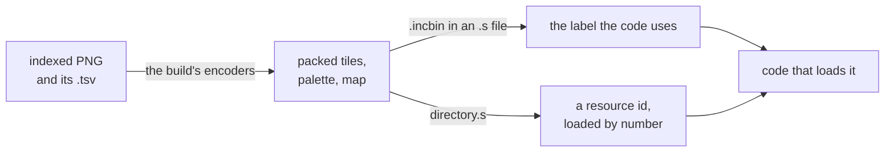
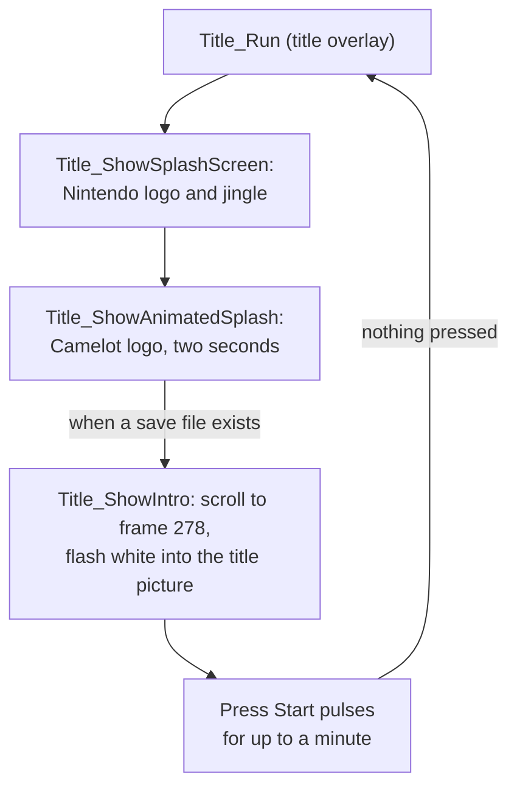

# Graphics

The graphics folder holds most of ☀️'s pictures, from monsters and battle
backdrops to fonts and map tiles, the code of the two screens that are
mostly pictures, the title intro and the credits, and the handwritten
decoders that unpack tiles and animation frames for the rest of the game.
The [Battle effects](../effect/README.md) load their sheets from
`battle_fx/`, and each map's `map.s` in [Maps](../map/README.md) places its
tile set from `tileset/`.

## How a picture is built and placed

Every picture is an indexed PNG that the build packs into the form the game
reads, placed by an `.s` file under the label the code uses.

Each picture is an indexed PNG whose pixels are numbers into its own palette,
which is how the GBA draws them too. The build packs the PNG, with the
`.tsv` beside it where there is one, into the form the game reads, and an `.s`
file places the result under the label the code uses. That `.s` usually sits
beside the picture; the tile sets in `tileset/` are placed by the maps'
`map.s` files, and the pictures in `window/` by `.s` files of
[Windows](../window/README.md) and [Menus](../menu/README.md). A picture
loaded by number rather than by label is an entry of the resource directory
(`system/resource/directory.s`).

Some packed pictures are followed by a few bytes Camelot's packing tool left
behind. The `.s` keeps them beside the picture they follow, as literal bytes
marked `@ PACKER:`.

## The palette fade

The palette fade moves every background and sprite colour a step a frame
towards a target.

The palette fade moves every colour a step at a time towards a target.
`PaletteFade_Initialize` saves both palettes, 512 colours, as the starting
components in the colour buffer's heap block and schedules
`PaletteFade_Update`. `PaletteFade_Start` divides each component's distance
to the target by the number of frames, keeping the remainder in the
component's low ten bits. Each frame the update adds the steps to all 1,536
components, packs them into colours and queues both palettes for the next
VBlank. The queue holds a pointer to the colours until then, so the update
packs each frame into the spare one of two copies, and a frame's packing
never overwrites colours the queue has yet to send. A `paletteHalf` of
`PALETTE_HALVES_BOTH`, `PALETTE_HALF_BG` or `PALETTE_HALF_OBJ` chooses which
palettes a setter changes.

`Palette_Transform` builds the colours a fade starts from or heads for: one
colour everywhere, a whole-palette filter (plain, grey, sepia and the
others), a tint, blend or split carrying a colour, or a copy. In ☀️ only
`Title_ShowIntro` uses the fade, for its 60-frame fade from near-black
(`RGB(2, 0, 0)`, a dark red);
`PaletteFade_Release`, `PaletteFade_SetTarget` and `PaletteFade_SetBackdrop`
are `UNUSED`.

The halves are named in `include/graphics/palbuf.h`.

| Name | Value | Meaning |
| --- | --- | --- |
| `PALETTE_HALVES_BOTH` | 0 | a setter changes both palettes |
| `PALETTE_HALF_BG` | 1 | the background palette only |
| `PALETTE_HALF_OBJ` | 2 | the sprite palette only |

## The title sequence

The title sequence is the logos at power-on, then the intro that scrolls
into the title picture and waits for Start.

The title overlay, `Title_Run` in [Menus](../menu/README.md), decides what
runs; the code is here, in the palette bank. At power-on
`Title_ShowSplashScreen` shows the Nintendo logo with its jingle and
`Title_ShowAnimatedSplash` the Camelot logo for two seconds, cycling its four
frames of tiles. When a save file exists, `Title_ShowIntro` then scrolls the
backgrounds down while the sprites rise along the slope until frame 278, and
flashes white into the title picture, where "Press Start" pulses for up to a
minute; if nothing is pressed `Title_Run` starts again from the logos. After
the prologue the same intro plays without the prompt and holds the picture
five seconds. A or Start cuts each part short. Of the backgrounds, `BG1` at
the back scrolls a pixel every third tick and `BG2` in front every other one,
each copying the next band of its picture in as a new row of tiles comes
into view. The page's opening picture takes the intro apart into those
layers.

## Two backdrops in one background memory

The credits crossfade from one battle backdrop to the next by splitting the
background tile memory and palette into two halves.

The credits roll over a slideshow of 32 battle backdrops
(`gDisplayScroll_SlideResources`), each crossfading into the next, and its
last entry, 0, fades the screen to black.
`Title_Run` reaches them through the scroll bank as `ScrollFar_Entry00`, at
the title scene's entrance 9, with `MUS_ENDING` playing, before the clear
screen. Their waits come to 11,223 frames: a 300-frame lead, then for each
of the 33 entries a 64-frame fade and a 267-frame hold.

A crossfade needs both pictures on screen at once, so the credits split the
256-colour background tile memory and the background palette into halves.
`BG3` draws from tiles in half 0 with colours 0 to 127, and `BG2` from tiles
in half 1 with colours 128 to 255. A backdrop has 128 colours, and
`Graphics_LoadCharacterBlockAndPalette` adds 128 to every pixel it unpacks
into half 1, so the same picture works in either.

`DisplayScroll_RunSlideshow` loads each backdrop into the half that isn't
showing, steps the blend weights between `BG2` and `BG3` over 16 steps of 4
frames, and holds. The halves alternate from one backdrop to the next, so a
backdrop is never loaded while it is shown. `Tile_ExpandSlide` unpacks the
tiles from a copy in `HEAP_SLOT_TEMP_RENDERER`, released after each load, and
the colours reach palette RAM through the I/O write queue at the next
VBlank. Every fourth frame a VBlank task moves both backdrops a pixel right;
a picture is as wide as its map, 256 pixels, so it wraps without a seam.

| Half | Background | Tile memory | Colours | Pixel offset |
| --- | --- | --- | --- | --- |
| 0 | `BG3` | `0x06000000`, 32 KB | 0 to 127 | 0 |
| 1 | `BG2` | `0x06008000`, 32 KB | 128 to 255 | 128 |

## The scrolling names

The staff names are sprites drawn a line at a time into a ring of tiles,
just ahead of where they come into view.

The names are sprites, not a background: six 32-by-8 sprites across each
192-pixel line, drawing from the tile ring. They move up a pixel every
fourth frame, so a new line arrives every 32 frames. Each time the scroll
enters a new line, `DisplayScroll_RenderEnteringLine` draws the line 16 rows
ahead into the hidden part of the ring, so only lines about to show are ever
drawn and the tile memory the credits need doesn't grow with the text.
Opaque border sprites over the top 16 and bottom 24 pixels, first in OAM,
hide the rows that are only partly on screen.

`DisplayScroll_DrawLine` draws each glyph in colour 15 with a colour 1
shadow a pixel down and to the right. It takes its line buffer before
checking for the end of the text, so the last call leaks the buffer
(`// BUG:`, fixed behind `BUGFIX`).

The sizes are macros at the top of `credits/credits.c`.

| Name | Value | Meaning |
| --- | --- | --- |
| `CREDITS_LINE_PIXELS` | 192 | a line's width |
| `CREDITS_COLUMNS` | 6 | 32-pixel sprites across a line |
| `CREDITS_LINE_TILES` | 24 | a line's 4bpp tiles |
| `CREDITS_RING_ROWS` | 32 | tile rows in the ring |
| `CREDITS_VISIBLE_ROWS` | 16 | rows on screen at a time |
| `CREDITS_BUFFER_BYTES` | `0x900` | a line's raster: nine rows of 256 one-byte pixels, the ninth for the shadow |
| `CREDITS_BORDER_SPRITES` | 24 | OAM entries 0 to 23, the opaque strips above and below the text |
| `CREDITS_OAM_ENTRIES` | 128 | the whole OAM: the borders, 96 text sprites and 8 parked off screen |

## Running outside the engine's frame

The credits switch most of the engine's frame off and keep their state in
four cells borrowed from the flash library.

The credits switch most of the engine's frame off. They reset the task
table, stop the VBlank's copy of the sprite list (`gOamCopyEnabled`) and
send their own 128 sprites from a 1 KB buffer taken from the alternate bump
pool and never freed. They also clear `gCpuLoadDisplayEnabled`,
`gDebugTextEnabled` and `gIdleSleepEnabled`. On return `BG2`, `BG3` and
blending are off, the window graphics are reloaded and the OAM copy is back
on; the three tasks they scheduled stay scheduled.

Their state lives in four cells borrowed from the flash library:
`gFlashNumRemainingBytes` holds the sprite buffer's pointer,
`gFlash_Handler3` the scroll position in pixels, `gFlash` the position of
the last line drawn and `gFlash_Handler0` the end-of-text latch. The borrow
is safe because the flash library sets each cell before it reads it:
`IdentifyFlash`, which runs before each use of the save, writes `gFlash`,
`gFlash_Handler0` and `gFlash_Handler3`, and each program routine sets
`gFlashNumRemainingBytes`. The original reaches the cells through casts of
the flash library's declarations, which is undefined behaviour (`// UB:`);
`UBFIX` gives them the credits' own types.

| Flash library cell | Credits' name | Holds |
| --- | --- | --- |
| `gFlashNumRemainingBytes` | `SCROLL_OBJECTS` | the sprite buffer's pointer |
| `gFlash_Handler3` | | the scroll position, in pixels |
| `gFlash` | `CREDITS_LAST_LINE_POSITION` | the position of the last line drawn |
| `gFlash_Handler0` | `CREDITS_END_OF_TEXT` | the end-of-text latch |

## How it fits with the rest of the game

The title intro and the credits are main-image code the title overlay
calls through their banks' far-call tables. The decoders are called by the
code that loads pictures everywhere else, many of them from a copy in a heap
slot (`RamCode_LoadSlot`), as `Tile_ExpandSlide` is. The pictures belong to
the code that loads them: effects, scenes, maps, windows and menus.

## Limits

- A credits backdrop has at most 128 colours and 480 tiles, 256 by 120
  pixels: half the background palette, and 30 KB of its half's 32 KB of
  tile memory, the backdrop's map taking the rest.
- A credits line is 192 pixels wide, six 32-pixel sprites, drawn centred.
- The palette fade covers all 512 background and sprite colours.

## Files

| File | What it holds |
| --- | --- |
| `title/intro.c` | the title intro, the Nintendo and Camelot logos, and the palette fade |
| `credits/credits.c` | the credits: the backdrops that slide and crossfade, and the scrolling text |
| `text/numwords.c` | the counted nouns the German message decoder writes after a number |
| `text/genders.s` | the grammatical gender of each item name, for the German and Italian editions |
| `text/decode_symbol.s`, [`render/decode.s`](render/decode.s), `tile/*.s` | handwritten ARM and Thumb decoders, copiers and a dot product, each proven in its header |
| `battle_fx/` | the battle effects' sheets and masks, loaded by resource id |
| `ui/` | window tiles, the small font, icons and menu sprites |
| `font/` | the main text font in each language's version (`gUiText_Glyphs`) |
| `world_map/` | the world map's tiles and palettes and the story frames |
| `tileset/` | the maps' tile sets and their palettes |
| `window/` | the name entry keyboards, the cursor frame and the main font's glyph widths |
| `shop/` | the eight frames of the shop cursor, `Shop_CursorFrameA` to `Shop_CursorFrameH` (`ResourceId_ShopCursorFrames`) |
| `title/` | the title picture, the logos, the "Press Start" prompt and the "To be continued" lettering |
| `render/labels.s` | the 64-by-16 text headings, each two 32-by-16 sprites |
| `display/credits.s` | the credits font, with its glyph widths in `display/glyph_widths.h` |
| `backdrop/`, `monster/`, `sprite/`, `colosso/`, `lamakan/`, `lucky_dice/`, `slots/`, `sol_sanctum_statue/` | the pictures of the place or screen they name |
| `animref*.s` | animation slot tables, whose entries point back at their own table |

The unit headers are in `games/tbs/include/unit/graphics/`. The credits are
the scroll bank and the title intro the palette bank
([Source](../README.md)); everything else here is linked where its users
are, as `games/tbs/objects.tsv` lists.

## Words used here

- **component**: one of a colour's three five-bit levels, red, green or
  blue, as the palette fade keeps it: in the top bits of a halfword, shifted
  up ten bits, so the ten bits below hold the fraction a fade step leaves.
- **half**: one of the two parts the credits split the background tile
  memory and palette into (`alternate` in the code). Half 0 is the first
  32 KB of VRAM with colours 0 to 127, half 1 the next 32 KB with colours
  128 to 255.
- **tile ring**: the credits' 32 rows of text tiles, 16 on screen at a time,
  reused as the text scrolls.

## Function prefixes

| Prefix | What it acts on |
| --- | --- |
| `Title_` | the title intro and the logos |
| `PaletteFade_`, `Palette_` | the palette fade, and `Palette_Transform`, which builds its colours |
| `DisplayScroll_` | the credits |
| `Graphics_` | tile memory and palettes, as the engine names them elsewhere |
| `Tile_`, `TileMap_`, `BitDecoder_`, `Render_`, `Text_` | the handwritten decoders, among them `Tile_ExpandSlide`, which unpacks the credits' backdrops |
| `Vector_` | `Vector_DotProduct`, a 16.16 dot product in `tile/dot_product.s` that nothing calls |

`UiText_LookupMessageArm` carries the text window's prefix, though it sits
beside `Text_DecodeSymbol` in `text/decode_symbol.s`.

## Evidence and open questions

The pictures are named for what they show, from the scenes and effects that
load them, and the decoders for the format each unpacks, proven in their
headers. The credits' and the title's functions are named for what they
draw.

- XXX (no evidence): why the credits use the flash library's four cells
  rather than globals of their own; the ROM's code shows only that both reach
  the same addresses, no other code uses them, and only Camelot's link map or
  source could say whether the sharing was meant.
