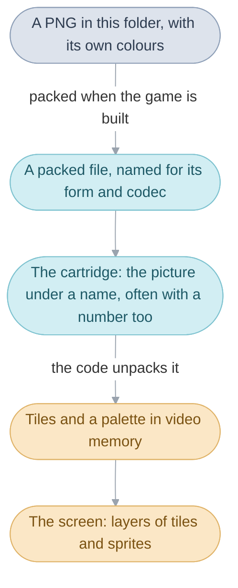
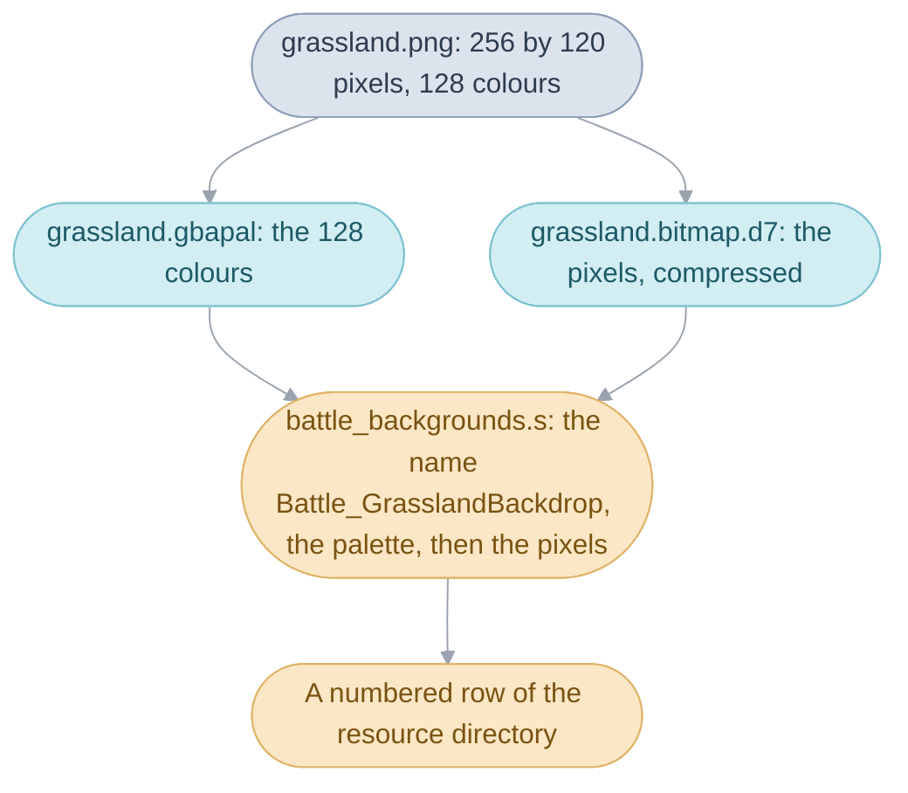
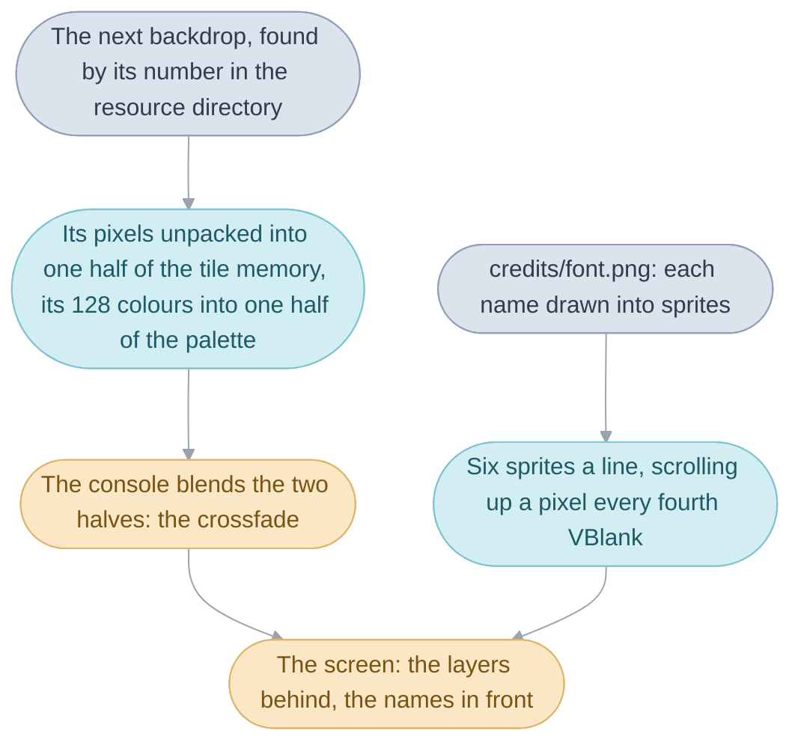

# Graphics


Everything the player sees is a picture from the cartridge. The clouds and
the mountain of the title intro are pictures. So are the tiles a town is
built from, Isaac and every person walking about, a monster, a battle's
backdrop and the letters of a message.

This folder keeps every one of them as an ordinary PNG that any image editor
opens. The cartridge holds them in other shapes, the ones the console reads,
and usually compressed.

Getting from one to the other, and from there to the screen, takes six ideas:

1. How the console draws a picture: a palette and tiles.
2. How an image is built and placed: from a PNG to the cartridge.
3. The forms a picture takes and the codecs that compress them.
4. Sprites and their animations.
5. [Tilesets](../../glossary.md#tileset), which the
   [maps](../../glossary.md#map) are drawn with.
6. Backdrops, monsters, effects and fonts.



The folder holds pictures only. The code that shows each one is with the
part of the game that uses it. The title intro and the credits are in
[Menus](../menu/README.md), the people in [Field code](../field/README.md),
and the backdrops in [Battle code](../battle/README.md).

## How the console draws a picture


The screen is made of
[background layers](../../glossary.md#background-layer) and
[sprites](../../glossary.md#sprite-and-oam)
([The console](../../README.md#the-console)). Both are built from the same
two things, a palette and tiles.

A pixel is a number, and a palette says what colour each number is. A
palette is a list of 16 or 256 colours, each mixed from 32 levels of red,
green and blue.

The console keeps 256 colours for the background layers and 256 for the
sprites. A 256-colour picture uses a whole list. A 16-colour picture uses one
sixteenth of it, and a [palette number](../../glossary.md#palette-number)
beside each of its tiles says which sixteenth.

The picture holds numbers and the palette holds the colours. So changing the
palette changes every pixel that uses it, while the picture stays as it is.

That is how the title intro fades in. For 60
[frames](../../glossary.md#frame) the game steps every colour in the palette
from dark towards its own colour, and never touches a pixel
([Menus](../menu/README.md#the-title-intros-own-palette-fade)). The field's
[palette fade](../../glossary.md#palette-fade) fades a scene in the same
way.

A tile is a square of 8 by 8 pixels. A background layer is a grid of tile
numbers, so a tile drawn once can be used all over the screen. One square of
grass can cover a whole field.

A sprite is one to 64 tiles in a block, from 8 by 8 to 64 by 64 pixels.

So a picture on the cartridge is two lists: its colours and its tiles.

## How an image is built and placed

Every PNG here is an indexed image. Its pixels are palette numbers, and the
file carries its own list of colours, exactly as the console wants them. So
an image editor shows the picture as the game does, and the game gets exactly
the colours the file holds.

Each time the game is built, every PNG is packed into the bytes the
cartridge holds. Take `battle_backgrounds/grassland.png`, the backdrop of a
battle on open ground. It is 256 by 120 pixels in 128 colours, and it becomes
two packed files: `grassland.gbapal`, its 128 colours, and
`grassland.bitmap.d7`, its 30,720 pixels compressed.

The names say what is inside. `bitmap` is the form, the layout of the pixels,
and `d7` is the codec, the compression over it
([below](#the-forms-a-picture-takes)).



A short assembly file in each folder then places the packed files on the
cartridge under a name the code can use. `battle_backgrounds.s` gives the
grassland the name `Battle_GrasslandBackdrop`, with the palette first and
the pixels after it.

The code finds a picture in one of two ways. A picture that one piece of
code always shows, such as the windows' font, is found by its name. A
picture chosen while the game runs is found by number, through the
[resource directory](../../glossary.md#resource-directory), the cartridge's
numbered list of everything packed on it
([The Game Pak](../gamepak/README.md#the-resource-directory-and-table-order)).

The grassland is one of those. A battle picks its backdrop by where it is
fought, and the credits show the same picture by the same number.

A picture that differs by [edition](../../glossary.md#editions), such as
the Title's lettering, has one PNG for each language.

## The forms a picture takes

A form is the layout the console reads a picture in. The suffix of a packed
file names it:

| Form                     | What it holds                                         | Used for                                      |
| ------------------------ | ----------------------------------------------------- | --------------------------------------------- |
| `4bpp`, `8bpp`           | tiles in 16 or 256 colours                            | the menus, the Title, the World Map           |
| `gbapal`                 | a palette alone                                       | every picture with its own colours            |
| `bitmap`                 | the pixels as they are, a byte each                   | the battle backdrops                          |
| `pictures`               | a run of pictures of one size                         | the monsters                                  |
| `bitmaps`                | a run of pictures of differing sizes                  | the battle effects                            |
| `font`, `glyphs`, `1bpp` | letters: each one's width and its rows of dots        | the text font, the small font, the credits    |
| `icons`, `icon4`         | the menus' small pictures                             | the command icons, the marks, the menu icons  |
| `parts`                  | several pictures of mixed forms in one file           | the title intro's sun, Lucky Dice's sprites   |
| `tilemap`                | a layer's grid of tile numbers                        | the Camelot logo, the lighthouse transition   |
| `spriteblocks`           | every sprite's pictures and animations                | the sprite bank                               |

The first seven are built from a PNG. The last three are built from a small
text table, a `.tsv` file, because a list of parts or a grid of tile numbers
is not something a picture can say. A `.tsv` beside a PNG adds what the PNG
alone leaves out, such as each letter's width in a font.

A codec is the compression a picture is stored under, so that more fits on
the cartridge. Each codec suits one kind of picture:

| Codec | How it saves space                                                       | Used for                          |
| ----- | ------------------------------------------------------------------------ | --------------------------------- |
| `lz`  | a run of bytes already seen is written as "copy that again"              | the general codec                 |
| `plz` | the same idea, tuned for palettes and 256-colour pictures                | palettes, 256-colour tiles        |
| `mtf` | keeps the 16 colours in order of last use, so a colour used again soon costs little | the tilesets' tiles    |
| `d7`  | writes each pixel as its difference from the one before                  | the battle backdrops              |
| `hlz` | `lz` copying two bytes at a time                                         | one picture of the palette editor |

A picture the code reads straight from the cartridge has no codec, as the
windows' tiles are stored.

## Sprites and their animations


Every figure the field and the battle draw is a sprite with a number. The
sprite bank is the one table that holds them all, 366 in total, and the field
and the battle draw any figure by asking the bank for its number.

A sprite's sheet is one PNG, one
[picture](../../glossary.md#picture) wide, with every picture of the figure
stacked down the page. Isaac's sheet has his walk in each direction, his
swing and his fall. The sheets are `sprite/spr_000.png` and on. There are 312
of them, since some sprites share a sheet.

A sprite's animations are written in the `.tsv` beside its sheet. Each is a
short list of commands:

| Command        | What it does                                                 |
| -------------- | ------------------------------------------------------------ |
| `picture 55 6` | shows picture 55 for 6 frames                                |
| `wait`         | holds the current picture longer                             |
| `kind 17`      | chooses the table that turns one drawing to face eight ways  |
| `loop`         | starts the animation again                                   |
| `play 1`       | switches to animation 1                                      |
| `hold`         | stays on the last picture                                    |

One of sprite 0's animations reads:

```
picture 55 6, picture 30 6, picture 35 6, picture 40 6, picture 45 6, picture 50 6, loop
```

Six pictures for six frames each make a cycle of 36 frames, which repeats
for as long as the animation plays.

The field lays up to four
[animations](../../glossary.md#sprite-animation) over each other to make
one figure, such as Isaac's body, his sword and his shadow
([Field code](../field/README.md#sprites-and-their-animation)).

The Japanese and Italian editions have sprite banks of their own.

## Tilesets


A tileset is the tiles and the palette a map is drawn from. There is one
set for each kind of place, so every town, cave and ship is built from a few
sheets of tiles.

A tileset is a folder, `tileset/set_NN/`. It holds `palette.png`, the
16-colour palettes its tiles use, and up to four sheets of tiles,
`tiles_a.png` to `tiles_d.png`. Each sheet is 256 pixels wide, and there is
one for each layer a map stacks.

A map says which set it is drawn with, and each square of its grid names four
tiles from those sheets ([Maps](../map/README.md#cells)). Many maps share a
set, so 182 maps are drawn from 76 sets.


A map can also take another set's tiles with a palette of its own. Crossbone
Isle's floors are built that way. They share one set of tiles and have a
palette for each floor, so the same walls come out grey on one floor and
brown on the next. There are 54 such palettes, in `tileset/palettes/`.

Loading a map copies the sheets its layers need, and the palette, into
video memory ([Maps](../map/README.md#loading-a-map)).

## Backdrops, monsters, effects and fonts

The remaining pictures are each shown by one part of the game, and sit in a
folder named for what they are.

### Battle backgrounds


A [battle background](../../glossary.md#battle-background) is the picture
behind a battle, chosen by the place the battle is fought in. There are 34,
in `battle_backgrounds/`.

It is the one kind of picture stored as a bitmap, a byte for each pixel. Each
uses 128 colours, half of the 256 the background layers have.

The battle unpacks the picture for its zoomed layer and darkens the palette
for the dimmed moments of a fight
([Battle code](../battle/README.md#the-zoomed-battlefield)).

### Monsters


A [monster](../../glossary.md#monster)'s battle picture is a run of pictures
stacked in one PNG, and each of the 54 monsters has one.

`monster/skeleton.png` holds twelve. The Skeleton stands, turned a little
further in each of six pictures, then strikes in six more. In battle its
picture changes as the camera swings round it and as it attacks.

### Battle effects


A battle effect's pictures differ in size, so each is a PNG of its own. They
are `NAME_00.png`, `NAME_01.png` and on, in `battle_effects/`, with the
effect's palettes beside them. [Battle effects](../battle_effect/README.md)
says how an effect plays them.

### Fonts


The text font is `font/text.png`, a two-colour sheet with one letter in
each 16-pixel square.

Letters differ in width, an `i` beside an `m`. So `text.tsv` beside the sheet
gives each letter's width in pixels, and a letter takes only the room it
needs ([Windows](../window/README.md#drawing-text)).

A letter is 15 rows tall, 12 in Japanese. Each language has its own sheet and
widths, and the Japanese sheet holds a second set for the kanji.

The credits have a font of their own, `credits/font.png`, and the menus write
numbers in a small one, `ui/small_font.png`.

### Everything else

The windows' tiles, the menus' icons and cursors and the shops' sprites are
in `ui/`, and the Title's pictures are in `title/`. A place that shows a
picture of its own keeps it in a folder named for the place, such as
`lamakan_desert/` for the desert's heat gauge.

The glossary lists every folder with what it holds
([Graphics folders](../../glossary.md#graphics-folders),
[Places and minigames](../../glossary.md#places-and-minigames)).

## The credits


After the ending the staff names roll over the battle backgrounds, one fading
into the next. The credits have no backdrops of their own. They borrow the
battle's and show them two at a time, which the 128 colours of a backdrop
make possible. [Menus](../menu/README.md#the-credits) has the code.




Two backdrops are on screen during a fade, and two times 128 is 256. Both fit
in the background palette at once.

The credits unpack one backdrop into the first half of the palette and the
next into the second half. They add 128 to every pixel of the second, so that
it points at its own colours.

Each backdrop is on a background layer of its own, and the console blends
from one layer to the other over 64 frames. The next backdrop then loads into
the half that has just faded out.

A backdrop is exactly as wide as its layer, so its slow drift to the right
wraps round without a seam.


The names are sprites. A line of text is drawn letter by letter from the
credits' font, with a shadow one pixel down and to the right, into the tiles
of six sprites side by side. The sprites move up one pixel every fourth
[VBlank](../../glossary.md#vblank).

The lines are drawn into a ring of 32 rows of tiles, used again and again, so
the roll can be any length.

## Design

Every picture is kept the way an editor shows it. A sheet is at its real
width, a tile-mapped picture is as the map shows it, and a run of pictures is
one picture wide, each with its real palette. A change to a PNG is then a
change to what the player sees and nothing else.

A picture's form and codec are in the name of its packed file. So one rule
serves every picture of a kind, and no picture needs instructions of its own.

A picture lives here when the file that places it places nothing but
pictures. A map's tileset is placed with the map, so the two sit together on
the cartridge.

## How it fits with the rest of the game

[Maps](../map/README.md) are drawn from `tileset/`, and the field draws its
people from the sprite bank. [Battle code](../battle/README.md) loads its
backdrops and monsters by number, and
[Battle effects](../battle_effect/README.md) their sheets.
[Windows](../window/README.md) type from `font/` and draw their borders from
`ui/`. [Menus](../menu/README.md) show the title intro and the credits.

The sound's data is kept the same way, as editable files packed when the game
is built ([Sound](../sound/README.md#the-sound-driver)).

## Limits

- 256 colours for the background layers and 256 for the sprites, as sixteen
  palettes of 16 or one of 256. A battle backdrop takes 128.
- 128 sprites on screen at once, each up to 64 by 64 pixels.
- A tileset has up to four sheets, each 256 pixels wide, one for each layer.
- A sprite animation shows pictures numbered below 239.

## Words used here

- **form**: the layout a picture is packed in for the console, named in the
  packed file's suffix (`4bpp`, `bitmap`, `pictures`, `font`).
- **codec**: the compression a packed picture is stored under, the last
  suffix of its file (`lz`, `plz`, `mtf`, `d7`, `hlz`).
- **sheet**: a PNG holding many tiles or pictures.
- **sprite bank**: the one table of every sprite's pictures and animations.
- **backdrop**: a [battle background](../../glossary.md#battle-background),
  as its name in the code says (`Battle_GrasslandBackdrop`).

## Evidence

The folder's name is the credits' "Graphic Arts", the staff who drew these
pictures. The glossary gives the source of each folder's name under
[Graphics folders](../../glossary.md#graphics-folders) and
[Places and minigames](../../glossary.md#places-and-minigames).

The forms and codecs are named in plain English for what they do to the
pixels, because the names Camelot's own packing tool used are unknown.
