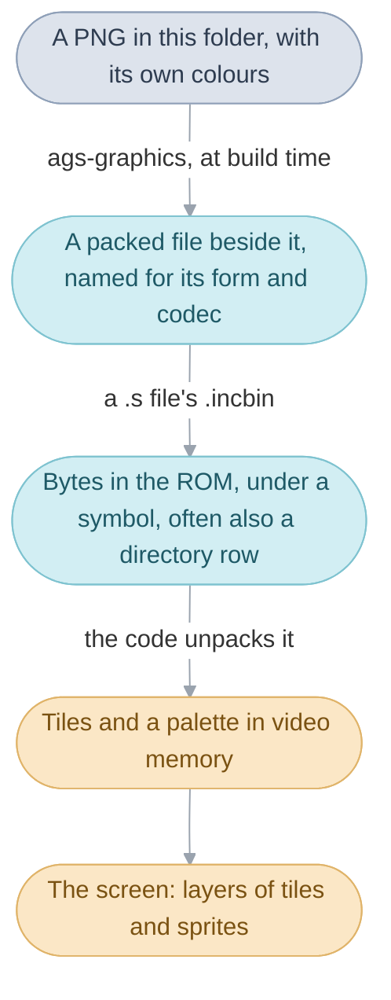
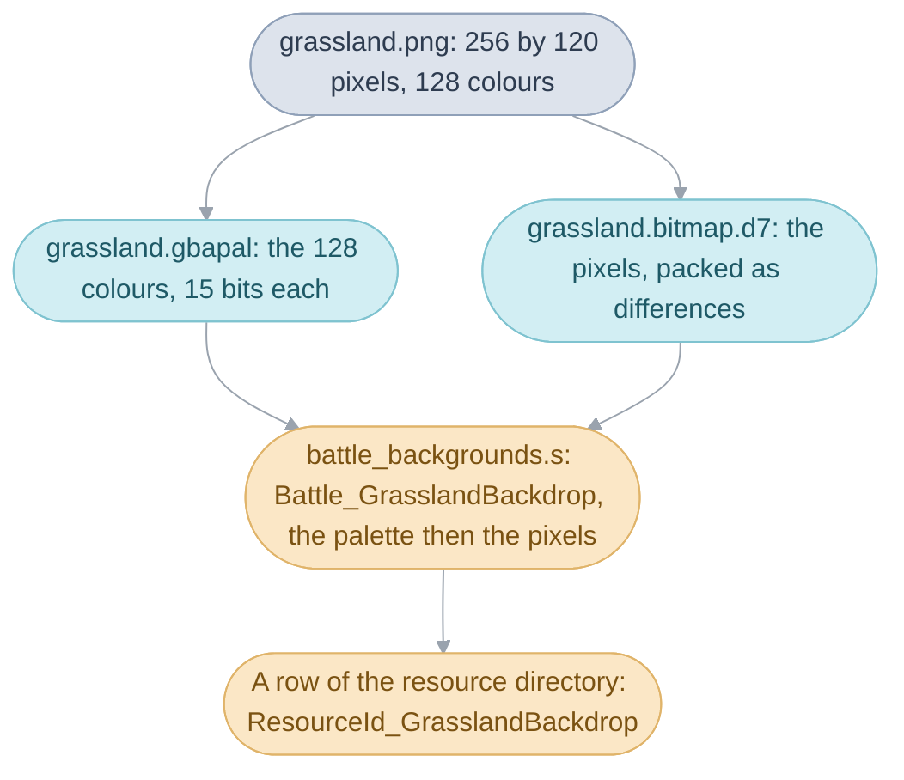
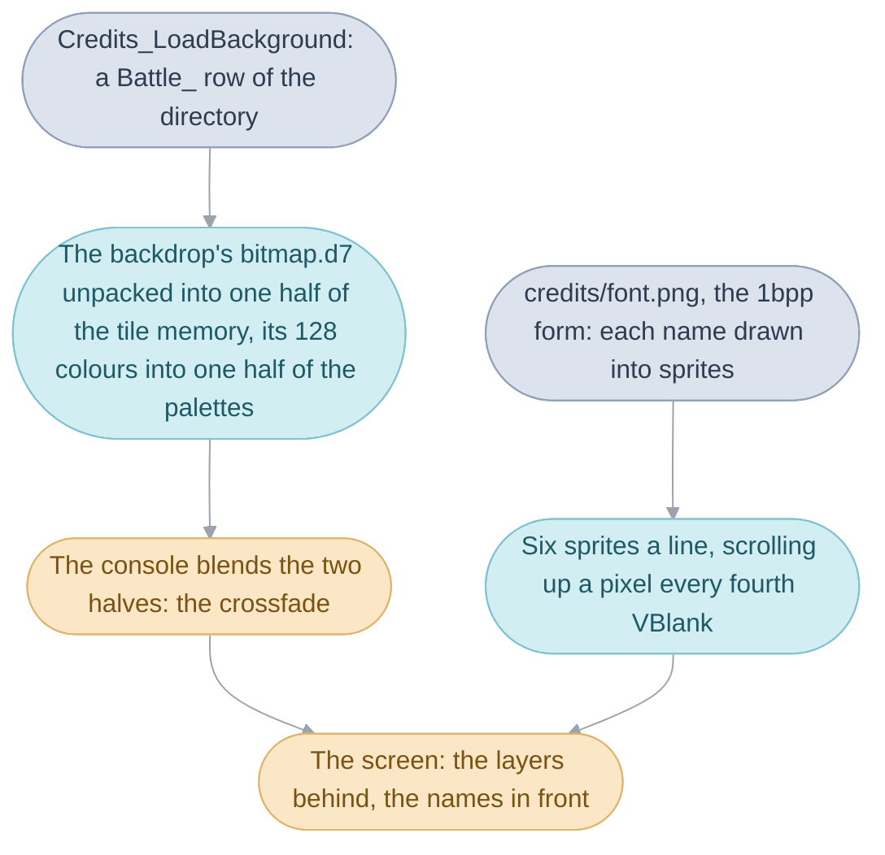

# Graphics

Everything the player sees is a picture from the cartridge: the clouds and
the mountain of the title intro, the tiles a town is built from, Isaac and
every person walking about, a monster, a battle's backdrop, the letters of a
message. The folder keeps every one of them as an ordinary PNG anyone can
open and edit, and each build packs them into the forms the console reads
and places them where the code looks for them. What a picture is to the
console, and how one gets from a PNG to the screen, is the work of six
mechanisms:

1. How the console draws a picture: palettes, tiles, the
   [background layers](../../glossary.md#background-layer) and the
   [sprites](../../glossary.md#sprite-and-oam).
2. How an image is built and placed: from a PNG to a packed file, to a
   symbol in the ROM or a row of the
   [resource directory](../../glossary.md#resource-directory).
3. The forms a picture takes, the layouts the console reads, and the
   codecs, the compressions that pack them.
4. Sprites and their [animations](../../glossary.md#sprite-animation): the
   sprite bank the field and the battle draw their people from.
5. [Tilesets](../../glossary.md#tileset): the tiles and palettes the
   [maps](../../glossary.md#map) are drawn with.
6. Backdrops, monsters, effects and fonts: the pictures each division keeps.

The code that shows the pictures lives with its
[bank](../../glossary.md#bank): the title intro and the
credits in [Menus](../menu/README.md), the people in
[Field code](../field/README.md), the backdrops in
[Battle code](../battle/README.md), and the decoders beside the code that
calls them. The page takes the six in order, from the console to each kind
of picture, and ends by following the credits through them.

## How the console draws a picture

The console draws a picture from a palette and a grid of tiles, so a picture
on the cartridge is a list of colours and a list of small squares of colour
numbers, and the screen is built from those squares.

A pixel on the console is a number, and a palette says what colour each
number is. The console keeps 256 colours for the background layers and 256
for the sprites, each a 15-bit colour, five bits of red, green and blue.
A picture uses them in one of two ways: a 256-colour picture takes the whole
list, and a 16-colour picture takes one sixteenth of it, with a
[palette number](../../glossary.md#palette-number) beside each of its tiles
saying which sixteenth. Since the picture holds numbers and the palette holds
the colours, changing the palette changes every pixel that uses it while the
picture stays as it is: that is how the title intro fades in, by stepping
every colour on screen from dark towards its own colour over 60 frames
([Menus](../menu/README.md#the-title-intros-own-palette-fade)), and how the
field's [palette fade](../../glossary.md#palette-fade) fades a scene in.

A picture is cut into tiles of 8 by 8 pixels. The background layers are
grids of tile numbers, four of them stacked one behind another, each
scrolling as a whole: a town's ground, walls and roofs are three of them
([Field](../../field.md#map-layers)). A sprite is a small picture placed
anywhere on the screen, made of one to 64 tiles in one of the console's
sprite shapes, from 8 by 8 to 64 by 64 pixels, and the console draws up to
128 of them in front of or between the layers. The console draws both from
tables in its video memory, and the game's work is to fill those tables:
copy a picture's tiles and palette in when a
[scene](../../glossary.md#scene) or a battle starts, and
write each [frame](../../glossary.md#frame)'s sprite list
([System code](../system/README.md#the-frame-loop)).

| Name              | Value     | Meaning                                                  |
| ----------------- | --------- | -------------------------------------------------------- |
| a colour          | 15 bits   | five bits each of red, green and blue                    |
| a palette         | 16 or 256 colours | a 16-colour picture carries its palette number    |
| palettes          | 16 for the layers, 16 for the sprites | 256 colours each                |
| a tile            | 8 by 8 pixels | 32 bytes in 16 colours, 64 in 256                    |
| sprite shapes     | 8 by 8 to 64 by 64 pixels | `4bpp16x32`, `8bpp64x64` and the other forms name them |
| sprites at once   | 128       | the console's sprite list                                |

## How an image is built and placed

The build turns every PNG here into the bytes the console reads and places
them in the ROM under the name the code uses, so the source stays a picture
and the ROM gets exactly the bytes it shipped with.

A PNG here is an indexed image: its pixels are palette numbers and it
carries its own list of colours, so an image editor opens it as the game
shows it while the game sees exactly the colours it shipped with. Each build
packs every image into a form, the layout of its pixels, and usually a codec,
the compression over it, and writes the result beside the PNG: `grassland.png`
becomes `grassland.gbapal`, its palette, and `grassland.bitmap.d7`, its
pixels packed. The packed files are ignored by git and remade whenever the
PNG changes.

A short assembly file in each folder places the packed files: it names a
symbol and reads the files in under it with `.incbin`, the palette first and
the pixels after, as `battle_backgrounds/battle_backgrounds.s` places
`Battle_GrasslandBackdrop`. Where the game asks for a picture by number
rather than by symbol, the symbol is also a row of the resource directory
([The Game Pak](../gamepak/README.md#the-resource-directory-and-table-order)):
the grassland is asked for that way both by a battle on open ground and by
the credits. A picture only one piece of code reads sits in that code's bank
of the [main image](../../glossary.md#main-image), as the windows' font does
in the window bank; the rest sit together after the directory at the ROM's
tail, where the directory's rows find them. A picture that differs by
[edition](../../glossary.md#editions), such as the Title's lettering or the
windows' tiles, has one PNG per language and the `.s` file chooses between
them.

Some packed images are followed by a few bytes Camelot's packing tool left
behind, from whatever it had packed before, and the build keeps them beside
the image with a `PACKER:` note naming the picture they came from, since the
ROM holds them and nothing reads them.

The rule is one line of the `Makefile` for every form and codec:
`%.FORM.CODEC` is built from `%.png`, or from `%.tsv` for a table, by
`tools/ags-graphics`, which reads the form and codec from the name of the
file it writes. An encoder that reads more than its PNG, a sprite bank its
sprites or a part list its parts, lists what it read in `NAME.FORM.CODEC.d`,
which the Makefile reads as a compiler's dependency file. A `.tsv` beside an
image holds what the PNG cannot say: a font's first letter and its widths, a
sprite's animations, a part list's parts.

| Name                 | Value                        | Meaning                                                 |
| -------------------- | ---------------------------- | ------------------------------------------------------- |
| a packed file        | `NAME.FORM` or `NAME.FORM.CODEC` | built beside `NAME.png` or `NAME.tsv`, ignored by git |
| `NAME.FORM.CODEC.d`  |                              | the other files the encoder read, for make              |
| `NAME_patch.tsv`     |                              | literal bytes a stream was edited to after packing       |
| `PACKER:`            | a few bytes                  | what Camelot's packer left after an image; nothing reads them |

## The forms a picture takes

A form is the layout the console reads a picture in, and a codec is the
compression a picture is stored under on the cartridge; a packed file's name
says both, so the build and the reader agree on them.

The picture forms are tiles, bitmaps, runs of pictures and fonts. `4bpp` and
`8bpp` are tiles of 16 or 256 colours, cut from the PNG eight pixels square
and, with a sprite shape in the name such as `4bpp16x32`, grouped so that
each sprite's tiles sit together. `gbapal` is a palette alone, the PNG's
colours as 15-bit words. `bitmap` is the pixels as they are, a byte each, the
form a battle backdrop takes. `pictures` is a run of pictures stacked in one
PNG one picture wide, a monster's form, and `bitmaps` a run whose pictures
differ in size, so that they come from `NAME_00.png`, `NAME_01.png` and on,
a battle effect's form. `font` and `glyphs` are the text fonts, `1bpp` the
credits' two-colour font, and `icons` and `icon4` the menus' icons. The table
forms are built from a `.tsv` rather than a PNG: `parts` for a list that
mixes forms, such as the title intro's sun, `tilemap` for a background's
grid of tile numbers written out as a text grid, `spriteblocks` for the
sprite bank, and the maps' own forms ([Maps](../map/README.md)).

The codecs are the game's own. `lz` is the general byte compression, in
which a run already seen is written as a copy, and `plz` its variant for
palettes and 256-colour pictures; `mtf` keeps a move-to-front alphabet of
the 16 colours a tileset's tiles are drawn in, so that a colour used again
soon costs little; `d7` writes each pixel of a bitmap as its difference from
the one before, modulo 128, the backdrops' codec; and `hlz` copies
halfwords instead of bytes, the debug palette editor's swatch alone. A
picture the code reads straight from the ROM has no codec at all, as the
windows' tiles are stored.

| Form           | Built from         | The console reads                                   | Used by                                      |
| -------------- | ------------------ | --------------------------------------------------- | -------------------------------------------- |
| `4bpp`, `8bpp` | a PNG              | 8-pixel tiles, 16 or 256 colours                    | [the Interface](../../glossary.md#interface), the title, the World Map |
| `gbapal`       | a PNG's colours    | a palette, 15 bits a colour                         | every picture with its own colours           |
| `bitmap`       | a PNG              | the pixels, a byte each                             | the battle backdrops, with `d7`              |
| `pictures`     | a PNG, one picture wide | a run of pictures with their sizes             | the monsters                                 |
| `bitmaps`      | `NAME_00.png` and on | a run of pictures of differing sizes              | the battle effects' sheets                   |
| `font`, `glyphs`, `1bpp` | a PNG and a `.tsv` | glyph widths and rows of bits              | the text font, the small font, the credits   |
| `icons`, `icon4` | a PNG            | the menus' icons, packed by colour                  | the command icons, the marks, the menu icons |
| `parts`        | a `.tsv`           | several pictures of mixed forms in one stream       | the title intro's sun, Lucky Dice's sprites  |
| `tilemap`      | a text grid        | a layer's grid of tile numbers                      | the Camelot logo, the lighthouse transition  |
| `spriteblocks` | the sprites' `.tsv` files | the sprite bank                              | every sprite                                 |

## Sprites and their animations

The sprite bank is one table of every sprite in the game, each with its sheet
of pictures and its animations, so that the field and the battle draw any
person or thing by one number.

A sprite's sheet is one PNG one picture wide, `spr_000.png` to
`spr_511.png`, every picture of the figure stacked down the page: Isaac's
walk in each direction, his swing, his fall. Its animations are the `anim`
lines of the `.tsv` beside it, each a list of commands the field reads a
frame at a time: `picture 55 6` shows [picture](../../glossary.md#picture) 55
for 6 frames, `wait` holds the current picture longer, `kind 17` chooses the
facing table that turns a picture drawn facing one way into the eight the
figure can face, and the last command says what follows: `loop` starts
again, `play 1` switches to animation 1, `hold` stays on the last picture.
An `animations` line maps the sprite's animation numbers onto those lines,
so that several numbers can share one. How the field lays up to four of
those animations over each other into one figure, and turns a picture to
face each way, is [Field code](../field/README.md#sprites-and-their-animation).

The build gathers every sprite's `.tsv` into one table, `layout.tsv` giving
the order, and `sprites.s` places it as `gSprite_AnimationMetadata` in the
sprite bank, a stretch of the ROM's tail of its own. The lookup is
`Resource_GetMetadataRecord`, the one row of the far-call table `SPRITE.S`
that sits beside the bank, which takes a sprite's number in the low twelve
bits and returns its row with no bounds check. The Japanese and Italian
editions build sprite banks of their own.

| Name                          | Value   | Meaning                                                   |
| ----------------------------- | ------- | --------------------------------------------------------- |
| sheets                        | 312     | `spr_NNN.png`, each one picture wide                      |
| sprites                       | 366     | `spr_NNN.tsv`, in `layout.tsv`'s order; some share a sheet |
| `picture N D`                 |         | show picture N for D frames; N below 239                  |
| `kind N`                      |         | use facing table N                                        |
| `loop`, `play N`, `hold`, `end` |       | after the last picture: start again, switch, stay, blank  |
| `gSprite_AnimationMetadata`   |         | the sprite bank, in the ROM's tail                        |
| `Resource_GetMetadataRecordFar` |       | the sprite bank's far-call table's one row                |

## Tilesets

A tileset is the tiles and the palette a map's
[cell pictures](../../glossary.md#cell-picture) are drawn from, one set for
each kind of place, so that every town, cave and ship is built from a few
sheets of tiles.

A tileset is a folder `tileset/set_NN/`: `palette.png`, the 16-colour
palettes its tiles use, and up to four sheets of tiles, `tiles_a.png` to
`tiles_d.png`, each 256 pixels wide in 16 colours, a sheet for each layer a
map stacks. A map says which set it is drawn with, and its grid names a
cell's picture as four tile numbers into those sheets
([Maps](../map/README.md#cells)). Many maps share a set: the directory lists
76 sets for 182 maps, drawn from 69 folders of sheets, and 54 palettes of
their own from `tileset/palettes/` recolour a set's tiles, 50 of them placed
after the rows of the maps that use them.

Crossbone Isle's floors are built that way: one set of tiles, and a palette
of each floor's own, so the same walls and floor come out in different
colours on each.

The build packs each sheet as `tiles_a.4bpp.mtf`, the move-to-front form,
and the palette as `palette.gbapal.lz`, and the map's own `map.s` places
them after the map's grid, as `Tileset_Set00Palette` and
`Tileset_Set00TilesA` to `TilesD`, so that a map and its tileset sit
together in the ROM; a recolouring map places its palette alone, as
`Tileset_Palette00`. Each is a row of the resource directory after the map's
rows, written there with the directory's `tileset` and `recolor` macros.
Loading a map copies the sheets its layers need into video memory and the
palette into the background palettes
([Maps](../map/README.md#loading-a-map)).

| Name                 | Value          | Meaning                                                |
| -------------------- | -------------- | ------------------------------------------------------ |
| tilesets             | 76             | the directory's sets, from `tileset/set_00/` to `set_68/` |
| recolours            | 54             | `tileset/palettes/pal_00.png` to `pal_53.png`, over another set's tiles |
| a sheet              | 256 pixels wide, 16 colours | one layer's tiles, `tiles_a.4bpp.mtf`     |
| `Tileset_Set00TilesA` |               | the symbol a map's `map.s` places a sheet under        |

## Backdrops, monsters, effects and fonts

Each division keeps the pictures only it shows, in a folder named for what
they are: the battle its backdrops, monsters and effects, the windows their
fonts and tiles, the menus their icons, a place its own few pictures.

### Battle backgrounds

A [battle background](../../glossary.md#battle-background) is the picture
behind a battle, chosen by the place the battle is fought in, and it is the
one kind of picture stored as a bitmap: `battle_backgrounds/grassland.png`
is 256 by 120 pixels in 128 colours, its pixels packed as differences
(`bitmap.d7`) after its palette (`gbapal`). A backdrop uses half of the
256 background colours, which is what lets the credits hold two at once and
crossfade between them. The battle unpacks the picture with a decoder it
copies to RAM, into the tile memory its zoomed layer reads, and darkens the
palette by level for the dimmed moments of a fight (`BattleBackground_Load`,
[Battle code](../battle/README.md#the-zoomed-battlefield)). The 34 backdrops
are the `Battle_` rows of the resource directory, and
`field/scene_rules.s` says which scenes fight on which.

### Monsters

A [monster](../../glossary.md#monster)'s battle picture is a run of pictures
in one PNG one picture wide, `monster/axe_goblin.png` 64 pixels wide and 768
tall, packed as `pictures.lz` and placed by `monster.s` as
`Monster_AxeGoblinSprites`, a row of the directory's `Monster` group; the 54
monsters each have one. `monster/skeleton.png` holds twelve: the Skeleton
standing, turned a little further in each of six, then striking in six
more, and in battle its picture changes as the camera swings round it and
as it attacks.

A battle effect's sheet is a run too, but of pictures of differing sizes,
so it is built from `NAME_00.png`, `NAME_01.png` and on into
`NAME.bitmaps.lz`, with its palettes beside it, all placed by
`battle_effects/battle_effects.s` and found by the directory's
`BattleEffect` rows; how an effect plays them is
[Battle effects](../battle_effect/README.md).

### Fonts

The text font is `font/text.png`, a two-colour sheet of 16-pixel cells, one
glyph each, 256 pixels wide; `text.tsv` beside it gives the first glyph's
code, the first row of each cell kept and how many rows, and then each
glyph's width in pixels, one line per code. The `font` form writes each
glyph as its width and then its rows, 16 bits a row, which is what the
windows type from a column at a time
([Windows](../window/README.md#drawing-text)).
Each language has its own sheet and widths, `text_de.png` to `text_it.png`,
and the Japanese sheet holds a second set, the kanji, which `text.s` places
after the first as `gFont_KanjiGlyphs`; a glyph is 15 rows tall, 12 in
Japanese. The credits' font, `credits/font.png`, is the plain `1bpp` form,
and the small font the menus write numbers in, `ui/small_font.png`, the
`glyphs` form.

### The Interface's and the places' pictures

The windows' tiles, the menus' icons, titles and cursors and the shops'
sprites are in `ui/`, most as `4bpp` tiles, the icons packed by colour as
`icon4` and `icons`, and the cursors as `8bpp` pictures; the windows' tiles
and the command icons differ by language. The Title's pictures are in
`title/`: the intro's clouds, peak and sun, the sun as a `parts` list that
mixes its forms, the Camelot logo as a tile map written out as a text grid,
and the lettering and prompt in each language. A place that shows a picture
of its own keeps it in a folder named for the place: the Colosso's lettering
and gauge, Lamakan Desert's heat gauge, Sol Sanctum's statue rows, the World
Map's tiles and its lighthouse transition, and Lucky Dice's and Lucky
Wheels' boards and reels. `palettes/` holds the two palettes the system
loads for everyone: the windows' and the basic sprite palettes.

## The credits

After the ending the staff names roll over the battle backgrounds, one
crossfading into the next. Each step of the picture is the work of one of
the page's mechanisms; how the credits run as code is
[Menus](../menu/README.md#the-credits).

### A backdrop from the directory

`Credits_LoadBackground` takes the next row of `gCredits_Backgrounds`, a
resource number, and asks `Resource_GetTableEntry` for its address: the
`Battle_` row the backdrop's `.s` file placed, the palette first and the
`bitmap.d7` after. It unpacks the pixels into one half of the background
tile memory and the 128 colours into one half of the background palettes,
moving the colour numbers up by 128 for the second half, which is why a
backdrop's 128 colours matter: two of them fill the 256 the layers have.

### Two layers blended

The two halves are two background layers, and the console blends across
from one to the other over 64 frames while the next backdrop loads into the
half that just faded out. Each is exactly as wide as its layer, so the slow
drift to the right wraps without a seam.

### The names as sprites

The names are drawn from `credits/font.png`, the `1bpp` form placed in the
credits' bank as `font.s`: a line of text is drawn glyph by glyph, with a
shadow a pixel down and to the right, into the tiles of six sprites side by
side, and the sprites move up a pixel every fourth
[VBlank](../../glossary.md#vblank). A ring of 32 rows
of tiles holds the lines, so the memory never grows however long the roll.

### The same picture, mechanism by mechanism

| Step                                   | Mechanism                                                        |
| -------------------------------------- | ---------------------------------------------------------------- |
| A backdrop is found by number          | the resource directory's `Battle_` rows, from `battle_backgrounds.s` |
| Its pixels and colours are unpacked    | the `bitmap` form under the `d7` codec, and its `gbapal` palette |
| Two backdrops share the colours        | the console's 256 background colours, 128 to a backdrop          |
| The crossfade                          | two background layers, blended by the console                    |
| The names are drawn                    | the `1bpp` font form, drawn into sprite tiles                    |
| The names scroll                       | the console's sprites, moved a pixel every fourth VBlank         |

## Design

A picture lives here with the assembly file that places it, when that file
places nothing but pictures: their `.incbin` lines and labels, the switches
between editions, alignment and padding, and the bytes Camelot's packing
tool left behind. A file that mixes pictures with other data stays with its
bank's code, and a picture only that file reads sits beside it, as the
battle's advance arrow does beside `battle/element_glow_tables.s`; a map's
tileset is placed by the map's own file, so that the map and its tiles sit
together. The headers for pictures, palettes, sprites and glyphs that several
parts of the game read are in `include/graphics/`.

Every picture is kept in the form an editor shows it: a sheet at its real
width or sprite shape, a tile-mapped picture as the map shows it, a run of
pictures one picture wide, with a real palette, so that a change to a PNG is
a change to what the player sees and nothing else. The form and codec a
picture needs are in the name of the file the build writes, and that one
rule serves every picture of a kind.

## How it fits with the rest of the game

[Maps](../map/README.md) place their tiles from `tileset/` and the field
draws its people from the sprite bank, through `Resource_GetMetadataRecord`;
[Battle code](../battle/README.md) loads its backdrops and monsters by their
directory rows, and [Battle effects](../battle_effect/README.md) their sheets
from `battle_effects/`; [Windows](../window/README.md) type from `font/` and
draw their borders from `ui/`'s tiles; [Menus](../menu/README.md) show the
title intro and the credits from `title/` and `credits/`. The sound's data
is kept the same way, as editable files packed at build time
([Sound](../sound/README.md#the-sound-driver)).

## Limits

- 256 colours for the background layers and 256 for the sprites, in
  sixteen palettes of 16 or one of 256; a battle backdrop takes 128.
- 128 sprites on screen at once, each up to 64 by 64 pixels.
- A tileset has up to four sheets of 256 pixels' width, one for each layer.
- A sprite's number is twelve bits, and the sprite bank is read with no
  bounds check.

## Words used here

- **form**: the layout a picture is packed in for the console, named in the
  packed file's suffix (`4bpp`, `bitmap`, `pictures`, `font`).
- **codec**: the compression a packed picture is stored under, the last
  suffix of its file (`lz`, `plz`, `mtf`, `d7`, `hlz`).
- **sheet**: a PNG holding many tiles or pictures, at its real width or one
  picture wide.
- **sprite bank**: the one table of every sprite's pictures and animations,
  `gSprite_AnimationMetadata`, in the ROM's tail.
- **backdrop**: a battle background as its symbol names it,
  `Battle_GrasslandBackdrop`.
- **packer bytes**: the few bytes Camelot's packing tool left after a
  picture, kept with a `PACKER:` note.

## Evidence

The folder's name is the credits' "Graphic Arts", the staff who drew these
pictures. `battle_backgrounds`, `battle_effects` and `monster` are the
credits' "Battle Backgrounds", "Battle Effects" and "Monster Design";
`world_map`, `lucky_dice`, `lucky_wheels` and `colosso` the game's own words;
`lamakan_desert` and `sol_sanctum_statue` the area names of the places they
are drawn in; `title` the Title's scene; `credits` the staff roll itself. The
rest are named in plain English for what they hold, and the forms and codecs
for what they do to the pixels, since the packing tool's own names are
unknown.
