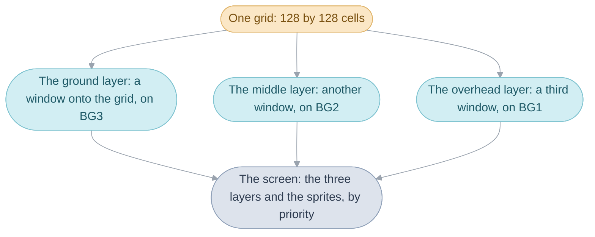
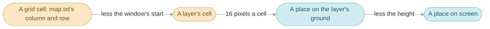
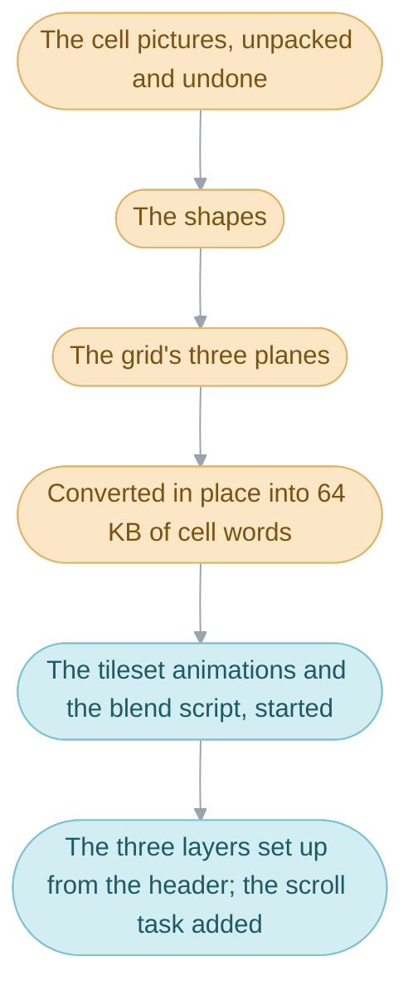

# Maps

Vale on screen is ground, walls and roofs, and Isaac walking among them:
behind a roof, up a ledge, along a cliff he cannot climb, up to a chest. All
of that is the [map](../../glossary.md#map), the ground a
[scene](../../glossary.md#scene) is drawn on, which this folder keeps as
editable tables with no code of its own. A map is a square grid of 16-pixel
[cells](../../glossary.md#cell), 128 on a side, and every cell says three
things: what is drawn there, what standing there does, and how its ground
is shaped. The three flat sheets the player sees, the ground, the walls and
the roofs, are three windows onto that one grid. From its smallest piece
outward, a map is:

1. [Cells](#cells): what one square of the grid says.
2. [One grid, three layers](#one-grid-three-layers): how the three sheets
   share the grid, and what the map's header says about each.
3. [From a cell to the screen](#from-a-cell-to-the-screen): how a cell's
   place in the grid becomes a place on the ground and on screen.
4. [A map's tables](#a-maps-tables): the files one map is kept in.
5. [Loading a map](#loading-a-map): how the game unpacks it when the
   [party](../../glossary.md#the-party) arrives, and the chests it then
   places.
6. [Tileset animation and blend scripts](#tileset-animation-and-blend-scripts):
   the parts of a map that move by themselves.
7. The two maps built differently: [the World Map's](#the-world-maps-data)
   and the [Colosso paths](#the-colosso-paths).

There are 182 maps, each a folder here, and the World Map's ground and the
Colosso paths beside them. A scene names its map, several scenes can share
one, and [the field bank](../field/README.md) draws and scrolls it.

## Cells

A cell is one 16 by 16 pixel square of a map, and it says three things:
what is drawn there, what standing on it does, and how its ground is shaped.
The cliff Isaac slides along is all three: a picture of rock, cells that say
nothing special, and ground 32 pixels higher than the path, too high to
step onto.

What is drawn is the cell's [cell picture](../../glossary.md#cell-picture),
2 by 2 of the console's 8-pixel tiles. Each map has a table of its cell
pictures, and a cell names one by its number in that table.

What standing on it does is its
[cell behavior](../../glossary.md#cell-behavior). Of the 256 behaviors a
cell can have, 239 belong to the scene: its table of
[triggers](../../glossary.md#trigger) says what each one does there, so the
same behavior can be a door in one town and a chest in another
([Scenes](../scene/README.md#which-triggers-a-cell-starts)). The rest mean
the same in every scene:

| Behavior | What it does |
| --- | --- |
| `CELL_BEHAVIOR_NORMAL` | open ground: nothing happens |
| `CELL_BEHAVIOR_EVENT_FIRST` to `CELL_BEHAVIOR_EVENT_LAST` | the scene's own: a [step trigger](../../glossary.md#step-trigger) or an [exit](../../glossary.md#exit) when the leader steps onto or pushes against the cell, an [examine trigger](../../glossary.md#examine-trigger) when the player presses A facing it |
| `CELL_BEHAVIOR_ENCOUNTER_GROUND_1`, `_2` | ground with random battles of its own |
| `CELL_BEHAVIOR_JAR` to `CELL_BEHAVIOR_WELL` | search spots with lines every scene shares: a jar, a barrel, a wooden box, a grave, books, a well |
| `CELL_BEHAVIOR_DESERT_SAND` | ground that hurts the party over time: the Lamakan Desert's sand |
| `CELL_BEHAVIOR_LEDGE` | jumped down with Down held |
| `CELL_BEHAVIOR_CLIMB` | climbed up or down with Up or Down held |
| `CELL_BEHAVIOR_JUMP_FORWARD` | a gap, jumped across |
| `CELL_BEHAVIOR_JUMP_FORWARD_UNREACHED` | jumped across in the same way, but only by a leader who lands on one, who jumps again |
| `CELL_BEHAVIOR_WALL` | a wall, whatever the heights |

How the ground is shaped is the cell's shape: a kind, one of 16 (flat
ground, slopes, steps, bends and others), and three heights, counted in
steps of 8 pixels, from which the height at any pixel of the cell is worked
out. Each map has a table of its shapes too, and a cell names one by its
number. How far up or down an [actor](../../glossary.md#actor) can step
from one height to the next is the field bank's rule
([How high a step can go](../field/README.md#how-high-a-step-can-go)), and
most of the game's walls are made of heights, as the cliff is.

A cell can also say where an actor standing on it belongs. Each layer has
ground of its own ([below](#one-grid-three-layers)), and an actor follows
the ground of one layer, so the three layers can have different walls and
heights. A cell can move an actor standing on it to another layer, and it
can change the actor's priority, the console's order of what covers what,
which is how the roof hides Isaac.

Once a map is loaded, everything a cell says sits in four bytes, read in
one go (`struct MapGridCell`).

## One grid, three layers

A town's three layers are drawn one over another, but in the grid they sit
side by side: all three are windows onto the one 128 by 128 grid. The map's
header says where each layer's window starts, so a map lays its layers out
side by side or one above another, and the cells no window reaches go
unused. In Vale on the stormy night (`map_000`) the ground, middle and
overhead layers start at cells (0, 0), (30, 0) and (60, 0), all in a row;
in the Goma Cave room with two pillars and a stump (`map_022`) they start
at cells (0, 0), (0, 34) and (50, 0). A window has no size of its own: the
camera's bounds stop the view, so a layer shows the cells from its start
out as far as the camera can go.

Each layer is one of the console's
[background layers](../../glossary.md#background-layer): the ground shows
on `BG3`, the middle layer on `BG2` and the overhead layer on `BG1`. Each
takes a priority from the header, which is how the console draws the roofs
over the sprites and the ground under them;
[the field bank](../field/README.md#towns-and-dungeons-on-screen) explains
how their priorities put actors between them.

### The header

A map opens with a header. It says how far the camera may go, and for each
layer where its window starts, how fast it follows the camera, whether it
drifts by itself and where it wraps. A layer that follows the camera at the
camera's own pace looks as far away as the ground; one that moves faster
looks nearer.

In the north of Suhalla Desert (`map_147`) the overhead layer is a haze of
sand. It follows the camera a quarter faster than the ground, drifts across
the screen by itself and wraps every 256 pixels. Only three maps drift a
layer: the north and south of Suhalla Desert and the Tolbi ship's deck
([Evidence](#evidence)).

| What the header says of a layer | Counted in | The Suhalla haze |
| --- | --- | --- |
| where its window starts in the grid | 8-pixel tiles, two to a cell | 128 across, 0 down: cell (64, 0) |
| how fast it follows the camera | sixteenths of the camera's motion | 20: a quarter faster |
| its drift | sixteenths of a pixel a [frame](../../glossary.md#frame) | -121 across and 35 down: about 7.6 pixels right and 2.2 up a frame |
| where it wraps | 8-pixel tiles | every 32 tiles, 256 pixels |

The header ends by saying where each of the map's six parts starts: the
cell pictures, the shapes, the grid, the tileset animations, the blend
script and the treasure spots. A map with no tileset animation or blend
script leaves that one out; the other four are always present.

## From a cell to the screen

Where a door, a chest or a trigger is on screen is worked out from where its
cell is in the grid, in three steps: from the grid to a layer, from a
layer's cell to a place on the ground, and from the ground to the screen.
Each step has its own unit.

The first step takes a cell of the grid to a cell of one layer. The grid's
columns and rows count from the grid's corner, starting at 0; a layer's
cells count from the start of its window. In Vale on the stormy night the
middle layer starts at cell 30, so the cell in the grid's column 43 is the
middle layer's column 13. A window has no size, so the same grid cell can
be in two windows or in none: only a layer's start says which cells that
layer reads.

The second step takes a layer's cell to the ground. Cell (x, z) covers the
ground from pixel 16x to 16x + 15 across and from 16z to 16z + 15 down,
with its middle at 16x + 8. The [entrances](../../glossary.md#entrance),
the actor placements and the scenes' code all give places in these pixels
on a layer's ground, and the game turns a place back into a cell by
dividing by 16.

The third step takes the ground to the screen, and here height comes in.
The cell pictures are drawn flat, row by row, but an actor is drawn its
height above its place on the ground, so the top of a ledge 48 pixels high
is drawn three rows above its own cells. The game finds a cell by its place
on the ground alone and never by height: the cell under an actor, which
gives the actor its layer and priority, and the cell the A button searches,
16 pixels ahead of the leader and always on the ground layer. A cell is
therefore seen where the actor standing on it, or looking at it, is drawn.
A step trigger or an exit shows at the height of its own ground. A cell the
leader searches shows at the height of the floor he searches it from: its
own ground is often the top of what stands there, and a bookcase's top is
32 pixels up, two rows above the bookcase the player sees.

## A map's tables

Everything that makes one town or dungeon map, from its cell pictures to
where its chests stand, is a handful of plain tables in the map's own
folder:

- `cell_pictures.tsv`: the cell pictures, one to a row.
- `shapes.tsv`: the shapes of the ground, each a kind and three heights.
- `map.txt`: the grid, with each cell's cell picture, behavior and shape.
- `tileset_anims.tsv` and `blend.tsv`: the tileset animations and the blend
  script, in the maps that have them.
- `map.s`: the header and the list of treasure spots, with the other tables
  put together behind them.

`map.txt` holds one line of the grid per row, each cell written
`picture:behavior:shape`, a field left off the end being 0, so `4fff:255`
is a wall and `20` is open ground showing cell picture `20`. The picture is
written in hexadecimal; its last three digits are the cell picture, and a
fourth digit in front holds the layer and priority the cell gives an actor
(`8fff` is cell picture `fff` with priority 2). The behavior and the shape
are in decimal. The file's first line gives the grid's size and the cell
that every cell the rows leave out holds.

On the cartridge each table is packed to save room. The grid is packed as
three planes, each one value a cell for the whole grid: every behavior,
then every shape, then every cell picture. The cell pictures are stored as
they are or, where it packs better, with each value stored as its change
from the one before. Where an [edition](../../glossary.md#editions)'s map
differs, the folder holds that edition's table beside the others
(`map_es.txt`): Venus Lighthouse Entry has a French grid and a Spanish one,
which the Italian edition shares.

## Loading a map

When the party arrives in a town or dungeon, the map's layers and
[sprites](../../glossary.md#sprite-and-oam) are hidden while the map is
unpacked into working memory, and the scene fades in once everything is in
place. Most of what is unpacked is the grid. Its three planes are put
together into one four-byte word per cell as the map loads, so that
everything about a cell can be read in one go.

The loading goes in a fixed order. In the recording the village is the part
of Vale with the shops and the [Psynergy](../../glossary.md#psynergy-and-pp)
Stone (`map_003`). Its 1,331 cell
pictures are unpacked first, then its shapes, then the three planes of its
grid, which are converted where they lie into cell words. After the grid
come its two tileset animations, unpacked and started; a map with a blend
script has it unpacked and started here too. The treasure spot list stays
where it is on the cartridge, and the field reads it there. Last,
the header sets up the three layers from their windows, paces and drifts,
and the [task](../../glossary.md#task) that scrolls them every frame is
added.

The grid is 128 by 128, which is 16,384 cells. The plane of behaviors and
the plane of shapes hold a byte a cell, 16 KB each, and the plane of cell
pictures two bytes a cell, 32 KB; the cell words they become take four
bytes a cell, 64 KB. That is twice the room set aside for the cells, so
they run on over two other buffers, and neither can hold anything else
while a map is loaded. Only code that loads the cells again afterwards
writes there: a battle, after which the scene's map is loaded again; the
Battle Arena, which leaves the partner's party there for the link battle
that follows; the World Map's still picture; and the debug sprite viewer.
[System code](../system/README.md#memory-map) has the memory's map.

A scene finds its map in two steps. Its row of the scene table names a row
of `gMaps` ([`maps.c`](maps.c)), which gives the map's header, palette and
tiles as rows of the
[resource directory](../../glossary.md#resource-directory). A map's folder
is named after its header's label in that directory, so its number differs
from its row of `gMaps`: the north of Suhalla Desert is row 151 of `gMaps`
and folder `map_147`, and Vale is row 3 and folder `map_002`.

### Placeholder cell pictures

A map's grid holds the number of a cell's cell picture only from the second
time that cell picture appears. The first time one appears in the grid, the
cell holds a placeholder instead, and the game hands out cell picture numbers
in order as it loads the map. Each map's table of cell pictures is ordered by
where they first appear, so a map has exactly as many placeholders as cell
pictures (`map_003` has 1,331 of each). Every map follows the rule but Venus
Lighthouse Entry, whose grid names 170 cells' cell pictures before their
placeholders; those cells still get the right cell pictures, since the
numbering depends only on the placeholders.

A placeholder is cell picture 4,095, the highest number a cell can name.

### Chests and Psynergy Stones

Several scenes can share one map, and each puts its own chests in it. The
map lists its treasure spots, the cells where a chest or a Psynergy Stone
can stand, each with the subject of the trigger that would place one there
(100 to 239). As a scene
starts, the field goes down the list and places a chest or a stone only
where the scene has a trigger with that subject, up to ten in a scene; a
spot the scene has no trigger for takes none of the ten. A chest is shown
open once it has been opened and is gone once its mimic has been beaten; a
Psynergy Stone stands until it is taken, and taking it fills every party
member's PP. Opening a chest and taking a stone are the scene's examine
triggers ([Scenes](../scene/README.md#how-a-trigger-is-chosen)).

Crossbone Isle's keys room and its Bane room share `map_110`, whose eight
treasure spots carry the trigger subjects 100 to 107: the keys room has chest
triggers for 100 to 103, and the Bane room for 104 to 107. The Demon Axe's
chest rides on the Bane room's second stone pillar: the room moves spot 107
out of the way as it starts, then keeps the chest's position on the pillar
until the pillar reaches the ladder.

Every map has a list, and in 76 of them it is empty.

## Tileset animation and blend scripts

Some parts of a map move without anything on the map moving: the game
copies new pictures over a few tiles on a timer, as with Vale's waterfall,
and the whole map changes wherever those tiles are drawn. A map's tileset
animations say which tiles to copy over which and how many frames to wait
between copies. Up to 16 run side by side, each stepped once a frame, and
84 of the town and dungeon maps have some, as does the World Map.

A tileset animation is a list of copies, each naming the tile to copy from,
how many tiles, the tile to copy to and the frames to wait afterwards; at
its end it starts again from the top or stops. While a wait lasts the
animation only counts down; when it ends, the copies run on in one frame
until one of them sets a new wait. In the north of Suhalla Desert the first
animation shows four pictures of 32 by 32 pixels in turn. Each picture is
four rows of four tiles, so it takes four copies, the last of which waits
15 frames; after the fourth picture the animation starts again, about once
a second.

A scene can pause one of its map's animations and resume it, as Vale's
cottage rooms resume one of theirs once Jenna's grandmother lies sick in
bed.

The blend script changes, in the same way, how the layers mix: one command
sets which layers blend into which, and another sets how strongly and
waits a number of frames. 35 maps have one.

## The World Map's data

The World Map is far too big to unpack at once, so its ground is cut into
squares that are packed one by one, and the game unpacks only the few
around the party, bringing in new ones as the party walks. The code calls a
square a world map tile, and the 2 by 2 squares around the party its tile
block.

The world is 16 by 16 squares of 512 pixels, which makes it 8,192 pixels on
a side. The ground is stored as two sets of squares, one for the lower
ground and one for the mountains, woods and towns drawn over it. Each
ground has 320 squares: the 256 the world starts with, one per position,
and 64 alternates that a World Map event can put in a position, as the
World Map's own setup swaps one in while `FLAG_LAMAKAN_MANTICORE_BEATEN` is
clear.

The game keeps the 2 by 2 squares around the party unpacked in each ground,
and brings in at most one new square a frame. `world/blocks.tsv` is the
ground, one value for each
32-pixel cell of the World Map. The tables in `default/` are the World
Map's too: its cell pictures, tileset animations and the collision of its
cells, which come back after its still picture
([the field bank](../field/README.md#the-world-map-in-perspective)).

## The Colosso paths

In each Colosso final Isaac races an opponent to the arena, and the
opponent follows no rule: it replays a run recorded once, stepping to the
next recorded point every frame. `colosso/` holds the three runs. Each has
room for 7,200 points, two minutes of running, and ends at the first point
that is two zeros.

| Table | Match | Points | The run lasts |
| --- | --- | --- | --- |
| `opponent_path_a.tsv` | Azart | 3,918 | about 65 seconds |
| `opponent_path_b.tsv` | Satrage | 4,380 | about 73 seconds |
| `opponent_path_c.tsv` | Navampa | 5,048 | about 84 seconds |

## Design

One grid serves all three layers, so every map takes the same 64 KB of
cells whatever it shows, and a map divides the grid as it needs: Vale sets
its three layers in a row, and the Goma Cave room puts one below the ground
and one beside it.

A map lists where treasure can stand, and the scene decides whether it
does. That is what lets several scenes share one map and still each have
chests of their own.

What moves by itself, the water and the haze, is the map's own data, run
by the field. A scene gets its moving water without any code of its own.

## How it fits with the rest of the game

When a scene starts, the field sequence loads the map the scene table names
for it, then places the treasure spots for the scene's triggers
([Scenes](../scene/README.md)). From then on
[the field bank](../field/README.md) draws and scrolls the three layers and
reads each cell's behavior and height as actors move. A battle reuses the
cells' memory, so when the party comes back the scene starts again and its
map is loaded again.

## Limits

- 128 by 128 cells, for all three layers together.
- 4,095 cell pictures a map: a cell's cell picture number has 12 bits, and
  4,095 is the placeholder.
- 256 shapes a map, since a cell names its shape in one byte.
- 16 tileset animations (`struct TilesetAnim`).
- `TREASURE_SPOT_MAX` (10) chests and Psynergy Stones placed in a scene.

## Words used here

- A **shape** is the form of the ground in a cell: a kind and three
  heights.
- A **layer** is one of the map's three backgrounds, each a window onto the
  one cell grid.
- A **plane** is one value per cell over the whole 128 by 128 grid.
- A **treasure spot** is a cell where a chest or a Psynergy Stone can stand.
- A **tileset animation** is one of the 16 timed copies of tiles a map can
  run.
- The **blend script** is the map's timed changes to how the layers mix.

## Evidence

The game keeps no names for any of this, so each piece is named for what the
code does with it: the 16-pixel pictures are what each cell shows, so they
are cell pictures; the shapes feed the height functions; and the treasure
spots are where `Field_PlaceTreasureSpots` puts chests and Psynergy Stones,
the only code that reads the list.

The haze's map is found from the scene table: `SceneId_SuhallaDesertNorth`'s
row of `gScenes` gives row 151 of `gMaps`, folder `map_147`; the south's row
leads the same way to `map_148`, and the Tolbi ship deck's to `map_103`,
whose ground drifts down the screen by a pixel and a half a frame and wraps
only every 2,048 pixels.

The layer and priority a cell gives are read by
`ActorSystem_PlaceSprites`, which moves an actor to the layer they give
and, for an actor with `ACTOR_PRIORITY_AUTOMATIC`, sets its sprite's
priority.
