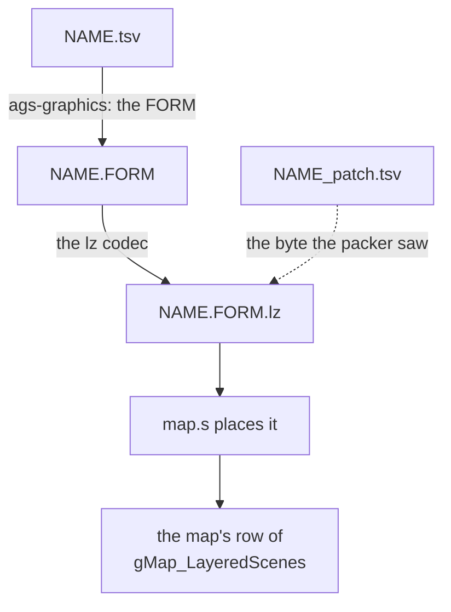
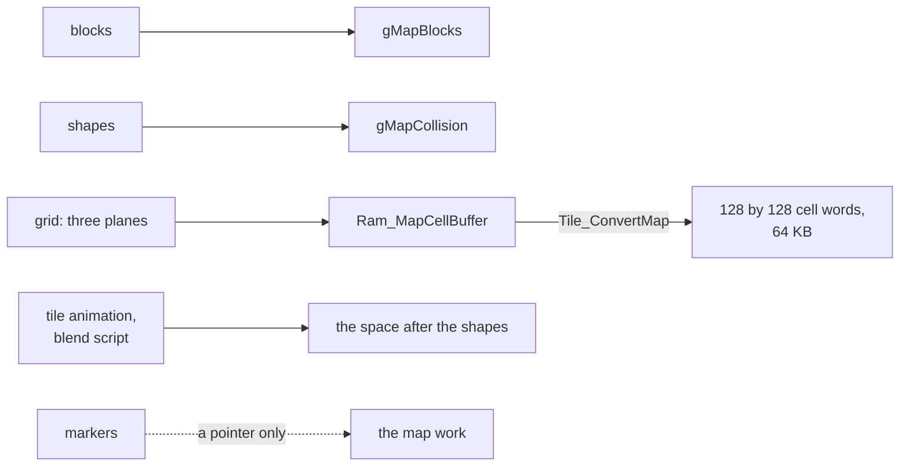

# Maps

The map data is kept as editable tables: 182 layered maps for the towns,
dungeons and interiors, the world map's ground and default cells, and the
opponents' recorded paths in the Colosso finals. There is no code here. Each
scene's row of `gField_SceneTable` ([`../field/scenes.s`](../field/scenes.s))
gives a map number, which picks a row of `gMap_LayeredScenes`
([`../field/layered.tsv`](../field/layered.tsv)): the map's header, palette,
three tile sheets and layer data. `Map_LoadLayeredScene`
([`../field/field/map_layers.c`](../field/field/map_layers.c)) loads it, and
[Field](../field/README.md) describes how the engine draws and scrolls it.

## Cells

A cell is one 16 by 16 pixel square of a layered map, a 32-bit word once
loaded, which says what is drawn there, what the ground is shaped like and
what standing on it does.

A loaded cell is one word. Its low halfword holds the block number in its low
12 bits and four flag bits above, the layer and priority an object standing
there takes; its third byte is the collision code, and its fourth the shape's
number in the map's shape table.

A shape is four bytes, a row of `shapes.tsv`. The low four bits of the first
pick one of the 16 terrain kinds (flat ground, slopes, steps, ground shaped
through three heights and others), and the other three are height samples in
steps of 8 pixels, which the kind's height function interpolates
(`Map_GetTerrainHeight`, through `gMap_TerrainHeightFunctions`).

The collision code is what walls and events are keyed on. `MAP_CELL_WALL`
blocks movement whatever the heights. The codes from `MAP_CELL_EVENT_FIRST`
to `MAP_CELL_EVENT_LAST` belong to the scene: a touch event fires when the
leader steps onto or pushes against a cell with its code, and a search event
when the player presses A facing one. The codes above them mean the same on
every map: `MAP_CELL_ENCOUNTER_GROUND_1` and `_2` for ground with encounters
of its own, `MAP_CELL_JAR` to `MAP_CELL_WELL` for search spots with shared
lines, `MAP_CELL_HAZARD` for the Lamakan Desert's sand, and `MAP_CELL_LEDGE`,
`MAP_CELL_CLIMB` and `MAP_CELL_JUMP_FORWARD`, which `Field_RunPushTileEvent`
acts on when the leader pushes against them.

A wall need not be coded. `Map_CheckObjectStep` lets an object step at most
8 pixels up or 12 down, so ground that rises sharply stops the leader as
surely as `MAP_CELL_WALL`. Goma Cave has no wall-coded cells at all: a rim of
ground 32 pixels high runs along the foot of each cliff, some of it cut along
a cell's diagonal.

Collision and height belong to a layer: code that asks about the ground
reads the cell in the window of the layer the object follows, so an object
stands in one layer at a time ([Field](../field/README.md#the-ground-under-an-object)).

A cell is `struct MapCell` in [`map.h`](../../include/map.h), and its code an
`enum MapCellCode`.

| Bits of the cell word | Field | Meaning |
| --- | --- | --- |
| 0 to 11 | `metatileAndFlags` | the block drawn in the cell |
| 12 to 15 | `metatileAndFlags` | flags: the layer and priority an object standing there takes (15 and 14 read by `Map_GetCellHighFlags`) |
| 16 to 23 | `collisionCode` | the collision code |
| 24 to 31 | `attributeB` | the shape, a row of the map's shape table |

| Name | Value | Meaning |
| --- | --- | --- |
| (open ground) | 0 | nothing happens |
| `MAP_CELL_EVENT_FIRST` to `MAP_CELL_EVENT_LAST` | 1 to 239 | the scene's own touch, exit and search events |
| `MAP_CELL_ENCOUNTER_GROUND_1`, `_2` | 240, 241 | ground with encounters of its own: grounds 1 and 2 of the scene's zones |
| `MAP_CELL_JAR` | 242 | a search spot with lines of its own |
| `MAP_CELL_BARREL` | 243 | a search spot with lines of its own |
| `MAP_CELL_WOODEN_BOX` | 244 | a search spot with lines of its own |
| `MAP_CELL_GRAVE` | 245 | a search spot with lines of its own |
| `MAP_CELL_BOOKS` | 246 | a search spot with lines of its own |
| `MAP_CELL_WELL` | 247 | a search spot with lines of its own |
| `MAP_CELL_JUMP_FORWARD_UNREACHED` | 249 | jumps forward like `MAP_CELL_JUMP_FORWARD`, but never reaches `Field_RunPushTileEvent` |
| `MAP_CELL_HAZARD` | 250 | ground that hurts the party over time: the Lamakan Desert's sand |
| `MAP_CELL_LEDGE` | 252 | jumped down with Down held |
| `MAP_CELL_CLIMB` | 253 | climbed up or down with Up or Down held |
| `MAP_CELL_JUMP_FORWARD` | 254 | jumped across |
| `MAP_CELL_WALL` | 255 | blocks whatever the heights |

## A map's tables

Each layered map is a directory of tables, one for each part of the map,
which `map.s` assembles behind the map's header.

| File | What it is | Built as |
| --- | --- | --- |
| `map.s` | the header, three layers and six offsets, then the parts; in 129 maps a tile set's palette and tile sheets follow (from `games/tbs/src/graphics/tileset`) | assembled |
| `metatiles.tsv` | the blocks; a block's number is its row, from 0 | `metatiles.delta0.lz`, `.delta1.lz` or `.delta2.lz` |
| `shapes.tsv` | the shapes | `shapes.table.lz` |
| `grid.tsv` | the three planes, in order | `grid.parts.lz` |
| `grid_collision.tsv`, `grid_shape.tsv`, `grid_metatile.tsv` | each cell's collision code, shape and block | parts of the grid |
| `animation.tsv` | the tile animation script | `animation.script.lz` |
| `blend.tsv` | the blend script | `blend.script.lz` |
| `markers.tsv` | the markers | `markers.table` |
| `*_ja.tsv`, `*_de.tsv`, `*_es.tsv` and so on | an edition's own version of a table | chosen in `map.s` |
| `*_patch.tsv` | bytes Camelot changed after packing | read by the packer |

A plane's first line describes it: `cell:u8	grid:128x128	fill:0	at:2,3`
gives the size of each value, the grid, the value of every cell the table
leaves out, and the cell its first row starts at, column then row. The rows
are hexadecimal, one row of the grid per line.

### The header

The header says where the camera may go, how each of the three layers is
placed and scrolled, and where each part of the map starts.

![Suhalla Desert's north as the leader walks east and south with the sand haze up, beside the map's cell grid at half size with each layer's window outlined: the ground on `BG3` from tile 0, 0 and the middle layer on `BG2` from tile 64, 0, each 64 by 128 tiles, the camera's bounds, and the overhead layer on `BG1` from tile 128, 0, a square of 32 by 32 tiles that wraps. In each window a box marks the part on screen. The ground's and the middle layer's boxes move with the leader, at a parallax of 16 sixteenths; the overhead layer's, at a parallax of 20 sixteenths and a drift of -121 and 35 sixteenths of a pixel a frame, races across its square and wraps round, as the haze streams over the screen.](https://alchemy.pascalpixel.com/guides/map/map-header.gif)

The header is one `map_header` line and three `map_layer` lines in `map.s`,
read as `struct LayeredSceneHeader`. It gives the camera's bounds in 8-pixel
tiles, each layer's priority (0 leaves the layer off) and the char block its
tiles come from, and for each layer its origin in 8-pixel tiles, its parallax
(in sixteenths of the view's motion), its drift (sixteenths of a pixel a
frame) and its wrap.

Six offsets from the header's start follow: the blocks, the shapes, the cell
grid, the tile animation, the blend script and the markers. An offset of 0
means the map has none of that part.

`struct LayeredSceneHeader` and `struct LayeredSceneLayer` are defined in
`field/field/map_layers.c`, and the `map_header` and `map_layer` macros that
write them in `map.inc`.

| Field | Unit | Meaning |
| --- | --- | --- |
| `origin[4]` | 8-pixel tiles | the camera's bounds: left, top, right and bottom |
| `priority[3]` | | each layer's BG priority, 1 to 3; 0 leaves the layer off |
| `charBase[3]` | | each layer's BG char block |
| `reserved` | | 0 in every map; nothing reads it |
| `layers[n].x`, `.y` | 8-pixel tiles | the layer's origin |
| `layers[n].scrollX`, `.scrollY` | sixteenths of the view's motion | the layer's parallax |
| `layers[n].speedX`, `.speedY` | sixteenths of a pixel a frame | the layer's drift |
| `layers[n].periodX`, `.periodY` | 8-pixel tiles, less one | where the layer wraps, as a mask: `0x1f` wraps every 32 tiles |
| `tiles` | bytes from the header | the blocks |
| `collision` | bytes from the header | the shapes |
| `tilemap` | bytes from the header | the cell grid |
| `animation` | bytes from the header | the tile animation script, or 0 for none |
| `blend` | bytes from the header | the blend script, or 0 for none |
| `markers` | bytes from the header | the marker list, read in place |

## How the build makes a map

`tools/ags-graphics` turns each table into the bytes the game reads, and
packs each stream exactly as Camelot's packer did.

The tool chooses what to do from the name of the file it is asked to write,
`NAME.FORM[.CODEC]`, made from `NAME.tsv` (the `Makefile`'s asset rules). A
map uses these forms:

- `table`: the shapes and markers, one record per row, each column's type
  giving its size.
- `plane`: a grid plane, written out whole, row by row, with `fill` in every
  cell the table leaves out.
- `parts`: the grid, the encodings of the files it lists one after another.
- `delta0`, `delta1`, `delta2`: the blocks, halfwords behind a method byte
  (`enum MapBlockPacking`) that `TileMap_DecodeStagedBuffer` undoes. Method 0
  stores them as they are, 2 XORs each with the one before, and 1 does the
  same with all the high bytes stored before all the low bytes. Each `map.s`
  names the method its stream uses.
- `script`: the tile animation and blend scripts below.

The codec `lz` then packs each stream as Camelot's packer did, and the bytes
must come out identical. Where the original stream is followed by stray bytes
the packer left in its buffer, `map.s` places them as literal bytes with a
`PACKER:` comment naming what wrote them. Where Camelot changed a stream after
packing it, a `_patch.tsv` lists each changed byte: its position, the byte
the packer saw, the byte that shipped, and the proof. The table holds what
shipped, and the patch gives the packer the byte it packed, so the packer
makes the same choices and the stream still decodes to the edited map. Only
Gondowan Passage's grid and Venus Lighthouse's entrance's grid, with its
Spanish and French versions, have patches.

An edition's own version of a table (`grid_es.tsv`, `markers_ja.tsv`) is
chosen in `map.s` with `.ifdef TBS_EDITION_*`, and editions that agree share
one file: Venus Lighthouse's entrance has a French grid and a Spanish one, and
the Italian edition uses the Spanish. A map whose whole data differs by
edition has a block of its `map.s` for each. A map that uses another map's
table names that map's file.

`enum MapBlockPacking` is in `field/field_internal.h`.

| Name | Value | Form | Meaning |
| --- | --- | --- | --- |
| `MAP_BLOCKS_RAW` | 0 | `delta0` | the blocks as they are |
| `MAP_BLOCKS_SPLIT_DELTA` | 1 | `delta1` | all the high bytes, then all the low bytes, each value XORed with the one before |
| `MAP_BLOCKS_DELTA` | 2 | `delta2` | each value XORed with the one before |

## Loading a map

`Map_LoadLayeredScene` unpacks each part of a map into its own fixed buffer
in EWRAM, and weaves the grid's three planes into one word per cell.

`Map_LoadLayeredScene` decodes each part into a fixed buffer in EWRAM: the
blocks into `gMapBlocks`, the shapes into `gMapCollision`, the grid into
`Ram_MapCellBuffer`, and the two scripts into the space after the shapes. The
markers are not decoded: the loader keeps a pointer to them in the map work.

The grid is stored as three whole planes: collision codes, then shapes, then
blocks (16 KB, 16 KB and 32 KB, since the block plane has a halfword per
cell). `TileMap_ConvertBuffer` then runs `Tile_ConvertMap`, an ARM routine
copied into RAM, which weaves them into 128 by 128 cell words, 64 KB from the
start of `Ram_MapCellBuffer`. The first two planes are saved to a temporary
buffer first, since the cell words overwrite them.

![Goma Cave's grid as Tile_ConvertMap leaves it, taken back apart into its three planes, each cropped to the three layers' windows at three pixels a cell: the collision codes, nearly all open ground with a few event and wall cells; the shapes, outlining the rock rims; and the blocks, the ground and middle layers' windows full of different blocks and the overhead layer's nearly empty. Beside them four by three cells around the leader with each cell's word written over it in hex, the shape in its top byte and the block in its low bits](https://alchemy.pascalpixel.com/guides/map/grid-planes.png)

`gMapCellBuffer` itself is 32 KB, so the cells run on through
`gActorSpriteSlots` and `gDecodeBuffer`, and neither can hold anything else
while a map is loaded. Only code that reloads the cells afterwards writes
there: a battle, after which the scene's map is loaded again; the link lobby,
which leaves the partner's party in `gActorSpriteSlots` for the link battle
that follows; and the world map's still view, which saves `BG1`'s tiles to
`gDecodeBuffer` and draws into the cells, which
`Map_LoadDefaultCellsAndUpdateBlock` then puts back. The debug sprite viewer
also loads sprites there. The tile animation only reads from
`Ram_DecodeBuffer`, at offsets that land past it. [System](../system/README.md) has the
EWRAM layout.

| Plane, in stored order | Size | Values |
| --- | --- | --- |
| collision codes | 16 KB | a byte a cell |
| shapes | 16 KB | a byte a cell |
| blocks | 32 KB | a halfword a cell |
| the woven cell words | 64 KB | a word a cell, from the start of `Ram_MapCellBuffer` |

### One grid, three layers

The three layers are windows onto the one grid, each starting at the cell
its origin names.

All three layers are windows onto the one grid. Each layer's origin picks
the cell its window starts at (half its tile position, since a cell is 2 by 2
tiles), so a map lays its layers out side by side or one above another:
`map_000`'s start at tiles 0, 60 and 120 across, and Venus Lighthouse's
entrance puts them at (0, 0), (64, 0) and (0, 68). The picture at the top of
this page shows Goma Cave's three windows in its grid.

The ground layer shows on `BG3`, the middle layer on `BG2` and the overhead
layer on `BG1`; [Field](../field/README.md#layered-maps-on-screen) explains
how their priorities put actors between them.

### Placeholder blocks

A placeholder is a cell whose block is 4,095, and it marks the first place in
the grid a block is used.

![Goma Cave's three layer windows, ground, middle and overhead, at a quarter size, every cell dimmed but its 368 placeholders, tinted yellow wherever a block is first used. Beside them one example six times its size: a cell stored as 4095, a placeholder, which `Tile_ConvertMap` makes block 42, the next number counting from 0 in the order the grid first uses its blocks; and a cell further down with the same picture, stored as block 42 already and kept as it is. The legend gives one placeholder for each of the map's 368 blocks.](https://alchemy.pascalpixel.com/guides/map/placeholders.png)

A cell whose block is 4,095, the highest 12 bits can hold, is a placeholder.
As the map is converted, `Tile_ConvertMap` gives each placeholder a fresh
block number, counting up from 0 in grid order. The ROM also keeps an unused
C version of that numbering, `TileMap_NumberPlaceholderBlocks`.

The placeholder is how the grid writes a block's first use. Each map's block
table is ordered by where its blocks first appear in the grid, and the grid
writes that first appearance as 4,095 and every later one by number, so a map
has exactly as many placeholders as blocks (`map_003` has 1,331 of each).
Every map follows the rule but Venus Lighthouse's entrance, whose grid names
170 cells' blocks before their placeholders; those cells still get the right
blocks, since the numbering depends only on the placeholders.

### Chests and Psynergy Stones

The marker list names the cells where a chest or a Psynergy Stone can stand,
each with the scene event that decides whether one does.

![The map CrossboneIsleKeys and CrossboneIsleBane share, both rooms drawn as each scene loads them, with each of the map's eight markers outlined at its cell and labelled with what its chest holds. CrossboneIsleKeys places the four chests in alcoves along its north wall, 333 coins, a Fairy Ring, a Cookie and a Smoke Bomb; CrossboneIsleBane places 666 coins and an Elixir on its raised floor and a Water of Life below them, and the Demon Axe's marker, whose cell lies past the room's east wall: the scene moves that chest to 0, 0 until the stone pillar carrying it reaches the ladder.](https://alchemy.pascalpixel.com/guides/map/markers.png)

The marker list is (column, row, id) triples, a cell and the trigger of a
scene event, ended by 255, 255. When a scene loads, `Field_PlaceMapMarkers`
([`../object/object/markers.c`](../object/object/markers.c)) places an
object at each marker whose id (100 to 239) the scene has an event for, up to
`MARKER_MAX` (10): a chest for a chest event, shown open once its flag is set
and gone once its mimic has been beaten, and a Psynergy Stone for a search
event that gives one, until it is taken. A marker the scene has no event for
takes no slot. 76 maps place `map_000/markers.table`, which holds only the end
marker.

| Name | Value | Meaning |
| --- | --- | --- |
| a marker's id | 100 to 239 | the trigger of the scene event that places it |
| the end marker | column 255, row 255 | ends the list |
| `MARKER_MAX` | 10 | markers placed on a map (`include/unit/object/object.h`) |

### Tile animation and blend scripts

Two scripts of halfwords, run each frame as tasks, make a map's tiles move
and its layers blend over time.

Both scripts are runs of halfwords, run each frame as tasks
(`field/map_animation.c`). The tile animation copies new tiles over old ones
on a timer, for the parts of a map that move by themselves. In its table,
`channel n` (`0xfd00 + n`) starts channel n of the 16 at the next halfword;
only the low four bits pick the channel, and a marker with bit 7 set starts
it paused. Each `frame` is four values: the source tile, how many tiles, the
destination tile and the frames to wait. `jump n` (`0xfe00 + n`) goes to
halfword 2n of the channel's script, `stop` (`0xfeff`) halts the channel,
and `end` (`0xffff`) loops it to its start. A source tile from 1,536 on is
copied from RAM at `Ram_DecodeBuffer` plus its offset, which lands in
`gMapLayerData`, and a lower one from elsewhere in video memory; the line is
512 for a map whose animations copy 64-byte tiles (`MapState.wideTiles`).

The blend script changes how the layers blend over time. `control` sets
`REG_BLDCNT`; `level` sets `REG_BLDALPHA`, or `REG_BLDY` when the control's
mode is not alpha blending, and waits its second value in frames. `jump`,
`stop` and `end` act as in the tile animation.

The words are tested in `MapAnimation_Update` and `DisplayBlend_RunScript`,
which have no names for them; the names are the tables' (`animation.tsv`,
`blend.tsv`).

| Word | Value | Meaning |
| --- | --- | --- |
| `channel n` | `0xfd00 + n` | the tile animation's channel n starts at the next halfword |
| `frame` | four values below `0xfd00` | source tile, tile count, destination tile, frames to wait |
| `jump n` | `0xfe00 + n` | continue at halfword 2n of the channel's script |
| `stop` | `0xfeff` | halt the channel |
| `end` | `0xffff` | loop back to the channel's start |
| a source tile from RAM | 1,536 on (512 for 64-byte tiles) | copied from `Ram_DecodeBuffer` plus its offset, rather than from video memory |

## The world map's data

The world map's ground is one large grid of cells, packed a square at a time
so that the game unpacks only the squares around the party.

![The world map as the party runs south and east from its entrance 3, south of Vale, with `FLAG_NO_ENCOUNTERS` set, beside a 5 by 4 patch of the world's 512-pixel squares around it, each drawn from the ground layer's block buffer while it is unpacked there. The 2 by 2 squares unpacked now, around the party's white mark, are outlined in yellow and drawn bright: forest, rivers and Vale's door, marked in red. As the party crosses a square's edge the outline moves one square east or south, the squares it reaches appear, and those it leaves stay dim; squares never unpacked stay black.](https://alchemy.pascalpixel.com/guides/map/world-map-squares.gif)

The world map's ground, `world/blocks.tsv` (`Field_PerspectiveDataA`), is one
grid of 32-bit values in hexadecimal, 512 across and 320 down. The `blocks`
form cuts it into 640 squares of 16 by 16 values and packs each separately
behind a table of offsets; a square written all as `-` would be left out with
an offset of 0, and the world map leaves none out. The game unpacks only the
2 by 2 squares around the party, in each of its two ground layers
(`Map_UpdateCurrentTileBlock`, `Map_WriteLayerCellTile`).

The tables in `default/` are the world map's too.
`Map_InitializePerspectiveScene` loads the default cells, block attributes and
tile animation when the world map scene starts, and
`Map_LoadDefaultCellsAndUpdateBlock` puts the cells back after the world map's
still view ([Field](../field/README.md#the-world-map-view)).

| Part | Size |
| --- | --- |
| the ground's grid | 512 by 320 values, 32 bits each |
| a square | 16 by 16 values |
| squares | 640, each packed on its own |
| unpacked at once | the 2 by 2 squares around the party, in each of two ground layers |

## The Colosso paths

In each Colosso final the opponent replays a recorded path of ground
positions, one a frame.

In each Colosso final the opponent replays a recorded path. `colosso/` holds
three, each 7,200 points of ground in pixels, the size of the race's path
buffer (`ColossoRaceWork.path`), with a row of two zeros where the run ends.
The tables call the columns x and y; the race code reads each pair as x and
z. The Azart match runs path A, the Satrage match path B and the Navampa match
path C (`Colosso_StartOpponent`, `ColosseumSatrageMatch_StartOpponentPath`).

Each frame `Colosso_UpdatePathOpponent` steps the opponent to the next point,
mirrored across the finish when asked, turning at most a sixteenth of a turn,
and at the end walks it to the finish. Its recording mode writes down where
an actor stands every frame and then plays it back with the opponent. The
Colosso lettering, which differs by edition, is placed after the paths.

| Table | Match |
| --- | --- |
| `opponent_path_a.tsv` | Azart |
| `opponent_path_b.tsv` | Satrage |
| `opponent_path_c.tsv` | Navampa |

## Design

The grid is stored as whole planes rather than as cell words, which keeps
each plane's long runs of one value together for the packer. XXX: an
inference; the bytes show only the layout.

The markers are the one part stored unpacked, and the loader reads them in
place rather than copying them. XXX: likely because only
`Field_PlaceMapMarkers` reads them, once as the scene loads; nothing else
shows why.

One grid serves all three layers, so every map takes the same 64 KB of cells,
and a layer's window can sit anywhere in the grid.

## Limits

- 128 by 128 cells, for all three layers together.
- 4,095 blocks a map: a cell's block number has 12 bits, and 4,095 is the
  placeholder.
- 256 shapes a map, since a cell names its shape in one byte.
- 16 tile animation channels (`struct MapState`).
- `MARKER_MAX` (10) chests and Psynergy Stones placed on a map.

## Files

| Path | What it holds |
| --- | --- |
| `map_000/` to `map_179/` | one layered map each: its `map.s` and the tables it places |
| `gondowan_passage/`, `venus_entrance/` | two more layered maps, Gondowan Passage and Venus Lighthouse's entrance, built like the others |
| `world/blocks.tsv` | the world map's ground (`Field_PerspectiveDataA`) |
| `default/` | the world map's default cells, tile animation and block attributes (`Field_DefaultMapCells` and the tables after it) |
| `colosso/` | the opponents' recorded paths, with the Colosso lettering placed after them |
| `map.s` | places `world/` and `default/` |
| `map.inc` | the `map_header`, `map_layer` and `map_block` macros every `map.s` uses |

The map numbers are the order of the directories, not numbers the game gives
its maps.

## Words used here

- A **cell** is a 16 by 16 pixel square, one 32-bit word once loaded
  (`struct MapCell` in [`map.h`](../../include/map.h)).
- A **block** (a metatile) is the picture of a cell: 2 by 2 of the 8-pixel
  tiles, stored as the four BG map entries that draw them, top left, top
  right, bottom left, bottom right.
- A **shape** is the form of the ground in a cell: a terrain kind and three
  height samples.
- A **collision code** says what standing on, pushing against or searching a
  cell does (`enum MapCellCode`).
- A **layer** is one of the map's three backgrounds, each a window onto the
  one cell grid.
- A **plane** is one value per cell over the whole 128 by 128 grid.
- A **marker** is a cell where a chest or a Psynergy Stone can stand.

## Evidence and open questions

The game keeps no names for any of this, so each part is named for what the
code does with it: the blocks become BG map entries, so they are `metatiles`;
the shapes feed the height functions; and the markers are where
`Field_PlaceMapMarkers` puts chests and Psynergy Stones. The sixth offset is
called the marker list because that function is the only code that reads the
pointer the loader stores to it, although `MapScrollWork`
(`include/map_scroll.h`) still names the field `script`.

The header's last two bytes (`pad0` and `pad1` in `map.inc`, `reserved` in
`struct LayeredSceneHeader`) are 0 in every map of both games, and nothing
reads them: the loader is the only code that reads the header.

