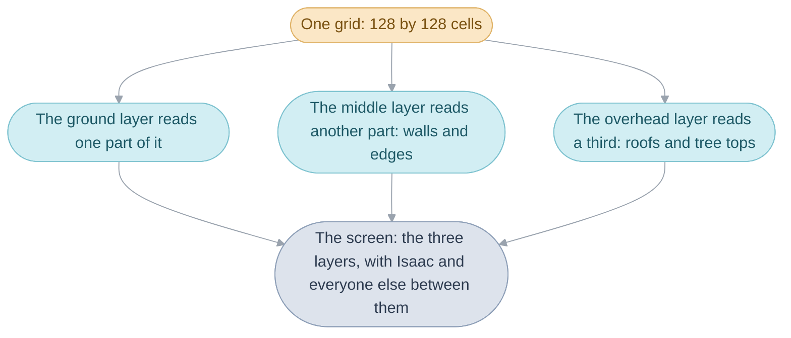
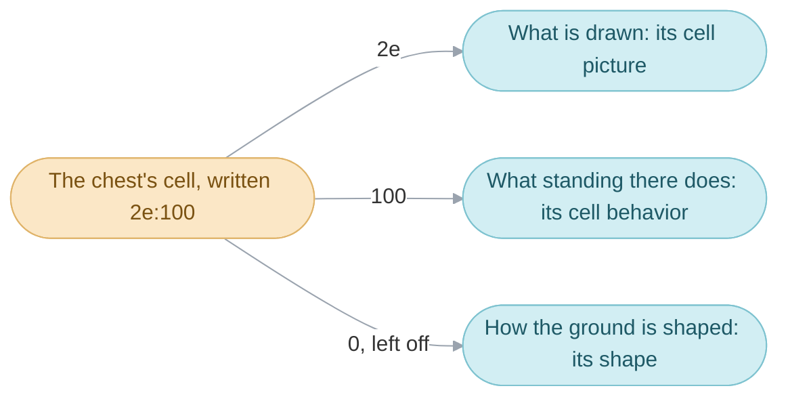
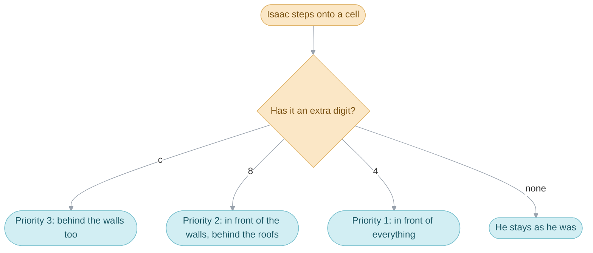
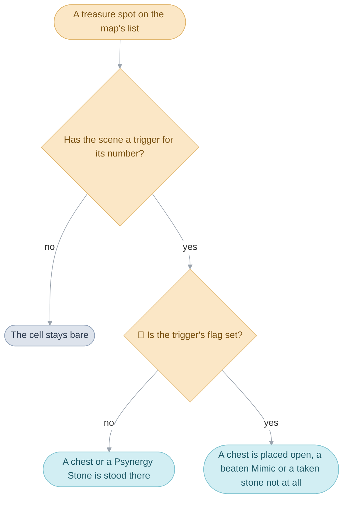

# Maps

Walk Isaac around Vale and the village behaves like a solid place. A roof
hides him when he goes behind a house. A cliff stops him. A ledge lets him
hop down, and a chest opens when he checks it.

None of that is written as rules about houses or cliffs. It is all read off
the [map](../../glossary.md#map), the ground a town or dungeon is drawn on.
This folder holds every map in the game, as lists of numbers anyone can
open and read.

A map only describes a place. The part of the game that draws it and walks
Isaac over it is called the field, and it has
[a page of its own](../field/README.md).

A map is a grid of squares, 128 across and 128 down. Each square is called a
[cell](../../glossary.md#cell), and each cell answers three questions: what
is drawn here, what happens to someone standing here, and how high is the
ground.

The ground, the walls and the roofs the player sees are three layers drawn
one over another. All three are cut from that one grid.

This page starts at one cell and works outward:

1. [Cells](#cells): what one square of the grid says.
2. [One grid, three layers](#one-grid-three-layers): how the three layers
   share the grid.
3. [From a cell to the screen](#from-a-cell-to-the-screen): why a thing is
   not always drawn where its cell is.
4. [Chests and Psynergy Stones](#chests-and-psynergy-stones): how one map
   can hold different treasure on different visits.
5. [Tileset animation and blend scripts](#tileset-animation-and-blend-scripts):
   the parts of a map that move by themselves.
6. The two maps built differently: [the World Map's](#the-world-maps-data)
   and the [Colosso paths](#the-colosso-paths).
7. [Loading a map](#loading-a-map): what happens while the screen is dark
   between two places.

The last part of the page,
[For readers of the code](#for-readers-of-the-code), is about the files
themselves.

There are 182 maps, and a map is not the same thing as a place in the
story. The game calls each place [the party](../../glossary.md#the-party)
can be a [scene](../../glossary.md#scene), and every scene names the map it
is drawn on.

A big place is cut into several maps. Vale is one map for the village
and another for its plaza with the shops, so the two have different numbers
on this page. And several scenes can name the same map: Vale and Vale during
the eruption share one, and so do ten scenes of Crossbone Isle's cave, from
its entrance to its ninth floor.

## Cells

A cell is one square of the grid, 16 pixels on a side. A pixel is one dot of
the screen, which is 240 dots wide and 160 tall, so the screen shows 15
cells across and 10 down.

Take a cell the player has stood in front of: the chest in Sol Sanctum's
maze, the one with a Small Jewel inside. In the map's own file that cell is
written `2e:100`. Those are the first two of a cell's three numbers, and the
third is left off because it is 0.

### What is drawn

The first number, `2e`, picks the cell's picture.

The console builds a background out of tiles, small pictures 8 pixels
square, laid side by side like a mosaic. A cell is 16 pixels square, so its
picture is four tiles, two by two. The game calls that a
[cell picture](../../glossary.md#cell-picture).

Each map has its own numbered list of cell pictures, and a cell names one by
its number. Sol Sanctum's maze has 216 of them. (`2e` is written in
hexadecimal, a way of counting in sixteens that the map files use for this
one number. It is 46 in ordinary counting.)

### What standing there does

The second number, `100`, is the cell's
[cell behavior](../../glossary.md#cell-behavior). It says what happens when
Isaac steps on the cell, pushes against it, or faces it and presses A.

There are 256 behaviors, numbered 0 to 255. Number 0 and the numbers from
240 up mean the same thing in every town and dungeon:

- open ground, where nothing happens;
- ground with random battles of its own;
- a jar, a barrel, a wooden box, a grave, a shelf of books or a well, each
  with a line to read when checked;
- sand that hurts the party over time, in the Lamakan Desert;
- a ledge, jumped down with Down held;
- something to climb, with Up or Down held;
- a gap, jumped across;
- a wall, however high or low the ground is.

Check an empty jar anywhere in the game and the same two lines come up:
`Isaac checked the jar...` and then `but didn't find anything.` No town has
to say so itself. The jar's cell says "jar", and the field knows the rest.

The other 239 behaviors, numbers 1 to 239, mean nothing by themselves. Each
scene has a list of [triggers](../../glossary.md#trigger): lines that say
"when the player does this at a cell with behavior such-and-such, do that."

In Sol Sanctum's maze, one trigger says that checking behavior 100 opens a
chest with a Small Jewel in it. In Vale's plaza, behavior 100 is the
Psynergy Stone. The same number means one thing in one scene and something
else in the next.

Three kinds of trigger answer to a cell. A
[step trigger](../../glossary.md#step-trigger) goes off when Isaac walks
onto the cell. An [exit](../../glossary.md#exit) takes the party somewhere
else: in the maze, behaviors 1 and 2 are the two ways out. An
[examine trigger](../../glossary.md#examine-trigger) goes off when the
player presses A facing the cell, as the chest's does.
[Scenes](../scene/README.md#which-triggers-a-cell-starts) says how a scene's
triggers are matched to cells.

### How the ground is shaped

The third number picks the cell's shape, from a second list each map keeps.
A shape says how high the ground is at every pixel of the cell.

A shape is a kind and up to three heights. The heights count in steps of 8
pixels. The kind says how to spread them over the cell, and there are 16
kinds: flat ground, slopes, steps, bends and rounded bumps among them.

Vale is built up a mountainside, and its list of shapes shows it. One shape
is flat ground 192 pixels up. Another is a slope that starts 256 pixels up
at the top edge of the cell and falls towards 240 at the bottom. The highest
ground in the village is 480 pixels up, which is three times the height of
the screen.

Height is what stops Isaac at the cliff in the recording. Nothing marks
those cells as a wall. The ground there is simply too far above the path to
step onto, and [the field's page](../field/README.md#how-high-a-step-can-go)
has the rule for how high a step can go. A map can also make a wall outright,
with the wall behavior from the list above.

### Who is in front

The first number can carry one more digit in front, and it settles who
covers whom.

The console gives every background layer and every moving figure a
priority, a number from 0 to 3. Lower numbers are drawn in front. In most
maps the ground has priority 3, the middle layer 2 and the overhead layer 1.

Isaac usually has priority 2. That puts him in front of the ground and the
walls, and behind the roofs and tree tops.

A cell can change that for whoever stands on it. The extra digit is `c` for
priority 3, `8` for priority 2 and `4` for priority 1. Vale has 421 cells
marked `c`. Standing on one puts Isaac behind the walls too, which is what a
map needs for the ground behind a building. Cells marked `8` bring him back
out, and cells marked `4` put him in front of everything. A cell with no
extra digit leaves him as he was.

So a house hides Isaac in one of two ways. Either its roof is on the
overhead layer, which covers him anyway, or the cells behind it send him to
the back.

The game's word for any figure on a map (Isaac, a villager, a chest, a
pillar) is an [actor](../../glossary.md#actor).

## One grid, three layers

On screen, a town's three layers lie one over another: the ground at the
back, walls and edges in the middle, roofs and tree tops over the top. In
the grid they lie side by side.

Open the grid of Vale on the stormy night that starts the game and the
village is there three times over. Columns 0 to 29 hold the ground. Columns
30 to 59 hold the same streets as the middle layer sees them, with only the
walls and edges filled in. Columns 60 to 89 hold the roofs.

The map itself says where each layer starts. Vale's three start at columns
0, 30 and 60, all on row 0.

The map also says how far the camera may travel. The camera is the view that
follows Isaac, and in Vale it may move across 30 cells and no further. So
each layer shows 30 columns of the grid and never reaches the next layer's.

Maps are free to cut the grid up differently. One room of Goma Cave is 48
cells wide and 32 tall. Its ground sits in the grid's top left corner. Its
middle layer is kept further down the grid, starting at row 34, and its
overhead layer further across, starting at column 50.

### A layer that moves by itself

The first time a sandstorm rises in the north of Suhalla Desert, a haze of
sand fades in over the picture and blows past.

The haze is that map's overhead layer. Beside where a layer starts, a map
can say three more things about it, and most maps leave all three alone.
Suhalla's uses them all:

| The map says | For the Suhalla haze |
| --- | --- |
| how fast the layer follows the camera | a quarter faster than the ground |
| how far it drifts by itself | about 7.6 pixels to the right and 2.2 up, every [frame](../../glossary.md#frame) |
| where its picture repeats | every 256 pixels |

A frame is one picture on the screen, and the console draws about sixty a
second. So the haze crosses the whole 240-pixel screen about twice a second.
Because its picture repeats every 256 pixels, it never runs out.

A layer that moves faster than the ground when the camera moves looks nearer
than the ground. That is why the haze seems to hang in the air in front of
the party.

Only three maps in the game drift a layer: the north and south of Suhalla
Desert, and the deck of the Tolbi ship, whose ground layer slides steadily
down the screen.

## From a cell to the screen

A thing on a map is not always drawn where its cell is. The game finds a
cell by a place on the ground. It draws an actor higher up the screen, by
however high the ground is there.

The cell pictures are drawn flat, row after row, as if the whole map were
painted on a floor. An actor is drawn above its place on that floor by its
height. So Isaac on top of a ledge 48 pixels high is drawn three cells
further up the screen than the cells he is standing on.

When the player presses A, the game does not look at what is drawn in front
of Isaac. It takes his place on the ground, goes 16 pixels the way he is
facing, and checks the ground layer's cell there.

A chest is put on screen the same way round. The field stands it at the
middle of its cell, then raises it to whatever height the ground has there.

Getting from a place on the ground to a cell is a division. Places are
counted in pixels and a cell is 16 pixels wide, so the place 216 pixels
across is in cell 13, which covers pixels 208 to 223.

Each layer counts its cells from where it starts in the grid. Vale's middle
layer starts at column 30, so its cell 13 is the grid's column 43.

## Chests and Psynergy Stones

A chest is not painted into the map. If it were, every scene that shares the
map would have the same chest in the same place.

A map only lists the cells where treasure could stand. The game calls each
one a treasure spot. Sol Sanctum's maze lists one: column 15, row 10, number
100.

The number is a cell behavior, and the scene's triggers decide what it
means. When the maze starts, the field reads the map's list and looks
through the scene's triggers for number 100. It finds one that says "a chest
with a Small Jewel", so it stands a chest on that cell. Had it found
nothing, the cell would stay bare.

Crossbone Isle shows why this is worth the trouble. Its room of keys and its
room with the Demon Axe are two scenes drawn on one map. The map lists eight
treasure spots, numbered 100 to 107.

The room of keys has triggers for 100 to 103: 333 coins, a Fairy Ring, a
Cookie and a Smoke Bomb. The other room has triggers for 104 to 107: 666
coins, a Water of Life, an Elixir and the Demon Axe. Each scene gets four
chests, and never sees the other four.

A [Psynergy](../../glossary.md#psynergy-and-pp) Stone is placed the same
way, from a trigger that says "a stone" in place of "a chest".

The game remembers what the player has done with each one. It keeps a long
row of yes-or-no notes about the story so far, called flags, and each of
these triggers names one. Once a chest's flag is set, the chest is placed
already open. A chest that turned out to be a Mimic is not placed at all
once the Mimic is beaten. A Psynergy Stone is not placed once it has been
taken.

The Demon Axe's chest is the odd one out. It rides on a stone pillar that
moves, and a treasure spot is a fixed cell. So the room takes spot 107's
chest off the map as it starts and shows a stand-in riding the pillar. When
the pillar comes to rest by the ladder, the real chest is put there.

What happens once the player checks a chest, from the lid opening to the
line that says what was inside, is in
[Scenes](../scene/README.md#how-a-trigger-is-chosen).

## Tileset animation and blend scripts

Stand still in Vale and parts of the picture keep moving. Nothing on the map
has changed. The cells are the same cells, naming the same cell pictures,
made of the same tiles.

What changed is a tile. The game paints a new picture over one of the tiles,
and every cell on the map that uses that tile changes with it, all at once.
The recording shows the tiles themselves beside the village, with a red
outline around each group as it is repainted.

A map's list of these repaintings is called a tileset animation, a tileset
being the map's whole stock of tiles. Vale's village map runs four at
once. The simplest repaints a single tile with four pictures in turn, each
for 8 frames, and then starts over. That is one full turn about every half
second.

Each step of an animation says four things: which picture to copy, how many
tiles of it, which tile to paint over, and how many frames to wait before
the next step. The pictures to copy are mostly spares, brought in along
with the map and kept to one side where the screen does not show them.

A bigger picture takes several steps in the same frame. In the north of
Suhalla Desert the first animation paints a square of four tiles by four. It
does that as four steps, one row of tiles each. The first three wait 0
frames, so they all happen at once, and the fourth waits 15. After four such
pictures it starts over, once a second.

A map can run up to 16 animations side by side, and 83 of the 182 maps have
at least one. So does the World Map.

A scene can hold an animation still and let it go later. Babi's palace uses
this for its doors. The door opening is a tileset animation, and the palace
holds it still every time the party arrives, so every door is drawn shut.
Walk into a door and the scene lets the animation run, and the door swings
open.

Vale's cottages do the same once Jenna has been taken. One of their
animations starts out held still, and it is let go from the day her
grandmother lies sick in bed.

### Blend scripts

The console can mix one layer into the others, so that it looks
see-through. A blend script is a map's list of how strongly to mix, and for
how long.

Sol Sanctum's room with the Psynergy Stone has one. It mixes the overhead
layer over the rest at a strength of 9 parts in 16, then 10, 11, 12, 13 and
14, then back down again to 10, holding each for 20 frames. So that layer
grows stronger and fainter about every three seconds.

Many scripts never change. Vale's cottage rooms set the overhead layer to 6
parts in 16 and leave it there.

## The World Map's data

The World Map is not a 128 by 128 grid. It is far bigger than any town:
8,192 pixels on a side, where a town's whole grid is 2,048.

On the cartridge everything is stored squeezed small, and has to be unpacked
before the game can use it. A town's map is unpacked whole. The World Map is
too big for that.

So its ground is cut into squares of 512 pixels, 16 squares across and 16
down, and each square is squeezed separately. The game keeps only the four
squares around the party unpacked, two by two. As the party walks, it
unpacks the next square needed, never more than one in a frame.

The World Map has two grounds, one drawn over the other: the lowlands
underneath, and the mountains, woods and cliffs on top. Each is cut into
squares the same way, so eight squares are unpacked at any time.

Each ground has 320 squares, although the world only has room for 256. The
other 64 are spares that the story can swap in.

One spare is in use from the very start. Until the party beats the Manticore
in the Lamakan Desert, the World Map swaps in a different square south of
Vault, in which the bridge over the river is broken in the middle.

How the flat ground is tilted into the view in the recording is on
[the field's page](../field/README.md#the-world-map-in-perspective).

## The Colosso paths

In each of the three Colosso finals, Isaac races his opponent to the arena.
The order they arrive in decides the prizes: against Azart, the first to
arrive takes the Iron Shield and the second gets the Padded Gloves.

The opponent is not thinking. He is replaying a run that was recorded once,
when the game was made. The recording is a list of places, one for every
frame, and each frame he is put at the next place on the list.

This folder holds the three runs. Each has room for 7,200 places, which is
two minutes.

| The opponent | Places in his run | The run lasts |
| --- | --- | --- |
| Azart | 3,918 | about 65 seconds |
| Satrage | 4,380 | about 73 seconds |
| Navampa | 5,048 | about 84 seconds |

The runs are not quick ones. In Azart's, 1,705 of the 3,918 places are the
same as the place before, so for almost half of his run he is standing
still.

The opponent's course lies on the far side of the finish from Isaac's, as
its mirror image. The game plays every recorded run flipped left to right
about the finish. Azart's was recorded as a run through Isaac's own stages,
and the flip is what puts it on Azart's side.

The part of the game that plays a run back can also record one. It can write
down where a runner is on every frame until the list is full, and then play
the result back. Nothing in the finished game turns the recording on.

## Loading a map

Walk out of the shops in Vale and the screen closes in, then opens on the
village. In between, the game has thrown away one map and unpacked another.

The layers and the actors are hidden while this happens. The plaza's cell
pictures are unpacked first, then its shapes, then its grid. Its tileset
animations start running. Then come the camera's limits and the three
layers' starting places, and last the map's colours and tiles. Only then
does the scene fade in.

The same thing happens after every battle. A battle borrows the room the
grid was unpacked into for its own effects, so when the fight is over the
map is unpacked again, as if the party had just arrived.

## Design

A map says where treasure can stand, and the scene says whether it does.
That split is what lets Crossbone Isle's two rooms share a map and still
hand out different chests.

A map also carries its own motion. A scene steps in only when the story
needs it to, as when a palace door waits for the party before it opens.

## How it fits with the rest of the game

A scene names its map and supplies the triggers
([Scenes](../scene/README.md)). The field does everything the player sees
with them: it draws and slides the three layers, and each time Isaac moves
it reads the cell under him for its behavior and its height
([Field](../field/README.md)).

## Limits

- All three layers have to fit inside the one grid. Vale's three strips use
  90 of its 128 columns.
- A scene can have ten chests and Psynergy Stones standing at once. A map
  may list more spots than that: one map of cottage rooms in Vale lists 36.
  A spot only counts towards the ten when the scene has a trigger for it.
- A map can run 16 tileset animations at once.

## For readers of the code

From here on the page is about the files in this folder and the code that
reads them.

### A map's tables

Each map is a folder of plain text tables:

- `cell_pictures.tsv`: the cell pictures, one to a line, each as its four
  tiles.
- `shapes.tsv`: the shapes of the ground, each a kind and three heights.
- `map.txt`: the grid.
- `tileset_anims.tsv` and `blend.tsv`: the tileset animations and the blend
  script, in the maps that have them. Of the 84 and 35 such files, one of
  each is empty.
- `map.s`: the header, which holds the camera's limits and each layer's
  settings, then the list of treasure spots, and the order the other tables
  go in.

`map.txt` has one line for each row of the grid. Each cell is written
`picture:behavior:shape`, and a number left off the end is 0. So `20` is
open flat ground showing cell picture `20`, and the Sol Sanctum chest is
`2e:100`.

The picture is in hexadecimal and the other two are in ordinary numbers. A
fourth digit in front of the picture is the one from
[Who is in front](#who-is-in-front): `8fff` gives priority 2, and
`4fff:255` is a wall whose cell gives priority 1. The same digit can also
move an actor onto another layer's ground, since each layer has heights and
walls of its own. Vale never does that, and Alpine Crossing does it in more
than 700 cells.

The file's first line gives the grid's size and a cell to use wherever a
line stops short of 128.

In the header, a layer's start is counted in 8-pixel tiles, two to a cell.
Its speed is in sixteenths of the camera's, and its drift in sixteenths of a
pixel a frame. The Suhalla haze is written as a start of 128, a speed of 20,
a drift of -121 across and 35 down, and a repeat every 32 tiles.

The game came out in six languages, and not every
[edition](../../glossary.md#editions) has exactly the same maps. Where one
differs, the folder holds that edition's grid beside the others, such as
`map_es.txt` for the Spanish game. Vale's Spanish grid, which the French
game shares, differs from the English one in seven cells, and its Italian
grid in one of those seven. They differ only in the priority the cell
gives.

`world/blocks.tsv` holds every square of both of the World Map's grounds,
one number for each 32-pixel cell. The tables in `default/` are the World
Map's too: its cell pictures, its tileset animations, and which of its cells
can be walked on. The code calls a square a world map tile. `colosso/` holds
the three recorded runs, each ending at the first place written as two
zeros.

The behaviors that mean the same everywhere are `enum CellBehavior`, and the
most treasure a scene can place is `TREASURE_SPOT_MAX`.

### How the grid is packed

On the cartridge the grid is not stored cell by cell. It is stored as three
long runs: every cell's behavior, then every cell's shape, then every
cell's picture. Each run has 16,384 values, one for each cell.

Once unpacked, the three runs are woven together so that each cell's three
numbers sit side by side, and the game can read everything about a cell in
one go (`struct MapGridCell`). The woven grid takes 64 KB, a quarter of the
console's main working memory.
[System code](../system/README.md#memory-map) shows where it sits.

The list of treasure spots is not unpacked. The field reads it straight off
the cartridge.

### Placeholder cell pictures

The first time a cell picture appears in a packed grid, the grid does not
give its number. It holds a placeholder, the number 4,095, which only means
"the next new one".

As the game unpacks the grid it counts the placeholders. The first becomes
cell picture 0, the second becomes 1, and so on. Only a cell picture that
has already appeared is named by its real number.

This works because every map's list of cell pictures is kept in the order
they first appear in its grid. Vale's plaza has 1,331 cell pictures and
exactly 1,331 placeholders.

It also sets the most cell pictures a map can have: 4,095, since that
number itself is taken. The largest map has 2,363.

### Finding a scene's map

The game has a table of every scene, and a scene's line in it gives a line
of a second table, `gMaps` ([`maps.c`](maps.c)). That line names six things:
the map's header, its colours, three sets of tiles and the spare pictures
for its animations. Each is an entry in the
[resource directory](../../glossary.md#resource-directory), the game's list
of everything stored on the cartridge.

The folders here take their numbers from the resource directory, where maps
that share tiles sit together, so a folder's number and a `gMaps` line
rarely agree. Vale's village map is line 3 of `gMaps` and folder
`map_002`. The north of Suhalla Desert is line 151 and folder `map_147`.

## Words used here

- A **shape** is the form of the ground in one cell: a kind and up to three
  heights.
- A **layer** is one of a map's three: the ground, the middle or the
  overhead, each reading its own part of the grid.
- The **header** is the settings at the front of a map.
- A **treasure spot** is a cell where a chest or a Psynergy Stone can stand.
- A **tileset animation** is a list of tiles to repaint on a timer.
- The **blend script** is a map's list of how strongly to mix one layer into
  the others, and for how long.
- A **placeholder** is the number 4,095 in a packed grid.

## Evidence

The game's text has no names for any of this, so each piece is named for
what the code does with it. The 16-pixel pictures are what each cell shows,
so they are cell pictures. The shapes are what the height of the ground is
worked out from. The treasure spots are where `Field_PlaceTreasureSpots`
puts chests and Psynergy Stones, and nothing else reads that list.

The map of the haze is found from the scene table.
`SceneId_SuhallaDesertNorth`'s line of `gScenes` gives line 151 of `gMaps`,
which leads to folder `map_147`. The south's line leads the same way to
`map_148`, and the Tolbi ship deck's to `map_103`. On the ship it is the
ground layer that drifts, down the screen by a pixel and a half each frame,
repeating only every 2,048 pixels.

The priority and layer a cell gives are read by `ActorSystem_PlaceSprites`.
It moves an actor to the layer the cell names. It changes the priority only
for an actor marked `ACTOR_PRIORITY_AUTOMATIC`.
