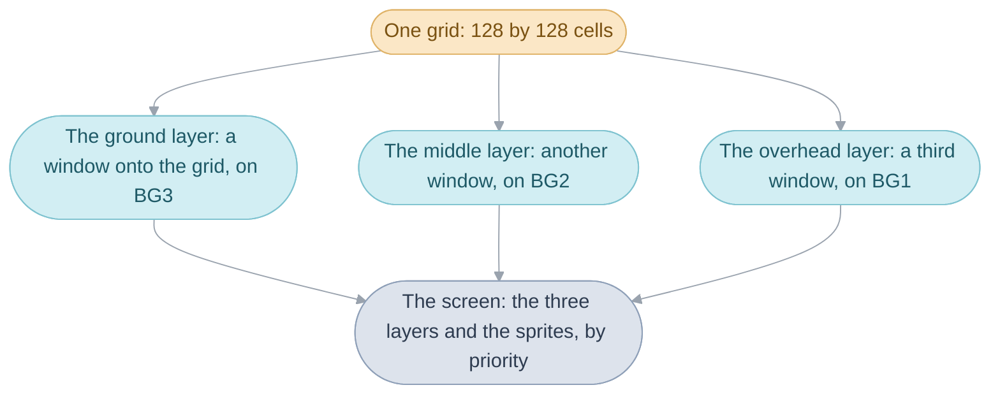
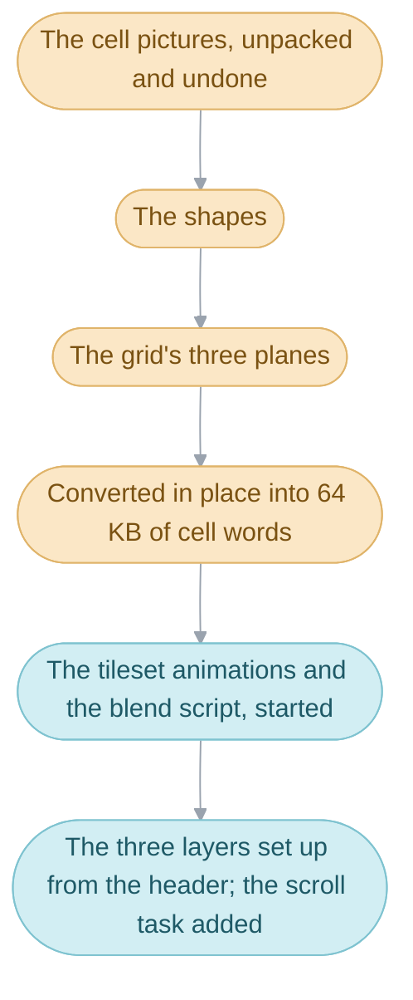

# Maps


Vale on screen is ground, walls and roofs, and Isaac walking among them:
behind a roof, up a ledge, along a cliff he cannot climb, up to a chest. All
of that is the [map](../../glossary.md#map), the ground a
[scene](../../glossary.md#scene) is drawn on, which this folder keeps as
editable tables with no code of its own. A map is a square grid of 16-pixel
[cells](../../glossary.md#cell), 128 on a side, and every cell says three
things: what is drawn there, what standing there does, and how its ground
is shaped. The three flat sheets the player sees, the ground, the walls and
the roofs, are three windows onto that one grid. From its smallest piece
outward, a map is:

1. [Cells](#cells): what one square of the grid says.
2. [One grid, three layers](#one-grid-three-layers): how the three sheets
   share the grid, and what the map's header says about each.
3. [A map's tables](#a-maps-tables) and [how the build makes a
   map](#how-the-build-makes-a-map) from them.
4. [Loading a map](#loading-a-map): how the game unpacks it when the party
   arrives, and the chests it then places.
5. [Tileset animation and blend scripts](#tileset-animation-and-blend-scripts):
   the parts of a map that move by themselves.
6. The two maps built differently: [the World Map's](#the-world-maps-data)
   and the [Colosso paths](#the-colosso-paths).



There are 182 maps, each a folder here, and the World Map's ground and the
Colosso paths beside them. A scene names its map, several scenes can share
one, and [the field bank](../field/README.md) draws and scrolls it.

## Cells


A cell is one 16 by 16 pixel square of a map, and it says three things:
what is drawn there, what standing on it does, and how its ground is shaped.
The cliff Isaac slides along is all three: a picture of rock, cells that say
nothing special, and ground 32 pixels higher than the path, too high to
step onto.

What is drawn is the cell's [cell picture](../../glossary.md#cell-picture),
2 by 2 of the console's 8-pixel tiles. A cell names its cell picture by
number, a row of the map's table of cell pictures.

What standing on it does is its
[cell behavior](../../glossary.md#cell-behavior), a number that walls and
[triggers](../../glossary.md#trigger) are keyed on. One number is a wall
whatever the heights. Most of the numbers belong to the scene: a
[step trigger](../../glossary.md#step-trigger) runs when the leader steps
onto or pushes against a cell with that number, and an
[examine trigger](../../glossary.md#examine-trigger) when the player presses
A facing one, so the same number can be a door in one town and a chest in
another ([Scenes](../scene/README.md#which-triggers-a-cell-starts)). The
rest mean the same in every scene: ground with random battles of its own,
the jars, barrels, wooden boxes, graves, books and wells anyone can search,
the Lamakan Desert's burning sand, and the ledges, climbing spots and gaps
the leader jumps when pushing against them.

How the ground is shaped is the cell's shape: a kind, one of 16
(`enum TerrainKind`: flat ground, slopes, steps, bends and others), and three
height samples in 8-pixel units, from which the height at any pixel of the
cell is worked out. How far up or down an [actor](../../glossary.md#actor)
can step from one height to
the next is the field bank's rule
([How high a step can go](../field/README.md#how-high-a-step-can-go)), and
most of the game's walls are made of heights, as the cliff is.

Behavior and height belong to a layer. Each layer is a window onto the grid
([below](#one-grid-three-layers)), and an actor follows the ground of one
layer, so the three layers can have different walls and heights. A scene's
code can move an actor to another layer, and so can a cell: an actor
standing on a cell whose layer bits are set moves to that cell's layer, and
one whose priority bits are set is drawn with that priority, the console's
order of what covers what, which is how the roof hides Isaac
([below](#one-grid-three-layers)).

A loaded cell is `struct MapGridCell`, one 32-bit word: 12 bits pick the
cell picture, 2 bits the layer and 2 the sprite priority an actor standing
there takes (0 for no change), a byte the behavior and a byte the shape.
`MapGrid_GetTerrainHeight` works out the height at a pixel from the shape,
and `ActorSystem_PlaceSprites` reads the layer and priority bits. The
behaviors are `enum CellBehavior`:

| Name | Value | Meaning |
| --- | --- | --- |
| `CELL_BEHAVIOR_NORMAL` | 0 | open ground: nothing happens |
| `CELL_BEHAVIOR_EVENT_FIRST` to `CELL_BEHAVIOR_EVENT_LAST` | 1 to 239 | the scene's own step triggers, [exits](../../glossary.md#exit) and examine triggers |
| `CELL_BEHAVIOR_ENCOUNTER_GROUND_1`, `_2` | 240, 241 | ground with random battles of its own |
| `CELL_BEHAVIOR_JAR` to `CELL_BEHAVIOR_WELL` | 242 to 247 | search spots with lines every scene shares: a jar, a barrel, a wooden box, a grave, books, a well |
| `CELL_BEHAVIOR_JUMP_FORWARD_UNREACHED` | 249 | jumped across like `CELL_BEHAVIOR_JUMP_FORWARD`, but only by a leader who lands on one, who jumps again |
| `CELL_BEHAVIOR_DESERT_SAND` | 250 | ground that hurts the [party](../../glossary.md#the-party) over time: the Lamakan Desert's sand |
| `CELL_BEHAVIOR_LEDGE` | 252 | jumped down with Down held |
| `CELL_BEHAVIOR_CLIMB` | 253 | climbed up or down with Up or Down held |
| `CELL_BEHAVIOR_JUMP_FORWARD` | 254 | jumped across |
| `CELL_BEHAVIOR_WALL` | 255 | a wall, whatever the heights |

## One grid, three layers


A town's three layers are drawn one over another, but in the grid they sit
side by side: all three are windows onto the one 128 by 128 grid. Each
layer's window starts at a cell the map's header gives, so a map lays its
layers out side by side or one above another, and the cells no window
reaches go unused. In Vale on the stormy night (`map_000`) the ground,
middle and overhead layers start at tiles (0, 0), (60, 0) and (120, 0), all
in a row; in the Goma Cave room with two pillars and a stump (`map_022`) at
(0, 0), (0, 68) and (100, 0); and in Venus Lighthouse Entry at (0, 0),
(64, 0) and (0, 68). A window has no size of its own: the camera's bounds
stop the view, so a layer shows the cells from its start out as far as the
camera can go.

The ground layer shows on `BG3`, the middle layer on `BG2` and the overhead
layer on `BG1`, and each takes a priority from the header, which is how the
console draws the roofs over the sprites and the ground under them;
[the field bank](../field/README.md#towns-and-dungeons-on-screen) explains
how their priorities put actors between them.

### The header

The header says, for each layer, where its window starts in the grid, how
fast it follows the camera, whether it drifts by itself and where it wraps,
and, for the whole map, how far the camera may go. A layer that follows the
camera at the camera's own pace looks as far away as the ground; one that
moves faster looks nearer. In the north of Suhalla Desert (`map_147`) the
overhead layer is a haze of sand that follows the camera a quarter faster
than the ground, drifts across the screen by itself and wraps every 256
pixels. Only three maps drift a layer: the north and south of Suhalla Desert
and the Tolbi ship's deck ([Evidence](#evidence)).

Six offsets follow the header, saying where in the map's bytes the cell
pictures, the shapes, the grid, the tileset animation, the blend script and
the treasure spots start. A map with no tileset animation or blend script
has 0 for that offset; the other four are always present.

The header is one `map_header` line and three `map_layer` lines in `map.s`,
read as `struct MapHeader` and `struct MapLayer`. The last column gives the
Suhalla haze's values.

| Field | Unit | Meaning | The Suhalla haze |
| --- | --- | --- | --- |
| `cameraBounds[4]` | 8-pixel tiles | how far the camera may go: left, top, right and bottom | |
| `priority[3]` | | each layer's priority, 1 to 3; 0 leaves the layer off | |
| `charBase[3]` | | each layer's character block | |
| `reserved` | | always 0, and never read | |
| `layers[n].x`, `.y` | 8-pixel tiles | where the layer's window starts in the grid | 128, 0 |
| `layers[n].scrollX`, `.scrollY` | sixteenths of the camera's motion | how fast the layer follows the camera | 20, 20: a quarter faster |
| `layers[n].speedX`, `.speedY` | sixteenths of a pixel a frame | the layer's drift | -121, 35: about 7.6 pixels right and 2.2 up a [frame](../../glossary.md#frame) |
| `layers[n].periodX`, `.periodY` | 8-pixel tiles, less one | where the layer wraps | `0x1f`: every 32 tiles |

## A map's tables

Everything that makes one town or dungeon map, from its cell pictures to
where its chests stand, is a handful of plain tables in the map's own
folder. Each table holds one piece of the map, and the map's `map.s` puts
them together behind its header.

| File | What it is |
| --- | --- |
| `map.s` | the header, then each table's packed stream, and the treasure spot list as `treasure_spot` lines ended by `treasure_spots_end`; in 129 maps a tileset's palette and tiles follow (from `games/tbs/src/graphics/tileset`) |
| `cell_pictures.tsv` | the cell pictures; a cell picture's number is its row, from 0 |
| `shapes.tsv` | the shapes of the ground: a kind and three height samples |
| `map.txt` | the grid: each cell's cell picture, behavior and shape |
| `tileset_anims.tsv` | the tileset animations' commands |
| `blend.tsv` | the blend script |
| `map_es.txt`, `cell_pictures_ja.tsv`, `shapes_es.tsv` and so on | an [edition](../../glossary.md#editions)'s own version of a table |
| `*_patch.tsv` | bytes [Camelot](../../glossary.md#camelot) changed after packing |

`map.txt` holds one line of the grid per row, each cell written
`picture:behavior:shape` in hexadecimal, a field left off the end being 0
(`4fff:ff`, `20`). Its first line gives the grid's size, the cell its first
written row starts at (column, then row), and the cell every cell the rows
leave out holds; in the part of Vale with the shops and the Psynergy Stone
(`map_003`) it is `grid:128x128	at:0,0	fill:2b:0:0`. Every map's rows
start at 0,0.

## How the build makes a map

The tables are for people to read and edit; the game wants packed bytes. The
build packs each table into the stream the game unpacks, choosing what
Camelot's packer chose, so that the bytes come out the same.

The name of the file the build asks for names the form to make, and
`tools/ags-graphics` makes it. `map.txt` becomes `map.grid.lz`: the grid as
three packed planes, one value a cell for the whole grid. `cell_pictures.tsv`
becomes `cell_pictures.delta1.lz` or one of its two sister forms: the cell
pictures stored as they are, or with each value XORed with the one before,
which packs better, as the file name says and as `enum CellPicturePacking`
names them for the loader. Where [the original](../../glossary.md#the-original)
stream is followed by stray bytes the packer left in its buffer, `map.s`
places them as literal bytes with a `PACKER:` comment naming what wrote
them.

| Table | Built form | What the loader sees |
| --- | --- | --- |
| `map.txt` | `map.grid.lz` | three planes: a byte of behavior a cell, a byte of shape a cell, a halfword (two bytes) of cell picture a cell |
| `cell_pictures.tsv` | `cell_pictures.delta0.lz`, `.delta1.lz` or `.delta2.lz` | `CELL_PICTURE_PACKING_RAW`, `_SPLIT_DELTA` or `_DELTA` |
| `shapes.tsv` | `shapes.table.lz` | 4 bytes a shape |
| `tileset_anims.tsv`, `blend.tsv` | `.script.lz` | halfword commands |

### Patches

Where Camelot changed a stream after packing it, a `_patch.tsv` lists each
changed byte. The table holds what shipped, and the patch gives the packer
the byte it packed, so the packer makes the same choices and the stream
still unpacks to the edited map. The first row of Gondowan Passage's grid
patch:

```text
position  pack  ship  proof
65472     0x02  0x01  literal: 254 of 255 stand-ins reproduce the stream; this is the lowest
```

The byte at that position shipped as `0x01`. The packer must have seen
something else there, since `0x01` would pack differently; any of 254 values
gives the shipped stream, and the patch names the lowest, `0x02`. The proof
column says how the packed byte was found, and a later row that the packer
copied from an earlier one says `copy of` that row's position. Two maps have
patches: Gondowan Passage's grid, and Venus Lighthouse Entry's grid with its
Spanish and French versions.

### Editions

An edition's own version of a table (`map_es.txt`, `cell_pictures_ja.tsv`)
is chosen in `map.s` with `.ifdef` on the edition's name
(`TBS_EDITION_ES`), and editions that agree share one file: Venus Lighthouse
Entry has a French grid and a Spanish one, and the Italian edition uses the
Spanish. A map whose whole data differs by edition has a block of its
`map.s` for each. A map that uses another map's table names that map's
file; the eight test scenes' maps are built this way from `map_001`'s
tables ([Debug scenes](../debug/README.md#the-test-scenes)).

The forms are named in the `Makefile`'s asset rules, and
`TileMap_DecodeStagedBuffer` undoes the cell pictures' packing.

## Loading a map


When the party arrives in a town or dungeon, the map's layers and
[sprites](../../glossary.md#sprite-and-oam) are hidden while the map is
unpacked into working memory, and the scene fades in once everything is in
place. Most of what is unpacked is the grid, which is stored as three
separate planes, one value a cell each, and put together into one word per
cell as it loads, so that everything about a cell can be read in one go.

The loading goes in a fixed order. The cell pictures are unpacked first,
into the cell buffer, then undone from their packing into the cell picture
table; the shapes come next, into their own buffer; then the three planes
of the grid are unpacked into the cell buffer and converted in place into
cell words. The conversion overwrites the first two planes, so they are
copied aside first, and the routine that converts runs from RAM. After the
grid come the tileset animations and the blend script, unpacked into the
space behind the shapes and started; the treasure spot list stays where it is in
the map's bytes, since the field reads it in place. Last, the header sets
up the three layers from their windows, paces and drifts, and the task that
scrolls them is added.



The cells take 64 KB, twice the room set aside for them, so they run on
over two other buffers, and neither can hold anything else while a map is
loaded. Only code that loads the cells again afterwards writes there: a
battle, after which the scene's map is loaded again; the Battle Arena,
which leaves the partner's party there for the link battle that follows;
the World Map's still picture; and the debug sprite viewer.

Each scene's row of `gScenes` ([`field/scenes.s`](../field/scenes.s)) names
a row of `gMaps` ([`map/maps.c`](maps.c)), which gives the map's header,
palette and tiles as rows of the
[resource directory](../../glossary.md#resource-directory). A map's folder
is named after its header's label in that directory, so its number differs
from its row of `gMaps`: the north of Suhalla Desert is row 151 of `gMaps`
and folder `map_147`, and Vale is row 3 and folder `map_002`.

`MapGrid_LoadMap` unpacks each stream in the order above,
`TileMap_DecodeStagedBuffer` undoes the cell pictures' packing,
`TileMap_ConvertBuffer` puts the three planes together into the cell words
in `gMapGridCellBuffer`, `TilesetAnim_StartAll` and `BlendScript_Start`
start the timed changes, and `MapGrid_UpdateLayerScroll` is the task that
scrolls the layers from then on. [System code](../system/README.md#memory-map)
has the memory's map.

| Plane, in stored order | Size | Values |
| --- | --- | --- |
| cell behaviors | 16 KB | a byte a cell |
| shapes | 16 KB | a byte a cell |
| cell pictures | 32 KB | a halfword a cell |
| the cell words they make | 64 KB | a word a cell |

### Placeholder cell pictures

A map's grid holds the number of a cell's cell picture only from the second
time that cell picture appears. The first time one appears in the grid, the
cell holds a placeholder instead, and the game hands out cell picture numbers
in order as it loads the map. Each map's table of cell pictures is ordered by
where they first appear, so a map has exactly as many placeholders as cell
pictures (`map_003` has 1,331 of each). Every map follows the rule but Venus
Lighthouse Entry, whose grid names 170 cells' cell pictures before their
placeholders; those cells still get the right cell pictures, since the
numbering depends only on the placeholders.

A placeholder is cell picture 4,095, the highest 12 bits can hold.
`Tile_ConvertMapGrid`, an assembly routine `TileMap_ConvertBuffer` copies to
RAM and runs, numbers them as it puts the cells together; a C routine that
nothing calls, `TileMap_NumberPlaceholderCellPictures`, does the numbering
alone.

### Chests and Psynergy Stones


Several scenes can share one map, and each puts its own chests in it. The
map lists the spots where a chest or a
[Psynergy](../../glossary.md#psynergy-and-pp) Stone can stand, each with the
subject of the trigger that would place one there (100 to 239), and a scene
places one only where it has a trigger with that subject. A chest is shown
open once it has been opened and is gone once its mimic has been beaten; a
Psynergy Stone stands until it is taken, and taking it fills every party
member's PP.

Crossbone Isle's keys room and its Bane room share `map_110`, whose eight
treasure spots carry the trigger subjects 100 to 107: the keys room has chest
triggers for 100 to 103, and the Bane room for 104 to 107. The Demon Axe's
chest rides on the Bane room's second stone pillar: the room moves spot 107
out of the way as it starts (`TreasureSpot_SetPosition`), then sets its
position to follow the pillar (`TreasureSpot_SetActorPosition`) until the
pillar reaches the ladder.

The treasure spot list is (column, row, subject) rows ended by 255, 255, and
`Field_PlaceTreasureSpots` places an actor at each spot whose subject the
scene has a trigger for, up to `TREASURE_SPOT_MAX`; a spot the scene has no
trigger for takes none of the ten. Every map has its own list, and 76 of
them hold only the end row. Opening a chest and taking a stone are the
scene's examine triggers
([Scenes](../scene/README.md#how-a-trigger-is-chosen)).

| Name | Value | Meaning |
| --- | --- | --- |
| `TREASURE_SPOT_MAX` | 10 | chests and Psynergy Stones placed in one scene |
| a treasure spot's subject | 100 to 239 | the subject of the examine trigger that fills it |

## Tileset animation and blend scripts


Some parts of a map move without anything on the map moving: the game
copies new pictures over a few tiles on a timer, as with Vale's waterfall,
and the whole map changes wherever those tiles are drawn. A map's tileset
animations say which tiles to copy over which and how many frames to wait
between copies; its blend script changes, in the same way, how the layers
mix. Up to 16 tileset animations run side by side, each stepped once a
frame by one [task](../../glossary.md#task), and 84 of the town and dungeon
maps have some, as does the World Map; 35 have a blend script.

A tileset animation is a list of halfwords: a start marker naming which of
the 16 it is, then groups of four values (the tile to copy from, how many
tiles, the tile to copy to and the frames to wait), then a jump, a stop or a
loop back to the start. While a wait lasts the animation only counts down;
when it ends, the copies run on in one frame until a group sets a new wait.
Each `picture` line of `tileset_anims.tsv` copies one run of tiles, so
Suhalla Desert's north needs four such lines for each of the four 32 by 32
pictures its first animation shows: it copies the four rows of a picture,
waits 15 frames, takes the next, and starts again after the fourth. A source
tile numbered from 1,536 up is read from the map's own store of animation
tiles in RAM, where the pictures wait their turn to be copied into video
memory; a lower one is copied within video memory.

The blend script has commands of its own: `control` sets how the layers
blend (`REG_BLDCNT`), and `level` sets the blend's strength (`REG_BLDALPHA`,
or `REG_BLDY` when the blend is a fade to a colour) and waits a number of
frames; it ends with the same jump, stop and loop.

`TilesetAnim_Update` steps the tileset animations and `BlendScript_Run` the
blend script, both as tasks; a scene can pause one animation with
`TilesetAnim_Pause` and resume it with `TilesetAnim_Resume`, as Vale's
cottage rooms resume one of theirs once Jenna's grandmother lies sick in
bed. The names below are the tables' words.

| Word | Value | Meaning |
| --- | --- | --- |
| `channel n` | `0xfd00 + n` | tileset animation n starts at the next value |
| `paused n` | `0xfd80 + n` | as `channel n`, but the animation starts paused |
| `picture` | four values below `0xfd00` | source tile, tile count, destination tile, frames to wait |
| `jump n` | `0xfe00 + n` | continue at value 2n of the animation's commands |
| `stop` | `0xfeff` | halt the animation |
| `end` | `0xffff` | loop back to the animation's start |
| a source tile from RAM | 1,536 on (512 for 64-byte tiles) | copied from the map's animation tiles in RAM |

## The World Map's data


The World Map is far too big to unpack at once, so its ground is cut into
squares that are packed one by one, and the game unpacks only the few
around the party, bringing in new ones as the party walks. The code calls a
square a world map tile, and the 2 by 2 squares around the party its tile
block.

The world is 16 by 16 squares of 512 pixels. The ground is stored as two
sets of squares, one for the lower ground and one for the mountains, woods
and towns drawn over it. Each ground has 320 squares: the 256 the world
starts with, one per position, and 64 alternates that a World Map event can
put in a position, as the World Map's own setup swaps one in while
`FLAG_LAMAKAN_MANTICORE_BEATEN` is clear.

`world/blocks.tsv` is the ground, one value for each 32-pixel cell of the
World Map, 512 across and 320 down, which the build cuts into the 640
squares, each packed on its own. `WorldMap_UpdateCurrentTileBlock` unpacks
the 2 by 2 squares around the party in each ground,
`WorldMap_PreloadCurrentTileBlock` brings in at most one new square a frame,
and `WorldMap_SetWindowCellTile` puts an alternate in a position. The tables
in `default/` are the World Map's too: its default cell pictures, tileset
animations and the collision of its cells, placed by `world_map.s`, which
come back after its still picture
([the field bank](../field/README.md#the-world-map-in-perspective)).

| Name | Value | Meaning |
| --- | --- | --- |
| a world map tile | 512 pixels square | one packed square of the ground |
| the world | 16 by 16 tiles | 8,192 pixels on a side |
| alternates | 64 a ground | squares an event can put in a position |
| the tile block | 2 by 2 tiles | the squares kept unpacked around the party |

## The Colosso paths


In each Colosso final Isaac races an opponent to the arena, and the
opponent follows no rule: it replays a run recorded once, one point a frame,
which `Colosso_UpdatePathOpponent` steps through from
`ColossoRaceWork.path`. `colosso/` holds the three runs, each padded with
rows of two zeros to the 7,200 the work holds; the run ends at the first
such row.

| Table | Match | Points |
| --- | --- | --- |
| `opponent_path_a.tsv` | Azart | 3,918 |
| `opponent_path_b.tsv` | Satrage | 4,380 |
| `opponent_path_c.tsv` | Navampa | 5,048 |

## From the shops back out into Vale


Isaac walks out of Vale's shops, the room closes in around him, and the
village fades in with him standing at the door. Between the two pictures
the whole of the village map is unpacked, and each step of that is one of
the mechanisms above.

### The old map goes

The shops are one room of a sheet of rooms drawn on its own map, and
walking out of the door is an exit, which ends the scene. The main routine
clears away the room's tasks and heap blocks, and with them the map's work;
the cell buffer still holds the room's cells until the next map's overwrite
them.

### The new map comes

The field sequence starts the part of Vale with the shops and the Psynergy
Stone, `SceneId_ValePlaza`, whose row of `gScenes` names row 4 of `gMaps`,
folder `map_003`. `MapGrid_LoadMap` hides the layers and sprites and unpacks
the map in order: its 1,331 cell pictures, undone from their delta packing
into the cell picture table; its shapes; and its grid, three planes that
`TileMap_ConvertBuffer` turns into 64 KB of cell words, handing each
placeholder the next cell picture number as it goes. Its two tileset
animations are unpacked and started, and the treasure spot list is left in
place. The header's three `map_layer` lines give the ground, middle and
overhead layers their windows, side by side at tiles (0, 0), (60, 0) and
(120, 0), each following the camera at the camera's own pace, and the
scroll task is added.

### The scene fills it

The field places Isaac at the entrance the door led to and the villagers
from the scene's actor placements, each standing at the height
`MapGrid_GetTerrainHeight` gives for its cell. `Field_PlaceTreasureSpots`
walks the treasure spot list, one spot on this map, and places the Psynergy
Stone there, since the scene's trigger table has a row for its subject. The
scene's
setup runs, the fade in starts, and from the next frame on
`MapGrid_UpdateLayerScroll` scrolls the three windows after the camera,
`TilesetAnim_Update` steps the two animations, and
`ActorSystem_PlaceSprites` gives Isaac the priority of the cell under him,
so that the next roof he walks behind hides him.

### The same moment, mechanism by mechanism

| Step | Mechanism |
| --- | --- |
| The room closes in | the scene ends; the main routine frees the map's work |
| The cell pictures are read | the cell picture table, undone from its delta packing |
| The grid becomes cells | the three planes, converted in place into cell words, placeholders numbered |
| The water starts moving | the tileset animations, started from the map's commands |
| The three sheets line up | the header: each layer's window, pace and priority |
| The villagers stand on the ground | the shapes, through the height of each one's cell |
| The Psynergy Stone appears | the treasure spot list, matched against the scene's triggers |
| Isaac passes behind a roof | the cell's priority bits, read as his sprite is placed |

## Design

The grid is stored as three whole planes, which the loader turns into cell
words, and the treasure spot list is the one table stored unpacked, which
the loader leaves in place for `Field_PlaceTreasureSpots` to read.

One grid serves all three layers, so every map takes the same 64 KB of
cells, and a layer's window can sit anywhere in the grid.

## How it fits with the rest of the game

When a scene starts, `FieldSequence_Run` loads the map its row of `gScenes`
names through `MapGrid_LoadMap`, then places the treasure spots
(`Field_PlaceTreasureSpots`) for the scene's triggers
([Scenes](../scene/README.md)). From then on
[the field bank](../field/README.md) draws and scrolls the three layers and
reads each cell's behavior and height as actors move. A battle reuses the
cells' memory, so when the party comes back the scene starts again and its
map is loaded again. Where the cells, shapes and cell pictures sit in memory
is in [System code](../system/README.md#memory-map).

## Limits

- 128 by 128 cells, for all three layers together.
- 4,095 cell pictures a map: a cell's cell picture number has 12 bits, and
  4,095 is the placeholder.
- 256 shapes a map, since a cell names its shape in one byte.
- 16 tileset animations (`struct TilesetAnim`).
- `TREASURE_SPOT_MAX` (10) chests and Psynergy Stones placed in a scene.

## Words used here

- A **shape** is the form of the ground in a cell: a terrain kind and three
  height samples.
- A **layer** is one of the map's three backgrounds, each a window onto the
  one cell grid.
- A **plane** is one value per cell over the whole 128 by 128 grid.
- A **treasure spot** is a cell where a chest or a Psynergy Stone can stand.
- A **tileset animation** is one of the 16 timed copies of tiles a map can
  run; its commands are in `tileset_anims.tsv`.
- The **blend script** is the map's timed changes to how the layers mix
  (`BlendScript_`), in `blend.tsv`.

## Evidence

The game keeps no names for any of this, so each piece is named for what the
code does with it: the 16-pixel pictures are what each cell shows, so they
are cell pictures; the shapes feed the height functions; and the treasure
spots are where `Field_PlaceTreasureSpots` puts chests and Psynergy Stones.
The sixth offset is called the treasure spot list because that function is
the only code that reads the pointer the loader stores to it
(`MapGridScrollWork.markers`).

The haze's map is found from the scene table: `SceneId_SuhallaDesertNorth`'s
row of `gScenes` gives row 151 of `gMaps`, folder `map_147`; the south's row
leads the same way to `map_148`, and the Tolbi ship deck's to `map_103`,
whose ground drifts down the screen by a pixel and a half a frame and wraps
only every 2,048 pixels.

The last two bytes of the `map_header` line (`pad0` and `pad1` in `map.inc`,
`reserved` in `struct MapHeader`) are 0 in every map of both games, and
nothing reads them: the loader is the only code that reads the header.

The layer and priority bits of a cell are read through
`struct ActorCameraTile` by `ActorSystem_PlaceSprites`, which moves an actor
to the layer they give and, for an actor with `ACTOR_PRIORITY_AUTOMATIC`,
sets its sprite's priority.
