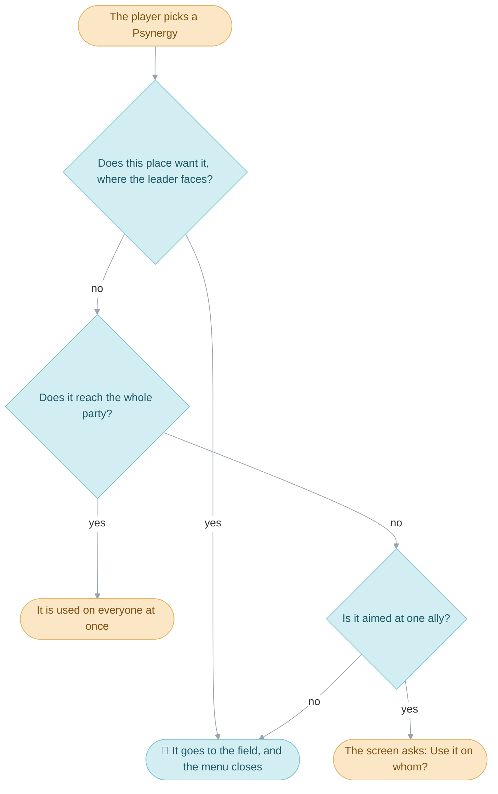
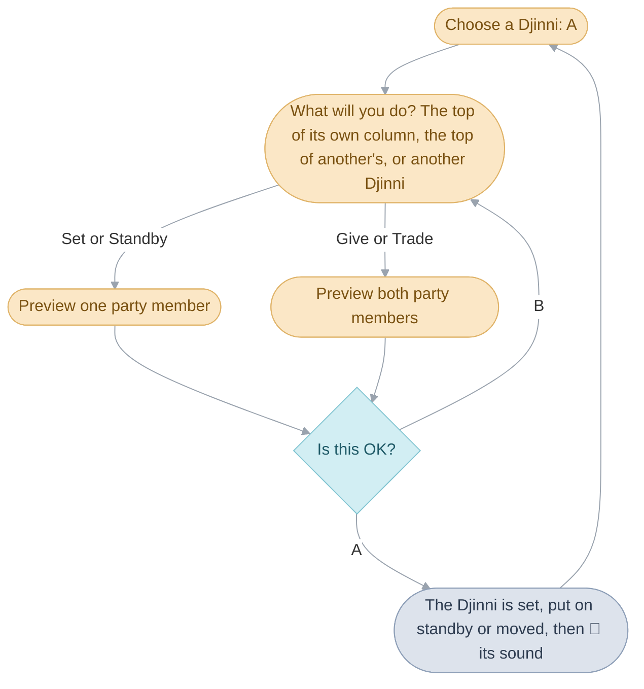
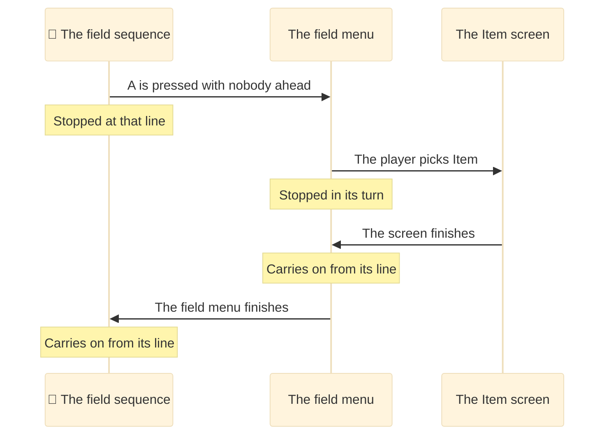
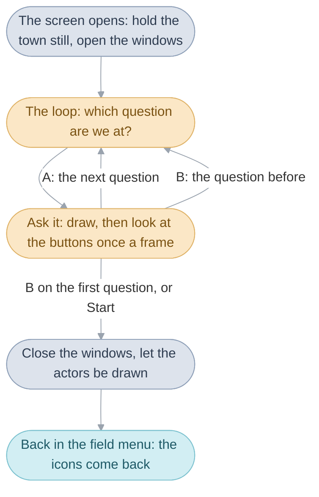
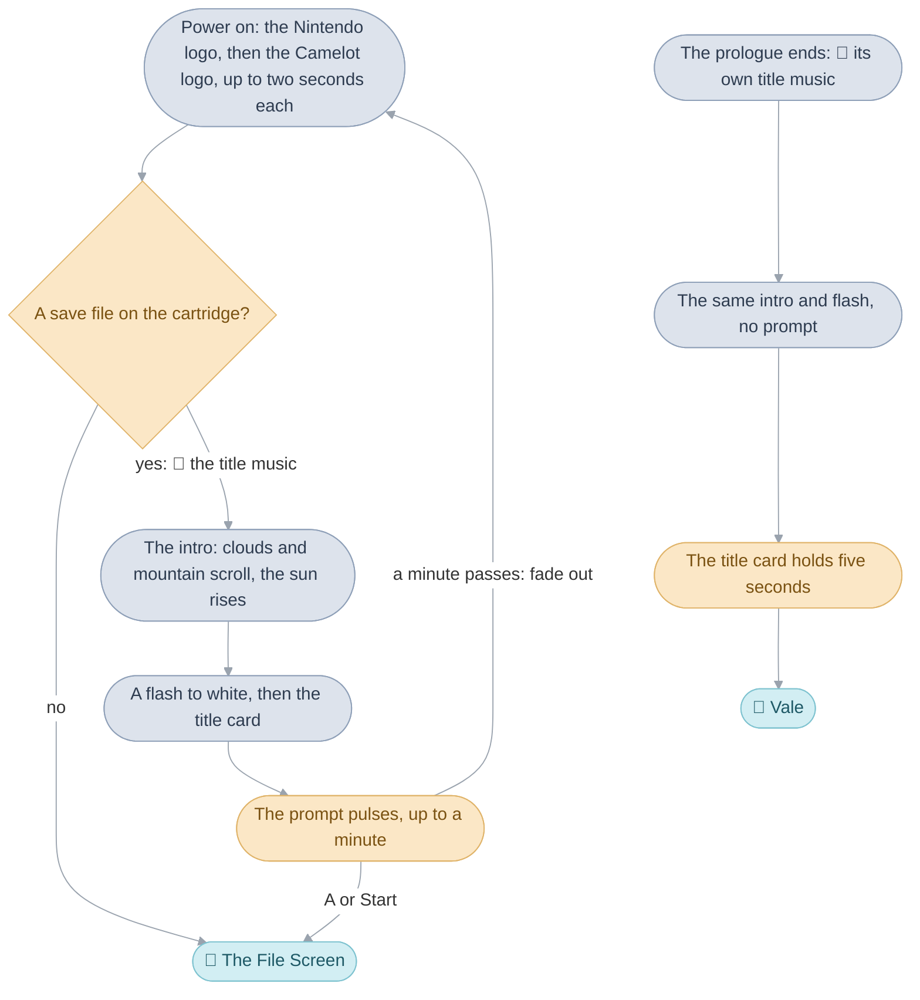
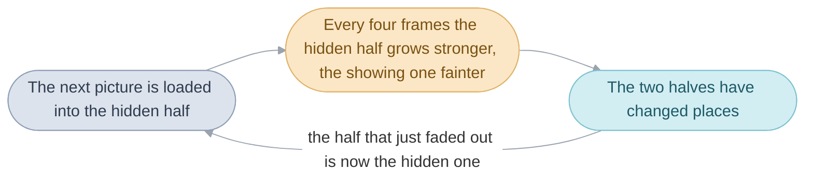

# Menus


Stand Isaac in the middle of Vale, with nobody to talk to and nothing to
examine in front of him, and press A. A window with the party's HP and PP
comes up, and under it a row of icons:
[Psynergy](../../glossary.md#psynergy-and-pp),
[Djinn](../../glossary.md#djinn), Item and Status. Select brings up the same
row from anywhere. This is the field menu, the menu of the
[field](../../glossary.md#field), which is everything outside a battle.

Each icon opens a screen that covers the whole display. A screen asks a few
short questions in a window at the top. The Psynergy screen asks
`Whose Psynergy?`, then `Which Psynergy?`, then `Use it on whom?`. B steps
back one question, and B on the first question brings the icons back.

The town waits behind the screen the whole time.

This page takes the four screens in turn, as the player meets them:

1. [The screens](#the-screens): Psynergy, Item, Djinn and Status. Two pieces
   are shared between them, [the status panel](#the-status-panel) and
   [sorting items](#sorting-items).
2. [A screen is code that waits](#a-screen-is-code-that-waits): where the
   town goes while a screen is open, and how Start closes a screen from any
   depth.
3. [The title intro](#the-title-intro) and [the credits](#the-credits). They
   are not menus, but their code is kept in this folder too.

The row of icons itself is drawn by [Windows](../window/README.md), and so
are the [windows](../../glossary.md#window), the bordered boxes every screen
draws in. The shop counters are in [Shops](../shop/README.md).

## The screens


The row has three icons while the party has no Djinn, and four once it has
one. The Djinn icon is simply left out until then.

The four screens look alike. Small walking figures of the party stand along
the top, and this page calls them the party figures. A pointing hand shows
what is chosen. And the questions come in much the same order: which party
member, then which of their things, then what to do with it.

| Icon     | What it asks, in the game's own words                               |
| -------- | ------------------------------------------------------------------- |
| Psynergy | `Whose Psynergy?`, `Which Psynergy?`, `Use it on whom?`             |
| Item     | `Whose item?`, `Which item?`, one of six commands, then on whom     |
| Djinn    | `Choose a Djinni.`, `What will you do?`, `Is this OK?`              |
| Status   | which party member, then three pages about them                     |

Backing out of a screen's first question brings the icons back, and so does
Start. Only two answers close the whole menu: a Psynergy or an item chosen
for use on the field, such as Move on a pillar. The screen hands that to the
field to carry out ([Psynergy and items used on the
field](../../interface.md#psynergy-and-items-used-on-the-field)).

### The Psynergy screen


Garet has known Flare since level 1, yet his list on this screen never shows
it. The list holds only the Psynergy that does something outside a battle,
such as Move and Cure, and Flare is for battles only. A party member with
nothing to list gets `No usable Psynergy.`

The list shows five Psynergy to a page, each with its PP cost. One that costs
more PP than its caster has left is written in red, and A on it only plays
the error sound.

Outside a battle a Psynergy can do one of two things. It can act on the
party, as Cure does, and then it is used right here while the menu is open.
Or it can act on the world, as Move does, and then the menu has to close so
that the field can cast it.

The screen decides which with three tests, in this order:

1. Does this place want this Psynergy, right where the leader is facing?
   Each [scene](../../glossary.md#scene), the game's word for one place such
   as Vale, lists the spots that react to a Psynergy. An entry on that list
   is a [trigger](../../glossary.md#trigger). If one matches, the Psynergy
   goes to the field, whatever kind it is. This is how Move reaches the
   pillar in the recording.
2. If not, does it reach the whole party, as Wish does? Then it is used on
   everyone at once, with no more questions.
3. If not, is it aimed at one ally, as Cure is? Then the screen asks
   `Use it on whom?`.

A Psynergy that passes none of the three goes to the field too. That is
what happens to Move with no pillar in front of Isaac: it is not for the
party, so the menu closes and the field is left to cast it.



Going to the field means the same thing each time. The screen writes down
who is casting and what as a
[field request](../../glossary.md#field-request), the whole menu closes,
and the field finds the request.


In the recording Isaac casts Cure on a wounded Garet. Follow the three
tests. Vale has nothing for Cure where Isaac is facing. Cure does not reach
the whole party. It is aimed at one ally, so the third test asks for the
target.

Cure starts from 70 HP of healing, and that grows with Isaac's
[Power](../../glossary.md#power-and-resist) in Cure's element, Venus. The
sum is the same one a battle uses. Garet's HP rises, Isaac pays Cure's 3 PP,
the healing sound plays and the line at the bottom reports it, with
`You recovered HP!` or `You recovered all HP!`. Then the list comes back for
another cast.

Had Garet been at full HP, nothing would have been spent. The error sound
plays, the line at the bottom reads `Your HP is maxed out!`, and the screen
asks for the target again.

#### The L and R shortcuts

The same screen sets the two shortcuts, the Psynergy that L and R cast on
the field without opening any menu. A shortcut is only for Psynergy that
acts on the world, such as Move. Cure acts on the party, so it cannot go on
a button.

On the row of party members, press L or R where A would go. The question
changes to a picture of that button and `:Which Psynergy?`, and the list now
holds only the Psynergy a shortcut can take. Pick one and it goes on that
button.

There is a quicker way from the ordinary list. Hold Select over Move, and
the line of button hints under the list changes to say that L and R set a
shortcut. Press either while Select is held, and Move is on that button.
Hold Select over Cure and the error sound plays instead.

### The Item screen


The Item screen asks `Whose item?` and `Which item?`. Then it shows a grid of
six commands for the item under the hand: Use, Equip and Details on the top
row, Give, Remove and Drop below.

A party member's pack has 15 slots. A slot holds one item, or a stack of up
to 30 of the same kind, which is why thirty Herbs take no more room than one.

Before the grid is drawn, the screen works out what this item can do for
this party member, and writes the rest in grey. A on a grey command only
plays the error sound.

| Command | Grey when                                                          |
| ------- | ------------------------------------------------------------------ |
| Use     | the item has no use here, or is broken                             |
| Equip   | this party member cannot wear it, or already wears it              |
| Details | never                                                              |
| Give    | there is nobody to give to, or it is worn and will not come off    |
| Remove  | the item is not worn, or it is one that will not come off          |
| Drop    | the story needs the item, or it is worn and will not come off      |

The items that will not come off are cursed ones such as the Demon Axe. The
items the story needs are the ones the game marks as important, such as the
Orb of Force.

#### Use

Use works much as casting does on the Psynergy screen, with one difference.
An item heals by a fixed amount, whoever holds it. A Herb restores 50 HP in
anyone's hands, where Cure's 70 grows with the caster.

An item that is used up loses one from its stack. Hermes' Water is not used
up: it leaves an Empty Bottle in its slot.

Some equipment can be used as well as worn. The Healing Ring casts Cure when
used, at Cure's plain 70 HP like any item. Each use that works has one
chance in eight of breaking it, with `It broke!`, and a broken item's Use is
grey until it is repaired.

The six items that raise a stat for good have a small surprise in them.
Power Bread raises maximum HP by 8, give or take one: a quarter of the time
it gives 7 and a quarter of the time 9. Cookie, Apple, Hard Nut and Mint are
rolled the same way around their own numbers. Only the Lucky Pepper always
gives exactly its 2 Luck.

An item can be meant for the field, just as Move is. The Bone is the clear
case. It does nothing by itself, so its Use is grey nearly everywhere. Stand
facing the dog in Vault at the right point in the story, though, and Use is
white: the scene has a trigger for a Bone used on that dog. Choose it and
the menu closes, and the field plays out what the dog does with it.

#### Give, Drop and Details


Give asks `Give it to whom?`, and `How many?` when the item is a stack of
more than one. If the receiver already holds a full stack of 30, the answer
is `Can't hold more!`.

When the item is something its new holder can wear, the screen then asks
`Equip this item?`, showing the stats it would give them. A Herb is simply
handed over.

In the recording Garet's pack is full, so there is no slot for Isaac's Herb.
The screen asks `Swap it for what?` over Garet's own list, and the two items
change places.

A swap can fail halfway, for instance when the receiver offers something
they are wearing that will not come off. So before it moves anything, the
screen takes a copy of both party members. If any step fails it puts both
back from the copies and says `Can't trade it!`.

Drop asks the player to confirm over two lines, `Are you sure you` and
`want to drop it?`, with the hand starting on `No`. A stack asks how many
first. A dropped rare item goes back on the shops' count of it, so a shop
may sell it again ([Shops](../shop/README.md#artifacts)).

Details opens a large window describing the item: its Attack and Defense,
each of its effects, whether it is cursed or teaches Psynergy, and how many
there are in the stack.

Two small things are easy to miss on this screen. The line along the bottom
shows the party's coins while a party member is being chosen, and the name
of the item under the hand after that. And on the row of party members,
holding R shows what each one is wearing in place of their items.

### The Djinn screen


The Djinn screen lists every party member's Djinn in a column under their
figure. A name in white is set. A name in red is on standby, and one in
yellow is recovering and cannot be set yet.

Under the columns the screen writes `Effect of unleashing in battle:` and
the line for the Djinni under the hand. For Flint that is
`Strike a blow that can cleave stone.`

A Djinni figure in the element of that Djinni stands by its column. Each
time the hand moves, the figure starts again from nothing and grows to full
size, covering a third of what is left on every
[frame](../../glossary.md#frame). A frame is one picture on the screen, and
the console draws about sixty a second. A Djinni that is recovering is drawn
turned to the side.

#### Two questions, one hand

The screen asks its two questions with the same moving hand. The first,
`Choose a Djinni.`, picks a Djinni in any column. Its figure stays where it
is, and a second figure follows the hand from then on.

The second question, `What will you do?`, has no list of commands. The
answer is where the hand goes next:

- to the top of the Djinni's own column, which now reads `Set` or `Standby`;
- to the top of another party member's column, which reads `Give`;
- or onto a Djinni in another column, to trade the two.

Give keeps the party's Djinn evenly shared. It is allowed only where no
party member would end up two or more Djinn ahead of another. Where it is
not allowed, the top of that column reads `Trade` and cannot be chosen.

Say Isaac holds Flint and Garet holds Forge, one each. Giving Flint to Garet
would leave them at none and two. So the top of Garet's column reads `Trade`,
and the only way to move Flint there is to take Forge back for it.

#### The preview is the real thing

Moving a Djinni changes a party member's class, stats and Psynergy, so the
screen shows the result before it makes the change. It draws each party
member affected as they would be, and asks `Is this OK?`. Only A makes it
happen.

The preview is honest because it is not an estimate. The screen takes a copy
of Isaac, really puts Flint on standby, and has the game work out his class
and stats again. It draws what came out, with an arrow beside each number
that moved. Then it puts Isaac back from the copy.


A give or a trade previews both party members side by side. R turns three
pages: both sets of stats, then the giver's Psynergy, then the receiver's.
Psynergy that would be gained is in yellow and Psynergy that would be lost
is in red.



#### Shortcuts on the first question

On `Choose a Djinni.` three buttons skip steps:

- L shows that party member's status.
- Select opens help on seven topics: Djinn, Set, Standby, Summon, Recovery,
  Class and Psynergy.
- R sets the Djinni under the hand, or puts it on standby, at once and with
  no preview. Keep R held and press Select, and every Djinni in the party
  that is not recovering is set. Press Select again and they all go on
  standby.

A recovering Djinni can be looked at but not chosen. A on it plays the error
sound and writes `Now recovering`.

#### Flint's lesson

The same screen is the lesson Flint gives when he joins the party on the
World Map. Nothing was built specially for it. The real Djinn screen opens,
and the screen plays itself.

It types a message, such as:

```
To give your Djinni to
someone else, move it
like this.
```

Then it waits a second and a half and presses A for the player, then Right,
then A again, each a second and a half apart. To the rest of the screen
these look exactly like the player's own presses, so the hand moves and the
preview opens just as they would in play.

One more detail. The settings let the player choose how fast text is typed.
The Djinn screen ignores that choice and types fast, except for Flint's
lesson messages, which it types at the normal speed. The player's own choice
is put back as the screen closes.

### The Status screen


The Status screen shows one party member at a time. A row picks the party
member, and then A moves through three pages and round to the first again:

- their status: stats, experience, Djinn and the elemental levels, Power
  and Resist;
- their Psynergy, all of it this time, with each one's PP cost and where it
  can be used;
- their equipment, beside the four slots they wear it in (Weapon, Head,
  Shield and Chest), five items to a page, or six in Japanese.

L and R switch to the previous or next party member on any page, and B goes
back to the row. When the party has Djinn, four Djinn figures stand on the
status page, one for each [element](../../glossary.md#the-four-elements).


On the row itself L and R do something else. They move the party member one
place along the party's order, and the change stays after the menu closes.
Select on the row opens `Current Djinn`, every Djinni the party has found,
in a column of seven for each element.

The row also works alone, without the pages. In Colosso an attendant asks
whether a friend should cheer for Isaac. Answer Yes and this row comes up
over the field for the player to pick the friend.

## The status panel


The panel on the left of the Item and Psynergy screens shows the chosen
party member: their name, their portrait and their level. A party member
with two or more ailments has them listed where the level would be.

Below that, the panel shows whatever the hand is on calls for. Watch it
change in the recording:

- Over the Herb it shows Isaac's class, HP, PP and experience.
- Over the Long Sword it shows his Attack, Defense and Agility as they are,
  and beside each one that would change, an arrow and the new number.
- Over the Orb of Force it shows `Force` and `Will learn`, or `Learned` once
  he knows it.

Over something the party member cannot wear, it says `Can't equip`.

HP under a quarter of its maximum is written in yellow, and HP at 0 in red.

The numbers for the Long Sword come from the Djinn screen's trick. The panel
takes a copy of Isaac, really puts the sword on him, has his stats worked
out again, writes them down and puts him back. The game has one way of
working out stats, from scratch ([Game
rules](../game/README.md#why-stats-are-always-worked-out-from-scratch)), and
because the preview uses it, the panel can never promise an Attack the sword
does not give.

When the item is being given to someone else, the panel does the same with
the receiver. If their pack is full, it even throws out their first unworn
item to make room. Putting them back from the copy undoes that too.

## Sorting items


Hold L and press A on the Item screen's row of party members, and that party
member's pack is sorted. Each press moves on to the next of four orders, and
moving the hand to someone else starts again from the first.

Each order sorts the pack into three piles: what the party member is
wearing, their other equipment, and everything else, such as Herbs and keys.

| Press  | Piles, first to last                              |
| ------ | ------------------------------------------------- |
| first  | what they wear, everything else, other equipment  |
| second | what they wear, other equipment, everything else  |
| third  | all equipment, worn or not, then everything else  |
| fourth | everything else, then all equipment               |

Inside a pile, equipment goes by kind: weapons, then helms, then shields,
and so on. Empty slots always end up last.

The Status screen's equipment page shows its list in the first of these
orders. It sorts only what it shows and leaves the pack itself as it is.

## A screen is code that waits


Open the Item screen in Vale and the town stands still underneath it. Close
it and Isaac is exactly where he was. So what became of the town in between?

It never went anywhere. One part of the game runs the field: it reads the
buttons, walks Isaac and starts conversations. The game calls it the [field
sequence](../../glossary.md#field-sequence). It saw the A press, found
nobody ahead to talk to, and started the field menu. Then it stopped right
there, the way a cook stops at one line of a recipe to answer the door.

The field menu draws the row of icons. When the player picks Item, it starts
the Item screen in the same way and stops in its turn.

Nothing has to be saved about where the field was, because the field is
still in the middle of that one line. When the screen finishes, the field
menu carries on from its line, and when the field menu finishes, the field
does.



Before it asks anything, a screen holds the town still. It tells the
[actors](../../glossary.md#actor), the people and creatures of the scene, to
stop being drawn. Most screens also pause the scene's own
[tasks](../../glossary.md#task). The ones paused here animate the
map, move the weather and carry on any change of colours.

When the screen is done, it undoes all of that and tells the field menu one
thing: did the player back out, or did they choose something for the field
to do? After backing out, the icons come back. After a choice for the field,
the whole menu closes and the field carries on from its line, where it finds
the request the screen set.

### The loop of questions

Inside, a screen is a loop over a small set of questions. The loop remembers
which question it is at and runs the piece of code that asks it.

That piece draws its windows and then waits. It looks at the buttons, and if
nothing was pressed it says, in effect, "that is all from me for this frame,
come back on the next one". The game writes that as
[`wait(1)`](../../glossary.md#wait). Meanwhile the rest of the game gets its
turn: the tasks run, the picture is drawn and the music plays. A sixtieth of
a second later the question looks at the buttons again.

From the answer the loop picks the next question. A moves forward and B
moves back, and B on the first question ends the loop.



Two things are the same in every question. The hand bobs on the spot through
eight small steps, one every two frames, and slides to a new place over two
frames. And a list remembers, for each party member, the entry the hand was
last on, so going back to Garet's items lands where the player left them.

### Closing a screen with Start


Start closes a screen however deep the player is. On the Item screen that
can be four questions down, at `How many?` in the middle of giving away
Herbs. The game does not teach every question how to close all the ones
before it. A small task and one flag do it.

Most [game flags](../../glossary.md#game-flag) record the story, such as whether
a chest has been opened. This one only means "Start was pressed in a menu".

As a screen opens, it lowers the flag and adds the task. The task runs once
a frame while the questions wait, and it does one thing. When Start is
pressed it plays the cancel sound, raises the flag and removes itself.

Every question looks at that flag each frame, beside its own buttons. When
it is raised, the question ends exactly as if the player had pressed B. The
loop looks at the flag too, before asking anything else.

So the questions end one after another, each reporting "backed out" to the
one before it, until the loop ends and the screen closes. In the recording
that takes Isaac from `Which Psynergy?` back to the icons in one press.

Because each question only has to look at one flag, `How many?` needs to
know nothing about the four questions before it. On the Djinn screen each
question reads the Start button itself, and ends the same way.

## The title intro


Switch the console on with a save file on the cartridge, wait through the
logos, and the clouds and Mt. Aleph scroll down the screen while the sun and
its lens flares rise along the mountain's slope. The screen flashes white,
and the Golden Sun title card settles with its Press Start prompt pulsing
under it. That is the title intro.


When the intro plays, and how it ends, depends on two things: whether the
cartridge holds a save file, and whether the game is just being switched on
or the story has reached the end of its prologue.



The Title is a scene like any other, and it is the one that makes these
choices
([Scenes](../scene/README.md#the-title-the-file-screen-and-the-battle-arena)).
The logos, the intro and the credits it shows are the pieces kept here.


### Two layers and a slope of sprites


The console draws a picture as a stack of [background
layers](../../glossary.md#background-layer), flat pictures laid one over
another, each of which can slide by itself. The intro puts the clouds on one
layer and the mountain on another in front of it.

The sense of depth comes from sliding them at different speeds. The clouds
move down a pixel, one dot of the screen, every third frame. The mountain
moves down a pixel every other frame. Things further away seem to move more
slowly, so the clouds look far behind the mountain.

Neither picture is ever on the console all at once, because there is not
room for it. Each new strip, eight pixels tall, is copied in just before it
scrolls into view. Once the mountain's picture runs out, the strips coming
in are blank, so that nothing from the top shows again at the bottom.

The sun and its lens flares are
[sprites](../../glossary.md#sprite-and-oam), small pictures the console can
place at any dot of the screen. Every frame the intro places them afresh
along a line from the mountain's foot to its top. The line moves with the
clouds, and the sprites also rise along it by themselves, one pixel every
four frames.

The sprites hide a neat trick. There are six shapes to show, and the intro
sets aside enough sprites for only three of them at a time. So it shows
three on one frame and the other three on the next, sixty times a second,
and the eye sees all six.

The scrolling lasts about four and a half seconds, and then comes the flash.
A or Start skips most of it, but never the last two thirds of a second: the
skip always lands just before the flash, so the flash is never cut into.

Under the title card, the prompt fades in and out by following a list of 60
brightness steps, one for each frame of a second.

### The title intro's own palette fade


The intro fades in by changing colours, with the pictures left as they are.
The screen has 512 colours to draw with, 256 for the layers and 256 for the
sprites. Every one of them starts as the same dark red. Each frame, each
colour moves an equal share of the way to its own proper colour, so they all
arrive together after 60 frames, one second.

That small share is a problem. A colour on this console is three levels,
red, green and blue, each from 0 to 31. Dark red to a pale cloud might be 20
levels of green to cover in 60 frames, a third of a level each frame. A fade
that could only take whole levels would stand still.

So the fade keeps each level with a fraction behind it, counted in 1,024ths
of a level. Every frame it adds the small share to that and shows only the
whole part. On the last frame it copies the proper colours outright, so
nothing is left a shade off by rounding.

The game uses this fade only here. Every scene fades in through another
[palette fade](../../glossary.md#palette-fade), the one the field sequence
runs.

## The credits


After the ending, as the Lemurian ship sails off, the staff names roll up
the screen. They begin with `GOLDEN SUN STAFF CREDITS`, then `Game Planning`
with `Hiroyuki Takahashi` and `Shugo Takahashi` under it.

Behind the names are the pictures the player has fought in front of all game
long, the [battle backgrounds](../../glossary.md#battle-background). Each
one melts into the next: stormy Vale, then Sol Sanctum's hall, then the
grassland and on to Venus Lighthouse, 32 in all, and last a fade to black.
Then the Title goes on to the File Screen, which offers to save the cleared
game.

The timing is as plain as it could be. The names roll alone for five
seconds. Then each picture takes about a second to melt in and stays for
four and a half more. With 32 pictures and the fade to black, that comes to
about 3 minutes 8 seconds.

### Two battle backgrounds in one background memory


For one picture to melt into another, both have to be on screen at once, one
growing fainter as the other grows stronger. A battle only ever shows one
battle background, and the console's room for background pictures is sized
for that.

So the credits cut that room in two, and its colours in two, and give each
half to its own background layer. This works out neatly: a battle background
uses 128 colours, exactly half of the 256 the layers can show, and its
picture fits in half the room with a little to spare.

While one half is showing, the next picture is loaded into the other, which
is hidden. Then the hidden layer is made a sixteenth stronger and the
showing one a sixteenth fainter, every four frames, until they have changed
places. The next picture goes into the half that has just faded out.



Both pictures drift right a pixel every fourth frame. Each is exactly as
wide as its layer, 256 pixels, so it wraps round without a seam.

### The scrolling names


The list of names is far longer than the screen, and the console has nowhere
near room to hold it all as pictures. So the credits keep room for only 32
lines of text, of which 16 are on screen and 16 are hidden.

The text scrolls up one pixel every fourth frame. A line is 8 pixels tall,
so a new one is needed every 32 frames. Each new line is drawn into the
hidden room, over a line that left the top of the screen long ago. When the
writing reaches the 32nd line it carries on from the first. Room used this
way is called a ring, and however many names there are, it never grows.

The names are sprites. Six sprites side by side make each line, and sixteen
lines are on screen. Every frame the sixteen rows are laid out again, raised
by however far the scroll is into the current line.

Each time the scroll crosses into a new line, that line is drawn sixteen
rows ahead: centred, each letter with a shadow one pixel down and to the
right. Strips of solid sprites along the top and bottom of the screen hide
the rows that are only partly in view.

The text itself is a plain list with one entry for each line and an empty
entry for a gap. A special last entry stops the scroll.

The game checks for that last entry a moment too late, after it has taken some
memory from the heap to draw a line in. So that memory is never given back, a
[bug](../../glossary.md#bug-bugfix-and-ubfix) that this code keeps, as it keeps
everything [the original](../../glossary.md#the-original) game does. It does no
harm, because the game takes back every block of the heap before the next scene
starts, and the next scene is the File Screen.

## Design

Two choices shape these screens.

The previews never guess. Both the status panel and the Djinn screen change
the real party member and put them back, so that the one piece of code that
works out stats is the only one. A second sum written just for previews
would sooner or later disagree with it.

A question knows nothing about the other questions. It reports an answer or
"backed out", and Start is one flag that all of them read. That is why the
same Djinn screen can be played by Flint's lesson, and the same row of party
members can be used by Colosso.

## How it fits with the rest of the game

When Isaac's Move is chosen at the pillar, the Psynergy screen sets its
request for the field, and the field sequence carries it out once the menu has
closed ([Field code](../field/README.md)). The Bone and the dog in Vault go
the same way.

What a use does to a party member is decided by the game's rules ([Game
rules](../game/README.md)): how much Cure heals, or what happens to Isaac's
class without Flint. The screens only ask and show.

Every window, letter and icon is drawn by [Windows](../window/README.md).
The shop counters show the same party figures ([Shops](../shop/README.md)).

## Limits

- Only one screen is open at a time, and a shop counter never opens over
  one.
- The Item and Psynergy lists show five entries to a page.
- A party member can know 32 Psynergy at most, and a list has room for
  exactly that many icons.
- A line of the credits is always centred, and can be at most four fifths
  of the screen wide.

## Words used here

- **field menu**: the row of icons that A or Select brings up on the field.
- **screen**: what one icon opens. It covers the display until the player
  backs out.
- **question**: one thing a screen asks, such as `Whose item?`, and the
  piece of code that asks it and waits for the answer.
- **status panel**: the window on the left of the Item and Psynergy screens
  that shows the chosen party member.
- **party figures**: the little party members walking in the top window.
- **Djinn figures**: the four Djinn standing on the Status screen, one for
  each element, and the ones by the columns on the Djinn screen.
- **ring**: the credits' room for 32 lines of text, 16 on screen at a time,
  written round and round as the text scrolls.

## Evidence

The four screens are named for the labels the English release gives their
icons: `Psynergy`, `Djinn`, `Item` and `Status`. Every question quoted on
this page is the game's own English text. The sort orders are described by
the kinds of item each one lists first.

## For readers of the code

The rest of this page is for someone about to open the source. It says where a
screen keeps what it is working on, how the title intro and the credits take the
display for themselves, and where the six languages differ.

### The menu work

While it is open, a screen has a lot to keep track of: which windows it has
opened, which party member and item the hand is on, where each party figure
stands. It keeps all of that in one block of memory, the menu
[work](../../glossary.md#work), `gMenuWork` in the code.

Only one screen is ever open, so the block changes hands. A screen takes
it from the [heap](../../glossary.md#heap-and-pools) as it opens, and gives
it back as it closes. It is always found through the same
[heap slot](../../glossary.md#heap-slot), so every piece of code knows where
to look for it.

A screen wipes the block blank as it takes it. That is what lets it close
"every window" on the way out without a list of the ones it opened: a window
it never opened is still a blank entry, and a blank entry is skipped.

Each screen reads the block its own way (`struct ItemMenuWork`,
`PsynergyMenuWork`, `DjinnMenuWork`, `StatusScreenWork`). The shop counters
use the same block. That is safe because a counter opens only when the
player talks to a shopkeeper, and the field menu is closed then.

The Start flag is `FLAG_MENU_START_PRESSED`. Nothing outside the menus
raises or reads it.

### Taking over the display

Normally the game runs a set of tasks every frame, and one fixed piece of
code sends the frame's sprites to the screen. The credits want neither. For
their length they clear out every task and add three of their own: one
drifts the pictures, one lays out the names and one draws each new line.
They also send their own sprites to the screen, and turn off the auto-sleep.

When they end they put the windows' pictures and the usual sprite code back,
as the File Screen expects. The auto-sleep stays off until a save file is
loaded or the settings menu sets it again. The title intro takes over the
tasks and the sprites in the same way.

The credits have four things to remember: where their sprites are kept, how
far the text has scrolled, the last line drawn and whether the text has
ended. Oddly, they keep them in four spare places that belong to the code
for the cartridge's [flash chip](../../glossary.md#flash-chip), the chip
that holds save files. Nothing is being saved while the credits roll, and
the saving code sets each place again before it next reads it.

### Where the languages differ

The game was released in six languages, which this project calls its
[editions](../../glossary.md#editions). A screen draws its text into the
same store of small pictures the field's own windows use. The English,
German, French, Spanish and Italian words are longer than the Japanese ones
and need more of that store. So while the Item and Status screens are up,
those editions copy part of the store to one side, use the space, and copy
it back as the screen closes. The German, French, Spanish and Italian
editions do the same for the Psynergy screen. The Djinn screen does it in
every language, along with four of the field's sets of colours, to make room
for the backdrop it draws behind its columns.

The same split decides which screens pause the scene's tasks. The Djinn and
Status screens pause them everywhere. The Item screen does not in Japanese,
and the Psynergy screen does only in German, French, Spanish and Italian.
