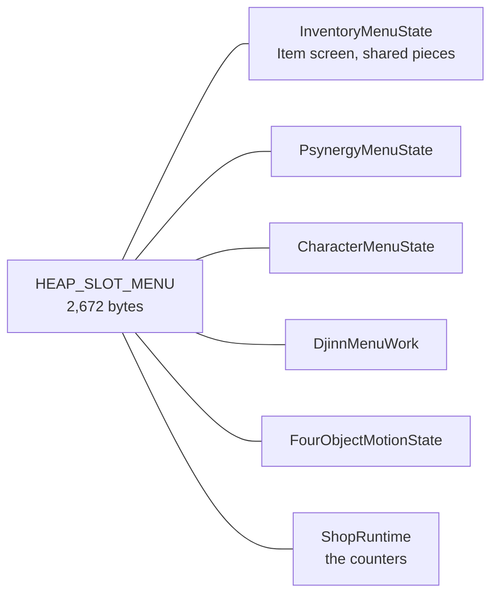
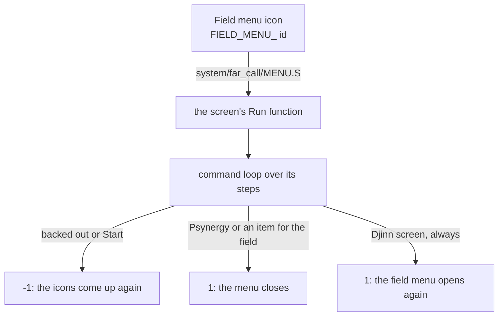

# Menus

The menu code runs the field menu's four screens (Psynergy, Djinn, Item and
Status), the member chooser the Colosso scenes open, and three overlays that
are mostly menus: the title screen, the file select screen and the Battle
Arena's lobby. [Menus, windows and shops](../../menus.md#field-menu-screens)
explains how the field menu opens a screen, how the field is held still
behind it, how Start closes a screen from any depth and how Psynergy and
items meant for the field reach it; this page gives each screen's work and
steps. The windows, messages and icons the screens are drawn with are in
[Windows](../window/README.md), which also draws the row of command icons
(`Menu_RunTopSelection` in `window/window/selection.c`). The counters that
share the menu work are in [Shops](../shop/README.md).

## The menu work

One heap block, the menu work, belongs to whichever screen is running, and
each screen reads it through its own struct.

Only one screen's loop runs at a time, so the menu work belongs to that
screen while it runs: each takes `HEAP_SLOT_MENU` as it opens and releases it
before it returns. The views stay separate structs, as the views of a field
object do in [Field](../field/README.md), because each
is what its own screen's code matches with. The work has room for eight
party members (`ownerIds`) and 32 listed entries (`entryIcons`, `items`). The
counters take the same slot as `struct ShopRuntime`, and the save screen uses
it for its sprites.

The Djinn and Status screens also take blocks from the alternate pool: the
Djinn screen's backdrop (`struct DjinnMenuBackdrop`), which saves the field
tiles and palettes it covers, and the Status screen's copies of the first two
background palettes and of the window tiles it draws over. Each puts them
back and frees them before returning.

| Name | Value | Meaning |
| --- | --- | --- |
| `HEAP_SLOT_MENU` | 55 | the heap slot of the menu work |
| `MENU_WORK_SIZE` | `0xa70` (2,672) | the menu work's size in bytes |
| `INVENTORY_SLOTS` | 15 | slots in a member's inventory |

## The screens

Each of the field menu's four icons opens a screen, a command loop over its
own steps that returns a result to the field menu.

Each screen is entered from the field menu by its `FIELD_MENU_` id through
`system/far_call/MENU.S`, runs a command loop over its steps, and returns a
result to the field menu. Every screen but Djinn returns -1 when the player
backs out or presses Start, and the field menu's icons come up again; the
Psynergy and Item screens return 1 when Psynergy or an item is to be used on
the field, which closes the menu. The Djinn screen always returns 1, which
also opens the field menu again.

| Icon | Value | Function | Part |
| --- | --- | --- | --- |
| `FIELD_MENU_PSYNERGY` | 1 | `PsynergyMenu_Run` | [`menu/psynergy.c`](menu/psynergy.c) |
| `FIELD_MENU_DJINN` | 2 | `DjinnMenu_Run` | [`menu/djinn.c`](menu/djinn.c) |
| `FIELD_MENU_ITEM` | 3 | `ItemMenu_Run` | [`menu/item.c`](menu/item.c) |
| `FIELD_MENU_STATUS` | 4 | `StatusMenu_Run` | [`menu/status.c`](menu/status.c) |

### The Psynergy screen

The Psynergy screen chooses a member, one of their Psynergy and its target,
and either uses it at once or hands it to the field.

![The Psynergy screen in Xian at twice the GBA's size in five panels, one for each step of `Menu_ResolveSelectedAction`, each found where its function is entered and shown just before the A that ends it: `PSYNERGY_STEP_OWNER` asking `Whose Psynergy?` with the hand on Isaac (`ownerIds[0]` 0); `PSYNERGY_STEP_LIST` with Cure highlighted in his list (`paneAction[0]` 90); `PSYNERGY_STEP_CLASSIFY`, which takes no frame and returns 1, one member, so `PSYNERGY_STEP_TARGET` starts in the same frame; `PSYNERGY_STEP_TARGET` asking `Use it on whom?` with the hand on Garet at 60 of 187 HP (`ownerIds[1]` 1); and `PSYNERGY_STEP_APPLY`, where `Ability_ApplyToTargets` has raised Garet to 139 HP and taken Isaac from 61 to 58 PP, and the screen reads `You recovered HP!`.](https://alchemy.pascalpixel.com/guides/menu/psynergy-steps.png)

The **Psynergy** screen steps through `PSYNERGY_STEP_OWNER`, `_LIST`,
`_CLASSIFY` (how the chosen Psynergy is used,
`PsynergyMenu_ClassifySelectedPsynergy`), `_TARGET` and `_APPLY`. Psynergy
used on a member takes effect at `_APPLY`; Psynergy that works on the field
ends the screen with the field's Psynergy request. In its shortcut modes the
same lists set the Psynergy the L or R button casts.

### The Item screen

The Item screen chooses a member, one of their items and a command, and
carries the command out.

The **Item** screen chooses a member (`ITEM_STEP_OWNER`), one of their items
(`ITEM_STEP_ITEM`) and a command (`ITEM_STEP_COMMAND`): Use, Equip, Give,
Drop, Remove or Details (`ITEM_STEP_INSPECT`). Giving chooses the receiver
(`ITEM_STEP_TARGET`) and, when the receiver's bag is full, what they give back
(`ITEM_STEP_TRADE`). Nothing sets `ITEM_STEP_IDLE` or `ITEM_STEP_QUANTITY`.
Each window it draws is a `struct UiWindow` that its work,
`struct InventoryMenuState`, keeps a pointer to: the party figures in
`mainWindow`, the prompt in `messageWindow`, the member's stats in
`statusWindow`, the items in `listWindow`, which holds the command grid once
an item is chosen, the button help in `helpWindow` and the item's description
in `infoWindow`.

`ItemMenu_Run` returns 1 when an item is to be used outside the menu, with
its owner, target and item id in its out parameters. Its steps are an enum
in `menu/item.c`.

| Step | Value | What the screen is doing |
| --- | --- | --- |
| `ITEM_STEP_OWNER` | 0 | choosing a member |
| `ITEM_STEP_ITEM` | 1 | choosing one of their items |
| `ITEM_STEP_USE` | 2 | Use |
| `ITEM_STEP_EQUIP` | 3 | Equip |
| `ITEM_STEP_GIVE` | 4 | Give |
| `ITEM_STEP_DROP` | 5 | Drop |
| `ITEM_STEP_TARGET` | 6 | Give: choosing whom to give it to |
| `ITEM_STEP_TRADE` | 7 | the receiver is full: choosing what they give back |
| `ITEM_STEP_IDLE` | 8 | nothing sets it |
| `ITEM_STEP_COMMAND` | 9 | choosing a command |
| `ITEM_STEP_INSPECT` | 10 | Details |
| `ITEM_STEP_REMOVE` | 11 | Remove |
| `ITEM_STEP_QUANTITY` | 12 | nothing sets it |

### The Djinn screen

The Djinn screen chooses a Djinni and sets it, puts it on standby, gives it
away or trades it, after showing what the change would do.

![The Djinn screen in Xian at twice the GBA's size, previewing Isaac's Flint put on standby: `Flint Standby` and `Is this OK?` at the top, Isaac's class going from Knight to Squire and his HP 178 to 141, PP 61 to 51, Attack 121 to 107, Defense 80 to 73 and Agility 69 to 63, and his Psynergy with `No change`. Beside it, Isaac's unit read from memory before and once A has made the change: two Venus Djinn set and then one, Knight and then Squire, and the same stats the preview shows; while the preview is up the unit is as it was before.](https://alchemy.pascalpixel.com/guides/menu/djinn-preview.png)

The **Djinn** screen chooses a Djinni (`DJINN_STEP_SELECT_DJINN`) and what to
do with it (`DJINN_STEP_SELECT_ACTION`): set it, put it on standby, give it to
another member or trade it for one of theirs, each with a confirm step and an
apply step. Before a change is made,
[`menu/djinn_preview.c`](menu/djinn_preview.c) shows the stats and Psynergy
it leaves each member with, and checks that it keeps the members' Djinn
counts even. Nothing sets `DJINN_STEP_RESERVED`. The
screen types its messages at `MESSAGE_SPEED_FAST` and puts the player's speed
back when it closes. Its choosers test Start themselves and return
`DJINN_RESULT_START`, which ends the loop. `DjinnMenu_Run` also runs the
Djinn tutorial, which the world map opens as `DjinnMenu_Open` when Flint
joins; the tutorial's steps set `MESSAGE_SPEED_NORMAL` for their messages.

The steps are an enum in `menu/djinn.c`, the results in `menu_internal.h`.

| Step | Value | What the screen is doing |
| --- | --- | --- |
| `DJINN_STEP_HANDLE_RESULT` | 0 | after a chooser: a negative result closes the screen, any other goes back to choosing a Djinni |
| `DJINN_STEP_RESERVED` | 1 | nothing sets it |
| `DJINN_STEP_SELECT_DJINN` | 2 | choosing a Djinni |
| `DJINN_STEP_SELECT_ACTION` | 3 | choosing what to do with it |
| `DJINN_STEP_HANDLE_PAIR_RESULT` | 4 | after a second choice: back to the Djinn, or on to a trade's second Djinni or a gift's confirmation |
| `DJINN_STEP_CONFIRM_SET`, `_STANDBY`, `_GIVE` | 5, 6, 7 | confirming a set, a standby or a gift |
| `DJINN_STEP_SELECT_SECOND` | 8 | choosing the other Djinni of a trade |
| `DJINN_STEP_CONFIRM_TRADE` | 9 | confirming a trade |
| `DJINN_STEP_SHOW_STATUS` | 10 | showing the status of the chosen column's member |
| `DJINN_STEP_APPLY_SET`, `_STANDBY`, `_GIVE`, `_TRADE` | 11 to 14 | making the change |
| `DJINN_STEP_SHOW_HELP` | 15 | showing the help |
| `DJINN_RESULT_START` | -2 | a chooser saw Start: the screen closes |

### The Status screen

The Status screen shows one member at a time, in three pages.

![The Status screen in Xian at twice the GBA's size in four panels, one for each step of `Menu_RunActionFlow`, each found where its function is entered: the member row with Isaac's stats and his Djinn counts, the status page with his ailments, Djinn levels, Power and Resist, the Psynergy page with Cure highlighted, and the equipment page with his Broad Sword, Bronze Helm, Bronze Shield and Adept's Clothes. In the first two the four Djinn figures, one of each element, are outlined where the menu work places them: at x 130, 162, 194 and 226 and y 128 under the member row, and at y 104 on the status page; on the other two pages they stand at y -16, above the screen.](https://alchemy.pascalpixel.com/guides/menu/status-pages.png)

The **Status** screen shows a member row and three pages: status, Psynergy
and equipment. When the party has Djinn, it shows the row of four Djinn
figures that `FourObjectMotion_` places
([`menu/djinn_figures.c`](menu/djinn_figures.c)): under the member row,
higher on the status page and above the screen on the other two pages, moved
there at once rather than eased; it is the Djinn screen's row that eases in.

`Menu_OpenCharacterSelector` ([`menu/status.c`](menu/status.c)) lets the
player choose one party member over the field and returns the member's id, or
-1. The Colosso scenes open it through `MENU.S`, and so does the debug test.

## The status panel

The status panel is the window on the Item and Psynergy screens that shows
the chosen member and what a choice would do to them.

![The status panel for Isaac five times at three times its size, each labelled with the kind its call's mode asked for: `STATUS_PANEL_EXPERIENCE` (mode 0) on the Item screen's member row, with his class, HP, PP and experience; `STATUS_PANEL_STATS` (mode 8) with R held there, with his Attack, Defense, Agility and Luck; `STATUS_PANEL_EQUIP` (mode 2) with the cursor on a Long Sword he does not wear, his Attack falling from 121 to 90; `STATUS_PANEL_LEARN` (mode 4) with the cursor on the Orb of Force, `Force` and `Will learn`; and `STATUS_PANEL_CLASS` (mode 6), class, HP and PP, drawn by giving the member row's call that mode, since no call passes it.](https://alchemy.pascalpixel.com/guides/menu/status-panels.png)

`Menu_DrawOwnerStatusPanel` fills a window at tile (0, 5), 13 by 12 tiles, on
the Item and Psynergy screens. It shows the member's name, up to two ailments
or else the level, and the portrait, and below them what the low byte of its
mode, an `enum StatusPanelKind`, asks for. With `STATUS_PANEL_LOWER_ONLY` it
keeps the open window, the name and the ailments and redraws only the part
below. The equipment panel equips the item on the real unit for a moment and
restores the unit from a copy.

| Kind | Value | Below the name |
| --- | --- | --- |
| `STATUS_PANEL_EXPERIENCE` | 0 | class, HP, PP and experience |
| `STATUS_PANEL_EQUIP` | 2 | the stats with an item equipped, or removed; 3 draws the same |
| `STATUS_PANEL_LEARN` | 4 | the Psynergy a Psynergy item teaches |
| `STATUS_PANEL_CLASS` | 6 | class, HP and PP; no call passes it |
| `STATUS_PANEL_STATS` | 8 | Attack, Defense, Agility and Luck |
| `STATUS_PANEL_LOWER_ONLY` | `0x100` | flag: redraw only the part below the name and ailments |

## Sorting items

L and A on the Item screen's member row sort that member's items, each press
moving on to the next of four orders.

![Isaac's eleven items five times: as given (Herb ×3, his equipped Broad Sword, Long Sword, Antidote, his equipped Adept's Clothes, Orb of Force, Leather Cap, his equipped Bronze Shield, Nut ×2, Elven Shirt and his equipped Bronze Helm), then after each of four presses of A with L held on the Item screen's member row. Each column shows the screen's item window at twice its size above the order his inventory then holds, read from his unit, the equipped items marked, and is labelled with the sort mode `InventoryMenu_SortByListOrder` was entered with: 0, `LIST_SORT_EQUIPPED_THEN_ITEMS`, the four equipped items, the Antidote, Nuts and Herbs, then the other equipment; 1, `LIST_SORT_EQUIPPED_THEN_EQUIPMENT`, the equipped items, the other equipment and the Orb of Force, then the rest; 2, `LIST_SORT_EQUIPMENT_FIRST`, the equipment by type, weapons, helms, shields and armor, then the Orb of Force and the rest; 3, `LIST_SORT_ITEMS_FIRST`, the Antidote, Nuts and Herbs first.](https://alchemy.pascalpixel.com/guides/menu/item-sorting.png)

Pressing A while holding L on the Item screen's member row sorts that
member's items, each press moving on to the next of the four orders in
`menudata.c`, named by `enum ListSort`: the equipped items, then the items
that aren't equipment, then the other equipment
(`gMenu_ListOrderEquippedThenItems`); the equipped items, then the other
equipment, then the rest (`gMenu_ListOrderEquippedThenEquipment`); the
equipment first (`gMenu_ListOrderEquipmentFirst`); and the items that aren't
equipment first (`gMenu_ListOrderItemsFirst`). An order lists item types a
byte at a time; a type plus `LIST_ORDER_EQUIPPED` takes only the equipped
items of that type, and `LIST_ORDER_END` ends the order.
`InventoryMenu_SortByListOrder` sorts by an order, which
`Menu_CopyListOrder` copies out of `menudata.c`; `enum ListSort` is in
[`menu.h`](../../include/unit/menu/menu.h).

| Name | Value | Meaning |
| --- | --- | --- |
| `LIST_SORT_EQUIPPED_THEN_ITEMS` | 0 | `gMenu_ListOrderEquippedThenItems` |
| `LIST_SORT_EQUIPPED_THEN_EQUIPMENT` | 1 | `gMenu_ListOrderEquippedThenEquipment` |
| `LIST_SORT_EQUIPMENT_FIRST` | 2 | `gMenu_ListOrderEquipmentFirst` |
| `LIST_SORT_ITEMS_FIRST` | 3 | `gMenu_ListOrderItemsFirst` |
| `LIST_ORDER_EQUIPPED` | `0x80` | added to an item type: only the equipped items of that type |
| `LIST_ORDER_END` | `0xff` | ends an order |

## Design

### Editions

Where the editions lay a screen out differently, such as a column moved over
for longer words, the value is a named macro chosen in one `#if` block near
the top of its part or file, with a comment on what differs.

## Limits

- The menu work is 2,672 bytes, shared by every screen's view of it.
- It has room for eight party members and 32 listed entries.
- A member's inventory has `INVENTORY_SLOTS` (15) slots.
- The title, file select and Battle Arena screens are overlays, loaded into
  the overlay area ([System](../system/README.md)).

## Files

| File | What it holds |
| --- | --- |
| `menu.c` | the menu object, written as parts in `menu/` in ROM order |
| `menu_internal.h` | the includes, macros, flags and types more than one part uses |
| `menu/*.c` | the parts: one for each screen, and [`common.c`](menu/common.c), [`djinn_figures.c`](menu/djinn_figures.c), [`djinn_preview.c`](menu/djinn_preview.c), [`icons.c`](menu/icons.c) and [`use.c`](menu/use.c) for what the screens share |
| `menudata.c`, `menustr.s` | the menu object's tables (the cursor's bob, the item sort orders, highlight widths) and its short strings and backdrop tile |
| `title.c`, [`title.h`](title.h) | the title overlay; `title.h` names the Golden Sun logo the title and file select screens share |
| `clear.c`, [`keyboard.s`](keyboard.s) | the file select overlay: new game, continue, copy, delete, the Battle Arena door and the data transfer, by link or as a password |
| `lobby.c` | the Battle Arena overlay: the link and monster battles, their records and the attendant |
| `entry/`, `import/` | each overlay's entry veneers and the main-image functions it calls |
| `backdrop.png` | the tile the Djinn screens copy into their backdrop's frame, which the Djinn preview blinks |
| `cursor_l.png`, `cursor_r.png`, `cursor_spin.png` | the hand cursor pointing each way and the animated cursor, placed by `window/cursor.s` |
| `slider.png`, `slidpal.png` | the option screen's slider and its colours, placed by `window/slider.s` and `window/slidpal.s` |
| `djinn/` | the Djinn screen's up and down arrows, and the tile the battle's Djinn menu blinks |

`menu.c` includes `menu_internal.h` and then the parts in ROM order, and
`head -4 menu/*.c` lists what each part holds. Link order is in
`games/tbs/objects.tsv`, from `menu/menu` in the main image and from
`menu/entry/title`, `menu/entry/clear` and `menu/entry/lobby` for the
overlays `36f`, `370` and `3cb`. The prototypes are in
`games/tbs/include/unit/menu/`: [`menu.h`](../../include/unit/menu/menu.h)
for the menu object and [`title.h`](../../include/unit/menu/title.h),
`clear.h` and `lobby.h` for the overlays. The structs the screens read their
work through are in the shared headers under `games/tbs/include`, such as
`inventory_menu.h`.

Each picture is an indexed PNG that the build encodes beside it: `.gbapal` is
a palette, and the tile formats name their depth and, for a sprite, its shape
in pixels: `.4bpp` (`backdrop`, `djinn/blink`), `.8bpp8x16` (`cursor_l`,
`cursor_r`), `.8bpp16x16` (`cursor_spin`), `.4bpp32x8` (`slider`) and
`.4bpp16x16` (`djinn/arrowup`, `djinn/arrowdn`). The ROM keeps three copies of
the Djinn arrows, placed by `graphics/ui/menuspr.s` (the copy `menu/icons.c`
loads, as `gMenu_PairSpriteATiles` and `gMenu_PairSpriteBTiles`),
`shop/shopspr.s` and `window/fixed_block.s`. `keyboard.s` keeps a compressed
name entry keyboard tilemap, the same as the Japanese one, that nothing reads.

## Words used here

- **menu work**: heap slot `HEAP_SLOT_MENU`, `MENU_WORK_SIZE` (2,672) bytes,
  reached as `gMenuWork`. Each screen reads it through its own struct:
  `InventoryMenuState` (the Item screen, and the pieces the screens share),
  `PsynergyMenuState`, `CharacterMenuState`, `DjinnMenuWork` and
  `FourObjectMotionState`.
- **owner**: a party member whose items, Psynergy or Djinn a screen shows, by
  character id; `ownerIds` lists the active party.
- **pane** `[0]` and `[1]`: the two sides of a command, the member and item it
  starts from and the member or item it goes to (`paneOwner`,
  `selectedItems`, `selectedSlots`). Giving an item uses both.
- **step**: where a screen's command loop has got to (`enum ItemMenuStep`,
  `PsynergyMenuStep`, `DjinnMenuStep`).
- **status panel**: the window `Menu_DrawOwnerStatusPanel` fills on the Item
  and Psynergy screens.
- **info window**: the help line at the top of a screen. While
  `FLAG_MENU_INFO_KEPT` is set it holds the message last shown there.
- **entry icons**: the item or Psynergy icons laid out in a grid
  (`entryIcons`).
- **party figures**: the members walking in the top window.
- **page arrows**: the two tiles beside a paged list's page numbers
  (`UI_PAGE_ARROW_`), which each screen's loop slides back and forth.
- `unk` plus an offset, such as `unk180`: a field whose meaning is not known.

## Function prefixes

| Prefix | What it acts on |
| --- | --- |
| `Menu_`, `UiMenu_` | pieces several screens share; holding the field still; the hand cursor in the top window |
| `PsynergyMenu_` | the Psynergy screen and its entry grid, and, under an older name, the party figures |
| `ItemMenu_`, `InventoryMenu_`, `EquipmentMenu_` | the Item screen, its messages and sorting, the equip markers |
| `CharacterMenu_`, `CharacterSelector_`, `StatusMenu_` | the Status screen and the member chooser |
| `DjinnMenu_`, `Djinn_`, `OwnerAction_` | the Djinn screen, its lists and its preview loop |
| `FourObjectMotion_` | the row of four figures the Status and Djinn screens show |
| `Item_`, `Ability_` | using an item or Psynergy from the menu |
| `Title_`, `Clear_`, `SaveMenu_`, `LinkLobby_`, `SceneData_` | the three overlays and their scene entry functions |
| `UiWindow_`, `UiText_`, `UiIcon_`, `UiWork_`, `UiPalette_`, `Palette_`, `Resource_`, `Render_`, `Scheduler_` | windows, text, icons, palettes, VRAM entries and tasks, whose main code is in other folders |

Some prefixes are older than the parts. `PsynergyMenu_InitializeEntryObjects`
sets up the party figures for the Item, Psynergy and Djinn screens (through
`ItemMenu_Initialize`), for the Status screen and, through
`PsynergyMenu_InitializeEntryObjectsFar`, for the counters. Many of these
names are shared with The Lost Age's twins (`games/tla/src/menu`), with the
far-call tables and with the window folder, so renaming one crosses folders.
[Matching](../MATCHING.md) explains the spellings some sites keep and the
comment markers.

## Evidence and open questions

Screen and prefix names follow what each screen shows in the English
release. The menu's two flags are named from what sets and tests them, and
the sort orders from the item types they list.

Every view of the menu work names only what its own screen reads and writes;
its `unk` byte runs are the bytes other screens' views use, and the screen
never touches them, since `UiWindow_InitializeWork` clears the whole work as
each screen opens. Three window handles have no window behind them: the
Status screen's `unknownWindow028` (`struct CharacterMenuState`), which it
only clears, and the Item screen's `unknownWindow38` and `unknownWindow40`
(`struct InventoryMenuState`), which it only closes, so they stay NULL and
closing them does nothing. The Djinn screen's `unknownWindow028`
(`struct DjinnMenuWork`) is never given a window either, but its preview
redraws it as it closes (a `// BUG:` in `djinn_preview.c`). That reads the
window's place through NULL, from the BIOS, which outside the BIOS returns the
last BIOS instruction fetched; as a width that is over 30, so
`UiWindow_DrawFrame` draws nothing.

- XXX (no evidence): why the Start watch is a game flag
  (`FLAG_MENU_START_PRESSED`) rather than a variable; the task that sets it
  and every test are in the menu's own code, so nothing in the ROM needs it to
  be a flag, and only Camelot's sources could say why it is one.
