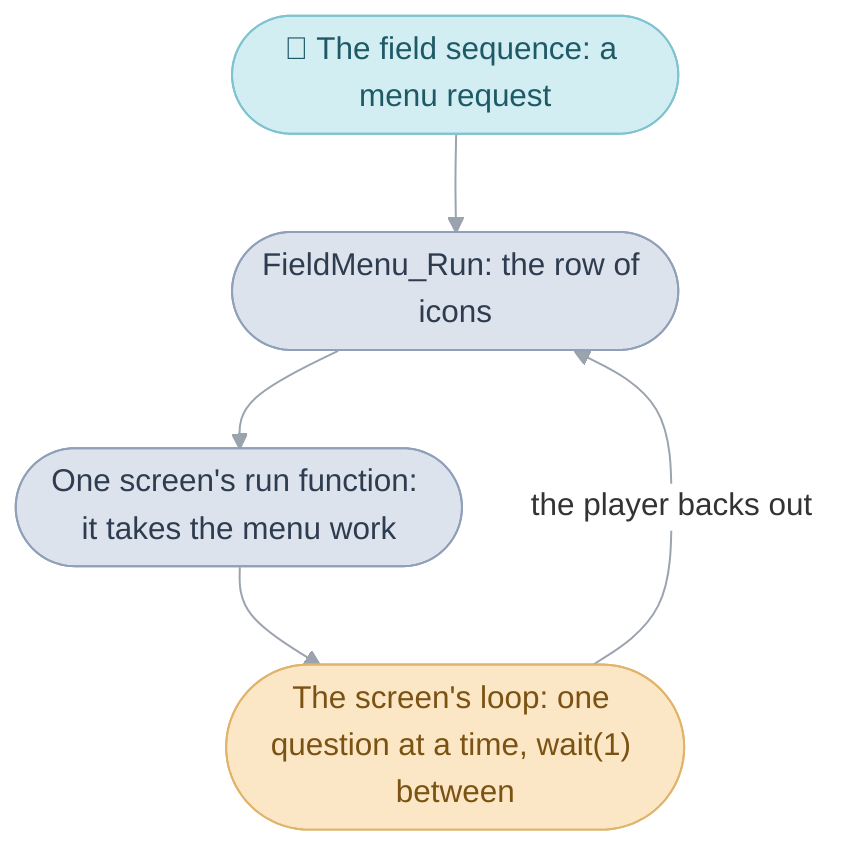
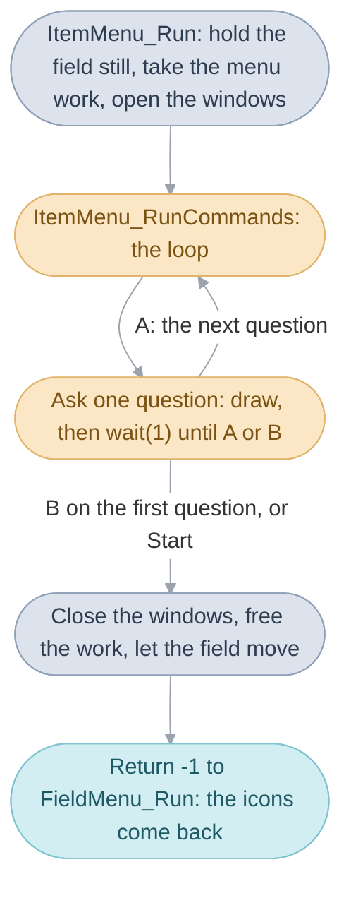
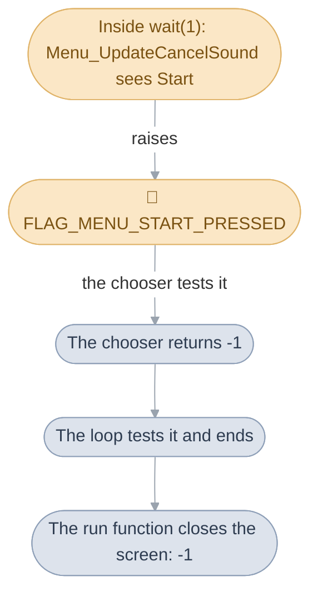
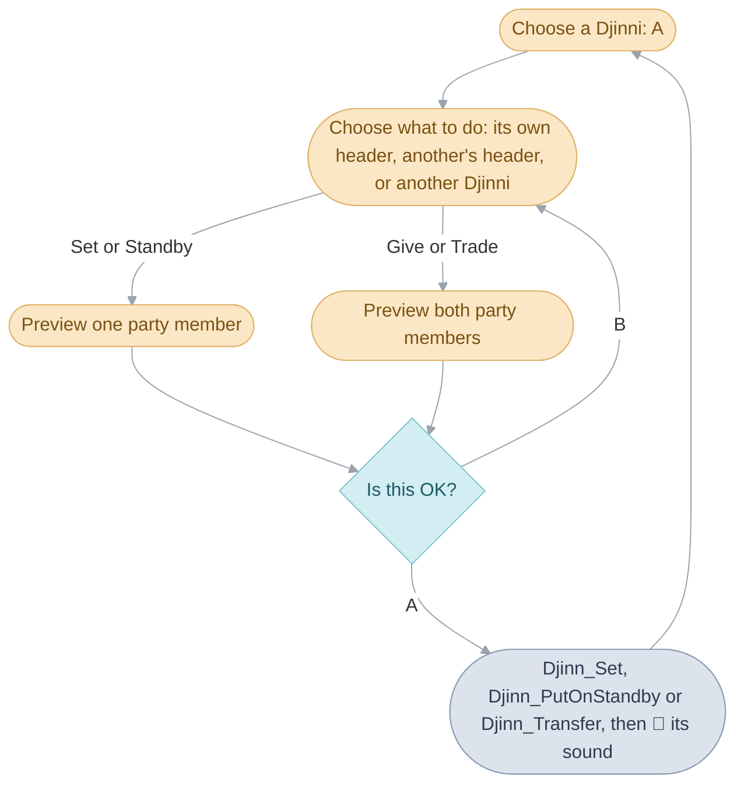
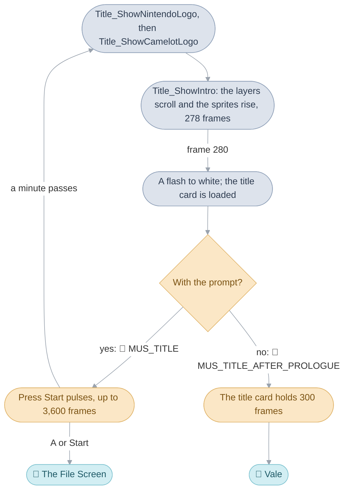

# Menus

Standing anywhere on the [field](../../glossary.md#field), the player presses
A with nothing ahead, or Select, and a row of icons comes up over the town:
[Psynergy](../../glossary.md#psynergy-and-pp), [Djinn](../../glossary.md#djinn),
Item and Status. Each icon opens a screen that fills the display, asks a few
questions one after another (whose, which, on whom) and goes away when the
player backs out, leaving the icons where they were. The town waits behind
it the whole time. The code here runs those four screens, and two things
this folder also holds: the title intro that plays after the logos, and the
staff credits after the ending, each in a [bank](../../glossary.md#bank) of
its own.

The screens work the same way as everything else the player waits on: each
is a function that runs from its first question to its last, letting a
[frame](../../glossary.md#frame) pass with
[`wait(1)`](../../glossary.md#wait) whenever it needs the buttons read.
The page takes them in this order:

1. [The menu work](#the-menu-work): the one block of memory every screen
   keeps its state in.
2. [A screen is code that waits](#a-screen-is-code-that-waits): how a screen
   is opened, loops through its questions, and is closed by Start from any
   depth.
3. [The screens](#the-screens): the Psynergy, Item, Djinn and Status screens,
   one by one.
4. [The status panel](#the-status-panel) and [sorting items](#sorting-items),
   two pieces the screens share.
5. [The title intro](#the-title-intro) and [the credits](#the-credits), which
   run the display themselves.

The row of icons itself, and the [windows](../../glossary.md#window) every
screen draws in, belong to [Windows](../window/README.md);
[Interface](../../interface.md#the-field-menu) gives the whole layer in
brief. The counters of the shops, which borrow the same memory as the
screens, are in [Shops](../shop/README.md).

## The menu work

A screen has a lot to remember while it is open: which windows it has
opened, which party member and which item the hand is on, the icons it has
laid out, where each party figure stands. All of it lives in one block of
memory, the menu [work](../../glossary.md#work), which belongs to whichever
screen is open. Only one screen is ever open, so the block changes hands: a
screen takes it as it opens and gives it back as it closes, and the next
screen starts from a clean block.

The block is borrowed from the [heap](../../glossary.md#heap-and-pools) under
one fixed [heap slot](../../glossary.md#heap-slot), `HEAP_SLOT_MENU`, so
every screen finds it in the same place: `gMenuWork` always points at it. Each
screen's run function allocates it first thing (`HeapSlot_Alloc`), clears it
with `Window_InitializeWork`, which also sets the few defaults (no party
member chosen yet, a cursor grid of one cell), and frees it last thing
(`HeapSlot_Release`). Because it is cleared, every window handle and icon
pointer in it starts as `NULL`, and a screen can close "whatever it opened"
without remembering what that was.

The same bytes mean different things to different screens, so each reads
them through its own struct, which names only the fields that screen uses:
`struct ItemMenuWork`, `struct PsynergyMenuWork`, `struct DjinnMenuWork`
and `struct StatusScreenWork`. A field one screen uses and another leaves
alone keeps the first screen's name in the second's struct, marked "not
named here". The shop counters read the block as `struct ShopWork`, which
works because a counter opens only from a
[scene](../../glossary.md#scene)'s [event](../../glossary.md#event), while
the field menu is closed.

| Name             | Value       | Meaning                                     |
| ---------------- | ----------- | ------------------------------------------- |
| `HEAP_SLOT_MENU` | 55          | the heap slot every screen takes the block from |
| `MENU_WORK_SIZE` | 2,672 bytes | the block's size                            |
| `memberIds`      | 8 entries   | the party in order, as a screen lists it    |
| `entryIcons`     | 32 sprites  | the item or Psynergy icons a screen lays out |

## A screen is code that waits

A screen is drawn over the town, and the town stands still underneath it.
The [field sequence](../../glossary.md#field-sequence)'s loop, which was
walking the party, has stopped at one call: it found a menu
[request](../../glossary.md#field-request), called `FieldMenu_Run` to
answer it, and is waiting for that call to return. `FieldMenu_Run` draws the
row of icons and, when the player picks one, calls that screen's run function
through the menu bank's [far-call](../../glossary.md#far-call) table:
`PsynergyMenu_Run`, `DjinnMenu_Run`, `ItemMenu_Run` or `StatusScreen_Run`.
The whole field is one chain of calls standing still at its deepest point,
which is now inside the screen.

The run function holds the field still before it asks anything. It marks the
[actors](../../glossary.md#actor) as suspended, so their
[sprites](../../glossary.md#sprite-and-oam) stop being drawn and the video
memory they held is released, and in most editions it also pauses the scene's
own [tasks](../../glossary.md#task), the map's animated tiles, the weather
and any palette blend in progress (`Menu_SuspendFieldTasks`). The Djinn and
Status screens pause those tasks in every
[edition](../../glossary.md#editions), the Item screen in every edition but
the Japanese, and the Psynergy screen only in the German, French, Spanish
and Italian ones. Then the run function takes the menu work, lists the
party, opens its first windows and lets its loop run. When the loop returns
it closes every window it opened (`ItemMenu_Close`), frees the work, lets
the actors draw again (`Menu_ResumeFieldTasks`) and returns to
`FieldMenu_Run` with one number. For the Psynergy, Item and Status screens
-1 means the player backed out and the icons come back, and anything else
means the menu is finished with, and the field sequence's loop goes on
walking; the Djinn screen returns 1, and the icons come back.

### The loop of questions

Inside, a screen is a loop over a small set of questions, each with a number
in an `enum` (`ItemMenuStep`, `PsynergyMenuStep`, `StatusScreenStep`,
`DjinnMenuStep`). The loop holds the number of the question it is at, runs
that question's chooser, which draws its windows and calls `wait(1)` once a
frame until the player answers, and from the answer decides the next
question: A moves forward to the next one, B back to the one before, and B on
the first question leaves the loop. The chooser is itself an ordinary
function that waits, so a question that takes a while, such as choosing an
item from a paged list, is one call. The Item screen's loop is
`ItemMenu_RunCommands`, the Psynergy screen's `PsynergyMenu_RunSteps`, the
Status screen's `StatusScreen_RunPages` and the Djinn screen's
`DjinnMenu_RunScreen`.

Every chooser reads the buttons through the same two pieces: a paged list
(`PagedList_HandleInput`, `struct PagedList`) for a list longer than its
window, which moves the hand with Up and Down and changes page with Left
and Right, and a hand cursor (`MenuCursor_Position`, `MenuCursor_Slide`) that
bobs on the spot and slides to its new place over two frames. A list keeps,
for each party member, the entry the hand was last on
(`selectedIndexByMember`), so going back to someone's items lands where the
player left.

### Closing a screen with Start

Start closes a screen however many questions deep the player is, without
any chooser knowing about the ones around it. Before its loop starts, a run
function adds a small task, `Menu_UpdateCancelSound`
(`Menu_CancelSoundReset`), which runs once a frame inside every `wait(1)`
and does one thing when Start is pressed: plays the cancel sound, raises the
[game flag](../../glossary.md#game-flag) `FLAG_MENU_START_PRESSED`, and
removes itself. Every chooser tests that flag beside its own buttons and
returns as if the player had backed out, and the loop tests it too before
running the next question. So the choosers unwind one after another, each
returning -1 to the one that called it, until the loop ends and the run
function returns -1. The Djinn screen is the one exception: its choosers
watch for Start themselves and return `DJINN_RESULT_START`, which its loop
answers with the same unwinding.

## The screens

The row holds three icons until the first Djinni joins the party and four
after it. Each opens one screen, and each screen asks its questions in the
same order: which party member, then which of their things, then what to do
with it. The Psynergy, Item and Status screens return -1 to bring the icons
back, which is what backing out of their first question or pressing Start
does; the Djinn screen always returns to the icons. Two answers close the
menu outright instead of returning to the icons: Psynergy or an item chosen
for use on the field, which the screen hands to the field to carry out
([Psynergy and items used on the
field](../../interface.md#psynergy-and-items-used-on-the-field)).

| Icon     | Run function       | Loop                     | Its questions                                   |
| -------- | ------------------ | ------------------------ | ----------------------------------------------- |
| Psynergy | `PsynergyMenu_Run` | `PsynergyMenu_RunSteps`  | whose Psynergy, which, on whom                  |
| Djinn    | `DjinnMenu_Run`    | `DjinnMenu_RunScreen`    | which Djinni, what to do with it, is this OK    |
| Item     | `ItemMenu_Run`     | `ItemMenu_RunCommands`   | whose item, which, which command, on or to whom |
| Status   | `StatusScreen_Run` | `StatusScreen_RunPages`  | which party member, then three pages            |

### The Psynergy screen

The Psynergy screen asks `Whose Psynergy?`, `Which Psynergy?` and, for
Psynergy aimed at one ally, `Use it on whom?`. What happens after the second
answer depends on the Psynergy chosen, and the screen decides it in one
place, `PsynergyMenu_ClassifySelectedPsynergy`, in this order. If the scene
has a [trigger](../../glossary.md#trigger) for this Psynergy at what the
leader faces
(`Scene_HasFieldPsynergyTriggerFar`), it is for the field: the screen writes
the caster and the Psynergy into the field's work (`gFieldWork.psynergy`)
and returns 1, the menu closes, and the field sequence casts it, which is
how Move reaches the pillar in the recording. If it reaches the whole party
(`ABILITY_RANGE_ALL`), it is used on everyone at once. If it is aimed at one
ally, the third question is asked. Anything else is handed to the field as
well.

Psynergy used on a party member works here and now, through the same
routine the Item screen uses, `Ability_ApplyToTargets`, which heals, cures,
revives or raises a stat and leaves the message to show (`You recovered
HP!`, counted from `MsgItemUseResult`). The Psynergy screen passes it a scale
of 0, which makes HP healing grow with the caster's
[Power](../../glossary.md#power-and-resist) in the Psynergy's element
(`Battle_CalculateRecoveryFar`), as it does in battle. On success the caster
pays the PP (`Unit_AddPpFar`), the status panel, the window on the left that
shows the chosen party member ([below](#the-status-panel)), is redrawn for
the target,
the Psynergy's sound plays (`Ability_PlayUseAnimation`: healing plays
`SE_RECOVERY`) and the list comes back for another cast; on failure, such
as healing someone already at full HP, the error sound plays and the screen
asks for the target again.

The screen also sets the Psynergy the L and R buttons cast on the field. On
the party member row, L or R instead of A picks whose field Psynergy to set
for that button (`PSYNERGY_MODE_SET_L`, `PSYNERGY_MODE_SET_R`), and the list
then shows only field Psynergy and sets the one chosen
(`PsynergyMenu_SetShortcut`, which packs the party member above bit 10 and
the Psynergy below). In the ordinary list, holding Select shows the shortcut
help, and L or R with Select held sets the Psynergy under the hand.

| Name                 | Value          | Meaning                                            |
| -------------------- | -------------- | -------------------------------------------------- |
| `PSYNERGY_MODE_USE`  | 0              | choosing Psynergy to use                           |
| `PSYNERGY_MODE_SET_L` | 1             | choosing the L shortcut                            |
| `PSYNERGY_MODE_SET_R` | 2             | choosing the R shortcut                            |
| `ABILITY_RANGE_ALL`  | 255            | the Psynergy reaches the whole party               |
| `LIST_PAGE_SIZE`     | 5              | Psynergy or items shown on one page of a list      |
| `MENU_TARGET_WHOLE_PARTY` | 9         | the target id passed for Psynergy on the whole party |

### The Item screen

The Item screen asks `Whose item?` and `Which item?`, then shows a grid of
six commands for the item under the hand: Use, Equip and Details on the top
row, Give, Remove and Drop below (`ItemMenu_ChooseCommand`,
`enum ItemMenuCommand`). Before the grid is drawn, `ItemMenu_BuildCommands`
greys out what the item cannot do: Use for an item with no use here or a
broken one, Equip for equipment this party member cannot wear or already
wears, Remove for what is not worn or is cursed, Give when there is nobody to
give to, Drop for an item the story needs; Details is always open. The
status panel on the left follows the hand across the grid, showing the party
member's HP and PP on Use, their stats with the item equipped on Equip and
Details, and without it on the bottom row.

Use works as the Psynergy screen's does, with one difference: the scale
passed to `Ability_ApplyToTargets` is 1, the item's plain power, so a Herb
heals its fixed amount whoever uses it (`Item_Use`). An item that is used up
loses one from its stack, Hermes' Water becomes an Empty Bottle, and an item
that can break, such as the Healing Ring, breaks one use in eight with `It
broke!` (`ItemMenu_TryBreak`). An item the scene has a trigger for at what
the leader faces, or one whose use belongs to the field, is handed to the
field as Psynergy is (`Item_ClassifyUseMode`, `ITEM_USE_MODE_FROM_FIELD`):
the screen writes it into `gFieldWork.item` and returns 1.

Give asks `Give it to whom?` and moves the item one at a time, asking how
many of a stack (`ItemMenu_SelectGiveQuantity`), then offers to equip it on
its new holder with the stats it would give (`ItemMenu_ConfirmEquip`). When
the receiver's pack is full the screen asks instead what they give back
(`ITEM_STEP_TRADE`), and swaps the two. Drop asks `Yes` or `No`
(`ItemMenu_ConfirmDrop`) and takes the item out; a dropped rare item goes
back on the shops' stock count (`Item_AdjustCounterFar`), so a shop may sell it
again ([Shops](../shop/README.md#artifacts)). Details opens a large window
describing the item: its Attack and Defense, each of its effects, whether it
is cursed or bestows Psynergy, and how many there are
(`ItemMenu_ShowDetails`, `ItemMenu_DrawItemDetails`).

The screen is laid out as six windows: the party figures and the question
along the top, the chosen party member's status panel on the left, their
items on the right with the button help under them, and a line along the
bottom that shows the party's coins while a party member is being chosen and
the item under the hand after that. On the party member row, holding R shows
what each one wears instead of their items, with their Attack, Defense,
Agility and Luck in the panel.

| Name                   | Value | Meaning                                              |
| ---------------------- | ----- | ---------------------------------------------------- |
| `INVENTORY_SLOTS`      | 15    | items a party member carries                         |
| `ITEM_STACK_MAX`       | 30    | the most of one item a stack holds                   |
| `MENU_ITEM_GRID_COLUMNS` | 5   | item icons in a row of the pack's grid               |
| one use in eight       |       | how often an item that may break does                |

### The Djinn screen

The Djinn screen shows every party member's Djinn in a column under their
figure and lets the player set one, put it on standby, give it to another
party member or trade it for one of theirs. Moving a Djinni changes a party
member's class, stats and Psynergy, so the screen shows the result before
it makes the change: after the choice it draws each party member affected
as they would be, asks `Is this OK?`, and only A makes the change
(`PsynergyList_RunCompareLoop`, in `menu/djinn_preview.c`). The
preview is made by putting the change on the real party member, working the
stats out again and putting the party member back from a copy, the same
trick as the [status panel](#the-status-panel)'s
(`DjinnMenu_DrawStatPreview`). A give or a trade previews both party members
side by side, and R turns its three pages: their stats, then each one's
Psynergy in turn, with what they would gain and lose.

The loop (`DjinnMenu_RunScreen`) runs two choosers one after the other, both
`DjinnMenu_SelectDjinn`. The first picks a Djinni in any column; A chooses
it, L shows that party member's status (`DjinnMenu_ShowMemberStatus`), Select
opens the help, a list of seven topics (`DjinnMenu_ShowHelp`), and R sets or
stands by the Djinni at once without a preview. The second picks what to do
with it by where the hand goes: the Djinni's own column header for Set or
Standby, another party member's header for Give, or a Djinni in another
column for Trade. Give is offered only where it leaves every pair of party
members within one Djinni of each other (`Djinn_MarkBalancedEntries`,
`Djinn_CheckTurnBalance`); a party member who would end up two ahead is
offered Trade alone. Once confirmed, the change is one call into the game's
rules, `Djinn_SetFar`, `Djinn_PutOnStandbyFar` or `Djinn_TransferFar`, with
its sound, and the lists are rebuilt (`DjinnMenu_BuildLists`).

The same screen is the Djinn tutorial the World Map opens when Flint joins
the party: the run function reads two flags to pick the lesson
(`FLAG_DJINN_LESSON_PART_A`, `FLAG_DJINN_LESSON_PART_B`), and the chooser
then presses the buttons itself between its messages, one lesson's worth
(`enum DjinnTutorialStep`). Whatever message speed the player has chosen,
this screen types at `MESSAGE_SPEED_FAST`, the tutorial's lessons at
`MESSAGE_SPEED_NORMAL`, and the player's speed is put back as it closes.

The screen draws a backdrop of its own behind the lists, and to do so it
saves the first 8 KB of the field's window tiles and four of its palettes in
a block of its own, `struct DjinnMenuBackdrop`, and puts them back as it
closes. Below the lists a row of four Djinn figures, one for each
[element](../../glossary.md#the-four-elements), rises into view, each
growing from small to full size as the hand reaches it, placed once a frame
by a task (`DjinnFigures_UpdateBottomRow`, in `menu/djinn_figures.c`).

| Name                  | Value | Meaning                                                  |
| --------------------- | ----- | -------------------------------------------------------- |
| `DJINN_LIST_ROWS`     | 10    | Djinn one party member's column can list                 |
| `DJINN_RESULT_START`  | -2    | Start was pressed in a chooser: the screen closes        |
| `DJINN_RESULT_BACK`   | -1    | B: back one question                                     |
| `SE_DJINNI_SET`       |       | 📣 the sound of setting a Djinni                         |
| `SE_NOTE_HIGH`        |       | 📣 the sound of putting one on standby                   |
| `SE_RECOVERY`         |       | 📣 the sound of a give or a trade                        |

### The Status screen

The Status screen shows one party member at a time: a row to pick the party
member, then three pages A moves through in a ring, their status (stats,
experience, Djinn and the elemental levels, Power and Resist), their Psynergy
with each one's PP cost and where it can be used, and their equipment beside
the four slots they wear it in. L and R switch to the previous or next party
member on any page; B goes back to the row. On the row itself L and R do
something else: they move the party member one place along the party order,
for good (`PartyMemberChooser_MoveEntry`), and Select lists every Djinni the
party has found, a column of seven for each element
(`DjinnMenu_ShowCurrentList`).

The row is `PartyMemberChooser_RunRearrange`, the status page
`StatusScreen_SelectCommand`, the Psynergy page `PsynergyMenu_SelectAction`
and the equipment page `ItemMenu_SelectItem`, all in `menu/status.c`, run
one after another by `StatusScreen_RunPages`. When the party has Djinn, four
Djinn
figures, one for each element, stand on the status page and move out of
sight for the other two (`DjinnFigures_InitializeTopRow`). The run function
saves the first two background palettes and the window tiles it draws over
before it starts, and puts them back as it closes: it copies the sprites'
first palette, the element icons' colours, into those two background
palettes, one for a highlighted row and one for the rest, so that the
status and Psynergy pages can draw the element icons as window tiles.

The row on its own, over the field and without the pages, is how the
Colosso scenes ask the player for a party member: `PartyMemberChooser_Open`
takes the menu work, runs the row and returns the party member chosen.

| Name                         | Value | Meaning                                       |
| ---------------------------- | ----- | --------------------------------------------- |
| `STATUS_SCREEN_PAGE_STATUS`  | 0     | the row belongs to the Status screen          |
| `STATUS_SCREEN_PAGE_CHOOSER` | 3     | the row is the Colosso scenes' party member chooser |
| `STATUS_EQUIP_PAGE_SIZE`     | 5     | items on one page of the equipment page; 6 in Japanese |

## The status panel

The panel on the left of the Item and Psynergy screens shows the chosen
party member, their name, portrait and level or statuses, and below them
whatever the hand is on needs: their HP and PP while an item is being chosen
to use, what a piece of equipment would do to their Attack, Defense and
Agility, or the Psynergy an item such as the Orb of Force would teach. Each
of those is a kind of panel, `enum StatusPanelKind`, and `StatusPanel_Draw`
draws the one asked for.

To show what a piece of equipment would change, the panel really puts the
item on the party member for a moment, works their stats out again, writes
the old and new values side by side with an up or down arrow where they
differ (`Text_DrawStatComparison`), and then puts the party member back as
they were from a copy taken on the heap, freed before the panel returns. The
game has one way of working out stats, from scratch
([Game rules](../game/README.md#why-stats-are-always-worked-out-from-scratch)),
and the preview uses it, so what it shows is what equipping would do. When
the item is being given, the preview puts it in the receiver's own pack
first, making room if that pack is full, and puts the receiver back the same
way (`ItemMenu_DrawEquipPreview`).

| Name                      | Value | Meaning                                           |
| ------------------------- | ----- | ------------------------------------------------- |
| `STATUS_PANEL_EXPERIENCE` | 0     | class, HP, PP and experience                      |
| `STATUS_PANEL_EQUIP`      | 2     | the stats with the item equipped, or removed      |
| `STATUS_PANEL_LEARN`      | 4     | the Psynergy a Psynergy item teaches              |
| `STATUS_PANEL_STATS`      | 8     | Attack, Defense, Agility and Luck, while R is held |
| `STATUS_PANEL_LOWER_ONLY` |       | redraw only the lower half of the panel           |
| `TEXT_COLOR_LOW_HP`       |       | HP under a quarter of the maximum is drawn yellow |
| `TEXT_COLOR_NO_HP`        |       | HP at 0 is drawn red                              |

## Sorting items

Holding L and pressing A on the Item screen's party member row sorts that
party member's pack, and each press moves on to the next of four orders.
Each order is a short list of item types, kept as data in
[`menu_tables.c`](menu_tables.c), and `ItemMenu_Sort` groups the pack by it,
runs each group from the highest item id down, and moves empty slots to the
end. The four are named by `enum ListSort`, and the Status screen's
equipment page shows its list in the first of them, leaving the pack as it
is.

| Order                               | Groups, first to last                                        |
| ----------------------------------- | ------------------------------------------------------------ |
| `LIST_SORT_EQUIPPED_THEN_ITEMS`     | what they wear, the items that are not equipment, the other equipment |
| `LIST_SORT_EQUIPPED_THEN_EQUIPMENT` | what they wear, the other equipment, the rest                |
| `LIST_SORT_EQUIPMENT_FIRST`         | all equipment by kind, then the rest                         |
| `LIST_SORT_ITEMS_FIRST`             | the items that are not equipment first                       |

## The title intro

The title intro is the show between the logos and the File Screen: the
clouds and Mt. Aleph scroll down while the sun and its lens flares rise
along the mountain's slope, the screen flashes white, and the Golden Sun
title card settles with `Press Start` pulsing under it. It belongs to the
Title, which is a [scene](../../glossary.md#scene) like any other, run by
the field sequence from its own [overlay](../../glossary.md#overlay)
([Scenes](../scene/README.md#the-title-the-file-screen-and-the-battle-arena)).
The Title's entry, `Title_Run`, chooses by the
[entrance](../../glossary.md#entrance) it was started with what to show, and
calls the pieces here through the title bank's far-call table.

At power-on the Nintendo logo shows with its jingle, then the Camelot logo
for two seconds (`Title_ShowNintendoLogo`, `Title_ShowCamelotLogo`). When
the cartridge holds a save file, the intro follows with its prompt
(`Title_ShowIntro(1)`): the title card waits up to a minute for A or Start,
and if nothing comes the screen fades out and the logos start again. With no
save file the logos lead straight to the File Screen. After the prologue the
same intro plays without the prompt (`Title_ShowIntro(0)`), holds the title
card five seconds and goes on to Vale.

### Two layers and a slope of sprites

The sense of depth comes from two
[background layers](../../glossary.md#background-layer) scrolling at
different speeds: the clouds at the back move down a pixel every third
frame, the mountain in front every other frame
(`Title_LoadIntroBackgrounds` sets them up, `Title_ShowIntro`'s loop scrolls
them). Neither image fits in video memory at once, so each new row of
eight pixels is copied in from the unpacked image just before it scrolls
into view, and once the mountain's image runs out the rows coming in are
cleared so that nothing from the top shows again at the bottom. The images
are unpacked through the map grid's cell buffer, which is free while no map
is loaded.

The sun and its lens flares are sprites, placed by a task that runs in the
[VBlank](../../glossary.md#vblank) interrupt, `Title_UpdateIntroSprites`.
Each VBlank it lays them along a line from the mountain's foot to its top,
whose ends follow the back layer's scroll and the sprites' own rise, one
pixel every four frames. The task alternates two sets of three shapes every
other VBlank, which fits six shapes into twelve sprite entries: each set
shows on half the VBlanks, and the eye sees all six. The task builds its own
sprite list and copies it to the hardware itself, so the intro switches the
System's usual sprite copy off while it runs (`gOamCopyEnabled`), and back on
at the flash.

A press of A or Start between frames 20 and 239 jumps the intro to frame
239, so the last stretch before the flash plays as it always does.

| Name                        | Value       | Meaning                                          |
| --------------------------- | ----------- | ------------------------------------------------ |
| the back layer              | 1 pixel every 3 frames | how fast the clouds scroll                |
| the front layer             | 1 pixel every 2 frames | how fast the mountain scrolls             |
| the rise                    | 1 pixel every 4 frames | how fast the sun climbs                   |
| `gTitle_IntroSpriteColumns` | 96 to 184   | the x of the six sprite columns, in pixels       |
| frame 278                   |             | the last frame of scrolling                      |
| frame 280                   |             | the flash                                        |
| `gTitle_PromptBlendLevels`  | 60 entries  | the prompt's brightness over one second's pulse  |

### The title intro's own palette fade

The intro fades in by changing colours, with the images left as they are:
every one of the 512 colours on screen, backgrounds and sprites alike, moves
an equal
share each frame from a dark red towards its own colour, so they all arrive
together after 60 frames. A colour on this console is three levels of five
bits, red, green and blue, and a share of one level over 60 frames is a
fraction of a bit, so the fade keeps each level with ten bits of fraction
below it, which lets a small change spread over many frames still move; on
the last frame it copies the target colours outright. Each frame the new
colours are packed into one of two pages, while the other page waits to reach
the hardware at the next VBlank.

It is a task, `TitlePaletteFade_Update`, set up by
`TitlePaletteFade_Initialize`, which saves both hardware palettes as the
starting colours, and started by `TitlePaletteFade_Start` with the number of
frames. The fade can also head for a single colour or a filtered palette
(`TitlePaletteFade_BuildColors`), and the game uses it only here; every scene
fades through the [palette fade](../../glossary.md#palette-fade) the field
sequence starts, `PaletteFade_Update` in
[palette_fade.c](../field/field_sequence/palette_fade.c), which covers 224
background and 224 sprite colours.

| Name            | Value         | Meaning                                                   |
| --------------- | ------------- | --------------------------------------------------------- |
| 512 colours     |               | 256 background and 256 sprite colours, every one faded    |
| 1,536 levels    |               | three levels of five bits for each colour                 |
| `RGB(2, 0, 0)`  |               | the dark red the intro fades in from                      |
| 60 frames       | about a second | the fade's length                                        |
| ten bits        |               | the fraction kept below each level, so a slow fade moves  |

## The credits

The credits are the staff names that roll over the game's
[battle backgrounds](../../glossary.md#battle-background) after the ending,
as the Lemurian ship sails off. The backgrounds crossfade one into the next,
stormy Vale, then Sol Sanctum's hall, then the grassland, 32 in all, and
last a fade to black, after which the Title goes on to the File Screen, which
offers to save the cleared game. `Credits_Run` runs them; `Title_Run` calls
it through the credits bank's far-call table, with `MUS_ENDING` playing.

`Credits_Run` is one straight run of waits: a lead of 300 frames with only
the names, then for each of 33 slides a crossfade of 64 frames and a hold of
267 frames, the last slide being the fade to black. Its waits come to 11,223
frames, about 3 minutes 8 seconds, besides the time each image takes to
load. Everything that moves meanwhile, the drifting backgrounds and the
scrolling names, is a task.

### Two battle backgrounds in one background memory

A crossfade needs both images on screen at once, one fading out as the
other fades in, so the credits split the background tile memory and the
background colours into two halves and give each half one layer: `BG3`
with the first half, `BG2` with the second. While one half is showing, the
next image is loaded into the other, which is hidden; then the blend between
the two layers is moved across a sixteenth at a time, four frames apart, 64
frames in all, and the halves swap roles. A battle background uses 128 colours,
exactly half of what the background layers can show, so each half holds one
image with its own 128 colours, and an image unpacked into the second half
has its colour numbers moved up by 128 as it is unpacked, so the same image
works in either (`Credits_LoadBackground`, from `gCredits_Backgrounds`).

Both images drift right a pixel every fourth VBlank
(`Credits_ScrollBackgrounds`, a task in the VBlank pass), and since each is
exactly as wide as its layer,
256 pixels, it wraps round without a seam. An image is 256 by 120 pixels,
480 tiles, 30 KB of its half's 32 KB; the last 2 KB hold the half's own
tilemap, whose rows above and below the image point at a blank tile.

| Name                   | Value             | Meaning                                              |
| ---------------------- | ----------------- | ---------------------------------------------------- |
| `gCredits_Backgrounds` | 32 images and a clear | the slides, in order                             |
| a crossfade            | 64 frames         | the blend moved a sixteenth at a time, four frames apart |
| a hold                 | 267 frames        | how long each image stays before the next fades in   |
| 128 colours            |                   | one battle background's palette, half of the 256     |
| 30 KB                  |                   | one image's tiles, 480 of them                       |
| a drift                | 1 pixel every 4 VBlanks | how fast both images slide right              |

### The scrolling names

The list of names is far longer than the screen, and drawing it all at once
would take more tile memory than the console can spare. Instead the names
live in a ring of 32 rows of tiles, 16 on screen and 16 hidden: the text
scrolls up one pixel every fourth VBlank, so a new line of 8 pixels reaches
the top of the hidden half every 32 frames, and each new line is drawn there
over a line that left the top of the screen long before. The credits' memory
stays the same size, however many names there are.

The names are sprites: six 32 by 8 sprites side by side make each line of
192 pixels, and sixteen lines are on screen.
Each VBlank, a task rebuilds the sixteen rows of sprites from the ring,
raised by the scroll within the current line, and copies them to the
hardware (`Credits_UpdateTextSprites`). Each frame, another task checks
whether the scroll has crossed into a new line and, when it has, draws the
line sixteen rows ahead into the hidden half (`Credits_DrawEnteringLine`,
`Credits_DrawLine`), centred, each letter in colour 15 with a shadow in
colour 1 a pixel down and to the right. Opaque strips of sprites along the
top and bottom of the screen hide the rows that are only partly on screen.
The text is `gCredits_Lines`, one row per line and a blank row for a gap,
ending with a null entry that stops the scroll.

[The original](../../glossary.md#the-original) checks for that null entry
after it has taken a line's drawing buffer, so the last buffer stays taken
at the very end
([`// BUG:`](../../glossary.md#bug-bugfix-and-ubfix) in `Credits_DrawLine`);
it does no harm, since the heap is emptied before the File Screen starts.

| Name                   | Value      | Meaning                                              |
| ---------------------- | ---------- | ---------------------------------------------------- |
| `CREDITS_RING_ROWS`    | 32         | rows of tiles in the ring                            |
| `CREDITS_VISIBLE_ROWS` | 16         | rows on screen at once                               |
| `CREDITS_COLUMNS`      | 6          | sprites side by side in one line                     |
| `CREDITS_LINE_PIXELS`  | 192        | a line's width                                       |
| a line                 | 8 pixels, 32 frames | how far, and how long, each line scrolls    |
| `CREDITS_BORDER_SPRITES` | 24       | the opaque strips above and below the text           |

### Taking over the display

For their length the credits run the display themselves: `Credits_Run`
clears the task table and adds its own three tasks, switches off the
System's usual copy of the sprite list and sends its own, and turns off the
debug displays and the idle sleep. When it ends it reloads the windows'
tiles and turns the sprite copy back on, as the File Screen expects; the
idle sleep stays off until a save file is loaded or the settings menu sets
it again. The title intro does the same with its tasks and sprites.

The credits keep their running state, the sprite buffer's address, the
scroll, the last line drawn and a latch for the end of the text, in four
words of memory that belong to the flash chip's code, which lies idle while
the credits roll and sets each word again before it reads it. The
original reaches those words in a way the C language leaves undefined
(`// UB:`), and `UBFIX` gives them proper types.

## Casting Cure from the menu

Garet is at 40 HP after a fight, and the player opens the menu to heal him.
Each thing that happens is one of the page's mechanisms.

The field sequence's loop is in `wait(1)` while the party stands in Vale.
A is pressed with nobody ahead, the leader's
[actor script](../../glossary.md#actor-script) notes it, and when
`wait(1)` returns the loop finds the request and calls `FieldMenu_Run`,
which draws the icons. The player picks Psynergy, and `FieldMenu_Run` calls
`PsynergyMenu_Run` through the menu bank's far-call table.

`PsynergyMenu_Run` holds the field still, takes the menu work under
`HEAP_SLOT_MENU`, clears it, lists the party into it, opens the party
figures' window and the message window, and adds the Start watch
(`Menu_CancelSoundReset`). Then it calls its loop, `PsynergyMenu_RunSteps`.

The loop is at `PSYNERGY_STEP_MEMBER`. It draws `Whose Psynergy?` and runs
the party member row (`PsynergyMenu_SelectPartySlot`), which waits a frame
at a time, moving the hand as Left and Right are pressed, until A on Isaac.
At `PSYNERGY_STEP_LIST` it draws `Which Psynergy?`, the status panel for
Isaac (`StatusPanel_Draw`) and the paged list of his Psynergy
(`PsynergyMenu_RunList`), five to a page with their PP costs; A on Cure.

At `PSYNERGY_STEP_CLASSIFY`, `PsynergyMenu_ClassifySelectedPsynergy` looks at
Cure: Vale has no trigger for it ahead of the leader, it does not reach the
whole party, and it is aimed at one ally, so the answer is 1 and the loop
goes to `PSYNERGY_STEP_TARGET`. It draws `Use it on whom?` and runs the
target row (`PsynergyMenu_SelectTarget`), which shows each party member's HP
as the hand passes; A on Garet.

At `PSYNERGY_STEP_APPLY`, `Ability_ApplyToTargets` is called with Isaac,
Garet and a scale of 0, so Cure's healing is worked out from Isaac's Power
in Cure's element, and Garet's HP goes up. The result is a message number
counted from `MsgItemUseResult`. Isaac pays 3 PP (`Unit_AddPpFar`), his
stats are worked
out again (`Unit_CalculateFar`), the panel is redrawn for Garet,
`Ability_PlayUseAnimation` plays `SE_RECOVERY`, and `You recovered HP!` is
shown in the info window until a button is pressed. The loop goes back to
`PSYNERGY_STEP_LIST`, where B returns to the party member row and B again
leaves the loop with -1.

`PsynergyMenu_Run` closes the windows (`ItemMenu_Close`), frees the menu
work, lets the actors draw again and returns -1. `FieldMenu_Run` sees -1 and
draws the icons once more; B there returns to the field sequence's loop,
which goes on walking.

| What happened                        | Mechanism                                                   |
| ------------------------------------ | ----------------------------------------------------------- |
| The icons come up                    | the field sequence's menu request, answered by `FieldMenu_Run` |
| The screen opens over a still town   | the run function holds the field and takes the menu work    |
| `Whose Psynergy?`, `Which Psynergy?` | the loop's questions, each a chooser that waits             |
| Cure is aimed at one ally            | `PsynergyMenu_ClassifySelectedPsynergy`                     |
| Garet's HP rises, Isaac's PP falls   | `Ability_ApplyToTargets` with a scale of 0, then the PP paid |
| The sound and the message            | `Ability_PlayUseAnimation` and the info window              |
| B, B, and the icons are back         | -1 up through the loop and the run function                 |

## Design

Start closes a screen through one game flag that every loop checks, so a
chooser needs no knowledge of the choosers above it, and a new question can
be added to a screen without touching the others.

Both previews, the status panel's and the Djinn screen's, change the real
party member and put them back, because the game has one routine for
working out stats from scratch, and a second one written for the previews
would drift from it.

The screens share pieces with each other and with the counters: the party
figures walking in the top window are set up by one function,
`PsynergyMenu_InitializeEntryActors`, which every screen calls as it opens
and the shops reach through its far call, and the 32 icon sprites of the
Item, Psynergy and Status screens are made by one, `Menu_SpawnIconEntries`.

The international editions keep 8 KB of the field's window tiles aside while
the Item screen is up, and the German, French, Spanish and Italian ones do
the same for the Psynergy screen, since their longer text needs more tiles
than the Japanese screens drew into. They also widen the highlight over a row
of the Djinn list from 5 tiles to 6 (`DJINN_CURSOR_WIDTH`) and start the
status panel's text further left for their longer labels
(`STATUS_PANEL_TEXT_X`).

## How it fits with the rest of the game

When a screen chooses Psynergy or an item for the field, it leaves it in the
field work's `psynergy` or `item`, and the field sequence
(`FieldSequence_Run`) carries it out once the menu has closed
(`Field_UsePsynergy`, `Field_UseItem`). What a use does to a party member
is the game's rules (`Ability_ApplyToTargets`, `Djinn_SetFar`,
`Unit_CalculateFar`), in [Game rules](../game/README.md); the screens only
ask and show.

## Limits

- A credits line is 192 pixels wide and always centred (the drawing routine
  can also align left or right, but nothing asks it to).

## Words used here

- **party member**: a screen knows each one by character id; `memberIds`
  lists the party in order.
- **side** `[0]` and `[1]`: the two sides of a command, the party member and
  item it starts from and the party member or item it goes to (`sideMember`,
  `selectedItems`, `selectedSlots`). Giving an item uses both.
- **question**: one place a screen's loop can be at, numbered by
  `enum ItemMenuStep`, `PsynergyMenuStep`, `StatusScreenStep` or
  `DjinnMenuStep`.
- **chooser**: the function that asks one question, drawing its windows and
  waiting a frame at a time for the answer.
- **status panel**: the window `StatusPanel_Draw` fills on the Item and
  Psynergy screens.
- **info window**: the help line of a screen. While `FLAG_MENU_INFO_KEPT` is
  set it holds the message last shown there.
- **entry icons**: the item or Psynergy icons laid out in a grid
  (`entryIcons`).
- **party figures**: the party members walking in the top window.
- **Djinn figures**: the row of four Djinn, one an element, on the Status and
  Djinn screens (`DjinnFigures_`).
- **backdrop**: the Djinn screen's own background, and the block that keeps
  the field's tiles and palettes it covers (`struct DjinnMenuBackdrop`).
- **tile ring**: the credits' 32 rows of text tiles, 16 on screen at a time,
  reused as the text scrolls.

## Evidence

Screen and prefix names follow what each screen shows in the English
release. The menu's two flags are named from what sets and tests them, and
the sort orders from the item types they list.

Each screen's struct names only the fields that screen uses. A field another
screen uses keeps that screen's name with the note "not named here"
(`moneyWindow` belongs to `ShopWork`), or is one byte run named for what it
holds (`itemWindows`, `figureRow`). Bytes no struct names are `unused` runs:
the first eight, the 36 after the category icons and a few more. Three window
handles have no window behind them: the Status screen's `unopenedWindow`
(`struct StatusScreenWork`), which it only clears, and the Item screen's
`unopenedWindow` and `secondUnopenedWindow` (`struct ItemMenuWork`), which
it only closes, so they stay `NULL` and closing them does nothing. The Djinn
screen's `unopenedWindow` (`struct DjinnMenuWork`) stays `NULL` too, but
its preview redraws it as it closes (a
[`// BUG:`](../../glossary.md#bug-bugfix-and-ubfix) in `djinn_preview.c`;
`struct DjinnMenuWork` says why it draws nothing).
