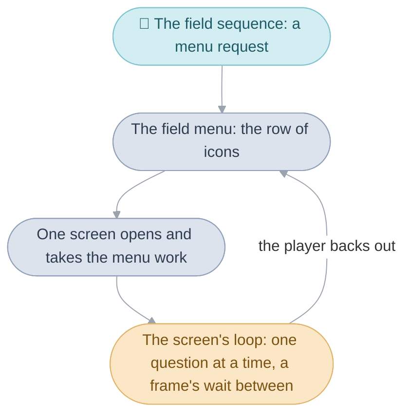
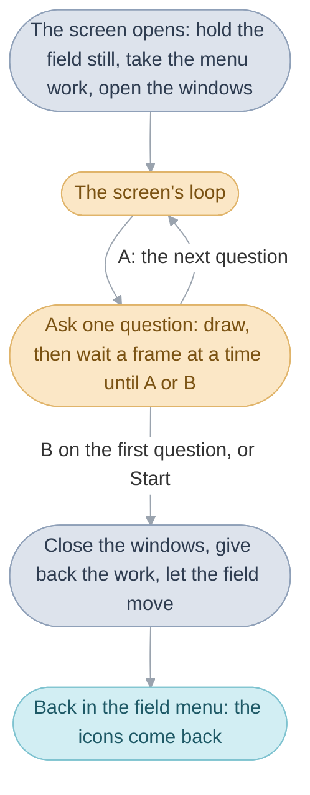
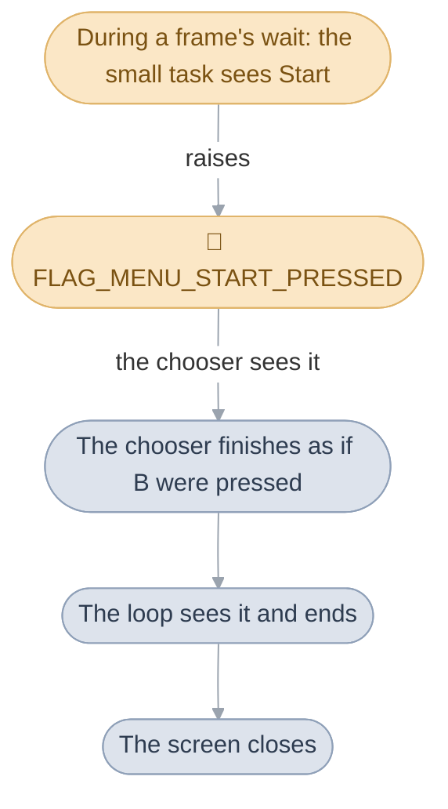
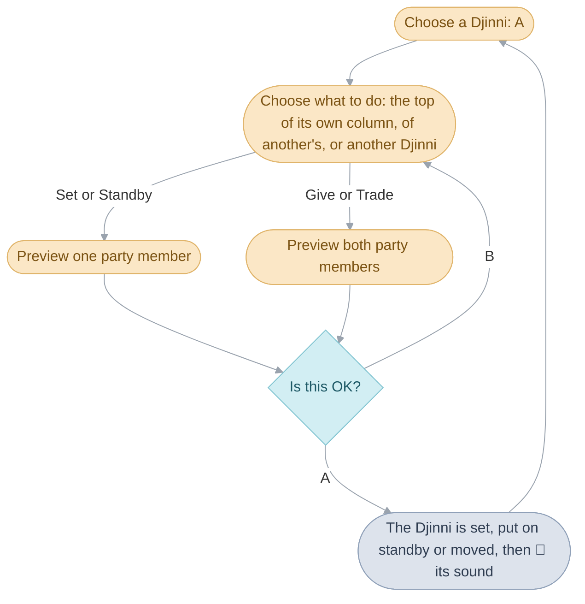
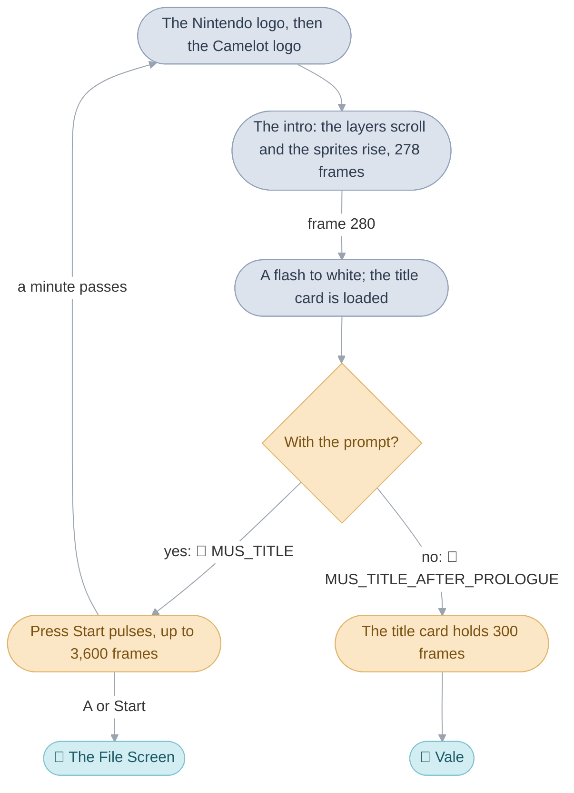

# Menus

Standing anywhere on the [field](../../glossary.md#field), the player presses
A with nothing ahead, or Select, and a row of icons comes up over the town:
[Psynergy](../../glossary.md#psynergy-and-pp), [Djinn](../../glossary.md#djinn),
Item and Status. Each icon opens a screen that fills the display, asks a few
questions one after another (whose, which, on whom) and goes away when the
player backs out, leaving the icons where they were. The town waits behind
it the whole time. The code here runs those four screens, and two shows
this folder also holds: the title intro that plays after the logos, and the
staff credits after the ending.

1. [The menu work](#the-menu-work) is the one block of memory every screen
   keeps its state in.
2. [A screen is code that waits](#a-screen-is-code-that-waits): it opens,
   loops through its questions, and can be closed by Start from any depth.
3. [The screens](#the-screens) are Psynergy, Item, Djinn and Status, with
   two pieces they share, [the status panel](#the-status-panel) and
   [sorting items](#sorting-items).
4. [The title intro](#the-title-intro) and [the credits](#the-credits) run
   the display themselves.

The row of icons itself, and the [windows](../../glossary.md#window) every
screen draws in, belong to [Windows](../window/README.md). The counters of
the shops, which borrow the same memory as the screens, are in
[Shops](../shop/README.md).

## The menu work

A screen has a lot to remember while it is open: which windows it has
opened, which party member and which item the hand is on, the icons it has
laid out, where each party figure stands. All of it lives in one block of
memory, the menu [work](../../glossary.md#work), which belongs to whichever
screen is open. Only one screen is ever open, so the block changes hands: a
screen takes it as it opens and gives it back as it closes.

The block is borrowed from the [heap](../../glossary.md#heap-and-pools), the
memory the game lends out, under a fixed number, its
[heap slot](../../glossary.md#heap-slot), so every screen finds it in the
same place. A screen wipes the block clean as it takes it. A window the
screen never opened is therefore an empty entry, and closing "every window
in the block" as the screen leaves is safe without a list of which ones
were opened.

The same memory means different things to different screens, and each lays
the block out its own way.
The shop counters use the block too, which works because a counter opens
only from a [scene](../../glossary.md#scene)'s
[event](../../glossary.md#event), when the field menu is closed.

## A screen is code that waits

A screen is drawn over the town, and the town stands still underneath it.
The [field sequence](../../glossary.md#field-sequence), the code that was
walking the party, has stopped at one line: it found the player's
[request](../../glossary.md#field-request) for the menu, called the field
menu to answer it, and is waiting for that call to finish. The field menu
draws the row of icons and, when the player picks one, calls that screen in
the same way and waits in its turn. Nothing has to be remembered about
where the field was, because the field never left: it is still in the
middle of that one line.

Before it asks anything, a screen holds the field still. It tells the
[actors](../../glossary.md#actor), the people of the scene, to stop being
drawn, which also frees the video memory their
[sprites](../../glossary.md#sprite-and-oam) used. In most editions a
screen also pauses the scene's own [tasks](../../glossary.md#task): the
map's animated tiles, the weather and any change of colours in progress.
Then the screen takes the menu work, lists the party, opens its first
windows and starts its loop.

When the loop ends, the screen undoes all of that in reverse: it closes its
windows, gives back the work and lets the actors draw again. It tells the
field menu one thing as it goes, whether the player backed out or the menu
is finished with. After backing out, the icons come back. The menu is
finished with when the player has chosen something for the field to do,
and then the field sequence carries on from its line.

### The loop of questions

Inside, a screen is a loop over a small set of questions. The loop
remembers which question it is at and runs that question's chooser, the
piece of code that asks it. A chooser draws its windows and then calls
[`wait(1)`](../../glossary.md#wait) once a [frame](../../glossary.md#frame),
reading the buttons each time, until the player answers. From the answer
the loop picks the next question: A moves forward, B moves back, and B on
the first question leaves the loop.

A chooser is an ordinary function that waits, so even a question that takes
a while, such as choosing an item from a list of several pages, is one call
from the loop's point of view.

Two helpers serve every chooser. A paged list handles a list longer than
its window: Up and Down move the hand, Left and Right change the page. A
hand cursor bobs on the spot and slides to its new place over two frames. A
list also remembers, for each party member, the entry the hand was last on,
so going back to someone's items lands where the player left.

### Closing a screen with Start

Start closes a screen however many questions deep the player is, and no
chooser has to know about the ones around it. As a screen opens it adds a
small task, which runs once a frame while the choosers wait. The task does
one thing when Start is pressed: it plays the cancel sound, raises a
[game flag](../../glossary.md#game-flag), `FLAG_MENU_START_PRESSED`, and
removes itself.

Every chooser looks at that flag beside its own buttons and, when it is
raised, finishes exactly as if the player had pressed B. The loop looks at
the flag too, before asking another question. So the choosers finish one
after another, each handing "backed out" to the one that called it, until
the loop ends and the screen closes. The Djinn screen's choosers watch for
Start themselves, and unwind the same way.

## The screens

The row holds three icons until the first Djinni joins the party and four
after it. Each opens one screen, and the screens ask their questions in
much the same order: which party member, then which of their things, then
what to do with it.

| Icon     | Its questions                                   |
| -------- | ----------------------------------------------- |
| Psynergy | whose Psynergy, which, on whom                  |
| Djinn    | which Djinni, what to do with it, is this OK    |
| Item     | whose item, which, which command, on or to whom |
| Status   | which party member, then three pages            |

Backing out of a screen's first question, or Start, brings the icons back.
Only two answers close the whole menu: Psynergy or an item chosen for use
on the field, which the screen hands to the field to carry out
([Psynergy and items used on the
field](../../interface.md#psynergy-and-items-used-on-the-field)).

### The Psynergy screen

The Psynergy screen asks `Whose Psynergy?`, then `Which Psynergy?` from a
list of five to a page with their PP costs. What happens next depends on
the Psynergy chosen, and the screen sorts it out by three tests, in this
order:

1. Does the scene have something for this Psynergy at the spot the leader
   faces, a [trigger](../../glossary.md#trigger)? Then it is for the field.
   The screen writes down who is casting and what, the menu closes, and the
   field sequence casts it. This is how Move reaches the pillar in the
   recording.
2. Does it reach the whole party? Then it is used on everyone at once.
3. Is it aimed at one ally? Then the screen asks `Use it on whom?`.

Anything else is handed to the field as well.

Psynergy used on a party member works here and now, while the menu is open.
In the recording Isaac casts Cure on Garet, who is at 40 HP. Vale has
nothing for Cure where Isaac is facing, Cure does not reach the whole
party, and it is aimed at one ally, so the third test asks for the target.
The healing is worked out the way a battle works it out, growing with
Isaac's [Power](../../glossary.md#power-and-resist) in Cure's element.
Garet's HP rises, Isaac pays Cure's 3 PP and goes from 61 to 58, the
healing sound plays, `You recovered HP!` shows, and the list comes back
for another cast. Had Garet been at full HP, the error sound would have
played and the screen would have asked for the target again, with no PP
spent.

The screen also sets the two Psynergy shortcuts, the ones L and R cast on
the field. On the party member row, pressing L or R instead of A picks
whose Psynergy to put on that button, and the list then shows only the
Psynergy that works on the field. In the ordinary list, holding Select
shows help for the shortcuts, and L or R with Select held puts the
Psynergy under the hand on that button.

### The Item screen

The Item screen asks `Whose item?` and `Which item?`, then shows a grid of
six commands for the item under the hand: Use, Equip and Details on the top
row, Give, Remove and Drop below. A party member's pack has 15 slots, and a
slot holds one item or a stack of up to 30 of the same kind.

Before the grid is drawn, the screen greys out what the item cannot do.

| Command | Greyed out when                                               |
| ------- | ------------------------------------------------------------- |
| Use     | the item has no use here, or is broken                        |
| Equip   | this party member cannot wear it, or already wears it         |
| Details | never                                                         |
| Give    | there is nobody to give to                                    |
| Remove  | the item is not worn, or is cursed                            |
| Drop    | the story needs the item                                      |

Use works as the Psynergy screen's casting does, with one difference: an
item heals by its own fixed power, so a Herb restores the same HP whoever
uses it. An item that is used up loses one from its stack, and Hermes'
Water leaves an Empty Bottle behind. An item that can break, such as the
Healing Ring, breaks one use in eight, with `It broke!`. And an item meant
for the field, one the scene has a trigger for where the leader faces, is
handed to the field just as Psynergy is: the screen writes it down and the
menu closes.

Give asks `Give it to whom?`, and how many when the item is a stack. Then
it offers to equip the item on its new holder, showing the stats it would
give. When the receiver's pack is full, the screen asks what they give
back, and swaps the two. Drop asks `Are you sure you want to drop it?` and
takes the item out. A dropped rare item goes back on the shops' count of
it, so a shop may sell it again ([Shops](../shop/README.md#artifacts)).
Details opens a large window describing the item: its Attack and Defense,
each of its effects, whether it is cursed or teaches Psynergy, and how many
there are.

The screen is laid out as six windows: the party figures and the question
along the top, the chosen party member's
[status panel](#the-status-panel) on the left, their items on the right
with the button help under them, and a line along the bottom. That line
shows the party's coins while a party member is being chosen, and the item
under the hand after that. On the party member row, holding R shows what
each one wears instead of their items.

### The Djinn screen

The Djinn screen shows every party member's Djinn in a column under their
figure and lets the player set one, put it on standby, give it to another
party member or trade it for one of theirs. Moving a Djinni changes a party
member's class, stats and Psynergy, so the screen shows the result before
it makes the change. After the choice it draws each party member affected
as they would be and asks `Is this OK?`, and only A makes the change.

The preview is honest because it is the real thing: the screen makes the
change to the real party member, has their stats worked out again, draws
them, and then puts the party member back from a copy it took first. The
[status panel](#the-status-panel) uses the same trick. A give or a trade
previews both party members side by side, and R turns its three pages:
their stats, then each one's Psynergy in turn, with what they would gain
and lose.

The screen asks two questions with the same chooser. The first picks a
Djinni in any column. The second picks what to do with it by where the hand
goes next: the top of the Djinni's own column for Set or Standby, the top
of another party member's column for Give, or a Djinni in another column
for Trade. On the first question L shows that party member's status, Select
opens help on seven topics, and R sets the Djinni or puts it on standby at
once, with no preview.

Give keeps the party's Djinn evenly shared. It is offered only where it
leaves every two party members within one Djinni of each other; where a
party member would end up two ahead, only Trade is offered.

The same screen is the Djinn lesson the game gives when Flint joins the
party on the World Map. For the lesson the chooser presses the buttons
itself between its messages, so the player watches the real screen at work.
This screen always types its messages
at the fast speed, and the lesson at the normal one, whatever the player
chose in the settings; the player's speed is put back as the screen closes.

The screen draws a backdrop of its own behind the columns. To make room it
sets aside part of the field's window pictures and four of its sets of
colours, and puts them back as it closes. Below the columns a row of four
Djinn figures, one for each [element](../../glossary.md#the-four-elements),
rises into view, each growing from small to full size as the hand reaches
its element.

### The Status screen

The Status screen shows one party member at a time. A row picks the party
member, and then A moves through three pages in a ring:

- their status: stats, experience, Djinn and the elemental levels, Power
  and Resist;
- their Psynergy, with each one's PP cost and where it can be used;
- their equipment, beside the four slots they wear it in, five items to a
  page (six in Japanese).

L and R switch to the previous or next party member on any page, and B goes
back to the row. When the party has Djinn, four Djinn figures stand on the
status page and move out of sight for the other two.

On the row itself L and R do something else: they move the party member
one place along the party's order, for good. Select on the row lists every
Djinni the party has found, a column of seven for each element.

The row also works alone, over the field and without the pages. That is
how the Colosso scenes ask the player to pick a party member.

## The status panel

The panel on the left of the Item and Psynergy screens shows the chosen
party member: their name, portrait and level or statuses, and below them
whatever the hand is on calls for. While an item is being chosen to use, it
shows their HP and PP. Over a piece of equipment, it shows what the item
would do to their Attack, Defense and Agility. Over an item such as the Orb
of Force, it shows the Psynergy the item would teach. HP under a quarter of
its maximum is drawn in yellow, and HP at 0 in red.

To show what a piece of equipment would change, the panel really puts the
item on the party member for a moment. It takes a copy of the party member,
equips the item, has the stats worked out again, and writes the old and new
values side by side with an up or down arrow where they differ. Then it
puts the party member back from the copy. The game has one way of working
out stats, from scratch
([Game rules](../game/README.md#why-stats-are-always-worked-out-from-scratch)),
and the preview uses it, so what it shows is exactly what equipping would
do.

When the item is being given to someone, the preview first puts it in the
receiver's own pack, making room if the pack is full, and puts the receiver
back the same way.

## Sorting items

Holding L and pressing A on the Item screen's party member row sorts that
party member's pack, and each press moves on to the next of four orders.
An order is a short list of kinds of item. The pack is grouped by that
list, each group runs from the highest item number down, and the empty
slots move to the end.

| Press  | Groups, first to last                                                 |
| ------ | --------------------------------------------------------------------- |
| first  | what they wear, the items that are not equipment, the other equipment |
| second | what they wear, the other equipment, the rest                         |
| third  | all equipment by kind, then the rest                                  |
| fourth | the items that are not equipment first                                |

The Status screen's equipment page shows its list in the first of these
orders, and leaves the pack itself as it is.

## The title intro

The title intro is the show between the logos and the File Screen: the
clouds and Mt. Aleph scroll down while the sun and its lens flares rise
along the mountain's slope, the screen flashes white, and the Golden Sun
title card settles with `Press Start` pulsing under it. It belongs to the
Title, which is a scene like any other
([Scenes](../scene/README.md#the-title-the-file-screen-and-the-battle-arena)).
The Title decides what to show and calls the pieces kept here.

At power-on the Nintendo logo shows with its jingle, then the Camelot logo
for two seconds. When the cartridge holds a save file, the intro follows
with its prompt: the title card waits up to a minute for A or Start, and if
nothing comes the screen fades out and the logos start again. With no save
file the logos lead straight to the File Screen. After the prologue the
same intro plays without the prompt, holds the title card five seconds and
goes on to Vale.

### Two layers and a slope of sprites

The sense of depth comes from two
[background layers](../../glossary.md#background-layer) scrolling at
different speeds: the clouds at the back move down a pixel every third
frame, the mountain in front a pixel every other frame. Things that are
further away seem to move more slowly, so the clouds look far behind the
mountain.

Neither picture fits in the console's video memory at once. So each new row
of eight pixels is copied in just before it scrolls into view, and once the
mountain's picture runs out, the rows coming in are blank, so that nothing
from the top shows again at the bottom.

The sun and its lens flares are sprites, placed afresh every frame along a
line from the mountain's foot to its top. The line moves with the clouds'
scroll and with the sprites' own rise, one pixel every four frames. There
are six shapes to show and the intro gives them twelve sprites, enough for
three shapes at a time. So it shows three on one frame and the other three
on the next, and the eye sees all six.

A press of A or Start between frames 20 and 239 jumps the intro to frame
239, so the last stretch before the flash always plays in full. The
scrolling ends at frame 278 and the flash comes at frame 280. Under the
title card the prompt's brightness follows a table of 60 steps, one
second's pulse.

### The title intro's own palette fade

The intro fades in by changing colours, with the pictures left as they are.
The screen has 512 colours to draw with, 256 for the backgrounds and 256
for the sprites, and every one of them starts as the same dark red and
moves an equal share of the way to its own colour each frame. They all
arrive together after 60 frames, about a second.

A colour on this console is three levels, red, green and blue, each from 0
to 31. A share of one level spread over 60 frames is less than a whole
step, and a fade that could only take whole steps would stand still. So
the fade keeps each level with a fraction behind it, in 1,024ths of a
step, adds the small share to that every frame, and shows the whole part.
On the last frame it copies the target colours outright, so nothing is
left a shade off by rounding.

The game uses this fade only here. Every scene fades through the
[palette fade](../../glossary.md#palette-fade) the field sequence runs,
which covers 224 background and 224 sprite colours.

## The credits

The credits are the staff names that roll over the game's
[battle backgrounds](../../glossary.md#battle-background) after the ending,
as the Lemurian ship sails off. The backgrounds crossfade one into the
next, stormy Vale, then Sol Sanctum's hall, then the grassland, 32 in all,
and last a fade to black. Then the Title goes on to the File Screen, which
offers to save the cleared game.

The credits' code is one straight run of waits. First come 300 frames with
only the names. Then, for each of 33 slides, a crossfade of 64 frames and a
hold of 267 frames, the last slide being the fade to black. That is 300 +
33 × 331 = 11,223 frames, about 3 minutes 8 seconds, besides the time each
picture takes to load. Everything that moves meanwhile, the drifting
backgrounds and the scrolling names, is a task.

### Two battle backgrounds in one background memory

A crossfade needs both pictures on screen at once, one fading out as the
other fades in. So the credits split the memory for background pictures,
and the background colours, into two halves and give each half to one
background layer. While one half is showing, the next picture is loaded
into the other, which is hidden. Then the mix between the two layers is
moved across a sixteenth at a time, four frames apart, 64 frames in all,
and the halves swap roles.

The numbers fit exactly. A battle background uses 128 colours, half of the
256 the background layers can show, so each half holds one picture with its
own colours. A picture is 256 by 120 pixels, which is 480 tiles and 30 KB
of its half's 32 KB; the last 2 KB hold the half's grid of tiles, whose
rows above and below the picture are blank.

Both pictures drift right a pixel every fourth frame. Each is exactly as
wide as its layer, 256 pixels, so it wraps round without a seam.

### The scrolling names

The list of names is far longer than the screen, and drawing it all at once
would take more video memory than the console has to spare. Instead the
names live in a ring of 32 rows of tiles, 16 on screen and 16 hidden. The
text scrolls up one pixel every fourth frame, so a new line of 8 pixels is
needed every 32 frames, and each new line is drawn in the hidden half over
a line that left the top of the screen long before. The credits' memory
stays the same size however many names there are.

The names are sprites: six sprites of 32 by 8 pixels side by side make each
line of 192 pixels, and sixteen lines are on screen. Every frame a task
lays out the sixteen rows of sprites again, raised by however far the
scroll is into the current line. Another task watches for the scroll
crossing into a new line and then draws the line sixteen rows ahead:
centred, each letter with a shadow a pixel down and to the right. Strips of
solid sprites along the top and bottom of the screen hide the rows that are
only partly on screen.

The text is a list with one entry for each line and a blank entry for a
gap, and an empty entry at the end stops the scroll.
[The original](../../glossary.md#the-original) checks for that last entry a
moment too late, after it has borrowed the memory to draw a line in, so
that memory is never given back
(a [bug](../../glossary.md#bug-bugfix-and-ubfix) the code keeps). It does
no harm, since the heap is emptied before the File Screen starts.

### Taking over the display

For their length the credits run the display themselves. They clear out
every task and add their own three, switch off the System's usual copy of
the sprite list to the screen and send their own, and turn off the debug
displays and the auto-sleep. When they end they reload the windows'
pictures and turn the sprite copy back on, as the File Screen expects. The
auto-sleep stays off until a save file is loaded or the settings menu sets
it again. The title intro takes over its tasks and sprites the same way.

The credits keep the few things they must remember, such as how far the
text has scrolled and the last line drawn, in four words of memory that
belong to the code for the cartridge's
[flash chip](../../glossary.md#flash-chip). That code lies idle while the
credits roll, and sets each word again before it next reads it.

## Design

Start closes a screen through one game flag that every loop checks, so a
chooser needs no knowledge of the choosers above it, and a new question can
be added to a screen without touching the others.

Both previews, the status panel's and the Djinn screen's, change the real
party member and put them back, because the game has one routine for
working out stats from scratch, and a second one written for the previews
would drift from it.

The screens share pieces with each other and with the counters. The party
figures walking in the top window are set up by one piece of code, which
every screen and every shop uses, and the icons of the Item, Psynergy and
Status screens are made by another.

The international [editions](../../glossary.md#editions) set 8 KB of the
field's window pictures aside while the Item screen is up, and the German,
French, Spanish and Italian ones do the same for the Psynergy screen: their
longer text needs more tiles than the Japanese screens drew into. They also
make the highlight over a row of the Djinn list a tile wider and start the
status panel's text further left, for their longer words.

## How it fits with the rest of the game

When a screen chooses Psynergy or an item for the field, it leaves a note
of it in the field's own work, and the field sequence carries it out once
the menu has closed ([Field code](../field/README.md)). What a use does to
a party member, how much a Cure heals or what setting a Djinni changes, is
decided by the game's rules ([Game rules](../game/README.md)); the screens
only ask and show.

## Limits

- The menu work has room to list eight party members, though the party of
  this game never holds more than four, and 32 icons in a grid.
- A pack has 15 slots, and a stack holds 30.
- A credits line is 192 pixels wide and always centred.

## Words used here

- **question**: one place a screen's loop can be at.
- **chooser**: the function that asks one question, drawing its windows and
  waiting a frame at a time for the answer.
- **status panel**: the window on the left of the Item and Psynergy screens
  that shows the chosen party member.
- **party figures**: the party members walking in the top window.
- **Djinn figures**: the row of four Djinn, one for each element, on the
  Status and Djinn screens.
- **backdrop**: the Djinn screen's own background.
- **tile ring**: the credits' 32 rows of text tiles, 16 on screen at a time,
  reused as the text scrolls.

## Evidence

The screens are named for what each shows in the English release, the
menu's flag from what raises and reads it, and the sort orders from the
kinds of item they list.
