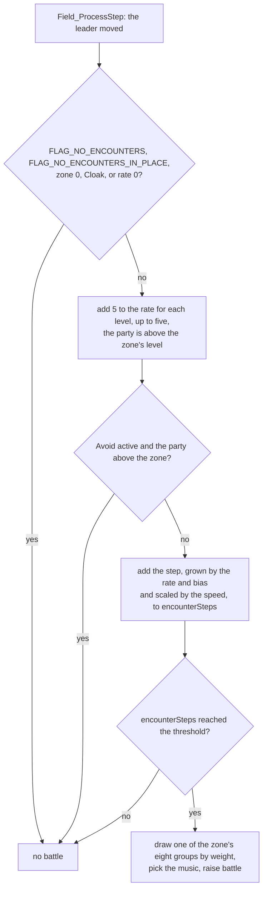
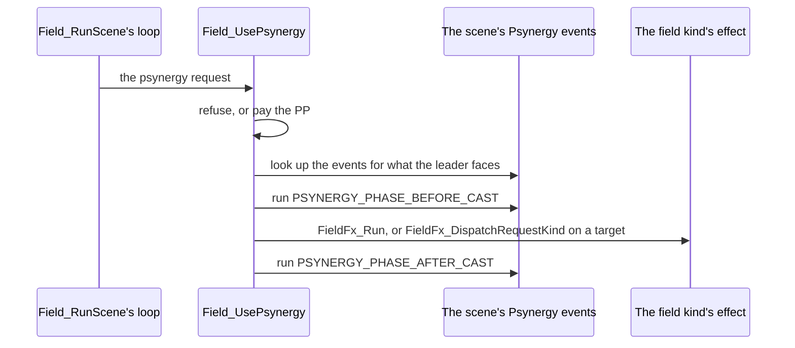

# Field objects


A field scene, a room, a town, a dungeon floor or the world map, runs here
from the moment `Game_Run` loads it until the party leaves. The code sets the
scene up, hands the leader to the player, and handles whatever interrupts the
walk: an event, a random battle, the A button, a menu or an exit. Around that
loop sit the systems a field scene needs: random encounters, the scene's
actors and events, items and Psynergy used on the field, the commands scene
scripts run, Djinn joining the party and the world map screen. The slot
machine is here too, in another bank.

The engine underneath, which moves objects and draws maps, is
[Field](../field/README.md); each place's events come from its overlay in
[Scenes](../scene/README.md). [World](../../world.md) gives the overview of
the scene loop, encounters and field Psynergy that this page goes through in
detail.

## The scene loop handles requests, not events

A field scene is one loop that lets the player walk until something raises a
request, a field of the field work, and then handles the requests one at a
time in a fixed order.


`Field_RunScene` ([`object/run_scene.c`](object/run_scene.c)) allocates the
field work, loads the map, picks the encounter zones, takes the overlay's
events, entrance and placements, restores the actors after a battle, and calls
the scene's initialization, which may take an exit at once. Otherwise it fades
the scene in, shows the area name if the group changed, and gives a Djinni or
item left pending by the scene before.

Then it alternates between walking and handling requests, as [World](../../world.md#the-scene-loop-and-its-requests)
outlines. These are the request fields, in the order the loop tests them; it
starts again from the top after each one it handles:

| Order | Field | What it asks for |
| --- | --- | --- |
| 1 | `exit` | leave the scene; its kind is `Field_RunScene`'s result |
| 2 | `event` | run a raised event, or one of the codes below |
| 3 | `battle` | a random or requested battle against this enemy group |
| 4 | `action` | a touch event or exit on the cell stepped onto (`MAP_CELL_EVENT_FIRST` to `MAP_CELL_EVENT_LAST`) |
| 5 | `pushTile` | a ledge, climbing spot or jump the leader pushes against (`Field_RunPushTileEvent`) |
| 6 | `examine` | the A button: becomes `talk` for an actor ahead with a talk event, else `tile` for a searchable cell ahead, else `menu` |
| 7 | `menu` | the main menu |
| 8 | `talk` | talk to an actor (`Scene_TalkToActor`) |
| 9 | `tile` | search a cell (`Field_SearchTile`) |
| 10 | `psynergy` | use Psynergy (`Field_UsePsynergy`) |
| 11 | `item` | use an item (`Field_UseItem`) |
| 12 | `start` | the pause menu |

Raising a request twice before the loop reaches it is the same as raising it
once. A request an event raises waits for the event to return, so a battle a
cutscene asks for starts only after its last line, and an exit it takes
discards whatever else it raised.

An `event` is either a scene event to run (`Scene_RunRaisedEvent`) or a
negative code from `enum FieldEventCode` that the loop handles itself:
`FIELD_EVENT_PARTY_FELL` when characters fell to poison or hazardous ground
(when no one survives, the party goes back to the last saved point with the
leader at 1 HP), `FIELD_EVENT_WORLD_MAP_PICTURE` and
`FIELD_EVENT_WORLD_MAP_ZOOM` for the world map screen (below).

The `battle` handler leaves the scene as an exit does: after
`ObjectTable_Snapshot`, it writes `SCENE_BATTLE` as the next scene with the
enemy group as its entrance, and raises `EXIT_NONE`, the result that means the
next scene is already set. `Scene_ReturnFromBattle` then loads the field scene
again with `FLAG_KEEP_PARTY_POSITION`, and `Field_RunScene` calls
`ObjectTable_Restore`.

The snapshot (`ObjectTableSnapshot` in
[`object_runtime.h`](../../include/object_runtime.h)) keeps up to
`OBJECT_SNAPSHOT_CAPACITY` (32) actors in parallel arrays of slots, runtime
copies, animations, sprite flags and priorities, its slot list ending at an
empty entry. The scene's placements have already made new sprites when the
restore runs, and each saved actor still points at its old one. So
`ObjectTable_Restore` keeps each actor's new sprite aside, copies the saved
actor back, sets the saved animation and sprite flags, gives the saved priority
to the new sprite and puts the new sprite's pointer back.

The requests are fields of the field work, `struct FieldWork`
(`field_runtime.h`), heap slot `HEAP_SLOT_EVENT`, reached as `gEventWork`.

| Name | Value | Meaning |
| --- | --- | --- |
| `FIELD_EVENT_PARTY_FELL` | -1 | characters fell to poison or hazardous ground |
| `FIELD_EVENT_WORLD_MAP_PICTURE` | -888 | R on the world map: the world map screen |
| `FIELD_EVENT_WORLD_MAP_ZOOM` | -889 | L on the world map: the view zooms out |
| `SCENE_BATTLE` | `0x1fe` | the next scene a battle request writes |
| `EXIT_NONE` | 999 | the exit result that means the next scene is already set |
| `FLAG_KEEP_PARTY_POSITION` | `0x109` | the next field scene starts where the party was, its actors restored from the snapshot |
| `OBJECT_SNAPSHOT_CAPACITY` | 32 | actors a battle snapshot keeps |

## Random battles

Each frame the leader moves, the ground underfoot may start a battle against
one of its zone's enemy groups; the picture at the top of this page shows
one starting in Goma Cave.



`Field_ProcessStep` rolls on the zone of the ground underfoot through
`Encounter_SelectEnemyGroup` ([`object/encounter.c`](object/encounter.c)),
passing the leader's speed limit, doubled while `FLAG_LURE_CAP` is set. There
is no battle when `FLAG_NO_ENCOUNTERS` or `FLAG_NO_ENCOUNTERS_IN_PLACE` is
set, on zone 0, while Cloak is active, or on a zone with rate 0. Otherwise:

1. Each level, up to five, by which the party's average level exceeds the
   zone's `level` adds 5 to the rate; with Avoid active such a zone has no
   battles.
2. A random bias, the halved sum of two differences of random numbers (from
   -65535 to 65535, most often near 0), is drawn once and kept in the field
   work until the next battle, so the distance between battles varies.
3. The step, which grows with the rate and the bias and is scaled by the speed,
   is added to `gGameState.encounterSteps`. A battle starts when that reaches
   `work->encounterThreshold`, 16 in 16.16 fixed point.
4. One of the zone's eight enemy groups is drawn by weight, and
   `FieldFx_SelectBattleCue` picks the music.

There is also no battle while flag 5 (`FLAG_IN_PARTY` for Jenna) is set and her
experience is above 130. Jenna is in the party only from Vale to the Sol
Sanctum's eruption, and she joins at level 1 with no experience, so the rule
ends the Sol Sanctum's random battles once she has fought her way to just
short of level 4 (158 experience). XXX: likely a cap on how strong the party
can grow before the journey begins, because the rule can act nowhere else.

`Encounter_SelectSceneZones` gives a field scene its zones from
`gBattle_LocationRules` (`location_rules.s`): the first rule for the scene and
entrance (or any entrance) whose flag is clear gives a first zone, and grounds
1 to 7 take consecutive zones from it while ground 0, ordinary ground, has
none. A rule can instead move the first zone onto ground 0 and leave ground 1
none, and most rules do. Cells marked `MAP_CELL_ENCOUNTER_GROUND_1` and
`MAP_CELL_ENCOUNTER_GROUND_2` are grounds 1 and 2. A scene no rule matches has
no battles. The world map takes its zone from `gWorldMap_EncounterRules`
(`zonedata.c`) by the terrain under the leader, which also picks the battle's
backdrop.

A zone is a row of `encounter.tsv`: `rate` (0 for none), `level`, the enemy
groups `group0` to `group7` (rows of `games/tbs/src/battle/formatn.tsv`), their
relative chances `weight0` to `weight7`, and `zone`, the place whose rules
select it. Zones with rate 0 are fought only by slot, through
`Field_RequestBattleFromEncounterTable` (the scripted battles, such as
`ENCOUNTER_ZONE_TOLBI_SHIP`, `ENCOUNTER_ZONE_COLOSSO` and
`ENCOUNTER_ZONE_SCRIPTED`, and the mimic chests of `ENCOUNTER_ZONE_MIMIC`) or
`Field_RequestDjinnBattle` (`ENCOUNTER_ZONE_VENUS_DJINN` to
`ENCOUNTER_ZONE_JUPITER_DJINN`, through `gEncounter_AreaEntryTable`). Both set
the `battle` request, so the battle starts when the event returns.

`gEncounter_BattleMusic` (`battle_cue.c`) is one list: a song marker (bit 15
set), then the `(zone << 4) + slot` keys that use it, ended by 0. A key takes
the last song before it, so the table stores each song once. Link battles
always play `MUS_018`.

The zones are `encounter.tsv`; the rules that choose them are
`gBattle_LocationRules` (`location_rules.s`) and `gWorldMap_EncounterRules`
(`zonedata.c`). The zone numbers are named in `include/unit/object/object.h`
and the flags in `flags.h`.

| Name | Value | Meaning |
| --- | --- | --- |
| `ENCOUNTER_ZONE_NONE` | 0 | no battles |
| `ENCOUNTER_ZONE_TOLBI_SHIP` | 62 | a scripted battle zone, fought by slot |
| `ENCOUNTER_ZONE_COLOSSO` | 72 | a scripted battle zone, fought by slot |
| `ENCOUNTER_ZONE_SCRIPTED` | 98 | a scripted battle zone, fought by slot |
| `ENCOUNTER_ZONE_MIMIC` | 99 | mimic chests, by the chest's slot |
| `ENCOUNTER_ZONE_VENUS_DJINN` to `ENCOUNTER_ZONE_JUPITER_DJINN` | 100 to 103 | Djinni battles, by `Field_RequestDjinnBattle` |
| `FLAG_NO_ENCOUNTERS` | `0x160` | no random battles |
| `FLAG_NO_ENCOUNTERS_IN_PLACE` | `0x161` | no random battles in this place |
| `FLAG_LURE_CAP` | `0x167` | the speed passed to the roll is doubled |
| `work->encounterThreshold` | 16, in 16.16 fixed point | the steps at which a battle starts |

## How field Psynergy reaches its effect

Psynergy used on the field runs the scene's events for what the leader faces
before and after its effect, and those events, not the effect, decide what
happens to the thing it is cast at.




Choosing Psynergy on the field raises the `psynergy` request, and the loop calls
`Field_UsePsynergy` ([`object/psynergy.c`](object/psynergy.c)). It refuses in
the Battle Arena (`FLAG_IN_BATTLE_ARENA`) and Reveal on the world map; Retreat
refuses where `FLAG_RETREAT_BLOCKED` is set and otherwise asks first and sets
the `exit` request. Then the user pays the PP.

Next it looks up the scene's Psynergy events for what the leader faces, one for
each phase: `PSYNERGY_PHASE_BEFORE_CAST`, `PSYNERGY_PHASE_AFTER_CAST` and
`PSYNERGY_PHASE_EFFECT_ACTS`. It runs the before event, plays the effect, and
runs the after event. Two flags the before event's script can still change
decide how the effect plays: `FLAG_PSYNERGY_EFFECT` whether it plays at all
(an after event whose trigger has bit `0x400` set clears it and plays the
effect itself, as two of Altin Peak's Mind Read events do), and `FLAG_PSYNERGY_TARGET` whether it plays on the actor ahead.
`FLAG_PSYNERGY_TARGET` stays set only when the scene has one of the three
events. The `PSYNERGY_PHASE_EFFECT_ACTS` event is never run here: it only makes
the effect aim at a target, and the effects that act on one (Force, Frost,
Reveal) find it themselves.

[`psynergy_effects/dispatch.c`](psynergy_effects/dispatch.c) runs the field
kind's effect: `FieldFx_Run` with no target, `FieldFx_DispatchRequestKind`
with one. The second clears `scene->enabled` first, which is how the runners
both share (Force, Frost, Ply, Whirlwind, Catch) tell that a scene event, not
the effect, decides what happens to the target: a stone pillar moves under
Move because its scene says so. Each field kind's effect is the
part named for it (`psynergy_effects/reveal.c`), and its entry point names the
abilities that reach it in a reach line, as the [battle
effects](../effect/README.md) do:

```c
/// Abilities: Carry (FIELD_KIND_CARRY).
```

Halt is dispatched in `dispatch.c` itself: only one actor is held at a time
(`gGameState.pausedObject`), so casting it again frees the one held before.
Mind Read is the one effect that stays up through the after event, since the
after event is the conversation it reads; `FieldFx_ClearChildValueOnMismatch`
ends it.

The field kind is the `type` column of `games/tbs/src/game/actions.tsv`,
named by `enum FieldKind` (`unit/object/psynergy_effects.h`); the phases are
`enum PsynergyPhase` (`field_scene.h`), bits 30 to 28 of an event's control
word.

| Name | Value | Meaning |
| --- | --- | --- |
| `PSYNERGY_PHASE_AFTER_CAST` | 0 | after the effect |
| `PSYNERGY_PHASE_BEFORE_CAST` | 1 | once the PP is paid, before the effect |
| `PSYNERGY_PHASE_AFTER_END` | 2 | after a Psynergy that runs out by itself has ended, as Cloak fades or Reveal runs out |
| `PSYNERGY_PHASE_BEFORE_END` | 3 | as `PSYNERGY_PHASE_AFTER_END`, before it |
| `PSYNERGY_PHASE_EFFECT_ENDS` | 4 | as Reveal's colours come back |
| `PSYNERGY_PHASE_EFFECT_ACTS` | 5 | run by Force, Frost and Reveal as they act; also aims the effect at the actor ahead |
| `PSYNERGY_PHASE_ANY` | 7 | matches every phase |
| `FLAG_PSYNERGY_EFFECT` | `0x140` | the effect plays |
| `FLAG_PSYNERGY_TARGET` | `0x141` | the effect plays on the actor ahead |
| `FLAG_RETREAT_BLOCKED` | `0x144` | Retreat refuses |
| `FLAG_IN_BATTLE_ARENA` | `0x17e` | all field Psynergy refuses |
| `FIELD_KIND_MOVE` | 1 | Move |
| `FIELD_KIND_MIND_READ` | 2 | Mind Read |
| `FIELD_KIND_PLY` | 3 | Ply |
| `FIELD_KIND_FORCE` | 4 | Force |
| `FIELD_KIND_DOUSE` | 5 | Douse |
| `FIELD_KIND_FROST` | 6 | Frost |
| `FIELD_KIND_LIFT` | 7 | Lift |
| `FIELD_KIND_REVEAL` | 8 | Reveal |
| `FIELD_KIND_HALT` | 9 | Halt |
| `FIELD_KIND_CLOAK` | 10 | Cloak |
| `FIELD_KIND_CARRY` | 11 | Carry |
| `FIELD_KIND_GROWTH` | 12 | Growth |
| `FIELD_KIND_CATCH` | 13 | Catch |
| `FIELD_KIND_WHIRLWIND` | 14 | Whirlwind and Gale |
| `FIELD_KIND_RETREAT` | 15 | Retreat |
| `FIELD_KIND_AVOID` | 16 | Avoid |

## The world map screen

On the world map, R shows a still picture of the whole world with a marker on
every place the party has visited, and L zooms the moving view out.


On the world map, L and R don't use their shortcuts. L raises
`FIELD_EVENT_WORLD_MAP_ZOOM`, and `FieldFx_RunVisibilityTransition` sets the
view 1.6 times as far while L is held. R raises `FIELD_EVENT_WORLD_MAP_PICTURE`,
and `Map_ShowWorldMap` shows a still picture of the whole world with a marker
on every place the party has visited. A cursor moves with the d-pad, faster the
longer it is held, and returns to the party's place while L or R is held; the
place nearest it gets a blinking frame and its name in a window. A or B closes
the screen.

`Map_ShowWorldMap` decodes the picture into `gMapCellBuffer`, the map cells'
scratch memory, and copies it to VRAM; only then does
[`psynergy_effects/world_map.c`](psynergy_effects/world_map.c) reuse that
buffer for its own work: the cursor, the markers and the name window. The
marker task releases its window and VRAM before `Map_LoadAreaGraphics`
restores the field graphics into the same buffer, so the screen needs no memory
of its own.

`gWorldMap_PlaceMarkers` (`scripts.s`) has a row for each place: its visited
flag (`FLAG_PLACE_VISITED` of the place's group, set on entering the group),
its marker's picture and its name. Rows belong to the world map's actors in
order from slot 11 (`WORLD_MAP_FIRST_PLACE_ACTOR`), and each marker is drawn
where its actor stands, so a place's position on the picture is the position of
its actor on the world map. A row of zeros is an actor with no marker, and -1
ends the table. Markers take sprite entries one after another rather than one
per actor, so a place not yet visited costs no sprite; the frame comes after
them and the cursor last.

`TBS_PATCH_2` editions (German, French, Spanish and Italian) also glide the
cursor onto the nearest place when the d-pad is released, and show a place's
name from a shorter distance (`WORLD_MAP_NAME_RANGE`). The edition block of
`psynergy_effects/world_map.c` chooses these values.

| Name | Value | Meaning |
| --- | --- | --- |
| `WORLD_MAP_FIRST_PLACE_ACTOR` | 11 | the world map actor the first row of `gWorldMap_PlaceMarkers` belongs to |
| `WORLD_MAP_CURSOR_SNAPS` | 1 in `TBS_PATCH_2` editions, else 0 | the cursor glides onto the nearest place when the d-pad is released |
| `WORLD_MAP_NAME_RANGE` | 64 in `TBS_PATCH_2` editions, else 100 | the squared distance at which a place's name shows |
| `WORLD_MAP_NAME_LEFT` | 3 in `TBS_PATCH_2` editions, else 1 | how far left of its marker the name goes |

## How it fits with the rest of the game

`Game_Run` (`object/scene.c`) is the game's main loop; [the front
page](../../README.md#the-main-loop) describes it. For a field scene it calls
`Scene_ResetFlagsOnEnter`, loads the overlay (`Scene_LoadOverlay`) and runs
`Field_RunScene`; for a battle or minigame it runs that and calls
`Scene_ReturnFromBattle`. The overlay supplies the scene's tables and
initialization, and calls back into this folder through its import table for
the commands of `field_event.h` and `field_service.h`.

Entering a new group (the scenes of one place) also resets the encounter and
hazard step counters, makes the entrance Retreat's destination, and asks for
the area name to be shown.

The window transitions and colour buffer serve battles as well, and the
effect scene's work serves the Djinn joining effects as well as Psynergy.

## Limits

- 104 encounter zones of eight enemy groups each.
- 66 actor slots and ten markers in the field work; 24 effect slots in the
  effect scene.
- A battle snapshot keeps up to 32 actors.
- One Halt target at a time.

## Files

| File | What it holds |
| --- | --- |
| `object.c`, `object/*.c` | the field object, in 16 parts: the main loop and scene changes, the scene loop and its requests, random encounters, a scene's actors, its events, items and Psynergy used on the field, the map's markers, the debug palette editor, and the window transitions and colour buffer the field shares with battles |
| `psynergy_effects.c`, `psynergy_effects/*.c` | the field Psynergy and event object, in 37 parts: the commands scene scripts run, the event camera, jumping and climbing, the field's weather and wavy backgrounds, Djinn joining the party, the effect of each field kind, the effect slots and the world map screen |
| `object_internal.h`, `psynergy_effects_internal.h` | each object's private header |
| `colorfx.c` | the slot machine, and an LZ packer nothing calls (`LzPack_PackStream` is `UNUSED`); linked in `rom_main_12`, where the rest of the folder is in `rom_main_04` |
| `fxdata.c` | constant tables: object scripts, curves and lookups |
| `battle_cue.c` | `gEncounter_BattleMusic`, the battle music of each encounter |
| `zonedata.c` | the world map's encounter rules, and the zone and slot of each Djinni battle |
| `location_rules.s` | `gBattle_LocationRules`, the encounter zones of field scenes |
| `scene_rules.s` | the field music and area names of field scenes (`gScene_AreaNameRules`) |
| `encounter.tsv` | the 104 encounter zones |
| `scripts.s` | object scripts, the leader's placement table, the display transition shapes, the weather pictures and `gWorldMap_PlaceMarkers` |
| `arcspark.s`, `swatch.s`, `mote.png` | the spark pictures, the debug palette editor's swatch (its picture is `../debug/swatch.png`) and the floating motes' picture |

`object.c` and `psynergy_effects.c` are each one object in the ROM, written
as parts: the `.c` includes its private header and then its parts in ROM
order, so a part is compiled only through it. The header places no bytes.
`head -2 object/*.c psynergy_effects/*.c` prints what each part holds.
Prototypes are in `games/tbs/include/unit/object/`.

## Words used here

- **field work**: `struct FieldWork` (`field_runtime.h`), the state of the
  running scene: its actor slots, markers, event table and requests. It is
  heap slot `HEAP_SLOT_EVENT`, reached as `gEventWork`; overlays read the same
  block as `struct EventWork`. Local name `work`.
- **actor**: an object in one of the field work's 66 actor slots. Slots 0 to 7
  are the party, 8 on the actors the scene places; an actor's id is its slot.
  Local names `actor`, `object`, `leader`.
- **request**: a field of the field work that something sets to interrupt the
  walk (above).
- **scene event**: a row of the scene's event table (`struct SceneEvent`); its
  kind says what it answers. [Scenes](../scene/README.md#the-tables) gives the
  kinds.
- **field kind**: what an ability does on the field, the `type` column of
  `games/tbs/src/game/actions.tsv`, named by `enum FieldKind`
  (`unit/object/psynergy_effects.h`), `FIELD_KIND_MOVE` (1) to
  `FIELD_KIND_AVOID` (16). Whirlwind and Gale share `FIELD_KIND_WHIRLWIND`.
- **effect scene**: `struct FieldFxScene` (`field/fx_scene.h`), the work of
  the field effect playing: the ability, its field kind (`fieldKind`), its
  caster and target, and 24 effect slots. It is `HEAP_SLOT_FX`, reached as
  `gEffectWork`. Local name `scene`.
- **effect slot**: `struct EffectSlot`, one particle an effect moves and draws.
- **marker**: a chest or Psynergy Stone the map places at one of its marked
  cells; the field work holds up to ten, apart from the actors.
- **mode**: `work->mode` is `MODE_LAYERED_MAP` on a town or dungeon map and
  `MODE_WORLD_MAP` on the world map.

## Function prefixes

| Prefix | What it covers |
| --- | --- |
| `Scene_` | scene changes, a scene's events and its entrance |
| `Field_` | the scene loop and its requests |
| `Encounter_` | random encounters |
| `Event_`, `FieldEvent_` | the commands scene scripts run |
| `Object_`, `ObjectMotion_`, `ObjectTable_` | actors, their motion and the actor table |
| `Marker_` | the map's markers |
| `ItemDisplay_` | a found item's picture, held up over the leader |
| `Camera_` | the event camera |
| `Djinn_` | Djinn joining the party and the hop before a Djinni battle |
| `DisplayTransition_` | the window transitions and dissolves between scenes |
| `WorldMap_` | starting and ending an event or menu on the world map |
| `EffectSlot_` | effect slots |
| `FieldFx_` | field effects: a field kind's runner is named for its Psynergy (`FieldFx_RunCatch`), and the small effects scenes spawn go through `FieldFx_Spawn` |
| `ColorBuffer_` | the colour buffer, which moves the palettes toward target colours |
| `ReelGame_`, `LzPack_` | the slot machine, and the packer beside it |

Other functions keep the prefixes of the families they belong to elsewhere.
Several structures are reached by more than one spelling (the field work, the
effect scene, the map's view, the colour buffer), each site keeping the one it
matches with; [Matching](../MATCHING.md) lists them.

## Evidence and open questions

The field kinds are named from the `type` column of `actions.tsv` and the
Psynergy the English release gives each; the requests from what the loop does
with each; the encounter columns from what `Encounter_SelectEnemyGroup`
computes with them; the zone names in `encounter.tsv` from the places whose
rules select them.

`Field_CountRequests` adds the requests together (`talk` twice) and tests the
sum, so a negative event code raised with a positive request can hide both.
It can happen: `Field_ProcessStep` raises `FIELD_EVENT_PARTY_FELL` (-1) on
the frame a member falls to poison, and the `action` request is the cell's
event code, 1 on the cells of a touch event 1, which 154 maps have. Both then
wait until another request makes the sum non-zero, by which time a later
cell's code may have replaced the action. It is marked `// BUG:`, and
`BUGFIX` tests each request instead.

`Scene_ResetFlagsOnEnter` clears flags `0x80` to `0xdf` on every ordinary
entrance, even within a group: the Djinn's hiding flags
(`FLAG_DJINNI_HIDING_0` and the 79 after it), which keep a Djinni that got
away out of its room until the room is entered again, and 16 more after them
that nothing else uses.

`Event_ShowSpeakerMessage`, `Event_ShowMessageAtPosition` and
`Event_ForwardShowMessageAtPosition` are unused: each is reached only through
a bare veneer in `system/far_call/OBJECT.S`, which has no symbol for code to
call ([`psynergy_effects/messages.c`](psynergy_effects/messages.c)).

- XXX (no evidence): what units `Event_ShowSpeakerMessage` and
  `Event_ShowMessageAtPosition` expected; they clamp a position to 8 to 312
  and 20 to 220, more than the 240 by 160 screen, and pass it to a window
  service that takes tiles, and with no caller in the ROM nothing shows what
  they were given.
