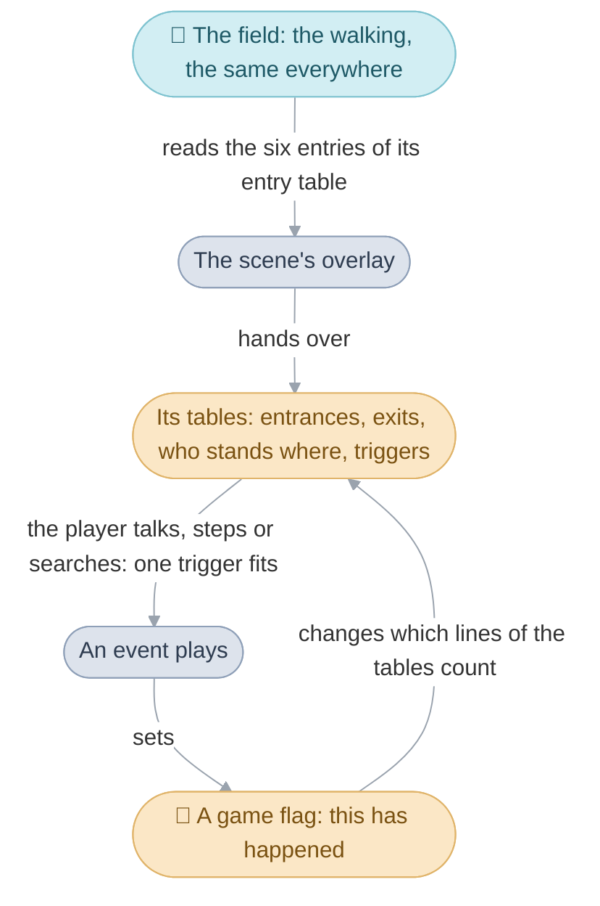
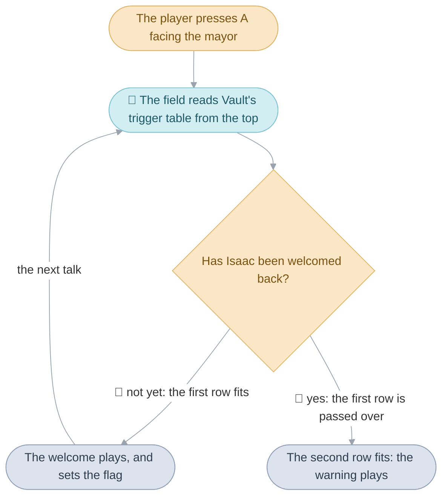
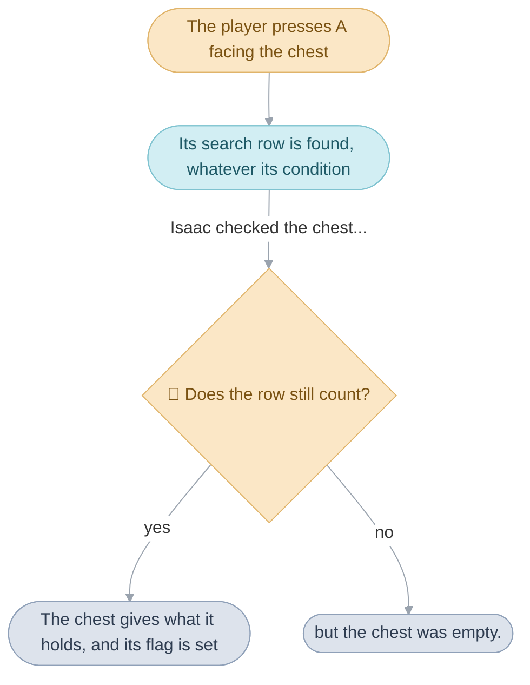
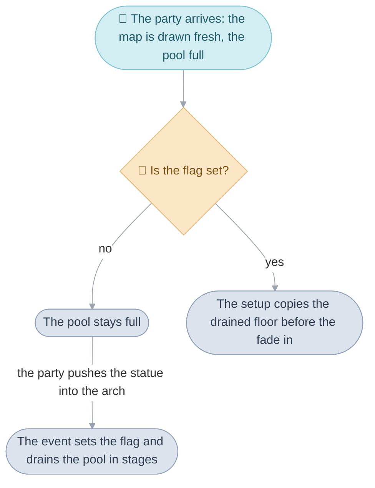
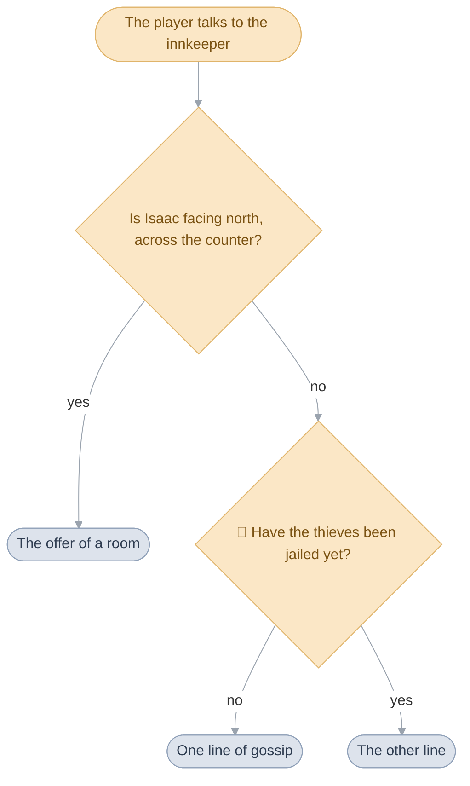
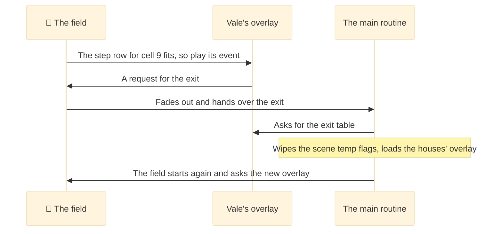

# Scenes


Walk around Vale on the day the story begins and Vale answers. Talk to Dora
outside her house and she frets about the roof. Walk into the door of
Jenna's grandparents' house and it opens. Use Catch on the Nut and it is
yours. Push against the stone pillar below the cliff and it slides over.

None of that belongs to the game's general rules for walking about. It is
Vale's own. The game is made of code, which is written instructions, and
each place has a bundle of code for what happens only there.

The game calls such a place a scene. Vale outdoors is one, the hall of the
Sanctum is another, and so is the World Map. There are 201 of them. A
scene's bundle of code is called its
[overlay](../../glossary.md#overlay). Most scenes have an overlay to
themselves, and a few close neighbours share one.

Only one overlay is loaded at a time. When the
[party](../../glossary.md#the-party) walks from Vale into the Sanctum, the
Sanctum's overlay is copied in from the cartridge, and it takes the place
of Vale's.

The walking itself is the same code everywhere. It is called the
[field sequence](../../glossary.md#field-sequence), or the
[field](../../glossary.md#field) for short. The field knows nothing about Vale.
It only knows how to ask the loaded [scene](../../glossary.md#scene) about
itself, and the scene's answers are what the player finds there.

One more word is needed from the start. The game remembers the story's
progress as [game flags](../../glossary.md#game-flag). A game flag is one
yes-or-no fact, such as "the party has left Vale" or "the Nut in Vale has
been caught". A flag that says yes is called set, and one that says no is
called clear.

This page follows a scene's parts in the order the field asks for them:

1. The [entry table](#the-entry-table) has six entries, one for each thing
   the field asks of every scene.
2. The [tables](#the-tables) are what those entries hand over: where the
   party arrives, who stands where, where the ways out lead, and what each
   thing the player can do there starts.
3. One line of the last of those tables is a
   [trigger](../../glossary.md#trigger), such as "talking to Dora".
   [How a trigger is chosen](#how-a-trigger-is-chosen) is the rule that
   picks one when the player talks, steps or searches.
4. Some of a scene's flags
   [clean themselves up](#state-that-cleans-itself-up), which is why a
   pushed pillar or a rolled log is back in place later. The scene
   [draws its room to match](#drawing-the-room-to-match) its flags.
5. An [event](../../glossary.md#event) is what a trigger sets off: Dora's
   few words, or a whole cutscene. [Events](#events) shows how one is
   written.

The parts feed each other in a circle, which is how a village changes as
the story moves on:



Every scene has a page of its own under
[Places](https://alchemy.pascalpixel.com/tbs/places), in
[story order](../../glossary.md#the-places-in-story-order), with its map,
its triggers and a recording of each event.

## The entry table


Isaac walks into the Sanctum's door, Vale fades out, and the hall fades in
with him just inside. Between the two fades, the field has asked the
Sanctum's overlay what it needs to know to put the hall on screen.

It always asks the same six things. Every overlay begins with six small
pieces of code, one for each, always in the same order at its very start.
So the field can find them in any overlay without knowing anything else
about it. That fixed set of six is the entry table, and each piece is one
of its entries.

| The field asks | The scene answers with | When |
| --- | --- | --- |
| What can happen here? | its list of triggers | as the scene starts, first of all |
| Where does the party arrive? | its list of entrances | as the scene starts |
| Who stands where? | its list of people and things | as the scene starts, once the party is placed |
| Is there anything to set up? | its setup | as the scene starts, last, just before the fade in |
| Are there ways out that hang in the air? | its [exit regions](#exit-regions), which few scenes need | while the party walks |
| Where does this way out lead? | its list of exits | as the scene ends |

Because every entry is code, a scene can hand over something different as
the story moves on. Vale has three lists of what can happen there: one before
the party leaves the village, one after it has left, and one for when it
comes back from Kalay. Asked "what can happen here?", Vale looks at its
flags and hands over the right one.

### The setup

The fourth entry, the setup, is where a scene does whatever a list cannot
say. Vale's setup, for one arrival:

- stands the stone pillar where the player last pushed it;
- takes the three puppies away, once the party has met Saturos and Menardi;
- starts the man guarding Mt. Aleph on his patrol, if he has already warned
  Isaac off the mountain;
- plays the moment where Dora praises the mended roof, the first time the
  party arrives from the rooftop.

A setup can even send the party straight on. Once the party has reached
Kalay, Vault's setup asks for a way out at once, and the field ends the
scene before it has faded in. The party lands in a second scene of Vault,
the town as it is later in the story, without ever seeing the first.

After a battle, or when a saved game is continued, the party comes back to
the very spot it left, not to a door. The field tells the setup so, with a
flag, and the setup decides what to leave alone. Vale's leaves the man
guarding Mt. Aleph where he stood instead of sending him back to his post.

## The tables

Each of the other entries hands over a table: a list with one line, called a
row, for each thing. One row is a spot the party can arrive at, or a way out, or
a person standing somewhere, or a thing the player can do.

Many rows give a position. The field is measured in pixels, the dots of the
screen. A position is three numbers: x counts east, z counts south across
the ground, and y is height above it. Many rows also give a facing, the
compass heading someone looks along.

### Conditions

The Nut in Vale can be caught once. After that, Catch finds nothing there,
though the row for catching it is still in Vale's table. Something has to
say whether a row counts today.

That is the row's condition. Most rows have one, and it names a game flag.

The usual condition means "until this has happened". The row for catching
the Nut names the flag `FLAG_VALE_NUT_CAUGHT`, and it counts while that flag
is clear. Catching the Nut sets the flag, and from then on the row is passed
over.

| Condition | The row counts |
| --- | --- |
| `CONDITION_ALWAYS` | always |
| a game flag, such as `FLAG_VALE_NUT_CAUGHT` | while the flag is clear |
| `IF_FLAG_SET(flag)` | while the flag is set |
| `CONDITION_IN_VIEW`, for people only | while the person stands in the room the party has entered ([Design](#design)) |

### Entrances

Come out of the Sanctum and Isaac stands on its doorstep, facing south. An
entrance is that: a spot where the party appears and the way it faces.

Each entrance is named for where the party comes from. Vale's
`VALE_FROM_SANCTUM` is the Sanctum's doorstep, 256 pixels east and 440
south of the map's top left corner. Vale's table has fourteen rows. Most are
a door or a path that leads into the village, and two are for the opening
of the story, when Isaac is mending the roof.

An entrance row can also give a camera box: a rectangle the view must stay
inside. Vale's rows give none, since the village may be seen from end to
end. A house's rows do. Several rooms are drawn side by side on one map
there, and the box keeps the neighbouring rooms out of sight
([Design](#design) shows two such rooms).

Two rows can share one entrance and put the party in different spots at
different points of the story. For that, an entrance row may name a flag,
and here the meaning is the plain one: the row counts once that flag is
set. A row that names no flag always counts. The party arrives at the first
row for its entrance that counts.

### Exits

Walk into the door of Jenna's grandparents' house and Vale ends. The event
that opened the door names the way out it took,
`VALE_TO_COTTAGE_ROOMS_A_NORTH`. An exit is that: a way out of a scene,
named for where it leads.

The name alone does not say which scene comes next. The exit table does.
Vale's has this row:

```c
SCENE_EXIT(VALE_TO_COTTAGE_ROOMS_A_NORTH, CottageRoomsA, COTTAGE_ROOMS_A_FROM_VALE_NORTH),
```

It reads: this exit leads to the scene `CottageRoomsA`, at its entrance
`COTTAGE_ROOMS_A_FROM_VALE_NORTH`. A door is named from both sides this
way. Inside the house, the exit `COTTAGE_ROOMS_A_TO_VALE_NORTH` leads back
to Vale's entrance `VALE_FROM_COTTAGE_ROOMS_A_NORTH`.

An exit can lead to different scenes as the story moves on. The path down
from Sol Sanctum's entrance has three rows. It leads to Vale until the
eruption, to Vale in the middle of the eruption until the party has left
the village, and to Vale again ever after. Each of the first two rows
counts until its flag is set, and the first row that counts wins
([Field](../../field.md#exits-and-entrances)).

An exit can also lead into a battle instead of a scene. Its row then names
the [formation](../../glossary.md#formation), the group of enemies to
fight.

The exit table is read by the main routine, the code above the field that
decides what runs next: a scene, or a battle.

### Who stands where


The same gate, three crowds. Everyone and everything the field puts into a
scene is an [actor](../../glossary.md#actor): a villager, a puppy, the
stone pillar, the Nut. The actor placement table has one row for each.

A row says what the actor looks like, its condition, how it moves, where it
stands and which way it faces. It also says what the actor does when spoken
to. Most turn to face the leader. Some turn back afterwards, as the old
woman in Vale turns north again once she has spoken. Some keep watching the
leader, and some never turn at all.

An actor can stand still or wander near its spot. Or it can follow an
[actor script](../../glossary.md#actor-script) of its own, a list of moves
it works through, as the man guarding Mt. Aleph walks his patrol.

Vale has a table for each of its three points in the story, and a fourth
for the opening on the roof.

#### Every actor has a number

The scene's code needs a way to say "Dora" or "the pillar". So each actor
has a number, its [actor id](../../glossary.md#actor-id).

The first eight numbers are kept for the characters a party is made of:
Isaac is 0, Garet 1, Ivan 2, Mia 3, Felix 4, Jenna 5, Sheba 6 and Piers 7.
The scene's own actors are numbered from 8, in the order of their rows. In
Vale the old woman who says `Mt. Aleph looks beautiful today.` has the
first such row, so she is actor 8.

A row keeps its number even when its condition fails and nobody appears.
That matters because the code refers to actors by number. Back from Kalay,
the stone pillar's row comes straight after the Nut's. If catching the Nut
moved everyone after it up by one, the code that pushes "the pillar" would
push the wrong thing. It does not: the Nut's number simply goes unused.

The same rule lets one thing have two rows. On Mercury Lighthouse's upper
floor a blue statue has a row for where it stands at first and a row for
where it lands after it falls. One row counts while the flag for its fall
is clear and the other while it is set, so only one statue ever appears.

A Djinni's row has one more rule. Lose to a Djinni or run from it, anywhere
but on the World Map, and it is gone from the room. A second flag hides it,
and that flag lasts until the party leaves the scene and comes back in.

### Exit regions


Watch where the screen fades in the recording: not at a door, but in the
air, part of the way up.

Most ways out are marked on the map's floor. An exit region is the other
way to mark one: an invisible box with a height. The field tests the boxes
whenever the leader is on a cell whose number is not 0. If the leader is
inside one, the scene ends through that box's exit.

A row gives the box's two corners, a condition and the exit. Kolima's
tunnel has two boxes. Each is 18 pixels square and reaches from 31 to 49
pixels above the ground, right over the spot where the party arrives by
that way. Walking about on the floor never touches it. Going up does.

Vale has no exit regions, and its entry for them hands the field none.
Kolima's tunnel and the deck of the Tolbi ship are two scenes that have
them.

### Which triggers a cell starts


The foot of that ladder looks like any other patch of grass. What makes it
special is a number on the map.

A map's floor is divided into squares 16 pixels on a side, and the game
calls each square a [cell](../../glossary.md#cell). Every cell carries a
number called its [cell behavior](../../glossary.md#cell-behavior). Most
cells carry 0, plain ground. The cell at the foot of Vale's ladder carries
100.

By itself 100 means nothing. Vale's trigger table gives it a meaning, with
a row that says: walking north into a cell numbered 100 plays the event
that climbs the ladder. Vale's doorsteps are numbered 1 and 6 to 10, the
rope bridge 14 and 15, and a door that will not open 24.

The same number means something else in the next scene, because each scene
reads the map through its own table. In Kolima, 100 is a jar with an Apple
in it. In one room of Altin Peak, 100 is a chest that turns out to be a
Mimic.

The numbers 1 to 239 are the scene's to use this way. The few above them
mean the same on every map: walls, ledges to jump down, and the plain jars,
barrels and wells that answer a search with the same two lines everywhere
([Maps](../map/README.md#cells)).

A cell with one of the scene's own numbers can be answered three ways:

- A [step trigger](../../glossary.md#step-trigger) answers the leader
  standing on it, or walking into it.
- A plain way out answers standing on it too, but only when no step trigger
  fits.
- An [examine trigger](../../glossary.md#examine-trigger) answers the A
  button. The cell it looks at is the one 16 pixels ahead of the leader,
  one cell away.

### What a trigger row says


The trigger table is the scene's list of everything the player can do
there. One row is one thing: talking to Dora, walking into a door, using
Catch on the Nut.

Here are four rows of Vale's table for the day the story begins:

```c
{ TRIGGER_TALK, ACTOR_DORA, CONDITION_ALWAYS,
  EVENT(Vale_DoraFretsAboutTheRoof) },
{ STEP_TRIGGER_WALKING_INTO(FACING_NORTH), 8, CONDITION_ALWAYS,
  EVENT(Vale_EnterIsaacsHouse) },
{ PSYNERGY_ON_ACTOR(ABILITY_CATCH), ACTOR_NUT, FLAG_VALE_NUT_CAUGHT,
  EVENT(Vale_CatchNut) },
{ EXAMINE_TRIGGER(EXAMINE_SILENT), 24, CONDITION_ALWAYS,
  EVENT(Vale_SearchTheLockedDoor) },
```

Each row has four parts, in the same order: what the player does, to whom
or where, the condition, and what happens.

- Talking to Dora plays the event at the top of this page.
- Walking north into the cell numbered 8 plays the event in the recording
  above. That cell is the doorstep of Isaac's house. Here 8 is a number on
  the map, and has nothing to do with actor 8.
- Using Catch on the Nut gives the Nut, until it has been caught.
- Pressing A facing the cell numbered 24 shows `The door won't open.`

#### How firmly the player must mean it

A plain step trigger plays as soon as the leader stands on its cell. That
suits the edge of a village.

A door needs more. The second row above is written
`STEP_TRIGGER_WALKING_INTO(FACING_NORTH)`. It plays only when the leader
has pushed against something for more than 12
[frames](../../glossary.md#frame) and is facing north or nearly so. A frame
is one picture on the screen, and the console draws about sixty a second,
so that is a fifth of a second of pushing. Nobody enters a house by
brushing past its door.

#### Ways out, searches and Psynergy

A cell that is simply a way out needs no event. Its row names the
exit and nothing else. Alpine Crossing has five such rows, one for each
path that leaves it. The row can also say how the leader leaves: with the
usual sound, silently, or up or down a staircase, with the stairs' sound
and a little animation of the leader going in.

An examine row says what kind of thing is being searched: a chest, a jar, a
bookcase and nearly thirty more. That chooses the line the game shows
first, such as `Isaac checked the chest...` Vale's locked door is marked as
none of them, `EXAMINE_SILENT`, so no such line comes first and the door's
own message is all the player reads.

A Psynergy row names the Psynergy and the actor it is used on. After the
party has left Vale, come back with Ivan and use Mind Read on Garet's
sister. Vale's later table has a row for exactly that, and it shows her
thought: `Gee, I wish I could see new lands, too.`
[Field code](../field/README.md#how-field-psynergy-reaches-its-target)
follows a Psynergy from the menu to its row. An item used from the menu
finds its row the same way.

#### What happens

| The row's last part | What happens |
| --- | --- |
| `MSGNO(name)` | that line of text is shown |
| `EVENT(function)` | that event plays |
| `FIND_ITEM(item)` | a search finds that item, and it goes to the first party member with room |
| `FIND_COINS(n)` | a search finds that many coins |
| `FIND_PSYNERGY_STONE` | a search finds a Psynergy Stone, which fills everyone's PP |
| `FIND_MESSAGE(message)` | a search shows that line |
| `FIND_MIMIC` | the chest is a Mimic, and its battle starts |

Most villagers need no event at all. The old woman's row in Vale ends in
`MSGNO(MsgValeMtAlephLooksBeautifulTodayIts)`, the name of her line, and
the field does the rest: stops her, turns her to Isaac, shows the line and
turns her back.

## How a trigger is chosen


Talk to Vault's mayor after Kalay and he is delighted: `You've come back to
Vault!` Talk to him again and he only warns of the thieves. He has two
rows, and one rule decides between them.

The rule: the field reads the scene's trigger table from the top and takes
the first row that fits. A row fits when it is the right kind, for the
right actor or cell, and its condition counts.

Here are the mayor's two rows ([`log_rooms_b.c`](log_rooms_b.c)):

```c
{ TRIGGER_TALK, ACTOR_MAYOR, FLAG_VAULT_REVISIT_ISAAC_WELCOMED_BACK, EVENT(LogRoomsB_WelcomeIsaacBack) },
{ TRIGGER_TALK, ACTOR_MAYOR, CONDITION_ALWAYS, EVENT(LogRoomsB_WarnOfThievesRevenge) },
```

The first row counts until the flag "Isaac has been welcomed back" is set.
The welcome event sets that flag as its last act. So the second talk passes
over the first row and falls through to the one below, which always counts.



That is the whole trick behind a villager who has something new to say. A
scene lists a person's rows in story order, each counting until its own
flag is set, with a row that always counts at the bottom.

Order matters, then. A row placed below one that always fits can never be
reached. The game has a few of those, lines nobody ever gets to hear. Each
is marked [`// Unused:`](../../glossary.md#unused) in its table, and
[Unused](https://alchemy.pascalpixel.com/tbs/unused) describes them all.

### Talking

Pressing A in front of someone is a talk only if that person has a talk row
that fits. Otherwise the press goes on to search the cell ahead, and if
there is nothing to search there either, it opens the menu.

Once the row is found, the person stops walking. The leader stops too and
the two turn to face each other, unless the person's placement says it
never turns. Then the row's line is shown, or its event plays.

Halt changes this. Stop the Djinni Kite in Vale Cave with Halt, talk to it
while it cannot move, and it joins the party. Kite has a second kind of
talk row, one that fits only while Halt holds it. Bane on Crossbone Isle is
caught the same way, and those two are the only such rows in the game.

Everyone else is simply tongue-tied. A Halted villager with a plain line
gets out its first word and trails off
([Windows](../window/README.md#a-line-the-decoder-cuts-short)). One whose
talk would have played an event says only a row of dots.

### Searching


Open that chest, then press A on it again. It still answers: `Isaac
checked the chest...` and then `but the chest was empty.`

By the rule above it should not answer at all. The chest's row counts
"until the Small Jewel has been found", and it has been.

So searching is the one exception to the rule. A search row for a chest, a
jar, a bookcase or any other named thing is found whatever its condition.
The game shows the `checked the chest...` line first, and only then looks
at the condition. If the row still counts, the chest gives what it holds
and its flag is set. If not, the game adds the matching second line.



A Mimic's row is the exception to the exception. It keeps the ordinary
rule, so once the Mimic is beaten its chest stops answering.

What a chest holds decides the rest:

- An item goes to the first party member with room for it. If nobody has
  room, the item stays and the chest closes again, to be opened another
  day.
- Coins go straight to the purse.
- A Psynergy Stone fills every party member's PP, glitters and is gone.
- A Mimic's chest jumps up, `The treasure chest was really a Mimic!`, and
  the battle starts.

### Stepping and raising

A step trigger or a way out is started by the leader's feet, as
[above](#which-triggers-a-cell-starts). Some triggers are started by
nothing the player does at all. The scene's own code starts them, and the
game calls that raising a trigger.

Lamakan Desert is the one to remember. The scene counts the party's steps
on the hot sand and draws them as the thermometer at the left of the
screen. When the count passes a quarter of the way up, the scene raises a
trigger, and Garet, Ivan or Mia complains about the heat. It raises another
at half and another at three quarters.

The menus can raise one too. In Vault's inn, while the party is cornering
the two suspects, the scene sets a flag that says "menus raise a trigger
instead of opening". Try to open a menu during the chase and Garet answers
in its place: `We don't have time for that, Isaac!`

## State that cleans itself up


Roll a log into the river in Kolima Forest, leave, and come back. The log
is on the bank again, ready to be rolled. Nothing in Kolima Forest's code
put it back.

Most game flags are forever: a chest stays opened. But the game sets aside
two groups of 256 flags that it wipes clean by itself, and a scene uses
those for anything that should reset.

Scene temp flags are wiped every time the party enters a scene. Kolima
Forest keeps "the log is in the river" in one of them. Walk out and in
again, the flag is clear, and the scene puts the log where it began.

Area temp flags last longer. An [area](../../glossary.md#area) is a group
of scenes the game treats as one place: Vale's is the village outdoors, its
plaza, Kraden's cottage, the Sanctum and the insides of the houses. Area
temp flags are wiped only when the party enters a scene of a different
area.

Vale's stone pillar shows the difference. Push it a column to the west.
Vale sets an area temp flag for that. Go into a house and come out: the
flag is still set, and Vale's setup stands the pillar in the west column
again. Now walk out to the World Map and come back. The World Map is
another area, the flag has been wiped, and the pillar is back in the
middle.

A battle wipes neither group, since the party comes back to the spot it
left. That is why the log in the recording is still in the river after the
Skeletons.

Every scene reuses the same 256 and 256, so each gives the ones it uses a
name of its own. Vale's file says that scene temp flag 4 is "Isaac is on
the roof" and that area temp flag 14 is "the pillar is in the west column":

```c
#define FLAG_VALE_ON_ROOF FLAG_SCENE_TEMP_04
#define FLAG_VALE_PILLAR_IN_WEST_COLUMN FLAG_AREA_TEMP_14
```

The same two flags mean something else in every other scene.
[Game rules](../game/README.md#the-game-flags) describes the game flags as
a whole.

### Drawing the room to match

A flag only remembers that something happened. The room itself is drawn
fresh from its map every time the party arrives, exactly as it was on the
first visit. So a scene has to change the map to match its flags, and it
does that by copying cells.

A map is far bigger than the room drawn on it, and its spare corners hold
spare cells: pieces of the room as it looks at other times. The open door
of Jenna's grandparents' house is one. It is a picture two cells wide and
two tall, kept at the bottom of Vale's map, below the village. The door
"opens" when the event copies that picture over the closed door.

In Kalay's tunnel ([`kalay.c`](kalay.c)) a pool lies under a waterfall, and
the map keeps the pool's floor a second time, drained. When the party
pushes a statue into the arch the water falls from, the event sets a flag
and copies the drained floor over the pool in stages, with a wait after
each, so the water is seen to sink.

Walk out into the tunnel's passage and back. The map has been drawn fresh,
with the pool full. But the tunnel's setup finds the flag set and
makes the same copy all at once, before the fade in, so the pool the player
sees is dry. That flag is an area temp flag, and the pool is dry only for
as long as the party stays in the tunnel's area.



A copy can carry a cell's picture, or its ground, or both. The ground is
what the cell does rather than how it looks: where the party can walk, and
its cell behavior. Climb the ladder in Vale and the event copies only
ground onto the roof of Isaac's house. The roof looks the same as ever, and
now it can be walked on. Climbing down copies the old ground back.

Mercury Lighthouse ([`mercury_lighthouse.c`](mercury_lighthouse.c)) uses
the same trick for a puzzle. A statue stands in front of a door. Move it
one column aside, and a cell nearby is given the ground of a cell the
leader can jump from. From then on a jump reaches the door.

A map also has a layer drawn over the party's heads, and a copy can land
there ([Maps](../map/README.md#one-grid-three-layers)). In Sol Sanctum's
Elemental Star Room
([`sol_sanctum_elemental_star_room.c`](sol_sanctum_elemental_star_room.c))
taking a star raises three pillars out of the dark as stepping stones. Each
pillar's picture is copied onto that overhead layer.

## Events


An event is what a trigger row plays when one line of text is not enough: a
conversation with a choice in it, a door opening, a whole cutscene. It is
written as a short list of commands, one to a line, and the game carries
them out from top to bottom.

The door of Jenna's grandparents' house is one of the shortest
([vale.c](vale.c)). Its first line only gives the event its name, and the
four lines inside the braces are the event:

```c
static void Vale_EnterJennasGrandparentsHouse(void) {
  Sound_Play(SE_DOOR_OPEN);
  MapGrid_AnimateCells(gVale_GrandparentsDoorOpens, 49, 69);
  Actor_WalkTo(ACTOR_PARTY_LEADER, 326, 1126);
  Import_EventSetExitRequest(VALE_TO_COTTAGE_ROOMS_A_NORTH);
}
```

Read them one at a time:

1. Play the sound of a door opening.
2. Play the little animation named "the grandparents' door opens". The two
   numbers say where on the map the door is.
3. Walk the party's leader to a spot 326 pixels east and 1126 south, which
   is just inside the doorway. A walk needs no height, since he stays on
   the ground.
4. Ask for the way out named `VALE_TO_COTTAGE_ROOMS_A_NORTH`.

Each line is an [event command](../../glossary.md#event-command), and
commands come in two sorts.

Some take time, and hold the event until they are done. Opening the door is
one: the event stays on that line for the four frames the door takes. A
line of dialogue is another, since it waits for the player to press A.

Others take no time. Starting Isaac's walk only tells him where to go, and
the next line is carried out in the same frame. That is why Isaac is still
walking as the screen begins to fade.

The last line does not end the scene on the spot. It sets a
[field request](../../glossary.md#field-request), which the field acts on
once the event has finished. The thieves in Vault's inn wait for their
battle the same way ([Field](../../field.md#triggers-and-events)).

### An event with a choice in it

The innkeeper in the recording has one row, and it plays an event. The
event first looks at which way Isaac is facing. Facing north, across the
counter, he is a customer and gets the offer of a room. From any other
side, as in the recording, he gets gossip. And the gossip is one of two
lines, chosen by whether Vault's thieves have been jailed yet.



That event opens with the command `Event_Start` and closes with
`Event_End`, as most do. `Event_Start` hides the area's name if it is still
showing, stops the leader and gets the game ready to show text. The
grandparents' door does without either, since it shows no text.

### What moves while an event waits

While an event is held at one command, nothing else in it is happening. So
anything that has to keep going is given to something that runs in every
frame, whatever the event is doing.

The man guarding Mt. Aleph has two such things. His actor script is his
patrol, a list of moves he works through. And a small piece of code of his
own runs every frame and turns him to keep watching Isaac. The game calls
that an update routine.

A [task](../../glossary.md#task) is the same idea belonging to no actor. At the
end of the roof repair, while Isaac's Psynergy is at work on a board, a task
plays the sparkle sound every 16 frames.

## The Title, the File Screen and the Battle Arena

Three scenes are not places at all. Each is in the game's list of scenes
and has an overlay of its own, and the game runs it the way it runs Vale.

- The Title ([`title.c`](title.c)) is the start screen, and the Golden Sun
  logo shown after the ending.
- The File Screen ([`file_screen.c`](file_screen.c)) is the menu with new
  game, continue, copy and delete. It is also the door to the Battle Arena,
  and it handles the transfer of a save's data, by link or as a password.
- The Battle Arena ([`battle_arena.c`](battle_arena.c)) is the third: the
  battles against a friend's party or against monsters, and the record of
  wins.

Their screens are drawn by the window code
([Windows](../window/README.md)), and the title intro and the credits the
Title starts are in [Menus](../menu/README.md#the-title-intro).

The World Map is a place, with an overlay of its own
([`world_map.c`](world_map.c)). [Field](../../field.md#the-world-map)
explains how it is drawn.

## Code shared between overlays

In Vault a boy and a girl walk about together round the well. They do it
before the thieves are caught and they are still at it when the party comes
back from Kalay. Those are two scenes with two overlays, and only one
overlay is ever loaded.

So the children's code is in both. It is written once, in the folder
`shared/`, and built into each overlay that needs it
([System](../../system.md#overlays) explains why an overlay cannot borrow
from another).

The three Colosso finals share their code the same way. Mercury
Lighthouse's scenes share the sparkling passages between floors. And many
scenes share small effects and the helpers that move actors about.

The cartridge really does hold each shared piece several times over, once
in every overlay that uses it.

## From Vale's doorstep into the house


The recording lasts a few seconds. Every part of this page takes a turn in
it.



### The step

Isaac is walking, so in every frame the field looks at the cell under him.
The doorstep's cell is numbered 9. The field reads Vale's trigger table
from the top for a step row for 9, and finds this:

```c
{ STEP_TRIGGER_WALKING_INTO(FACING_NORTH), 9, CONDITION_ALWAYS, EVENT(Vale_EnterJennasGrandparentsHouse) },
```

The row asks for more than standing there. For the first few frames it
does not fit. Once Isaac has pushed north against the door for long enough,
it does, and the field plays its event.

### The event

The four commands [above](#events) run. The sound plays, the door opens,
Isaac starts walking in, and the event sets its request for the exit
`VALE_TO_COTTAGE_ROOMS_A_NORTH`.

The event is over. The field finds the request before it looks at anything
else, since leaving comes first. It fades the screen out and hands the exit
to the main routine.

### The exit

The main routine asks Vale's overlay for its exit table and finds the row
shown under [Exits](#exits). The next scene is `CottageRoomsA`, at the
entrance `COTTAGE_ROOMS_A_FROM_VALE_NORTH`.

It wipes the scene temp flags, so "Isaac is on the roof" could not survive
this door. It leaves the area temp flags alone, because the house is in
Vale's area, and the pillar stays where it was pushed. Then it loads the
houses' overlay in place of Vale's.

### The room

The field starts again and reads the new overlay's entry table.

The trigger table comes first. Then the entrance table: the row for
`COTTAGE_ROOMS_A_FROM_VALE_NORTH` puts Isaac at 337 pixels east and 199
south, facing north, and gives a camera box 296 pixels wide and 232 tall.
That box is the grandparents' room, one of several rooms drawn on this
map.

Next comes "who stands where". The overlay picks its list by the story's
flags, then marks each person placed with `CONDITION_IN_VIEW` as inside or
outside the camera box. Only the grandparents' room gets its people.

Last, the setup. If the party has already left Vale, Jenna has been taken,
and the setup lays her grandmother in her sickbed.

The room fades in.

## Design

Two choices shape every scene, and both can be seen in the game.

### Rooms packed several to a map

Walk into Vale's inn, and later into the room of Babi's scholars in Tolbi.
The two rooms are in different towns, and they are on the same map.

The inside of a house is not a map of its own. Rooms drawn in one style sit
side by side on one big map, which the glossary calls a
[sheet of rooms](../../glossary.md#sheet-of-rooms), and a sheet is one
scene. The entrance the party comes in by picks the room, by its camera
box, so the player never sees the room next door.

Vale's inn and the scholars' room share the sheet `CottageRoomsB`, because
both are drawn as cottages. So a sheet is named for its style, not for a
town.

The people of every room on a sheet are listed together. They are placed
with `CONDITION_IN_VIEW`, and that is how only the room the party has
entered gets its people.

### A scene's four parts are picked separately

The game's list of scenes gives each scene four things: its overlay, its
area, whether it is a town, and its map. Two scenes can share any of them.

The Bilibin Barricade shares Bilibin's overlay but is an area of its own,
so walking onto it counts as arriving somewhere new. Vault before Kalay and
Vault after are two scenes with two overlays, drawn on one and the same
map. That is how the later Vault can be the same streets with different
people and different things to do. And only outside the towns does walking
restore the party's PP.

## How it fits with the rest of the game

A scene never runs by itself. The main routine loads its overlay, and the
field reads its entry table.
[System code](../system/README.md#how-an-overlay-reaches-the-rest-of-the-game)
has the loading, and how an overlay's code reaches the rest of the game.

[Field code](../field/README.md#the-field-sequence-serves-requests)
explains what the field does between the player pressing A and a trigger
row being chosen. How scenes and areas follow the story is in
[Field](../../field.md#scenes-and-areas), and the maps the scenes are drawn
on are in [Maps](../map/README.md). The debug scenes the developers left in
are built the same way, and are in [Debug scenes](../debug/README.md).

To find the code behind something a villager says, search
`games/tbs/text/en.po` for the line. Above it is the line's name, such as
`MsgVaultWelcomeToVaultTheTownAt` for `Welcome to Vault, the town at the
heart of Angara.` Search the scene files for that name and it turns up in a
trigger row or an event.

## Limits

- Only one overlay is loaded, and it has a fixed amount of room: 32 KB. A
  scene's code and tables have to fit in it.
- An overlay cannot use another overlay's code, since the other is not
  loaded. That is why Vault's children are stored twice.
- A scene's rows can number its actors up to 65, and 64 actors can exist at
  once.
- A scene has 239 cell behaviors of its own, 1 to 239.

## Words used here

- position: three numbers in pixels, x east, y up and z south. A cell is 16
  pixels by 16.
- facing: one of sixteen compass headings, named from `FACING_EAST` round
  through south, west and north.
- condition: a table row's test of a game flag
  ([Conditions](#conditions)).
- camera box: the rectangle an entrance row gives, which the view stays
  inside. A room on a sheet of rooms is whatever its entrance's box shows.
- scene temp flags and area temp flags: the two groups of flags the game
  wipes by itself, written `FLAG_SCENE_TEMP_xx` and `FLAG_AREA_TEMP_xx`.
- message: one piece of the game's text. Each has a name, and
  `MSGNO(name)` is its number. After a message is shown, the next one in
  the text is lined up to follow, so the second and third lines of a
  conversation often have no name of their own.
- update routine: a piece of code that belongs to one actor and runs every
  frame.
- setup: the fourth entry of the entry table. The code calls it
  `initialize`.

Three files hold what this page describes, for a reader who wants the
code. `scene_tables.h` has the tables' rows and every word in capitals
used above. `scene_exits.h` names every entrance and exit. `event.h` lists
the event commands; a command that takes time does its waiting through
`wait()`, which [System](../../system.md#waiting-and-tasks) explains. The
game's list of scenes is `gScenes` in
[`field/scenes.s`](../field/scenes.s). An overlay is one file, in a fixed
order: the six entries of the entry table, then its events and other code,
then its tables. Its events are named for the scene and for what the player
sees, as `Vale_DoraFretsAboutTheRoof` is.

## Evidence

A scene is named for its area, the name the game shows on arrival. A room
the game leaves unnamed is named for what the player sees there.

A sheet of rooms is named for the style its rooms are drawn in, in a word
from building and furnishing (`CottageRoomsA`, `LogRoomsC`, `StuccoRoomsB`,
`StoneRooms`, `ShipRooms`), with a letter where several sheets share a
style.

An event is named for what the player sees it do, and a line of text is
named from its English words.

The staircase ways out are named from Isaac's own pictures. In two of his
animations he goes into the stair opening with his back turned, growing
darker and smaller. In two others he comes out of it facing the player.
