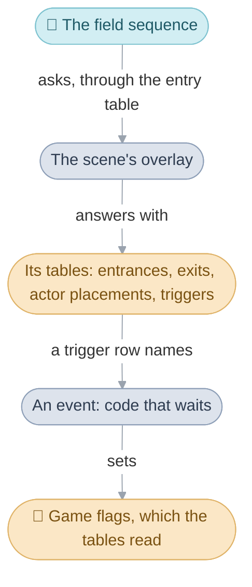
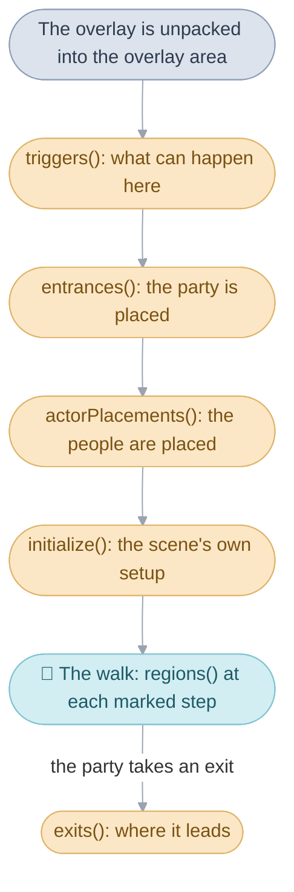
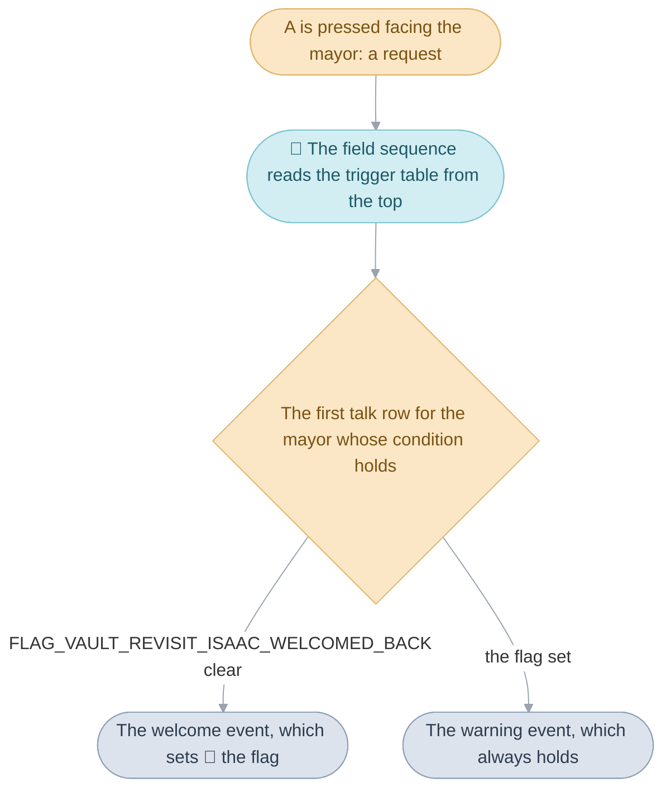

# Scenes


Walking around Vale, the player meets what is particular to Vale: Dora
outside her house with something to say about the roof, a door
that opens into the house of Jenna's grandparents, a jar with coins in it, a
pillar to push. The code that knows all this is Vale's own, and every place
in the game has code of its own in the same way. A place is a
[scene](../../glossary.md#scene), one row of the scene table, and its code is
an [overlay](../../glossary.md#overlay), unpacked into memory when the
[party](../../glossary.md#the-party) arrives and replaced by the next scene's
when it leaves. The [field sequence](../../glossary.md#field-sequence), which
runs the walk, knows only how to ask a scene about itself; the scene's
answers are what the player sees there. The answers come in the order the
field asks for them:

1. The [entry table](#the-entry-table): the six questions the field asks
   every scene, and when it asks them.
2. The [tables](#the-tables) that answer them: where the party arrives, who
   stands where, where it can leave, and what each thing the player does
   starts.
3. [How a trigger is chosen](#how-a-trigger-is-chosen) from those tables
   when the player talks, steps or searches, a
   [trigger](../../glossary.md#trigger) being one row of them.
4. [Events](#events), the code a trigger runs, an
   [event](../../glossary.md#event) being the C routine itself.
5. The [flags that clean themselves up](#state-that-cleans-itself-up), which
   let a scene keep notes without putting anything back.



Every scene has a page of its own under
[Places](https://alchemy.pascalpixel.com/tbs/places), in
[story order](../../glossary.md#the-places-in-story-order), with its map,
its triggers and a recording of each event.

## The entry table


The entry table is the fixed set of six questions the field asks a scene,
each answered by a function of the scene's own, so that the field can run any
scene without knowing anything about it. When Isaac walks from Vale into the
Sanctum, the field asks the Sanctum's overlay where the party arrives and who
stands there, and later, as he leaves, where the door he took leads.

The six questions, in the order the field asks them while a scene runs:

| Question | The scene answers with | When the field asks |
| --- | --- | --- |
| What can happen here? | its trigger table | as the scene starts, before anything else |
| Where does the party arrive? | its entrance table | as the scene starts, for the entrance the party came in by |
| Who stands where? | its actor placement table | as the scene starts, once the party is placed |
| Is there anything to set up? | its setup function | as the scene starts, last of all |
| Has the leader stepped into a box on the ground that leads out? | its exit region table | at every step onto a marked cell, while the party walks |
| Where does this exit lead? | its exit table | as the scene ends, with the exit the party took |

Each answer comes from a function, so a scene can answer differently as the
story moves on. Vale answers "who stands where" with one table before the
party has set out, another after it has left and a third once it has
reached Kalay, each chosen by a [game flag](../../glossary.md#game-flag);
Vault answers "what can happen here" with one table before its thieves are
jailed and another after.

The setup function is where a scene does whatever its tables cannot: it
restores what the flags say has happened (a pushed pillar stands where it was
left), starts work of its own that runs every frame, plays an arrival event,
or sends the party straight on to another scene. A setup that sends the party
on leaves an exit request behind, and the field ends the scene before it has
faded in. When the party comes back to where it stood, as after a battle, the
scene's own setup decides what to skip: the field tells it so through
`FLAG_KEEP_PARTY_POSITION`, which stays set until the setup has run.



The six functions are `struct SceneEntryPoints`, which sits at the very
start of every overlay (`entry/<scene>.s`), each function behind an 8-byte
[veneer](../../glossary.md#veneer) so that the main image can call it at a
fixed place whatever the overlay holds. `FieldSequence_Run` calls
`gOverlayArea.triggers()`, then `Scene_ApplyEntrance` reads the entrances,
`Actor_ResetForLeader` the actor placements, and `gOverlayArea.initialize()`
runs the setup; `Field_CheckExitRegions` reads the regions as the party walks,
and `Scene_TakeExit`, in the main routine, reads the exits once the scene has
ended. Vault names its six `Scene_Initialize`, `Scene_GetEntrances`,
`Scene_GetExits`, `Scene_GetActorPlacements`, `Scene_GetTriggers` and
`Scene_GetExitRegions`; most overlays give some of them names of their own
(`BabiLighthouse_SetupMap`, `BabiLighthouse_GetExits`), since only the order
is fixed.
[System code](../system/README.md#how-an-overlay-reaches-the-rest-of-the-game)
explains the overlay's other table, the imports through which the scene calls
the main image back.

## The tables

The answers are tables, one row to a thing: an entrance the party can arrive
at, an exit it can leave by, a person standing somewhere, a box that takes
the leader out, and a trigger for each thing the player can do. The field is
drawn in three dimensions: x runs east, z runs south across the ground, and
y is height, so a position in these tables is three numbers in pixels, and a
facing is one of eight headings ([Words used here](#words-used-here) gives
the units). The five kinds of row are `struct SceneEntrance`, the
`SCENE_EXIT` words of the exit table, `struct ActorPlacement`,
`struct SceneExitRegion` and `struct Trigger`, all in `scene_tables.h` and
`scene.h`; each table ends with a row whose first column is
`SCENE_TABLE_END`, and a trigger table with `TRIGGERS_END`.

### Conditions

Most rows carry a condition, which says whether the row holds now. The
usual case is "until this has happened": the condition names a game flag,
and the row holds while that flag is clear. A row can also hold only while a
flag is set, or always.

| Condition | The row holds |
| --- | --- |
| `CONDITION_ALWAYS` (-1) | always |
| a game flag, such as `FLAG_VALE_NUT_CAUGHT` | while the flag is clear |
| `IF_FLAG_SET(flag)` | while the flag is set |
| `CONDITION_IN_VIEW` (0), in actor placements only | while the actor stands inside the camera's box, in the scenes that call `Scene_AssignViewFlags` |

`GameFlag_IsConditionActive` tests every condition column the same way.

### Entrances

An entrance is where the party appears and which way it faces, named for
where the party comes from: `VALE_FROM_SANCTUM` is Vale's doorstep of the
Sanctum. An entrance row holds the entrance's number, a position, a facing,
and a box the camera may move in, which a room on a shared map uses to show
only itself ([Design](#design) explains the sharing). A row can also require
a flag to be set, and then a second row for the same number can place the
party elsewhere once the story has moved on. The party arrives at the first
row for its entrance whose flag is set, or at the table's first row when none
matches; the camera box is read even when the party keeps its position after
a battle, so the view stays the room's.

A camera box smaller than the screen is widened to it, so the view is always
at least 240 by 160 pixels. `Scene_ApplyEntrance` reads the table, and
`scene_exits.h` names every entrance.

### Exits

An exit is a way out of a scene, named for where it leads:
`SOL_ENTRANCE_TO_VALE` is the path down from Sol Sanctum's entrance. The exit
table turns the exit into the scene and entrance that run next, and a row
can hold only until a flag is set, with the first row that holds winning.
The front page's [Sol Sanctum path](../../README.md#exits-and-entrances)
shows three rows for one exit, each holding until its flag is set.

A door is named the same from both sides, so each side names the other:
Vale's `VALE_TO_COTTAGE_ROOMS_A_NORTH` leads to
`COTTAGE_ROOMS_A_FROM_VALE_NORTH`, and that room's
`COTTAGE_ROOMS_A_TO_VALE_NORTH` leads back to
`VALE_FROM_COTTAGE_ROOMS_A_NORTH`. An exit table opens with a header naming
the scene whose exits follow, and an overlay that serves several scenes
lists each scene's exits under its own header in the one table. One kind of
exit leads into a battle.

| Word | Meaning |
| --- | --- |
| `SCENE_EXITS(Scene)` | the header: the exits of this scene follow |
| `SCENE_EXIT(exit, Scene, entrance)` | this exit leads to that scene, at that entrance |
| `SCENE_EXIT_UNLESS(exit, Scene, entrance, flag)` | the same, until the flag is set |
| `EXIT_TO_BATTLE(exit, formation)` | this exit starts a battle against that [formation](../../glossary.md#formation) |
| `SCENE_EXITS_END` | the end of the table |

The exit a scene ended on is the number `FieldSequence_Run` returns, and
`Scene_TakeExit` in the main routine finds the scene's header and then the
first row of that exit whose flag is clear; a row of exit 0, or the end of
the scene's rows, sends the party to the first row's scene at its first
entrance. An exit that is also how the leader leaves, with a sound and an
animation up or down stairs, is chosen by its trigger row
([below](#what-a-trigger-row-says)).

### Who stands where


Each row of a scene's actor placement table puts one person or thing in the
scene, as an [actor](../../glossary.md#actor): its sprite, its condition, how
it moves (standing still, wandering near its spot, or an
[actor script](../../glossary.md#actor-script) of its own), its position and
facing, and how it turns when spoken to. The rows' conditions read the
story flags, so the field places only the rows that hold.

Every row owns an [actor id](../../glossary.md#actor-id), whether or not its
actor appears. The party takes ids 0 to 7, and the rows take the ids from
`ACTOR_FIRST_PLACED` in table order; a row whose condition fails puts nobody
in the scene, and its id stays empty, so that every actor keeps one number
in its scene and the scene's code can name it once. On Mercury Lighthouse's
upper floor the blue statue has one row for its place on the ledge and
another for where it lands after it falls, and only one of the two appears.
A row whose sprite is one of the party's
characters takes that character's own id instead, so Garet in Vale after
Kalay is `ACTOR_GARET` wherever his row sits.

A placed actor stands on the ground under it, and a row with a height
floats at that height instead. A Djinni's row holds while its caught flag is
clear and, away from the World Map, while its hiding flag is clear too, so a
Djinni the party fled from stays hidden until the scene is entered afresh.

| Column | Meaning |
| --- | --- |
| `sprite` | the actor's sprite; 0 to 7 is one of the party's characters |
| `condition` | when the row holds ([Conditions](#conditions)) |
| `movement` | `MOVEMENT_TYPE_STAND`, `MOVEMENT_TYPE_WANDER` and the rest of `enum MovementType`, or an actor script |
| `x`, `y`, `z` | its position in pixels, written `PIXELS(n)` |
| `facing` | its heading, `enum Facing` |
| `talkFacing` | how it turns when spoken to, `enum ActorTalkFacing`: `TALK_FACING_PARTY_AND_BACK` turns back afterwards, `TALK_FACING_PARTY_THEN_WATCH` keeps watching the leader |

Each scene names its actors in an enum in row order from
`ACTOR_FIRST_PLACED`; `ACTOR_PARTY_LEADER` is Isaac, the one the player moves
everywhere but Colosso. `Event_SpawnActorPlacements` places the rows, and
`Scene_FindActorPlacement` finds an actor's row again from its id, counting
the rows the same way. Up to four tables can be placed in one scene, since
an event can add a table of its own after the scene's.

### Exit regions

An exit region is a box on the ground that takes the leader out through an
exit as soon as the leader steps into it, for the few places where a map
edge or a wide opening is easier to draw as a box than to mark cell by cell.
A row holds the box's two corners, a condition and the exit it leads to; the
field tests the boxes at every step onto a marked cell, and the first box
that holds the leader's position takes its exit. Fourteen scenes have
regions, Kolima's tunnel and the Tolbi ship's deck among them; the rest
answer with none.

`Field_CheckExitRegions` tests the rows, `struct SceneExitRegion`, from
`Field_UpdateWalking`.

### What a trigger row says


A trigger is one row of the scene's trigger
table for one thing the player can do there: what starts it, whom or where
it answers, when it holds, and what runs. Walking north into the doorstep of
Isaac's house is one row, and after the party has left Vale that row's event
has Dora refuse to open the door. These are four rows of Vale's table on the
day the story begins:

```c
{ TRIGGER_TALK, ACTOR_DORA, CONDITION_ALWAYS,
  EVENT(Vale_DoraFretsAboutTheRoof) },
{ STEP_TRIGGER_WALKING_INTO(FACING_NORTH), 8, CONDITION_ALWAYS,
  EVENT(Vale_EnterIsaacsHouse) },
{ PSYNERGY_ON_ACTOR(ABILITY_CATCH), ACTOR_NUT, FLAG_VALE_NUT_CAUGHT,
  EVENT(Vale_CatchNut) },
{ EXAMINE_TRIGGER(EXAMINE_SILENT), 24, CONDITION_ALWAYS,
  EVENT(Vale_SearchTheLockedDoor) },
```

Talking to Dora runs an event; walking north into the doorstep of Isaac's
house, a [step trigger](../../glossary.md#step-trigger), takes him in; Catch
on the nut works until the nut has been caught; and A facing the locked door,
an [examine trigger](../../glossary.md#examine-trigger), searches it.

The first column says what starts the row, and with it what the second
column, the subject, names: an actor for talking, a cell for stepping and
searching, a number the scene's own code raises.

| Kind | Started by | The subject is |
| --- | --- | --- |
| `TRIGGER_TALK` | the A button on someone | that actor's id |
| `TRIGGER_TALK_HALTED` | talking to someone Halt has stopped | that actor's id |
| `TRIGGER_STEP` and its forms | stepping onto a cell, walking into it facing a way, or pushing against it | the cell's [cell behavior](../../glossary.md#cell-behavior) |
| `TRIGGER_EXIT` | stepping onto a cell no step trigger answers | the cell behavior; the value is the exit |
| `EXAMINE_TRIGGER(target)` | the A button on what is ahead, when it is nobody | the cell behavior |
| `USE_ITEM(item)`, `USE_ITEM_ON_ACTOR(item)` | using an item | a cell behavior or an actor |
| `PSYNERGY_ON_ACTOR(ability)`, `PSYNERGY_ANYWHERE(ability, phase)` | using [Psynergy](../../glossary.md#psynergy-and-pp) on someone, or anywhere | that actor, or anywhere |
| `TRIGGER_RAISED` | the scene's own code, or the menus while `FLAG_MENUS_RAISE_TRIGGER` is set | a number the code gives |

A step trigger's form says how firmly the leader must mean it: a plain
`TRIGGER_STEP` runs on the first step onto the cell, `STEP_TRIGGER_WALKING`
once the leader has pushed against it for more than 12
[frames](../../glossary.md#frame), and the
`_FACING` and `_WALKING_INTO` forms only while the leader
faces within an eighth of a turn of the heading the row names, which is how
a doorstep opens only to someone walking north into it. A `TRIGGER_EXIT` row
also says how the leader leaves: plainly with `SE_MAP_EXIT`, silently, or up
or down stairs with `SE_STAIRS_UP` or `SE_STAIRS_DOWN` and an animation that
the next scene's arrival answers (`enum ExitStyle`).

An examine trigger's target, `EXAMINE_CHEST`, `EXAMINE_JAR` and the rest of
`enum ExamineTarget`, names the line the leader says as the search starts
(`Isaac checked the chest...`), and the matching line when nothing comes of
it. A Psynergy row says when it runs around the Psynergy: before it plays,
after it, or from inside it as Force strikes, Frost freezes or Reveal shows
what is hidden (`enum PsynergyPhase`); Reveal's scenes pair that row with one
that hides everything again as the colours come back, and a row can run when
Psynergy that runs out by itself, such as Cloak, has ended.
[Field code](../field/README.md#how-field-psynergy-reaches-its-target)
follows a cast through these.

The last column is what runs: a message, an event, or for a search what is
found there. One word holds either a message or an event, because events sit
at addresses above any message number.

| Value | What runs |
| --- | --- |
| `MSGNO(name)` | that message, shown and waited for |
| `EVENT(function)` | that event |
| `FIND_ITEM(item)`, `FIND_COINS(n)`, `FIND_PSYNERGY_STONE` | a search finds that: the item goes to the first party member with room, the coins to the purse, the stone fills everyone's PP |
| `FIND_MESSAGE(message)` | a search shows that line |
| `FIND_MIMIC` | the chest is a mimic, and its battle starts |

The row is `struct Trigger`; its kinds, their forms and the `FIND_` values
are in `scene_tables.h`.

| Name | Value | Meaning |
| --- | --- | --- |
| `STEP_TRIGGER_FLAG_WALKING` | more than 12 frames of pushing | a step trigger that waits for the leader to mean it |
| `STEP_TRIGGER_FLAG_QUICK` | more than 2 frames | a walking step trigger that runs almost at once |
| `TRIGGER_FLAG_FACING` | an eighth of a turn | how far the leader's heading may differ from the row's |
| `FIELD_RAISED_TRIGGER_MENUS` | 250 | the raised trigger the menus hand to the scene while `FLAG_MENUS_RAISE_TRIGGER` is set |

### Which triggers a cell starts


Some spots in a scene do something when the leader reaches them: a doorstep
leads into a house, the edge of a village leads on to the next scene, the
foot of a ladder climbs to a roof, and a chest answers the A button. The map
marks each such spot with a number, the cell behavior of its
[cell](../../glossary.md#cell), and the scene's trigger table says what that
number does there; the same number means different things in different
scenes, since each scene reads it through its own table. Only the numbers
from `CELL_BEHAVIOR_EVENT_FIRST` to `CELL_BEHAVIOR_EVENT_LAST` belong to the
scene; the ones above them, walls, ledges and the jars anyone can search,
mean the same on every map ([Maps](../map/README.md#cells)).

Stepping onto or walking into a marked cell runs the first step trigger for
its number whose condition holds, or failing one the first such exit;
pressing A facing it runs the first such examine trigger. In Vale on the day
the story begins, each door is a step trigger: walking north into the
doorstep runs an event that opens the door, walks the leader
in and only then asks for the exit, which is how Dora can refuse at Isaac's
door. The ladder in the recording is a step trigger too: walking north into
its foot runs the event that climbs the leader and changes the roof's cells
so that it can be walked on, and another step trigger puts the bridge's
cells back when the leader steps off it.

`Field_UpdateWalking` notes the number of a marked cell the leader steps
onto, `Scene_RunStepTriggerOrExit` runs its step trigger or takes its exit,
and `Actor_GetTriggerCellAheadOfCurrent` finds the cell to search, 16 pixels
ahead of the leader.

## How a trigger is chosen


When the player talks to someone, the game reads the scene's trigger table
from the top and runs the first row that fits: the right kind, the right
subject, a condition that holds. That one rule is how a person says
something new as the story moves on. A scene lists a person's rows in story
order, each holding until its flag is set, with one that always holds last;
the event a row runs sets the flag, so the next talk falls through to the
row below. In Vault's houses after Kalay, the mayor has a row that holds
until he has welcomed Isaac back and below it one that always holds, so the
first talk welcomes Isaac and every later one warns of the thieves
([`log_rooms_b.c`](log_rooms_b.c)):

```c
{ TRIGGER_TALK, ACTOR_MAYOR, FLAG_VAULT_REVISIT_ISAAC_WELCOMED_BACK, EVENT(LogRoomsB_WelcomeIsaacBack) },
{ TRIGGER_TALK, ACTOR_MAYOR, CONDITION_ALWAYS, EVENT(LogRoomsB_WarnOfThievesRevenge) },
```

A row behind one that always fits is unreachable, and rows these rules make
unreachable keep a [`// Unused:`](../../glossary.md#unused) tag in their
table; [Unused](https://alchemy.pascalpixel.com/tbs/unused) describes every
such case.



### Talking

Pressing A with someone ahead is a talk only when that person has a talk
row; with a person who has none, the A press goes on to search the cell
ahead, or to open the field menu. Once the row is found,
the person stops, and unless the row's placement says to keep its heading
the leader stops too and the two turn to face each other; then the row's
message is shown, or its event runs. Afterwards a person whose placement
says so turns back to its old heading, or keeps turning to watch the leader.
A person Halt has stopped answers with a `TRIGGER_TALK_HALTED` row where the
scene has one; otherwise a talk row that is a message is still shown, and
one that is an event gives one of two lines of dots instead.

`FieldSequence_Run` finds the person ahead with `Field_FindNearbyTalkTarget`
and asks `Scene_FindActorTalkTrigger` whether a row exists, and
`Scene_TalkToActor` runs it; `Scene_FindTrigger` does the reading for every
kind of row.

### Searching


Searching something with a target, a chest, a jar, a bookcase, is the one
case where a row is found whatever its condition, so that an opened chest
still answers. The game finds the row, shows the `checked the chest...` line,
and only then tests the condition: an unopened chest gives what it holds and
sets its flag, and an opened one adds `but the chest was empty.` A mimic's
row keeps the ordinary rule, so an opened mimic chest stops answering. The
jars, barrels, wooden boxes, graves, books and wells that every scene shares
have no row: their two lines are the same everywhere.

An item the chest gives stays in it when no party member can carry it, and
the chest closes again; a Psynergy Stone restores every party member's PP
and is gone once taken; a mimic's chest jumps up and the battle starts, and
the chest is gone once the mimic is beaten. `Field_ExamineCell` runs a
search, and `Scene_ExamineTriggerIgnoresCondition` says which rows are found
regardless.

### Stepping and raising

Stepping onto or walking into a marked cell runs its step trigger, or takes
its exit when the scene has none for that cell; the exit's sound plays, and
the scene ends with that exit. A scene's own code can raise a trigger by
number, as a stop in a chase raises the row that reads the cornered
suspect's mind, and the menus raise one while `FLAG_MENUS_RAISE_TRIGGER` is
set, so that a scene can answer a menu press with a refusal instead.
`Scene_RunStepTriggerOrExit` and `Scene_RunRaisedTrigger` run these.

## Events


An event is the code a trigger row runs: a
conversation that does more than show one line, or a cutscene, written as a
list of [event commands](../../glossary.md#event-command), one to a line,
which the game plays from top to bottom while the party waits. The door of
Jenna's grandparents' house is one of the shortest ([vale.c](vale.c)): it
plays the door's sound, opens the door, starts the leader walking in and
asks for the exit into the house.

```c
static void Vale_EnterJennasGrandparentsHouse(void) {
  Event_PlaySound(SE_DOOR_OPEN);
  MapGrid_AnimateCells(gVale_GrandparentsDoorOpens, 49, 69);
  Actor_WalkTo(ACTOR_PARTY_LEADER, 326, 1126);
  Import_EventSetExitRequest(VALE_TO_COTTAGE_ROOMS_A_NORTH);
}
```

A command that takes time, such as opening the door, a line of dialogue or a
wait, holds the event until it is done; one that takes no time, such as
starting a walk, lets the next line run in the same
frame, which is why the leader is still walking
when the exit is asked for. A request the event raises, like this exit,
waits until the event has returned, as the front page's
[Vault thieves](../../README.md#the-event) wait for their battle.

Whatever has to keep moving during an event moves on its own, since the
event is standing still at one command: as an actor script, the commands an
actor runs each frame; as a [task](../../glossary.md#task), a function run
once a frame, added with `Task_AddFrame`; or as an update routine, a
function one actor runs each frame. The thieves climb the ladder on their
actor scripts while the event waits for them.

Most events open with `Event_Start`, which hides the
[area](../../glossary.md#area)'s name, stops the
leader and resets the message state, and close with `Event_End`; the door
above runs without either. The innkeeper's talk in the recording is the
other usual shape: `Event_Start`, a message chosen by a flag, shown and
waited for, `Event_End`. An event is plain C written in the calls of
`event.h` and `event_inline.h`, and a command that takes time lets frames
pass before it returns: `Event_Wait` calls `wait()`, which runs one frame
after another ([System](../../system.md#waiting-and-tasks) explains it). A
few commands are called through an `Import_` name, such as
`Import_EventSetExitRequest`, declared without its arguments so that the
call compiles as the original did; `event.h` says which.

## State that cleans itself up

Two ranges of game flags are cleared for scenes as the party moves on, so a
scene can keep a note without any code to put things back. Scene temp flags
last until the party next enters a scene, so a pushed stone pillar or an
opened door kept in one is back where it started the next time the party
comes in. Area temp flags last while the party
stays anywhere in the area, so they hold what must survive moving between
its scenes, as Fuchin Falls Cave keeps where its logs float. Coming back
from a battle clears neither, since the party is returning to where it
stood.

Because the numbers are reused everywhere, each scene names the ones it
uses for what they hold there, beside its includes:

```c
#define FLAG_VALE_ON_ROOF FLAG_SCENE_TEMP_04
#define FLAG_FUCHIN_FALLS_ENTRANCE_FIRST_LOG_EAST FLAG_AREA_TEMP_01
```

`Scene_Arrive`, in the main routine, clears them before each scene unless
the party keeps its position, and the flags are in
`games/tbs/include/flags.h`; [Game rules](../game/README.md#the-game-flags)
describes the game flags as a whole.

| Name | Value | Meaning |
| --- | --- | --- |
| `FLAG_SCENE_TEMP_00` to `FLAG_SCENE_TEMP_FF` | `0x200` to `0x2ff` | cleared on every ordinary arrival in a scene |
| `FLAG_AREA_TEMP_00` to `FLAG_AREA_TEMP_FF` | `0x300` to `0x3ff` | cleared on entering another area |
| `FLAG_KEEP_PARTY_POSITION` | `0x109` | the party is coming back to where it stood: both ranges stay |

## The Title, the File Screen and the Battle Arena

Three scenes are screens, each a row of the scene table with an overlay of
its own, run by the field sequence like any other: the
Title ([`title.c`](title.c): the start screen, and the logo shown after the
ending), the File Screen ([`file_screen.c`](file_screen.c): new game,
continue, copy and delete, the door to the Battle Arena, and the transfer of
a save's data by link or as a password) and the Battle Arena
([`battle_arena.c`](battle_arena.c)). Their screens are drawn by the window
code ([Windows](../window/README.md)), and the title intro and the credits
the Title starts are in [Menus](../menu/README.md#the-title-intro). The
World Map is a place, but the only scene of its overlay
([`world_map.c`](world_map.c)), and the one drawn in perspective
([Field](../../field.md#the-world-map)).

## Code shared between overlays

Code several scenes need is written once in `shared/` and compiled into each
overlay that uses it ([System](../../system.md#overlays) explains why): the
three Colosso finals share the friends' cheering spots, the stage guides, the
race gauge and the opponent's recorded run; Vault and its houses share the
walking villagers; Mercury Lighthouse's scenes share the pool's lights and the
passages between floors; and many scenes share the small field effects and
the helpers that move actors. The ROM holds a copy in each overlay, alike but
for the addresses they hold.

A header in `shared/` is code: each scene includes it where the code lies in
that overlay, since the include decides where its bytes land, and including
it twice in one scene would place it twice. A helper that some of the scenes
including its header never call is `UNUSED`, so that a current GCC stays
quiet there. Renaming a function in `shared/` renames it in every scene that
includes the header; each header's opening comment says what it holds.

## From Vale's doorstep into the house


Isaac walks north into the doorstep of Jenna's grandparents' house, the door
opens, and the room inside fades in with him just inside it. Each step of
that is one of the mechanisms above.

### The step

The field sequence is in its walk, and in each frame `Field_UpdateWalking`
looks at the cell under the leader. The doorstep's cell carries the number
Vale's table gives the grandparents' door, within the scene's own range, so
the walk notes a step request for it and stops. The loop answers it with
`Scene_RunStepTriggerOrExit`, which asks `Scene_FindTrigger` for the first
step row with that subject whose condition holds. Vale's table has this
one:

```c
{ STEP_TRIGGER_WALKING_INTO(FACING_NORTH), 9, CONDITION_ALWAYS, EVENT(Vale_EnterJennasGrandparentsHouse) },
```

The form asks for more than a step: the leader must have pushed against the
doorstep for more than 12 frames and be facing north. Isaac is, so the row
fits, and its value is an event, which the loop calls.

### The event

`Vale_EnterJennasGrandparentsHouse` runs its four lines. The door's sound
plays; the cell animation opens the door and holds the event until it has;
Isaac starts walking to a spot inside the doorway, which takes no time; and
the last line asks for the exit `VALE_TO_COTTAGE_ROOMS_A_NORTH`. That is a
request, so it waits in the field's work until the event has returned. When
it has, the loop finds the exit request first of all, since leaving comes
before anything else, and `FieldSequence_Run` ends the scene and returns
that exit.

### The exit

The main routine hands the exit to `Scene_TakeExit`, which asks Vale's
overlay for its exit table and finds, under `SCENE_EXITS(Vale)`, this row:

```c
SCENE_EXIT(VALE_TO_COTTAGE_ROOMS_A_NORTH, CottageRoomsA, COTTAGE_ROOMS_A_FROM_VALE_NORTH),
```

So what runs next is `SceneId_CottageRoomsA` at the entrance
`COTTAGE_ROOMS_A_FROM_VALE_NORTH`. `Scene_Arrive` clears Vale's scene temp
flags, and keeps the area temp flags, since the houses are in Vale's area;
`Scene_LoadOverlay` unpacks the cottage rooms' overlay over Vale's.

### The room

`FieldSequence_Run` starts again and asks the new overlay its questions.
Its trigger table comes first. Then `Scene_ApplyEntrance` reads the entrance
table and finds the row for `COTTAGE_ROOMS_A_FROM_VALE_NORTH`: Isaac is
placed at (337, 0, 199) facing north, and the camera is boxed in from
(252, 4) to (548, 236), which is the one room of the sheet the house is drawn
on. `CottageRoomsA_GetActorPlacements` chooses its table by the story flags
and marks each row as in or out of that box, so only the grandparents' room
is peopled. Last, `CottageRoomsA_Initialize` runs, and once the party has
left Vale it lays the grandmother in her sickbed for this entrance. The
scene fades in.

### The same moment, mechanism by mechanism

| Step | Mechanism |
| --- | --- |
| Isaac pushes north against the doorstep | the walk notes the cell's number, a step request |
| The door row is found | the trigger table, read from the top for a step row with that subject |
| The door opens and Isaac walks in | the event, one command at a time |
| The exit is asked for | a request, answered once the event has returned |
| The exit leads to the room | the exit table, read by the main routine |
| Vale's notes are forgotten | the scene temp flags, cleared on arrival |
| Isaac stands in the right room | the entrance table: a position and the camera's box |
| The grandparents are there | the actor placement table, with the box deciding who appears |
| The grandmother is in bed | the scene's setup, by entrance and story flags |

## Design

Each overlay is three objects, linked in this order into the overlay area:
`entry/<scene>`, `<scene>` and `import/<scene>`. Every overlay's RAM
variables take the overlay's `bss` row of `objects.tsv`; where they are
still written in assembly, that row names a fourth object,
`bss/<scene>.s`. The scene
table, `gScenes` in [`field/scenes.s`](../field/scenes.s), gives each scene
its overlay, area, scene type and map, and names it `SceneId_<Scene>`;
several scenes may share one overlay, and then share its file. A scene
overlay stays one file, because its code is laid out by kind (entry points,
then every handler, then every scene's tables), with each scene's parts
spread through it.

Rooms are packed several to a map, a
[sheet of rooms](../../glossary.md#sheet-of-rooms): the rooms drawn in one
tile style sit side by side on one map, each with a camera box of its own,
and the entrance the party arrives at chooses the room by its box. The rooms
of one sheet can belong to different places, so its area name follows the
entrance too; Vale's inn and the scholars' room in Babi's Palace share
`SceneId_CottageRoomsB`. A sheet is therefore named for the style its rooms
are drawn in, and its file lists its rooms and the places they belong to. A
sheet's actor placements use `CONDITION_IN_VIEW`, so that the field peoples
only the room the camera's box holds.

A scene's functions, its events among them, take its name (`Vault_`,
`VaultRevisit_`, `ColosseumNavampaMatch_`) and say what the player sees.
Shared helpers take their family's prefix (`Colosso_`, `MercuryLighthouse_`,
`KolimaPalette_`, `PushedActor_`, and `FieldEffect_` for the field effects),
and some keep older descriptive names (`Scene_`,
`Actor_SetFlagBitByRelativeDepth`). A run of functions inside one overlay
that is about one thing takes that thing's name, and a party member's or the
leader's part in an event takes that character's (`Ivan_StepOnDeck`,
`Leader_StopMoving`). The spellings some sites keep to match (fields reached
through `offsetof`, another struct's view of an actor, update routines
returning `s32`) are in [Matching](../MATCHING.md).

## How it fits with the rest of the game

`MainRoutine_Run` unpacks the overlay into `gOverlayArea`
(`Scene_LoadOverlay`) and `FieldSequence_Run` calls its entries;
[System](../../system.md#overlays) describes the entry and import tables and
how the overlay is loaded. The scene table and how scenes depend on the story
are in [Field](../../field.md#scenes-and-areas), and the requests the field
answers between a trigger and its event in
[Field code](../field/README.md#the-field-sequence-serves-requests). The maps
the scenes are drawn on are in [Maps](../map/README.md), and the debug
scenes, built the same way, in [Debug scenes](../debug/README.md).

To find the code for a scene, find its row in `field/scenes.s`: the
overlay's resource number begins the rows of `objects.tsv` that name its
files. To find what someone says, search `games/tbs/text/en.po` for the line;
its `msgctxt` is the name the scene writes (`MsgVaultWelcomeToVaultTheTownAt`).

## Limits

- An overlay's code, tables and RAM variables must fit in `gOverlayArea`,
  32 KB of [EWRAM](../../glossary.md#iwram-and-ewram).
- An overlay calls the [main image](../../glossary.md#main-image) only through
  its import table, so code two scenes need is copied into each.
- 66 actor ids (`ACTOR_ID_COUNT`): the party's 8, then the placed actors.
- Four actor placement tables in one scene (`FieldWork.tables`).
- 256 scene temp flags and 256 area temp flags, reused by every scene and
  area.

## Words used here

- position: pixels, x east, y up and z south; the field keeps them in
  16.16 fixed point (`PIXELS(n)`), and a cell is 16 by 16 pixels.
- facing: `enum Facing`, eight headings in 1/65536 turns from `FACING_EAST`
  through `FACING_SOUTH` to `FACING_NORTHEAST`.
- condition: a table row's test ([Conditions](#conditions)).
- camera box: the corners an entrance row gives, within which the camera
  moves; a room on a sheet of rooms is the box its entrance gives.
- scene temp flags and area temp flags: `FLAG_SCENE_TEMP_xx` and
  `FLAG_AREA_TEMP_xx`, the two ranges cleared for scene code
  ([above](#state-that-cleans-itself-up)).
- messages: each line of game text has a name (its `msgctxt` in
  `games/tbs/text/en.po`, such as `MsgVaultWelcomeToVaultTheTownAt`);
  `MSGNO(name)` is its number. `Event_ShowMessageAndWait` chooses the next
  message after showing one, so a line that follows a named one has no name
  of its own.
- update routine: an actor's `update`, run each frame with the actor.

## Evidence

A scene's name is its area name from `gArea_NameRules`, or for a room the
game leaves unnamed, what the player sees there. A sheet of rooms is named
for the style its rooms are drawn in, in a word from building and furnishing
(`CottageRoomsA`, `LogRoomsC`, `StuccoRoomsB`, `StoneRooms`, `ShipRooms`),
with a letter in scene-table order where several
share a style. A scene's functions are named for what the player sees; its
messages are named from their English text. Overlay numbers are their rows of
the resource directory.

The stairs exits of `enum ExitStyle` play the leader's leaving and arrival
animations, named in `enum ActorAnimation` from Isaac's sprite
(`spr_000.tsv`, animations 23 to 26).
