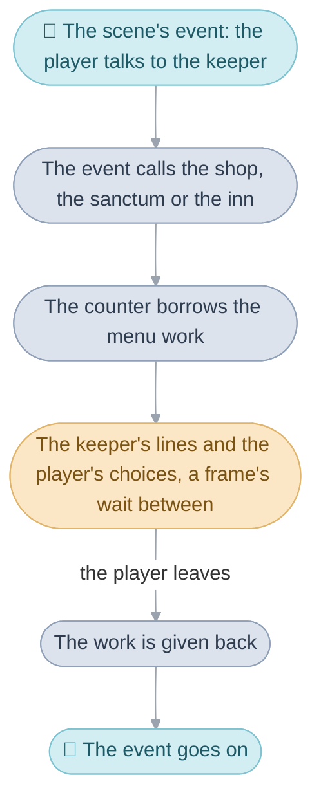

# Shops

In a town the [party](../../glossary.md#the-party) spends its coins at three
kinds of counter. At a shop it buys and sells weapons, armor or items, has
broken things mended, and finds the rare items the game calls artifacts. At a
sanctum a priest revives a fallen party member or lifts poison, a haunting or
a curse. At an inn the party sleeps and wakes with full HP and
[PP](../../glossary.md#psynergy-and-pp).

Every counter opens the same way. The player talks to the keeper, and the
town's [scene](../../glossary.md#scene) runs an
[event](../../glossary.md#event), the piece of code behind a conversation.
The event calls the counter and waits for it to finish, and the counter
draws the keeper's lines, the coins window and the pointing hand over the
town meanwhile. The code here runs all three counters and two smaller
things that share their screens:

1. [A counter's work](#a-counters-work) is the memory every counter borrows
   while it is open.
2. [Shops](#shops) buy, sell, repair and offer artifacts, and give out Game
   Tickets for spending.
3. [Sanctums](#sanctums) and [inns](#inns) restore the party for a fee.
4. [The item picker](#the-item-picker) asks what to drop when the party is
   given an item and every pack is full.

The [windows](../../glossary.md#window) and
[messages](../../glossary.md#message) the counters draw with are in
[Windows](../window/README.md), and the items and their prices in
[Game rules](../game/README.md).

## A counter's work

A counter has to remember what it is doing: its windows, the party's
figures, the items on sale, where the hand is. It keeps all of it in one
block of memory, and that block is the field menu's, the menu
[work](../../glossary.md#work) ([Menus](../menu/README.md#the-menu-work)).

Borrowing it is safe because the two are never open together. The field
menu takes the block when the player opens it on the field and gives it
back when it closes, and a counter opens only from a scene's event, when
the field menu is closed. A counter also needs much the same things as a
menu screen, the party in order, its figures, some windows and a hand, so
one block suits both.

Every counter starts by taking and clearing the block, listing the party
into it, loading the hand's six small pictures (the hand, the page arrows,
a gem and the two stat arrows) and adding the [task](../../glossary.md#task)
that moves the hand each [frame](../../glossary.md#frame). Every counter
ends by removing the task, freeing the pictures and giving the block back.

## Shops

A shop offers four things at its counter, Buy, Sell, Artifacts and Repair,
and the shopkeeper talks the player through each. The game has 35 shops,
and each is one row of a table, the stock table in
[`shop/stock.c`](shop/stock.c). A row says three things: the ordinary items
the shop always sells, up to 24 of them; the rare items it brings, up to 8
([Artifacts](#artifacts)); and whether it is a weapon shop, an armor shop
or an item shop. Bilibin's weapon shop, for one, sells the Long Sword,
Broad Sword, Hunter's Sword, Battle Axe and Heavy Mace, and brings the
Witch's Wand.

A town's event only has to say which row its shop is and which
[actor](../../glossary.md#actor) is the keeper, whose face the lines show.
The shop then greets the player and loops: the four icons, the keeper's
line for the choice, and the choice itself. Buy and Artifacts are the same
buying screen over two different lists. B on the icons ends the loop with
the keeper's farewell.

The keepers' lines are written once for each kind of shop, and every set is
in the same order. So the code
always asks for the weapon shop's line, and one helper steps from there to
the same line of the armor or item shop's set. Xian's three shops have a
further set of their own, whose keepers call the player `warrior`. Each
line is a message typed into a window that the counter waits for, so a shop
reads as a conversation with choices in it.

### Buying

Buying asks `What would you like?` over the stock, seven items to a page
with their prices. Then it asks `Which one of you gets this?` over the
party, and how many for an item that stacks, such as a Herb.

As the hand passes each party member, the window beside them shows what the
item would mean to them. For a weapon or armor it shows how their Attack,
Defense and Agility would change, with an arrow beside each. For anything
else it shows how many of it they already carry. The party members who
cannot equip the item are drawn at four fifths of their size, as Ivan and
Mia are in the recording.

Before any coins change hands the shop makes its checks in order:

1. Is there room? The shop finds out by really putting one of the item in
   the party member's pack and taking it out again. A full pack gets its own
   line, `Your pack is full, Isaac. Who will you give this to?`, and so
   does a full stack.
2. Are there enough coins?
3. Can this party member equip it? If not the keeper says so,
   `You can't equip this, Isaac.`, and asks whether to buy it anyway.

For a stack, the most the player can ask for is the smallest of three
numbers: what the coins will buy, how many of an artifact the shops have
left, and a stack of 30 less what the party member already carries.

Then the items are added one at a time, each taking its price off the coins
and adding the same amount to the shop credit, which earns the
[Game Tickets](#game-tickets) below. The keeper offers to equip a weapon or
armor at once and, if it was equipped, to buy what it replaced, as with the
Bandit's Sword in the recording.

### Game Tickets

Every coin spent buying also builds up a shop credit, a count kept out of
the player's sight. Once the credit reaches the next ticket's cost, the
keeper says `Please take a complimentary Game Ticket.` and asks who takes
it. The ticket pays for a game of Lucky Wheels in Tolbi. Its cost comes off
the credit, and the coins stay as they were.

In the recording the party walks into Bilibin's item shop having spent 290
coins in shops so far, and buys one Herb for 10. The coins drop from 500 to
490 and the credit rises to 300, which is the cost of the first ticket. So
the keeper hands one over, the credit goes back to 0, and the coins are
still 490.

The cost rises after every fifth ticket, and one purchase gives at most
one ticket.

| Tickets      | Credit each |
| ------------ | ----------- |
| 1st to 5th   | 300         |
| 6th to 10th  | 500         |
| 11th to 15th | 1,000       |
| 16th to 20th | 2,000       |
| 21st to 25th | 4,000       |
| 26th on      | 8,000       |

The credit and the number of tickets given are kept in the
[main routine's work](../../glossary.md#main-routines-work), with the
party and its coins, so a save file keeps them.

### Selling

Selling asks `What do you want to sell?`, then whose items, and shows that
party member's items as a grid of icons, five to a row, each with its price
and description as the hand passes. A stack asks how many.

A shop pays three quarters of an item's price, rounded down: a Herb that
costs 10 sells for 7. A broken item fetches half. An item the story needs
is refused (`Sorry, but we don't buy those.`), and so is a cursed item that
is being worn.

A sold item leaves the pack the same way a dropped one does, through one
routine in the game's rules. That routine is what puts a rare item back on
sale ([Artifacts](#artifacts)), so selling and dropping cannot disagree
about it.

### Repairing

Only an item that can break can be repaired: the kind that breaks one use
in eight, such as the Healing Ring. A repair costs a quarter of the item's
price. The keeper takes the item away for three strokes of a bell, 110
frames apart, hands it back mended and offers to equip it.

Any other item is refused (`Sorry, but we don't handle <item>s.`), and so
is an item that is not broken (`It's not broken.`), a cursed one that is
being worn, or one the coins do not cover.

While it is away the item is hidden from the grid, and the items after it
stay where they are, so it comes back in the same place.

### Artifacts

A rare item belongs to no one shop. It has one count for the whole game,
from 0 to 99, and every shop of its kind sells it while that count is above
zero. The first time the player opens a shop, each rare item in its row
adds one to its count. Buying one takes one off, and selling or dropping
one puts one back. So a rare item first found in one town is sold by every
shop of its kind afterwards, and one the party gives up comes back on sale.

Vault's weapon shop brings the Magic Rod. The party reaches Vault first, so
Bilibin's weapon shop lists the Magic Rod beside its own Witch's Wand,
unless it was bought in Vault. When two shops' rows bring the same item,
each first visit adds one, so it can be bought twice.

The game remembers each shop's first visit with a
[game flag](../../glossary.md#game-flag), one of 35, so a shop adds its
rare items only once. [Game rules](../game/README.md#rare-item-counters)
explains the counts themselves.

## Sanctums

A sanctum's priest offers four services, Revive, Cure poison, Repel evil and
Remove curse, and serves one party member at a time. The hand can point at
anyone, and the fee window under the party says what the service would cost
that party member, or that they don't need it (`This ally needs no healing.`,
`This ally is not poisoned.`). On someone who doesn't need it A only
buzzes, and they are drawn at seven tenths of their size.

| Service      | For a party member who         | Fee              | Tune                  |
| ------------ | ------------------------------ | ---------------- | --------------------- |
| Revive       | is down (HP 0)                 | 20 coins a level | 🎵 `MUS_REVIVE`       |
| Cure poison  | is poisoned or deadly poisoned | 10 coins         | 🎵 `MUS_CURE`         |
| Repel evil   | is haunted                     | 50 coins         | 🎵 `MUS_REPEL_EVIL`   |
| Remove curse | wears a cursed item            | 10 coins a level | 🎵 `MUS_REMOVE_CURSE` |

Reviving and lifting a curse cost more for a party member of a higher
level. Lifting a curse takes off every cursed item the party member wears, and
their stats are then worked out again from what they still wear.

Once the player agrees to the donation, the service is applied and the
sanctum plays its burst. The field's colours are tinted over 16 frames.
Eighteen sparkles fly in from a ring around the party member's figure,
three frames apart, while the figure flashes through changes of colour. The
counter waits for the service's tune to finish, the colours fade back, and
the coins are taken. The choice is then offered again while anyone who
needs the service is left.

The same counter serves the healers in the towns and temples, the
travelling healers, and the one in the Battle Arena.

## Inns

An inn charges for each party member still standing and restores their HP
and PP overnight. A party member who is down stays down and is not charged.
Each town's inn has its own price for a guest. Bilibin's is 7 coins, so
three party members standing pay 21, the number in the recording. The
price is one of the blanks a message can have
([Windows](../window/README.md#decoding-a-message)): the inn works it out
and the innkeeper's line shows it.

| Inn      | Coins a guest |
| -------- | ------------- |
| Vale     | 2             |
| Vault    | 4             |
| Bilibin  | 7             |
| Kolima   | 8             |
| Imil     | 8             |
| Xian     | 10            |
| Altin    | 12            |
| Kalay    | 15            |
| Lunpa    | 20            |
| Suhalla  | 18            |
| Lalivero | 25            |

On No, or on Yes without the coins, the innkeeper says so and the counter
closes. On Yes with the coins, the inn takes them, fills each standing
party member's HP and PP, and plays the night. The night is the field's own
screen transition in its oval shape: the screen closes in on the leader
over 60 frames, the inn's tune plays through, and the screen opens again
over 60 frames. Then the innkeeper says the last line. Xian's inn, like
Xian's shops, has lines of its own.

## The item picker

When the party is given an item and every party member's pack is full, the
game says `What will you drop?` and the item picker asks which party member,
then which of their items, to drop to make room. Under the hand it shows why
an item cannot be dropped, or what the whole stack would sell for. An item
the story needs cannot be dropped, nor can a cursed one that is being worn.

The picker only asks. It hands the answer back to whatever was giving the
item, which drops the one chosen and puts the new item in its place, or
does nothing if the player backed out.

Choosing a cursed item that is being worn should show
`You can't remove it!`, but in
[the original](../../glossary.md#the-original) it only plays the cancel
sound. The code checks the wrong one of two results, one that is always
zero at that point, so the message's test never passes. This is a
[bug](../../glossary.md#bug-bugfix-and-ubfix) the code keeps.

## Design

A rare item has one count for the whole game, and every way an item leaves
the party, a sale, a drop from the Item screen and a drop from the item
picker, goes through the same routine in the game's rules. So one count
serves every shop of a kind, and the shops need no list of what each has
sold.

### Editions

The counters' layout differs by [edition](../../glossary.md#editions) where
longer words need room. In German the Yes and No menu sits a column further
left. In German and French the sanctum's fee window is wider and the hand
that picks a quantity sits further left. French moves an item's price and
the word after it, Spanish only the word. Outside Japan the coins window
and the item picker's window are wider.

## How it fits with the rest of the game

Scenes open the counters from their events. What a purchase, a sale or a
service does to a party member, adding an item, discarding one, moving a
rare item's count, working stats out again, is decided by the game's rules
([Game rules](../game/README.md)); the counters ask, show and charge. The
party figures at a counter are set up by the field menu's code
([Menus](../menu/README.md#design)).

Some of the shop's pieces serve other screens. Its pointing hand also moves
in the settings menu, the name entry screen, the file list and the Colosso
choice. The Item screen draws its quantity bar with the shop's. The tint of
colours a sanctum plays also runs as a [Djinni](../../glossary.md#djinn)
joins the party and as the wall in Altmiller Cave bursts. The
[debug menus](../../glossary.md#debug-menus) can open a shop with 200,000
coins, broken equipment and a poisoned party.

## Limits

- Shop credit stops at 999,999 and the count of Game Tickets given at 28.
  Every ticket from the 26th costs 8,000 either way, so the cap changes
  nothing the player sees.
- A price shows at most five digits.
- A rare item's count stops at 99.
- The inns' price table has a row for Tolbi that costs nothing, and no
  event opens it.

## Words used here

- **counter**: one of the three things the party trades at, a shop, a
  sanctum or an inn.
- **keeper**: the actor the event names as the shopkeeper, priest or
  innkeeper, whose portrait the lines show.
- **stock row**: one shop's row of the stock table in
  [`shop/stock.c`](shop/stock.c).
- **artifact**: a rare item, which a shop sells only while its count is
  above zero.
- **shop credit**: the coins spent buying, which earn Game Tickets.
- **service**: what a sanctum does for one party member.
- **burst**: the sparkles and tinted colours a sanctum plays over the party
  member served.

## Evidence

The counters are named for what the player meets at them, the stock row's
parts from what the shop's code reads from each, the choices and services
from what their windows offer in the English release, and the inns from the
town scenes that open them.

The rows of the inns' price table follow the order of the towns' area
names, from Vale to Lalivero. The empty row falls between Lunpa and
Suhalla, where Tolbi is, and Tolbi is the one town whose inn no event
opens: its sign says the inn is full.
