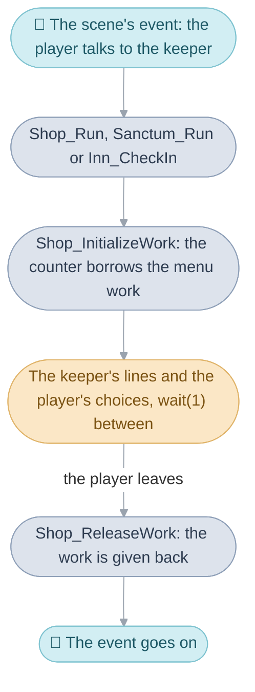

# Shops

In a town the [party](../../glossary.md#the-party) spends its coins at three
kinds of counter. At a shop it buys and sells weapons, armor or items, has
broken things mended, and finds the rare items the game calls artifacts. At a
sanctum a priest revives a fallen party member or lifts poison, a haunting or
a curse. At an inn the party sleeps and wakes with full HP and
[PP](../../glossary.md#psynergy-and-pp). Every counter opens the same way:
the player talks to the keeper, and the town's
[scene](../../glossary.md#scene) runs an [event](../../glossary.md#event)
that calls the counter's one function and waits for it to return, with the
keeper's lines, the coins window and the hand cursor drawn over the town
meanwhile. The code here runs all three counters, and two smaller things
that share their screens: the Game Tickets a shopkeeper gives for spending,
and the item picker, which asks what to drop when the party is given an item
with every party member's pack full.

The page takes the counters in this order:

1. [A counter's work](#a-counters-work): the memory every counter borrows
   while it is open.
2. [Shops](#shops): the four things a shop does, buying, Game Tickets,
   selling, repairing and the artifacts.
3. [Sanctums](#sanctums) and [inns](#inns).
4. [The item picker](#the-item-picker).

[Interface](../../interface.md#shops-sanctums-and-inns) gives the counters
in brief; the [windows](../../glossary.md#window) and
[messages](../../glossary.md#message) they draw with are in
[Windows](../window/README.md), and the items, their prices and their rare
item counters in [Game rules](../game/README.md).

## A counter's work

A counter keeps what it is doing, its windows, the party's figures, the
items on sale, the hand cursor and the sanctum's sparkles, in one block of
memory, and that block is the field menu's: the menu
[work](../../glossary.md#work), in the
[heap slot](../../glossary.md#heap-slot) `HEAP_SLOT_MENU`
([Menus](../menu/README.md#the-menu-work)). The field menu takes the block
when the player opens it on the field and gives it back when it closes, and a
counter opens only from a scene's event, when the field menu is closed, so
the block is always free for a counter to take, and a counter needs a block
of the same shape: the party in order, its figures, windows and a hand
cursor. The shops, sanctums and the
item picker read it as `struct ShopWork`
([`include/shop/shop.h`](../../include/shop/shop.h)), and the inn, which
needs only the coins window and the innkeeper's portrait, as
`struct InnWork` ([`include/shop/inn.h`](../../include/shop/inn.h)).

Every counter opens with `Shop_InitializeWork`, which takes and clears the
block, lists the party into it, loads the six icons the hand cursor uses
(the hand, the page arrows, a gem and the two stat arrows) into the video
memory cache, and adds the task that moves the hand each
[frame](../../glossary.md#frame) (`MenuCursor_Step`). Every counter closes
with `Shop_ReleaseWork`, which removes the task, frees the icons and gives
the block back.

| Name                 | Value       | Meaning                                                |
| -------------------- | ----------- | ------------------------------------------------------ |
| `HEAP_SLOT_MENU`     |             | the heap slot a counter takes its work from            |
| `struct ShopWork`    | 2,672 bytes | the menu work as the shops, sanctums and item picker read it |
| `stockItemIds`       | 129 entries | the items on sale, ended by 0                          |
| `partyMemberIds`     | 9 entries   | the party in order, ended by 0                         |
| `effects`            | 24 sparkles | the sanctum's burst                                    |

## Shops

A shop offers four things at its counter, Buy, Sell, Artifacts and Repair,
and the shopkeeper talks the player through each. Every shop in the game is
one row of a stock table, which lists the ordinary items it always sells,
the rare items it adds, on its first visit, to a stock every shop of its
kind shares ([Artifacts](#artifacts)), and whether it sells weapons, armor
or items. Bilibin's weapon shop, for one, sells the Long
Sword, Broad Sword, Hunter's Sword, Battle Axe and Heavy Mace, and adds the
Witch's Wand. A town's event names only which row its shop is and which
[actor](../../glossary.md#actor) is the keeper, whose face the lines show.

`Shop_Run` runs a shop until the player leaves. It adds the row's artifacts
to that shared stock if this is the shop's first visit
(`ShopStock_AddArtifacts`), takes the work, reads the shop's type from the
row (`ShopStock_GetType`), opens the keeper's portrait and greets the player,
and then loops: the four icons (`Menu_SelectShopCommandFar`, in the window
code), the keeper's line for the choice, and the choice itself. Buy and
Artifacts both run `Shop_SelectBuy` (`shop/buy.c`), the one with the row's
ordinary items copied into the work (`ShopStock_CopyItems`) and the other
with the artifacts the shop's type can sell (`Shop_ListAvailableArtifacts`);
Sell runs `Shop_ChooseMember` (`shop/sell.c`), which asks whose items
first, and Repair reaches it through `Shop_RunRepairMemberChoice`. B on the
icons ends the loop with the farewell. The stock
table is `sStockTable` in [`shop/stock.c`](shop/stock.c), its columns named
there.

The keepers' lines are written once for each kind of shop, every set in the
same order, so the code always names the weapon shop's line and
`Shop_ShowKeeperMessage` adds the distance from `MsgWeaponShopWelcome` to
the armor or item shop's welcome; one call serves every kind of shop. Xian's
three shops have a further set of their own, whose keepers call the player
`warrior`, and this set's distance is added on top (`ShopWork.warriorShop`);
the sanctum's four services are four sets of the same kind
(`Shop_MessageByMode`). Each keeper's line is a message typed into a window
the counter waits for, so a shop reads as a conversation with choices in it.
The lines quoted on this page are the weapon shop's unless a recording shows
another shop.

| Name                     | Value | Meaning                                              |
| ------------------------ | ----- | ---------------------------------------------------- |
| `SHOP_STOCK_ROWS`        | 35    | shops in the game, one row each                      |
| `SHOP_STOCK_ITEM_COUNT`  | 24    | ordinary items a row lists                           |
| `SHOP_STOCK_ARTIFACT_COUNT` | 8  | rare items a row adds                                |
| `SHOP_TYPE_ITEMS`        |       | the row sells items                                  |
| `SHOP_TYPE_WEAPONS`      |       | the row sells weapons                                |
| `SHOP_TYPE_ARMOR`        |       | the row sells armor                                  |
| `SHOP_STOCK_ROW_EMPTY`   | 0     | the row that sells nothing, used for a row out of range |

### Buying

Buying asks `What would you like?` over the stock, seven items a page with
their prices, then `Which one of you gets this?` over the party, then how
many for an item that stacks, such as a Herb, and takes the price off the
party's coins. As the hand passes each party member, the window beside them
shows what the item would mean to them: for a weapon or armor, how their
Attack, Defense and Agility would change, with an arrow beside each
(`Shop_DrawEquipComparison`), and for anything else how many of it they
already carry (`Shop_DrawCarriedItem`). The party members who cannot equip
the item are drawn at four fifths of their size, `Q16_ONE * 4 / 5` in 16.16 fixed
point (`Shop_DrawParty`).

`Shop_SelectBuy` runs it. Before taking any coins it tests for room in the
party member's pack by adding one and taking it out again, so a full pack
and a full stack get their own lines (`Your pack is full, Isaac. Who will
you give this to?`); then it checks the coins, and warns when the party
member cannot equip the item (`You can't equip this, Isaac.`) and asks
whether to buy it anyway. The count for a stack (`Shop_SelectBuyCount`,
`Shop_SelectQuantity`) is limited by what the coins buy, by the artifact's
stock, and by a stack of 30 less what the party member carries. Then
`Shop_BuyDone` adds the items one at a time, taking each one's price off
the coins and adding it to the shop credit, the count the Game Tickets below
are earned by, offers to equip the item (`Shop_ConfirmEquip`) and, if it was
equipped, to sell what it replaced (`Shop_SellOld`). An artifact bought is
taken off its stock count only once the purchase is complete, and the list
is rebuilt.

| Name                    | Value | Meaning                                             |
| ----------------------- | ----- | --------------------------------------------------- |
| `SHOP_STOCK_PAGE_ITEMS` | 7     | items on one page of the stock, 32 pixels apart     |
| `SHOP_STACK_LIMIT`      | 30    | the most of one item a party member's stack holds   |
| `INVENTORY_SLOTS`       | 15    | items a party member carries                        |
| four fifths             | `Q16_ONE * 4 / 5` | the size a party member who cannot equip the item is drawn at, in 16.16 |

### Game Tickets

Every coin spent buying also builds up a shop credit, a count kept out of
the player's sight. Once the credit reaches the next ticket's cost, the item
shop's keeper says `Please take a complimentary Game Ticket.` and hands one
over,
asking who takes it. The ticket pays for Lucky Wheels in Tolbi, and its cost
comes off the credit, while the coins stay as they were. The cost rises after
every fifth ticket, and a purchase gives at most one.

After each purchase `Shop_BuySpecialItem` compares the credit with the next
cost in `sGameTicketCreditCosts`, indexed by how many tickets the party has
been given. The credit and the count are two numbers in the
[main routine's work](../../glossary.md#main-routines-work),
`gMainRoutineWork.shopCredit` and `gMainRoutineWork.shopGifts`, so a save
file keeps them. The [worked example](#buying-a-herb-in-bilibin) below shows
a ticket handed over.

| Tickets     | Credit each |
| ----------- | ----------- |
| 1st to 5th  | 300         |
| 6th to 10th | 500         |
| 11th to 15th | 1,000      |
| 16th to 20th | 2,000      |
| 21st to 25th | 4,000      |
| 26th on     | 8,000       |

### Selling

Selling asks `What do you want to sell?`, then whose items, and shows that
party member's items as a grid of icons, each with its price and
description as the hand passes. A shop buys an item back for three quarters
of its price, half for a broken one, and nothing for one the story needs,
which it refuses to buy at all (`Sorry, but we don't buy those.`); a Herb
that costs 10 sells for 7. A cursed item that is being worn is refused too.
A stack asks how many. A rare item sold goes back on sale
([Artifacts](#artifacts)).

`Shop_ChooseMember` asks whose items and runs `Shop_SelectSell` for the
party member chosen, which runs `Shop_SellItem` for each item the player
picks; `Shop_SalePrice` sets the price. Each item sold goes through
`Inventory_DiscardFar`, the same routine that drops an item, which is what
puts a rare item back on its stock count.

| Name                     | Value | Meaning                                             |
| ------------------------ | ----- | --------------------------------------------------- |
| three quarters           |       | what the shop pays for an item in good order        |
| half                     |       | what it pays for a broken one                       |
| `SHOP_INVENTORY_COLUMNS` | 5     | icons in a row of the party member's grid           |

### Repairing

Only an item that can break, one that breaks one use in eight such as the
Healing Ring, can be repaired, for a quarter of its price. The smith takes it
away for three hammer blows, hands it back mended and offers to equip it.
Any other item is refused (`Sorry, but we don't handle <item>s.`), and so is
an item that is not broken (`It's not broken.`), a cursed one that is being
worn, or one the coins do not cover.

`Shop_RepairItem` (`shop/repair.c`) runs the repair for the item picked in
`Shop_SelectRepair`, with `Shop_RepairPrice` setting the price. During the
blows the item is hidden from the grid without moving the items after it, so
it comes back in the same place; the three bells are 110 frames apart, six
seconds from the first wait to the last.

| Name                  | Value       | Meaning                                       |
| --------------------- | ----------- | --------------------------------------------- |
| a quarter             |             | what a repair costs, of the item's price      |
| `ITEM_USE_MAY_BREAK`  |             | the kind of item a shop can repair            |
| three bells           | 110 frames apart | 📣 `SE_BELL`, the smith's hammer blows   |

### Artifacts

A rare item belongs to no one shop: it has one stock count for the whole
game, and every shop of its kind sells it while that count is above zero.
The first time the player opens a shop, each rare item in its row adds one
to its count; buying one takes one off, and selling or dropping one puts
one back. So a rare item first found in one town is sold by every shop of its
kind afterwards, and one the party gives up comes back on sale.

Vault's weapon shop adds the Magic Rod. The party reaches Vault first, so
Bilibin's weapon shop lists the Magic Rod beside its own Witch's Wand unless
it was bought in Vault. When two shops' rows list the same item, each first
visit adds one, so it can be bought twice.

`ShopStock_AddArtifacts` counts a shop's rare items on its first visit, and a
[game flag](../../glossary.md#game-flag) for each row,
`FLAG_SHOP_ARTIFACTS_STOCKED` plus the row, remembers that it has.
`Shop_ListAvailableArtifacts` builds the Artifacts list from every item of
the shop's type whose count is above zero, and `Item_AdjustCounterFar` moves
a count. [Game rules](../game/README.md#rare-item-counters) explains the
counts themselves.

| Name                          | Value | Meaning                                              |
| ----------------------------- | ----- | ---------------------------------------------------- |
| `FLAG_SHOP_ARTIFACTS_STOCKED` |       | the first of 35 flags, one a row, set on its first visit |
| a rare item's count           | 0 to 99 | how many of it the shops can still sell            |

## Sanctums

A sanctum's priest offers four services, Revive, Cure poison, Repel evil and
Remove curse, and serves one party member at a time. The hand can point at
anyone, and the fee window under the party says what the service would cost
that party member, or that they don't need it (`This ally needs no healing.`,
`This ally is not poisoned.`), in which case A only buzzes; such party
members are drawn smaller too. Once the player agrees to
the donation, the service is applied, a burst of sparkles plays over the
party member's figure to the service's tune, and the coins are taken. The
choice is offered again while anyone who needs the service is left.
Reviving and lifting a curse cost more for a higher-level party member, and
lifting a curse takes off every cursed item the party member wears. The same
counter serves the healers in the towns and temples, the travelling healers,
and the one in the Battle Arena.

`Sanctum_Run` (`shop/sanctum.c`) runs it: the welcome, then the four icons
(`Menu_SelectSanctumServiceFar`) and, for the service chosen,
`Sanctum_RunPartyService`, unless nobody needs it
(`Sanctum_CountMembersInNeed`). `Sanctum_NeedsService` decides who needs
what and `Sanctum_ServicePrice` sets the fee; `BattleUnit_ResetStateByMode`
applies the service, and `Unit_Calculate` then rebuilds the party member
from what they still wear. The burst is `Sanctum_RunMemberIconBurst`: the
field's colours are tinted (`Shop_SaveAndTintFieldPalette`), eighteen
sparkles fly in from a ring around the figure three frames apart while a
task cycles the figure through colour modes (`Shop_ResetEffects`), the
counter waits for the tune to finish (`Sound_WaitForJingle`), and the colours
fade back.

| Service      | For a party member who         | Fee               | Tune                   |
| ------------ | ------------------------------ | ----------------- | ---------------------- |
| Revive       | is down (HP 0)                 | 20 coins a level  | 🎵 `MUS_REVIVE`        |
| Cure poison  | is poisoned or deadly poisoned | 10 coins          | 🎵 `MUS_CURE`          |
| Repel evil   | is haunted                     | 50 coins          | 🎵 `MUS_REPEL_EVIL`    |
| Remove curse | wears a cursed item            | 10 coins a level  | 🎵 `MUS_REMOVE_CURSE`  |

| Name                 | Value      | Meaning                                                 |
| -------------------- | ---------- | ------------------------------------------------------- |
| seven tenths         | `Q16_ONE * 7 / 10` | the size a party member who needs nothing is drawn at, in 16.16 |
| eighteen sparkles    | 3 frames apart | the burst, in 24 sparkle slots                      |
| the tint             | 16 frames  | how long the field's colours take to change, and to come back |

## Inns

An inn charges for each party member still standing and restores their HP
and PP overnight. A party member who is down stays down and is not charged.
Each town's inn has its own price a guest, from 2 coins in Vale to 25 in
Lalivero; Bilibin's is 7, so three party members standing pay 21. Xian's
inn, like Xian's shops, has lines of its own.

`Inn_CheckIn` runs it, with each town's scene naming its row of
`sInnPricesPerGuest`: `Inn_RoomPrice` multiplies the row's price by the
party members whose HP is above 0, the innkeeper names the total, and on Yes
with the coins to pay it `Inn_PlaySleep` takes the coins, fills each
standing party member's HP and PP, and plays the night. The night is the
screen closing in an oval on the leader over 60 frames
(`Event_StartScreenTransition`), `MUS_INN` played through, and the screen
opening again over 60 frames; the 16 frames the field's own wipes take are
put back after.

| Inn      | Coins a guest |
| -------- | ------------- |
| Vale     | 2             |
| Vault    | 4             |
| Bilibin  | 7             |
| Kolima   | 8             |
| Imil     | 8             |
| Xian     | 10            |
| Altin    | 12            |
| Kalay    | 15            |
| Lunpa    | 20            |
| Suhalla  | 18            |
| Lalivero | 25            |

## The item picker

When the party is given an item and every party member's pack is full, the
game says `What will you drop?` and the item picker asks which party member,
then which of their items, to drop to make room. Under the hand it shows why
an item cannot be dropped, or what the whole stack would sell for. An item
the story needs cannot be dropped, nor can a cursed one that is being worn.

`ItemPicker_Run` runs it and hands back the party member and the slot
chosen, or -1 for both when the player backs out; the caller, which gave the
item, drops the one chosen and puts the new item in its place. Choosing a
cursed item that is being worn should show `You can't remove it!`, but in
[the original](../../glossary.md#the-original) it only plays the cancel
sound: the test reads the selection result, still 0, instead of the discard
error, a [bug](../../glossary.md#bug-bugfix-and-ubfix) the code keeps, with
the fixed form behind `BUGFIX` (`SHOP_CANNOT_REMOVE_STATUS`).

## Buying a Herb in Bilibin

The party walks into Bilibin's item shop with 500 coins, having spent 290 in
shops so far, and buys a Herb. Each thing that happens is one of the page's
mechanisms.

Talking to the keeper runs the scene's event, which calls
`Shop_Run(SHOP_BILIBIN_ITEMS, ACTOR_BILIBIN_ITEM_MERCHANT)` and waits.
`ShopStock_AddArtifacts` finds nothing to count, since the item shop's row
lists no artifacts; `Shop_Run` takes the work with `Shop_InitializeWork`,
reads the row's type, `SHOP_TYPE_ITEMS`, opens the keeper's portrait and
shows the welcome, moved from the weapon shop's line to the item shop's.

The four icons come up (`Menu_SelectShopCommandFar`); A on Buy. `Shop_Run`
copies the row's items into the work (`ShopStock_CopyItems`), says `What
would you like?` and calls `Shop_SelectBuy`, which opens the coins window,
the price window and the stock, and waits a frame at a time while the hand
moves along the items; A on the Herb.

`Shop_SelectBuy` asks who gets it and places the party figures; the window
beside them shows how many Herbs Isaac carries (`Shop_DrawCarriedItem`). A
on Isaac. It adds a Herb to his pack and takes it out again to test for
room, checks that 10 coins are there, and asks how many
(`Shop_SelectBuyCount`), capped by the coins and the stack, the two limits
that apply to an ordinary item; one. `Shop_BuyDone` adds the Herb, takes 10
coins and adds 10 to the shop credit, and goes straight on, since the offer
to equip is for weapons and armor.

`Shop_BuySpecialItem` runs next. The party has been given no tickets, so the
next cost is 300; the credit is now 300, so the keeper says `Please take a
complimentary Game Ticket.` and asks who takes it. A on Isaac: the ticket
goes into his pack, 300 comes off the credit and the ticket count becomes 1.
The coins stay at 490.

`Shop_SelectBuy` asks `Is there anything else?` and shows the stock again;
B closes its windows and returns. `Shop_Run` puts the hand back off screen,
says `Feel free to take a look around.` and shows the icons; B ends the loop
with `Thank you very much. Please come again.`, closes the portrait, frees
the work with `Shop_ReleaseWork` and returns to the event, which ends, and
the party can walk again.

| What happened                          | Mechanism                                                     |
| -------------------------------------- | ------------------------------------------------------------- |
| The keeper greets the party            | `Shop_Run`, opened by the scene's event, with the item shop's line |
| The counter has memory to work in      | `Shop_InitializeWork` borrows the menu work                   |
| The four icons                         | `Shop_Run`'s loop and `Menu_SelectShopCommandFar`             |
| The stock, seven a page                | `Shop_SelectBuy` over `ShopStock_CopyItems`                   |
| Room, coins and how many               | `Shop_SelectBuy`'s tests and `Shop_SelectBuyCount`            |
| The coins drop to 490                  | `Shop_BuyDone`, which also adds 10 to the shop credit         |
| The Game Ticket                        | `Shop_BuySpecialItem` against `sGameTicketCreditCosts`        |
| The farewell and the walk              | `Shop_ReleaseWork`, and the event returns                     |

## Design

Counting artifacts for each item, in one stock count the whole game shares,
lets one count serve every shop of a kind and every way an item leaves the
party: a sale, a drop from the Item screen and a drop from the item picker
all go through `Inventory_Discard`, and the shops need no list of what each
has sold.

### Editions

The counters' layout differs by [edition](../../glossary.md#editions) where
longer words need room. In German the Yes and No menu sits a column further
left; in German and French the sanctum's fee window is wider and the
quantity cursor sits further left; French moves an item's price and the
word after it, Spanish only the word. Outside Japan the coins window and the
item picker's window are wider, and an item's description is drawn as window
tiles. Each value is a named macro chosen in an `#if` block, mostly in
`shop_internal.h`.

## How it fits with the rest of the game

Scenes open the counters through their
[import tables](../../glossary.md#entry-table-and-import-table), and the rest
of the main image through the shop [bank](../../glossary.md#bank)'s
[far-call](../../glossary.md#far-call) table. The party figures are set up
through the menu bank's `PsynergyMenu_InitializeEntryActorsFar`, and what a
purchase, a sale or a service does to a party member is the game's rules
(`Inventory_AddItem`, `Inventory_Discard`, `Item_AdjustCounter`,
`Unit_Calculate`), in [Game rules](../game/README.md).

Some of the shop's pieces serve other screens: its hand cursor also moves in
the settings menu, the name entry screen, the file list and the Colosso
choice (`MenuCursor_Advance`); the Item screen draws its quantity bar with
the shop's (`QuantityBar_Fill`); and the colour fade a sanctum plays also
runs as a [Djinni](../../glossary.md#djinn) joins the party and as the wall
in Altmiller Cave bursts (`Shop_SaveAndTintFieldPalette`). The debug menus
open a shop with 200,000 coins, broken equipment and a poisoned party
(`Shop_OpenDebugShop`).

## Limits

- Shop credit stops at 999,999 and the Game Ticket count at 28
  (`Party_AdjustShopCredit`, `Party_AdjustShopGifts`). Every ticket from the
  26th costs 8,000 either way, so the cap changes nothing the player sees.
- A price sprite shows at most five digits.
- Tolbi's row of `sInnPricesPerGuest` costs nothing and no event opens it.

## Words used here

- **counter**: one of the three things the party trades at, a shop, a sanctum
  or an inn, each one function the scene's event calls.
- **keeper**: the actor the event names as the shopkeeper, priest or
  innkeeper, whose portrait the lines show (`ShopWork.keeperGraphics`).
- **stock row**: a row of `sStockTable` in [`shop/stock.c`](shop/stock.c),
  one per shop, with its columns named by `SHOP_STOCK_`.
- **shop type**: the stock row's last column, `SHOP_TYPE_ITEMS`,
  `SHOP_TYPE_WEAPONS` or `SHOP_TYPE_ARMOR`.
- **artifact**: a rare item, which a shop sells only while its stock count
  (`Item_AdjustCounter`) is above zero.
- **shop credit**: `gMainRoutineWork.shopCredit`, the coins spent buying, which
  earns Game Tickets; `gMainRoutineWork.shopGifts` counts the tickets given.
- **choice at the counter**: Buy, Sell, Artifacts or Repair
  (`enum ShopAction`).
- **service**: what a sanctum does for one party member (`enum SanctumService`).
- **burst**: the sparkles and tinted colours a sanctum plays over the party
  member served (`Sanctum_RunMemberIconBurst`).
- **hand cursor**: the hand that glides between choices (`struct MenuCursor`,
  `MenuCursor_Place`).

## Evidence

The counters are named for what the player meets at them, the stock row's
columns from what `shop/stock.c` reads from each, the actions and services
from the choices their windows offer in the English release, and the inns
from the town scenes that open them. The item names on this page are
`MsgItemName` plus each row's item ids.

The rows of `sInnPricesPerGuest` follow the order of the towns' area names in
`gArea_NameRules`, from Vale to Lalivero. The empty row falls between Lunpa
and Suhalla, where Tolbi is, and Tolbi is the one town whose inn no event
opens: its sign says the inn is full
(`MsgTolbiInteriorsIsaacCheckedTheSignInnFull`).
