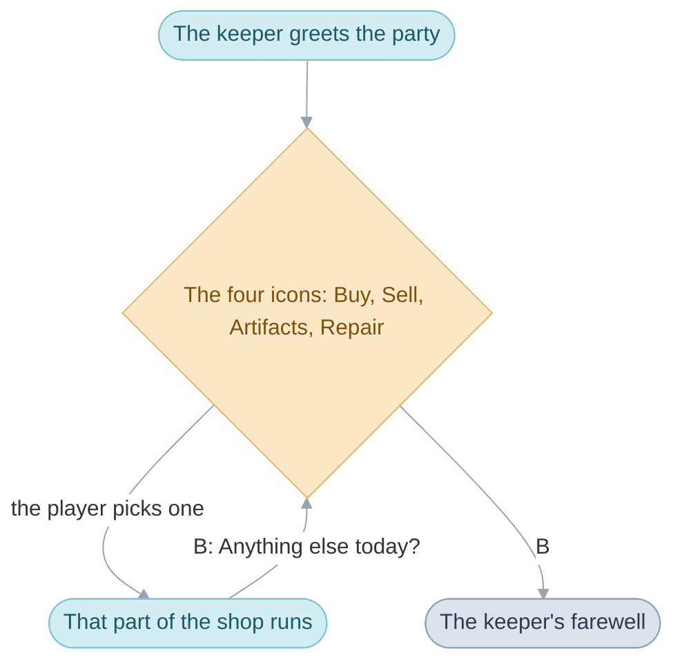
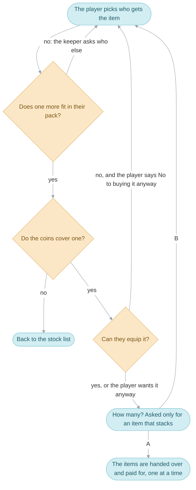
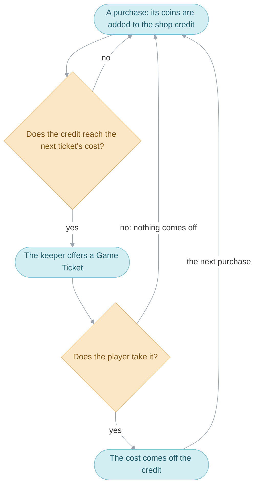
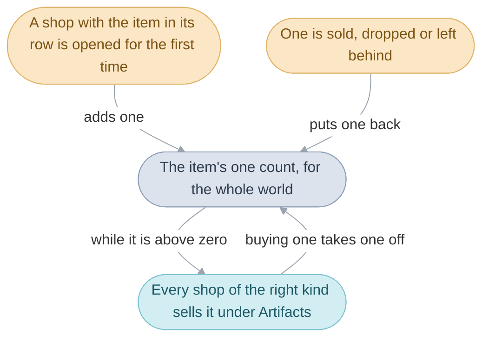
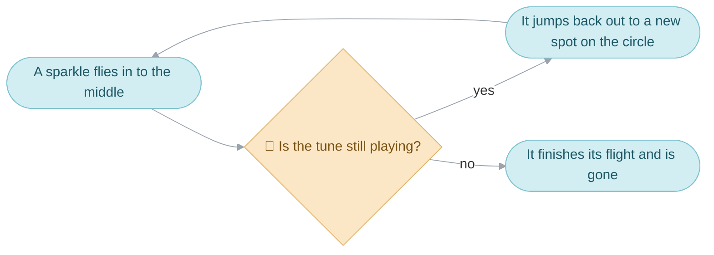
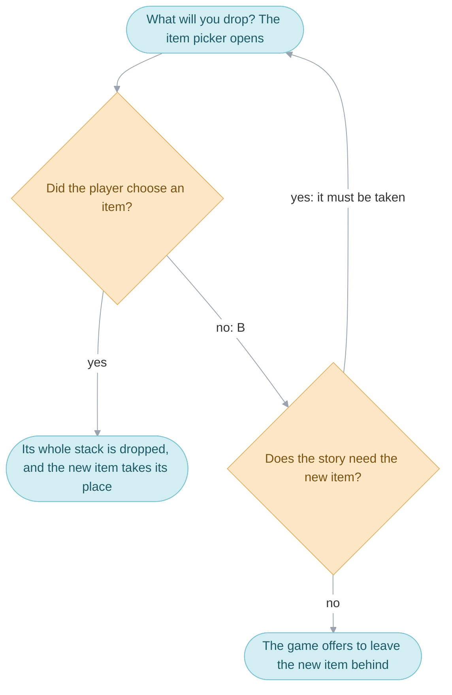

# Shops

Walk up to the counter of Bilibin's item shop and press A. The shopkeeper's
portrait appears with `Welcome! We have just the gear you need.`, four icons
come up, and the visit lasts until the shopkeeper says goodbye.

The [party](../../glossary.md#the-party) spends its coins across three kinds
of counter.

At a shop it buys and sells weapons, armor or items, has broken things
mended, and finds the rare items the game calls artifacts. At a sanctum a
priest revives a fallen party member or lifts poison, a haunting or a curse.
At an inn the party sleeps and wakes with full HP and
[PP](../../glossary.md#psynergy-and-pp).

This page calls all three counters, and follows each in turn:

1. Shops: the four icons, then [buying](#buying), the
   [Game Tickets](#game-tickets) a shop gives away, [selling](#selling),
   [repairing](#repairing) and [artifacts](#artifacts).
2. [Sanctums](#sanctums), with their fees and their shower of sparkles.
3. [Inns](#inns), and where the price of a night comes from.
4. [The item picker](#the-item-picker), the small screen that asks what to
   drop when the party finds an item and every pack is full. It is built from
   the shop's pieces, so it lives here.

The boxes of text are [windows](../../glossary.md#window) and the lines in
them are [messages](../../glossary.md#message), and both are explained in
[Windows](../window/README.md). The items themselves, and their prices, are
in [Game rules](../game/README.md).

## Shops

Where Isaac stands matters. Bilibin's weapon merchant opens the shop only
when Isaac faces north, across the counter. Talk to the same merchant from
the side and there is no shop, only a bit of talk.

Every conversation in the game is run by a small piece of code that belongs
to its town, which the game calls an [event](../../glossary.md#event). The
merchant's event looks at which way Isaac is facing. If he is across the
counter, it hands over to the shop and waits until the shop is finished.

It tells the shop two things: which shop this is, and which person in the
room is the keeper, so the shop knows whose portrait to show.

### What a shop sells

Every shop in the game is one row of a single list, the stock table in
[`shop/stock.c`](shop/stock.c), which is the file to open to see what any
shop sells. There are 34 shops, from Vale's three to Lalivero's three.

Bilibin's weapon shop is one of those rows. It says three things:

- The ordinary stock: Long Sword, Broad Sword, Hunter's Sword, Battle Axe and
  Heavy Mace. A shop never runs out of these.
- The rare stock: one Witch's Wand. Rare items are sold under the Artifacts
  icon, and there are only so many of each ([Artifacts](#artifacts)).
- The kind of shop: weapons. The other two kinds are armor and items.

### Round the four icons

A visit is a loop. The keeper greets the party, and the four icons come up:
Buy, Sell, Artifacts and Repair. The player picks one, the keeper says a line
about it, and that part of the shop runs until the player backs out with B.
Then the keeper asks `Anything else today?` and the icons are back.

Pressing B on the icons themselves ends the visit with the keeper's farewell.

Buy and Artifacts are the same screen. The only difference is the list it is
given: the row's ordinary stock, or the rare items on sale.

### How one shop speaks with three voices

A weapon shopkeeper asks `Which one of you gets this?` An armor shopkeeper
asks `And who is this for?` An item shopkeeper asks `Now, who is this for?`
Yet the shop's code is written once, for all three.

The trick is in how the lines are stored. The weapon shop has a set of 43
lines: the welcome, the farewell, a line for every question and every
refusal. The armor shop's set follows it in the text, with its own wording of
the same 43 lines in the same order. The item shop's set comes after that.

So the code only ever asks for the weapon shop's line. In an armor shop the
game steps 43 lines further on before showing it, and in an item shop 86. It
lands on the same moment of the conversation in another keeper's words.

Xian's three shops go one step further. Their keepers have three more sets,
and in the English text they call the player `warrior`. Xian's weapon
shopkeeper opens with `You need weapons, warrior. Check our weapons.`

One line in the item shops' set has a slip that shipped with the English
game. Pick something the party can't afford, and the shopkeeper says it is
`a litle out of your price range.`

### Buying

Buying opens on the stock, seven items to a page, each with its price.
Bilibin's armor shop sells nine things, so it has a second page with two
on it, and a small arrow shows there is more.

Pick the Long Sword and the keeper asks who gets it. Now the hand moves along
the party, and the window beside it changes for each member it passes.

For a weapon or a piece of armor, that window shows the member's Attack,
Defense and Agility as they are. Where a number would change, an arrow points
up or down and the new number stands beside it. Under them is the name of the
item it would replace.

The shop does not work those numbers out with a sum of its own. It really
puts the Long Sword in the member's hands, has the game's rules work out
their stats, writes the numbers down, and puts the old weapon back. All of
that happens before the next picture reaches the screen, so the player only
ever sees the result.

For anything else, such as an Herb, the window shows how many the member
carries already (`You have 3`, or `None in stock`) and the icons of
everything in their pack.

Party members who cannot equip the item are drawn at four fifths of their
size.

When the player presses A on a party member, the shop asks three questions
before any coins move:

The first question is answered the same way as the stat window: by trying.
The shop puts one of the item in the member's pack. If that works, it takes
the item straight out again and carries on. If it fails, the keeper says why.

There are two ways to fail. A pack has 15 places, and when all are taken the
weapon shopkeeper says `Your pack is full, Isaac. Who will you give this to?`

The other way is a full stack. Some items stack, which means that many of
them share one place in the pack: thirty Herbs take up one place, not thirty.
Thirty is the most a stack holds, so a thirty-first Herb fails even with
places to spare. The item shopkeeper has a line for that too: `Isaac can't
hold this Herb, so who wants it?`

For an item that stacks the keeper asks how many, and a bar of 30 small
segments shows the stack filling up. The player can ask for as many as the
coins will buy and as many as still fit in the stack, whichever is fewer. A
rare item has a third limit, how many of it are left to sell.

Then the items change hands one at a time. Each one takes its price off the
coins and adds the same amount to a second, hidden count, which is what earns
the [Game Tickets](#game-tickets) below.

Last, the keeper offers to equip a weapon or a piece of armor at once. If the
player says yes, the keeper also offers to buy what it replaced.

### Game Tickets

Every so often a shopkeeper hands over a Game Ticket, good for a spin of the
Lucky Wheels in Tolbi. It can look like luck. It is a tally.

Every coin the party spends buying is also added to that hidden count, which
this page calls the shop credit. It counts purchases at every shop in the
game together. Selling, repairs, inns and sanctums add nothing to it.

After each purchase the shop compares the credit with the cost of the next
ticket. The first ticket costs 300.

Say the party has spent 295 coins in shops so far and now buys one Herb
for 10. The credit rises to 305. That reaches 300, so the keeper offers a
ticket and asks who takes it. The 300 comes off the credit, leaving 5 towards
the next one. The coins are not touched.

The player can turn the ticket down with B (`You don't need it?`). Then
nothing comes off the credit, and the keeper offers again after the next
purchase.

A purchase gives one ticket at most, however large it is. Spend 3,000 coins
on the first purchase of the game and the keeper gives one ticket and keeps
2,700 of credit. The tickets that credit has already earned then come one at
a time, each after one more purchase of anything at all, even a single Herb.

The tickets get dearer as they are handed out:

| Tickets      | Credit each |
| ------------ | ----------- |
| 1st to 5th   | 300         |
| 6th to 10th  | 500         |
| 11th to 15th | 1,000       |
| 16th to 20th | 2,000       |
| 21st to 25th | 4,000       |
| 26th on      | 8,000       |

The credit and the number of tickets given are saved with the party's coins,
so the tally carries on where it was when the game is loaded again.

### Selling

Selling asks whose items, then shows that party member's pack as a grid of
icons, five to a row. As the hand passes an item, one window shows what the
shop will pay for it and another shows its description.

A shop pays three quarters of an item's price, rounded down. A Herb costs 10,
three quarters of that is 7 and a half, so it sells for 7. A broken item
fetches half its price instead.

The keeper words the offer to fit the item. At a weapon shop:

- an ordinary item gets `How about 7 coins for your Herb?`
- an item the game marks as rare gets `What rare stuff! How about 645
  coins?`, which is the offer for a Witch's Wand
- a broken one gets `Your Healing Ring is damaged, so...maybe 400 coins?`

Two things a shop will not buy. An item the story needs, such as the Shaman's
Rod, is worth nothing to it: `Sorry, but we don't buy those.` And seven items
won't come off once they are equipped: the six cursed ones and the Machete.
While one of those is being worn the keeper can't take it, and says to come
back once it's off.

Selling a stack asks how many, with the same bar of 30 segments as buying.

### Repairing

Some items can be used in battle again and again, but each use has one
chance in eight of breaking them. The Healing Ring is one. A broken one can't
be used until a shop mends it.

A repair costs a quarter of the item's price. The Healing Ring costs 800, so
mending it costs 200.

The keeper turns the job down for four reasons, checked in this order:

1. The item is not the kind that can break:
   `Sorry, but we don't handle Herbs.`
2. It can break but is not broken:
   `Huh? That Healing Ring isn't damaged at all.`
3. It is being worn and won't come off, so it can't be handed over.
4. The coins don't cover it.

Otherwise the keeper takes the item away. A bell sounds three times, 110
[frames](../../glossary.md#frame) apart. A frame is one picture on the
screen, and the console draws about sixty a second, so the strokes are
nearly two seconds apart and the whole repair takes six seconds. Then the
item is handed back mended, the coins are taken, and the keeper offers to
equip it.

While it is away the item's place in the grid is empty, and the items after
it do not close up. That is deliberate. Normally a pack closes its gaps
the moment something leaves it. Here the shop only blanks the one place and
puts the very same item back afterwards, so the ring returns to exactly
where it was.

### Artifacts

Bilibin's weapon shop starts with one Witch's Wand, at 860 coins. Buy it and
it is gone from the list. If it was the only rare weapon on sale, Artifacts
now gets `Sorry, but we're out of stock. Come back later, OK?` Sell the wand
back, in Bilibin or anywhere else, and it is on sale again.

The surprise is where it is on sale. A rare item does not belong to the shop
that first had it. The game keeps one count for each rare item, for the
whole world, and every shop of the right kind sells that item while its count
is above zero.

Take the Magic Rod. It is in the row of Vault's weapon shop. Open that shop
once, without buying the rod, and its count is 1. Walk on to Bilibin, and the
weapon shop there lists the Magic Rod beside its own Witch's Wand. Buy it in
either town and it is gone from both.

The count moves in three ways:

- The first time the player opens a shop, each rare item in its row adds one
  to that item's count.
- Buying one takes one off.
- Giving one up puts one back: selling it, dropping it from the Item screen,
  dropping it to make room for a found item, or leaving a found one behind.

So no shop has to remember what it has sold, and a wand sold in Lalivero
turns up in Bilibin.

When the Artifacts list is asked for, the shop does not read its own row at
all. It goes through every item in the game and lists each one that is of its
kind (weapon, armor or other) and has a count above zero.

Some rare items are in more than one row. The Water of Life is in the rows of
the item shops of Tolbi, Suhalla and Lalivero. Each first visit adds one, so
after opening all three the party can buy three.

A shop must add its rare items only once, or every visit would make more. So
for each shop the game keeps a yes-or-no note, saved with the game, that says
"this shop has been opened". The game calls such a note a
[game flag](../../glossary.md#game-flag).

Which items have a count at all is a list of its own, shown in
[Game rules](../game/README.md#rare-item-counters).

## Sanctums

A sanctum's priest offers four services, Revive, Cure poison, Repel evil and
Remove curse, and serves one party member at a time.

Pick a service and the priest says a line about it, then counts who needs
it. If nobody does, the visit is short. For Revive it ends with `Fear not,
none of your companions are down.`

Otherwise the party comes up with the hand already on the first member who
needs the service. The hand can move to anyone, and a line under the party
says what the service would cost the member it is on, or that they don't
need it. Members who don't need it are drawn at seven tenths of their size,
and pressing A on one only plays the cancel sound.

| Service      | For a party member who         | Fee              |
| ------------ | ------------------------------ | ---------------- |
| Revive       | is down (HP 0)                 | 20 coins a level |
| Cure poison  | is poisoned or deadly poisoned | 10 coins         |
| Repel evil   | is haunted                     | 50 coins         |
| Remove curse | wears a cursed item            | 10 coins a level |

Two of the fees grow with the party member. Reviving a member at level 5
costs 100 coins. Reviving the same member at level 30 costs 600.

The priest asks for the donation, and on Yes checks the coins. Then things
happen in an order worth noticing: the cure is applied first, the light show
plays, and the coins are taken last.

What each cure does:

- Revive fills the member's HP to the top.
- Cure poison and Repel evil simply clear the poison or the haunting.
- Remove curse takes off every cursed item the member is wearing. The items
  stay in the pack. The member's stats are then worked out again from what
  they still wear.

### The shower of sparkles

The light show has the same steps for all four services.

1. The service's own short tune starts, and the colours of the room fade to
   grey over 16 frames. The member's little figure stops moving.
2. Eighteen sparkles appear, three frames apart. Each starts at a random
   spot on a circle a short way out from the figure, and flies in to the
   middle.
3. A sparkle that arrives does not vanish. It jumps back out to a new random
   spot on the circle and flies in again. So the 18 keep streaming in for as
   long as the tune lasts, whichever tune it is.
4. From the sixth sparkle on, the figure flickers. Every frame the game
   picks one of seven ways to colour it, at random: as it is, in grey, or
   with its reds, greens and blues swapped about.
5. When the tune ends, each sparkle finishes the flight it is on and is
   gone. The figure returns to its own colours and the room fades back.

Because step 3 waits on the music, the four services need no timing of their
own. A longer tune simply gets a longer shower.

Afterwards the priest reports the cure, and if anyone else needs the same
service the hand moves to them and the priest asks again.

The same counter serves the healers in the towns and temples, the travelling
healers on the road, and the one in the Battle Arena at Colosso.

## Inns

An inn charges by the guest, and a guest is a party member who is still
standing. Each town's inn has its own price for one guest.

Bilibin's is 7 coins. With three party members standing the night costs 21.
With Mia along as a fourth it costs 28. With one of three knocked out it
costs 14.

A party member who is down is not charged, and is not healed either. They
wake up still down, and need a sanctum.

| Inn      | Coins a guest |
| -------- | ------------- |
| Vale     | 2             |
| Vault    | 4             |
| Bilibin  | 7             |
| Kolima   | 8             |
| Imil     | 8             |
| Xian     | 10            |
| Altin    | 12            |
| Kalay    | 15            |
| Lunpa    | 20            |
| Suhalla  | 18            |
| Lalivero | 25            |

The inns are in the order the game keeps them. Tolbi belongs between Lunpa
and Suhalla, and the game does keep a price for it there: 0 coins. Nobody
ever pays it. Tolbi's inn can't be stayed at, and the sign at its door reads
`Inn Full No Vacancies`.

The innkeeper's line is stored once for all these inns, with a gap where the
price goes. [Windows](../window/README.md#decoding-a-message) follows this
very line and shows how the 21 is written into it.

On No the innkeeper says `Please come again.` On Yes without the coins it is
`I'm afraid you don't have enough.` On Yes with the coins, the inn takes
them, fills the HP and PP of each member still standing, and plays the night.

The night borrows one of the game's own screen changes: the picture closes
in to black around Isaac in an oval, and later opens out again. Elsewhere
such a change takes 16 frames. The inn slows it to 60, a full second each
way. In between, the screen stays black while the inn's tune plays through
to its end.

Xian's inn, like Xian's shops, has lines of its own. Its innkeeper says
`Welcome to my inn!` and, when the party says No, `Come again, warrior.`

## The item picker

Find an item with every pack full and the game says `But you can't carry any
more items.`, then `What will you drop?` The screen that follows is the item
picker. It asks which party member, then which of their items.

It is the selling screen with the shopkeeper taken away: the same row of
party figures, the same grid of icons five to a row, the same hand.

The small window even shows a price under the item's name, what the whole
stack would sell for at a shop. Nothing is paid for a dropped item. The
price is only there as a measure of what the party is about to give up.

For an item that can't go, the window says why instead. `Can't drop.` is for
an item the story needs. `Can't remove.` is for an item that is being worn
and won't come off. The six cursed items are like that, and so, oddly, is
the Machete: while Isaac is holding it, it can't be dropped.

The picker only asks. What happens next is up to the part of the game that
gives out found items:

- If the player chose an item, the whole stack of it is dropped and the new
  item takes its place.
- If the player backed out with B, the game offers to leave the new item
  behind instead (`Drop the Nut?`). It will not offer that for an item the
  story needs. The game says that the item is valuable and must be taken,
  and `What will you drop?` comes round again.

One moment in the story uses the picker by itself. In Sol Sanctum the party
is given four Mythril Bags at once, and Isaac and Garet need four free places
between them. Until they have them, the game says `You have too many items.
Will you drop something?` and opens the picker again.

### A message that never shows

Press A on an item the story needs and a window says `You can't drop it!`

Press A on the Machete in Isaac's hand and a second message, `You can't
remove it!`, was plainly meant to appear. It is in the game's text, in all
six languages. It never shows. The player hears the cancel sound and nothing
else.

The cause is a small slip. When A is pressed the picker asks the game's rules
whether the item may go, and gets back one of three answers: yes, no because
the story needs it, or no because it won't come off. For the first message it
checks that answer. For the second it checks something else by mistake, a
note of which item the player has settled on, and at that moment nothing has
been settled on. So the test for the second message can never come out true.

This is a [bug](../../glossary.md#bug-bugfix-and-ubfix) in the game as it
was sold, and the code here keeps it.

## Design

Three times on this page the shop needs to know what would happen, and each
time it finds out by doing it. Will the Herb fit? Put one in the pack and
take it out. What would the Long Sword do to Garet's Attack? Equip it, read
the number, unequip it. Where does the ring go after its repair? It never
left; its place was only blanked.

The reason is that the answers already exist elsewhere. The game's rules
know when a pack is full and how a sword changes a stat. If the shop worked
those answers out a second way, the two could disagree, and the player
would buy a sword on a promise the battle didn't keep.

## Limits

- The shop credit stops at 999,999, and the game stops counting Game Tickets
  at 28. Every ticket from the 26th costs 8,000 anyway, so the player never
  notices.
- A price has room for five digits. The dearest items in the game, the Sol
  Blade and the Kusanagi, cost 19,000, so every price fits.
- A rare item's count stops at 99.
- A shop's row has room for 24 ordinary items and 8 rare ones. The fullest
  shops, the armor shops of Bilibin and Tolbi, sell nine ordinary items, and
  no shop has more than four rare ones.
- The Vial is in the rare lists of three item shops, Tolbi's, Suhalla's and
  Lalivero's, but it is not one of the items the game keeps a count for. So
  it never appears under Artifacts.
- Right after the list of ticket costs, the shop's data holds a list of
  twenty items, among them the Sol Blade, the Muramasa, an Herb and a Nut.
  Nothing in the game reads it.

## Words used here

- **counter**: a shop, a sanctum or an inn. Bilibin has five: three shops, an
  inn and a sanctum.
- **keeper**: the shopkeeper, priest or innkeeper, whose portrait the lines
  show.
- **stock row**: one shop's row of the stock table in
  [`shop/stock.c`](shop/stock.c), such as Bilibin's weapon shop with its
  five swords, axes and maces and its one Witch's Wand.
- **artifact**: the shop's word for a rare item, which is on sale only while
  its count is above zero.
- **shop credit**: the hidden tally of coins spent buying, which earns Game
  Tickets.
- **service**: one of the four things a sanctum does for a party member.

## For readers of the code

What follows is for someone opening the source in
[`shop/`](shop/). It adds nothing about what the player sees.

### How it fits with the rest of the game

What a purchase, a sale or a cure does to a party member is decided by the
game's rules ([Game rules](../game/README.md)): putting an item in a pack,
taking one out, moving a rare item's count, working stats out again. The
row of party figures at a counter is set up by the field menu's code
([Menus](../menu/README.md#design)).

Some of the shop's pieces turn up on other screens. The pointing hand that
glides from item to item is the same one that moves in the settings menu, on
the name entry screen, in the list of save files and in the choice the party
is given at Colosso. The Item screen draws its quantity bar with the shop's.
And the fade of the room's colours that a sanctum plays is the one seen when
a [Djinni](../../glossary.md#djinn) joins the party, and when the wall
bursts in Altmiller Cave.

The game still holds test menus its makers used, which a player never
reaches ([debug menus](../../glossary.md#debug-menus)). One opens a shop
with 200,000 coins, a broken Virtuous Armlet and Muramasa to repair, and
party members who are poisoned or haunted.

### Borrowed memory

A counter has a lot to keep track of while it is open: its windows, the
party's figures, the list on sale, where the hand is. It keeps all of that
in the same stretch of the console's memory that the field menu (the
Psynergy, Djinn, Item and Status screens) uses for the same things. The code
calls it the menu [work](../../glossary.md#work)
([Menus](../menu/README.md#the-menu-work)).

The two can share because the player can never have both open. A counter
opens only from a town's event, when the field menu is closed.

### Editions

The game was released in six languages, and words take more room in some
than in others, so a few windows and positions change by
[edition](../../glossary.md#editions).

In German the Yes and No choice sits a little further left. In German and
French the sanctum's line under the party gets a wider window, and the hand
that picks a quantity sits further left. French moves an item's price and
the word after it to the left, and Spanish moves the word to the right.
Outside Japan the coins window and the item picker's small window are wider.

### Evidence

The names in the code are ours, chosen from what the game shows. The four
choices at a shop and the four services at a sanctum are named from what
their windows offer in the English release, and each inn from the town whose
event opens it.

The order of the inns' prices follows the order of the towns' names in the
game's list of areas, from Vale to Lalivero. That is how the entry with no
price, between Lunpa and Suhalla, is known to be Tolbi's.
