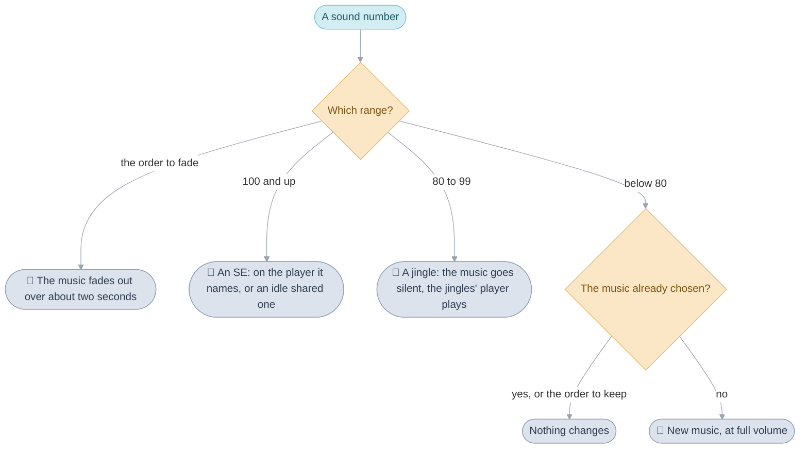
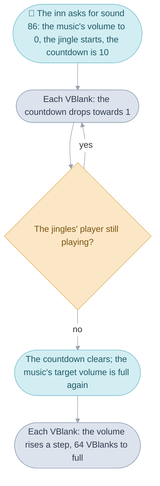

# Sound


A town's music plays while the cursor clicks through a menu. A chest opens
with a short tune, and the music comes back by itself. Footsteps and impacts
play over everything. The player hears three kinds of
[sound](../../glossary.md#sound): music, which plays on until something
changes it; a jingle, a short tune that silences the music and then gives it
back; and an SE, a sound effect, which plays over both. Every one of them is
asked for the same way, with one call and a number. What happens next is the
work of five mechanisms:

1. The sound number, whose range says which kind of sound it is.
2. The scene's music, chosen when the party arrives.
3. The sound driver, which turns notes into what the speaker plays.
4. The ramps, which move the music's volume a little at a time and bring it
   back after a jingle.
5. The lock and the reverb code, two small parts of the driver the game
   leans on.

```mermaid
%%{init: {"theme": "base", "themeVariables": {"lineColor": "#9AA3AE", "edgeLabelBackground": "#FFFFFF"}, "flowchart": {"curve": "basis", "padding": 12}}}%%
flowchart TD
  call(["Any code asks for a sound by its number"]) --> layer(["The sound layer: music, a jingle, an SE or an order"])
  layer --> player(["One of eight music players: a song's tracks of notes"])
  player -- "every VBlank" --> mixer(["The mixer: the next slice of sound"])
  mixer --> speaker(["The speaker"])
  classDef code fill:#DDE3EC,stroke:#8FA0B8,color:#2E3C50
  classDef layer fill:#D2EEF3,stroke:#7FC3D0,color:#1E5966
  classDef hardware fill:#FBE7C6,stroke:#E0B46A,color:#7A5212
  class call code
  class layer,player layer
  class mixer,speaker hardware
```

The folder holds two things. The sound layer, `sound.c`, is the game's own
code: it makes every decision about what a number means. Under it is the
sound driver, Nintendo's MusicPlayer2000, which plays what the layer starts.

## What a sound number means


The code that opens a chest asks for sound 83 and nothing more. It never
says that 83 is a jingle, or that the music should stop for it. The number's
range says so:

| Sound number | Kind     | Examples                                           |
| ------------ | -------- | -------------------------------------------------- |
| 0 to 79      | music    | `MUS_VALE`, 0, Vale's music                        |
| 80 to 99     | a jingle | `MUS_TREASURE_FOUND`, 83; `MUS_INN`, 86            |
| 100 to 311   | an SE    | `SE_BELL`, 100, the Vault bell                     |

There are 312 sounds, and `sounds.h` names every one, from what it sounds
like or the moment it marks.

A few numbers are orders. `SOUND_FADE_OUT_BGM` fades the music out over
about two seconds. `SOUND_KEEP_BGM` keeps whatever is playing.
`SOUND_FADE_OUT_ACTION_SE` fades out the sounds of the field and of battle,
such as footsteps, in under a second.

### Each kind has its own players

A music player plays one sound at a time, so two sounds can be heard
together only on two players. The driver has eight, shared out by kind, and
that is why an SE never stops the music and a jingle never stops an SE:

| Players                                             | How many | Tracks each |
| --------------------------------------------------- | -------- | ----------- |
| the music                                           | 1        | 10          |
| the jingles                                         | 1        | 4           |
| the menus' sounds                                   | 1        | 2           |
| footsteps, tremors, water and impacts               | 1        | 2           |
| every other SE                                      | 4        | 2           |

A track is one line of a tune, such as its melody or its bass, so the music
can have ten lines going at once and a sound effect two. Each sound names
its player. An SE
that names the four shared players takes the first one that is idle, and
when all four are busy it cuts off the sound on the last. On any other
player a new sound cuts off the one before, which is why a second menu click
replaces the first.

### What music and a jingle do

Asking for the music that is already chosen changes nothing. Every
[scene](../../glossary.md#scene) can therefore ask for its music each time
the party arrives, and walking from Vale into one of its houses leaves the
tune playing on. It also means a piece that ends without looping plays again
only after other music or a fade. New music starts at full volume.

A jingle turns the music's volume to zero, starts on the jingles' player,
and leaves a note that the music is to come back when it ends
([below](#how-the-music-comes-back-after-a-jingle)).



The whole decision is one short function, `Sound_Play` in `sound.c`, and
about 1,300 places in the game call it.

## How a scene chooses its music


When the party arrives in a scene, the
[main routine](../../glossary.md#main-routine) asks for the scene's music
before it fetches the scene's code, so the music is already playing as the
scene fades in.

The music comes from a table of rules, `gScene_MusicRules`. A rule names a
scene or a whole [area](../../glossary.md#area), optionally an
[entrance](../../glossary.md#entrance) and a
[game flag](../../glossary.md#game-flag), and gives a sound number. The
first rule that fits wins. Vale's rules name its area, so its houses fall
under them too: a house asks for the music the town is already playing, and
the sound layer leaves it alone. A scene no rule fits gets the order to keep
whatever is playing.

A rule with a flag fits only once the flag is set, which lets the story
change a place's music. Vale's Sanctum has three rules, read in this order:

| Rule fits                                             | Music                                             |
| ----------------------------------------------------- | ------------------------------------------------- |
| once the party has accepted the Great Healer's quest  | `MUS_FILE_SCREEN`, the Sanctum's usual music      |
| once Sol Sanctum has erupted                          | `MUS_TOWN_IN_TROUBLE`                             |
| always                                                | `MUS_FILE_SCREEN`                                 |

Before the eruption only the last rule fits. After it the second
fits too and comes first, so the music changes. Accepting the quest sets
the first rule's flag, and the usual music is back.

Three flags keep the music where the rules would change it: one for a
single scene change, one for as long as it stays set, and the one that puts
the party back where it stood after a battle or the Pause menu, which also
brings back the music saved when the Pause menu opened.

A battle's music is chosen with its encounter. A short list names the music
for the fights that have their own, and every other fight takes the usual
battle music.

## The sound driver

To the driver, every sound is a song, whatever its kind. A song is a few
tracks, and a track is a line of notes with commands among them: set the
tempo, change the volume, jump back to loop. A music player steps each track
of its song on a little at every [VBlank](../../glossary.md#vblank), the
moment about 60 times a second when the screen has just been drawn.

A note becomes sound in one of two ways. It plays a sample, a short
recording of an instrument, speeded up or slowed down to the note's pitch,
or it plays a tone on one of the four simple tone generators built into
the console. A song's voices say which each of its instruments is, and how
its notes swell and fade.

The console's speaker plays a stream of numbers, 21,024 of them a second.
The mixer makes them. At every VBlank it adds together the next 352 numbers
of every sample that is playing, on all eight players, and leaves them in a
buffer the console plays from until the next VBlank: 352 numbers at about
59.7 VBlanks a second is the 21,024. Up to eight sampled notes can sound at
once.

The mixer runs 60 times a second whatever else the game is doing, so
start-up copies it into [IWRAM](../../glossary.md#iwram-and-ewram), the
console's small fast memory.

| What                       | How many                                      |
| -------------------------- | --------------------------------------------- |
| music players              | 8, with 26 tracks between them                |
| sounds                     | 312                                           |
| samples                    | 32                                            |
| voices                     | 225: 128 for the music, 16 drums, 81 for SEs  |
| sampled notes at once      | 8                                             |
| numbers mixed each VBlank  | 352, which is 21,024 a second                 |

The sounds are kept as files anyone can open, in
[`games/tbs/sound`](../../sound). Each song with notes is a MIDI file in
`songs/`, and the samples are WAV files in `direct_sound_samples/`. The
voices are the rows of `voice_groups.s`.

## How the music comes back after a jingle


During a night at the inn the town's music falls silent, the inn's tune
plays over the black screen, and the music fades back in once the tune has
ended. The inn's code asked for one sound, number 86. Everything after that
happens at the VBlank.

The music's volume is never set in one jump from outside. It has a target,
and at every VBlank the volume moves one step towards it, a sixty-fourth of
full volume. That movement is a ramp: from silence to full takes 64 VBlanks,
about a second.

When the jingle starts, the sound layer sets the music's volume and its
target to zero and starts a countdown of ten VBlanks. The music keeps
playing in silence, so when it returns it has moved on, as if the band had
played through the night. At every VBlank the countdown drops by one until
it reaches one, and holds there until the jingles' player has no track left
playing. Then the countdown clears, the target goes back to full, and the
ramp does the rest.



The code that played the jingle does nothing more to get its music back.
What it can do is wait. The inn waits a [frame](../../glossary.md#frame) at
a time until the countdown has cleared, then ten frames more, and opens the
screen again, so the room comes back as the music rises. The Sanctum, the
Lemurian ship and Tolbi's spring wait the same way, and a message window
reads the same countdown to hold a pause until a jingle has ended.

The silence reaches the music's first eight tracks. Nine pieces of music
use a ninth or tenth, among them the World Map's and Kalay's, and those
tracks keep sounding under a jingle.

A second ramp moves the music's tempo and pitch together, like a record
played at another speed. The game uses it once: when the Lemurian ship sails
off, the ending music plays a little slow.

## The driver's lock

The game starts and stops sounds from its ordinary code. The mixer runs in
the VBlank interrupt, which breaks in on that code wherever it happens to
be, even halfway through starting a sound. A mixer that read a music player
at that moment would find it half set up.

The lock prevents that. The driver's memory and each music player's carry
one number, which normally holds a fixed signature (the four letters `Smsh`).
Code that is about to change the driver adds 1 to the number, does its work,
and puts the signature back. The mixer looks at the number first, and when
it is not the signature it skips mixing for that VBlank.

```mermaid
%%{init: {"theme": "base", "themeVariables": {"lineColor": "#9AA3AE", "edgeLabelBackground": "#FFFFFF"}, "flowchart": {"curve": "basis", "padding": 12}}}%%
flowchart TD
  call(["A call: the number is the signature, so add 1 and work"]) --> vblank(["VBlank arrives: the mixer reads the number"])
  vblank -- "raised" --> skip(["Skip this VBlank's mixing"])
  vblank -- "the signature" --> mix(["Mix the next slice"])
  call --> done(["The call puts the signature back"])
  classDef layer fill:#D2EEF3,stroke:#7FC3D0,color:#1E5966
  classDef hardware fill:#FBE7C6,stroke:#E0B46A,color:#7A5212
  classDef out fill:#DDE3EC,stroke:#8FA0B8,color:#2E3C50
  class call,done layer
  class vblank hardware
  class skip,mix out
```

The same check guards the calls themselves: a call that finds the lock
raised is dropped. That can happen only to a call made inside the interrupt,
since the interrupt always finishes before the code it broke in on goes on.
Two things call the driver from inside it. The ramps do, and a dropped ramp
step is made up by the next, since each step sets the whole volume again.
Lucky Wheels does too, from a [task](../../glossary.md#task) that runs at
the VBlank, and a sound it asks for while the lock is raised does not play.

## The reverb code for each piece of music

The mixer ends each VBlank's work by deciding how much of the sound it has
just made carries over into the next VBlank's. What carries over is heard as
an echo. The game keeps five versions of that last step and copies one into
the mixer whenever music starts, so each piece of music gets its echo.

| Reverb code            | What carries into the next VBlank                          | Used for                                    |
| ---------------------- | ---------------------------------------------------------- | ------------------------------------------- |
| `SOUND_REVERB_NORMAL`  | a quarter of the new sound, an eighth of the old           | most music, the Battle Arena                |
| `SOUND_REVERB_LONG`    | an eighth of the new sound, a quarter of the old           | the Title, the ending's logo and the ending |
| `SOUND_REVERB_NONE`    | nothing                                                    | a link battle                               |
| `SOUND_REVERB_MONO`    | one value for both the left and the right                  | the sound test                              |
| `SOUND_REVERB_CROSSED` | the left's old sound into the right, the right's into the left | the sound test                          |

The sound test is a screen the developers left in the sound
[bank](../../glossary.md#bank). Nothing in the game opens it, so two of the
five versions are never heard.

## Design

The sound layer decides and the driver plays. Every decision the game has to
make about sound is in one place: what a number means, which player takes
it, what happens to the music under a jingle. The driver knows nothing about
music, jingles or scenes; it plays songs on players.

The number carries the kind, so the caller says nothing else. The code for a
chest, a menu or a battle effect asks for a sound in one line and cannot get
the rules wrong.

The music's return is in the VBlank interrupt, not in the code that played
the jingle. Every jingle in the game gets its music back without any of its
callers having to remember to ask.

## How it fits with the rest of the game

Every part of the game plays sound through the one call: the main routine
asks for each scene's music on arrival, menus click, battle effects play
their impacts. The VBlank interrupt steps the ramps and runs the mixer
([System code](../system/README.md#the-frame-loop)), and the mixer is part
of what start-up copies into IWRAM
([System code](../system/README.md#memory-map)).

## Limits

- Eight music players. The music's has 10 tracks, of which a jingle
  silences 8.
- Four sound effects on the shared players at once, and eight sampled notes
  in all.
- 312 sounds, numbered 0 to 311.
- A call made inside the VBlank interrupt while the lock is raised is
  dropped. A ramp's last step can be lost that way, leaving the music a
  sixty-fourth short of its target.

## Words used here

- **sound number**: see [sound](../../glossary.md#sound). A few numbers are
  orders instead of sounds.
- **song**: the driver's word for one sound's data, whatever kind of sound
  it is.
- **music player** and **track**: a music player plays one song; a track is
  one of the song's lines of notes and commands.
- **sample**: a short recording the mixer plays at a note's pitch.
- **ramp**: the music's volume, or its tempo and pitch together, stepped
  towards a target once a VBlank.
- **lock**: the number in the driver's memory, and in each music player's,
  that is raised while a call changes them.
- **reverb code**: one of the five versions of the mixer's last step, copied
  in when music starts.

## Evidence

The driver is Nintendo's, so its code keeps the spellings
[pret](../../glossary.md#pret) gives the same driver in its own games
(`SoundInfo`, `MusicPlayerInfo`, `gMPlayTable`, `m4aSoundInit`), including
its names for fields nothing reads (`dummy1`, `gap`). Where pret has no name
the name is ours, as are the names of everything Camelot added: the sound
layer in `sound.c`, the music players beyond the music's own, and the
interrupt's way into the mixer.

In `sounds.h`, music is named by the
place or moment the player knows it from (`MUS_DJINN_LESSON`), a sound
effect by what it sounds like or the moment it marks (`SE_THUMP`). The three
kinds are The Lost Age's sound test's: Music, Jingle and SE.
