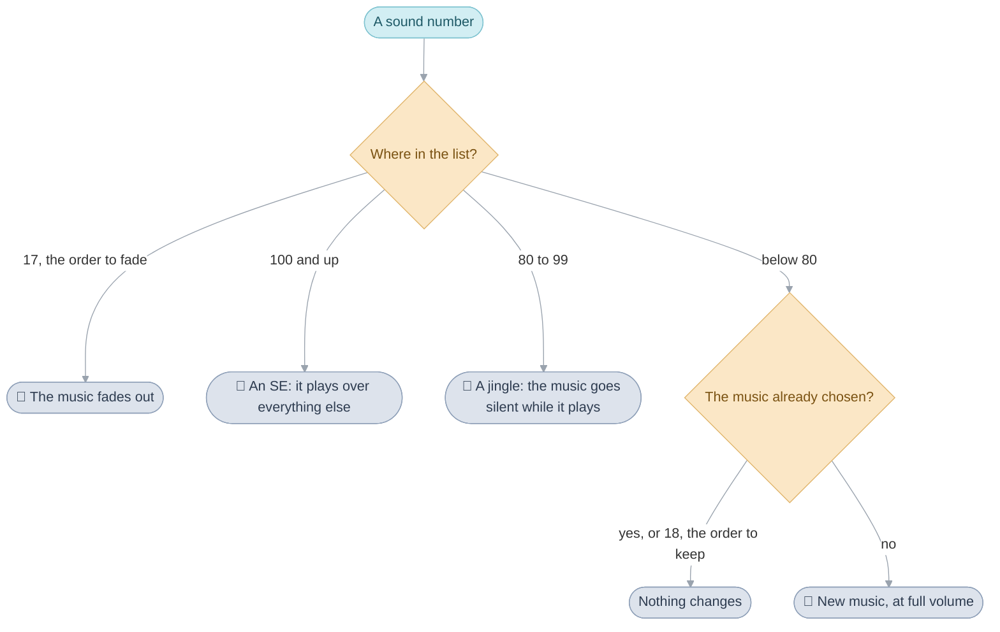
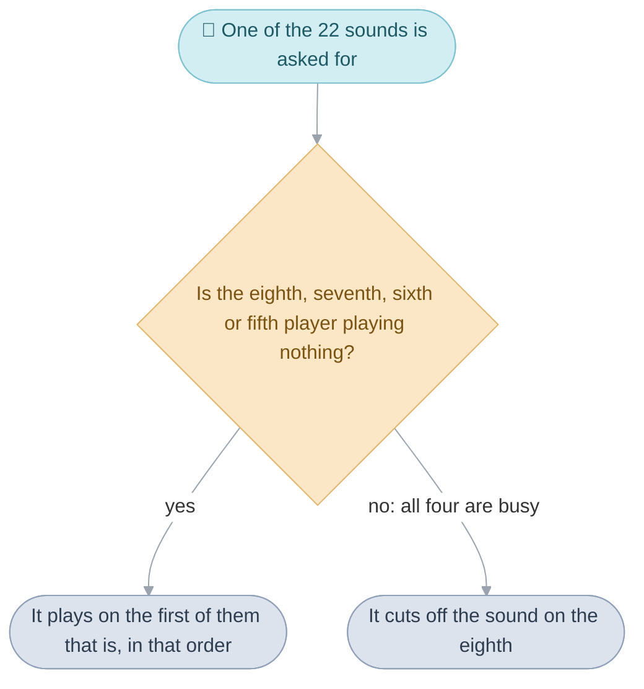
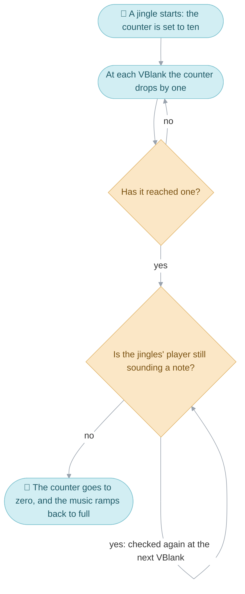
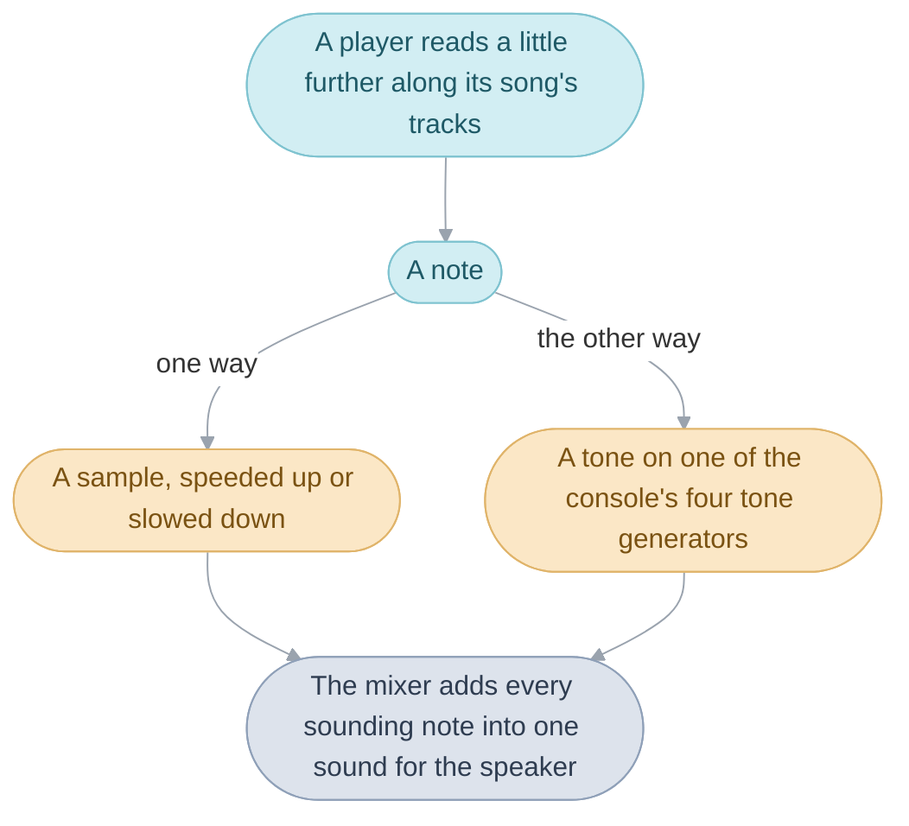

# Sound

Open a chest in Sol Sanctum and three things reach the speaker. The lid
lifts with a sound of its own. Then Sol Sanctum's music cuts out, and the
short tune every player knows plays as the Small Jewel rises over Isaac's
head. When the tune is over the music comes back, though nobody seems to
have asked for it.

Those are the three kinds of [sound](../../glossary.md#sound) in the game.
Music plays on until something changes it. A jingle is a short tune that
silences the music and then gives it back. A sound effect, an SE for short,
plays on top of both.

This page follows them in the order a player meets them:

1. Every sound has a number, and the number alone says which kind it is
   ([What a sound number means](#what-a-sound-number-means)).
2. Each place has its music, picked from a list of rules as the party walks
   in ([How a scene chooses its music](#how-a-scene-chooses-its-music)),
   and so does each battle ([Battle music](#battle-music)).
3. After a jingle the music returns by itself
   ([How the music comes back after a jingle](#how-the-music-comes-back-after-a-jingle)).
4. Under all of it sits the part that turns written notes into sound
   ([The sound driver](#the-sound-driver)).

## What a sound number means

The chest plays its jingle by asking for sound 83. That is all it says. It
does not say that 83 is a jingle, or that the music should go quiet for it.
The number's place in the list says so:

| Sound number | Kind     | Examples                                                     |
| ------------ | -------- | ------------------------------------------------------------ |
| 0 to 79      | music    | 0 is Vale's music, 42 the World Map's, 50 the usual battle's |
| 80 to 99     | a jingle | 83 is treasure found, 85 a saved game, 86 a night at the inn |
| 100 to 311   | an SE    | 100 is Vault's bell, 124 a chest's lid, 171 thunder          |

The list has 312 places, numbered 0 to 311, and 48 of them are empty. An
empty place plays nothing.

The game's code, the written instructions this site rebuilds, gives each
number a name so that a person can read it. Where the cartridge holds 83,
the code says `MUS_TREASURE_FOUND`. Names for music and jingles both start
with `MUS_`, and names for sound effects with `SE_`. They are all in
[sounds.h](../../include/sounds.h), and most have a note of where the sound
is heard.

### The three orders

Three numbers in the list are not sounds. They are orders.

- Number 17, among the music, fades the music out. The fade takes 112
  [VBlanks](../../glossary.md#vblank), a little under two seconds.
- Number 18, next to it, means "keep whatever is playing".
- Number 289, among the sound effects, fades out one group of sound
  effects. [The mine cart](#each-kind-has-its-own-players) further down
  shows what that is for.

A VBlank is the short gap after the console has drawn one picture and
before it starts the next. It comes round about 60 times a second, as
steady as a clock, and the sound code counts all its time in VBlanks.

### What each kind does

One short piece of the game's code takes every number and decides what to
do with it. Nearly 1,800 places in the game ask it for a sound.

Music has one rule worth remembering: asking for the music that is already
chosen changes nothing. Walk from Vale's plaza into one of its houses and
the house asks for Vale's music. It is already playing, so it plays on
without a break.

A jingle turns the music's volume to zero and starts playing. The music is
not stopped. It carries on in silence, and
[comes back](#how-the-music-comes-back-after-a-jingle) when the jingle is
done.

### Each kind has its own players

Two sounds can be heard together only if something plays each of them. The
game has eight music players for that. A music player plays one sound at a
time, and when it is handed a new sound it drops the one it was playing.

Every sound is listed with the player it belongs on:

| Player | What plays on it                                                 |
| ------ | ---------------------------------------------------------------- |
| 1      | the jingles                                                      |
| 2      | the music                                                        |
| 3      | a menu choice confirmed or cancelled, a purchase in a shop       |
| 4      | blows landing, a chest's lid, a door, and about a hundred more   |
| 5      | the cursor's click, and the voice blips as a line is typed       |
| 6      | stairs, the way out of a scene, and a few more                   |
| 7      | a sliding gate, and two more                                     |
| 8      | 22 sounds that do not mind where they play (see below)           |

The music and the jingles have a player each. That is why a jingle can
sound while the music carries on silently beside it. The sound effects
have six more, which is why a door or a blow never stops the music.

It is also why some sounds cut each other off. Every voice blip of a spoken
line plays on the fifth player, so each new blip replaces the one before
it. So does the cursor's click.

The fourth player has the most to do. Some of its sounds go on until
something stops them, and the mine cart on Altin Peak is one: its rolling
does not end by itself. To stop it, the scene plays a sound with no notes
in it on the same player. The player drops the rolling for the empty
sound, and the cart is quiet.

The game plays that same empty sound as it moves from one scene to the
next, so a rumble does not follow the party through a door.

Order 289 does the same job more gently. It fades the fourth player out
over 48 VBlanks, most of a second. The logs floating across the water in
Fuchin Falls Cave go quiet that way.

The 22 sounds of the eighth player are treated differently. Thunder on
the stormy night, an enemy's cry as it falls and Vault's bell are among
them. When one of these is asked for, the game checks the eighth player,
then the seventh, the sixth and the fifth, and uses the first one that is
playing nothing. Only when all four are busy does the new sound cut
another off, the one on the eighth.

## How a scene chooses its music

Every room, street and cave the party can stand in is a
[scene](../../glossary.md#scene), and scenes are grouped into
[areas](../../glossary.md#area): Vale is an area, and each of its houses is
a scene in it.

When the party arrives in a scene, the game picks the scene's music and
asks for it before it has even fetched the scene itself from the cartridge.
That way the music is already playing as the picture fades in.

The music is picked from a list of rules. A rule names a scene or a whole
area, and gives a sound number. It can also name a
[game flag](../../glossary.md#game-flag). A flag is a yes-or-no note the
game keeps about the story, such as "Mt. Aleph has erupted", and it starts
at no. A rule with a flag fits only once its flag has turned to yes. The
game reads down the list and takes the first rule that fits.

Vale has five rules, and between them they tell its whole story. They are
written latest first:

| Vale's rule fits                                    | Music                                                        |
| --------------------------------------------------- | ------------------------------------------------------------ |
| once Isaac has accepted the Great Healer's request  | Vale's own music                                             |
| once Mt. Aleph has erupted                          | the troubled-town music, which cursed Kolima also plays      |
| once the prologue is over, three years later        | Vale's own music                                             |
| once a monster has been fought on the stormy night  | the danger music, also heard on Altin Peak                   |
| always                                              | silence: a sound with no notes in it                         |

Read it from the bottom, the way the story goes. On the stormy night no
flag has turned yet, so only the last rule fits and Vale's music is
silence. The rain and the thunder the player hears there are sound
effects. Once a monster has been fought the fourth rule fits, and it
stands above the last, so it wins. Three years later the third rule stands
above that. The eruption brings the troubled music, and accepting the
quest brings Vale's own music back.

Because the rules name Vale's area, nearly every house in Vale gets the
same answer. A house asks for the music the town is already playing, and
nothing changes.

A rule can also name an [entrance](../../glossary.md#entrance), the door or
path the party came in by. The World Map uses that for the voyage to
Tolbi. Each time the party is shown crossing the sea on the Tolbi-bound
ship, the World Map is entered by an entrance of its own, seven in all,
and for those seven it plays the ship's music and not the World Map's.

A scene no rule fits gets order 18, to keep whatever is playing.

### When the rules are overruled

Sometimes a tune should carry on across a change of scene, whatever the
rules say. The end of the game is the clearest case. As the Lemurian ship
sails off, its scene turns on a flag that means "keep the music for the
next change of scene" and then hands over to the scene that shows the
credits. The ending music is left alone on the way.

The Pause menu is the other case. When it opens, the game notes which
music is playing. When it closes and the party is put back where it
stood, the game asks for that noted music, not for the music the rules
would pick.

## Battle music

A battle's music is chosen along with its enemies, from a short list of
the fights that have a tune of their own.

| Music                    | Fights                                                                 |
| ------------------------ | ---------------------------------------------------------------------- |
| the Saturos battle music | the Mystery Man and Mystery Woman in Vale's plaza; Saturos at Mercury Lighthouse's aerie |
| the boss battle music    | Tret, the Killer Ape, the Hydros Statue, the Manticore, the Kraken, Toadonpa, the Storm Lizard, the Tempest Lizard, and the guardians of Crossbone Isle's nine floors |
| the Colosso battle music | the three Colosso finals, against Azart, Satrage and Navampa           |
| Saturos and Menardi's    | Saturos and Menardi at Venus Lighthouse's aerie; Deadbeard             |
| the Fusion Dragon's      | the Fusion Dragon                                                      |

The first row gives something away. On the stormy night two travelers
catch Isaac eavesdropping in Vale's plaza, and the battle calls them only
the Mystery Man and the Mystery Woman. The list already gives them the
music Saturos has at Mercury Lighthouse.

Deadbeard borrows the music of the fight with Saturos and Menardi. The
monsters guarding Crossbone Isle's nine floors get the boss music, the
same as the Kraken and the Manticore.

Each Colosso final is in the list twice, with and without one piece of
equipment: the Iron Shield for Azart, the Chain Mail for Satrage and the
Claymore for Navampa. Both ways get the same tune.

Every other battle with the game's monsters takes the usual battle music,
sound 50. That includes the thieves in Vault and a Djinni that fights
back. A link battle against a friend is the one exception: it is given
order 18, so the list has no say in it.

## How the music comes back after a jingle

Stay the night at an inn. The screen closes to black, the town's music
falls silent, and the inn's little tune plays in the dark. When it ends the
screen opens and the town's music swells back up.

The inn asked for one sound, number 86. It never asks for the town's music
again. Here is what brings it back.

The music's volume is not set in one jump. It has a target, and at every
VBlank the volume moves one step towards the target. A step is a
sixty-fourth of full volume, so the climb from silence to full takes 64
VBlanks, about a second. The game calls this a ramp.

When the jingle starts, the game sets both the music's volume and its
target to zero. The music is still playing, only unheard. So when it
returns it has moved on, as if the band had played through the night.

The game also needs to know when the tune is over, and it uses a single
counter for that. The counter is zero when no jingle is going. A jingle
sets it to ten, and at every VBlank it drops by one.

It does not drop below one. At one, the game starts looking at the
jingles' player each VBlank, and the counter waits there for as long as
that player is still sounding a note. The first ten VBlanks are a head
start: a player that has only just been handed a tune has not sounded
anything yet, and would look finished.

The moment the jingles' player has gone quiet, the counter goes to zero
and the music's target goes back to full. The ramp does the rest.

That counter is also how the rest of the game knows a jingle is still
going. The inn keeps the screen black until the counter is zero, waits a
sixth of a second more, and only then opens the screen. So the room comes
back just as the music rises.

Others wait the same way. Tolbi's spring waits for its prize jingle, and
the Lemurian ship for the jingle of its raising. The window
that says a Djinni has joined stays up until the joining jingle ends, or
until the player presses a button.

Vale's Sanctum waits too, after Isaac accepts the Great Healer's request,
and the tune it waits for is the inn's. That wait gives up after five
seconds.

### Two lines that play through

One oddity is left over. A piece of music is written as several lines of
notes that play together, a melody and a bass and so on, and each line is
called a track. The music's player has room for ten tracks. The silence
under a jingle reaches only the first eight.

Eight pieces the game plays use a ninth or a tenth track. The World
Map's, Kalay's and Venus Lighthouse's are among them, and so is the music
of the File Screen, which Vale's Sanctum also plays. Whenever a jingle
plays over one of those pieces, its last line or two of notes keep
sounding underneath.

### The ending plays a little slow

The music's speed can be changed as well as its volume, and the game does
it once. As the Lemurian ship sails off, its scene starts the ending music
and slows it to fifteen sixteenths of its written speed. It stays that
slow until other music starts.

## The sound driver

Under the game's own sound code sits a sound driver, the part that makes
the sound itself. It is Nintendo's, and it is called MusicPlayer2000. The
driver knows nothing of music, jingles or scenes. To it every sound is a
song, and it plays songs on the eight players.

A song is stored much like sheet music. Each track is a line of notes with
instructions among them: set the tempo, change the volume, switch
instrument, go back and repeat. At every VBlank each player reads a little
further along each of its tracks.

A note becomes sound in one of two ways.

It can play a sample, a short recording of an instrument, speeded up for a
high note or slowed down for a low one. The game has 32 of these
recordings.

Or it can play a tone on one of the four simple tone generators built into
the console, the ones the older Game Boy had.

A song picks its instruments from a list of voices. A voice names a
recording or a tone generator and says how its notes swell and die away.
There are 128 voices for the music, 16 drums, and 81 for the sound
effects.

Twenty of the music's voices use no recording at all. They are plain
synthesizer tones, and where another voice names a recording these name
only a shape of wave: one of three pulse waves, a sawtooth or a triangle.

All of this can be opened and listened to. The songs are in
[`games/tbs/sound`](../../sound) as MIDI files, a common format for written
music that many music programs can play, and Vale's music is
`songs/mus_vale.mid`. The 32 recordings are ordinary sound files in
`direct_sound_samples/`.

### The echo

The driver's last job each VBlank is to add together every note that is
sounding into the one sound the speaker plays. The part that does it is
called the mixer.

The game has the mixer add an echo. A little of the sound from the moment
just gone is added, more faintly, to the moment now being made. There are
five settings for how much, and the game calls each a reverb code.

- Most music gets the normal echo.
- The Title's music, the ending's, and the music of the Golden Sun logo
  after the ending get a longer one: less of the new sound and more of the
  old.
- A link battle gets none.
- Two more, one that plays the same echo on the left and the right and one
  that swaps the two sides' echoes, are reached only from the sound test.

The sound test is a screen the developers left in the game. Its three rows
choose a piece of music, a jingle and an SE, and Select steps through the
five echoes. Nothing in the game opens it, so those last two are never
heard.

## Design

The chest shows the whole idea. The code that opens it asks for sound 83
in one line, and everything else follows from the number: the music goes
silent, the tune plays on the jingles' player, and the music returns. No
place that asks for a sound can get those rules wrong, because none of
them states the rules.

The music's return is not the chest's work either, or the inn's. It
happens in one place, for every jingle in the game. No scene has to
remember to ask for its music back.

And a place's music is one line in a list. To change what Vale plays
after the eruption, that line is all that would change.

## How it fits with the rest of the game

The [main routine](../../glossary.md#main-routine), the loop that moves the
game from scene to scene, asks for each scene's music on arrival and plays
the empty sound that stops a rumble at the door.

Sound must not stutter when the picture does. A busy moment can make the
game take two VBlanks over one [frame](../../glossary.md#frame), its turn
of work for one picture, and the music must not slow down with it. So the
volume's steps and the mixer's work are done at every VBlank, by the part
of the game that runs at each one whatever else is going on
([System code](../system/README.md#the-frame-loop)).

## Limits

- One piece of music and one jingle at a time. New music replaces the old,
  and a second jingle replaces the first.
- Six players for sound effects, so at most six sound effects at once.
- At most eight recorded notes sound at once, counting the music, the
  jingle and every sound effect together.
- A jingle silences eight of the music's ten tracks.

## Words used here

- **sound number**: the number a sound is asked for by, 83 for the treasure
  jingle. See [sound](../../glossary.md#sound).
- **order**: one of the three numbers that are not sounds: 17 fades the
  music, 18 keeps it, 289 fades the fourth player.
- **music player**: one of the eight things that each play one sound at a
  time.
- **track**: one of the lines of notes that make up a sound.
- **song**: the driver's word for any one sound, whether music, a jingle or
  an SE.
- **sample**: a short recording of an instrument, played at a note's pitch.
- **voice**: one instrument in a song's list.
- **mixer**: the part of the driver that adds the sounding notes together.
- **ramp**: the music's volume stepped towards a target once a VBlank.
- **reverb code**: one of the five settings of the echo.

## Evidence

The driver is Nintendo's, and other games that use it have been rebuilt by
[pret](../../glossary.md#pret). Its code here keeps the names pret gives
it. The names of everything Camelot added are ours: the game's own sound
code, and the seven music players beyond the music's own.

Music is named by the place or moment the player knows it from, and a
sound effect by what it sounds like or the moment it marks. A number
nothing in the game plays keeps its number as its name, such as `MUS_011`,
since there is no moment to name it from.

## For readers of the code

This last part is for someone who means to open the files.

`Sound_Play` in [sound.c](sound.c) is the piece of code that takes every
sound number. The scenes' music rules are the table `gScene_MusicRules` in
[scene_rules.s](../field/scene_rules.s), and the battle list is
[battle_music.c](../field/battle_music.c). The voices are the rows of
`voice_groups.s`.

The code counts the music players from 0, so the fourth player on this
page is its player 3. The music's player has 10 tracks, the jingles' 4,
and each of the six for sound effects 2.

The mixer makes 352 numbers for the speaker at every VBlank. With about
59.7 VBlanks in a second, that is 21,024 a second. The game copies the
mixer into [IWRAM](../../glossary.md#iwram-and-ewram), the console's small
fast memory, at start-up
([System code](../system/README.md#memory-map)).

Each reverb code is a short piece of the mixer, and starting new music
copies one of the five into place. The normal one carries a quarter of the
new sound and an eighth of the old into the next VBlank, and the long one
an eighth of the new and a quarter of the old.

### The driver's lock

The game starts sounds from its ordinary code, and the part that runs at
every VBlank can break in on that code anywhere, even halfway through
handing a player a new song. A player read at that moment would be half
set up.

So the driver and each player carry a number that normally holds a fixed
signature, whose four letters spell `Smsh`. Code that is about to change a
player adds 1 to the player's number, does its work, and puts the
signature back. Anything that finds the number raised leaves that player
alone: the player is not moved along its song for that VBlank, and a
request to change it is dropped, not kept for later.

Only something running at the VBlank itself can meet a raised number. The
volume ramp runs there. A dropped step of the ramp is made up by the next,
since each step sets the whole volume again. Only a dropped last step
would not be made up, and it would leave the music a sixty-fourth short of
its target.
