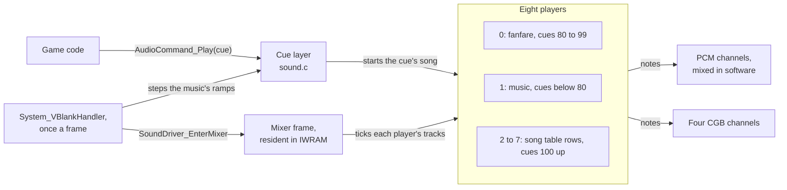
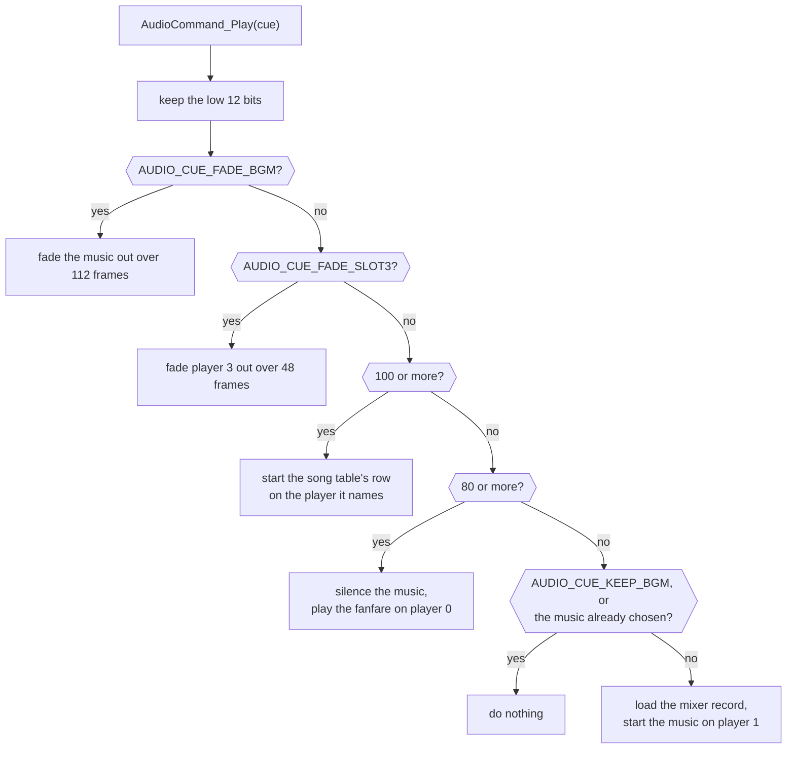
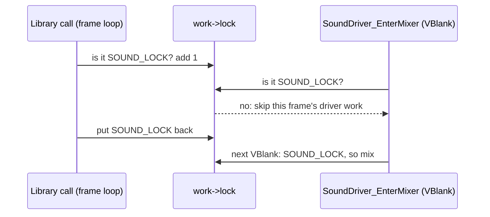

# Sound

Every sound in ☀️ is played through one call, `AudioCommand_Play`, with a
number, a cue. The game's cue layer (`sound.c`) decides what each number
means, steps the music's volume, tempo and pitch towards their targets, and
brings the music back after a fanfare. Under it is the driver that plays
songs on the hardware: Nintendo's MusicPlayer2000, as this game links it.
The two meet once a frame in the VBlank handler, which steps the music's
ramps and then enters the mixer ([Runtime](../runtime/README.md)).

## What a cue number means

A cue's range decides whether it is music, a fanfare, a sound from the song
table or a control.

Only a cue's low 16 bits count: the low 12 (`AUDIO_CUE_ID_MASK`) are the cue,
0 to 4,095, and the four above them are flags, of which only
`AUDIO_CUE_START_SILENT` is read; it starts music at volume 0 and fades it
in over 64 frames.

The driver has eight players (`gSound_PlayerSlots`):
`SOUND_PLAYER_FANFARE` (0) with four tracks, `SOUND_PLAYER_MUSIC` (1) with
ten, and players 2 to 7 with two each. What a cue plays depends on its
range:

- From `AUDIO_SONG_FIRST` (100) up, a cue is a row of the song table
  (`gSound_SongTable`), played on the player the row names; sound effects
  such as `SE_SHOP_PURCHASE` and `SE_MENU_CURSOR_MOVE` are rows. A row that
  names `SOUND_PLAYER_EFFECT_LAST` takes the first idle player counting down
  to `SOUND_PLAYER_EFFECT_FIRST`, and `SOUND_PLAYER_EFFECT_LAST` again if
  none is idle, so four such sounds play at once and a fifth cuts off the
  sound on player 7.
- From `AUDIO_JINGLE_FIRST` (80) to 99, a cue is a fanfare, such as
  `MUS_TREASURE_FOUND` or `MUS_PUZZLE_SOLVED`, played on the fanfare player.
- Below 80, a cue is music, played on the music player.

Three cues are controls. `AUDIO_CUE_FADE_BGM` fades the music out over 112
frames (16 steps 7 frames apart), once until the next music starts, and
records `MUS_SILENCE`, a song with no tracks, as the music playing, so a
later cue for the faded music starts it again. `AUDIO_CUE_KEEP_BGM` keeps
the music that is playing. `AUDIO_CUE_FADE_SLOT3` fades player 3 out over
48 frames. The three values are also rows of the song table (17, 18 and 289),
and those rows never play, since the controls are tested first.

A cue for the music already chosen (`gAudioSecondaryState`) does nothing,
even when that song has ended, so a scene names its music on every entry
without restarting it.

`AudioCommand_Play` does all of this, reached from the whole game through
the sound bank's far-call table as `AudioCommand_PlayFar`. It reads the song
table, `gSound_SongTable` (`games/tbs/sound/songs.s`), whose row holds the
song's header and its player, and the players, `gSound_PlayerSlots`
(`games/tbs/sound/players.s`). The cues are named in
`audio_engine_symbols.h` and the songs in `songs.h`.

| Name | Value | Meaning |
| --- | --- | --- |
| `AUDIO_CUE_ID_MASK` | `0xfff` | the bits that are the cue |
| `AUDIO_CUE_START_SILENT` | `0x1000` | flag: music starts at volume 0 and fades in over 64 frames |
| `AUDIO_CUE_FADE_BGM` | 17 | fade the music out over 112 frames, once |
| `AUDIO_CUE_KEEP_BGM` | 18 | keep the music that is playing |
| `AUDIO_JINGLE_FIRST` | 80 | first fanfare cue; below it, music |
| `AUDIO_SONG_FIRST` | 100 | first cue that is a song table row |
| `AUDIO_CUE_FADE_SLOT3` | `0x121` (289) | fade player 3 out over 48 frames |
| `SOUND_PLAYER_FANFARE` | 0 | the fanfare player, 4 tracks |
| `SOUND_PLAYER_MUSIC` | 1 | the music player, 10 tracks |
| `SOUND_PLAYER_EFFECT_FIRST` | 4 | the lowest player a sound effect on player 7 may take |
| `SOUND_PLAYER_EFFECT_LAST` | 7 | a sound effect that takes the first idle player from 7 down to 4 |

## The fanfare's return to the music

A fanfare silences the music without stopping it, and the cue layer brings
the music back by itself once the fanfare has ended.

`AudioCommand_Play` sets the music's volume to 0, plays the fanfare on the
fanfare player and sets `gMusicRestoreDelay` to `MUSIC_RESTORE_DELAY_FRAMES`;
the music keeps playing, silently.

Once a VBlank, `MusicPlayer_StepVolumeAndPitchTowardTargets` (called from
`System_VBlankHandler`) counts the delay down to 1, then waits until the
fanfare player has no track playing and sets the music's target volume back
to full. The same routine steps the volume, and the combined tempo and
pitch, towards their targets by a fixed step each VBlank, and stops on the
target when a step would cross it. Full volume is `MUSIC_UNITY_SCALE`, 1.0
in the ramps' 8.8 fixed point, and the usual step `MUSIC_DEFAULT_RAMP_STEP`
is 4, so a full fade takes 64 frames. The music resumes where it was, fading
back in, and the code that asked for the fanfare need not track it.

The ramps are globals of the cue layer: `gMusicVolume`, `gMusicVolumeTarget`
and `gMusicVolumeStep`, and `gMusicPitch`, `gMusicPitchTarget` and
`gMusicPitchStep` for tempo and pitch together. The music commands here
select only tracks 0 to 7 (`MUSIC_ALL_TRACKS`, one bit a track), though the
music player has 10. `MUS_006`, `MUS_022`, `MUS_028`, `MUS_029`, `MUS_040`
to `MUS_VENUS_LIGHTHOUSE` and `MUS_074` use 9 or more, and their tracks 8 and 9 keep
their volume and pitch through the ramps and under a fanfare.

| Name | Value | Meaning |
| --- | --- | --- |
| `MUSIC_RESTORE_DELAY_FRAMES` | 10 | VBlanks after a fanfare starts before the music waits for it to end |
| `MUSIC_UNITY_SCALE` | `0x100` | full volume, and the song's own tempo and pitch: 1.0 in 8.8 fixed point |
| `MUSIC_DEFAULT_RAMP_STEP` | 4 | a ramp's step a VBlank: a full fade takes 64 frames |
| `MUSIC_ALL_TRACKS` | `0xff` | the track mask of every music command: tracks 0 to 7 |
| `MUSIC_WAIT_TIMEOUT_FRAMES` | 300 | frames `AudioCommand_WaitForCompletion` waits before giving up, about five seconds |

## The driver's lock

One word in the driver's work, `work->lock`, keeps the game's library calls
and the VBlank's mixer from changing the driver's state at the same time.

The game calls the driver's library (`audio.c`, `engine.c`) from its frame
loop, and the VBlank handler enters the mixer last of all
(`SoundDriver_EnterMixer`), so each can interrupt the other. They share one
word, `work->lock`, the first field of the driver's work, and each player
has a lock word of its own.

The word is both a signature and a lock. `SOUND_LOCK`'s four bytes spell
`Smsh` in memory order. `AudioEngine_Initialize` sets the word to 0 while it
clears the driver's work and to `SOUND_LOCK` once the driver is ready. Every
library call that changes the driver's state checks that the word is exactly
`SOUND_LOCK`, adds 1 while it works, and puts `SOUND_LOCK` back. The mixer's
entry runs only when the word is exactly `SOUND_LOCK`, and its exit stores
the signature again.

A VBlank that arrives during a library call therefore skips that frame's
driver work instead of reading half-changed state, and a library call made
while the driver isn't ready, or while another call holds the lock, returns
without doing anything: it is dropped, not delayed.
`AudioEngine_SuspendDirectSound` adds 10 rather than 1, so a suspended
driver can be told from a busy one. It suspends only a driver that is free
or held once, as `AudioEngine_SetMode` holds it around a rate change, and
`AudioEngine_ResumeDirectSound` takes the 10 off again.

| Name | Value | Meaning |
| --- | --- | --- |
| `SOUND_LOCK` | `0x68736D53` | the driver is ready and free; its bytes spell `Smsh` |
| `SOUND_LOCK` + 1 | | a library call holds the driver |
| `SOUND_LOCK` + 10 | | `AudioEngine_SuspendDirectSound` has suspended the driver |
| 0 | | `AudioEngine_Initialize` is clearing the driver's work |

## The mixer's code is chosen per song

Part of the code that mixes the PCM channels is copied in from one of five
records each time music starts, so a song chooses how much of each frame's
mix carries into the next.

The PCM channels play recorded samples, which the driver mixes in software
into the buffers the hardware plays from. Each VBlank,
`SoundDriver_EnterMixer` jumps into the resident sound code at
`IwramSoundMixEntry`, which start-up copies to IWRAM with the rest of the
resident runtime ([System](../system/README.md)).

`Sound_LoadPresetParameters` copies one of `SOUND_PRESET_COUNT` records of
`SOUND_PRESET_SIZE` bytes of mixer code (`IwramCodeRecords`, in
`system/entry.s`) over `IwramSoundPresetCode`, in the middle of the code
that renders the mix. Music loads record 3 for `MUS_ENDING`, `MUS_TITLE` and
`MUS_ENDING_LOGO` and record 2 for the rest. A link battle loads record 4 with its
music (`Battle_RunEncounter`), the link lobby record 2, and the audio test
steps through all five with Select. What each record does is under
[Evidence and open questions](#evidence-and-open-questions).

The driver's own mixer, `SoundDriver_Mixer` (`mixer.s`), is separate code at
`Ram_SoundMixer`, which `Audio_Initialize` copies there; the records never
touch it.

| Record | Loaded by | What it carries into the next frame |
| --- | --- | --- |
| 0 | the audio test | one value for both channels, from the two buffers together |
| 1 | the audio test | each channel's old samples crossed with the other's |
| 2 | most music, the link lobby | a quarter of the mix and an eighth of each buffer's old samples |
| 3 | `MUS_ENDING`, `MUS_TITLE`, `MUS_ENDING_LOGO` | an eighth of the mix and a quarter of the old samples |
| 4 | a link battle | nothing: the mix buffer is cleared |

## Limits

- Eight players; the music player has 10 tracks, of which the cue layer's
  ramps and fanfare silence reach 8.
- Four sound effects that name `SOUND_PLAYER_EFFECT_LAST` play at once.
- Cues are 12 bits, 0 to 4,095.

## Files

| File | What it holds |
| --- | --- |
| `sound.c` | the cue layer: playing a cue, the music's ramps, the fanfare's return to the music, and the audio test |
| `engine.c` | the driver: the sound hardware, the players and their tracks, the song commands and the CGB channels |
| `audio.c` | the driver's library calls: starting, stopping, fading and resuming songs on the players, and the PCM key-to-frequency step |
| `tables.c` | the driver's tables: the song command handlers and the frequency tables |
| `empty_callback.c` | the driver's do-nothing callback |
| `mixer.s`, `channel_update_entry.s`, `clear_buffer.s`, `umul_high.s` | the driver's handwritten ARM and Thumb routines, each proven in its header |

`engine.c`, `audio.c` and `tables.c` are compiled with pret's `old_agbcc`
(the Makefile's `SOUND_C`), as pret builds its MusicPlayer2000 C; the rest
with the game's compiler. The cue layer's code is the sound bank; the
driver follows the banks in the ROM's tail, with `mixer.s` loaded into IWRAM.
The songs and samples are in `games/tbs/sound`, with the players in
`games/tbs/sound/players.s`, and the songs' names in `songs.h` (`MUS_`,
`SE_`). The unit headers are in `games/tbs/include/unit/sound/`, the
driver's structures in `games/tbs/include/sound`.

## Words used here

- **cue**: the number `AudioCommand_Play` takes: music, a fanfare, a song of
  the song table, or a control.
- **player** and **track**: a player (`struct SoundPlayer`) plays one song,
  whose tracks (`struct SoundTrack`) each run a stream of song commands.
- **note**: a sound a track starts, on a PCM channel the mixer renders or on
  one of the four CGB channels, the tone generators built into the hardware
  (channel 4 is noise).
- **ramp**: the music's volume, or its combined tempo and pitch, stepped
  towards a target once a VBlank.
- **lock**: `work->lock`, the driver's signature and lock word.

## Function prefixes

| Prefix | What it acts on |
| --- | --- |
| `AudioCommand_`, `Audio_`, `AudioTest_` | the cue layer and the audio test |
| `AudioEngine_` | the sound hardware and the driver's work |
| `MusicPlayer_`, `MusicTrack_`, `MusicCommand_` | players, tracks and song commands |
| `SoundNote_`, `Pcm_` | a note, and its PCM pitch |
| `Cgb_`, `CgbAudio_`, `CgbChannel_`, `CgbNote_` | the CGB channels |
| `SoundDriver_`, `MusicDriver_`, `Mixer_` | the handwritten routines: entering the mix, the mixer and their call helpers |
| `Sound_`, `Runtime_` | functions the engine names elsewhere |

## Evidence and open questions

The driver's names follow pret's for MusicPlayer2000 where its structure is
the same. The cue layer's come from what `AudioCommand_Play` does with each
range of numbers, and the songs' from `songs.h`, where a song without a
proven name keeps its number (`MUS_009`, `SE_188`).

The mixer records are the last step of `IwramSoundRenderFrame`'s loop. Each
pass loads four words of the mix buffer, two 16-bit samples to a word, and
writes them out to the two hardware buffers, reading back first what those
buffers held from the previous time round (`fp` from the first, `ip` from the
second, `0x630` bytes on). The record then works out what the mix buffer
starts the next frame with, from this frame's mix and those older samples,
and stores it. Record 2, which most music uses, keeps a quarter of the mix
plus an eighth of each buffer's old samples, each channel from its own buffer
(in the shifts' units: the mix `>> 18`, the old samples `>> 19`). Record 3
swaps the weights, an eighth of the mix and a quarter of the old samples, so
more of what has already played carries into the next frame. Record 0 makes
both channels one value from the two buffers together, record 1 crosses each
channel's old samples with the other's, and record 4 clears the mix buffer, so
nothing carries over. Record 3 is the title's music and the ending's: `MUS_TITLE`
over the title intro, `MUS_ENDING_LOGO` over the title shown after the prologue, and
`MUS_ENDING` through the credits and as the Lemurian ship sails off
(`menu/title.c`, `scene/lemurian_ship.c`). Record 4 is the link battle's.

A library call is dropped only when it meets another that holds the lock, and
library calls all run on the main thread, one after another, except from a
VBlank task. A call graph of the tbs-en build finds one VBlank task that
reaches the library: `ReelGame_RunFrame`, the slot machine's frame, which
plays its sounds from the VBlank. Its sounds can be dropped only if the VBlank
arrives while a main-loop task is inside a library call; while the slot
machine runs, the main thread only draws and waits, and no message types, so
in practice nothing is dropped.

A sound effect that names `SOUND_PLAYER_EFFECT_LAST` searches only players 4
to 7 because players 2 and 3 have sounds of their own in the song table:
player 2 the interface's (`SE_MENU_CONFIRM`, `SE_MENU_CANCEL`,
`SE_MENU_ERROR`, `SE_SHOP_PURCHASE`) and player 3 the field's and battle's
actions (`SE_CAST`, `SE_IMPACT`, `SE_HEAVY_IMPACT`, `SE_DOOR_OPEN`). A
floating effect therefore never cuts those off.
- XXX (picture): the sound players, as an illustration of music, fanfare and sound effects taking turns.
