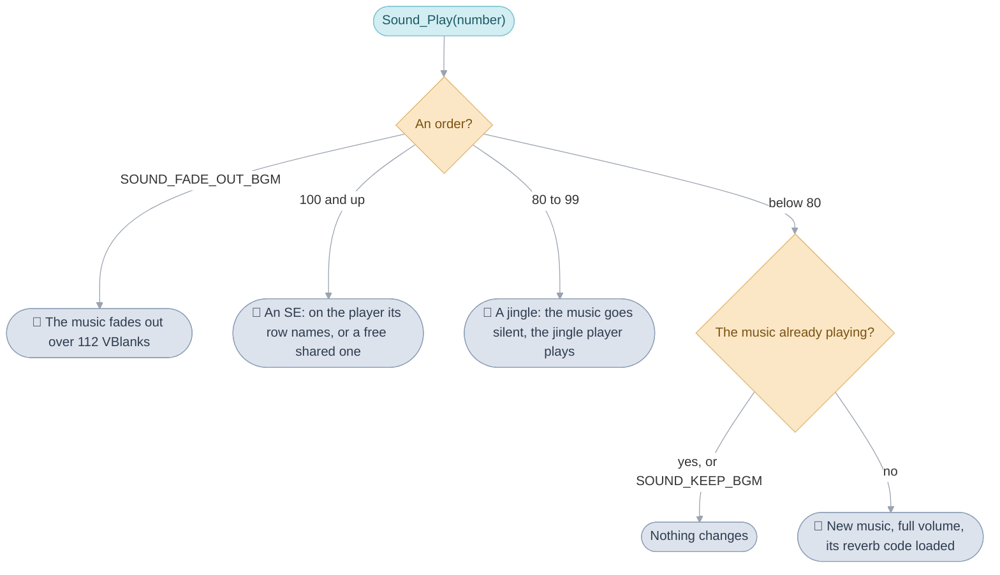
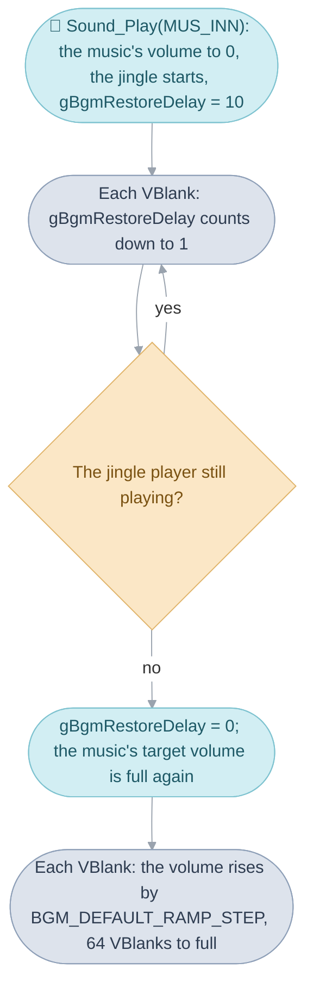
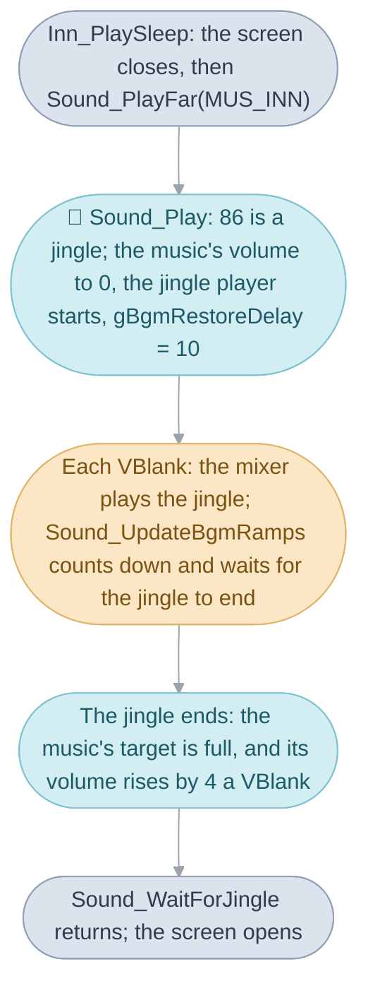

# Sound


A town's music plays while the cursor clicks through a menu; a chest opens
with a short tune and the music comes back by itself; footsteps and impacts
play over everything. The player hears three kinds of
[sound](../../glossary.md#sound): music, which plays on until something
changes it; a jingle, a short tune that silences the music and then gives it
back; and an SE, a sound effect, which plays over both. Every one of them is
asked for the same way, with one call and a number, and what happens to it
is the work of five mechanisms:

1. The sound number: the sound layer reads the number's range and decides
   which kind it is, which of the driver's eight music players plays it,
   and what it does to the music already playing.
2. The scene's music: how a scene asks for its music when the party arrives,
   and when the music is kept instead.
3. The sound driver: the music players, their tracks and the mixer that
   turns the notes of a sound's data, which the driver calls a song, into
   sound once a [VBlank](../../glossary.md#vblank).
4. The ramps: how the music's volume, tempo and pitch move a step a VBlank,
   which is how the music comes back after a jingle.
5. The lock and the reverb code: what keeps the mixer and the game's calls
   from treading on each other, and the echo each piece of music is given.

```mermaid
%%{init: {"theme": "base", "themeVariables": {"lineColor": "#9AA3AE", "edgeLabelBackground": "#FFFFFF"}, "flowchart": {"curve": "basis", "padding": 12}}}%%
flowchart TD
  call(["Any code: Sound_PlayFar(number)"]) --> layer(["The sound layer: music, a jingle, an SE or an order"])
  layer --> player(["One of eight music players: a song's tracks of notes"])
  player -- "every VBlank" --> mixer(["The mixer, in IWRAM: the next slice of sound"])
  mixer --> speaker(["The speaker"])
  classDef code fill:#DDE3EC,stroke:#8FA0B8,color:#2E3C50
  classDef layer fill:#D2EEF3,stroke:#7FC3D0,color:#1E5966
  classDef hardware fill:#FBE7C6,stroke:#E0B46A,color:#7A5212
  class call code
  class layer,player layer
  class mixer,speaker hardware
```

The sound layer is `sound.c`, the game's own code in the sound
[bank](../../glossary.md#bank). Under it is the driver that plays the sounds
on the hardware, Nintendo's MusicPlayer2000, which the game's code calls
through the layer and the VBlank interrupt runs. The page takes the five in
that order, from the call to the speaker, and ends by following a night at
the inn through all of them.

## What a sound number means


A sound number is the one thing the game passes when it wants a sound, and
its range says what kind of sound it is, so that the caller never has to say
whether it wants music, a jingle or an SE.

The numbers run from 0 to 311, one for each row of the song table, and the
sound layer reads the range: below 80 the number is music, from 80 to 99 a
jingle, and from 100 up an SE. The treasure jingle in the recording is
`MUS_TREASURE_FOUND`, 83; Vale's music is `MUS_VALE`, 0; the Vault bell is
`SE_BELL`, 100. `sounds.h` names every number the game plays, each from what
it sounds like or the moment it marks.

A few numbers are orders rather than sounds. `SOUND_FADE_OUT_BGM` fades the
music out, over about two seconds, once, until the next music starts;
`SOUND_KEEP_BGM` keeps whatever is playing; and `SOUND_FADE_OUT_ACTION_SE`
fades out the sounds of the field and of battle, such as footsteps and
impacts, over under a second. A number can also carry a flag above its twelve
bits: `SOUND_FLAG_FADE_IN` asks for new music to start silent and rise to
full volume over about a second. Every call in The Broken Seal leaves the
flag clear and starts its music at full volume.

Each kind of sound has music players of its own, so an SE never stops the
music and a jingle never stops an SE. The music has one player with ten
tracks and the jingles one with four. Of the six players left, one belongs
to the menus' sounds, one to the footsteps, tremors, water and impacts of
the field and the battle, and the other four are shared by the rest of the
SEs. A song table row names the player its sound plays on; a sound whose row
names the last of the four shared players takes the first idle one, counting
down from the last, and when all four are busy it cuts off the last one's
sound. A sound on any other player cuts off what was there.

Music is the kind the layer thinks hardest about. Asking for the music
already chosen changes nothing, which lets every
[scene](../../glossary.md#scene) ask for its music on arrival without
restarting it; it also means a piece that ends without looping plays again
only after other music or a fade. New music starts at full volume, unless
the flag asks for a fade in, and takes the reverb code its number calls for
(below). A jingle turns the music's volume to zero, starts on the jingle
player, and leaves a note that the music is to come back when it ends.



The call is `Sound_Play`, or `Sound_PlayFar` from outside the sound bank,
which almost 1,300 places in the game use. It masks the flag off with
`SOUND_FLAGS_MASK`, tests the orders, then the ranges `SOUND_SE_FIRST` and
`SOUND_JINGLE_FIRST`; an SE starts with `MPlayStart` on its player, a jingle
or music with `m4aSongNumStart`, and music records itself in `gCurrentBgm`
and loads its reverb code with `Sound_LoadReverbCode`. The players are the
rows of `gMPlayTable` (`sound/music_player_table.s`), and the sounds, each
with its player, the rows of `gSongTable` (`sound/song_table.s`).

| Name                       | Value   | Meaning                                                        |
| -------------------------- | ------- | -------------------------------------------------------------- |
| `SOUND_NUM_MASK`           | `0xfff` | the sound number: bits 0 to 11                                 |
| `SOUND_FLAG_FADE_IN`       | `0x1000` | new music fades in over 64 VBlanks, about a second            |
| `SOUND_FADE_OUT_BGM`       | 17      | fades the music out: 16 steps 7 VBlanks apart, about 2 seconds |
| `SOUND_KEEP_BGM`           | 18      | keeps the music playing                                        |
| `MUS_SILENCE`              | 19      | a sound with no tracks: silence, as music                      |
| `SOUND_JINGLE_FIRST`       | 80      | jingles from here                                              |
| `SOUND_SE_FIRST`           | 100     | sound effects from here                                        |
| `SE_STOP_ACTION_SE`        | 288     | a sound with no tracks on the action player: stops a loop there |
| `SOUND_FADE_OUT_ACTION_SE` | 289     | fades the action player out: 16 steps 3 VBlanks apart          |
| `MUSIC_PLAYER_JINGLE`      | 0       | the jingle player, 4 tracks                                    |
| `MUSIC_PLAYER_BGM`         | 1       | the music player, 10 tracks                                    |
| `MUSIC_PLAYER_MENU_SE`     | 2       | the menus' sounds, 2 tracks                                    |
| `MUSIC_PLAYER_ACTION_SE`   | 3       | the field's and the battle's actions, 2 tracks                 |
| `MUSIC_PLAYER_SE_FIRST` to `MUSIC_PLAYER_SE_LAST` | 4 to 7 | the four shared SE players, 2 tracks each   |

## How a scene chooses its music


When the party arrives in a scene, the
[main routine](../../glossary.md#main-routine) asks for the scene's music
before it loads the scene's code, so that the music is already playing as
the scene fades in.

The music is chosen from a table of rules, `gScene_MusicRules`, each naming a
scene or an [area](../../glossary.md#area), an
[entrance](../../glossary.md#entrance) or any, and a
[flag](../../glossary.md#game-flag) or none, and giving a sound number. The
first rule that fits wins: Vale's rules name its area, so its houses fall
under them too and ask for the music the town is already playing, which the
sound layer leaves alone, and the Sanctum has rules of its own, each behind a
flag, so that its music changes as the story moves on. A scene no rule fits
gets `SOUND_KEEP_BGM`, which keeps whatever is playing. Three flags keep the
music across a change where the table would change it:
`FLAG_KEEP_MUSIC_ONCE` for one change, `FLAG_KEEP_MUSIC_HELD` for as long as
it stays set, and `FLAG_KEEP_PARTY_POSITION`, which puts the party back where
it was, after a battle or the Pause menu, and starts the music saved before
the Pause menu opened. Every scene change also plays `SE_STOP_ACTION_SE`,
which stops a looping sound on the action player, such as a rolling log,
unless `FLAG_SKIP_SCENE_CHANGE_SOUND` is set for that one change.

`Scene_ChooseMusic` reads the rules into `gMainRoutineWork.sceneMusic`, and
`Scene_PlayMusic` plays it through `Sound_PlayFar`; `MainRoutine_Run` calls
both before `Scene_LoadOverlay`, and reads `returnMusic`, which the field
sequence saved from `Sound_GetCurrentBgm` before the Pause menu
(`field_sequence.c`). The rules are in `field/scene_rules.s`, each written
as `area_music` or `scene_music`. A battle plays the music chosen for its
encounter, `gMainRoutineWork.battleMusic`, from `battle_music.c`'s list;
battles the list leaves out, such as the Vault thieves, take `MUS_BATTLE`.
`Battle_Run` plays that music, or, with none set, `MUS_SATUROS_BATTLE` and
then `MUS_COLOSSO_BATTLE`, so the second is what plays; a link battle adds
`MUS_BOULDER_CHASE` with `SOUND_REVERB_NONE` (`battle/battle/run.c`).

## The sound driver

The sound driver is the code that turns a song's notes into the sound the
console plays, Nintendo's MusicPlayer2000, which the game asks for a song by
number and which the VBlank interrupt runs once a VBlank.

To the driver, every sound is a song: a header naming its voices and its
tracks, each track a stream of notes and commands such as a tempo, a volume
or a jump back to loop. A music player plays one song, stepping each of its
tracks on by the song's tempo once a VBlank, and a note a track starts
becomes either a sample, a recording the mixer plays at the note's pitch, or
a tone from one of the four generators built into the console. The eight
music players share the mixer: once a VBlank it mixes the next slice of
every playing sample into two buffers, left and right, which a timer and two
DMA transfers feed to the speaker between VBlanks. The mixer is copied into
[IWRAM](../../glossary.md#iwram-and-ewram) at start-up, since it runs every
VBlank whatever else the game is doing, and the ROM keeps the copy it is
made from.

The data is editable. Each song with notes is a MIDI file in
`games/tbs/sound/songs`, whose first text event names its header, `sound_000`
for Vale's music, and its tracks, and `tools/ags-music` turns it into the
driver's commands at build time; the trackless ones, `MUS_SILENCE` and
`SE_STOP_ACTION_SE` among them, are a few lines of assembly; the 32 samples
are WAV files in `direct_sound_samples/`, which `tools/ags-audio` packs, and
nine wave patterns for the console's wave
generator are in `programmable_wave_samples/`. The voices, which say for each
instrument whether it is a sample or a generator and how its note swells and
fades, are the rows of `voice_groups.s`, 225 of them in three groups: 128 for
the music, 16 drums and 81 for the sound effects.

The driver's code is `driver.c`, `audio.c` and `tables.c`, compiled with
`old_agbcc` ([The compilers](../../glossary.md#the-compilers)), and its mixer
`mixer.s`, with the game's own copy of the mixing step in
`resident_mixer.s`, `resident_mixer_interpolate.s` and
`resident_mixer_render.s`. `Sound_Initialize` calls `m4aSoundInit` at
power-on, which copies the mixer to IWRAM, sets the driver's mode and opens
every player from `gMPlayTable`. Each VBlank the handler calls
`Sound_UpdateBgmRamps`, which ends by restarting the buffers' DMA when they
run out (`m4aSoundVSync`), and last `Mixer_Enter`, which runs the mixer
([System code](../system/README.md#the-frame-loop)).

| Name                     | Value         | Meaning                                                   |
| ------------------------ | ------------- | --------------------------------------------------------- |
| music players            | 8             | the rows of `gMPlayTable`, 26 tracks between them         |
| songs                    | 312           | the rows of `gSongTable`, sound numbers 0 to 311          |
| samples                  | 32            | `Sound_Wave00` to `Sound_Wave31`, 8-bit PCM               |
| `AUDIO_INITIAL_MODE`     | `0x0097F800`  | 8 sample notes at once, volume 15, 352 samples a VBlank   |
| samples a second         | 21,024        | 352 samples at 59.7275 VBlanks a second                   |
| `SOUND_MIXER_CODE_SIZE`  | 1 KB          | the mixer code copied to IWRAM                            |
| `Ram_SoundMixer`         | `0x03007000`  | where the mixer runs                                      |

## How the music comes back after a jingle


The music's volume, and its tempo and pitch together, each move towards a
target by a fixed step once a VBlank, a ramp, and the jingle's return of the
music is one of those ramps, started by the VBlank handler itself when the
jingle ends.

During a night at the inn the town's music falls silent, the inn's tune plays
over the black screen, and the music fades back in once the tune has ended.
The music keeps playing at zero volume, so it comes back at the point it
has played on to. When the jingle starts, the sound layer sets
the music's volume and its target to zero, starts a countdown of ten VBlanks,
and leaves it there. Once a VBlank, the handler counts the countdown down to
one and holds it there until the jingle's player has no track left playing;
then it clears the countdown and sets the music's target volume back to full,
and the volume ramp does the rest, a step a VBlank for 64 VBlanks. The code
that played the jingle does nothing more. The inn waits for the countdown to
clear before it opens the screen again, as do the Sanctum, the Lemurian ship
and Tolbi's spring; the Colosso scenes and the message windows read the same
countdown to hold a pause until a jingle has ended.



The silence reaches only the music's first eight tracks, the ones every
music command of the layer selects. Nine pieces of music use more, among them
the World Map's and Kalay's, and their ninth and tenth tracks keep their
volume under a jingle and through every ramp.

The tempo and pitch ramp moves both together, like a record played at another
speed, but in a straight line: twelve semitones for each doubling of the
scale. The game uses it once, when the Lemurian ship sails off to the ending
music played a little slow (`Sound_SetBgmTempo`); the other ways in,
`Sound_SetBgmPitch`, `Sound_SetBgmTempoPitchTarget`, `Sound_SetBgmVolume` and
`Sound_SetBgmVolumeTarget`, are reached only through bare rows of the sound
bank's [far-call](../../glossary.md#far-call) table.

`Sound_Play` sets the countdown, `gBgmRestoreDelay`;
`Sound_UpdateBgmRamps`, which the VBlank handler runs through
`Sound_UpdateBgmRampsFar`, counts it, watches the jingle player's `status`,
and steps both ramps, each clamped when a step would cross its target. The
inn and the others wait a [frame](../../glossary.md#frame) at a time in
`Sound_WaitForJingle` (`shop/shop/run.c`), which polls
`Sound_GetBgmRestoreDelay`; Vale's Sanctum, after the jingle for accepting
the Great Healer's quest, waits in
`Sound_WaitForBgmRestore`, which gives up after `BGM_WAIT_TIMEOUT_FRAMES`.

| Name                         | Value   | Meaning                                                 |
| ---------------------------- | ------- | ------------------------------------------------------- |
| `BGM_UNITY_SCALE`            | `0x100` | full volume, or the song's own tempo and pitch, in 8.8 fixed point |
| `BGM_DEFAULT_RAMP_STEP`      | 4       | a ramp's step a VBlank: 64 VBlanks from silence to full |
| `BGM_RESTORE_DELAY_VBLANKS`  | 10      | VBlanks after a jingle starts before the music waits for its end |
| `BGM_WAIT_TIMEOUT_FRAMES`    | 300     | frames `Sound_WaitForBgmRestore` waits at most, about five seconds |
| `TRACKS_ALL`                 | `0xff`  | the music's tracks 0 to 7, the ones the ramps and a jingle reach |

## The driver's lock

The lock is one word in the driver's work, and one in each music player's,
that a call raises while it changes them and the mixer checks before it mixes,
so that the VBlank interrupt never mixes from a player a call is halfway
through changing.

The game starts and stops sounds outside the interrupt, and the mixer runs
at VBlank, which can arrive in the middle of one of those calls. The VBlank
handler also calls the driver itself: it steps the ramps through the same
calls, Lucky Wheels plays its sounds from a VBlank
[task](../../glossary.md#task) (`LuckyWheels_Update`), and the mixer reads
every player. The lock keeps them apart. A call that changes the driver
checks that the word holds its free value, adds 1 to it while it works, and
puts the free value back; the mixer, finding the word raised, skips mixing
for that VBlank, and a call that finds it raised is dropped, not delayed.
Since the interrupt finishes before the code it interrupted goes on, only a
call made inside the interrupt can be dropped, and a dropped ramp step is
made up by the next, since each step sets the whole volume again.

```mermaid
%%{init: {"theme": "base", "themeVariables": {"lineColor": "#9AA3AE", "edgeLabelBackground": "#FFFFFF"}, "flowchart": {"curve": "basis", "padding": 12}}}%%
flowchart TD
  call(["A call: the word is ID_NUMBER, so add 1 and work"]) --> vblank(["VBlank arrives: Mixer_Enter reads the word"])
  vblank -- "raised" --> skip(["Skip this VBlank's mixing"])
  vblank -- "ID_NUMBER" --> mix(["Mix the next slice"])
  call --> done(["The call puts ID_NUMBER back"])
  classDef layer fill:#D2EEF3,stroke:#7FC3D0,color:#1E5966
  classDef hardware fill:#FBE7C6,stroke:#E0B46A,color:#7A5212
  classDef out fill:#DDE3EC,stroke:#8FA0B8,color:#2E3C50
  class call,done layer
  class vblank hardware
  class skip,mix out
```

The word's free value, `ID_NUMBER`, spells `Smsh` in memory. The driver's
work has one, its first field `SoundInfo.ident`, and each music player its
own, `MusicPlayerInfo.ident`; `Mixer_Enter`, the VBlank handler's way into
the mixer, compares the driver's and returns when it is raised. Suspending
the driver adds 10 instead (`m4aSoundVSyncOff`), so a suspended driver can be
told from a busy one, and `SoundInit` holds the word at 0 while it clears the
driver's work.

| Name              | Value        | Meaning                                              |
| ----------------- | ------------ | ---------------------------------------------------- |
| `ID_NUMBER`       | `0x68736D53` | the lock's free value, `Smsh` in memory order        |
| a raised lock     | `ID_NUMBER + 1` | a call is changing the driver or the player       |
| a suspended driver | `ID_NUMBER + 10` | `m4aSoundVSyncOff` has stopped the mixer       |

## The reverb code for each piece of music

The reverb code is the last step of the mixer's loop, which decides how much
of one VBlank's sound carries into the next, an echo, and the game keeps five
versions of it and copies one into the mixer whenever music starts.

Every piece of music is given its echo as it starts: the Title's and the
ending's carry the most, and other music a little less. A link battle then
loads the version that carries nothing, and the Battle Arena the usual one.
The other two versions only the sound test loads, a screen reached only
through the sound bank's far-call table, which nothing in the game calls.
The mixer also marks a sample it had to clip because the mix came out too
loud, and only the sound test reads the mark.

The versions are `enum SoundReverbCode`, and `Sound_LoadReverbCode` copies
the chosen one, 152 bytes of ARM code, from `IwramSoundReverbCodes` in the
ROM (`system/entry.s`) over `IwramSoundReverbCode` in IWRAM with a DMA;
`Sound_Play` loads `SOUND_REVERB_LONG` for `MUS_TITLE`, `MUS_ENDING_LOGO` and
`MUS_ENDING` and `SOUND_REVERB_NORMAL` for the rest, the battle
`SOUND_REVERB_NONE` for a link battle (`Battle_Run`), the Battle Arena
`SOUND_REVERB_NORMAL`, and the sound test, `SoundTest_Run`, whichever Select
steps to. The clip mark is `gSoundMixerClipped`.

| Reverb code              | Carries into the next VBlank                               | Loaded by                      |
| ------------------------ | ---------------------------------------------------------- | ------------------------------ |
| `SOUND_REVERB_NORMAL`    | a quarter of the mix and an eighth of each buffer's old samples | most music, the Battle Arena |
| `SOUND_REVERB_LONG`      | an eighth of the mix and a quarter of the old samples      | the Title, the ending's logo and the ending |
| `SOUND_REVERB_NONE`      | nothing: the mix buffer is cleared                         | a link battle                  |
| `SOUND_REVERB_MONO`      | one value for both the left and the right buffer           | the sound test                 |
| `SOUND_REVERB_CROSSED`   | each buffer's old samples crossed with the other's         | the sound test                 |
| `SOUND_REVERB_CODE_SIZE` | 152 bytes                                                  | each version's length          |

## A night at the inn


Isaac pays four coins, the screen closes around him, the inn's tune plays,
and the town's music comes back as the room opens up again. Each step of it
is the work of one of the page's mechanisms.



### The inn asks for the jingle

`Inn_PlaySleep` (`shop/shop/inn.c`) takes the coins, restores the party, closes
the screen around the leader over 60 frames, and calls
`Sound_PlayFar(MUS_INN)`: a far call into the sound bank, with the number 86.

### The sound layer makes it a jingle

`Sound_Play` masks the flag off, finds no order, and reads the range: 86 is
at least `SOUND_JINGLE_FIRST` and below `SOUND_SE_FIRST`, so it is a jingle.
The layer turns the music's volume and its target to zero, starts the song on
the jingle player with `m4aSongNumStart`, which reads row 86 of `gSongTable`
for the song's header and its player, and sets `gBgmRestoreDelay` to ten.

### The driver plays it

Once a VBlank the mixer runs the jingle player's four tracks, mixes their
notes into the buffers, and the DMA plays them, under the driver's lock. The
music player keeps running too, at zero volume, so the town's music moves on
through the night.

### The VBlank handler brings the music back

Each VBlank `Sound_UpdateBgmRamps` counts `gBgmRestoreDelay` down to one and
then holds it there, reading the jingle player's `status` until no track is
left. Then it clears the countdown and sets the music's target volume to
`BGM_UNITY_SCALE`, and from that VBlank on the volume ramp adds
`BGM_DEFAULT_RAMP_STEP` a VBlank, 64 VBlanks to full.

### The inn waits for it

Meanwhile `Inn_PlaySleep` has been standing in `Sound_WaitForJingle`, which
waits a frame at a time while `Sound_GetBgmRestoreDelayFar` is nonzero. The
frame after the countdown clears it returns, the inn waits ten frames more
and opens the screen, and the music is rising as the room comes back.

### The same moment, mechanism by mechanism

| Step                                   | Mechanism                                                       |
| -------------------------------------- | --------------------------------------------------------------- |
| The inn asks for a sound by number     | the sound number: `Sound_PlayFar(MUS_INN)`, 86                  |
| The town's music goes silent           | the sound number: a jingle sets the music's volume to zero      |
| The tune plays over the black screen   | the sound driver: the jingle player's tracks, mixed each VBlank |
| The handler and the layer keep apart   | the driver's lock, checked by `Mixer_Enter` each VBlank         |
| The music comes back by itself         | the ramps: the countdown, then the volume ramp from the handler |
| The screen opens as the music rises    | the inn's wait on the countdown, `Sound_WaitForJingle`          |

## Design

The sound layer decides and the driver plays. The layer is the game's own
code in the sound bank, compiled with the game's compiler, and it owns every
decision the game has to make about sound: what a number means, which player
takes it, what happens to the music under a jingle. The driver follows the
banks in the ROM's tail, compiled with `old_agbcc`, and its mixer runs from
IWRAM; the game's way in from the VBlank handler, `Mixer_Enter`, jumps to
the game's own copy of the mixing step, which carries the reverb codes.

Putting the music's return in the VBlank handler, rather than in the code
that played the jingle, means every jingle in the game gets its music back
without any of the 1,300 callers having to remember to ask.

## How it fits with the rest of the game

Every part of the game plays sound through `Sound_PlayFar`: the main routine
names each scene's music on entry, menus click, battle effects play their
impacts. The VBlank handler in
[System code](../system/README.md#the-frame-loop) steps the ramps and enters
the mixer every VBlank, and the mixer's resident code is part of what
start-up copies into IWRAM
([System code](../system/README.md#memory-map)). The sounds and samples
themselves are data in `games/tbs/sound`.

## Limits

- Eight music players; the music's player has 10 tracks, of which a jingle
  silences 8.
- Four sound effects on the shared players play at once.
- Sound numbers run from 0 to 311, one for each row of `gSongTable`; the call
  reads the low 12 bits as the number, and the bit above them,
  `SOUND_FLAG_FADE_IN`, makes new music fade in over about a second.
- A call made inside the VBlank interrupt while the driver's lock is raised
  is dropped: a ramp's last step can be lost, leaving the music one step,
  a sixty-fourth of full volume, short of its target, and a sound Lucky
  Wheels asks for from its VBlank task while its player's lock is raised
  does not play.

## Words used here

- **sound number**: the number `Sound_Play` takes: music, a jingle, a sound
  effect from the song table, or an order. The Lost Age's sound test sorts the
  same sounds as Music, Jingle and SE.
- **song**: the driver's word for one sound's data, a header and its tracks
  (`struct Song`, `gSongTable`), whatever kind of sound it is.
- **music player** and **track**: a music player plays one song, whose tracks
  each run a stream of notes and commands.
- **note**: a sound a track starts, either a sample the mixer renders or one
  of the four tone generators built into the hardware.
- **ramp**: the music's volume, or its combined tempo and pitch, stepped
  towards a target once a VBlank.
- **lock** (`ident`): the driver's and each music player's signature word,
  raised while a call changes them.
- **reverb code**: one of the five versions of the mixer's last step, copied
  in when music starts.

## Evidence

The driver is Nintendo's, so its code keeps the m4a spellings
[pret](../../glossary.md#pret) gives its structures, tables and routines
(`SoundInfo`, `MusicPlayerInfo`, `gMPlayTable`, `m4aSoundInit`, the song
commands `ply_goto` to `ply_xswee`), each checked against the same routine in
pret's m4a sources. Where pret has no name the name is ours: `MPlayStartFade`
(the fade setup each fade call shares), `ld_r3_tp_adr_i_r2` (the second entry
of `ld_r3_tp_adr_i`), `Mixer_CallViaR3` (the `bx r3` at the end of
`SoundMainRAM`), `SoundMainRAM_Rom` (the mixer's ROM copy) and the
`MPLAY_JUMP_` indices. What Camelot added takes a plain name in the project's
style: the VBlank handler's way into the mixer (`Mixer_Enter`), the music
players beyond `gMPlayInfo_BGM` (`gMPlayInfo_Jingle` and the rest), and the
sound layer in `sound.c`. The sound layer's names come from what `Sound_Play`
does with each range, and the sounds' from `sounds.h`: music by the place or
moment the player knows it from (`MUS_DJINN_LESSON`), a sound effect by what
it sounds like or the moment it marks (`SE_THUMP`).

`gSoundMixerClipped` is named from the store that sets it: near the end of
`IwramSoundNormalizeChannels`, `str lr, [pc]` writes the clip mask the routine
has just built into the word that follows the routine.

The driver's structures keep their m4a names for the bytes nothing uses: the
notes' `dummy1` to `dummy5`, `xpi` and `xpc`, a track's `gap`, `timer` and
`unk_3C`, a music player's `gap`, and the driver work's `mode`, `gap` and
`gap2`. No C in the game names them, and the driver's assembly (`mixer.s`,
`clear_buffer.s`, `channel_update_entry.s`) loads and stores at none of their
offsets.
