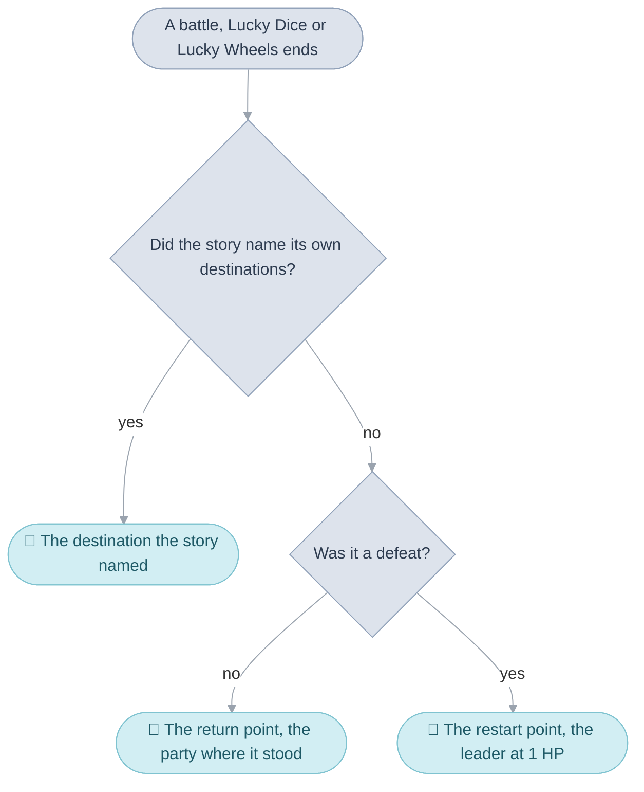
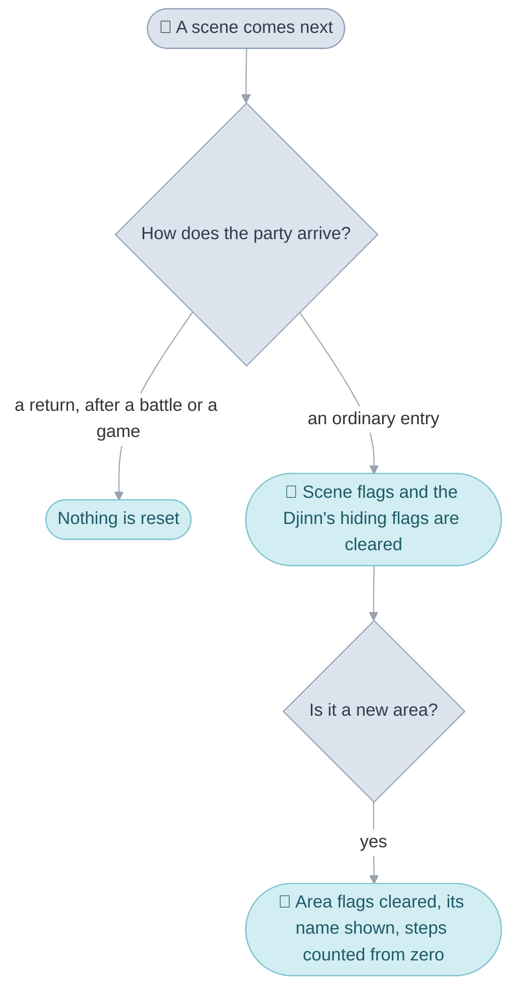
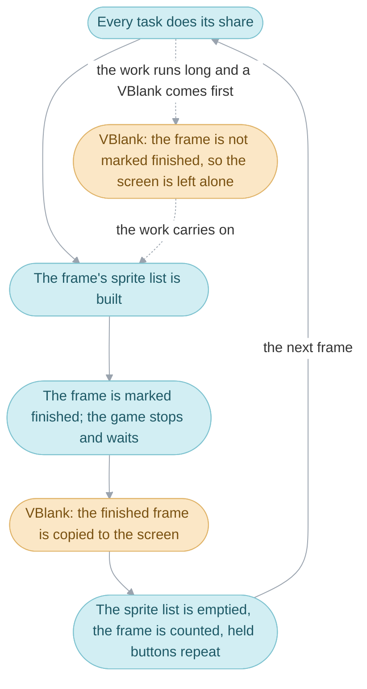
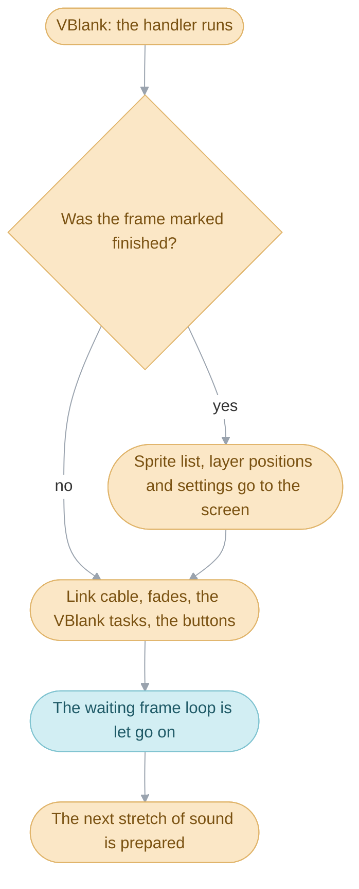
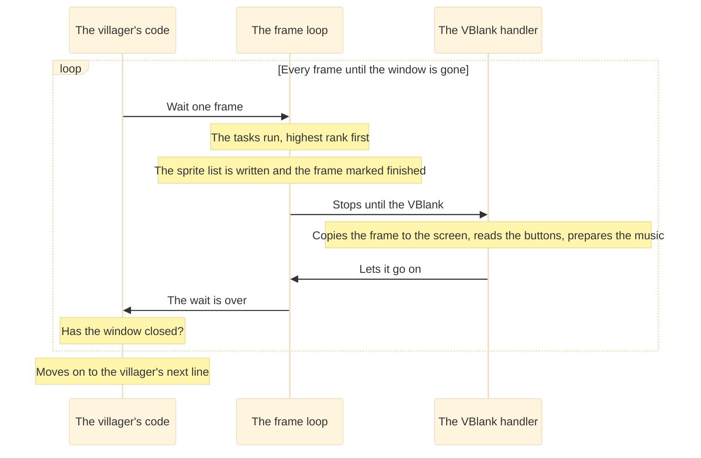
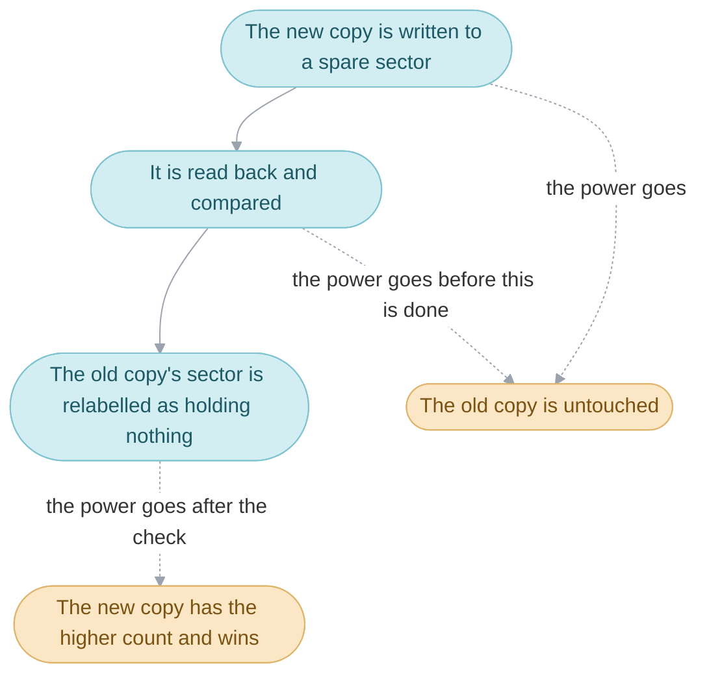
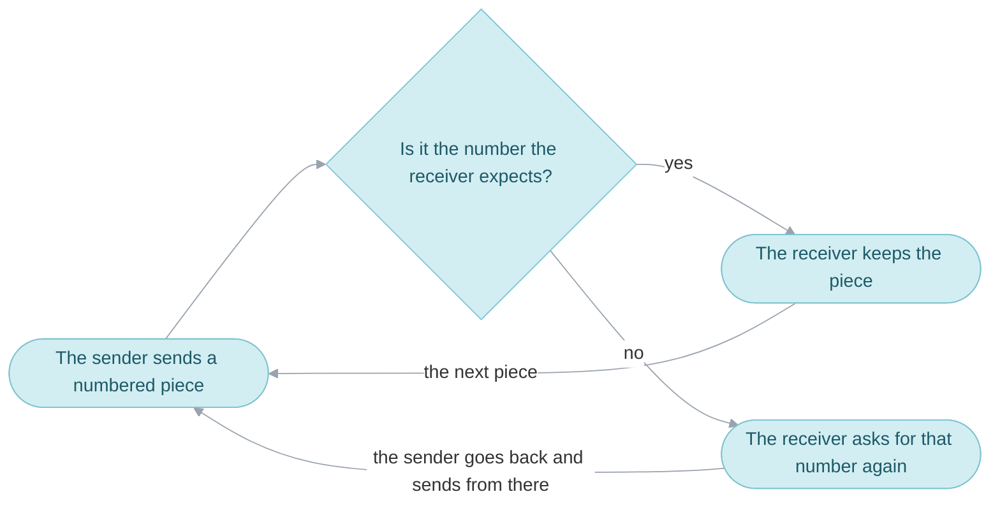
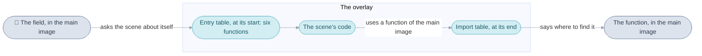
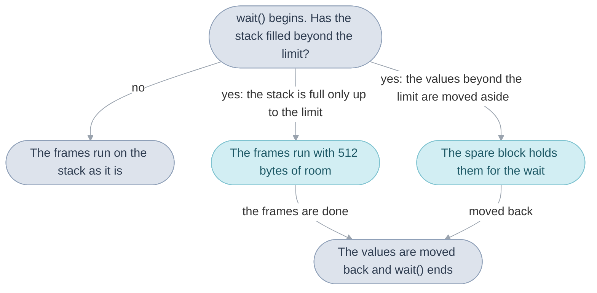

# System code

Talk to Garet's sister in Vale and her words arrive a letter at a time.
At the end of the page an arrow bobs until the player presses A.

Here is the odd part. The piece of the game that showed her line is doing
nothing. It asked for the line once, and now it stands still until the
window has closed. Yet the letters keep coming and the arrow keeps bobbing.

Both are true because of how the game lets time pass. The game is code, long
lists of instructions cut into named pieces called functions. Whenever one
of them has to wait, for a window, a walk or a fade, it hands over to one
small function named [`wait()`](../../glossary.md#wait).

While `wait()` waits, it keeps the rest of the game going. For every picture
the screen shows, it runs a short list of small jobs. The game calls each
one a [task](../../glossary.md#task), and each picture, with the work that
goes into it, a [frame](../../glossary.md#frame). Typing the next letters and
bobbing the arrow is one of those tasks.

That function, and the few things it needs around it, are what the credits
call the [System](../../glossary.md#system). Every other part of the game
stands on it. This page goes through it in the order a player meets it:

1. [Start-up](#start-up): switching on, and the reset with A, B, Select and
   Start.
2. [The main routine](#the-main-routine): what happens between a cave, a
   battle and the cave again.
3. [The frame loop](#the-frame-loop): how each frame reaches the screen, why
   the game can slow down while its music doesn't, how a held button
   repeats, and how the console goes to sleep.
4. [The task runner](#the-task-runner),
   [the frame's sprites](#the-frames-sprites) and
   [the register write queue](#the-register-write-queue): what keeps moving
   while something waits, and how it all lands on screen at once.
5. [One frame of a conversation](#one-frame-of-a-conversation), which puts
   those together.
6. [Saving](#saving) and [the link cable](#the-link-cable), the two ways
   anything leaves the console.
7. [How an overlay reaches the rest of the
   game](#how-an-overlay-reaches-the-rest-of-the-game): what walking through
   a door loads.

The last part, [For readers of the code](#for-readers-of-the-code), is the
housekeeping underneath: where things sit in memory and how memory is
shared out.

The cartridge itself is [The Game Pak](../gamepak/README.md).

## Start-up

Hold A, B, Select and Start anywhere in the game, as in the recording, and
the Camelot logo comes up as if the console had just been switched on.

As far as the game can tell, it has been. Switching on runs the cartridge's
first instruction, and the reset jumps back to that same instruction. So a
reset goes through start-up in full.

Start-up runs once, from top to bottom, while nothing is moving yet:

1. It stops any effect the old game left running. A reset can arrive in the
   middle of an effect that changes the picture line by line, and the piece
   of hardware that drives such an effect would otherwise keep going.
2. It wipes the console's small, fast working memory, which the game calls
   [IWRAM](../../glossary.md#iwram-and-ewram). Memory is where the game
   keeps everything it is working on, and after a reset it is full of the
   old game. Only a strip at the top is spared, because start-up itself is
   already using it.
3. It copies its most used functions from the cartridge into that fast
   memory, where they run quickest. These are the resident code: the
   function that turns the music's notes into sound, a few small helpers
   the whole game uses, and the function that receives every interrupt.
4. It sets up the interrupts. An interrupt is the console breaking into
   whatever the game is doing to run one function at once, and then letting
   the game carry on. That function is the interrupt's handler. Start-up
   switches on two interrupts: one after every picture the screen draws, and
   one for the four reset buttons.
5. It loads the pictures the windows are drawn from, starts the sound and
   empties the list of tasks.
6. It waits ten frames and starts the main routine.

The Camelot logo that follows is not part of start-up. It is the first thing
the main routine runs.

The four reset buttons do not restart the game on the spot. Their handler
only records that a reset is wanted. `wait()` checks for it at the end of
the frame it is working on, and jumps to the cartridge's first
instruction then.

The German, French, Spanish and Italian editions switch on a third
interrupt, the one the console raises when the cartridge is pulled out. Its
handler stops the game where it stands.

Start-up is `System_Initialize`, in `system/start_up.c`.

## The main routine

In the recording Isaac walks through Goma Cave, a battle breaks out, and
afterwards the cave is back with the party where it stood.

Those are three separate stretches of play, and the game runs them one at a
time. It calls each stretch a [sequence](../../glossary.md#sequence). There
are four kinds: the field, which is everything walked around in, a battle,
Lucky Dice and Lucky Wheels.

The main routine is the one function that runs them, one after another, and
never finishes. [System](../../system.md#the-main-routine) gives its place
in the game.

It goes round and round the same three steps (`MainRoutine_Run` in
`main_routine.c`). It clears away what the last sequence left, runs the next
one, and works out what follows. In the recording it goes round three times:
the cave, the battle, the cave again.

### Clearing away the last sequence

A sequence can end with things still going. If the battle inherited them
from the cave, they would carry on under it. So each time round, the main
routine first stops them all:

- **Looping sounds.** Some sound effects loop, such as a rolling log. The
  main routine plays a silent sound in their place, which cuts the loop off.
  Three scenes want their sound to carry over the change: the World Map's
  lighthouse transition and two Venus Lighthouse scenes. They ask for the
  silence to be skipped once.
- **Effects drawn line by line.** The console can interrupt the game after
  every line of the picture it draws, or when the drawing reaches one chosen
  line. A sequence uses these to change the picture from one line to the
  next, as the opening of a battle does. A handler left behind would keep
  running under the next sequence, so both interrupts are switched off.
- **Tasks.** The list of tasks is emptied.
- **Memory from the heap.** Every block the last sequence took is taken
  back at once ([the heap](#the-heap)), and so is the memory the sprites'
  pictures were in.

Very little survives this. The party, its coins and Djinn and what runs
next live in one block of memory the game calls the
[main routine's work](../../glossary.md#main-routines-work). The
[game flags](../../glossary.md#game-flag) live beside it. A flag is one
yes-or-no fact, such as a chest being open. Those, and a few fixed blocks,
are all that one sequence can hand to the next.

### Running another sequence

The main routine then reads what runs next from its work. A battle, Lucky
Dice or Lucky Wheels
([The Broken Seal](../../README.md#the-main-routine-and-its-sequences) lists
them) runs from start to finish and hands back a result, such as a defeat.

The result decides which scene comes back (`Scene_ReturnFromSequence`):

- **Any result but a defeat** goes back to the return point. That is the
  scene and the way in that the party last arrived by, which the field
  writes down as each scene starts. The main routine also sets a flag,
  `FLAG_KEEP_PARTY_POSITION`, so the party stands where it stood. That is
  the recording: Goma Cave comes back with the party where the battle found
  it.
- **A defeat** brings the leader back at 1 HP and sends the party to the
  restart point, usually the last Sanctum. A defeat in the prologue also
  heals Isaac and Garet in full.
- **A story battle** can name its own destinations beforehand, one for after
  the battle and one for a defeat, and those win over the two rules above.

### Arriving in a scene

A [scene](../../glossary.md#scene) is one stretch of the field: a town, a
dungeon floor, a few rooms, the World Map.

When a scene comes next, the main routine first asks how the party arrives.
An ordinary entry is a walk through a door or off the edge of a map. A
return is a scene coming back after a battle or a game of dice or slots,
marked by the flag set above.

On a return nothing is reset. On an ordinary entry the game forgets what was
meant to last for one visit:

- The flags that last for one scene are cleared. On entering a new
  [area](../../glossary.md#area), such as a different town, so are the flags
  that last for one area
  ([State that cleans itself up](../scene/README.md#state-that-cleans-itself-up)
  gives their ranges).
- A new area also shows its name, starts the count of steps towards a random
  battle from zero, and makes this way in the place Retreat leads back to.
- The Djinn's hiding flags are cleared. A Djinni that got away stays out of
  its room only until the room is entered again.

Then the scene's music is chosen from a list of rules, `gScene_MusicRules`,
and the first rule that fits the scene wins. On an ordinary entry that music
plays, unless the story asked for the music already playing to carry on. After
a random battle the scene's own music plays again.

Last, the scene's own code is loaded
([below](#how-an-overlay-reaches-the-rest-of-the-game)) and the field runs
the scene
([Field code](../field/README.md#the-field-sequence-serves-requests)).

### Taking an exit

The same path can lead to two places. In the recording the path down from
Sol Sanctum leads into Vale as usual, and after the eruption it leads into
a Vale with the villagers gathered by the river.

A scene ends when the party takes one of its
[exits](../../glossary.md#exit). The field hands the exit's number back to
the main routine, and the main routine turns it into a
[destination](../../glossary.md#destination): a scene, and a way into it.

It does so with the scene's list of exits. Each line of the list names an
exit and where it leads, and a line can carry a flag. The main routine takes
the first line for the exit whose flag, if it has one, is not set. That is
how one path leads to two places
([The Broken Seal](../../README.md#exits-and-entrances) reads the three
lines behind this recording).

Vale's door to the Sanctum is the plainest case. Walking into the door
plays a thump, opens the door, walks Isaac through and asks for the exit
`VALE_TO_SANCTUM` (`Vale_EnterSanctum`). Vale's list holds the line
`SCENE_EXIT(VALE_TO_SANCTUM, Sanctum, SANCTUM_FROM_VALE)`. So the Sanctum
runs next, entered from Vale.

One exit number is special. `EXIT_KEEP_DESTINATION` says the destination is
already written down, by Retreat, by a random battle, by a party that fell
or by the story, and the main routine leaves it alone.

## The frame loop

The villager in Vault walks, stops, turns and speaks. Each of those is
counted in frames: so many frames of walking, so many of turning.

The frame loop is the inside of `wait()`. Asked to wait ten frames, it goes
round ten times, and each time round it makes one frame and gets it onto the
screen.

Getting it onto the screen takes care. The console draws its picture line by
line, from the top, about sixty times a second. If the game moved Isaac
while the console was halfway down the picture, the top half would show the
old Isaac and the bottom half the new one.

So the game never touches the screen while it works. It writes where
everything should go into ordinary memory. After its last line, the console
pauses for a moment before starting the next picture. That pause is the
[VBlank](../../glossary.md#vblank), and it raises the interrupt start-up
switched on. The interrupt's handler copies everything to the screen in one
go, while nothing is being drawn.

Each time round, the frame loop does five things in order:

1. It runs the tasks, each doing one frame's share of its job
   ([the task runner](#the-task-runner)).
2. It gathers every [sprite](../../glossary.md#sprite-and-oam) that asked to
   be shown into one list, in the order the screen needs
   ([the frame's sprites](#the-frames-sprites)). A sprite is a small picture
   the console can place anywhere on the screen: Isaac, the villager, a
   letter in a window.
3. It marks the frame finished and stops everything until the VBlank
   handler has run.
4. It empties the sprite list for the next frame and counts the frame, once
   for the game and once for the play time a save file shows.
5. It works out which held buttons repeat ([below](#buttons-and-sleep)).

### What VBlank does

The VBlank handler, `System_VBlankHandler` in `system/frame.c`, runs at
every VBlank, whatever the game is in the middle of. It does two kinds of
work.

The first kind is done only if the frame was marked finished. The handler
copies three things to the screen: the frame's sprite list, how far each
[background layer](../../glossary.md#background-layer) has been slid along,
and any changed settings ([below](#the-register-write-queue)). A background
layer is one of the four sheets the scenery is painted on, and sliding them
is how the map scrolls as Isaac walks. Together the three are the whole new
picture.

The second kind is done at every VBlank, finished frame or not. The handler
trades data over the link cable if one is in use, moves any fade of the
music or the screen one step on, runs a second, shorter list of tasks, and
reads the buttons. Then it lets the waiting frame loop go on.

Last of all it prepares the next stretch of sound. The sound comes last
because it is the least urgent. It only has to be ready before the next
VBlank.

Now suppose a frame has too much to do and is still being worked on when the
VBlank comes. The handler finds the frame not marked finished, so it copies
nothing. The screen keeps the last picture, whole. When the late frame is
done, it goes up, whole, at the VBlank after.

That is the game's [slowdown](../../glossary.md#slowdown). Everything
counted in frames, every walk and wait, takes longer. Nothing is ever shown
half moved. And the music keeps its tempo, because the sound is prepared at
every VBlank whether a frame was finished or not.

The handler also counts how many VBlanks each frame took: 1 for a frame in
time, 2 or more for a late one. A battle's messages use that count. After a
late frame they type more letters at once, to catch up
([Windows](../window/README.md#how-fast-the-letters-come)).

One small delay follows from the order of things. A button read at VBlank
reaches the rest of the game at the start of its next frame.

### Screen fades

The console has a brightness setting for the whole picture. It runs from 0,
the picture as drawn, to 16, all black or all white.

To fade, a part of the game names a target brightness and a number of
VBlanks. The VBlank handler then moves the brightness one even step at every
VBlank until it gets there. Because the steps are taken at VBlank and not
once a frame, a fade takes the same time whether or not the game is slowing
down.

The Title and the battle fade this way. The field usually fades its scenes
in differently, by changing the colours themselves
([Field code](../field/README.md#the-palette-fade)).

### Buttons and sleep

Hold Down in a long item list and the cursor steps once, pauses, and then
runs.

The VBlank handler only reads which buttons are down. From that, the frame
loop makes a second reading for menus, the repeats. A held button repeats
first after about a third of a second, and then ten times a second. The
delay is counted in VBlanks, not in frames.

Pressing another button while one is held starts a repeat at once. Letting
go of everything brings back the full delay. Where two directions are held,
the repeat keeps only the one pressed last.

The recording shows the other thing the frame loop watches for. Hold L and
R, and nothing else, for three seconds, and the console goes to sleep. The
frame loop counts the frames the two have been held. At 180 it turns the
screen white for a second, switches the sound off and stops the console
dead.

Asleep, the console spares its batteries until L and R are pressed again.
The game then puts the picture back and waits a moment before carrying on.
The Pause menu's Sleep command asks for the same sleep, after a message that
begins `Enter Sleep mode.`

The frame loop also counts frames with no button held at all. With
Auto-Sleep on in the settings, it sleeps after three minutes of them. A new
game starts with Auto-Sleep off, and a loaded file brings back what it
saved.

Some places switch sleeping off. The credits turn Auto-Sleep off. So does
the Battle Arena, whose attendant says so: `Note: you can't use the sleep
function in battle stages!` The File Screen can forbid sleep of either kind.

The game has a debug mode, a set of testing tools its makers left in and a
player never sees. In it, holding Start and Select freezes the game, and A,
B, Select or the D-pad then move it on one frame at a time.

## The task runner

A villager by Vale's river talks, and behind him the river goes on flowing.
A window types while the part of the game that asked for it waits. Something
is doing that work, a little every frame, and it is the task runner.

A task is a function added to a list once and then run every frame until it
is taken off again. Scrolling the map is a task. So is typing the windows'
text, and so is placing each person's sprite where that person now stands.
The list holds 20, and the main routine empties it before every sequence.

There are really two lists in one. Most tasks run once a frame, from the
frame loop. The game calls that run the frame pass. A few run once a VBlank,
from the VBlank handler: the VBlank pass. Those are the ones that copy
something to the screen, such as the task that puts a window's border up.

Each task also has a rank, and a pass runs its tasks from the highest rank
down. The rank is how one task gets to see another's finished work. In a
battle, the task that aims the view ranks one below the task that plays the
battle's action out. So in every frame the action moves on first, and the
view is aimed at where things now are.

A task can be paused without losing its place. Open the Status screen in
front of Mercury Lighthouse's waterfall and the waterfall holds still. The
task that cycles its colours belongs to the scene's own code, and every such
task is paused while the screen is open and resumed when it closes. A scene
can mark a task to keep running all the same. Colosso does for its moving
lifts, and the Battle Arena for its link.

The task code is `system/task.c`.

## The frame's sprites

Walk Isaac behind a villager and the villager covers him. Walk him in front
and he covers the villager. Who is in front changes from frame to frame.

The screen itself has no idea of in front. It has one list of sprites, and
draws the ones nearer the top of the list over the ones further down. So
the game writes that whole list afresh every frame, in the right order.

It does so with 256 depth slots, numbered places for one frame's sprites.
Everything that wants a sprite shown puts it in a slot, and a higher slot is
drawn in front. Slot 0 is behind everything. It is where the field puts the
shadows under people's feet.

Once the frame's tasks have run, the frame loop walks the slots from the
highest down and writes the list in that order. The VBlank handler copies
it to the screen.

The slots are emptied after every frame. So a sprite shows only for as long
as something keeps asking for it, and nothing has to remember to take one
down. Lucky Dice, Lucky Wheels and the credits switch the copying off and
write the screen's list themselves.

A sprite drawn bigger, smaller or turned needs one more thing. The screen
has 32 settings for size and turn, and they are handed out one after another
each frame. If all 32 are taken, the next sprite is given the first one
without changing it. It is drawn at whatever size and turn the first sprite
asked for.

## The register write queue

The screen has settings as well as sprites: which background layers show,
how two of them blend, what colours are in use. The console keeps each
setting in a register, and changing one is called writing to its register.

A setting changed in the middle of a picture would show half changed, just
as a moved sprite would. And a setting changed one frame before the sprites
it goes with would show the two out of step.

So during a frame the game does not write to those registers. It adds each
write to a waiting list, the queue. The VBlank handler carries out the whole
queue along with the sprites, and only for a finished frame.

A battle's row of command icons is one instance. While the row is open the
battle keeps one more background layer switched on for it. It queues that
switch, so the layer appears in the same picture as the icons. A fade's new
colours go through the queue too, and so all reach the screen at once.

The queue takes 32 writes a frame, and a write to a full queue is dropped. A
late frame keeps its writes for the VBlank at which it does go up.

## One frame of a conversation

By Vale's river a villager's second page is typing out, letter by
letter, while the water flows behind him. The villager's part of Vale's code
asked for the line and is standing still, waiting one frame at a time.

Here is one of those frames, start to finish.

First the tasks run, highest rank first. Every person in the scene is moved
on a step, the villager included. The map is slid to follow Isaac. Then the
windows' task types the next letters of the page and bobs the arrow, the
river's task counts down towards its next picture of water, and another task
puts each person's sprite into its depth slot.

Next the frame loop writes the screen's sprite list from the depth slots,
marks the frame finished and stops.

At the VBlank, the handler copies the list, the map's new position and any
queued settings to the screen, while nothing is being drawn. It reads the
buttons, where A has just gone down, and prepares the next stretch of Vale's
music. Then the frame loop goes on.

The wait is over, and the villager's code asks whether the window has
closed. It hasn't. The press of A reaches the windows' task in the next
frame, which finishes the page and starts closing the window over the frames
after it.

So the code keeps asking, a frame at a time, until the window is gone. Then
it moves on to the villager's next line.

## Saving

Choose Save your quest, and before `Your game was saved.` appears the game
has done something careful. It has written the new save beside the old one,
checked it, and only then crossed the old one out. A save is never
overwritten in place, so a power cut cannot leave half of one.

The cartridge keeps saves in a
[flash chip](../gamepak/README.md#the-flash-chip), memory that holds on
without power. The chip is divided into 16 equal sectors, and a sector is
always written whole.

Each of the three save [files](../../glossary.md#file-and-part) is too big
for one sector, so it is cut into two parts, each in a sector of its own.
The first part begins with what the File Screen shows about the file, then
the game flags and the main routine's work. Most of the second is where the
scene's people stand. Three files of two parts take six sectors, which
leaves ten spare.

A part does not have a sector of its own for good. Each sector opens with a
short label: the word `CAMELOT`, which says the sector holds a save at all,
the part's number, a count, and a checksum. The checksum is everything in
the part added up. If a part is damaged or only half written, it no longer
adds up to the label's sum, and the game can tell.

Every save, load, copy or erase starts by reading all 16 sectors to learn
what is where. A sector counts as taken when its `CAMELOT` and its checksum
are good. If two sectors hold the same part, only the one with the higher
count stays taken.

A save then goes like this, for each of the file's two parts in turn:

1. The new copy is written into a spare sector, with a count one higher than
   the old copy's.
2. It is read back and compared with what was meant to be written.
3. Only then is the old copy's sector relabelled as holding nothing.

If the power goes before step 2 is done, the old copy is untouched. If it
goes after, the new copy has the higher count and wins the next time the
sectors are read. Either way one whole copy of the part remains.

One gap is left. The two parts are written one after the other, so a power
cut between them leaves a new first part with an old second part. The game
notices: each part carries the play time, and when the two differ the File
Screen lists the file as `(The data is corrupted)`.

The spare sector is chosen at random, which spreads the wear, since a flash
chip's sectors wear out with writing. The last spare sector is kept back for
a part that already has a copy. So saving over a file always has room, even
on a full chip.

The count cannot grow for ever. Past 65,000 it starts over. The game then
writes the new copy a second time, over the old copy's sector, with a count
of 1. It keeps the high-numbered copy until that second write has been
checked, and crosses it out last.

The sector code is `system/save.c`. The Save command and the File Screen
that use it are in [Windows](../window/README.md#saving).

## The link cable

Two consoles joined by a cable can fight each other in the Battle Arena, and
the File Screen can send a file's party across.

Underneath, the two consoles trade one small message each way at every
VBlank. A message is a fixed, small size, and anything larger rides inside a
run of them.

Each message travels with a number, a value saying which console has not
been heard from, and a checksum like a save's. A message that does not add
up is thrown away.

Something bigger, such as a whole
[party](../../glossary.md#the-party) for a link battle, is cut into numbered
pieces, one to a message. The receiver keeps a piece only when its number is
the one it expects. Otherwise it asks for that number again, and the sender
goes back and sends from there. So a piece lost on the way costs time and
nothing else.

A console waiting for a transfer gives up after 600,000 frames, a little
under three hours.

## How an overlay reaches the rest of the game

While the screen is dark between Vale and the Sanctum, the game throws away
everything Vale could do and loads everything the Sanctum can do in its
place.

Each scene has code of its own: what its people say, what its doors and
switches do. The game does not keep all of that in memory. It keeps each
scene's code packed small on the cartridge and unpacks it when the party
arrives. Such a packed piece is an [overlay](../../glossary.md#overlay).
[System](../../system.md#overlays) says why the game works this way.

Every overlay is unpacked into the same spot in memory, and each one is
built to run from exactly that spot. So only one is ever loaded, and walking
into the Sanctum unpacks its code over Vale's.

There are 96 overlays for the 201 scenes, because scenes share. One overlay
serves fourteen scenes: Crossbone Isle, the nine floors of its cave, and
the pirate ship among them.

One scene can also stand for several places. The Sanctum the party walks
into here is the same scene as the Sanctums of Vault, Bilibin, Xian and
Altin. It looks at which way in the party took and puts the right healer
there.

The rest of the game is the [main image](../../glossary.md#main-image), the
code that is always there. An overlay and the main image have to find each
other, and they do it with two lists:

- At the overlay's start is its
  [entry table](../../glossary.md#entry-table-and-import-table): six
  functions the field uses to ask the scene about itself, such as where its
  doors lead and who stands where
  ([Scenes](../scene/README.md#the-entry-table) explains each).
- At its end is the import table: one line for each function of the main
  image the overlay uses, saying where to find it. When the Sanctum's healer
  speaks, the Sanctum's code finds the function that shows a line through
  this list.

The details of both are in
[For readers of the code](#for-readers-of-the-code).

## Design

The whole of this folder is built around one promise: the player never sees
a frame half made.

During a frame nothing touches the screen. Sprites go into the depth slots,
settings into the queue. The VBlank handler puts them up together, and only
for a finished frame. A busy battle may show a picture late. It never shows
the fighters moved and the background not
([System](../../system.md#design) covers the rest).

The second choice is that every sequence starts from nothing. The cave's
tasks, its blocks from the heap and its line-by-line effects are all gone
before the battle begins, and only the party and the flags cross over
([The Broken Seal](../../README.md#why-every-sequence-starts-fresh)).

## How it fits with the rest of the game

Every other folder runs on this one. The townspeople walking, a battle's
action and a menu's blinking cursor are all tasks, and all of them let time
pass through `wait()`.

The music is prepared inside the VBlank handler
([Sound](../sound/README.md#how-it-fits-with-the-rest-of-the-game)). The
Save command and the File Screen in [Windows](../window/README.md#saving)
use the sector code here. Every scene in [Scenes](../scene/README.md) and
[Debug scenes](../debug/README.md) is an overlay loaded as described above.

## For readers of the code

The rest of this page is for someone about to open the files. It is the
housekeeping the parts above rest on: how the game shares out its memory,
and where each thing sits.

Sizes here are in bytes. A byte is the smallest piece of memory, enough for
one letter, and a KB is 1,024 of them.

### The stack switch in `wait()`

A conversation is usually waited for from deep inside the game. The field
handed over to the scene's code, which handed over to the function that
shows a line, which handed over to `wait()`. Each of them is waiting for the
next to finish.

Every function that is waiting like this keeps what it was in the middle of:
who it is waiting for, what it was doing. It keeps it on the stack, a strip
of memory
that fills as functions hand over to one another and empties as they
finish. The longer the chain, the fuller the stack.

The stack is small, 1,792 bytes, and the interrupt handlers use it too.

That is a problem for waiting. While something waits, the tasks run, and at
every VBlank so does the handler, and all of them need room on the stack. If
the waiting chain had nearly filled it, there would be none left.

So the game sets a limit on the stack: a fixed point with 512 bytes of room
beyond it. `wait()` first looks at how full the stack is. If it has filled
beyond the limit, `wait()` moves everything beyond it into a spare block
elsewhere, and the stack is back to being filled only as far as the limit.

When the wait is over it moves those values back. The waiting functions
carry on without having noticed. If the stack never reached the limit,
nothing is moved at all.

Either way the tasks and the VBlank handler have at least those 512 bytes.
The spare block holds 3,152 bytes, far more than can ever need moving.

This costs one rule: a task must finish within its frame and may not itself
wait. There is only one spare block, so a task that waited would start a
second wait inside the first, and the second lot of moved values would land
on top of the first.

Nothing in the game enforces the rule. Its tasks simply keep it
([Evidence](#evidence)). In the code the limit is `Ram_FrameWaitStackTop`
and the spare block `gSavedStack`.

### The heap

Open the menu and the game needs somewhere to keep the menu's state. Start a
battle and it needs room for the fighters' pictures. Close the menu, end the
battle, and that memory is wanted for something else.

The heap is the part of memory the game hands out this way, in blocks.

It works like a stack of plates. Each block goes on top of the last. Giving
a block back gives back everything put on after it as well. So handing one
out is only a matter of writing down where the top now is, and taking it
back is moving that point down again. Neither costs any time to speak of.

In return, blocks have to go back in the reverse of the order they were
handed out. The main routine also empties the whole heap before each
sequence, so nothing the cave took is still held in the battle.

There are two heaps, one in the small fast memory and one in the larger,
slower memory the game calls EWRAM. Code that asks is given fast memory if
there is room and slow memory if not. A part of the game that wants room
more than speed, as the battle and the save do, asks the other way round.

Some blocks have to be found again by a function that did not ask for them.
The menu's state is one: the function that opens the menu takes it, and
every menu screen after that reads it. For these the game keeps 62 numbered
places, the [heap slots](../../glossary.md#heap-slot), one for each such
block. The menu's is one slot, the field's another. The game calls a block
kept this way a [work](../../glossary.md#work).

Asking for a slot that already holds a block simply hands back that block.
So the function that sets a work up and the functions that read it all make
the same request.

Giving blocks back out of order goes wrong later, not at once. The blocks
handed out after the one given back still sit in their slots, but their
memory is free again and the next code to ask is handed it. Two parts of
the game then write over each other.

For the same reason a block is given back only when nothing uses it any
more. When the Gaia Psynergy's effect ends in a battle, it first takes its
copying task off the list, and only then gives back its block.

### Memory map

Everything above lives at a fixed place in memory. The memory map is the
list of what lives where, the same on every console.

The console has two kinds of working memory. EWRAM, 256 KB, is large but
slower, and holds most of what the game is working on. IWRAM, 32 KB, is
fast, and holds what must run or be read quickly.

| EWRAM, from | Size | What |
| --- | --- | --- |
| 0 KB | 32 KB | what the game keeps: the main routine's work, the game flags, what the sound is playing |
| 32 KB | 32 KB | the current scene's code, its overlay |
| 64 KB | 112 KB | the map being walked on: its grid of [cells](../../glossary.md#cell), the squares it is made of, their [pictures](../../glossary.md#cell-picture), and room for unpacking; a battle keeps the fighters' pictures here |
| 176 KB | 16 KB | the shapes of the ground |
| 192 KB | 32 KB | the larger heap |
| 224 KB | 32 KB | background pictures being prepared, used only by the World Map |

| IWRAM, from | What |
| --- | --- |
| 0 KB | the 5 KB of resident code copied in at start-up |
| 5 KB | the most used values, among them the heap slots and the list of tasks |
| 8 KB | the smaller heap, up to 30 KB |
| 28 KB | a second copy of the sound-making function, put there when the sound starts |
| 30 KB | the stack |

The places are the same in every [edition](../../glossary.md#editions),
with one exception. The German edition leaves 16 bytes empty before those
values in IWRAM, so each of them sits 16 bytes further on. Nothing in the
German game uses those 16 bytes.

Look at the second table again. The smaller heap runs up to 30 KB, but
something else already sits at 28 KB. The heap is allowed to grow straight
through it.

In a battle it does. The smaller heap writes over the second copy of the
sound-making function. Nothing is heard, because during a battle the sound
is made by the resident code and that second copy is never run.

The larger heap does the same. It is stopped only at the very end of EWRAM,
so it runs on into the World Map's block, which nothing but the World Map
uses.

#### Video memory

The screen's own memory holds the pictures it draws from. Everything on
screen is built from tiles, small pictures 8 dots by 8. A background layer
is a sheet of tiles, and a sprite is made of tiles too.

The last 32 KB of video memory is for the sprites' tiles, and everything
that shows a sprite shares it. The game hands it out in 512 pieces of two
tiles each, and notes who holds each piece, for up to 96 holders at once.

### The overlay's two tables

The overlay area is the 32 KB of EWRAM in the table above, `gOverlayArea`.

The import table exists because of distance. One function reaches another by
its place in memory, and the processor, the chip that carries the
instructions out, has a short way of saying "the function this far from
here". The short way only reaches nearby. The overlay sits in the console's
memory and the main image on the cartridge, much too far apart.

So each line of the import table is a
[veneer](../../glossary.md#veneer): a tiny stepping stone, close to the
overlay's code, that holds a full place to jump to. That place is in a list
at a fixed spot in the main image, its
[far-call](../../glossary.md#far-call) table
([The Game Pak](../gamepak/README.md#why-the-main-image-is-cut-into-banks)).
The list stays put even when the functions behind it move, so an overlay
never needs to know where a function really sits.

Unpacking has one last step. On the cartridge, where one of the overlay's
functions uses another, the distance is stored measured from the start of
the overlay. The processor wants it measured from the spot where it is used.
So after unpacking, the game goes through the code and corrects each one
(`Overlay_Load`).

### The link cable's packet

A message is 24 bytes. With its number, the value saying which console is
silent and its checksum in front it makes a packet of 28, sent two bytes at
a time in 14 pieces. One of the two consoles sets the pace for both. A
message is also thrown away if the console's own link hardware flagged the
transfer as failed. Larger data goes 20 bytes to a message. The code is
`system/serial.c`.

### A slip in the task list

The list of tasks is kept sorted by rank, and sorted again whenever a task
is added. The sorting stops one step early, so the first two tasks in the
list can be left in the wrong order
([`// BUG:`](../../glossary.md#bug-bugfix-and-ubfix), the mark the source
puts on the original game's mistakes).

## Limits

Each limit is a fixed size, and the game does little when one is reached. It
relies on never reaching them.

- **Tasks.** When the list is full, a new task is not added. The function
  that adds it reports the failure, and nothing in the game looks at the
  report.
- **Depth.** A sprite asking for a slot above the highest is put in the
  highest, and one asking below slot 0 in slot 0.
- **The heap.** A request neither heap can meet is refused.
- **An overlay** has to fit its area of EWRAM.
- **Saving.** With no spare sector, or only the one kept back for an
  existing part, a new part is not written and the save fails.
- **The link cable.** Larger data must fill its messages exactly, since a
  transfer ends only when exactly nothing is left to send.

## Words used here

- **resident code**: the functions copied from the cartridge into the fast
  memory at start-up, such as the one that receives every interrupt.
- **the frame pass** and **the VBlank pass**: the two runs of the task
  list. The windows' typing is in the frame pass, run once a frame by
  `wait()`. Putting a window's border on screen is in the VBlank pass, run
  once a VBlank by the handler.
- **depth slot**: one of the numbered places a sprite is put in for a frame.
  The field's shadows go in slot 0, behind everything.

Frame, VBlank, IWRAM, EWRAM, heap slot, task, sprite, file and part are in
the [glossary](../../glossary.md).

## Evidence

The folder is named for the credits' Programming "System" (`gCredits_Lines`).
The names inside it come from what the code does. None is recovered from
Camelot.

How far each heap reaches was measured by playing the English edition and
reading the top of each heap at every frame: a Goma Cave battle, the field
menu, the Item screen, field
[Psynergy](../../glossary.md#psynergy-and-pp), a shop, an inn, a talk, the
World Map and its still picture, the credits and sleep.

That no task ever waits was checked by following, through the whole English
edition, every function a task could lead to. Ten routes lead from
something to `wait()`.

Nine start from tasks, and on none of the nine does the task really wait.
Some ask for a wait of 0 frames, which is no wait. Some open a window that
appears at once, where a window that grew open would have waited. One moves
the World Map's view with a glide. One first tests whether the tasks are
running.

The tenth starts from a debug tool for jumping to any scene, which only an
unused function (`DebugSceneSelect_Schedule`) would add as a task.

The same search finds no route from any task to the function that adds one.
