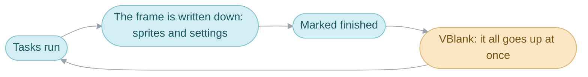

# System code

This folder is the base the rest of the game runs on: start-up, the main
routine, the frame, tasks, the heap and the save.
[System](../../system.md) gives the four big ideas. This page goes one step
closer, so you know what each file is for before you open it.

## Start-up

Switching on and the reset with A, B, Select and Start are the same thing:
both run the cartridge's first instruction. Start-up clears memory, copies
the hottest routines into fast RAM, switches on the interrupts, and calls
the main routine, which never returns. It is `System_Initialize` in
`system/start_up.c`.

## The main routine

`MainRoutine_Run` in `main_routine.c` goes round three steps for as long
as the console is on: clear away the last sequence, run the next one, work
out what follows.

### Clearing away the last sequence

Before every sequence the task list is emptied, the whole heap is taken
back, looping sounds are cut off and any line-by-line screen effect is
switched off. This is what makes each sequence start cold, and why only the
main routine's work and the game flags cross from one to the next.

### Running another sequence

A scene ends with an exit, which the main routine turns into a destination
through the scene's exit table. Anything else ends with a result, and
`Scene_ReturnFromSequence` picks the destination from it: back where the
party stood, to the restart point after a defeat, or wherever an event
named beforehand.

## The frame loop

The frame loop is the inside of `wait()`, in `system/frame.c`. One trip
round it is one frame.

The rule that shapes everything here: during a frame the game never touches
the screen. It only writes down, in ordinary memory, what the screen should
become. The console signals when it has finished drawing a picture, the
[VBlank](../../glossary.md#vblank), and in that gap everything written down
goes up at once.

### What VBlank does

The VBlank handler does two kinds of work. If the frame was marked
finished, it copies the frame to the screen. Whether or not it was, it
reads the buttons and prepares the next stretch of sound.

That split is the game's [slowdown](../../glossary.md#slowdown). A frame
that runs long is simply shown one VBlank later, whole. Everything counted
in frames stretches together, nothing is ever shown half moved, and the
music keeps its tempo.

### Buttons and sleep

The frame loop also turns held buttons into repeats for the menus, and puts
the console to sleep when L and R are held for three seconds, or when
nothing is pressed for three minutes and idle sleep is on.

### Waiting from anywhere

Any routine may call `wait()`, however deep in its own calls it is. The
loop runs on a stack of its own: when the caller's stack has grown past
the loop's, the part in use is copied aside first and put back when
`wait()` returns.

## The task runner

A [task](../../glossary.md#task) is a function put on a list once and
called every frame until it is taken off. The list holds 20. Each task has
a rank, and higher ranks run first, which is how one task gets to see
another's finished work in the same frame.

There are two passes. Most tasks run once a frame from the frame loop. A
few run once a VBlank from the handler: the ones that copy something to the
screen. It is all in `system/task.c`.

## The frame's sprites

The console draws sprites in the order of one list, and has no idea of
"in front". So the game rebuilds that list from scratch every frame.
Whatever wants a sprite shown drops it into one of 256 depth slots, and the
list is written from the highest slot down.

Because the slots are emptied every frame, a sprite shows only while
something keeps asking for it. Nothing ever has to take one down. It is
`system/oam.c`.

Screen settings follow the same rule as sprites. A change to a hardware
register is queued, and the VBlank handler carries the queue out with the
frame it belongs to (`system/io_write_queue.c`).

## The heap

The heap hands out memory like a stack of plates: each block goes on top of
the last, and giving one back gives back everything above it. That makes
it nearly free, and it means blocks go back in reverse order. The main
routine empties the lot between sequences.

A block that other code has to find again is kept in a numbered
[heap slot](../../glossary.md#heap-slot). The game calls such a block a
[work](../../glossary.md#work): the menu's work, the battle's work. Asking
for a slot that is already filled just returns it, so the code that sets a
work up and the code that reads it make the same call. It is
`system/heap.c`.

## Memory map

The console has two working memories: 256 KB that is large and slower, and
32 KB that is small and fast. The game keeps most of its state in the first
and what must be quick in the second, each with a heap of its own. Where
everything sits is fixed, and is declared in `ewram.s` and `iwram.s`.

## Saving

A save is never overwritten in place. Each file is two parts, each part
fills one sector of the flash chip, and there are ten spare sectors. The
new copy of a part goes into a spare sector with a higher count, is read
back, and only then is the old copy retired. Every sector carries a label
and a checksum, so a half-written one is recognised and ignored.

The parts hold the game flags, the main routine's work and where the
scene's actors stand. It is `system/save.c`, and the Save command that
uses it is in [Windows](../window/README.md#saving).

## The link cable

Two consoles trade one small checked packet at every VBlank. Anything
bigger, such as a whole party for the Battle Arena, is cut into numbered
pieces and resent from the first one that goes missing. It is
`system/serial.c`.

## How an overlay reaches the rest of the game

An [overlay](../../glossary.md#overlay) is a scene's code, unpacked into
one fixed spot when the party arrives. It and the always-loaded
[main image](../../glossary.md#main-image) find each other through two
tables:

- The [entry table](../../glossary.md#entry-table-and-import-table) at the
  overlay's start: six functions the field calls to ask the scene about
  itself ([Scenes](../scene/README.md#the-entry-table) explains each).
- The import table at its end: one line for each main-image function the
  overlay calls.

Scenes share overlays, 96 for 201 scenes, and one scene can stand for
several places: the Sanctums of five towns are one scene that looks at
which way in the party took.

## Where the rest is

The cartridge itself, and how its contents are found, is
[The Game Pak](../gamepak/README.md).
