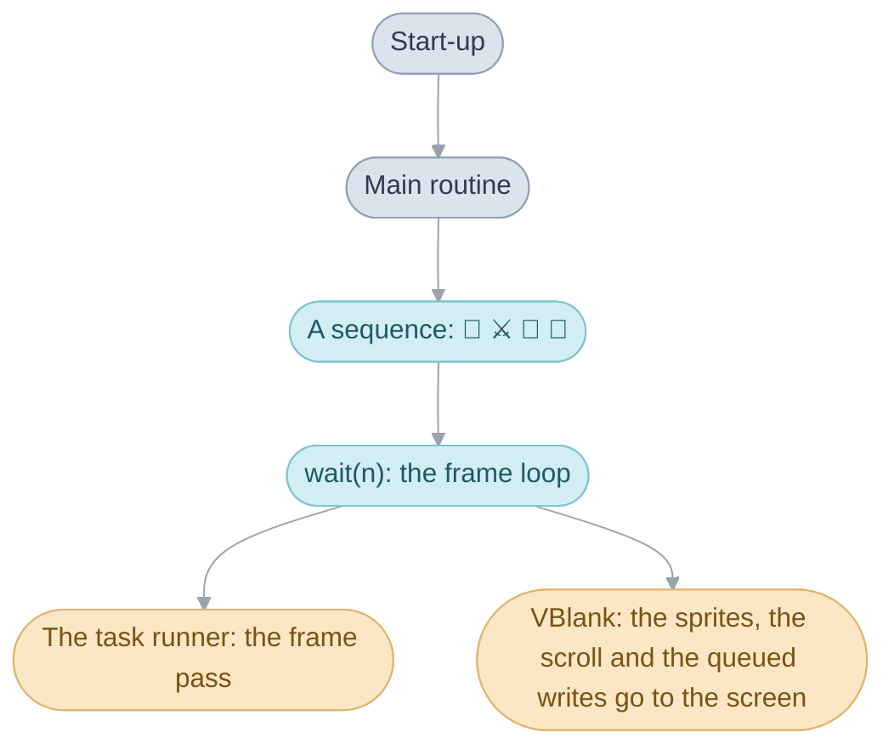
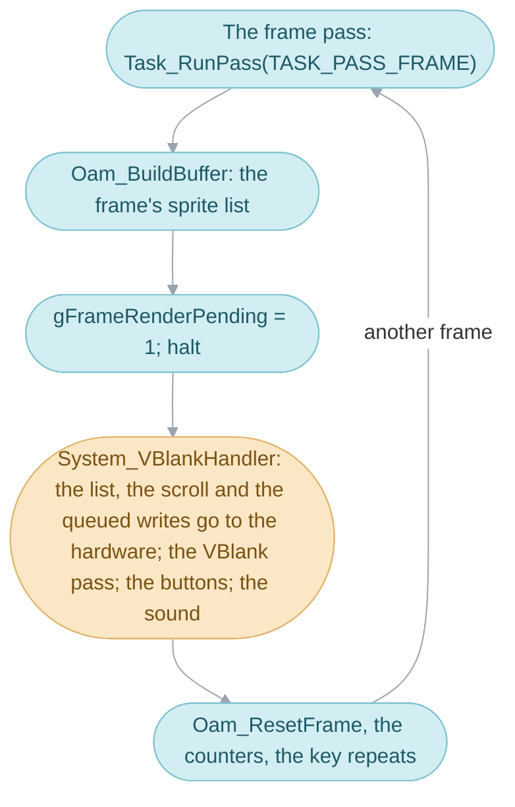
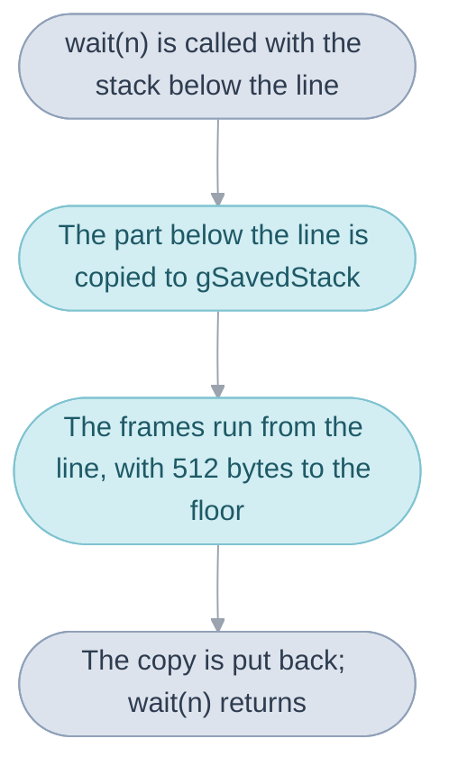
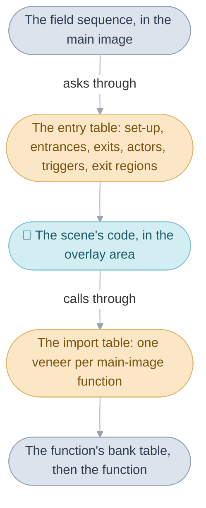
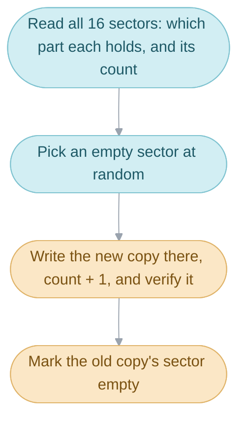
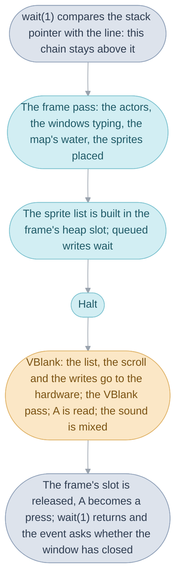

# System code

While Garet's sister's words are typed out, the event that showed them is
standing still at one call and waiting, yet the letters keep coming and the
arrow at the end keeps bobbing. Everything in the game lets time pass the
same way, through one function, [`wait()`](../../glossary.md#wait), which
runs a short list of routines, the [tasks](../../glossary.md#task), once
every [frame](../../glossary.md#frame) while it waits. That function and what
it needs around it are the [System](../../glossary.md#system), the base every
other division stands on. This folder's mechanisms, in the order the console
meets them:

1. [Start-up](#start-up), from the cartridge's first instruction to the
   first scene.
2. [The main routine](#the-main-routine), which runs one
   [sequence](../../glossary.md#sequence) after another and never returns.
3. [The frame loop](#the-frame-loop) inside `wait()`, and its handover to the
   screen at [VBlank](../../glossary.md#vblank).
4. [The stack switch in `wait()`](#the-stack-switch-in-wait), which gives the
   tasks room however deep the waiting code is.
5. [The heap](#the-heap), which lends memory, and
   [the task runner](#the-task-runner), which keeps the tasks in order.
6. [The register write queue](#the-register-write-queue) and
   [the frame's sprites](#the-frames-sprites), through which a frame's changes
   reach the screen together.
7. [The memory map](#memory-map), the fixed places everything above lives in,
   and [how an overlay reaches the rest of the
   game](#how-an-overlay-reaches-the-rest-of-the-game).
8. [Saving](#saving) and [the link cable](#the-link-cable), the two ways
   anything leaves the console.

`system.c` is one object written as parts under `system/`, in cartridge order
([Source](../README.md#objects-and-parts) says how parts are compiled); the
main routine is an object of its own, `main_routine.c`, linked first in bank
04 before the [field sequence](../../glossary.md#field-sequence). The
cartridge itself, its header, the far-call tables of the banks, the resource
directory and the flash chip, is [The Game Pak](../gamepak/README.md). The
page ends by following one frame of the conversation above through the
mechanisms.

## Start-up

Start-up puts memory in order and starts the services everything relies on,
once, then hands over to the main routine for as long as the console is on.

Switching on runs the cartridge's first instruction once the console's own
logo has gone; pressing A, B, Select and Start together, as in the
recording, runs that same instruction again, so a reset runs start-up in
full, and the Camelot logo that follows is drawn by the Title, the main
routine's first scene.

Start-up runs from top to bottom with nothing yet moving, in this order. It
stops any line-by-line DMA left running and sets the speed the console reads
the cartridge at. It clears IWRAM, the fast memory, below the stacks, and
empties the [heap](../../glossary.md#heap-and-pools). It copies 5 KB of
routines from the cartridge into IWRAM, the interrupt dispatcher among them,
points the console's interrupt vector at that dispatcher and installs a table
of handlers, one for each kind of interrupt. An interrupt is the console's
way of running a piece of code at a moment of its own choosing, whatever else
is running; the two start-up enables are the VBlank, after every image, and
the keypad, when the reset buttons are pressed. Then it loads the windows'
graphics, installs the VBlank handler, arms the reset buttons, starts the
sound driver and empties the task table. It waits ten frames and starts the
main routine, which never returns.

The reset buttons work through the keypad interrupt: pressing all four marks
a reset as wanted, and the frame loop carries it out at the end of the frame
by jumping to the cartridge's first instruction. During sleep the same
interrupt only wakes the console.

The cartridge header jumps to `System_Entry`, which sets up the stacks and
calls `System_Initialize`; that installs the resident code and the handlers
through `System_InstallIwramAndIrqs` and ends with `MainRoutine_RunFar`. The
reset is `Input_HandleKeyInterrupt`, and `wait()` carries it out through
`System_SoftReset`. The German, French, Spanish and Italian editions also take
the interrupt raised when the cartridge is removed, whose handler,
`Iwram_Halt`, stops the game.

| Name                | Value                  | Meaning                                              |
| ------------------- | ---------------------- | ---------------------------------------------------- |
| `IwramResident_Rom` | 5 KB                   | the routines copied into IWRAM at power-on           |
| `KEYCNT_SOFT_RESET` | A, B, Select and Start | the buttons that raise the keypad interrupt          |
| `WAITCNT_GAME`      | `0x4014`               | how fast the console reads the cartridge             |
| `wait(10)`          | 10 frames              | the pause before the main routine starts             |

## The main routine

The main routine, `MainRoutine_Run`, runs every scene, battle and game of
dice or slots, one after another, and never returns;
[System](../../system.md#the-main-routine) gives its place in the game.

`System_Initialize` starts it at power-on through `MainRoutine_RunFar`;
`Game_RestartQuest`, which would start it again at the opening, has a
far-call veneer and no caller. Its argument, an `enum GameStart`, chooses
the first scene: the Title, or in debug mode Vale or the File Screen. Before
its loop it applies the window colours from the options, empties the sprite
cache and the task table, and then each pass of its loop does the same
things around one sequence.

### Clearing away the last sequence

A pass opens with `SE_STOP_ACTION_SE`, a sound with no tracks that stops any
loop the last scene left playing on the sound player that carries the
field's and the battle's action sounds (`MUSIC_PLAYER_ACTION_SE`), such as a
rolling log. `FLAG_SKIP_SCENE_CHANGE_SOUND`, which the World Map's lighthouse
transition and two Venus Lighthouse scenes set, skips it once and clears
itself. The pass stops DMA 0, which a scene may have left repeating line by
line, then tears down what the last sequence left: `Task_ResetAll`
empties the task table, `Irq_SetHandler` drops the HBlank and VCount
handlers, `Heap_Initialize` empties the heap, and `DebugText_Clear` and
`VramCache_Reset` clear the debug text and the sprite VRAM cache. What lives
outside the heap survives: the
[main routine's work](../../glossary.md#main-routines-work),
`gMainRoutineWork`, the game flags, and fixed buffers such as
`gActorSnapshot`.

### Running another sequence

The main routine then reads `gMainRoutineWork.next`. An id from
`SEQUENCE_NONE` up runs a sequence other than the field sequence
([System](../../system.md#the-main-routine) lists them): `Battle_RunFar` for
a battle, with the entrance as the [formation](../../glossary.md#formation),
and `MainRoutine_RunDice` and `MainRoutine_RunSlots` for the dice and slots
sequences, which copy BG palettes 14 and 15 (15 holds the window colours)
into a 64-byte heap block before the game and back after it. Each returns a
result, and
`Scene_ReturnFromSequence` chooses the scene that comes back: in the
recording, Goma Cave with the party where the battle found it.

A defeat, result -1, revives the leader at 1 HP; after a defeat in the
prologue (`FLAG_CHILDHOOD`) Isaac and Garet are healed in full as well. The
party then goes to the defeat destination an event set
(`Event_SetDefeatDestination`), or without one to the restart point. Any
other result goes to the after-battle destination an event set
(`Event_SetAfterBattleDestination`), or without one back to the return point
with `FLAG_KEEP_PARTY_POSITION` set, so the party stands where it did. A
destination may name only its scene or only its entrance; the return point
fills in the other.

### Arriving in a scene

Any other id is a [scene](../../glossary.md#scene), and its entry is either
an ordinary entry, one without `FLAG_KEEP_PARTY_POSITION`, or a return, with
it. On an ordinary entry `Scene_Arrive` clears the flags that last for one
scene and, on entering a new [area](../../glossary.md#area), those that last
for one area
([State that cleans itself up](../scene/README.md#state-that-cleans-itself-up)
gives their ranges); a new area also shows its name, resets the counters of
random battles and hazardous ground and makes this entrance the place Retreat
leads back to. Every ordinary entry also clears the Djinn's hiding flags,
`FLAG_DJINN_HIDING_FIRST` and the 79 after it, one for each Djinni id, which
keep a Djinni that got away out of its room until the room is entered again,
and the 16 flags after them, which nothing else uses. On a return the flags
stay as they were.

`Scene_ChooseMusic` takes the first rule of `gScene_MusicRules` that matches
the scene or its area, the entrance and a flag, or `SOUND_KEEP_BGM` when none
does. On an ordinary entry that music plays unless `FLAG_KEEP_MUSIC_ONCE`
(cleared as it is used) or `FLAG_KEEP_MUSIC_HELD` (left set) keeps the music
playing. On a return, `gMainRoutineWork.returnMusic` plays instead if it holds
any music: it is saved whenever the Pause menu opens, and a random battle and
every ordinary entry set it to -1, so after a random battle the scene's own
music plays.

Last, `Scene_LoadOverlay` unpacks the scene's overlay into `gOverlayArea`
([below](#how-an-overlay-reaches-the-rest-of-the-game)) and
`FieldSequence_Run` runs the scene
([Field code](../field/README.md#the-field-sequence-serves-requests)).

### Taking an exit

`FieldSequence_Run` returns the kind of exit the scene ended on, and
`Scene_TakeExit` turns it into the next
[destination](../../glossary.md#destination). It reads the overlay's exit
table: a header word naming a scene, then that scene's exits, one packed word
each holding the exit's kind, the scene it leads to and the entrance there,
with a flag word after it where the exit holds only until a flag is set. The
first exit of the ended kind, or marked for any kind, whose flag is clear
wins; the recording shows one path leading to two scenes as the eruption's
flag changes. With no exit of that kind, the destination is the scene of the
scene's first exit, at entrance 0. `EXIT_KEEP_DESTINATION` means the
destination is already written: by an event, Retreat, a random battle or a
party that fell.

| Name                    | Value   | Meaning                                                   |
| ----------------------- | ------- | --------------------------------------------------------- |
| `SEQUENCE_NONE`         | 507     | the first id above the scene table; runs nothing          |
| `SEQUENCE_SLOTS`        | 508     | Lucky Wheels                                              |
| `SEQUENCE_DICE`         | 509     | Lucky Dice                                                |
| `SEQUENCE_BATTLE`       | 510     | a battle; the entrance is the formation                   |
| `EXIT_KEEP_DESTINATION` |         | the destination is already in the main routine's work     |
| `MINIGAME_PALETTE_BYTES` | 64 bytes | BG palettes 14 and 15, saved around Lucky Dice or Lucky Wheels |

## The frame loop

The frame loop inside `wait()` runs the game one frame at a time and hands
each finished frame to the screen at the next VBlank.

The screen is redrawn about 60 times a second, and after each image the
console pauses in the vertical blank, the VBlank, before it starts the next.
Changing the image while it is drawn would show half the change, so code
writes new positions, scroll and colours to memory during the frame, and the
VBlank interrupt's code copies them to the hardware together.

Each frame, `wait()` runs the frame pass's tasks
(`Task_RunPass(TASK_PASS_FRAME)`), with `gTasksRunning` set while they run,
then gathers every [sprite](../../glossary.md#sprite-and-oam) the code asked
to show into the list the hardware reads (`Oam_BuildBuffer`,
[below](#the-frames-sprites)), in a 1 KB heap slot that lives for one frame.
It marks the frame finished, `gFrameRenderPending`, and halts the processor
until the VBlank handler, `System_VBlankHandler`, has run once. After the
halt it releases the frame's heap slot, starts the next frame's sprites
(`Oam_ResetFrame`), counts the frame (`gFrameCount`, `gPlayTimeFrames`) and
turns the buttons read at VBlank into repeats ([below](#buttons-and-sleep)).

### What VBlank does

At VBlank the interrupt's handler, `System_VBlankHandler`, runs whatever the
frame loop is doing. It stops any line-by-line DMA left running, trades the
link cable's payloads if a link is up, advances the music's fades and the
screen fade, and then, only if the frame was marked finished, does what has
to land
on screen: it copies the sprite list to the hardware's OAM, the scroll of the
four [background layers](../../glossary.md#background-layer) from `gBgScroll`,
and carries out the queued register writes
([below](#the-register-write-queue)). The display writes come first, while
the blank lasts, since OAM can be written only in a blank and a palette or
scroll changed while lines are drawn shows half changed. It then runs the
one-shot `gVBlankCallback`, cleared before it is called, runs the VBlank
pass's tasks, reads the buttons, counts the VBlank and sets `gVBlankDone`,
which the halted frame loop is waiting for. Last it mixes the next stretch of
sound (`Mixer_Enter`), which need only finish before the next VBlank.

The screen writes happen only for a finished frame, so a frame that runs
past VBlank changes nothing on screen until the next one: the image keeps
the previous frame's sprites, scroll and settings together, and the frame
lasts two VBlanks or more, which is [slowdown](../../glossary.md#slowdown).
The music is mixed at every VBlank whatever the frame is doing, so it keeps
its tempo. One small delay follows from the order: buttons read at VBlank
reach the game's code at the start of its next frame.

`gFrameVBlanks` counts the VBlanks since the frame loop last halted, so a
frame that overran shows 2 or more, and `gLastFrameVBlanks` keeps the count as
the last frame left it, by which the windows pace their typing
([Windows](../window/README.md#how-fast-the-letters-come)). When the debug
CPU-load display is on, the frame loop also measures the load, as the line
the frame ended on, for that display.

### Screen fades

The screen fade darkens or brightens the whole image over a number of
VBlanks, through the hardware's blend registers: `ScreenFade_ToBlack` and the
three like it set a target brightness and a duration, and `ScreenFade_Update`,
called by the VBlank handler, moves `REG_BLDY` a little each VBlank, in a
straight line from the start level to the target. `ScreenFade_Wait` waits a
frame at a time until the fade has finished. The Title and the battle use
it; the field
fades its scenes in through the palette fade instead
([Field code](../field/README.md#the-palette-fade)).

| Name             | Value | Meaning                                      |
| ---------------- | ----- | -------------------------------------------- |
| `FADE_LEVEL_MAX` | 16    | `REG_BLDY`'s strongest level, all white or all black |
| `FADE_GAME_LAYERS` | all but `BG0` | the layers the game's fades cover    |

### Buttons and sleep

The VBlank handler reads the keypad into `gKeysHeld` and `gKeysPressed`, the
buttons down now and those that went down since the last VBlank, and starts
or counts down the repeat timer: a newly held button restarts the repeat at
once, and letting go of every button restarts the full delay. After its halt
the frame loop turns the held buttons into `gKeysRepeat`, as when the player
holds Down in a menu: the first repeat comes after about a third of a second,
then one every tenth of a second. Where several directions are held, the
repeat keeps only the one pressed last.

Holding L and R alone for three seconds puts the console to sleep, with the
screen off and the battery spared until L and R wake it: the frame loop
counts the frames they have been held, turns the screen white for a second,
switches the sound off and stops the processor, and after waking restores the
screen and waits a few VBlanks before carrying on. The frame loop also counts
frames with no button held and sleeps after three minutes of them when
auto-sleep is on: the settings menu's auto-sleep row switches it at once, a
new game starts with it off, a loaded file brings back what it saved, and in
debug mode the File Screen turns it on when it finds no backup memory. Some
moments forbid sleep altogether (`gSleepDisabled`). In debug mode
(`gDebugMode`), Start and Select held pause the game, and A, B, Select or the
D-pad then advance it one frame at a time.

`wait()` counts the hold and the idle frames against `SLEEP_COMBO_FRAMES` and
`SLEEP_IDLE_FRAMES`; `Input_UpdateKeyRepeatAndDirection` repeats keys after
`INPUT_KEY_REPEAT_FIRST` frames, then every `INPUT_KEY_REPEAT_NEXT`.

| Name                     | Value         | Meaning                                              |
| ------------------------ | ------------- | ---------------------------------------------------- |
| `INPUT_KEY_REPEAT_FIRST` | 19 frames     | a held button's first repeat                         |
| `INPUT_KEY_REPEAT_NEXT`  | 6 frames      | each later repeat                                    |
| `SLEEP_COMBO_FRAMES`     | 180 frames    | L and R held alone for three seconds                 |
| `SLEEP_IDLE_FRAMES`      | 10,800 frames | three minutes with no button, with auto-sleep on     |
| `SLEEP_WHITE_VBLANKS`    | 60 VBlanks    | the white screen shown before the processor stops    |
| `SLEEP_WAKE_VBLANKS`     | 10 VBlanks    | waited after waking, with the screen restored        |

## The stack switch in `wait()`

The stack switch gives the frame loop and its tasks room to run however deep
the waiting code is.

The stack is the scratch memory every function call takes a little of, and
it is small: 1,792 bytes at the top of IWRAM, which the interrupts share.
Code can ask to wait from deep inside its own calls, when most of the stack
is already in use, and the tasks that run while it waits need stack of their
own. So before running any frames, `wait()` looks at where the waiting code's
stack has reached. When it has grown below a fixed line 512 bytes above the
stack's floor, `Ram_FrameWaitStackTop`, `wait()` copies the part below the
line aside into ordinary memory, `gSavedStack`, and starts afresh from the
line; when the wait is over it puts the copy back. A caller whose stack is
still above the line keeps it.

The frame loop and the tasks therefore have at least 512 bytes, however deep
the waiting code, and so does what VBlank does when the VBlank arrives during
the halt. The price is one rule: a task returns within its frame, because a
second wait would overwrite the copy the first one saved. The rule is kept by
the code alone, and every task keeps it (see [Evidence](#evidence)).

| Name                    | Value        | Meaning                                                 |
| ----------------------- | ------------ | ------------------------------------------------------- |
| `Ram_FrameWaitStackTop` | `0x03007a00` | the line the frames run from                            |
| `Ram_IwramHeapEnd`      | `0x03007800` | the stack's floor, 512 bytes below the line             |
| `gSavedStack`           | 3,152 bytes  | where the part below the line is kept, in EWRAM         |
| `gSavedStackSize`       |              | bytes copied, or 0 when the caller kept its own stack   |

## The heap

The heap lends blocks of memory to the rest of the game: a scene's work, a
menu's buffers, a battle effect's pictures.

It works like a pile: each block goes on top of the last, and giving one back
gives back everything taken after it. That makes taking and giving back a
block cost almost nothing, at the price of one rule: blocks go back in the
reverse of the order they were taken. The main routine empties the whole heap
before
each sequence, so no block outlives the sequence that took it.

There are two piles, one in fast IWRAM and one in the larger EWRAM; a request
tries IWRAM first and falls back on EWRAM, or the other way round for
`Heap_AllocEwram` and `HeapSlot_AllocEwram`. Some blocks have to be found
again by code that took none of them, such as a scene's
[work](../../glossary.md#work), which a task reads every frame. Those are kept
in numbered places, the [heap slots](../../glossary.md#heap-slot), and asking
for a slot that already holds a block simply returns that block, whatever
size is asked for. A block is lent as it is, with whatever the memory held
before.

Giving blocks back out of order fails later: later blocks stay in their
slots, pointing at memory the next request hands out again. For the same
reason, code stops using a block before giving it back, which is why a
battle effect stops the task copying its pictures first.

Code takes a block with `Heap_Alloc` or, for a heap slot, `HeapSlot_Alloc`,
and gives it back with `Heap_Release` or `HeapSlot_Release`, which sets the
pool's next address back to the block's start; the pool is read off the
block's address. The slots live in `gHeapSlots`, whose first two words are
the two pools' next addresses, and `Heap_Initialize` empties all of it.

| Name           | Value   | Meaning                                                   |
| -------------- | ------- | --------------------------------------------------------- |
| `gHeapSlots`   | 64 words | two pool pointers and 62 heap slots, `enum HeapSlot`     |
| `gIwramHeap`   | 22 KB   | the IWRAM pool, from 8 KB to the stack's floor at 30 KB   |
| `gEwramHeap`   | 32 KB   | the EWRAM pool, at 192 KB                                 |
| a block's size |         | rounded up to whole words                                 |

## The task runner

The task runner keeps the list of routines that run every frame or every
VBlank, in priority order, until each is removed.

Some things have to happen every frame whatever else is going on: scrolling the
map, typing the windows' text, placing each actor's sprite where the actor
now stands. Each is a task, added once and run until it is removed or the
main routine empties the table at the next transition. A task's priority says
which of the two passes runs it, the frame's or VBlank's, and where in that
pass, highest first: the high byte is the pass, the low byte the rank. The
battle camera, `BattleCamera_Update`, ranks one below the battle's playback,
so in every frame it runs after it.

Adding a task sorts the table by priority, highest first, and a pass then
runs the table from the top, calling every task whose high byte matches. A
task can be paused and resumed without losing its place in the order: a
paused task's high byte is made odd, which matches neither pass. When a menu
opens over a scene, the tasks whose code is in the scene's overlay pause,
except the few a scene marks to keep running under a menu, as the Battle
Arena and Colosso do. The table holds 20 tasks. The game adds a task only
outside a pass, so a pass sees the table in one order from its start to its
end.

The original game's sort stops one pass early, so the first two tasks in the
table can be left in the wrong order
([`// BUG:`](../../glossary.md#bug-bugfix-and-ubfix)).

`Task_Add` adds a task, or gives one already in the table a new priority, and
sorts with `Task_Sort`; `Task_Remove` removes it; `Task_RunPass` runs
`TASK_PASS_FRAME` or `TASK_PASS_VBLANK`; `Task_SuspendOverlayTasks` and
`Task_ResumeOverlayTasks` pause and resume a scene's tasks, `Task_SetFlags`
marks one to keep running; and `Task_ResetAll` clears the table.

| Name                    | Value    | Meaning                                                  |
| ----------------------- | -------- | -------------------------------------------------------- |
| `TASK_COUNT`            | 20       | tasks the table holds                                    |
| `TASK_PASS_FRAME`       | `0xc80`  | the frame pass; add a rank to run earlier in it          |
| `TASK_PASS_VBLANK`      | `0x480`  | the VBlank pass                                          |
| `TASK_PRIORITY_EMPTY`   | `0xffff` | an empty slot, sorted last                               |
| `TASK_PRIORITY_REMOVED` | `0x7fff` | a removed task; its odd high byte matches no pass        |
| `struct Task`           | 8 bytes  | `func`, `priority` and `flags`, whose bit 0 keeps it running under a menu |

## The register write queue

The register write queue holds the changes to the hardware's registers that
a frame asks for, so that VBlank can carry them out together.

The hardware's registers decide how the screen is drawn: which layers show,
how two blend, where a window cuts the image. Code that changes them while
a frame is being prepared adds its writes to a queue, and VBlank's code
carries them out together with the sprites and the scroll, and only for a
frame that has finished, so a frame's changes reach the screen together
or wait together. A frame left unfinished keeps its writes for the next. Each
entry is a value, an address and a control word saying how wide the write is
and whether the value is stored, ORed in or cleared; an entry whose control
word names no width is a DMA transfer instead, carried out through DMA 3. The
queue takes 32 writes; a write to a full queue is dropped.

`IoWriteQueue_Store16`, `IoWriteQueue_SetBits16` and their byte and word
forms add a write; `IoWriteQueue_FlushPending` empties the queue,
`gIoWriteQueue`, by copying the routine that carries the writes out,
`Resource_ExecuteTransfer`, onto the stack in IWRAM each time and running it
there.

| Name             | Value      | Meaning                                       |
| ---------------- | ---------- | --------------------------------------------- |
| `gIoWriteQueue`  | 32 entries | a value, an address and a control word each   |
| `IO_WRITE_8` to `IO_WRITE_32` |  | the write's width                       |
| `IO_WRITE_SET`, `IO_WRITE_CLEAR` | | set or clear the value's bits instead of storing it |

## The frame's sprites

The frame's sprites are gathered once a frame into the list the hardware
draws from, in depth order.

Everything that draws a sprite puts its entry on the list of one of 256
depth slots, `gOamDepthLists`, with `Oam_AddSpriteAtDepth`; a higher slot is
drawn in front, and slot 0, where the field puts its shadows, behind
everything. Each frame `Oam_BuildBuffer` walks the slots from the highest
down and writes the hardware's list into the frame's scratch heap slot, with
an ARM routine copied into a heap block for the walk and released after it,
and the VBlank handler copies that list into OAM while `gOamCopyEnabled` is
set; Lucky Dice, Lucky Wheels and the credits clear it and write OAM
themselves. `Oam_ResetFrame` empties the slots for the next frame.

A sprite drawn scaled or rotated also needs one of the hardware's 32
rotation-scaling matrices, which `OamMatrix_AllocFromTransform` hands out one
after another each frame. Once all 32 are taken it hands out matrix 0 again
without filling it, so a sprite is drawn with whatever the first matrix
holds.

| Name                       | Value | Meaning                                         |
| -------------------------- | ----- | ----------------------------------------------- |
| `RENDER_DEPTH_SLOT_COUNT`  | 256   | depth slots; the front is slot 255, the back slot 0 |
| `OBJ_AFFINE_MATRIX_COUNT`  | 32    | rotation-scaling matrices a frame               |
| `HEAP_SLOT_FRAME_SCRATCH`  | 1 KB  | the heap slot the list is built in, one frame long |

## Memory map

The memory map is the fixed place each part of the game lives in, the same
on every console.

The console has two kinds of working memory, IWRAM and EWRAM. EWRAM, 256 KB,
is large but slower and holds most of the game's data: its variables, the
current scene's code, the map's grid and pictures being unpacked, and the
larger heap. IWRAM, 32 KB, is fast and holds what must run or be read
quickly: routines copied from the cartridge at power-on, the busiest
variables, a second heap and the stacks. Video memory holds the tiles and tile
maps the screen is drawn from, and the processor runs the
[main image](../../glossary.md#main-image) straight from the cartridge.

Each area has a fixed place, the same in every
[edition](../../glossary.md#editions), except that German reserves 16 bytes
before the IWRAM variables, so all of them sit 16 bytes higher (two of them
are fixed addresses, below):

| EWRAM, from | Size | What |
| --- | --- | --- |
| 0 KB | 32 KB | the game's variables: the main routine's work, the [game flags](../../glossary.md#game-flag), the sound driver's work |
| 32 KB | 32 KB | the current scene's code, `gOverlayArea` |
| 64 KB | 112 KB | the map grid's [cells](../../glossary.md#cell), the battle figures' pictures, unpacking space, the map's [cell pictures](../../glossary.md#cell-picture) and its animated tiles |
| 176 KB | 16 KB | the shapes of the ground |
| 192 KB | 32 KB | the EWRAM heap |
| 224 KB | 32 KB | background tiles being prepared, used only by the world map |

| IWRAM, from | What |
| --- | --- |
| 0 KB | 5 KB of routines copied from the cartridge: the interrupt code, the sound mixing and small helpers the rest of the game calls |
| 5 KB | the busiest variables, among them the heap slots |
| 8 KB | the IWRAM heap |
| 28 KB | the sound driver's own mixer, copied in when sound starts |
| 30 KB | the build stamp and the start of the stacks |
| the last 256 bytes | the stack tops and the address the console jumps to on an interrupt |

The allocators test only against the end of EWRAM and against the IWRAM
heap's end at 30 KB, so each heap can run into the buffer above it, and in
play both do: the EWRAM heap reaches into the world map's tile buffer in
battle, and in battle the IWRAM heap runs over the sound mixer's copy at
28 KB, which stays idle through a battle (the measurements are in the comments
on `gEwramHeap` and `gIwramHeap`, `include/system/heap_release.h`).
`main.ld` declares the areas, `ewram.s`, `iwram.s` and `iwram_high.s` lay out
their variables, and the English link map, `out/tbs-en/tbs-en.map`, has every
address.

### Video memory

The screen is built from 8 by 8 pixel tiles. A background layer is a sheet of
tiles plus a screen map saying which tile goes where; a sprite draws its own
tiles wherever it is put. On a scene, video memory holds the windows' tiles
first, then the windows' screen map and the three map layers' screen maps,
then the map's three sheets of tiles, and in its last 32 KB the sprites'
tiles, which a cache hands out in 512 blocks of 64 bytes. The credits screen
divides the background memory into two halves instead
([Menus](../menu/README.md#two-battle-backgrounds-in-one-background-memory)).

The window tiles are placed by `Window_LoadGraphics`, the map's by
`MapGrid_LoadMap` ([Maps](../map/README.md)), and the sprite tiles by the
cache's `VramCache_Load` and `VramCache_AllocateBlocks`, which finds the first
run of unowned blocks long enough and records the entry that owns each block
in `gVramCacheBlockOwners`.

| Name                      | Value | Meaning                                       |
| ------------------------- | ----- | --------------------------------------------- |
| `VRAM_BLOCK_COUNT`        | 512   | blocks of sprite tile memory                  |
| `VRAM_BLOCK_BYTES`        | 64    | bytes in a block, two 16-colour tiles         |
| `VRAM_CACHE_ENTRY_COUNT`  | 96    | cache entries that can own blocks             |

## How an overlay reaches the rest of the game

An [overlay](../../glossary.md#overlay) is a scene's code, packed on the
cartridge and unpacked into one area of EWRAM when the party arrives.

Walking into the Sanctum unpacks its code into the overlay area over Vale's.
Every overlay is built to run at `gOverlayArea`, so only one is ever loaded
and each carries its own copy of the code several scenes need;
[System](../../system.md#overlays) says why a scene's code is an overlay at
all. There are 96 overlays: several scenes can share one, and the Title and
a few screens that are mostly menus are overlays too.

An overlay meets the rest of the game at two tables:

- At its start, the
  [entry table](../../glossary.md#entry-table-and-import-table): the functions
  the main image calls to ask the scene about itself
  ([Scenes](../scene/README.md#the-entry-table) explains each).
- At its end, the import table: one entry for each function of the main image
  the overlay calls. A direct call reaches only a few megabytes either way,
  and the cartridge lies far beyond that from the overlay area, so each call
  goes through a [veneer](../../glossary.md#veneer) holding the address of the
  function's veneer in its bank's [far-call](../../glossary.md#far-call) table
  ([The Game Pak](../gamepak/README.md#why-the-main-image-is-cut-into-banks)),
  which stays put while the banks' code moves.

Every overlay keeps the same list of possible imports in the same order, and
takes from it only what it uses. As the game unpacks an overlay it also fixes
up the overlay's calls: on the cartridge each call is stored relative to the
start of the overlay, and the processor needs it relative to the call itself.

The entry table is `struct SceneEntryPoints`; the list of imports is
`overlay/imports.inc`, which every overlay's entry and import tables include.
Before each scene the main routine calls `Scene_LoadOverlay`, whose
`Overlay_Load` unpacks the overlay the scene table names with
`Decompress_TaggedLz` and then fixes up its calls with a RAM copy of
`Resource_PatchThumbBranch`, taken from the heap and released again.
`overlay/overlay.ld` links each overlay at `gOverlayArea`,
`overlay/overlays.s` places the 96 packed streams, and the packer is
`tools/ags-overlays`.

| Name                     | Value        | Meaning                                         |
| ------------------------ | ------------ | ----------------------------------------------- |
| `gOverlayArea`           | `0x02008000` | the 32 KB every overlay is unpacked into        |
| `struct SceneEntryPoints` | 48 bytes    | six entries, each an 8-byte veneer              |
| overlays                 | 96           | 93 scenes' and 3 for the debug menus            |

## The addresses that stay put

Some code reaches the sound mixer, the heap's end and a few buffers by a
number written into it, wherever the linker puts the rest.
[The original](../../glossary.md#the-original) holds 23 such fixed addresses,
so the matching build compiles the same numbers, and the memory map keeps
what they point at in place: the cartridge's first instruction, eleven
routines copied into IWRAM, the map and decode buffers that follow the
overlay area, the sound mixer, the end of the IWRAM heap, the stack `wait()`
runs its frames on, and two IWRAM variables whose German address differs.
Each is defined once, with why it stays where it is, and the check build with
a current GCC (`make modern`) reaches each by its name instead.

They are the `FIXED_ADDRESS` lines of `include/system/ram_buffer.h`,
`include/system/iwram_call.h` and `include/gamepak/rom_header.h`. The
routines in IWRAM are called through the inlines of `iwram_call.h`, one for
each: `Iwram_SignedDivide`, `Iwram_Sqrt`, `Iwram_CopyWords` and the rest.

## Saving

Saving writes the new copy of a save before it lets go of the old one, so a
save survives the power going at any moment.

The cartridge's [flash chip](../gamepak/README.md#the-flash-chip) is written
a sector at a time, and each of the three save
[files](../../glossary.md#file-and-part) is two parts, each in a sector of
its own: the first part holds the file's summary for the file list, the game
flags and the main routine's work, the second where the scene's people
stand. A part in its sector opens with a
16-byte header: a signature, `CAMELOT`, the part's number, a checksum of the
part and a counter. Each save goes into an empty sector, its copy stamped
with a count one higher than the old copy's, and only once it is written and
verified is the old copy marked empty. Whenever the power goes, one whole copy
remains, and the game keeps the one with the higher count.

The flash has 16 sectors. A new copy of a part goes into an empty sector
chosen at random, which spreads the wear over the chip, and the last empty
sector is kept back for replacing an existing save, so replacing one always
has room.
Every save, load, copy or delete starts by reading all 16 sectors to find the
newest copy of each part; a sector counts as taken when its signature and
checksum are good, and of two copies of a part only the newer stays taken.
When a part's count passes 65,000 the new copy is written again over the old
sector as count 1, with the high copy kept valid until that write has been
verified.

The sectors are scanned by `Save_InitializeWork`, which takes the save work
in a heap slot, finds the flash chip and reads each sector with
`Save_ReadSector`; `Save_WritePart` writes a part, choosing its sector with
`Save_SelectWriteSector` and programming it with `Save_WriteSector` before
`Save_InvalidateSector` frees the old one; `Save_ReadPart` loads one, and
`Save_ReleaseWork` gives the work back. The Save command itself is
`Save_ToChosenFile` ([Windows](../window/README.md#saving)), and `savedata.c`
holds the signature a sector is recognized by.

| Name                   | Value    | Meaning                                                |
| ---------------------- | -------- | ------------------------------------------------------ |
| `SAVE_SECTOR_COUNT`    | 16       | sectors of 4 KB                                        |
| `SAVE_FILE_COUNT`      | 3        | files; file n is parts n and n + 3                     |
| `SAVE_PART_NONE`       | 16       | the part number of an empty sector                     |
| `SAVE_COUNTER_LIMIT`   | 65,000   | the highest count kept; the next copy restarts at 1    |
| `SAVE_CHECKSUM_BYTES`  | 4,072    | payload bytes summed into the checksum                 |
| `SAVE_FLASH_IDENTIFY_ATTEMPTS` | 8 | tries to find the flash chip, a frame apart          |

## The link cable

The link cable joins two consoles so that a small fixed payload passes each
way every VBlank, and anything larger rides inside it.

Two consoles joined by a cable trade a payload every VBlank, and anything
larger, such as a [party](../../glossary.md#the-party) for a link battle,
rides inside it in numbered blocks that are sent again when one goes missing.
The Battle Arena's link battles and the File Screen's transfer use it.

Each VBlank's payload carries 24 bytes each way, in a packet with its number,
the consoles yet to be heard from and a checksum; one console clocks the
transfers from a hardware timer, a halfword at a time, about 20 a frame.
Larger data travels 20 bytes a VBlank. The receiver keeps a block only when
its number is the one it expects, and otherwise asks for that one again; the
sender then goes back and sends from there. A payload that arrives while the
hardware reports a failed transfer is thrown away.

`Serial_Initialize` sets the port up and installs the serial and timer
handlers; VBlank's code trades the payloads through `Serial_ExchangePayloads`
and advances a block transfer with `Serial_StepBlockTransfer`; larger data
starts with `Serial_StartSend` and `Serial_StartReceive`.

| Name                             | Value         | Meaning                                       |
| -------------------------------- | ------------- | --------------------------------------------- |
| `SERIAL_PAYLOAD_BYTES`           | 24            | one console's payload each VBlank             |
| `SERIAL_BLOCK_BYTES`             | 20            | bulk data carried in each payload             |
| `SERIAL_TIMER_RELOAD`            | `0xc963`      | the clock between halfwords, about 20 a frame |
| `SERIAL_TRANSFER_TIMEOUT_FRAMES` | 600,000       | about three hours before a transfer gives up  |

## One frame of a conversation

The villager's second page is typing out, a few letters a frame, while the
river flows. The event showing it is standing at `Event_ShowMessageAndWait`,
which is standing at `wait(1)`, and one frame of that wait passes through the
mechanisms above one after another.

### Into the wait

The field sequence called the event, the event called the message command,
and that called `wait(1)`: one chain of calls on one stack. `wait()`
compares the stack pointer with the line, `Ram_FrameWaitStackTop`; this
chain is shallow and stays above it, so the frames run on the caller's own
stack.

### The frame pass

`Task_RunPass(TASK_PASS_FRAME)` runs the table from the top. The palette
fade, `PaletteFade_Update`, runs first, and hands its new colours to the
register write queue as two DMAs into the palettes, so they land at VBlank
with the rest. Then `Actor_UpdateAllThumb` moves every actor on, the
villager's actor script included, and the map's scroll follows the camera.
`WindowSystem_Update` types the next letters of the page into the window's
tiles and bobs the arrow, `TilesetAnim_Update` moves the river's water on a
picture, and `ActorSystem_PlaceSprites` links each actor's sprite into its
depth slot with `Oam_AddSpriteAtDepth`.

### The image

`Oam_BuildBuffer` takes `HEAP_SLOT_FRAME_SCRATCH` from the heap and writes
the hardware's sprite list into it from the depth slots, the highest slot
first;
`gFrameRenderPending` is set, and the processor halts. At the VBlank,
`System_VBlankHandler` copies that list into OAM, the layers' scroll from
`gBgScroll` into the scroll registers and the queued writes into their
registers, all while the screen is blank; runs the VBlank pass; reads the
keypad, where A has just gone down, into `gKeysHeld` and `gKeysPressed`; and
mixes the next stretch of the river's music. `gVBlankDone` is set and the
frame loop wakes.

### Out of the wait

The frame loop releases the frame's heap slot, empties the depth slots for
the next frame, counts the frame and turns the keys read at VBlank into
repeats. One frame is done; `wait(1)` puts the stack back and returns, and
`Event_ShowMessageAndWait` asks whether the window has closed
(`Window_IsClosedFar`). It is still open: the press reaches the windows'
task in the next frame's pass, which dismisses the page and starts closing
the window over the frames after it, and the event keeps asking a frame at a
time until the window has closed, then goes on to its next line.

### The same frame, mechanism by mechanism

| Moment                                | Mechanism                                                  |
| ------------------------------------- | ---------------------------------------------------------- |
| The event calls `wait(1)`             | the stack switch's test in `wait()`                        |
| The actors move, the letters type     | the task runner's frame pass, in priority order            |
| A sprite is placed                    | the frame's sprites: a depth slot                          |
| The fade's colours are queued         | the register write queue                                   |
| The list is built, then the halt      | the frame loop, in the frame's heap slot                   |
| The image, the scroll, the writes     | what VBlank does, for a finished frame                     |
| A is read                             | the VBlank handler's keypad read                           |
| The river's music keeps time          | the sound mixed at every VBlank                            |
| `wait(1)` returns                     | the frame loop, then the stack put back                    |
| The page closes                       | the windows' task, in the next frame's pass                |

## Design

A frame's changes reach the hardware together
([System](../../system.md#design) covers the rest): code writes copies in
memory (the sprite lists, the scroll, the write queue) and VBlank's code
commits them only for a finished frame.

The ROM shows the System's bank 00 code as one object, compiled once through
`system.c`; the parts are our cut of it. The main routine is the first code of
bank 04, and nothing it defines is read by the field sequence's object after
it, so it is compiled as an object of its own in this folder, with the System
it belongs to.

Every sequence starts cold, from the main routine's work and the game flags
([The Broken Seal](../../README.md#why-every-sequence-starts-fresh)).

## How it fits with the rest of the game

Every other folder runs on the System: the field, the battles and the menus
let time pass through `wait()`, keep what they do each frame as tasks, take
their memory from the heap and reach the screen through the sprite lists, the
scroll and the write queue. Other banks call the System's bank 00 directly,
and overlays through its far-call table
([The Game Pak](../gamepak/README.md#why-the-main-image-is-cut-into-banks)).
The main routine loads each scene's overlay by the number the scene table
gives, and every overlay in [Scenes](../scene/README.md) and
[Debug scenes](../debug/README.md) is built from the entry and import tables
described here. The sound driver mixes inside the VBlank handler
([Sound](../sound/README.md#how-it-fits-with-the-rest-of-the-game)), and the
save screens in [Windows](../window/README.md#saving) call the sector code
here.

## Limits

- 62 heap slots; the IWRAM heap ends below the stack, the EWRAM heap at the
  end of EWRAM, and each may run into the buffer above it.
- 20 tasks at a time.
- 32 queued register writes.
- 256 depth levels for sprites and 32 rotation-scaling matrices a frame; once
  all 32 are taken, a sprite is drawn with whatever the first matrix holds.
- At least 512 bytes of stack for the frame loop and its tasks.
- An overlay has the 32 KB of the overlay area.
- 16 flash sectors for the three save files.
- 24 bytes each way a VBlank over the link cable.

## Words used here

- **resident code**: code copied into IWRAM at power-on or when sound starts.
- **the frame pass** and **the VBlank pass**: the two runs of the task
  table, once a frame by `wait()` and once a VBlank by the VBlank handler.
- **the line**: `Ram_FrameWaitStackTop`, the stack address `wait()` runs its
  frames from.

Frame, VBlank, IWRAM, EWRAM, heap slot, task, sprite and OAM, file and part
are in the [glossary](../../glossary.md).

## Evidence

The folder is named for the credits' Programming "System" (`gCredits_Lines`).
The names inside it come from what the code does; none is recovered from
Camelot. `IwramIrqMain` and the other resident routines are named from their
code, and the fixed addresses come from the literals in the ROM's code.
`types.h` describes a `FIXED_ADDRESS` as checked against the link; the
Makefile and the tool tests of `make test` hold no comparison of a literal
with its symbol's linked address, and `make modern` reaches each by its name
without comparing. A one-off comparison of
every one of them with the six Broken Seal linker maps found every literal
equal to its symbol in each edition its `#if` selects.

The heaps' high points (how far each heap reached) were measured in the
English edition in libmgba, with the heap's next address read at every frame
and every release: a Goma Cave battle, the field menu, the Item screen, field
[Psynergy](../../glossary.md#psynergy-and-pp), a shop, an inn, a talk, the
world map and its still picture, the credits and sleep mode.

`gSavedStack` holds 3,152 bytes, though a stack below the frame-wait top and
above the heap's end is at most 512. `ewram.s` lays EWRAM out in 4 KB groups
(`gSceneLocalState` opens the second, `gSleepActive` the third, the music state
the fourth), and `gSavedStack` is the last cell of the third, sized to reach
the fourth.

No task waits, and none adds a task. A call graph of the English build's
objects, main image and overlays, from each function the code adds as a task,
each actor update routine and each `SC_CALL` routine, finds ten paths to
`wait()`: nine from tasks, none of which takes it, and one from the debug
scene selector, which only the unused `DebugSceneSelect_Schedule` would add
as a task. Of the nine, the scene tasks face actors in a direction with a
wait of 0 (`Actor_FaceDirection`), the world map's lighthouse jitter moves
the camera with a glide, Lucky Wheels and the link countdown open instant
windows (`WINDOW_FLAG_INSTANT`), and battle playback's sprite respawn tests
`gTasksRunning`. The same graph has no path from any task to `Task_Add`.

Idle sleep's switches: the settings menu's auto-sleep row, the File Screen in
debug mode when it finds no backup memory, and a loaded file's own setting
(`gIdleSleepEnabled`); a new game, the credits and the Battle Arena's lobby
turn it off.
