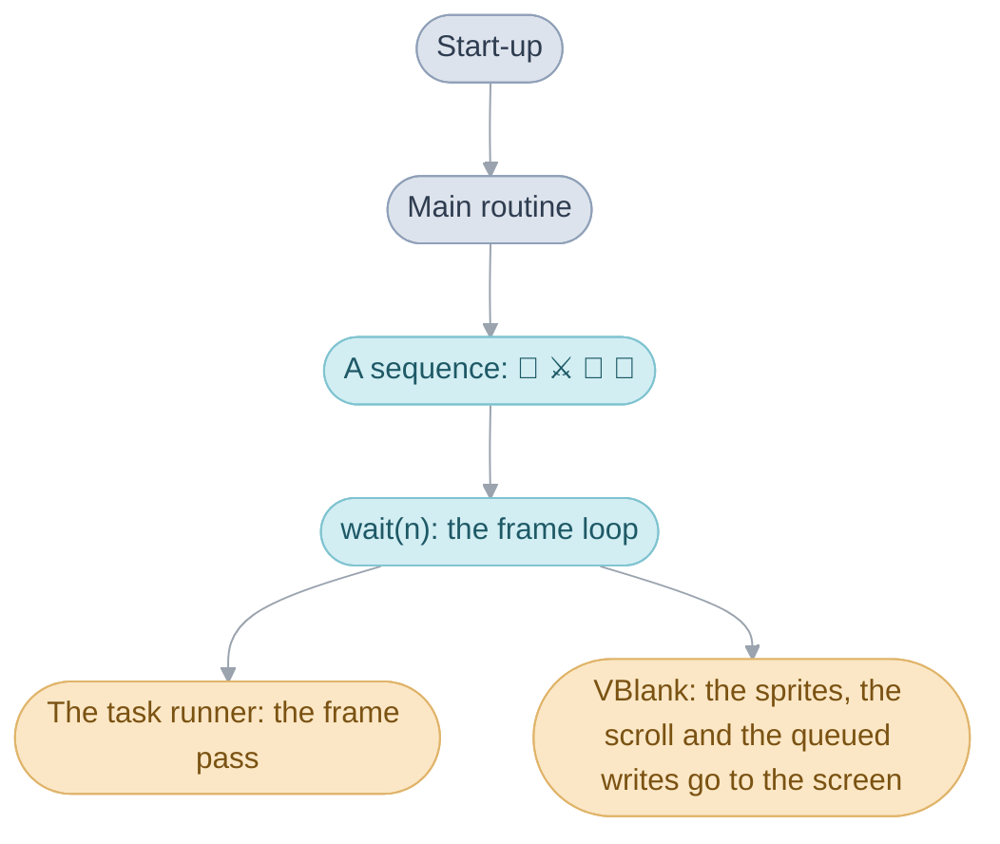
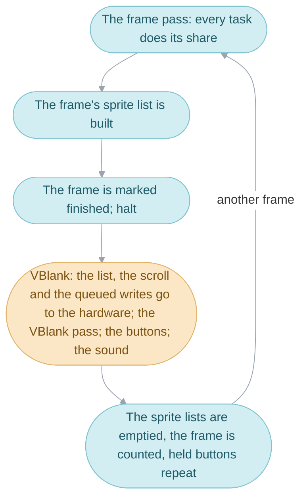
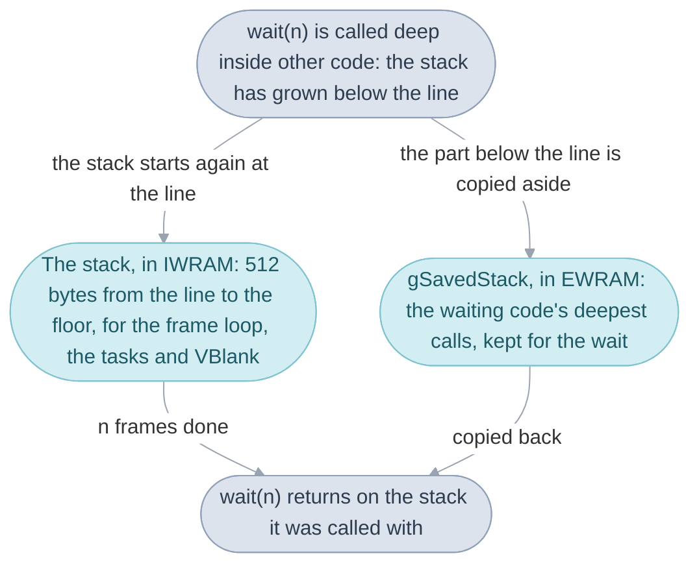
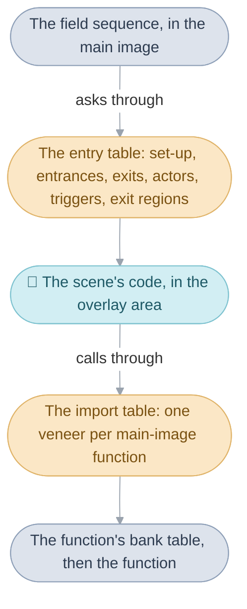

# System code

While Garet's sister's words are typed out, the event that showed them is
standing still at one call, waiting. Yet the letters keep coming and the
arrow at the end keeps bobbing.

Everything in the game lets time pass the same way, through one function,
[`wait()`](../../glossary.md#wait). While it waits, it runs a short list of
routines, the [tasks](../../glossary.md#task), once every
[frame](../../glossary.md#frame).

That function and what it needs around it are the
[System](../../glossary.md#system), the base every other division stands on.
Here are this folder's mechanisms, in the order the console meets them:

1. [Start-up](#start-up), from the cartridge's first instruction to the
   first scene.
2. [The main routine](#the-main-routine), which runs one
   [sequence](../../glossary.md#sequence) after another and never returns.
3. [The frame loop](#the-frame-loop) inside `wait()`, and its handover to the
   screen at [VBlank](../../glossary.md#vblank).
4. [The stack switch in `wait()`](#the-stack-switch-in-wait), which gives the
   tasks room however deep the waiting code is.
5. [The heap](#the-heap), which lends memory, and
   [the task runner](#the-task-runner), which keeps the tasks in order.
6. [The register write queue](#the-register-write-queue) and
   [the frame's sprites](#the-frames-sprites), through which a frame's changes
   reach the screen together.
7. [The memory map](#memory-map), the fixed places everything above lives in,
   and [how an overlay reaches the rest of the
   game](#how-an-overlay-reaches-the-rest-of-the-game).
8. [Saving](#saving) and [the link cable](#the-link-cable), the two ways
   anything leaves the console.

The cartridge itself, with its header, its banks, its directory of packed
things and its flash chip, is [The Game Pak](../gamepak/README.md).

## Start-up

Switching on runs the cartridge's first instruction once the console's own
logo has gone. Pressing A, B, Select and Start together, as in the recording,
runs that same instruction again, so a reset goes through start-up in full.
The Camelot logo that follows is drawn by the Title, the main routine's
first scene.

Start-up puts memory in order and starts the services everything else relies
on. It runs once, from top to bottom, with nothing yet moving:

1. It quiets the hardware. A reset can arrive in the middle of an effect
   that changes the image line by line, and the hardware copy that drives
   such an effect would otherwise keep running.
2. It clears [IWRAM](../../glossary.md#iwram-and-ewram), the console's small
   fast memory, below the stacks, and empties the
   [heap](../../glossary.md#heap-and-pools).
3. It copies 5 KB of routines from the cartridge into IWRAM, where they run
   fastest. These are the resident code: the routine that receives every
   interrupt, the sound mixing and a few small helpers the whole game calls.
4. It sets up the interrupts. Each kind of interrupt has a handler, a
   routine the console runs when that interrupt comes. Start-up switches on
   two: the VBlank, after every image, and the keypad, when the four reset
   buttons are pressed together.
5. It loads the windows' graphics, starts the sound driver and empties the
   task table.
6. It waits ten frames and starts the main routine, which never returns.

The reset buttons work through the keypad interrupt. Pressing all four only
marks a reset as wanted. The frame loop carries it out at the end of its
frame by jumping to the cartridge's first instruction. While the console
sleeps, the same interrupt only wakes it.

The German, French, Spanish and Italian editions also switch on the
interrupt the console raises when the cartridge is pulled out. Start-up is
`System_Initialize`, in `system/start_up.c`.

## The main routine

The main routine runs every scene, battle and game of dice or slots, one
after another, and never returns.
[System](../../system.md#the-main-routine) gives its place in the game.

It is one loop, `MainRoutine_Run` in `main_routine.c`, and every pass of the
loop does the same things around one sequence. It clears away what the last
sequence left, runs the next one, and works out what follows it. In the
recording the loop goes round three times: the cave, the battle, the cave
again.

### Clearing away the last sequence

A sequence can end with things still going: a sound that loops, an effect on
the screen, routines that run every frame, memory it borrowed. The next
sequence must not inherit any of them, so each pass opens by stopping them
all:

- **Looping sounds.** The field's and the battle's action sounds, such as a
  rolling log, can loop. The main routine plays a silent sound in their
  place, which cuts the loop off. The World Map's lighthouse transition and
  two Venus Lighthouse scenes want their sound to carry over, and set
  `FLAG_SKIP_SCENE_CHANGE_SOUND` to skip the silence once.
- **Effects drawn line by line.** The console can interrupt the game after
  each line of the image it draws (the HBlank interrupt) or when the drawing
  reaches a chosen line (the VCount interrupt). A sequence uses these to
  change the image from one line to the next, as the opening of a battle
  does. A handler left behind would go on running under the next sequence,
  so both are switched off.
- **Tasks.** The task table is emptied.
- **Memory.** The heap is emptied, and so is the cache that hands out the
  sprites' tile memory.

What lives outside the heap survives: the
[main routine's work](../../glossary.md#main-routines-work), the game flags,
and a few fixed buffers. They are all that one sequence can pass to the next.

### Running another sequence

The main routine then reads what runs next from its work. A battle, Lucky
Dice or Lucky Wheels
([The Broken Seal](../../README.md#the-main-routine-and-its-sequences) lists
them) runs from start to finish and returns a result.

For a battle, the number that would be a scene's entrance is the
[formation](../../glossary.md#formation) to fight. Around Lucky Dice and
Lucky Wheels the main routine saves the last two background palettes, one of
which holds the window colours, and puts them back afterwards.

The result decides which scene comes back (`Scene_ReturnFromSequence`):

- **Any result but a defeat** goes back to the return point: the
  scene and entrance the party last arrived by, which the field sequence
  writes down as each scene starts. The main routine also sets
  `FLAG_KEEP_PARTY_POSITION`, so the party stands where it stood. That is
  the recording: Goma Cave comes back with the party where the battle found
  it.
- **A defeat** revives the leader at 1 HP and sends the party to the restart
  point, usually the last Sanctum. A defeat in the prologue also heals Isaac
  and Garet in full.
- **A story battle** can name its own destinations beforehand, one for after
  the battle and one for a defeat, and those win over the two rules above. A
  destination may name only its scene or only its entrance, and the return
  point fills in the other. Both are forgotten when the next scene starts.

The result itself stays in the main routine's work, where the scene that
comes back can read it.

### Arriving in a scene

When a [scene](../../glossary.md#scene) comes next, the main routine first
asks how the party arrives. An ordinary entry is a walk through a door or
off the edge of a map. A return, marked by `FLAG_KEEP_PARTY_POSITION`, is a
scene coming back after a battle or a game of dice or slots.

On a return nothing is reset. On an ordinary entry the game forgets what was
meant to last for one visit:

- The flags that last for one scene are cleared, and on entering a new
  [area](../../glossary.md#area), the flags that last for one area
  ([State that cleans itself up](../scene/README.md#state-that-cleans-itself-up)
  gives their ranges).
- A new area also shows its name, starts the count of steps towards a random
  battle and the count on hazardous ground from zero, and makes this
  entrance the place Retreat leads back to.
- The Djinn's hiding flags are cleared, one for each of the 80 Djinni ids. A
  Djinni that got away stays out of its room only until the room is entered
  again.

Then the scene's music is chosen. A table of rules, `gScene_MusicRules`,
gives music by scene or area, by entrance and by flag, and the first rule
that matches wins.

On an ordinary entry that music plays, unless an event asked for the music
already playing to carry on, either for this one change of scene
(`FLAG_KEEP_MUSIC_ONCE`) or until further notice (`FLAG_KEEP_MUSIC_HELD`).

On a return, the music saved when the Pause menu last opened plays instead,
if there is any. A random battle and every ordinary entry throw that saved
music away, so after a random battle the scene's own music starts again.

Last, the scene's overlay is unpacked into memory
([below](#how-an-overlay-reaches-the-rest-of-the-game)) and the field
sequence runs the scene
([Field code](../field/README.md#the-field-sequence-serves-requests)).

### Taking an exit

The field sequence ends by returning the
[exit](../../glossary.md#exit) the party took, and the main routine turns
it into the next [destination](../../glossary.md#destination).

To do so it reads the scene's exit table from the overlay and takes the
first row for that exit whose flag, if it has one, is not set
([The Broken Seal](../../README.md#exits-and-entrances) reads the three rows
behind this recording). A scene with no row for the exit sends the party to
the scene of its first row, at entrance 0.

Vale's door to the Sanctum is the plainest case. The door's event,
`Vale_EnterSanctum`, plays a thump, opens the door, walks Isaac through and
asks for the exit `VALE_TO_SANCTUM`. Vale's exit table holds the row
`SCENE_EXIT(VALE_TO_SANCTUM, Sanctum, SANCTUM_FROM_VALE)`, so the Sanctum's
scene runs next, at its entrance from Vale.

One exit is special. `EXIT_KEEP_DESTINATION` says the destination is already
written, by an event, by Retreat, by a random battle or by a party that
fell, and the main routine leaves it alone.

## The frame loop

The villager walks, stops, turns and speaks, and each of those movements is
a number of frames. The frame loop inside `wait()` runs the game one frame
at a time and hands each finished frame to the screen at the next VBlank.

Why hand it over, instead of drawing as it goes? Because changing the image
while the console draws it would show half the change. So during a frame the
game writes its new sprite positions, scroll and colours into ordinary
memory, and the VBlank interrupt copies them to the hardware together, in
the pause between two images.

Each frame, `wait()` does five things in order:

1. It runs the tasks of the frame pass, the routines that each do one
   frame's share of a job.
2. It gathers every [sprite](../../glossary.md#sprite-and-oam) the code
   asked to show into the list the hardware reads
   ([below](#the-frames-sprites)). The list is built in a 1 KB block of the
   heap that lives for one frame.
3. It marks the frame finished and halts the processor until the VBlank
   handler has run once.
4. After the halt it gives the frame's block back, empties the sprite lists
   for the next frame and counts the frame, once for the game and once for
   the play time a save file keeps.
5. It turns the buttons read at VBlank into repeats
   ([below](#buttons-and-sleep)).

### What VBlank does

The VBlank handler, `System_VBlankHandler` in `system/frame.c`, runs at
every VBlank whatever the frame loop is doing. Its work is of three kinds.

First comes what has to land on screen, done only if the frame was marked
finished. The handler copies the sprite list to OAM, the hardware's own
sprite table, copies the scroll of the four
[background layers](../../glossary.md#background-layer), and carries out the
queued register writes ([below](#the-register-write-queue)).

These are done early, while the blank lasts. The hardware accepts a new
sprite table only during a blank, and a colour or a scroll changed while
lines are being drawn shows half changed.

Next comes what has to happen at every VBlank whether the frame is finished
or not. The handler trades the link cable's payloads if a link is up, moves
the music's fades and the screen fade one step on, runs the tasks of the
VBlank pass and reads the buttons. Then it tells the halted frame loop that
the VBlank has come.

Last comes the sound. The handler ends by mixing the next stretch of it. The
mixing comes last because it is the least urgent, and need only finish
before the next VBlank.

Because the screen writes wait for a finished frame, a frame that runs past
its VBlank changes nothing on screen. The image keeps the previous frame's
sprites, scroll and settings together, and the late frame goes up whole at
the VBlank after. That is [slowdown](../../glossary.md#slowdown). The music
is mixed at every VBlank regardless, so it keeps its tempo.

The handler also counts the VBlanks each frame took, which is 1 for a frame
in time and 2 or more for one that overran. The windows pace their typing
by that count
([Windows](../window/README.md#how-fast-the-letters-come)).

One small delay follows from the order of things. A button read at VBlank
reaches the game's code at the start of its next frame.

### Screen fades

The screen fade darkens or brightens the whole image through the hardware's
brightness setting, which runs from 0, the image as drawn, to 16, all black
or all white.

Code asks for a target and a number of VBlanks, and the VBlank handler moves
the brightness a step each VBlank, in a straight line from where it was to
the target. Because it is stepped at VBlank, a fade takes the same time
whether or not the game is slowing down.

The game's own fades cover the sprites and every background layer but the
first. The Title and the battle fade this way. The field fades its scenes in
by changing the colours themselves
([Field code](../field/README.md#the-palette-fade)).

### Buttons and sleep

The VBlank handler reads the keypad into two sets: the buttons down now,
and the buttons that went down since the last VBlank. From the first set the
frame loop makes a third, the repeats, which is what a menu reads when the
player holds Down to run through a list.

A held button repeats first after about a third of a second and then ten
times a second. Pressing another button starts a repeat at once, and letting
go of everything brings back the full delay. Where several directions are
held, the repeat keeps only the one pressed last.

Holding L and R, and nothing else, for three seconds puts the console to
sleep. The frame loop counts the frames they have been held, turns the
screen white for a second, switches the sound off and stops the processor.

With the screen off and the processor stopped the console spares its battery
until L and R are pressed again. The game then puts the screen back and
waits a moment before carrying on.

The frame loop also counts frames with no button held, and sleeps after
three minutes of them when auto-sleep is on. The settings menu's auto-sleep
row switches it. A new game starts with it off, and a loaded file brings
back what it saved. The credits and the Battle Arena's lobby turn it off,
and the File Screen can forbid sleep of either kind.

In debug mode, holding Start and Select pauses the game, and A, B, Select or
the D-pad then advance it one frame at a time.

| Name                     | Value         | Meaning                                           |
| ------------------------ | ------------- | ------------------------------------------------- |
| `INPUT_KEY_REPEAT_FIRST` | 19 frames     | a held button's first repeat                      |
| `INPUT_KEY_REPEAT_NEXT`  | 6 frames      | each later repeat                                 |
| `SLEEP_COMBO_FRAMES`     | 180 frames    | L and R held alone for three seconds              |
| `SLEEP_IDLE_FRAMES`      | 10,800 frames | three minutes with no button, with auto-sleep on  |
| `SLEEP_WHITE_VBLANKS`    | 60 VBlanks    | the white screen shown before the processor stops |
| `SLEEP_WAKE_VBLANKS`     | 10 VBlanks    | waited after waking, with the screen restored     |

## The stack switch in `wait()`

The stack is the scratch memory every function call takes a little of, and
gives back when it returns. It is small: 1,792 bytes at the top of IWRAM,
which the interrupts share. The deeper a chain of calls, the further down
the stack has grown.

That is a problem for waiting. Code can ask to wait from deep inside such a
chain, when most of the stack is already in use, and the tasks that run
while it waits need stack of their own.

So before running any frames, `wait()` looks at how far down the caller's
stack has reached. If it has grown below a fixed line, 512 bytes above the
stack's floor, `wait()` copies the part below the line aside into a buffer
in the larger memory, `gSavedStack`, and runs its frames from the line.

When the wait is over it puts the copy back, and the caller carries on
without having noticed. A caller whose stack is still above the line simply
keeps it.

The frame loop and the tasks therefore always have at least 512 bytes, and
so does the VBlank handler when it runs during the halt. The buffer the
copy goes to holds 3,152 bytes, far more than the 512 that can lie below
the line.

The price is one rule: a task returns within its frame. There is one buffer,
so a task that waited would start a second wait inside the first, and the
second would overwrite the copy the first one saved.

Nothing checks the rule. The code simply keeps it, and every task does
(see [Evidence](#evidence)).

## The heap

The heap lends blocks of memory to the rest of the game: a scene's work, a
menu's buffers, a battle effect's pictures.

It works like a pile. Each block goes on top of the last, and giving one
back gives back everything taken after it. Taking a block is then only a
matter of moving the top of the pile up, and giving it back of moving it
down again, which costs almost nothing.

The price is one rule: blocks go back in the reverse of the order they were
taken. The main routine empties the whole heap before each sequence, so no
block outlives the sequence that took it.

There are two piles, the pools: one in fast IWRAM and one in the larger
EWRAM. A request tries IWRAM first and falls back on EWRAM. Code that wants
room more than speed, such as the battle and the save, asks the other way
round. A block is lent as it is, holding whatever the memory held before.

Some blocks have to be found again by code that did not take them, such as
a scene's [work](../../glossary.md#work), which a task reads every frame.
Those are kept in numbered places, the
[heap slots](../../glossary.md#heap-slot). Asking for a slot that already
holds a block simply returns that block, whatever size is asked for, so the
code that sets a work up and the code that reads it make the same call.

Giving blocks back out of order goes wrong later, not at once. The blocks
taken after the one given back stay in their slots, pointing at memory the
next request hands out again, and two pieces of code then write over each
other.

For the same reason, code stops using a block before it gives it back. A
battle effect first stops the task that copies its pictures, then returns
the memory they were in.

| Name         | Value    | Meaning                                                 |
| ------------ | -------- | ------------------------------------------------------- |
| `gIwramHeap` | 22 KB    | the IWRAM pool, from 8 KB to the stack's floor at 30 KB |
| `gEwramHeap` | 32 KB    | the EWRAM pool, at 192 KB                               |
| `gHeapSlots` | 62 slots | the numbered places, named by `enum HeapSlot`           |

## The task runner

Some things have to happen every frame whatever else is going on: scrolling
the map, typing the windows' text, placing each actor's sprite where the
actor now stands.

Each is a task, a routine added to a table once and then run every frame
until it is removed, or until the main routine empties the table at the next
transition. The table holds 20.

The table is run twice over, in two passes. The frame pass is the one
`wait()` runs once a frame, and the VBlank pass is the one the VBlank
handler runs once a VBlank. A task's priority says which pass it belongs to
and its rank within that pass, and a pass runs its tasks from the highest
rank down.

The rank is how one task is made to see another's work. The battle's camera
ranks one below the battle's playback, so in every frame the camera is
placed after the playback has moved everything.

Adding a task sorts the table by priority, so a pass only has to walk it
from the top. The game adds tasks only outside a pass, so a pass sees the
table in one order from its start to its end.

A task can be paused and resumed without losing its rank. A paused task is
marked so that neither pass picks it up. When a menu opens over a scene, the
tasks that belong to the scene's own code are paused this way, which is why
the scene stands still behind the menu. A scene can mark a task to keep
running under a menu, as the Battle Arena and Colosso do.

The original game's sort stops one sweep early, so the first two tasks in
the table can be left in the wrong order
([`// BUG:`](../../glossary.md#bug-bugfix-and-ubfix)). The task code is
`system/task.c`.

## The register write queue

The hardware's registers are its settings: which layers show, how two of
them blend, where a window cuts the image.

Like a sprite's position, a setting changed while the image is being drawn
would show half changed. And a setting changed a frame before the sprites it
goes with would show the two out of step.

So code that changes a register during a frame adds the write to a queue
instead. The VBlank handler carries the whole queue out together with the
sprites and the scroll, and only for a finished frame. A frame's changes
reach the screen together or wait together: a frame that overruns keeps its
writes for the next VBlank.

A queued write can replace a register's value, or switch some of its
settings on or off and leave the rest as they are. An entry can also be a
copy of a whole block of memory, which is how a fade's new colours reach
the palettes.

The queue takes 32 writes a frame, and a write to a full queue is dropped.

## The frame's sprites

Which sprite is in front changes from frame to frame, as people walk in
front of and behind each other. So the game builds the hardware's sprite
table anew every frame, in order of depth.

It does so with 256 depth slots. Everything that shows a sprite puts it in
a slot, and a higher slot is drawn in front. Slot 0, where the field puts
its shadows, is behind everything.

Once the frame's tasks have run, the frame loop walks the slots from the
highest down and writes the hardware's table in that order, and the VBlank
handler copies it to the hardware.

The slots are emptied after every frame, so a sprite shows only for as long
as something keeps asking for it. Lucky Dice, Lucky Wheels and the credits
switch the copy off and write the hardware's table themselves.

A sprite drawn scaled or rotated also needs one of the hardware's 32
rotation-scaling settings, which are handed out one after another each
frame. Once all 32 are taken, a further sprite is given the first one again
without changing it, so it is drawn with whatever the first one holds.

## Memory map

The memory map is the fixed place each part of the game lives in, the same
on every console.

The console has two kinds of working memory. EWRAM, 256 KB, is large but
slower and holds most of the game's data: its variables, the current scene's
code, the map's grid and pictures being unpacked, and the larger pool of the
heap. IWRAM, 32 KB, is fast and holds what must run or be read quickly:
routines copied from the cartridge at power-on, the busiest variables, the
heap's other pool and the stacks.

Video memory holds the tiles and tile maps the screen is drawn from, and the
processor runs the [main image](../../glossary.md#main-image) straight from
the cartridge.

Each area has a fixed place, the same in every
[edition](../../glossary.md#editions), with one exception. German reserves
16 bytes before the IWRAM variables, so all of them sit 16 bytes higher.

| EWRAM, from | Size | What |
| --- | --- | --- |
| 0 KB | 32 KB | the game's variables: the main routine's work, the [game flags](../../glossary.md#game-flag), the sound driver's work |
| 32 KB | 32 KB | the current scene's code, `gOverlayArea` |
| 64 KB | 112 KB | the map grid's [cells](../../glossary.md#cell), the battle figures' pictures, unpacking space, the map's [cell pictures](../../glossary.md#cell-picture) and its animated tiles |
| 176 KB | 16 KB | the shapes of the ground |
| 192 KB | 32 KB | the EWRAM heap |
| 224 KB | 32 KB | background tiles being prepared, used only by the world map |

| IWRAM, from | What |
| --- | --- |
| 0 KB | 5 KB of routines copied from the cartridge: the interrupt code, the sound mixing and small helpers the rest of the game calls |
| 5 KB | the busiest variables, among them the heap slots |
| 8 KB | the IWRAM heap |
| 28 KB | the sound driver's own mixer, copied in when sound starts |
| 30 KB | the build stamp and the start of the stacks |
| the last 256 bytes | the stack tops and the address the console jumps to on an interrupt |

A request is refused only when the EWRAM pool would pass the end of EWRAM,
or the IWRAM pool the stack's floor at 30 KB. Each pool can therefore grow
into the buffer that lies in its way, and in play both do.

In a battle the EWRAM pool reaches into the world map's tile buffer, which
only the world map uses. The IWRAM pool runs over the sound driver's copy of
its mixer at 28 KB, which stays idle through a battle.

### Video memory

The screen is built from 8 by 8 pixel tiles. A background layer is a sheet of
tiles plus a screen map saying which tile goes where. A sprite draws its own
tiles wherever it is put.

On a scene, video memory holds the windows' tiles first, then the windows'
screen map and the three map layers' screen maps, then the map's three
sheets of tiles, and in its last 32 KB the sprites' tiles.

The sprites' 32 KB is shared by everything that shows a sprite, so a cache
hands it out, in 512 blocks of 64 bytes, two tiles each. A sprite's pictures
take the first run of free blocks long enough to hold them. The cache
remembers who owns each block, and it can serve 96 owners at once.

The credits screen divides the background memory into two halves instead
([Menus](../menu/README.md#two-battle-backgrounds-in-one-background-memory)).

## How an overlay reaches the rest of the game

Walking into the Sanctum unpacks its code over Vale's.

An [overlay](../../glossary.md#overlay) is a scene's code, packed on the
cartridge and unpacked into one 32 KB area of EWRAM when the party arrives.
[System](../../system.md#overlays) says why a scene's code is an overlay at
all. Every overlay is built to run at that one place, so only one is ever
loaded.

There are 96 overlays for the 201 scenes. Several scenes can share one, as
fourteen scenes on and around Crossbone Isle do, and the Title and a few
screens that are mostly menus are overlays too.

One scene can also hold several places. The Sanctum the party walks into
here is one scene holding six Sanctums, Vale's among them, and it answers
for whichever entrance the party arrives at.

An overlay meets the rest of the game at two tables:

- At its start, the
  [entry table](../../glossary.md#entry-table-and-import-table): the six
  functions the main image calls to ask the scene about itself
  ([Scenes](../scene/README.md#the-entry-table) explains each).
- At its end, the import table: one entry for each function of the main image
  the overlay calls. A direct call reaches only a few megabytes either way,
  and the cartridge lies far beyond that from the overlay area, so each call
  goes through a [veneer](../../glossary.md#veneer) holding the address of the
  function's veneer in its bank's [far-call](../../glossary.md#far-call) table
  ([The Game Pak](../gamepak/README.md#why-the-main-image-is-cut-into-banks)),
  which stays put while the banks' code moves.

Every overlay draws its imports from the same list in the same order, and
takes from it only what it uses.

Unpacking has one more step. A call inside the overlay is stored on the
cartridge as a distance from the start of the overlay, and the processor
needs the distance from the call itself. So after unpacking the code, the
game goes through it and corrects every call (`Overlay_Load`).

## Saving

Saving writes the new copy of a save before it lets go of the old
one, so a save survives the power going at any moment.

The cartridge's [flash chip](../gamepak/README.md#the-flash-chip) is written
a sector at a time, and it has 16 sectors of 4 KB. Each of the three save
[files](../../glossary.md#file-and-part) is two parts, each in a sector of
its own. The first part holds the file's summary for the file list, the
game flags and the main routine's work. The second holds where the scene's
people stand.

Three files of two parts fill six sectors at most, so at least ten stay
empty.

A part in its sector opens with a short header: the word `CAMELOT`, which
marks the sector as holding a save, the part's number, a checksum of the
part and a count. The checksum is a sum over the part's bytes, kept so that
a part damaged or only half written can be told from a good one.

Every save, load, copy or delete starts by reading all 16 sectors to learn
what is where. A sector counts as taken when its `CAMELOT` and its checksum
are good, and of two copies of the same part only the one with the higher
count stays taken.

A save then writes each part into an empty sector, stamped with a count one
higher than the old copy's, and reads it back to check it. Only then is the
old copy's sector marked empty.

If the power goes before the new copy is whole, the old one is still there.
If it goes after, the new one has the higher count. Either way one whole
copy remains.

The empty sector is chosen at random, which spreads the wear over the chip.
The last empty sector is kept back for replacing a part that already has a
copy, so replacing a save always has room.

The count's place in the header holds numbers up to 65,535, so past 65,000
the count starts over. The new copy is written a second time, over the old
copy's sector, as count 1, and the high-numbered copy is kept until that
write has been checked.

The sector code is `system/save.c`. The Save command and the File Screen
that call it are in [Windows](../window/README.md#saving).

## The link cable

Two consoles joined by a cable trade a small fixed payload at every VBlank,
24 bytes each way, and anything larger rides inside it. The Battle Arena's
link battles and the File Screen's transfer use it.

Each payload travels in a packet with its number, a note of which consoles
have yet to be heard from, and a checksum. A payload whose checksum is wrong
is not used, and neither is one that arrives while the hardware reports a
failed transfer.

One of the consoles sets the pace, sending the packet a piece at a time on
the beat of a hardware timer, about 20 pieces a frame.

Larger data, such as a [party](../../glossary.md#the-party) for a link
battle, is cut into numbered blocks of 20 bytes, one to a payload. The
receiver keeps a block only when its number is the one it expects, and
otherwise asks for that one again. The sender then goes back and sends from
there.

Code waiting for a transfer gives up after 600,000 frames, a little under
three hours.

## One frame of a conversation

The villager's second page is typing out, a few letters a frame, while the
river flows. The event showing it is standing at the command that shows a
message and waits, which is standing at `wait(1)`.

Follow one frame of that wait, and it passes through the mechanisms above
one after another.

### Into the wait

The field sequence called the event, the event called the message command,
and that called `wait(1)`. It is one chain of calls on one stack.

`wait()` compares the top of that chain with the line. This chain is shallow
and stays above it, so the frames run on the caller's own stack and nothing
is copied.

### The frame pass

The frame pass runs the task table from the top. The palette fade runs
first and hands its new colours to the register write queue, so they land
at VBlank with the rest.

Then the actors' task moves every actor on, the villager's
[actor script](../../glossary.md#actor-script) included, and the map's
scroll follows the camera.

The windows' task types the next letters of the page into the window's tiles
and bobs the arrow, the map's animation moves the river's water on by one
picture, and the last task puts each actor's sprite into its depth slot.

### The image

The frame loop takes the frame's 1 KB block from the heap and writes the
hardware's sprite table into it from the depth slots, the highest slot
first. It marks the frame finished, and the processor halts.

At the VBlank, the handler copies that table to the hardware, the layers'
scroll into the scroll registers and the queued writes into theirs, all
while the screen is blank. It runs the VBlank pass, reads the keypad, where
A has just gone down, and mixes the next stretch of the river's music. Then
the frame loop wakes.

### Out of the wait

The frame loop gives the frame's block back, empties the depth slots for
the next frame, counts the frame and works out the button repeats. One
frame is done.

`wait(1)` returns, and the message command asks whether the window has
closed. It is still open. The press of A reaches the windows' task in the
next frame's pass, which dismisses the page and starts closing the window
over the frames after it.

The command keeps asking a frame at a time until the window has closed, and
then the event goes on to its next line.

## Design

A frame's changes reach the hardware together
([System](../../system.md#design) covers the rest). During the frame, code
writes only to copies in memory, the sprite lists, the scroll and the write
queue, and the VBlank handler commits them only for a finished frame. So a
slow frame is shown late and never shown half done.

Every sequence starts cold, from the main routine's work and the game flags
([The Broken Seal](../../README.md#why-every-sequence-starts-fresh)).

## How it fits with the rest of the game

Every other folder runs on the System. The field, the battles and the menus
let time pass through `wait()`, keep what they do each frame as tasks, take
their memory from the heap and reach the screen through the sprite lists, the
scroll and the write queue.

Other banks call the System's bank 00 directly, and overlays through its
far-call table
([The Game Pak](../gamepak/README.md#why-the-main-image-is-cut-into-banks)).

The main routine loads each scene's overlay by the number the scene table
gives, and every overlay in [Scenes](../scene/README.md) and
[Debug scenes](../debug/README.md) is built from the entry and import tables
described here.

The sound driver mixes inside the VBlank handler
([Sound](../sound/README.md#how-it-fits-with-the-rest-of-the-game)), and the
save screens in [Windows](../window/README.md#saving) call the sector code
here.

## Limits

- 62 heap slots; the IWRAM heap ends below the stack, the EWRAM heap at the
  end of EWRAM, and each may run into the buffer above it.
- 20 tasks at a time.
- 32 queued register writes.
- 256 depth levels for sprites and 32 rotation-scaling settings a frame;
  once all 32 are taken, a sprite is drawn with whatever the first one holds.
- At least 512 bytes of stack for the frame loop and its tasks.
- An overlay has the 32 KB of the overlay area.
- 16 flash sectors for the three save files.
- 24 bytes each way a VBlank over the link cable.

## Words used here

- **resident code**: code copied into IWRAM at power-on or when sound starts.
- **the frame pass** and **the VBlank pass**: the two runs of the task
  table, once a frame by `wait()` and once a VBlank by the VBlank handler.
- **the line**: the stack address `wait()` runs its frames from,
  `Ram_FrameWaitStackTop`, 512 bytes above the stack's floor.
- **depth slot**: one of the 256 places a sprite is put for a frame; a
  higher slot is drawn in front.

Frame, VBlank, IWRAM, EWRAM, heap slot, task, sprite and OAM, file and part
are in the [glossary](../../glossary.md).

## Evidence

The folder is named for the credits' Programming "System" (`gCredits_Lines`).
The names inside it come from what the code does. None is recovered from
Camelot.

How far each pool of the heap reaches was measured in the English edition
in an emulator, with the top of each pool read at every frame and every
release: a Goma Cave battle, the field menu, the Item screen, field
[Psynergy](../../glossary.md#psynergy-and-pp), a shop, an inn, a talk, the
world map and its still picture, the credits and sleep.

No task waits, and none adds a task. A call graph of the English edition's
code, main image and overlays, from each function the code adds as a task,
each actor update routine and each routine an actor script calls
(`SC_CALL`), finds ten paths to `wait()`. Nine are from tasks, none of which
takes it, and one is from the debug scene selector, which only the unused
`DebugSceneSelect_Schedule` would add as a task.

Of the nine, the scene tasks turn actors to a direction with a wait of 0
frames, the world map's lighthouse jitter moves the camera with a glide,
Lucky Wheels and the link countdown open windows that appear at once, and
the battle playback's sprite respawn first tests whether the tasks are
running. The same graph has no path from any task to the routine that adds
one.
