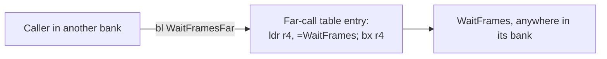
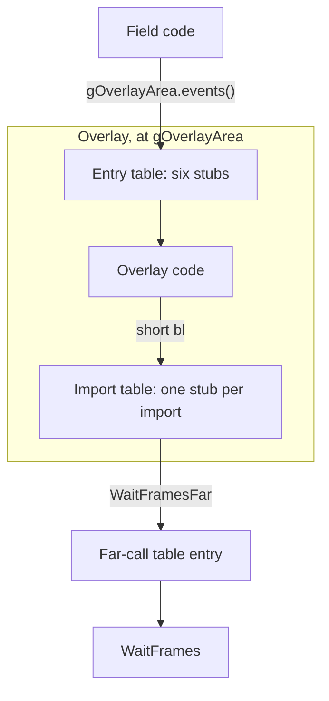

# System

The system folder holds what the rest of the program is laid out on: the
cartridge header and `System_Entry`, the RAM variables in their fixed order,
the resident code copied into IWRAM, the far-call tables that join the banks
of the main image, the overlays that hold each place's code, the resource
directory every picture, table and overlay is found through, and the flash
library that writes saves. Nearly all of it is assembly: code no C compiler
emits, each file saying in its header what proves it, and tables the linker
lays out. [Runtime](../runtime/README.md) builds directly on it, and
[Scenes](../scene/README.md) are the main users of its overlays.

## Memory map

The memory map says where in EWRAM, IWRAM and VRAM each part of the game's
state lives.

`main.ld` declares the areas the game uses: 256 KB of EWRAM, where most
variables live; 32 KB of IWRAM, where code that must run fast is copied; VRAM,
which holds the tiles and maps the screen is drawn from; and the cartridge
ROM. The addresses below are tbs-en's, from its link map
(`out/tbs-en/tbs-en.map`), in hexadecimal as the link map shows them. German
moves three IWRAM variables ([below](#the-addresses-that-never-move)).

**EWRAM**, laid out by `ewram.s`:

| Address | Size | What | Named in |
| --- | --- | --- | --- |
| `0x02000000` | 32 KB | the main image's variables: the save buffer, the game flags (`gGameFlagBytes`), the game state (`gGameState`), the sound driver's work and the flash library's | `ewram.s` |
| `0x02008000` | 32 KB | `gOverlayArea`, the loaded scene or screen overlay | `ewram.s`, `overlay/overlay.ld` |
| `0x02010000` | 32 KB | `gMapCellBuffer`; battle effects also use it for particles | `Ram_MapCellBuffer` |
| `0x02018000` | 16 KB | `gActorSpriteSlots` | `Ram_ActorSpriteSlots` |
| `0x0201c000` | 16 KB | `gDecodeBuffer` | `Ram_DecodeBuffer` |
| `0x02020000` | 32 KB | `gMapBlocks`, the map's blocks (`games/tbs/src/field/field/map_layers.c`) | `Ram_MapBlocks` |
| `0x02028000` | 16 KB | `gMapLayerData` | `ewram.s` |
| `0x0202c000` | 16 KB | `gMapCollision` | `Ram_MapCollision` |
| `0x02030000` | 32 KB | `gEwramHeap`; `heap.c` allocates from it up to `0x02040000`, the end of EWRAM, so past its 32 KB it runs into `gBgTileBuffer` | `ewram.s`, `games/tbs/src/runtime/runtime/heap.c` |
| `0x02038000` | 32 KB, to the end | `gBgTileBuffer` | `Ram_BgTileBuffer` |

**IWRAM**:

| Address | What | Named in |
| --- | --- | --- |
| `0x03000000` | the resident runtime, 5 KB copied from the ROM: the dispatcher `IwramIrqMain`, the handler table `gIrqHandlers`, the resident sound mixing code and the small routines the rest of the game calls | `main.ld` (`.iwram_runtime`), `runtime*.s` |
| `0x03001400` | the main image's IWRAM variables, among them the heap slots `gWorkSlot` (`0x03001e50`) | `iwram.s`, `Ram_WorkSlot` |
| `0x03002000` | `gIwramHeap`, which `heap.c` allocates from below `Ram_IwramHeapEnd` | `iwram.s` |
| `0x03007000` | the sound driver's mixer, `SoundDriver_Mixer`, 932 bytes copied from the ROM by `Audio_Initialize` | `Ram_SoundMixer`, `main.ld` (`.iwram_mixer`), `games/tbs/src/sound/audio.c` |
| `0x03007800` | `Ram_IwramHeapEnd`, the end of the IWRAM heap, where `gCartridgeResetMarker` sits | `iwram_hi.s` |
| `0x03007a00` | `Ram_FrameWaitStackTop`, the stack top `WaitFrames` runs from | `iwram_hi.s` |
| `0x03007f00`, `0x03007fa0` | the system-mode and IRQ-mode stack tops `System_Entry` sets | `entry.s` |
| `0x03007ffc` | `gIrqVector`, where the BIOS jumps on an interrupt | `entry.s`, `iwram_hi.s` |

**VRAM** (`games/tbs/include/system/io_reg.h`):

- Background tiles go in four 16 KB character blocks (`BG_CHAR_BLOCK(n)`) and
  background maps in 2 KB screen blocks (`BG_SCREEN_BLOCK(n)`), sharing the
  same 64 KB. The window system's tilemap is screen block 4
  (`UI_TILEMAP_VRAM`) and its text canvas tiles follow it (`UI_CANVAS_VRAM`,
  [`unit/window/window.h`](../../include/unit/window/window.h)).
- Screens that load two pictures in turn split the background in halves: the
  first 32 KB with background colours 0 to 127, the second with colours 128 to
  255 (`Graphics_LoadCharacterBlockAndPalette`,
  `games/tbs/src/graphics/credits/credits.c`).
- Sprite tiles take the last 32 KB (`OBJ_VRAM0`), which the sprite VRAM cache
  hands out as 512 blocks of 64 bytes
  (`games/tbs/src/runtime/runtime/vram_cache.c`).

## Why the program is cut into banks

The main image is linked in banks, each at a fixed address with a table of
8-byte stubs in front, so code in one bank reaches another only through that
table.

The main image, the part of the program the CPU runs straight from the
cartridge, is linked in banks. `main.ld` puts each bank at an address of its
own, written per edition (the `. = ABSOLUTE(...)` before each `rom_main_NN`
from 01 on, and before the later `rom_tail` places), and leaves the space up
to that address empty.

Each bank opens with its far-call table, one 8-byte stub for each function
another bank calls. A caller in another bank never calls such a function at
its own address but the table's entry, by the function's `...Far` name:
`WaitFramesFar` reaches `WaitFrames`. In `objects.tsv` the table is the first
row of every `rom_main_NN` place from 01 on (a `far_call/*.S` file); the
runtime bank's table, `FarCall_RuntimeTable`, follows the cartridge header,
and the resource bank's opens `rom_tail_01`.

The stub is the `overlay_veneer` macro in `overlay.s`: `ldr r4` of the
target's address from the word after it, then `bx r4`. It may use r4 freely
because every game C file is compiled with `-fcall-used-r4` (the `Makefile`'s
`CFLAGS_tbs`), so no caller expects r4 to survive a call. `bx` switches to ARM
when the target is ARM code, so the IWRAM routines are reached through the
same stubs.

The bank starts differ by edition because each edition's banks hold different
amounts of code. Most of German's starts fall on 256-byte steps, where the
other editions' fall on 2 or 4 KB ones.

| Name | Where | Meaning |
| --- | --- | --- |
| `overlay_veneer` | `overlay.s` | the 8-byte stub: `ldr r4` of the target, `bx r4` |
| `far_call/*.S` | first row of each `rom_main_NN` from 01 on | a bank's far-call table, one stub per export (`stub.inc`) |
| `FarCall_RuntimeTable` | after the cartridge header | the runtime bank's table |
| `...Far` | each table entry | the name another bank calls (`WaitFramesFar`) |

## How an overlay reaches the rest of the game

An overlay is a place's code, unpacked into one fixed 32 KB area of EWRAM, and
it meets the main image only through two tables of stubs.

The code for each place the party walks around in is not in the main image.
It is an overlay: one compressed resource, unpacked into `gOverlayArea` (32 KB
of EWRAM) when its scene loads. There are 96, placed by `overlay/overlays.s`
and listed in the scene table (`field/scenes.s`). Some places share one (the
three `VaultCave` scenes load the same overlay), and the title screen and a
few other screens that are mostly menus are overlays too.

An overlay is linked on its own at the overlay area (`overlay/overlay.ld`),
after the main image and against its symbols (`-R` in the `Makefile`'s overlay
rule). It is three objects:

- The entry table (`scene/entry/<place>.s`) opens it: six 8-byte stubs whose
  words hold the scene's start-up function and the functions that return its
  entrances, exits, placements, events and regions. The field code reads them
  through `struct SceneEntries` (`include/field_runtime.h`), calling
  `gOverlayArea.initialize()`, `gOverlayArea.events()` and so on.
- The overlay's code and data.
- The import table (`scene/import/<place>.s`). EWRAM is out of `bl` range of
  the ROM, so the overlay's code makes a short `bl` to a local stub, and the
  stub's word holds the address of the main-image function's far-call entry,
  never the function itself: `Engine_TaskWait` goes to `WaitFramesFar`, which
  goes to `WaitFrames`.

The rows an overlay may import, and their order, are fixed in `overlay.inc`:
the four IWRAM divide routines first (`IwramSignedDivide` and the rest), which
the stubs reach directly, then the far-call entries in the order of the main
image. Each import table sets `import.NAME` for the stubs its overlay calls
and includes that list, so every overlay keeps its imports in the same
relative order. Several local names can lead to one target (`ArcTan2`,
`Math_Atan2`, `CalculateFacingAngle` and `CalculateAngleFromCoordinateDelta`
all reach `ArcTan2Far`), because different overlays' code calls the same
routine by different names.

Only one overlay is loaded at a time, since all are linked to the same 32 KB,
so an overlay never calls another. Code several scenes need is copied into
each of them (`games/tbs/src/scene/common/`).

`Resource_LoadCode` (`../runtime/runtime/system.c`) unpacks an overlay and
runs `Resource_PatchThumbBranch` over it. In the packed stream each `bl` holds
its target's offset from the start of the overlay, and the patch turns it into
the offset from the instruction itself, which is what the CPU expects. The
packer, `tools/ags-overlays`, does the reverse, so in the stream every call to
the same routine has the same bytes wherever it is made from. XXX: likely done
so the overlays compress better under LZ, because that is what the filter
achieves; nothing in the ROM says so.

The entry table's members, as `struct SceneEntries` lays them out, each
behind its veneer word:

| Member | Offset | What it returns |
| --- | --- | --- |
| `initialize` | `0x04` | runs the scene's start-up |
| `entrances` | `0x0c` | the scene's entrances (`struct SceneEntrance`) |
| `exits` | `0x14` | its exits |
| `placements` | `0x1c` | its placements (`struct ScenePlacement`) |
| `events` | `0x24` | its events (`struct SceneEvent`) |
| `regions` | `0x2c` | its exit regions (`struct SceneRegion`) |

## The resource directory and table order

Every picture, map, table and overlay is found through one directory by its
row number, and the far-call tables are reached by place the same way, so
both keep their order.

Every picture, map, table and overlay the game loads is a row of
`Resource_DirectoryTable` (`resource/directory.s`), which holds where that
resource's data starts. Code asks for a resource by its number
(`Resource_GetTableEntry`), and the number is the row's place: the `resource`
macro defines `ResourceId_NAME` as that place. The far-call tables are lists
of places in the same way. Callers in this tree use names the linker resolves,
so a moved row still builds, but the bytes change, and some code reads a list
by position.

A row added in the middle of a far-call table moves every later entry and the
bank's code by 8 bytes. Callers follow through their `...Far` symbols, but the
bank's code moves towards the next bank's fixed start, and once the gap is gone
the link fails. Code that reads a table by place goes wrong:
`Transform_UpdateVertices` (`games/tbs/src/field/vertices.c`) calls `ArcTan2`,
`Trig_Sin` and `Trig_Cos` as members of `FarCall_RuntimeTable` at byte offsets
64, 88 and 96, which its `STATIC_ASSERT`s check. And every caller of a later
entry, in every bank and overlay, changes its bytes, so no edition compares
OK. A row at the end of a table moves no other entry, though the bank's code
after it still shifts.

In the directory, a row added in the middle renumbers every row after it.
Code that names a resource by its symbol follows, but numbers travel without
symbols in several places: the scene table (`games/tbs/src/field/scenes.s`)
gives each scene its overlay as a resource number, and the first column of
`objects.tsv` numbers each overlay's rows the same way. The layered map table
(`games/tbs/src/field/layered.tsv`) holds numbers counted from
`ResourceId_Map001` (`Map_LoadLayeredScene`), so the rows after that one keep
their order. Code also adds to an id to reach the rows after it: the option
menu's marker steps through eight frames from `ResourceId_ShopCursorFrames`
(`window/window/options.c`), so a run like that stays together. The directory
ends with 25 unused rows (`unused 25`), where a row fits without renumbering
any other.

| Where a number travels without its symbol | Why its rows keep their order |
| --- | --- |
| the scene table, `field/scenes.s` | each scene names its overlay as a resource number |
| `objects.tsv`'s first column | each overlay's rows are numbered by resource |
| `field/layered.tsv` | numbers counted from `ResourceId_Map001` |
| `window/window/options.c` | eight frames counted from `ResourceId_ShopCursorFrames` |
| `field/vertices.c` | `FarCall_RuntimeTable` read at byte offsets 64, 88 and 96 |

## The addresses that never move

Some places in memory are reached as plain numbers, not through the linker,
and the layout keeps every one where the code expects it.

`include/ram_buffer.h`, `include/iwram_call.h` and `include/cartboot.h` list
them, each once, with `FIXED_ADDRESS(type, address, linked)`. The matching
build compiles the number, and `make modern` compiles the linked name instead
(`FIXED_LINKED_` in `include/types.h`). Because the code holds these numbers
itself, the layout has to keep every one:

| What | Where | Why it can't move |
| --- | --- | --- |
| The cartridge restart entry, `Cart_Restart` | `0x08000000`, the start of the ROM | The soft reset in `WaitFrames` jumps there, and `SerialTest_Run`, a link cable test nothing reaches, sends the first 640 bytes from there over the cable. So the header and `System_Entry` stay at the start of the ROM. |
| The resident runtime, `.iwram_runtime` (5 KB, copied by `Runtime_InstallIwramAndIrqs`) | `0x03000000`, the start of IWRAM | C calls its routines at their addresses (`IwramSqrt` and the rest), and the ARM code that runs from RAM reaches them as offsets from `IwramIrqMain` (`IWRAM_ENTRY`, `games/tbs/src/field/update.c`). |
| The overlay area, `gOverlayArea` | `0x02008000`, 32 KB of EWRAM | Every overlay is linked to run there and has to fit. Its first 48 bytes are the entry table, which the field object calls by member. |
| The map and decode buffers: `Ram_MapCellBuffer`, `Ram_ActorSpriteSlots`, `Ram_DecodeBuffer`, `Ram_MapBlocks`, `Ram_MapCollision`, `Ram_BgTileBuffer` | after the overlay area, as the EWRAM table lists | Code reaches across their boundaries by arithmetic: the map's cells fill 64 KB from the start of `Ram_MapCellBuffer`, through the sprite slots and the decode buffer, and the tile animation reads tiles from `Ram_DecodeBuffer` that land in `gMapLayerData` ([Maps](../map/README.md)). So `ewram.s` can't reorder or resize them. |
| The ends of the two heaps | `0x03007800` in IWRAM and `0x02040000`, the end of EWRAM | The allocators test against these numbers (`heap.c`). `gCartridgeResetMarker` sits at the first, and the system stack lives above it. |
| The sound driver's mixer, `SoundDriver_Mixer` (932 bytes) | `0x03007000`, inside the IWRAM heap's range | `Audio_Initialize` copies 1 KB at once (`SOUND_MIXER_CODE_SIZE`), so the 92 bytes after the mixer in the ROM land just after it. `Sound_LoadPresetParameters` copies its 152-byte presets elsewhere, into the resident code at `IwramSoundPresetCode`. |
| The frame wait's stack top, `Ram_FrameWaitStackTop` | `0x03007a00` | The 512 bytes between it and the heap's end are what the frame loop, its tasks and the VBlank work always have ([Runtime](../runtime/README.md)). |
| The stacks and the interrupt vector, `gIrqVector` | the top of IWRAM | `System_Entry` sets the system and IRQ stacks there, and the BIOS jumps through `gIrqVector` on an interrupt. |
| `gBgScroll`, `gVramBlockCache` and `gWorkSlot` (`Ram_WorkSlot`) | among the main image's IWRAM variables | The code reaches them as constants. German moves all three 16 bytes up, so `ram_buffer.h` chooses them per edition. |

## Design

The banks and their tables buy independence. Distance is not the reason: a
Thumb `bl` reaches 4 MB either way, and the main image, a little over 1.5 MB
from the start of the ROM to the last bank's table, is within reach of every
bank. Another bank knows only where a bank starts and the place of each export
in its table, so a bank can grow or shrink inside its gap without moving any
address other code holds. XXX: likely Camelot linked each bank on its own
against the others' tables, because fixed starts and tables are what that
would need; the bytes show only the starts and the tables.

Overlays depend on the main image through the same tables. An import stub
holds a far-call entry's address, which moves only when a table changes, so an
overlay built against one layout of a bank's code still works after that code
moves; the price is two hops per call. In the other direction, the engine
knows an overlay only through the entry table's six fixed members. The engine
and an overlay meet only at those two tables, and both have a known order.

The fixed addresses are the cost of code that holds numbers rather than
symbols. Each is defined once and named where its bytes are, so `make modern`
can build from the names while the matching build keeps the numbers.

## Limits

- An overlay has the 32 KB of the overlay area, and a bank the space up to
  the next bank's fixed start.
- The IWRAM heap ends just below the frame wait's stack and the EWRAM heap at
  the end of EWRAM; `Runtime_AllocateHeapBlock` takes IWRAM first and EWRAM
  when IWRAM is full.
- Nothing keeps either heap out of the buffers above its own space. The
  allocators test only against the heap's end, and so does
  `Runtime_GetRemainingIwram`, which `Battle_RunEncounter` calls around every
  action and then ignores. In battle the IWRAM heap runs into the sound
  driver's mixer: with the heap's next address at `0x0300667c`,
  `Sprite_ComposeAnimationFrame` takes the 4 KB pixel buffer of a 64 by 64
  sprite from `MemAlloc`, 1,660 bytes of it over `SoundDriver_Mixer`, and
  clearing the buffer overwrites the mixer from its first word. Nothing
  copies the mixer back, and nothing needs it: the VBlank handler mixes
  through `SoundDriver_EnterMixer` and the resident code at
  `IwramSoundMixEntry`, and through a whole battle neither
  `AudioEngine_RunMixerTick` nor the code at `0x03007000` runs once. The
  EWRAM heap runs into `gBgTileBuffer` the same way, to `0x02038e60` in the
  field and `0x0203d960` in battle, where only the world map uses that
  buffer; on the world map the heap reaches `0x02038004`, one word into it,
  while the still map picture is open. These marks come from tbs-en played
  in libmgba, the heap's next addresses read at every frame and every free:
  a Goma Cave battle fought with A, and the field menu, the Item screen,
  field Psynergy cast from the menu and directly, a shop, an inn, a talk,
  the world map and its still picture, the credits and sleep mode.
- A far-call table's entries keep their order, because code in other banks
  and overlays calls them by place.
- The resource directory has 25 spare rows at its end.

## Files

| File | What it holds |
| --- | --- |
| `rom_head.s`, `entry.s` | the cartridge header; the entry that sets the CPU modes and stacks, and the sound preset records (`IwramCodeRecords`) |
| `ewram.s`, `iwram.s`, `iwram_hi.s` | the main image's RAM variables, in their order in EWRAM and IWRAM |
| `runtime.s`, `runtime_irq_table.s`, `runtime_mix*.s`, `runtime_mul_q16_ip.s` | the code copied to IWRAM: the interrupt dispatcher and its handler table, the resident sound mixing code, and the multiplies, divides, square root, word fills, transform and decoder the rest of the game calls |
| `iwram_entry.s` | the stubs that call the IWRAM code from the ROM |
| `cpu_set.s`, `sound_get_jump_list.s` | BIOS calls |
| `heapfree.s` | `Runtime_ReleaseHeapBlock` and `MemFree` |
| `updfar.s` | three ARM routines that share one literal pool (`ArcTan2FarArm`, `Iwram_SqrtFarArm`, `Iwram_RatioMulQ14FarArm`) |
| `syspal.s`, `memory/*.png` | the window palette and the basic sprite palettes, built from the PNGs |
| `overlay.s` | the far-call stub macro, `overlay_veneer` |
| `overlay.inc` | the head every stub table includes, and the list of stubs an overlay may import |
| `far_call/*.S` | each bank's far-call table, one stub per export in a fixed order (`stub.inc`) |
| `overlay/` | `overlays.s` places each overlay's packed stream as a directory resource, `overlay.ld` links each at `gOverlayArea`, and the `ovl_*.s` hold the RAM variables of the overlays that have them |
| `resource/directory.s` | the resource directory, each row defining its `ResourceId_` name |
| `resource/*.s`, `resource/metadata_get_record.c`, `resource/colconv*.tsv` | the resource decoders; beside them the OAM build kernel and colour-buffer kernels other code copies into RAM to run, the colour conversion tables, the sprites' shadow and the animation metadata lookup |
| `save/` | the flash library: the drivers for Atmel, Macronix and SST chips (`FLASH_C`, compiled with pret's `old_agbcc`), and the save record signature, `CAMELOT` (`savedata.c`) |

The unit headers are in `games/tbs/include/unit/system/`, the far-call
prototypes in `games/tbs/include/farcall/`. Link order, overlays included, is
in `games/tbs/objects.tsv`; `games/tbs/overlays.tsv` gives each overlay's
`.bss` header. `games/tbs/main.ld` places the main image's sections, and
`games/tbs/include/ram_buffer.h` names the fixed RAM addresses the code uses
as constants. [Matching](../MATCHING.md) explains the markers in the code.

## Words used here

- **bank** and **far call**: the main image is linked in banks (`runtime`,
  `field`, `window`, `game` and the rest). A function another bank calls is
  exported through its bank's far-call table and called by its `...Far` name.
  An entry no code calls by name keeps its place in the table, as a stub with
  no `...Far` name.
- **overlay**: code and data unpacked into the overlay area from one
  compressed resource when a scene or screen needs it: its entry table, its
  code, and its import table.
- **resource**: a row of the directory, loaded by its id
  (`Resource_GetTableEntry`); the id is the `ResourceId_` symbol's value.
- **resident code**: code, mostly ARM, copied from the ROM into IWRAM at
  power-up (`.iwram_runtime`) or when sound starts (`.iwram_mixer`).

## Function prefixes

| Prefix | What it acts on |
| --- | --- |
| `System_` | the cartridge entry |
| `Iwram` | the resident IWRAM code and its entry stubs (`IwramIrqMain`, `Iwram_Halt`, `IwramMulQ16`) |
| `Bios_` | the BIOS calls |
| `Resource_`, `ResourceId_` | the resource decoders and the directory's ids |
| `Flash_`, `EraseFlash`, `ProgramFlash` | the flash library, named as pret names it |
| `Runtime_`, `Sound_`, `ColorBuffer_`, `Render_` | things the engine names elsewhere |

## Evidence and open questions

The names follow what each piece does in the link: the far-call tables are
named for the bank they open, the stubs for their target with `Far` added, and
the overlays by their directory number. `IwramIrqMain` and the other resident
routines are named from their code. The fixed addresses come from the literals
in the ROM's code.

No build step compares a `FIXED_ADDRESS` literal with its symbol's linked
address; `make modern` only builds with the name. A one-off comparison of all
27 `FIXED_ADDRESS` uses with the six ☀️ linker maps found every literal equal
to its symbol in each edition its `#if` selects.

- XXX (no evidence): whether Camelot linked the banks separately; the fixed
  bank starts and the tables are what a separate link needs, but one link
  with fixed starts leaves the same bytes, so only Camelot's build could say.
- XXX (no evidence): whether the 25 unused directory rows were left for later
  resources; they are empty in the ROM and nothing reads them, so they show
  only that they are spare.
- XXX (no evidence): why the directory's first 19 rows point at pieces of the program: the
  start of the ROM (`Rom_Start`, row 0), the directory itself (row 1), the
  build stamp (row 2), and from row 3 every bank's far-call table but the
  runtime's, the sound and resource tables twice each. The build stamp is read
  through its row (`System_CopyBuildStamp`, `game/game/units.c`), but the named far-call rows are
  only passed to stubs that do nothing (`RuntimeDispatch_NoOpHook`,
  `RuntimeDispatch_ReturnZero`), from the title screen, Lucky Dice, the slot
  machine and the sprite viewer. Those calls look like a leftover of loading
  banks as resources (the comment in `menu/title.c` suggests as much), but
  The Lost Age's stubs are empty too, and nothing in either ROM loads a bank
  through its row, so only Camelot's sources could say.
- XXX (picture): the resource directory's rows drawn against the ROM they
  point into, overlays, maps and pictures each in their own colour.
- XXX (picture): the EWRAM and IWRAM maps drawn a byte to a pixel through a
  scene load and a battle, showing each area and the two heaps' reach.
