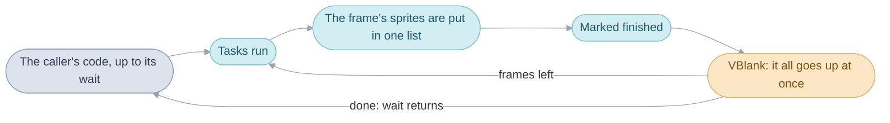

# System library code

This folder is the base the rest of the game runs on: start-up, the main
routine, the frame, tasks, the heap and the save.
[The system library](../../../../docs/tbs/system.md) gives the four big ideas. This page goes one step
closer, so you know what each file is for before you open it.

## Start-up

Switching on and the reset with A, B, Select and Start are the same thing:
both run the cartridge's first instruction. Start-up clears memory, copies
the hottest functions into fast RAM, switches on the interrupts, and calls
the main routine, which never returns. It is `syInit` in
`system_start_up.c`.

## The main routine

`gmMainRoutineRun` in `main_routine.c` goes round three steps for as long
as the console is on: clear away the last sequence, call the next one as a
function, and when it returns work out what follows. One trip is a whole
sequence, not a frame. The loop that goes round once a frame is
[inside `sySynch()`](#the-frame-loop).

### Clearing away the last sequence

Before every sequence the task list is emptied, the whole heap is taken
back, looping sounds are cut off and any line-by-line screen effect is
switched off. This is what makes each sequence start cold. Only what lies
outside the heap crosses from one to the next: the main routine's state, the
game flags and the actor snapshot, each a fixed block of memory
(`MainRoutineStateWork` and `ActorSnapshotWork` are declared in `ewram.s`).

A scene's overlay is loaded here too, just before the field sequence is
called. A battle, Lucky Dice and Lucky Wheels load none.

### Running another sequence

A scene ends with an exit, which the main routine turns into a destination
through the scene's exit table. Anything else ends with a result, and
`scReturnFromSequence` picks the destination from it: back where the
party stood, to the restart point after a defeat, or wherever an event
named beforehand.

## The frame loop

The frame loop is the inside of `sySynch()`, in `system_frame.c`. One trip
round it is one frame.

The rule that shapes everything here: during a frame the game never touches
the screen. It only writes down, in ordinary memory, what the screen should
become. The console signals when it has finished drawing a picture, the
[VBlank](../../../../docs/tbs/glossary.md#vblank), and in that gap everything written down
goes up at once.

One trip, in order:

1. Every task of the frame pass runs, highest rank first.
2. The sprites that were asked for are written into one list
   ([The frame's sprites](#the-frames-sprites)).
3. The frame is marked finished.
4. The loop sleeps until the VBlank handler has run.
5. The sprite slots are emptied, the frame count goes up by one and held
   buttons are turned into repeats.

The caller's own work is part of the frame as well. What it did between its
last `sySynch()` and this one came before step 1, and is shown with what the
tasks do. So a frame's time is the caller's work and the tasks' together.

### What VBlank does

The VBlank handler does two kinds of work. If the frame was marked
finished, it copies the frame to the screen. Whether or not it was, it runs
the tasks of its own pass, reads the buttons and prepares the next stretch
of sound.

That split is the game's [slowdown](../../../../docs/tbs/glossary.md#slowdown). A frame
that runs long is simply shown one VBlank later, whole. Everything counted
in frames stretches together, nothing is ever shown half moved, and the
music keeps its tempo.

### Buttons and sleep

The frame loop also turns held buttons into repeats for the menus, and puts
the console to sleep when L and R are held for three seconds, or when
nothing is pressed for three minutes and idle sleep is on.

### Waiting from anywhere

Any function may call `sySynch()`, however deep in its own calls it is, but
for a [task](../../../../docs/tbs/glossary.md#task) and the VBlank handler: a task is
called from inside `sySynch()` and must return for the frame to end. Code that
a task might reach checks first (`TasksRunning`).

There is one line of execution throughout: `sySynch()` starts no second one.
It does move the stack. The loop always runs from the same fixed place in
memory, so when the caller's stack has grown past that place, the part in
use is copied aside first and put back when `sySynch()` returns.

## The task runner

A [task](../../../../docs/tbs/glossary.md#task) is a function put on a list once and
called every frame until it is taken off. The list holds 20. Each task has
a rank, which the code calls its `pri`, and higher ranks run first.
That is how one task gets to see another's finished work in the same frame.

There are two passes. Most tasks run once a frame from the frame loop. A
few run once a VBlank from the handler: the ones that copy something to the
screen. When a frame runs long, those few run more than once in it. The
rank says which pass as well: `TASK_PASS_FRAME + 10` is rank 10 of the
frame pass, and `TASK_PASS_VBLANK` is rank 0 of the other.
[The field's tasks](../field/README.md#the-fields-tasks) lists the ones a
town keeps on the list.

### A task's life

`sySetEvent` puts a function on the list with a rank, and sorts the list. If
the function is already there it only gets the new rank, so nothing is on
the list twice. `syCloseEvent` takes it off.

A task can also be suspended and resumed: it stays on the list and is
passed over. Opening the field menu suspends every task whose function is
in the overlay, so the scene holds still behind the menu, and a scene can
flag one of its tasks to keep running through that.

The main routine empties the list before every sequence, and the field
sequence empties it again as it sets a scene up. So each sequence adds what
it needs when it starts, and a scene adds its own on top.

An entry of the list is the function, the rank and that one flag. A task
gets no arguments and no memory of its own, so what it has to remember is
in its owner's [state](../../../../docs/tbs/glossary.md#state). No task adds a task, and no
task calls `sySynch()` ([Who may wait](../../../../docs/tbs/system.md#who-may-wait)). It is
all in `system_task.c`.

## The frame's sprites

The console draws sprites in the order of one list, and has no idea of
"in front". So the game rebuilds that list from scratch every frame.
Whatever wants a sprite shown drops it into one of 256 depth slots, and the
list is written from the highest slot down.

Because the slots are emptied every frame, a sprite shows only while
something keeps asking for it, so nothing ever has to take one down. It is
`system_oam.c`.

Screen settings follow the same rule as sprites. A change to a hardware
register is queued, and the VBlank handler carries the queue out with the
frame it belongs to (`system_io_write_queue.c`).

## The heap

The heap hands out memory like a stack of plates: each block goes on top of
the last, and giving one back gives back everything above it. That makes
it nearly free, and it means blocks go back in reverse order. The main
routine empties the lot between sequences.

A block that other code has to find again is kept in a numbered
[heap slot](../../../../docs/tbs/glossary.md#heap-slot). Such a block is its owner's
[state](../../../../docs/tbs/glossary.md#state): the menu's state, the battle's state.
Asking for a slot that is already filled just returns it, so the code that
sets a state up and the code that reads it make the same call. It is
`system_heap.c`.

## Memory map

The console has two working memories: 256 KB that is large and slower, and
32 KB that is small and fast. The game keeps most of its state in the first
and what must be quick in the second, each with a heap of its own. Where
everything sits is fixed, and is declared in `ewram.s` and `iwram.s`.

## Saving

A save is never overwritten in place. Each file is two parts, each part
fills one sector of the flash chip, and there are ten spare sectors. The
new copy of a part goes into a spare sector with a higher count, is read
back, and only then is the old copy retired. Every sector carries a label
and a checksum, so a half-written one is recognised and ignored.

The parts hold the game flags, the main routine's state and where the
scene's actors stand. It is `system_save.c`, and the Save command that
uses it is in [Windows](../window/README.md#saving).

## The link cable

Two consoles trade one small checked packet at every VBlank. Anything
bigger, such as a whole party for the Battle Arena, is cut into numbered
pieces and resent from the first one that goes missing. It is
`system_serial.c`.

## How an overlay reaches the rest of the game

An [overlay](../../../../docs/tbs/glossary.md#overlay) is a scene's code, unpacked into
one fixed spot when the party arrives. It and the always-loaded
[main image](../../../../docs/tbs/glossary.md#main-image) find each other through two
tables:

- The [entry table](../../../../docs/tbs/glossary.md#entry-table-and-import-table) at the
  overlay's start: six functions the field calls to ask the scene about
  itself ([Scenes](../scene/README.md#the-entry-table) explains each).
- The import table after its code: one line for each main-image function
  the overlay calls, which the build writes from one list of them,
  `imports.inc`.

Scenes share overlays, 96 for 201 scenes. An overlay that holds several
scenes still has one entry table. Each of its six functions looks at which
scene the party is in and answers for that one: Crossbone Isle's hands
over one list of actors for the isle, another for the floating logs and
another for the nine floors of the cave
([crossbone_isle.c](../scene/crossbone_isle.c)).

It works the other way too, and one scene can serve several towns: the
Sanctums of five towns are one scene that looks at which way in the party
took.

## Where the system library comes from

Nobody outside Camelot has seen their source. This is what the ROMs show when
you read them beside [SGL's manual](https://www.infochunk.com/saturn/segahtml/sgl/sglr/)
(SGL is Sega's engine for the Saturn) and
[GBATEK](https://problemkaputt.de/gbatek.htm). Each line is something you can
check in the tree.

The system library is one body of code, carried from the Saturn to the Game
Boy Advance by someone who wrote assembly as readily as C. It has three
layers:

1. **Functions written in assembly**, kept in fast RAM: the multiply, the
   divide, the square root, the matrix product, the point transform, the fills
   and the decompressor ([iwram_routines.s](iwram_routines.s)).
2. **A handful of macros** for what is too small to be worth a call
   ([system/asm.h](../../include/system/asm.h)).
3. **C**, which is everything else.

### Its shape is SGL's

Set the system library beside SGL's manual, function by function, and it
sorts into three kinds. The pattern in them is the heart of the matter.

**Where numbers flow, SGL is kept exactly.** Types, argument orders and
matrices are the manual's own, down to its quirks.

| Here | In SGL's manual |
| --- | --- |
| `FIXED`, 16.16; angles of 65,536 to the turn; a matrix of twelve words | `FIXED`, `ANGLE`, `MATRIX` |
| `syRotX`, `Y` and `Z` write the same four cells with the same signs | the matrices printed for `slRotX`, `slRotY`, `slRotZ` |
| The fixed-point divide takes its divisor first and returns b / a | `slDivFX` returns b / a |
| One caller of the arctangent expects a halfword back | `slAtan` returns a 16-bit `ANGLE` |
| The unit matrix is stored at a pointer, or at the current matrix | `slUnitMatrix` takes a pointer, or `CURRENT` |
| The projection is set from an angle, or as a distance | `slPerspective`, `slSetScreenDist` |
| `syDMAXCopy` takes source, destination, count and a fourth word | `slDMAXCopy` |

**The frame is SGL's too.** `wait` runs every registered function and then
waits for the next frame, which on the Saturn is `slExecuteEvent` followed by
`slSynch`. Register writes are queued during the frame as source, destination
and control, and carried out in the blanking interrupt, as `slTransferEntry`
queues its transfers. A function is given to the interrupt, and taken away
again with a null pointer, as with `slIntFunction`.

**Where SGL keeps books, the system library keeps fewer.** The job is the
same each time, cut down for a machine with 32K of fast memory.

| SGL | Here |
| --- | --- |
| a matrix stack twenty deep | one level |
| a list of 64 events, each with 128 bytes of work | a table of 20 tasks, sorted by priority |
| `slLookAt` with a turn about the line of sight | a camera and a target, kept level |
| debug text at any address | debug text at a cursor |

**And some of it is the cartridge's own.** The decompressors, the overlays
and their stub calls, the heap and the save have no counterpart: the Saturn
read a disc and had memory to spare.

The World Map's ground, the battle effects' models and the sound calls have
not been compared with SGL in detail yet.

### Its hardware is taken raw

Each piece of assembly answers something [GBATEK](https://problemkaputt.de/gbatek.htm)
says about the machine. One fact explains most of them: the cartridge is read
16 bits at a time and takes 8 cycles to deliver a 32-bit ARM instruction,
while the 32K of fast RAM delivers one in a single cycle. So code written as
ARM does not run from the cartridge. It is kept in fast RAM, or copied there
or onto the stack just before it runs, and what runs from the cartridge is
Thumb.

| GBATEK says | So the system library |
| --- | --- |
| The fast RAM is 32K | keeps its books small, and copies a function into a heap slot only while it is needed |
| Only ARM code can multiply to a 64-bit product | keeps the 16.16 multiply as an ARM function in fast RAM, which the Thumb code calls |
| The BIOS can divide, take roots and arctangents, and unpack data | never asks it to: it has a function for each, and even the compiler's own division is the system library's |
| Halt stops the processor until an interrupt; Stop ends only on a key, the cartridge or the cable | halts in a loop until its own VBlank flag is set, and arms the keypad before it sleeps |
| The BIOS saves r0 to r3, r12 and `lr`, then jumps to an ARM function | has an ARM interrupt handler in fast RAM that saves r4 itself |
| A DMA channel is three words: source, destination, control | writes all three with one instruction, and feeds a register a new value every line with HBlank transfers |
| The tilted layer's origin can be rewritten on every line | gives the World Map's ground its own terms for each line |
| Sound is two queues of samples; mixing is the program's job | has a mixer in fast RAM, part the development kit's and part its own |

Camelot's own code makes four BIOS calls in all: Halt, Stop, CpuSet and
SoundBias (SWI 02h, 03h, 0Bh and 19h).

### A word on registers

The processor has sixteen registers, r0 to r15: slots that each hold one number
while the code works on it. They are the processor's, the same in every Game
Boy Advance, and what a register holds changes from one function to the next.
What a programmer chooses is the rule for sharing them between a function
and whatever it calls.

The usual rule lets a function destroy r0 to r3 and makes it hand back r4 to
r11 as it found them. The system library moves the line by one: **r0 to r4
are scratch.** Every function written in assembly follows it, the C is compiled
with an option that says the same (`-fcall-used-r4`), and the macros follow it
too. A macro takes its arguments in the registers a call would pass them in,
r0, r1, r2, r3 in order, and destroys nothing a call would keep. So
`syDMAXCopy(source, destination, count, channel)` always has those four in r0,
r1, r2 and r3, in every one of its hundreds of uses.

### Three compilers built it

The C that runs as Thumb code is GCC's snapshot of July 2000, the one Red Hat
shipped as 2.96. The C that runs as ARM code is GCC 2.95.2. Only the sound
driver and the save code, which are the SDK's sound library and the SDK's
flash library, came from the kit's own compiler.

## The calls

No original name of any of the system library's functions is known. Where SGL
has the same call, the function takes SGL's name with `sy` for `sl`, as
`sySynch` does for `slSynch`; 37 of them do. The rest have names of our own
that say what they do. The last column names the SGL function a Saturn
programmer would have reached for to do the same job, where there is one, and
says how this one differs if it does. Where SGL has nothing like it, the
column says none. Most of those are what the Saturn never needed: a
cartridge's memory, the decoders, the overlays, the link cable and the save.

The tables follow the system library's stub table, which is the ROM's own
list of its functions, and add the inlines the rest of the game calls
everywhere.

### Events and the frame

| Call | What it does | SGL |
| --- | --- | --- |
| `wait` | runs a number of frames, the frame pass's tasks in each, and returns | `slSynch`, which waits for one frame; here it is `slExecuteEvent` and `slSynch` in one |
| `syInitEvent` | empties the task table | `slInitEvent`, for 20 tasks where SGL keeps 64 events |
| `sySetEvent` | adds a task at a priority and sorts the table; a task already there only gets the new priority | `slSetEvent`, which takes no priority and returns the event |
| `syCloseEvent` | takes the task off the table | `slCloseEvent`, which is given the event rather than its function |
| `syTaskSuspend` | suspends one task, or every task for a null function | none |
| `syTaskResume` | resumes one task, or every task | none |
| `syExecuteEvent` | runs one pass of the tasks, the frame's or the VBlank's | `slExecuteEvent`, in two passes by priority where SGL runs one list in order |
| `syIntFunction` | installs a function for one interrupt and enables it; a null function disables it | `slIntFunction`, for any interrupt where SGL's is for the blanking one |
| `syInputResetKeyRepeat` | makes held buttons wait the full delay before they repeat | none |
| `syTaskSetFlags` | sets a task's flags, such as running on while the overlay's tasks are suspended | none |

### Maths

| Call | What it does | SGL |
| --- | --- | --- |
| `syRandom` | the next random number, 0 to 65535 | `slRandom`, the same 16 bits; callers mask them where SGL's manual multiplies by a range |
| `syAtan` | the angle of a vector, measured from the y axis | `slAtan`, with a 16-bit result |
| `syMathIntegerSqrt` | an integer square root, worked out a bit at a time from the cartridge | none |
| `sySquartFX` | the square root of a 16.16 number | `slSquartFX`, but only eight bits after the point are worked out |
| `sySin` | the sine of an angle, from a table of a quarter turn | `slSin` |
| `syCos` | the cosine, a quarter turn on from the sine | `slCos` |
| `syVectorAddPolarOffset` | moves a point a distance in a direction on the ground | none |
| `syMulFX` | the product of two 16.16 numbers | `slMulFX` |
| `syDivFX` | the second number over the first, in 16.16 | `slDivFX`, the divisor first as in SGL |
| `sySquart` | the integer square root, from fast RAM | `slSquart` |
| `syIntegerDivide` | a signed whole quotient | none |
| `syIntegerDivideUnsigned` | an unsigned whole quotient | none |

### Matrix

| Call | What it does | SGL |
| --- | --- | --- |
| `syInitMatrix` | sets up the save area and makes the current matrix the unit | `slInitMatrix` |
| `syMatrixResetUnit` | makes the current matrix the unit, as a function | `slUnitMatrix(CURRENT)` |
| `syPushMatrix` | saves the current matrix | `slPushMatrix`, one level deep where SGL nests twenty; a second save is ignored |
| `syPopMatrix` | brings the saved matrix back | `slPopMatrix` |
| `syMatrixRotate` | turns about X, Y and Z by three angles, as one matrix | none |
| `syRotX` | turns the current matrix about X | `slRotX` |
| `syRotY` | turns it about Y | `slRotY` |
| `syRotZ` | turns it about Z | `slRotZ` |
| `syMatrixTranslateVector` | moves it by a point | none; `slTranslate` takes the three as numbers |
| `syMatrixScaleVector` | scales it by a vector | none; `slScale` takes the three as numbers |
| `syMatrixRotateTranslate` | turns and moves it, as one matrix | none |
| `syMatrixRotateTranslateScale` | turns, scales and moves it, as one matrix | none |
| `syMatrixSetLookAt` | makes the current matrix a camera at one point looking at another | none |
| `syConvert3Dto2D` | puts a point through the matrix and onto the screen | `slConvert3Dto2D`, which returns the depth; this returns the scale to draw at, and writes the depth third |
| `syPerspective` | sets the projection from a field of view and a depth range | `slPerspective`, whose angle spans the screen's width; here it spans the height |
| `sySetScreenDist` | sets the projection's focal length and depth range | `slSetScreenDist`, which takes the distance alone |
| `syLookAt` | multiplies a camera looking at a point into the current matrix | `slLookAt`, without the turn about the line of sight; the camera is kept level |
| `syUnitMatrix` | makes a matrix the unit | `slUnitMatrix` |
| `syMatrixSetCurrentUnit` | makes the current matrix the unit | `slUnitMatrix(CURRENT)` |
| `syGetMatrix` | copies the current matrix out | `slGetMatrix` |
| `syLoadMatrix` | copies a matrix in as the current one | `slLoadMatrix` |
| `syMultiMatrix` | multiplies a matrix into the current one | `slMultiMatrix` |
| `syCalcPoint` | puts a point through the current matrix | `slCalcPoint`, given a point where SGL takes three numbers |

### Memory

| Call | What it does | SGL |
| --- | --- | --- |
| `syHeapInit` | empties both heaps and every heap slot | none |
| `syHeapSlotAlloc` | a heap slot's block, made on the first call, in fast RAM if it fits | none |
| `syHeapSlotAllocEwram` | the same, trying the large RAM first | none |
| `syHeapSlotRelease` | gives back a heap slot's block and every block after it | none |
| `syHeapGetRemainingIwram` | the bytes left in fast RAM's heap | none |
| `syHeapGetRemainingEwram` | the bytes left in the large RAM's heap | none |
| `syHeapAlloc` | a block with no slot, in fast RAM if it fits | none |
| `syHeapAllocEwram` | the same, trying the large RAM first | none |
| `syHeapRelease` | gives back a block and every block after it | none |
| `syWordsClear` | clears whole words | none |
| `syWordsFill` | fills whole words with a value | none |
| `syWordsCopy` | copies whole words | none |

### Screen fades

| Call | What it does | SGL |
| --- | --- | --- |
| `syScrFadeToBlack` | fades to black over a number of VBlanks | none |
| `syScrFadeFromBlack` | fades in from black | none |
| `syScrFadeToWhite` | fades to white | none |
| `syScrFadeFromWhite` | fades in from white | none |
| `syScrFadeStart` | starts a fade of chosen layers, from one level to another | none; it does the job of `slColOffsetA`, which shifts every colour at once |
| `syScrFadeWait` | waits a frame at a time until the fade is done | none |

The four short fades take every layer but BG0, where the debug text is, and
start from wherever the last fade ended.

### Register transfers

| Call | What it does | SGL |
| --- | --- | --- |
| `syIoWriteQueueStore8` | queues a byte store for the VBlank | none; the queue does the job of `slTransferEntry` |
| `syIoWriteQueueStore16` | queues a halfword store | none |
| `syIoWriteQueueStore32` | queues a word store | none |
| `syIoWriteQueueSetBits8` | queues setting bits of a byte register | none |
| `syIoWriteQueueSetBits16` | queues setting bits of a halfword register | none |
| `syIoWriteQueueSetBits32` | queues setting bits of a word register | none |
| `syIoWriteQueueClearBits8` | queues clearing bits of a byte register | none |
| `syIoWriteQueueClearBits16` | queues clearing bits of a halfword register | none |
| `syIoWriteQueueClearBits32` | queues clearing bits of a word register | none |
| `scIoWrite8` | stores a byte now | none |
| `scIoWrite16` | stores a halfword now | none |
| `scIoWrite32` | stores a word now | none |
| `scIoRead16` | reads a halfword | none |

### DMA

| Call | What it does | SGL |
| --- | --- | --- |
| `syDMAXCopy` | starts a transfer: source, destination, count and channel, in one store | `slDMAXCopy`, the same four words in the same order; the count carries the transfer's flags |
| `syDMAWait` | waits until a channel is done | `slDMAWait`, given the channel |
| `btDmaFill16` | fills with a halfword | none |
| `btDmaFill32` | fills with a word | none |
| `syDma0Stop` | stops the repeating transfer a line effect left on channel 0 | none |

### Decoders

| Call | What it does | SGL |
| --- | --- | --- |
| `fdDecompressByteLz` | unpacks the byte LZ format and returns the size | none |
| `fdDecompressTaggedLz` | unpacks the tagged LZ format, plain or for palettes | none |
| `fdDecompressMoveToFrontLz` | unpacks the move-to-front LZ format | none |
| `syDecompressHalfwords` | unpacks the halfword LZ format | none |
| `fdDecompressSprPicture` | unpacks a sprite's picture straight into its pixels | none |
| `fdDecompressBitRuns` | draws a glyph's one-bit rows in one colour | none |

### Sprites and VRAM

| Call | What it does | SGL |
| --- | --- | --- |
| `syVramCacheReset` | frees every block and entry of the sprite VRAM cache | none |
| `syVramCacheFreeEntry` | frees one cache entry and its blocks | none |
| `syVramCacheReleaseVram` | gives an entry's blocks back but keeps the entry | none |
| `syVramCacheLoad` | gives an entry sprite VRAM and copies tiles into it | none |
| `syVramCacheFindFreeEntry` | the first free cache entry | none |
| `syVramCacheAllocEntry` | takes a free entry and gives it VRAM | none |
| `syVramCacheReload` | copies tiles into an entry's VRAM again | none |
| `syOamMatrixAllocFromTransform` | hands out the next of 32 sprite matrices and fills it | none |
| `syOamAddSprAtDepth` | puts a sprite in one of 256 depth slots for this frame | none; `slDispSprite` takes a position instead |
| `syPaletteLoadBasicSprCols` | loads the basic sprite palettes | none |

### Print

| Call | What it does | SGL |
| --- | --- | --- |
| `syPrint` | prints a string at the debug text cursor | `slPrint`, at a cursor where SGL takes an address |
| `syPrintHex` | prints the last few hexadecimal digits of a number | `slPrintHex`, at the cursor |
| `syDebugTextPrintDecimal` | prints a number in decimal | none |
| `syDebugTextPrintBlanks` | prints blanks | none |
| `syDebugTextClear` | clears the debug text screen and homes the cursor | none |

`syPrint`, `syPrintHex` and `syDebugTextPrintDecimal` print only while debug text is on;
`syDebugTextPrintBlanks` and `syDebugTextClear` write to the screen either way.

### Link

| Call | What it does | SGL |
| --- | --- | --- |
| `sySerialInit` | sets the link port up and starts the exchange every frame | none |
| `sySerialPollAndTransfer` | looks for the partner and, once there, makes one exchange | none |
| `sySerialWaitForStatMask` | waits for status bits, then returns this console's place in the link | none |
| `sySerialRemoveIrqHandlers` | stops the exchange and takes the link's interrupts away | none |
| `sySerialStartSend` | starts sending a block of memory, 20 bytes at a time | none |
| `sySerialStartReceive` | starts receiving into a block of memory | none |
| `sySerialWaitForSend` | waits until the send is done | none |
| `sySerialWaitForReceive` | waits until the receive is done | none |
| `sySerialWaitForTransfers` | waits for both, giving up after a time | none |
| `sySerialGetActiveTransfers` | says whether a send or a receive is running | none |
| `sySerialStepBlockTransfer` | moves the transfer on one piece each way, every VBlank | none |

### Save

| Call | What it does | SGL |
| --- | --- | --- |
| `sySaveInitState` | finds the flash chip's maker and reads which sectors hold what | none |
| `sySaveWritePart` | writes a new copy of a part, then retires the old one | none |
| `sySaveReadPart` | reads the newest copy of a part | none |
| `sySaveDeletePart` | retires the newest copy of a part | none |
| `sySaveLoadFileSummaries` | reads each file's summary for the file list | none |
| `sySaveReleaseState` | stops the flash timer and gives back the save's memory | none |

### Start-up and resources

| Call | What it does | SGL |
| --- | --- | --- |
| `syCopyBuildStamp` | copies the build stamp into fast RAM | none |
| `syResourceGetTableEntry` | a resource's address, from the resource directory | none |
| `syOverlayLoad` | unpacks an overlay and fixes its long branches | none |
| `syWindowLoadGraphics` | loads the window font and borders, their palette and the basic sprite palettes | none |
| `sySndLoadReverbCode` | loads the mixer code for one reverb | none |
| `syGetLanguage` | the cartridge's language, from the header's game code | `slGetLanguage`, which asks the console |
| `syDummyNoOpHook` | does nothing with the number it is given | `slNoOperation`, which takes none |
| `syDummyReturnZero` | does nothing and returns 0 | none |
| `syDummyReservedNoOpA` to `syDummyReservedNoOpE` | five empty entries nothing calls | none |

### How far the port goes

This is what was measured on this branch. The system library takes its
angles in 32-bit words: give its functions SGL's 16-bit `ANGLE` and 349
functions in this game, and 663 in The Lost Age, no longer build the ROM's
code, because each caller would narrow the angle before the call and the
ROM's callers do not. Only the arctangent's result is 16 bits. `MATRIX` is
twelve words in a row rather than four rows of three. And outside the system
library the game stores to hardware registers directly far more often than
it uses the transfer queue: 521 direct stores against 75 queued.

## Where the rest is

The cartridge itself, and how its contents are found, is
[The Game Pak](../system/README.md).

## The Game Pak

The cartridge holds two chips. An 8 MB ROM has the whole game: the code and
every picture, map, tune and line of text. A small flash chip, 64 KB, can be
written to and keeps the three save files.

This page is about how things on the ROM are found, and how the code on it
is laid out. Both rest on one idea: a thing is found by its position in a
table, so tables only ever grow at the end.

### The ROM header

The first 192 bytes are the same layout on every Game Boy Advance game: a
jump to the game's first instruction, the cartridge logo, a title, a game
code and a checksum. The console checks them before it lets the game run.

Each language is a cartridge of its own, an
[edition](../../../../docs/tbs/glossary.md#editions), and the last letter of its game code
names the language: `AGSJ`, `AGSE`, `AGSD` and so on.

### The resource directory and table order

Every stored thing on the ROM has a number: a map, a sprite sheet, a
battle background, a scene's code. The
[resource directory](../../../../docs/tbs/glossary.md#resource-directory) is one table of
1,000 rows, and row *n* holds the address of resource *n*. Whoever wants a
resource holds its number, reads that row, and goes there. One read, no
searching.

Walking through a door is two lookups. The scene table says which resource
is the new scene's overlay. The directory says where that resource is. The
game unpacks it into memory and runs it.

A number is nothing but a row's position, so the table can never be
reordered. Put a new picture in at row 500 and every later number would
point one row off. Anything new goes at the end, and 25 empty rows are
waiting there.

Roughly, reading down the rows: the windows' pieces and fonts, the title,
the battle backgrounds, the minigames and battle effects, the enemies, the
maps with their tiles and colours, then the 96 overlays.

One of the first rows points at the build stamp, the date and time the
edition was built. A save file records it, which is how the File Screen
recognises a file written by an older build.

### The flash chip

Writing a save is slow because flash is awkward. The chip is 16 sectors of
4 KB, and a sector cannot be changed in place: it is erased whole and
written again from the start, a byte at a time, each byte sent as a short
command and then read back until the chip agrees.

Cartridges were made with chips from four makers that take different
commands and need different patience. So before every save or load the
game asks the chip who made it and picks the matching functions, and every
wait has a time limit so a dead chip cannot hang the game.

How the 16 sectors are used, so that a power cut never costs a save, is in
[Saving](../system/README.md#saving).

### Why the main image is cut into modules

The code that is always loaded, the
[main image](../../../../docs/tbs/glossary.md#main-image), is cut into fourteen
[modules](../../../../docs/tbs/glossary.md#module), one for each large part of the game: the
battle, the sound, the windows, the menus, the shops, even Lucky Dice. Each
module starts at a fixed address.

Code inside a module moves whenever that module is rebuilt. So one module
never calls another's function directly. Each module opens with a table of
[stubs](../../../../docs/tbs/glossary.md#stub), one for each function other modules may
use, and a call from outside goes to a position in that table. That is a
[stub call](../../../../docs/tbs/glossary.md#stub-call).

It is the resource directory's idea again, for code. The table is the one
thing that does not move, callers know a function only by its place in it,
and so a table only ever grows at the end. You can watch Camelot keep the
rule: the European editions needed one more function in a module, and it went
last.

#### A stub

A stub is 8 bytes: "jump to the address that follows", and the address.
An overlay carries a small table of its own stubs, each pointing at a
stub in a module. So a call from a scene into the main image takes two
hops.

The first module is the exception. It holds the system library, and the
other modules call its functions directly. Only the overlays go through its
table.

### Where the files are

- `rom_header.s` is the header, and `resource_directory.s` the 1,000
  rows.
- [`sdk/flash`](../sdk/flash) is the SDK's flash library, the flash chip's
  functions.
- Each module's table is the `stubs.s` of its own engine folder, and the
  system library's own is `stubs.s` here.
