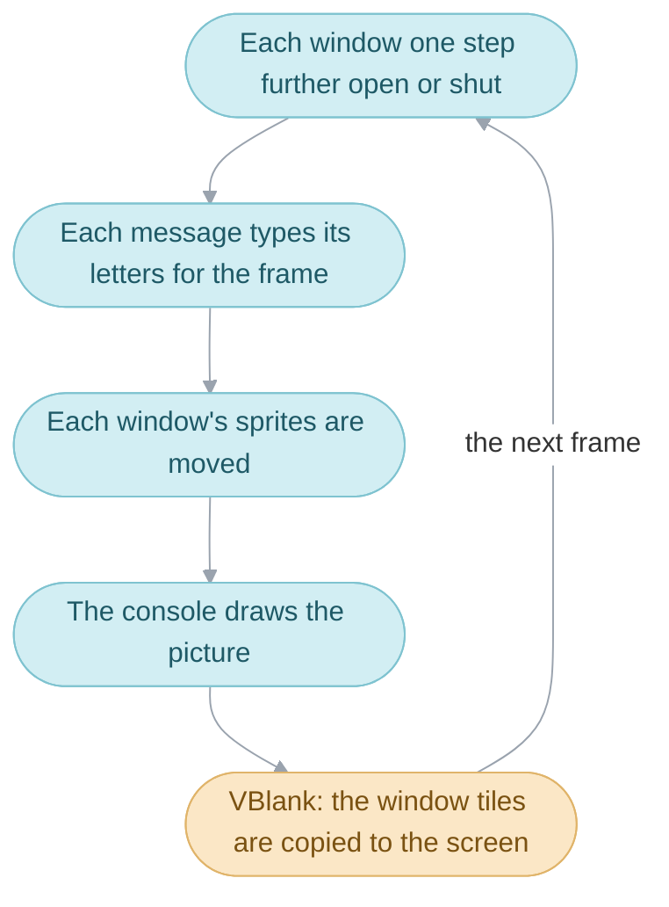
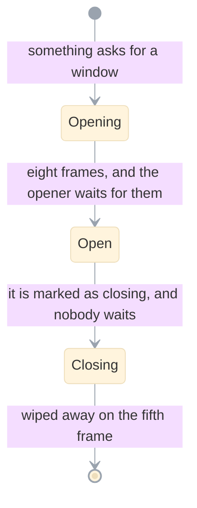
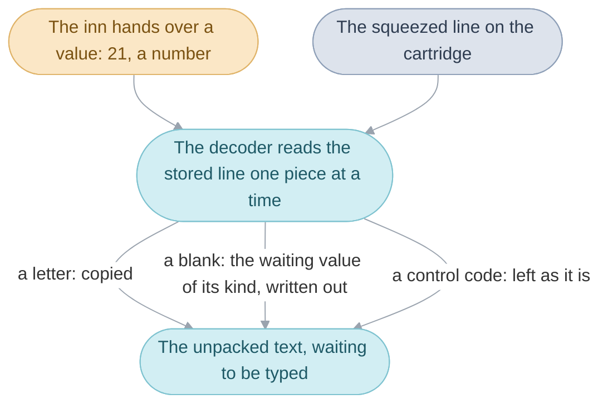
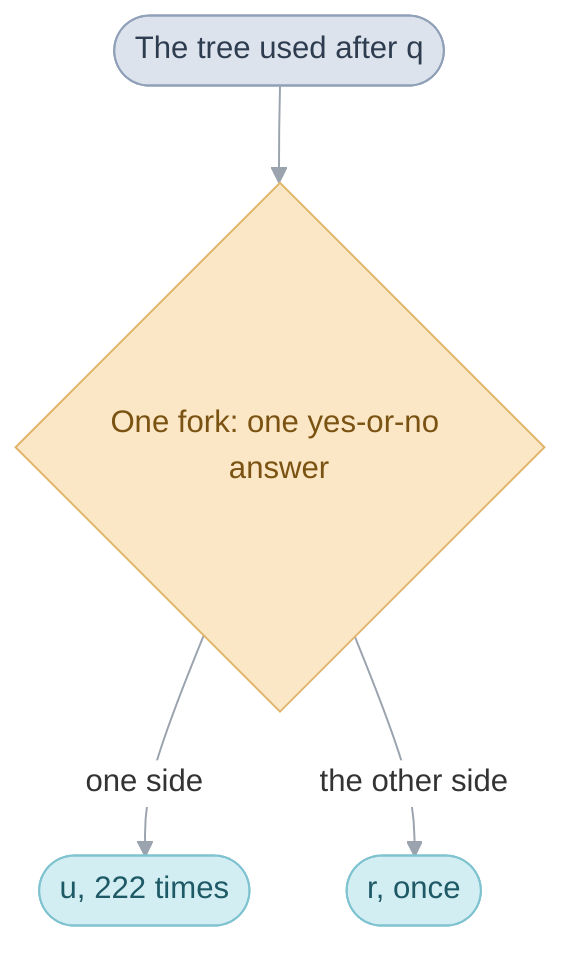
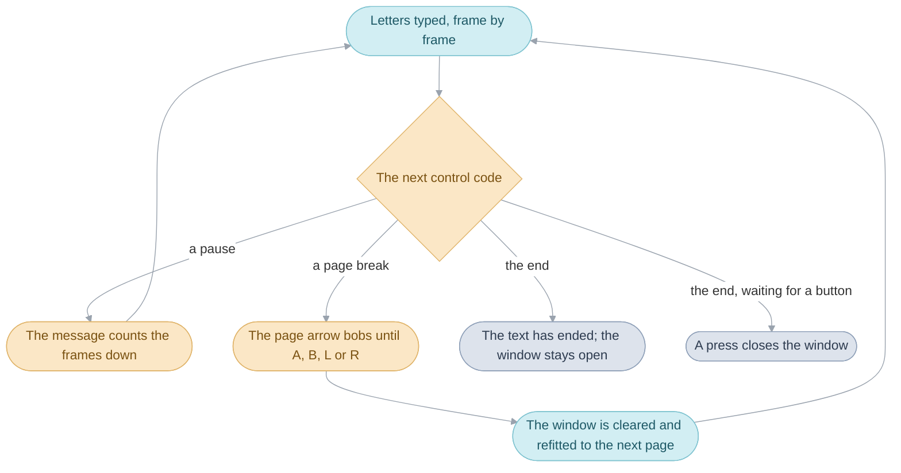
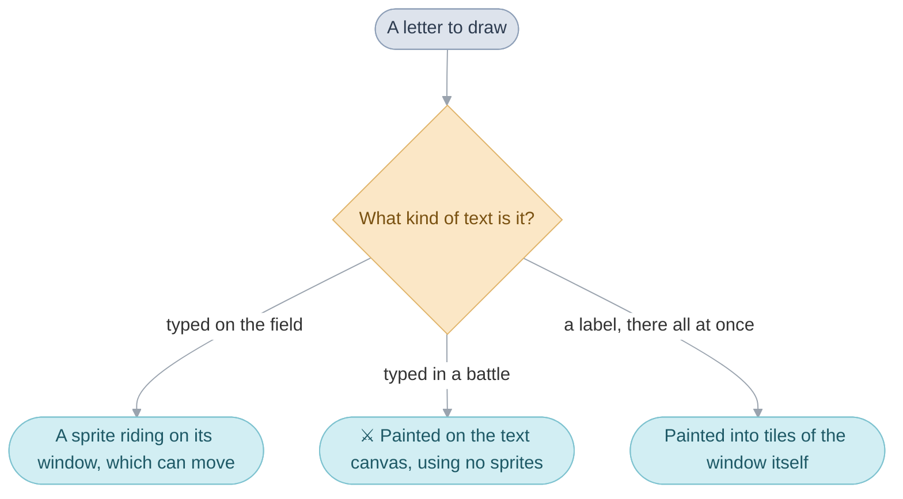

# Windows


Talk to Garet's sister in Vale and a bordered box grows open at the top of
the screen. Her portrait appears beside it. `You guys are so lucky, Garet.`
arrives a letter at a time, with a little voice blip as it goes.

Every box of text in the game is made the same way: what people say, the
field menu in the recording above, the Pause menu, the shop counters and the
battle's commands. The game calls these boxes windows, and this page is about
how they are drawn and how text gets into them.

Her one line goes through five steps:

1. A window just big enough for the first page grows open
   ([Windows](#windows)).
2. Her line is unpacked. The game's text is stored squeezed small, and her
   line is stored without Garet's name in it, so the game unpacks the letters
   and writes the name in ([Decoding a message](#decoding-a-message)).
3. The unpacked letters are typed into the window, letter by letter
   ([Typing](#typing)).
4. Each letter is drawn. On the field every letter is a small picture of its
   own, which is why a letter can shake ([Drawing text](#drawing-text)).
5. The player presses A, the second page follows, and after one more press
   the window shrinks away.

Every spoken line in the game takes this path. The battle's messages and the
list of save files take it too.

After the five steps come the screens built straight from windows: the area's
name on arrival, the Pause menu with saving and the settings, and name entry.
The field menu's four screens are in [Menus](../menu/README.md), the shop
counters are in [Shops](../shop/README.md), and
[Interface](../../interface.md) gives the whole division in brief.

## Windows


Watch the [window](../../glossary.md#window) in the recording, which belongs
to Garet's brother. It starts as a sliver at its own centre and grows outward
to full size. When it closes it shrinks back into its centre. The game's own
word for this growing and shrinking is the zoom.

The zoom is counted in [frames](../../glossary.md#frame). A frame is one
picture on the screen, and the console draws about sixty a second.

Opening takes eight frames. On each one the whole
[border](../../glossary.md#border) is drawn again, a little larger. A window
16 squares wide is drawn 2 squares wide on the first frame, then 4, then 6,
and so on to 14. On the eighth frame it is drawn in full. The height grows in
the same even steps.

Closing is quicker. The window is drawn once more at full size, then at three
quarters, at half and at a quarter, and on the fifth frame it is wiped away.

Shrinking takes one extra step. A smaller border drawn over a larger one would
leave the larger one's edges behind. So a closing window remembers the
rectangle it last drew, and each frame it wipes that rectangle before drawing
the next, smaller one.

A window can also appear and vanish with no zoom at all. The menus' windows
do, which is why the field menu at the top of this page is there all at once.

### What a window is made of

The squares are tiles. The console builds its backgrounds from tiles, small
pictures 8 dots by 8, laid side by side like a mosaic. The dots are the
screen's pixels, and the screen is 30 tiles across and 20 down. A window's border and filling are tiles, in the
colour the player chose in the settings.

The letters, the portrait and the pointing hand are not tiles. They are
[sprites](../../glossary.md#sprite-and-oam): small pictures the console draws
on top of the tiles, and can place at any dot of the screen. A window's
sprites belong to it. When the window is cleared or closed they are handed
back for other windows to use.

### Where a spoken line's window goes

A spoken line's window is sized to fit its first page. It is placed above or
below the speaker, and if it would hang off the edge of the screen it is
moved back on.

The portrait beside it is a second window, 5 tiles by 5, opened with no zoom.
The face is the one sprite it carries.

## The windows' task

While Garet's brother's window grows open, the rest of the game is standing
still. The player talked to him, the field went to show his line, and until
the line is finished the field does nothing but wait.

So who is drawing the window?

The game keeps a short list of [tasks](../../glossary.md#task) that it runs
once in every frame, no matter what else is waiting. The windows have a
task of their own, and it does three things each frame, always in this order:

1. Every window that is opening is drawn one step bigger, and every window
   that is closing one step smaller.
2. Every message being typed gets its letters for the frame.
3. Every sprite on an open window that moves, such as a shaking letter or the
   bobbing page arrow, is moved.

That is the whole trick behind a window that seems to act by itself. The
field asks for the line once and waits. The task does a little more of it
every frame until it is done.

The task does not draw on the screen directly. It draws on a copy of the
window tiles that the game keeps to one side. A second, smaller task copies
that to the screen in the short gap after the console has finished one
picture and before it starts the next, which is called the
[VBlank](../../glossary.md#vblank). Nothing is being drawn in that gap, so
the player never sees a window half made.



Opening and closing are waited for differently. Whoever opens a window waits
the eight frames until it is fully open, so that it can write in it straight
away. Whoever closes one does not wait: the window is marked as closing and
the task shrinks it away while the game moves on.



## Decoding a message


A [message](../../glossary.md#message) is one piece of the game's text: a
person's line, a battle report, a menu's label. On the cartridge it is not
ready to show. It is squeezed small, and some of its words are missing on
purpose.

So before the first letter is typed, the whole message is unpacked and its
missing words are written in. The game calls this decoding, and the part of
it that does the work the decoder.

Ask Bilibin's innkeeper for a room and the game works out the price on the
spot. Every inn has a price per guest, and Bilibin's is 7 coins. Three party
members are still standing, so the night costs 21.

The innkeeper's line is stored without that number. On the cartridge it reads
`It's {argument_signed_number} coin{plural_suffix} for a room.`, with a blank
where the price goes. The inn hands over 21, and the decoder writes it into
the blank. It even adds the `s` to `coin`, because the number isn't 1.

### What a blank can hold

The words in braces are how the text files write a blank. A number is only
one kind.

Garet's sister's line is stored as `You guys are so lucky, {actor_name:2}.`
The `2` means the second party member. The decoder looks up the name he
carries in the party and writes that. Isaac's name is written the same way,
which is how a villager can say the name the player typed in at the start.

An item's name is a blank that brings a small word with it. After a battle
the game says `You got {argument_item_name:2}.` Each item's name is stored
with a note of the word that belongs in front of it. Herb is noted as an `an`
word, Potion as an `a` word, Soothing Water as a `some` word. So the player
reads `You got an Herb.`, `You got a Potion.` or `You got some Soothing
Water.`, all from the one stored line.

The other kinds are a class's name, a
[Psynergy](../../glossary.md#psynergy-and-pp) or Djinni's name, and an
area's name. Each language has its own small words and endings, so each
language's decoder writes them its own way.

### Two blanks in one line

A battle line can have two blanks:
`{argument_actor_name:1} takes {argument_signed_number} damage!` In the
battle recording further down it comes out as `Ghost takes 11 damage!`

Before showing it, the battle hands over two values and says what kind each
is: a fighter, the Ghost, and a number, 11. They wait in a short list. When
the decoder reaches a blank, it takes the first waiting value of the kind
that blank asks for. So the name blank takes the Ghost and the number blank
takes the 11, whichever order the sentence puts them in. A translation is
free to put the number first.

The list has room for eight values. No line in the English text has more than
four blanks.

### The marks that are left alone

Not everything in braces is a blank. `Your game was saved.` is stored as
`Your game was saved.{end_wait}`, and `{end_wait}` means: wait for a button,
then close the window. Garet's sister's line has a `{page_break}` between its
two sentences.

These marks are control codes. The decoder cannot act on them, since nothing
is on screen yet. It leaves them in place among the letters, and the typing
acts on each one when it reaches it ([Typing](#typing)).



### How the text is squeezed

A cartridge has only so much room, and the game has a great deal of text. So
a message is not stored as letters. It is stored as a row of yes-or-no
answers, and the decoder plays a guessing game with them.

To find the next letter, the decoder follows a small tree of forks. Each
answer picks a side at one fork, and the path ends at a letter. Common
letters sit near the top of the tree, a fork or two down. Rare ones sit deep.
So the letters the game uses most cost the fewest answers. This is called
Huffman coding.

The game goes one step further, and this is the neat part. It keeps a
separate tree for each letter, used only for whatever comes after that
letter.

Take `q`. In the whole English text a small `q` is followed by `u` 222
times, and by anything else exactly once: the `q` on the name entry
keyboard, which sits before `r`. So the tree for "after `q`" has one fork
and two ends, `u` and `r`. Every `u` after a `q` costs a single answer.



After `t` it is another story. More than twenty different letters follow `t`
somewhere in the text, with `r`, `h` and a space the commonest, and `u` is a
long way down the list. That tree is far bigger, and a `u` in it costs more.

All of this is slow work, and that is why it is done once, ahead of the
typing. Afterwards each frame's typing has only to pick up the next letter.

### A line the decoder cuts short

The decoder can also change how a line reads. Stop someone with the Halt
Psynergy, talk to them, and they can barely get a word out.

When a Halted person has an ordinary line to say, the field tells the decoder
to make it halting, and the decoder does two things to it. It puts a pause of
20 frames, a third of a second, between the letters. And at the line's first
space, or after eleven letters if no space has come, it writes `...` and
throws the rest of the line away.

Garet's brother's line is stored as:

```
Please take care of my
brother{pause_20_skippable}, {actor_name:1}.{end_wait}
```

Put through that rule, all that is left of it is `Please...`, one slow letter
at a time.

The text itself is in the files under `games/tbs/text`, one for each
language, and the decoder is `Message_Decode` in [decode.c](window/decode.c).

## The text buffer

The unpacked text has to wait somewhere until it has been typed. It waits in
a row of 512 places called the text buffer. Each place holds one letter or
one control code.

The innkeeper's whole message, `Welcome to our inn.` and the question after
it, takes 71 of them.

The next message to be unpacked is written straight after it, and the next
after that. When the writing reaches the last place it carries on from the
first, over whatever was there. A row used this way is called a ring.

Old text is never tidied away. It simply stays until newer text comes round
and covers it. Nothing has to keep track of which places are in use, and
that is what lets several windows type at once: each message remembers its
own place in the ring and reads on from there.

A ring could go wrong in one way. A message longer than the ring would come
round and write over its own beginning. The longest message in the game is
the rules of Lucky Dice, and it fits with room to spare
([Evidence](#evidence)).

## Typing


Typing is the second of the windows' task's three jobs. Each frame, for each
message whose window is fully open, it reads the next few places of the text
buffer.

If the place holds a letter, the letter is drawn at the pen. The pen is the
spot in the window where the next letter goes, and after each letter it moves
right by that letter's width. An `i` moves it less than an `m`.

If the place holds a control code, the typing does what the code says: start
a new line, wait, turn the page, change colour, or stop.

On the field, a space or a control code ends the frame's letters. So however
fast the speed is set, the text arrives about a word at a time.



### Lines that end level

Look at a page of several lines and its lines all end at the same place on
the right, as a column in a newspaper does. The stored text has no extra
spaces to make that happen.

Before a page is typed, the game measures each of its lines. A short line is
given slightly wider gaps between its words, just wide enough for its last
letter to reach the right edge. The typing adds that little extra each time
the pen crosses a space.

Now and then a line is far too short for that. A last line of two words, in a
window as wide as the screen, would end up with one word at each edge and an
empty stretch between. The game draws a limit. Outside the Japanese edition,
if the spaces would each have to grow by more than 12 dots, they grow by 2
instead, and the line is left ending short.

A page has at most four lines.

### How fast the letters come


The player chooses the message speed in the settings menu. Each speed says
three things: how many letters come in a frame, how long the typing rests
afterwards, and how many letters go by in silence between two voice blips.

| Speed  | Letters a frame | Frames of rest after them | Letters between blips |
| ------ | --------------- | ------------------------- | --------------------- |
| slow   | 1               | 4                         | 1                     |
| normal | 1               | 0                         | 3                     |
| fast   | up to 10        | 0                         | 10                    |

At the slow speed, holding any button skips the rest, so an impatient player
gets the normal speed without opening the menu.

"One letter a frame" is sometimes two. On the field each letter is drawn in a
square of 16 dots, and outside the Japanese edition two narrow letters whose
widths add up to 15 dots or less share one square. `Y` and `o` do. So the
first frame of `You guys are so lucky, Garet.` shows `Yo`.

Each speaker has four blip sounds of their own, and the letter being typed
picks which of the four plays, so a line is not one note repeated. A space
never blips. With Speech turned off in the settings there is no blip at all.

A battle sets its own pace. It types 8 letters a frame whatever the setting.
After a frame that took too long to finish in time
([slowdown](../../glossary.md#slowdown)) it types 13, to catch up. One part
of the setting does carry over: at the slow speed a battle still rests 4
frames after each burst.

### Pauses, pages and the end


The man in the recording has lost his gem to a cat. His line is stored like
this:

```
{text_effect:4}Waah! {reset_text_style}{pause_20_skippable}
A cat ate my
precious stone!{page_break}
```

Three kinds of control code are at work in it.

**A pause.** `{pause_20_skippable}` holds the typing still for 20 frames, a
third of a second. It is the beat between `Waah!` and the rest. There are
three lengths: 20 frames, 60 and 120. Holding A, B, L or R cuts the shortest
and the longest short, and the middle one always runs its course. Nearly
every pause in the English text is the shortest. The longest comes once,
after `This place doesn't seem to be on the map...`, and the middle one not
at all.

**A page break.** `{page_break}` shows the page arrow in the window's bottom
right corner and waits for a fresh press of A, B, L or R. Then the window is
wiped and measured again for the next page.

In the recording the second page is a different size from the first, and the
window is drawn again to fit it. It also shifts sideways, by a quarter of
the change in width. That keeps it near where it was.

**A style.** `{text_effect:4}` makes the letters of `Waah!` shake, and
`{reset_text_style}` stops the shaking
([Letters as sprites](#letters-as-sprites)).

A message ends in one of two ways. `{end_wait}` waits for a button, and the
press closes the window. That is how most spoken lines end. The other ending
leaves the window open, because something more is coming. The innkeeper's
question ends that way, and the inn puts `Yes` and `No` beside it while it is
still on screen.

One more control code is there and never used. It makes the window swell: the
border is drawn a tile larger on every side and the window's sprites pulse,
for ten frames, and then the window goes back to its size. No message in any
of the six editions asks for it, so the player never sees a window swell.

## Drawing text


A letter gets onto the screen in one of three ways.

On the field, each letter is a sprite riding on its window. Sprites can be
moved one by one, so a letter can shake. But the windows have only a few
dozen sprites between them.

In a battle, the letters are painted into one shared sheet of tiles, the
text canvas. Painted letters cannot move, but they use no sprites, and a
battle needs its sprites for the fighters.

A label that appears all at once, such as the Pause menu's entries or an
area's name, is painted into tiles of the window itself. Once drawn it needs
no more attention.



A thought read with Mind Read is typed the first way, with two changes you
can see in the recording. Its window has round corners. There is only one
round corner tile, and it is flipped left to right and top to bottom to make
the other three. And its letters are another colour, with no shadow. In the
Japanese and English editions the window also opens two tiles wider.

### Letters as sprites


A letter typed on the field is a sprite of 16 dots by 16. The letter is
painted into the sprite, with its shadow, and the sprite is placed at the pen
and added to its window. Lines are 15 dots apart.

Because each letter is its own sprite, each can move by itself. The text
marks a stretch of letters with a style, and the third job of the windows'
task moves every sprite by its style, each frame.

The old man in Imil shows it. His line is stored as `{text_effect:4}Cough...`
and the 4 is the shake: every other frame, each letter jumps to a new spot
within a dot of its place. His next words follow `{reset_text_style}` and
stand still.

The game can do five styles:

- the shake;
- an outline, which draws the letter a dot wider and leaves it still. The
  game uses it for a word said with weight, as the `IS` in
  `That IS dangerous!`;
- a wobble, which swings the letter along a small arc;
- a pop, which shows the letter at double size for eight frames;
- a spin, which turns the letter while it circles its place.

Most of this goes unseen. The English, German, Spanish, French and Italian
text use only the shake and the outline. The Japanese text uses the wobble
too, exactly once, on a sob, `ふえーん`. The pop and the spin are finished and
waiting, and no line in any of the six languages asks for them.

A style is not the only thing a line can change. A Djinni's name is typed in
its element's colour: `The Venus Djinni Flint joined Isaac.` is stored with a
yellow mark before the name and a white one after.

The page arrow is a window sprite too. It runs through eight pictures every
32 frames, about half a second, and bobs up and down on a slower beat of 80
frames.

### The text canvas


The strip along the bottom of the battle screen, where `Ghost appeared!`
shows, is the text canvas. It is 30 tiles wide and 4 high, with no border.

The canvas tiles start blank, and the game paints on them. They are laid out
so that together they make one continuous sheet, and a letter can be painted
at any dot, even across the edge between two tiles.

There is one canvas, so only one such window shows at a time.

Its lines are 13 dots apart, and there is room for two. Watch what happens in
the recording when a third line arrives. It does not start a third row. The
whole canvas slides up by 12 rows of dots, over two frames, and the new line
is typed where the second one was. That is why a battle's messages run on
like a log, each line pushing the last one up and away.

The battle menus' help lines are painted on the canvas as well.

### Labels as tiles


The names in an item list are not typed. They are there at once. Text like
this is a label.

A label is drawn in one go. Its message is decoded, each letter is painted
into a blank tile, and the tile is set into the window. From then on it is
part of the window, like the border.

The game keeps a stock of blank tiles for this. Each time the list in the
recording turns a page, the old names' tiles go back into the stock and the
new names take them out again.

A conversation never runs the stock down, but a long list could. So the field
menu's screens and the battle's Djinn menu double it for as long as they are
open.

## The area name


Walk into Bilibin and its name shows in a small window near the top of the
screen. It stays for 90 frames, a second and a half, and goes.

The same happens on arriving in any new [area](../../glossary.md#area). The
window is a label, opened with no zoom. A small task of its own counts the 90
frames down and closes it.

It also gets out of the way early. Pressing A, opening a menu, or the start
of any [event](../../glossary.md#event), a scripted moment such as a
cutscene, closes it at once. So a conversation has the screen to itself.

## The Pause menu


Press Start on the field and the Pause menu opens: `Save your quest`, `Sleep`
and `Change settings`. Each has an icon that lights while the hand points at
it and dims otherwise.

The menu is one window. Its three entries are labels. Its icons and its
pointing hand are window sprites, like the letters of a spoken line.

While it is open the game looks at the buttons once a frame. A picks the
entry under the hand, and B or Start backs out.

Sleep shows `Enter Sleep mode.`, with the L and R buttons drawn in the text
as the way to wake the console. Then the console stops at the end of the
frame ([System](../system/README.md#buttons-and-sleep)).

Backing out of the file list or the settings menu brings the Pause menu back.

In the Battle Arena, Start on the field says
`The Pause menu is not available now.` instead.

The menu also has three entries the player never sees: `Rough menu`,
`Recovery test` and `Restart quest`. The game's makers used them while
building the game, and they are still on the cartridge, switched off
([debug menus](../../glossary.md#debug-menus)).


### Saving


The cartridge has room for three save
[files](../../glossary.md#file-and-part), and saving asks which one.

The file list opens with the hand on the file last used. It shows each file's
leader and area. For the file under the hand it also shows the party and
their [Djinn](../../glossary.md#djinn). When the chosen file already holds a
game, the game asks `OK to save over this file?` with a Yes and No.

Then a jingle plays, `Saving...` shows, and the game is written.

A file holds four things:

- the party and its progress
  ([main routine's work](../../glossary.md#main-routines-work));
- the [game flags](../../glossary.md#game-flag), the game's long list of
  yes-or-no facts, such as a chest being open;
- where the people of the place the party is in are standing;
- a short summary.

The summary is the leader's name, level and class, the play time, the area,
the coins and the Djinn of each element. It is kept apart so that the file
list can show a file without reading the whole of it.

The save ends with `Your game was saved.`, or with `Failed to save.` in
yellow.

The file list is the same one the File Screen's Continue, Copy and Erase use.
A file is written in two halves, in a way that always leaves one whole copy
of a save on the cartridge, which [System code](../system/README.md#saving)
explains.

### The settings menu


`Change settings` sets five things in one window: the windows' colour and
brightness on two sliders, the message speed, whether people speak with voice
blips, and Auto-Sleep, which puts the console to sleep after three minutes
with no button pressed.

A help window above says what the row under the hand does. For the first row
it reads `Change the window's color.`

Move the colour slider and every window on screen changes with it, the
settings menu included. So the player sees the choice on the menu itself.

The colour is two numbers: one of 24 hues round a colour wheel, and one of 15
levels of brightness. A window is drawn in seven colours, the filling and its
lighter and darker shades. The game works all seven out from the two numbers,
and every window is drawn from those same seven. That is why they all change
together.

Select steps through six ready-made pairs.

A or Start keeps the settings, and B puts the old ones back. B can do that
because the menu works on a copy of the five values, and the real ones are
replaced only when the player decides. The kept values go into every save
file with the rest of the game.

## The name entry screen


A new game opens on name entry, with `Isaac` already in the name window
beside his portrait.

The player moves the hand over the keys. A puts the key's letter on the name,
and B or `DEL` takes the last letter off. The switch key changes keyboards,
as Select does in the Japanese edition. `END` keeps the name, and Start jumps
the hand there.

A name has at most five letters. When the fifth goes on, the hand jumps to
`END` by itself. Ending with an empty name keeps the old one.

The screen is two windows. The name window is a label, drawn again after
every change. The keyboard is a window whose tiles are copied in from a
ready-made picture of the keys, and the key under the hand flashes in a
second set of colours.

How does the game know which letter the hand is on? It looks at the
keyboard's own picture, at the spot where the hand is, and reads the letter
back from there.

## Windows the rest of the game borrows

A few windows made here turn up all over the game:

- The party status window is the row of HP and PP figures at the top of the
  screen, one column for each party member. The field menu shows it, and so
  does every battle.
- An icon menu is a row of icons with a label beside the chosen one. The
  field menu's row of Psynergy, Djinn, Item and Status is one. So are the
  File Screen's Continue and New, a shop's Buy, Sell, Artifacts and Repair,
  and every Yes and No in the game.
- The field menu itself, which shows the party status window and its row of
  icons, opens the screen the player picks and comes back to the row when
  the player backs out ([Menus](../menu/README.md#the-screens)).
- The battle's command menus: the row of commands for each party member, and
  the lists for choosing Psynergy, Djinn, summons, items and targets
  ([Battles](../battle/README.md#the-partys-commands)).

Two of the makers' own tools are built from windows as well: a list that
jumps to any place in the game, and a screen for switching the game's flags
on and off by hand ([debug menus](../../glossary.md#debug-menus)).

## The window work

All the while a line is being typed, the game has to remember things from one
frame to the next: where each window is and how big, how many letters each
message has typed, where every sprite sits, what text is waiting in the ring
and which values are waiting for blanks.

All of it is kept together in one stretch of the console's memory. The game
calls a stretch like this a [work](../../glossary.md#work), and this one is
the window work.

It also holds the copy of the window tiles that the task draws on. That copy
is 32 tiles across although the screen shows 30, because 32 is the width the
console itself gives a layer of tiles. Kept in the same shape, it can be
copied to the screen as it stands.

The window work does not last the whole game. It is made fresh each time the
party arrives somewhere new, and each time a battle starts. So every place
starts with no windows open and nothing left over from the last one.

Lucky Dice and Lucky Wheels make theirs the same way the field does.

## Design

All the windows share one layer of tiles. The console has four such layers,
each a full screen of tiles that can slide as a whole
([background layer](../../glossary.md#background-layer)), and a town uses the
other three: one for the ground, one for the middle and one for what passes
overhead. So a town is drawn exactly the same however many windows are open
over it.

Two jobs on this page are done a great many times for every letter: following
the forks of a Huffman tree, one answer at a time, and painting a letter on
the canvas, one dot at a time. If they were slow, the text would be slow.

The console reads from the cartridge more slowly than from its own memory.
So before either job runs, the game copies its instructions off the cartridge
into the console's memory and runs them from there. It prefers a small, fast
part of that memory, which the hardware calls
[IWRAM](../../glossary.md#iwram-and-ewram), when there is room. The field
does the same with its own busiest jobs
([Field code](../field/README.md#routines-run-from-ram)).

## How it fits with the rest of the game

Nothing on this page happens by itself. A window opens because some other
part of the game wants to say something.

Talk to a villager, and it is the field that asks for the line and waits for
it ([Field code](../field/README.md#the-field-sequence-serves-requests)). The
field also answers Start with the Pause menu.

At a shop counter it is the shop that asks, as the inn does when it hands
over its price ([Shops](../shop/README.md)). The field menu's screens are
built from these same windows and labels ([Menus](../menu/README.md)).

In a battle it is the battle: it hands over the Ghost and the 11 and asks for
the damage line, and it opens the command menus on the party's turn.

The names that fill a blank are looked up in the game's own lists of
fighters, items and areas ([Game rules](../game/README.md)). And when the
player saves, writing the chosen file is passed on to the part
of the game that works the cartridge's save chip
([Game Pak](../gamepak/README.md#the-flash-chip)).

## Limits

- Eight windows can be open at once, twelve in the Japanese edition. A window
  that is still shrinking away counts as open.
- Three messages can be typing at once.
- The windows share 64 sprites. Every letter of a spoken line on the field
  takes one, or shares one with a narrow neighbour.
- A window is between 2 and 30 tiles each way. Asked for one outside that,
  the game draws nothing.
- Eight values can wait for a line's blanks, and a ninth is dropped. A blank
  left with no number of its own reads 0.
- Labels have a stock of 128 tiles, doubled in the field menu's screens and
  the battle's Djinn menu.
- The decoder stops reading a message once it has read as many letters and
  codes as the text buffer has places.
- A name has five letters, and the play time stops counting at 999:59.

## Words used here

| Word          | Meaning                                                                    |
| ------------- | -------------------------------------------------------------------------- |
| window        | [glossary](../../glossary.md#window)                                       |
| zoom          | a window growing open out of its centre, or shrinking back into it         |
| window sprite | a small picture a window carries: a letter, an icon, a portrait, the arrow |
| message       | [glossary](../../glossary.md#message)                                      |
| decoding      | unpacking a stored message and writing its blanks in, before it is typed   |
| blank         | a place in a stored message where a number or a name is written in         |
| control code  | a mark among a message's letters that the typing acts on, such as a pause  |
| text buffer   | the ring where unpacked text waits to be typed                             |
| pen           | the spot in a window where the next letter will be drawn                   |
| text canvas   | the sheet of tiles a battle's messages are painted on                      |
| label         | text drawn all at once into tiles of its window, as a menu's entries are   |
| file list     | the list of the three save files                                           |
| window work   | the stretch of memory holding everything the windows remember              |

## Evidence

The names on this page come from three places. Windows and window sprites are
named from what the game does with them. A message is the game's own word:
the settings menu calls its text speed `Message`. The screens are named from
the English text they show. Halting speech is named from the one moment that
asks for it, a talk with someone Halt has stopped.

That `Yo` arrives on the first frame was worked out from the widths of the
English `Y` and `o` and the rule for sharing a square, and then checked
against the recording of the window opening.

That no message overruns the text buffer was checked by counting. Counting
each letter, control code and line break as one place, before the blanks are
filled in, the longest message in five of the six languages is the rules of
Lucky Dice. It takes 200 of the Japanese ring's 256 places and at most 446,
in Italian, of the others' 512. In German the longest is the Venus statue's
speech, at 333.
