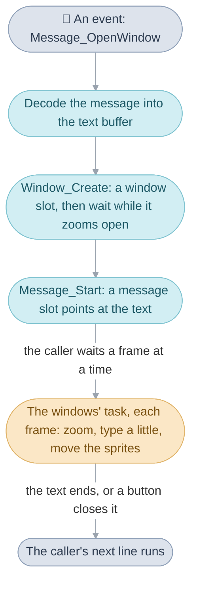
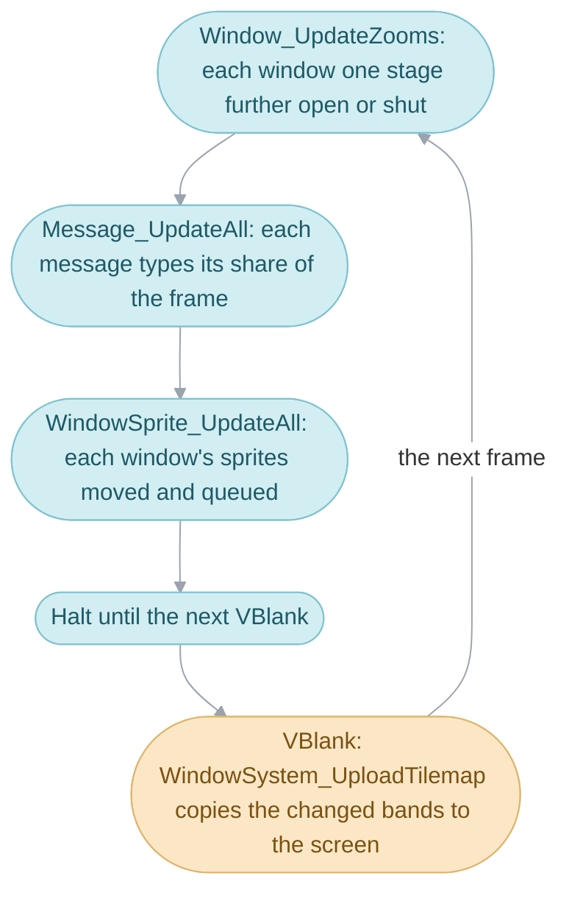
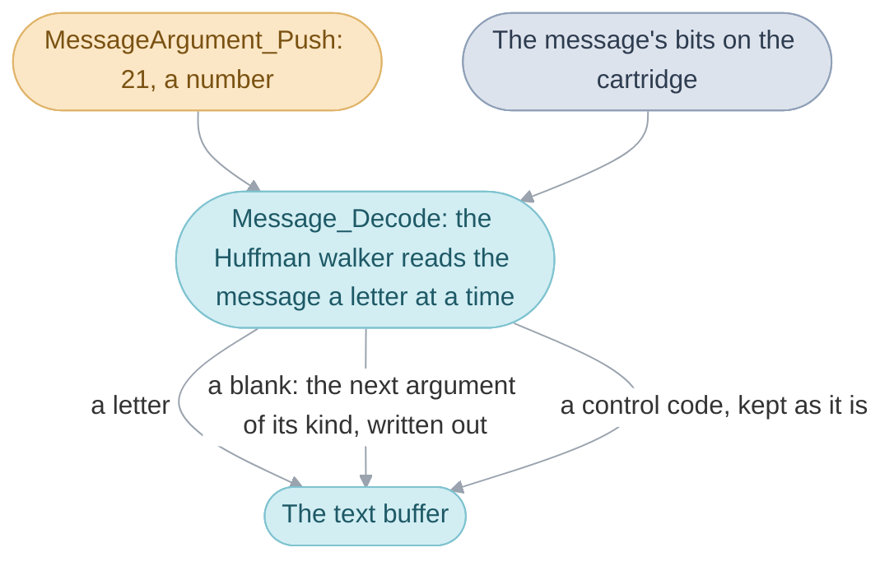
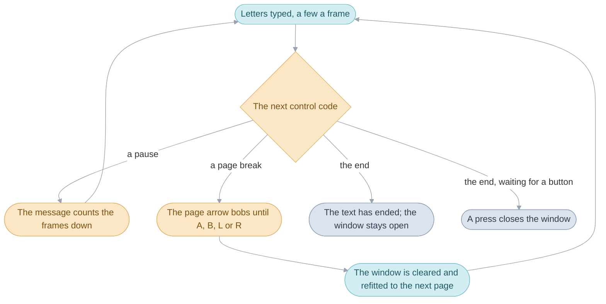
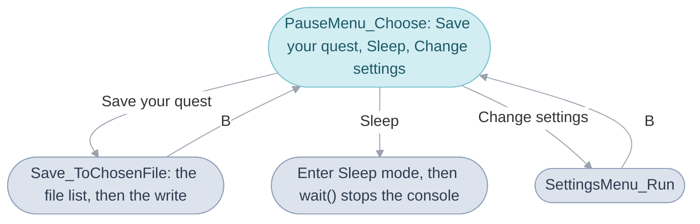

# Windows


When someone in a town speaks, a bordered box opens on the screen and their
words appear in it a few letters at a time, with a little voice blip as they
go. Every box of text in the game works this way: what people say, the field
menu's row and its figures, the Pause menu, the shop counters, the battle's
commands. The code in this folder draws the boxes, unpacks the game's stored
text, types it out over several [frames](../../glossary.md#frame) and moves
the sprites a box carries: its letters, its icons, a portrait and the page
arrow. Six mechanisms do it, each leaning on the one before:

1. The window work is one block of memory holding every window, every
   message being typed and every sprite a window carries, set up afresh for
   each [scene](../../glossary.md#scene) and each battle.
2. The windows' task runs once a frame inside
   [`wait()`](../../glossary.md#wait): it grows and shrinks the windows, types
   a little of each message and moves the sprites.
3. A window is opened by code that waits: `Window_Create` takes a slot in the
   work and waits while the task zooms the window open.
4. A message is decoded whole before anything is typed: its compressed text
   is unpacked, its blanks filled in, and the result goes into the text
   buffer.
5. Typing reads the decoded text a few codes a frame, drawing letters and
   acting on the control codes between them: a pause, a new page, a colour.
6. A letter is drawn one of three ways: as a sprite riding on its window, into
   a shared canvas of tiles, or as a tile of the window itself.



The battle's command row and the file list reach `Message_OpenWindow` the
same way an event does. After the six mechanisms come the screens built
straight from windows: the
area's name on arrival, the Pause menu with saving and the settings, and name
entry. The field menu's four screens are in [Menus](../menu/README.md), the
shop counters in [Shops](../shop/README.md), and
[Interface](../../interface.md) gives the whole division in brief.

## The window work

Everything the window code keeps from one frame to the next lives in one
block of memory, its [work](../../glossary.md#work): the grid of tiles, the
tilemap, the windows are drawn into, the windows themselves, the three
messages that can be typing at once, the 64 sprites the windows can carry,
the decoded text waiting to be typed, and the blanks to fill into it. The
block is taken from the [heap](../../glossary.md#heap-and-pools) under the
[heap slot](../../glossary.md#heap-slot) `HEAP_SLOT_WINDOW` when a scene or a
battle starts, and the [main routine](../../glossary.md#main-routine) clears
the heap before the next one, so every scene starts with empty windows.

The [field sequence](../../glossary.md#field-sequence) sets it up with
`WindowSystem_InitField`, and the battle with `WindowSystem_InitBattle`; both
clear the block, blank the tilemap, chain the 64 sprites into the list of
those no window holds, and add the two tasks of the next section.
Lucky Dice and Lucky Wheels call the field's setup too. The code reaches the
block as `WINDOW_WORK`, a `struct WindowWork`. The Japanese
[edition](../../glossary.md#editions) keeps more windows and a smaller text
buffer than the others, so the block is a different size there, and the code
that reads it is the same.

| Name                     | Value                                       | Meaning                              |
| ------------------------ | ------------------------------------------- | ------------------------------------ |
| `WINDOW_WORK_SIZE`       | 4,492 bytes in Japanese, 4,860 in the others | the block's size                     |
| `WINDOW_COUNT`           | 12 in Japanese, 8 in the others             | windows open at once                 |
| `MESSAGE_COUNT`          | 3                                           | messages typing at once              |
| `WINDOW_SPRITE_COUNT`    | 64                                          | sprites the windows carry at once    |
| `MESSAGE_ARGUMENT_COUNT` | 8                                           | blanks waiting to be filled          |

## The windows' task

A window grows open over a few frames, its letters appear a few at a time and
its page arrow bobs, all while the code that opened it stands still at one
call. One [task](../../glossary.md#task) does all of it. Every frame, inside
`wait()`, the task walks the windows and advances each one's zoom, then walks
the three messages and types each one's share for the frame, then walks the
sprites of every open window and moves each by its motion and queues it for
drawing. Then the frame's work is done and the console halts until the next
[VBlank](../../glossary.md#vblank).

The windows are drawn on one
[background layer](../../glossary.md#background-layer) of the console, from
a tilemap of 32 by 20 tiles kept in the work, of which the screen shows 30
by 20. The task changes that copy in the work; a second, smaller task copies
it to the screen's memory during the VBlank, when the screen is between
pictures, so the player sees each window whole. The copy is sent in bands of
four tile rows, and only the bands that changed, which the window code marks
as it draws.



`WindowSystem_Update` is the frame task, added with the priority
`TASK_PASS_FRAME`, which runs it among the frame's tasks, and it calls
`Window_UpdateZooms`, `Message_UpdateAll` and `WindowSprite_UpdateAll` in
that order. `WindowSystem_UploadTilemap` is the VBlank task, added with
`TASK_PASS_VBLANK`, which runs it among the VBlank's; it reads the work's
`dirty` bits,
one for each band and one for the whole tilemap, and clears them.

## Windows


A [window](../../glossary.md#window) is a bordered rectangle of the tilemap,
placed on the grid of 8-pixel tiles, 30 across and 20 down, that covers the
screen. Opening, it grows out of its centre over eight frames; closing, it
shrinks back into its centre over four: its zoom. Its
[border](../../glossary.md#border) and filling, in the colour the settings
choose, are tiles of the window layer, and the letters, portrait and
pointing hand it carries are [sprites](../../glossary.md#sprite-and-oam)
riding on it, released when it is cleared or closed.

Opening a window is code that waits. `Window_Create` finds an empty slot among
the work's windows, sets its place and size, and stands in `wait(1)` until the
task has drawn the last stage of the zoom and the window is at full size;
only then does it return the window, so the caller can write in it. A window
can instead open at once, with `WINDOW_FLAG_INSTANT`, as the menus' windows
do. Closing is the other way round: `Window_Close` marks the window closing
and returns at once, and the task shrinks it over the next four frames and
then releases its slot. A closing window keeps its slot until it has shrunk
away,
so it still counts against the windows open at once; `Window_IsClosed` says
when the slot is released, and the code that cares waits on it a frame at a
time.

The zoom draws the window smaller each stage. `Window_DrawZoomBorder` moves
each edge in by the stage's share of half the width or height and draws the
border at that size; closing, it remembers each stage's rectangle so the next
stage can erase it. `Window_DrawBorder` draws a border of any size from 2 to
30 tiles with its filling, and `Window_EraseBorderRect` blanks a rectangle.
Under Mind Read every corner is one round tile, flipped to fit, which is how
a thought's window gets its rounded shape.

| Name                  | Value | Meaning                                 |
| --------------------- | ----- | --------------------------------------- |
| `WINDOW_OPEN_FRAMES`  | 8     | frames a window takes to open           |
| `WINDOW_CLOSE_FRAMES` | 4     | frames a window takes to close          |
| `WINDOW_FLAG_INSTANT` |       | the window opens and closes with no zoom |
| a window's size       | 2 to 30 tiles each way | a smaller or larger one is left undrawn |

## Decoding a message


The game's text is stored compressed on the cartridge, and a
[message](../../glossary.md#message) is unpacked whole, with its blanks filled
in, before its first letter is typed. The innkeeper's price is a blank: the
inn's code works out 21 coins, hands the number to the window code, and the
decoder writes `21` into the text where the message has its blank. Doing all
of this once, ahead of the typing, leaves each frame's typing a cheap read of
the next code.

The compression is Huffman coding: a common letter takes fewer bits than a
rare one, and the code for a letter depends on the letter before it, which
makes the text smaller still. Each message is a string of bits, and the
decoder walks a small tree a bit at a time to its next letter, choosing the
tree by the letter it just read. The walker is a short routine in the
processor's 32-bit instructions, copied into RAM for the length of one
message's decoding, since RAM runs such code faster than the cartridge
([Design](#design)).

Marks such as a page break or a change of colour travel inside the text as
control codes, written in braces in the catalogs: `Your game was saved.` ends
with `{end_wait}`, which waits for a button and closes the window. The
decoder keeps those codes as they are, for the typing to act on. The codes
that stand for a blank it writes out: a number with its sign, a party
member's name, an item's or a class's name with the small word each language
puts before it (`a Herb`, `an Elixir`, and in English an `s` or `es` after a
plural), a [Psynergy](../../glossary.md#psynergy-and-pp) name, an area's
name. Each blank is filled from a table
of arguments the caller pushes first, one value with its kind, and the decoder
takes the first argument of the kind the code asks for; the table has eight
places, and a ninth argument is dropped.



One decode flag changes how a line reads. A person stopped by Halt speaks
haltingly: the decoder puts a short pause before each letter and breaks the
line off with `...` at its first space, or after eleven letters.
`Scene_TalkToActor` sets that flag for a line spoken by an
[actor](../../glossary.md#actor) Halt has stopped, and `Message_OpenWindow`
clears it once the message is typing.

The text is in the PO catalogs under `games/tbs/text`, one per language, and
the code names a message by its linker symbol, `MsgGameSaved`. A caller pushes
each blank's value with `MessageArgument_Push`, and `Message_Decode`
([decode.c](window/decode.c)) unpacks the message into the text buffer and
returns where it starts; it copies the bit walker, `Text_DecodeSymbol`
([message_decode.s](message_decode.s)), into heap slot `TEXT_WORK_BLOCK` for
the call. `Message_AppendArticleName` writes a name with its article, in a
form for each language, and `Message_SetDecodeFlags` sets halting speech.

| Name                     | Value | Meaning                                              |
| ------------------------ | ----- | ---------------------------------------------------- |
| `MESSAGE_ARGUMENT_COUNT` | 8     | blanks a message can fill; a ninth argument is dropped |
| `MESSAGE_NAME_HALFWORDS` | 24    | codes the buffer a name is decoded into holds        |
| `TEXT_PAUSE_SHORT`       | 20 frames | the pause halting speech puts before each letter |
| `TEXT_WORK_BLOCK`        | 50    | the heap slot the bit walker runs from               |

## The text buffer

Decoded messages wait in the text buffer until they have been typed. The
buffer is a ring: each message is written after the one before, and when the
writing reaches the end it carries on from the start, over whatever was
there. Nothing has to be set aside or given back, so three windows can show
text at once, and a message stays readable until enough later text has run
over it. No message in the game is long enough to run over itself
([Evidence](#evidence)).

`Message_Decode` writes at the work's `textBufferEnd`, leaves it just past the
message's terminator, and returns where the message began; that position is
all the typing needs. Every read of the ring steps its index with
`TEXT_BUFFER_MASK`, which is how the index wraps.

| Name               | Value               | Meaning                                        |
| ------------------ | ------------------- | ---------------------------------------------- |
| `TEXT_BUFFER_MASK` | 511, or 255 in Japanese | the ring holds one more letter code than this |

## Typing


A message is typed into its window a little each frame, with the speaker's
voice blip every few letters, and the code that showed it waits a frame at a
time until the text has ended. The typing is the second step of the windows'
task: each frame, for each of the three messages whose window is fully open,
`Message_Type` reads the next few codes from the text buffer. A letter is
drawn at the pen, the place the next letter goes, and the pen moves on by
the letter's width; a control code
is acted on, and outside battle it ends the frame's share, as a space does,
so the text comes about a word at a time at the fast speed.

A message's place in the ring, its pen, its colour and style and the frames
left of a pause are all kept in its `struct Message`, one of the three in the
work. `Message_Start` takes an idle one and points it at a window and a place
in the ring. The message stays taken until its window has closed, and
`Message_AllTyped` says when every message's text has ended, which is what
the waiting code asks each frame.



### How fast the letters come


The player chooses the message speed in the settings menu, and the choice
picks a row of three small tables. At the slow speed one letter comes a frame
with a pause of 4 frames after it, which holding any button skips; at the
normal speed one letter comes a frame; at the fast speed up to ten, though a
space ends the frame's share. The voice blip comes every letter, every third
letter or every tenth. In battle the setting is left aside: 8 letters come a
frame, or 13 after a frame that ran over into a second VBlank
([slowdown](../../glossary.md#slowdown)), so the battle keeps its pace.

Letters go on in 16-pixel squares, and in the international editions two
narrow letters whose widths together fit in 15 pixels share one square, so the
first frame of `You guys are so lucky, Garet.` shows `Yo`. The tables are in
[message_speed.c](message_speed.c): `gMessageSpeed_Steps`,
`gMessageSpeed_Delays` and `gMessageSpeed_VoiceGaps`, each indexed by
`gMainRoutineWork.messageSpeed`.

| Speed  | Letters a frame | Frames after each letter | Letters between blips |
| ------ | --------------- | ------------------------ | --------------------- |
| slow   | 1               | 4                        | 1                     |
| normal | 1               | 0                        | 3                     |
| fast   | 10              | 0                        | 10                    |
| battle | 8, or 13 after slowdown | 0                | as the setting says   |

### Pauses, pages and the end


A pause holds the message on its code while a countdown runs: the short and
longest pauses can be cut short by holding A, B, L or R, and the long one
runs its course. A page break shows the page arrow in the window's bottom
right corner and waits for a fresh press of one of those buttons; then the
window is cleared, measured for the next page's text, moved by a quarter of
the change in width so that it stays near its place, and drawn again. The
text ends in one of two ways: plainly, leaving the window open for the code
that showed it to close, or waiting for a button, which closes the window
from inside the task.

A message can also swell its window: on the control code that starts a
window animation (`TEXT_WINDOW_STATE`) the border is drawn a tile larger on
every side and the window's sprites pulse for ten frames, then the window
goes back to its size. No message in the six editions' text uses that code,
so the player never sees a window swell. The control codes and their frames
are listed with their meanings in
[window_internal.h](window_internal.h) (`TEXT_`), and `Message_Type`
([typing.c](window/typing.c)) acts on each; `Text_CheckPauseSkipped` reads
the held buttons for a pause and `Text_CheckTextDismissed` the pressed ones
for a page; `Window_StepSwellEffect` draws the swell.

| Code                 | Catalog name          | What the player sees                                    |
| -------------------- | --------------------- | ------------------------------------------------------- |
| `TEXT_PAUSE_SHORT`   | `{pause_20_skippable}` | 20 frames of pause, cut short by a held button          |
| `TEXT_PAUSE_LONG`    |                       | 60 frames of pause                                      |
| `TEXT_PAUSE_LONGEST` |                       | 120 frames of pause, cut short by a held button         |
| `TEXT_PAGE`          |                       | the arrow, a wait for a button, then a cleared window   |
| `TEXT_END`           |                       | the text ends and the window stays open                 |
| `TEXT_WAIT_KEY`      | `{end_wait}`          | a button closes the window                              |
| `TEXT_END_ALT`       | `{end_now}`           | the text ends as `TEXT_END` does                        |
| `WINDOW_ANIMATION_SWELL` | | the border a tile larger all round for 10 frames, the letters pulsing |

## Drawing text


A letter reaches the screen in one of three ways, and the way decides what
the letter can do. A message typed on the field puts each letter on as a 16
by 16 sprite riding on the window, one of the 64, which is what lets a
letter bob, shake or pop. A battle message is painted into one shared block
of tiles, the text canvas, so the battle's long lines take no sprites from
the battlefield, and since there is one canvas only one such window shows at a
time. A label drawn all at once, such as the Pause menu's entries or the
area's name, becomes tiles of the window layer itself, which costs nothing
each frame. Under Mind Read a thought's window has round corners and its
letters another colour with no shadow, and in the Japanese and English
editions the window opens two tiles wider.

| Way          | Used for                                   | Lines apart | Code                     |
| ------------ | ------------------------------------------ | ----------- | ------------------------ |
| sprites      | a message typed on the field               | 15 pixels   | `Glyph_Draw`             |
| text canvas  | battle messages and the battle menus' help lines (`WINDOW_FLAG_TEXT_CANVAS`) | 13 pixels | `Glyph_DrawArm` |
| window tiles | a label drawn all at once                  | one line    | `Text_DrawMessageAsTiles` |

### Letters as sprites


A letter typed on the field is a 16 by 16 sprite with four tiles of its own,
taken from a sheet of 256 tiles reserved for the 64 window sprites when the
field's windows are set up. `Text_DrawGlyphPair` paints the letter, with its
shadow or its outline, into those four tiles, and `Glyph_Draw` takes a
sprite no window holds, copies the tiles into sprite memory, places the sprite
half a line below the pen and appends it to the window's list. The sprite
keeps the motion the text's style gave it, and `WindowSprite_UpdateAll` moves
it every frame: a wobble swings along a small arc, a shake jitters by a pixel
every other frame, a pop shows the letter at double size for eight frames,
and a spin turns it while it circles its place. The page arrow is a window
sprite too, bobbing over 80 frames through eight pictures. The catalog writes
a style as its number plus one, which the decoder takes off again, so
`{text_effect:4}` is the shake; the game's text uses only that and the
outline, `{text_effect:2}`.

| Style (`{text_effect:N}`) | Motion                        | Frames                    |
| ------------------------- | ----------------------------- | ------------------------- |
| `TEXT_STYLE_OUTLINED`     | drawn a pixel wider with an outline | still                |
| `TEXT_STYLE_WOBBLE`       | `WINDOW_SPRITE_MOTION_WOBBLE` | one of its 20 offsets every other frame |
| `TEXT_STYLE_SHAKE`        | `WINDOW_SPRITE_MOTION_SHAKE`  | a pixel either way, every other frame |
| `TEXT_STYLE_POP`          | `WINDOW_SPRITE_MOTION_POP`    | double size for 8 frames  |
| `TEXT_STYLE_SPIN`         | `WINDOW_SPRITE_MOTION_SPIN`   | one turn in about 85 frames |

### The text canvas


The canvas is a block of 120 tiles in the screen's tile memory, mapped into a
canvas window's interior column by column, so a letter can be painted at any
pixel across tile edges. The battle message window is a borderless canvas
along the bottom of the screen, 30 tiles wide and 4 high inside, which uses
all 120. Its lines are 13 pixels apart, and once two lines are on the canvas,
each further line scrolls it up 12 pixel rows over two frames instead of
starting a third, so a battle's messages run on like a log. The painter,
`Glyph_DrawArm` ([glyph_arm.c](glyph_arm.c)), sets the letter's pixels one by
one; it is copied into RAM for each call, as the decoder is.
`BattleMessage_Open` opens the window and `BattleMessage_Continue` carries a
message on below the last line.

### Labels as tiles


A label is drawn in one go: `Text_DrawMessageAsTiles` decodes the message
from the start of the ring and `Text_DrawStringAsTiles` paints each letter
into a text tile and writes the tile's number into the window's tilemap. The
text tiles are the window layer's tiles `128` to `255`, and the field
menu's screens and the battle's Djinn menu add tiles `512` to `639`
while they are open (`Text_UseExtraTiles`, which sets `extraTextTiles`),
since their lists hold more text than a conversation. A tile is released
when the rectangle showing it is cleared or redrawn
(`Window_ClearTextTilesInRect`).

| Name                   | Value          | Meaning                                       |
| ---------------------- | -------------- | --------------------------------------------- |
| the glyph sheet        | `128 << 6` bytes | 256 sprite tiles, four for each of the 64 window sprites |
| `TEXT_CANVAS_SIZE`     | 120 tiles      | the canvas, one canvas window at a time       |
| text tiles             | `128` to `255`, and `512` to `639` with `extraTextTiles` | tiles labels are drawn into |

## The area name


When the party arrives in a new [area](../../glossary.md#area), its name shows
in a small window near the top of the screen for a second and a half. The
window is a label drawn as tiles, opened at once and centred in the top ten
rows, and a task of its own counts the frames down and closes it. Pressing A,
opening a menu or the start of any [event](../../glossary.md#event) closes it
early, so a conversation has the screen to itself.

The field sequence calls `AreaNameWindow_Show` on arrival when
`FLAG_SHOW_AREA_NAME` is set, which reads the area's name through
`Area_GetNameIndex` and adds `AreaNameWindow_Update` as a frame task; the
field calls `AreaNameWindow_Hide` as it answers a request, and `Event_Start`
calls it too ([shortcuts.c](window/shortcuts.c)).

| Name                      | Value | Meaning                       |
| ------------------------- | ----- | ----------------------------- |
| `AREA_NAME_WINDOW_FRAMES` | 90    | frames the area's name shows  |

## The Pause menu


Start on the field opens the Pause menu: `Save your quest`, `Sleep` and
`Change settings`, each with an icon that lights while the hand points at it
and dims otherwise. The menu is one window with labels drawn as tiles and
its icons and hand as window sprites, and a function that loops a frame at a
time reading the buttons until A picks an entry or B or Start backs out.
Sleep shows `Enter Sleep mode.`, with the L and R buttons drawn as the way
to resume, and asks the system to sleep, which `wait()` does at the end of
the frame ([System](../system/README.md#buttons-and-sleep)). Backing
out of the file list or the settings menu brings the Pause menu back. In the
Battle Arena, Start on the field says `The Pause menu is not available now.`
instead. In debug mode three more entries show, the Rough menu, Recovery test
and Restart quest, which the menu returns and the field leaves alone.



The field sequence answers its Pause menu request with `PauseMenu_Run`
([debug.c](screens/debug.c)), which runs `PauseMenu_Choose`
([settings_menu.c](window/settings_menu.c)) and then `Save_ToChosenFile`, the
sleep message with `gSleepRequested`, or `SettingsMenu_Run`, opening the menu
again when a save or the settings are cancelled. The menu's work block lives
in `HEAP_SLOT_SETTINGS_MENU`, which the settings menu takes in its turn.

### Saving


The game keeps three save [files](../../glossary.md#file-and-part) in the
cartridge's backup memory, and saving asks which one. The file list opens with
the cursor on the file last used and shows each file's leader and area, with
the party and Djinn of the file under the cursor; when the chosen file
already holds a game the code asks `OK to save over this file?` with a Yes
and No. Then the saved jingle plays, `Saving...` shows, and the game is
written: the [main routine's work](../../glossary.md#main-routines-work),
the [game flags](../../glossary.md#game-flag), where the scene's people
stand, and a short summary for the file list to show without reading the
whole file, the leader's name, level and class, the play time, the area, the
coins and the [Djinn](../../glossary.md#djinn) of each element.
`Your game was saved.` ends it, or `Failed to save.`.

`Save_ToChosenFile` ([save.c](screens/save.c)) does all of it, in that order:
`Save_InitializeWork` reads the flash, `FileList_SelectFile` runs the list,
`YesNoMenu_Run` asks, `Save_BuildFileSummary` fills the summary and
`Save_CaptureActorsFar` the people's places (from the field's code), and
`Save_WritePart` writes each of the file's two parts. The file list is the
same one the File Screen's
Continue, Copy and Erase use. How a part reaches the flash so that one whole
copy of a save always remains is in
[System code](../system/README.md#saving).

| Name              | Value | Meaning                                      |
| ----------------- | ----- | -------------------------------------------- |
| `SAVE_FILE_COUNT` | 3     | save files                                   |
| `SAVE_PART_BYTES` | 4 KB  | one of a file's two parts                    |
| `MUS_SAVED`       |       | 🎵 the jingle that plays as the game is saved |

### The settings menu


Change settings sets five things in one window: the windows' colour and
brightness on two sliders, the message speed, whether people speak with voice
blips, and auto-sleep, which puts the console to sleep after three minutes
with no button pressed. A help window above the settings says what the row
under the hand does, `Change the window's color.` for the first. The windows
take each new colour at once, so the player sees the choice on the menu
itself; Select steps through six preset pairs of hue and brightness. A or
Start keeps the settings, and B puts the old ones back, which is why the menu
works on a copy of the five values until then.

The colour is one of 24 hues round a wheel and 15 levels of brightness, and
from the pair `WindowColor_Apply` recomputes the seven colours of the
windows' palette, the filling and its lighter and darker shades, so every
window changes together. `SettingsMenu_Run`
([settings_menu.c](window/settings_menu.c)) runs the menu and writes the
copy back into the main routine's work when it is kept, and the saved values
go into every save file with the rest.

| Setting           | Values                    | Saved in                              |
| ----------------- | ------------------------- | ------------------------------------- |
| Window color      | 24 hues                   | `gMainRoutineWork.windowColor[0]`     |
| Window brightness | 15 levels                 | `gMainRoutineWork.windowColor[1]`     |
| Message           | Slow, Normal, Fast        | `gMainRoutineWork.messageSpeed`       |
| Speech            | On, Off                   | `gMainRoutineWork.speech`             |
| Auto-Sleep        | On, Off                   | `gMainRoutineWork.idleSleepEnabled`   |

## The name entry screen


A new game opens on name entry with the leader's name already in the name
window, beside the leader's portrait. The keyboard is a window whose tiles
are copied in from a ready-made tilemap, the key under the hand flashing in a
second palette, and the name window is a label redrawn after every change.
The player moves the hand over the keys: A puts the key's letter on the name,
B or `DEL` takes the last letter off, the switch key changes keyboards (as
Select does in the Japanese edition), and `END` keeps the name, or Start,
which jumps the hand there. A name has at most five
letters, after which the hand jumps to `END` by itself, and ending with an
empty name keeps the old one.

`NameEntry_EditMemberName` ([name_entry.c](screens/name_entry.c)) runs it for
one party member, a frame at a time, reading the key under the hand from the
keyboard's own tilemap; the File Screen
([file_screen.c](../scene/file_screen.c)) calls it for each name a new game
asks for.

| Name               | Value | Meaning           |
| ------------------ | ----- | ----------------- |
| `NAME_MAX_LETTERS` | 5     | letters in a name |

## The screens the other folders call

The rest of this folder is screens built from windows that other code opens.
The party status window is the row of HP and PP figures at the top of the
screen, one column of six tiles a party member, which the field menu and the
battle open (`PartyStatus_CreateWindow`). The icon menus are a row of command
icons with a label beside the chosen one: the field menu's row of Psynergy,
Djinn, Item and Status (`FieldMenu_SelectCommand`), the File Screen's
Continue, New and the rest (`FileList_SelectAction`), a shop's Buy, Sell,
Artifacts and Repair, and every Yes and No (`YesNoMenu_Run`). `FieldMenu_Run`
runs the field menu itself: it opens the party status window, runs the icon
row, and calls the chosen screen through the menu
[bank](../../glossary.md#bank)'s [far-call](../../glossary.md#far-call)
table,
looping back to the row when a screen is backed out of
([Menus](../menu/README.md#the-screens)). The battle's command menus, the
Djinn, summon, item, Psynergy and target choosers and the party's command row,
are here too, called from the battle's turn
([Battle](../../battle.md#turns-and-actions)); so are the
[debug menus](../../glossary.md#debug-menus)' scene selector and flag editor.

## A villager's line, mechanism by mechanism


Isaac walks up to Garet's sister in Vale and presses A. Each step of the line
that follows is one of this page's mechanisms in turn.

### Talking to her

The field sequence's loop finds the talk
[request](../../glossary.md#field-request) when its `wait(1)` returns and
calls `Scene_TalkToActor`, which looks her up
in the scene's [trigger](../../glossary.md#trigger) table. Her row names a
message, so the runner shows it as a one-line event (the line that sets
halting speech left out):

```c
Event_Start();
Event_SetMessageId(trigger->result);
Event_ShowMessageAndWait(id, 0);
Event_End();
```

`Event_ShowMessageAndWait` calls `FieldMessage_ShowAtActor`, which measures
the message, places the window above or below her on the screen, and asks for
her voice, which is the first of her four blip sounds or nothing with Speech
off. Then it calls `Message_OpenWindow` with the window's place, the zoom
option and the voice packed together.

### The window opens

`Message_OpenWindow` is the path every spoken line takes. It decodes the
message into the text buffer, sizes a window to the first page's text and
slides it onto the screen, opens the window and waits the eight frames of the
zoom, and starts a message typing at the window's top left:

```c
entry = Message_Decode(message, 1);
Window_FitOnScreen(entry, &x, &y, &width, &height, (out = bounds), 0);
window = Window_Create(x, y, width, height, flags);
Message_Start(window, entry, 0, 0, out, 0);
```

`Window_FitOnScreen` also works out, for each line, how much wider each
space must be for the line to fill the window, and `Message_Start` keeps
those gaps with the message. Her portrait opens beside the window with
`Portrait_OpenWindow`, a 5 by 5 window opened at once with the portrait as
its one sprite.

### The letters are typed

`FieldMessage_ShowAtActor` now stands in `wait(1)` until `Message_AllTyped`
says the text has ended. In each of those frames the windows' task runs
`Message_Type` on her message: a letter or two go on as sprites, the pen
moves, and every third letter plays a blip at the normal speed. At the page
break after `Garet.` the task draws the page arrow and waits for a press;
when A comes, the window is cleared and refitted for `I wish I could go with
you.` and the typing goes on. The message's last code waits for a button and
closes the window, and the task shrinks it over four frames and releases the
slot.

### The window closes

`Event_ShowMessageAndWait` closes her portrait and waits a frame at a time
until `Window_IsClosed` says the message window's slot is released; then
`Event_End` runs, the loop goes back to `wait(1)`, and Isaac can walk on.

| Step                                   | Mechanism                                                |
| -------------------------------------- | -------------------------------------------------------- |
| A is pressed by Garet's sister         | the field's talk request, answered by `Scene_TalkToActor` |
| Her row names a message                | the scene's trigger table, run as a one-line event       |
| Her line is unpacked                   | decoding, into the text buffer                           |
| The window is sized and slid on screen | `Window_FitOnScreen`                                     |
| The window grows open                  | `Window_Create`, waiting while the windows' task zooms it |
| Her portrait appears                   | a window opened at once, carrying one window sprite      |
| The letters appear with blips          | typing, a share each frame inside `wait(1)`              |
| The arrow bobs                         | a window sprite with the page arrow motion               |
| The next page                          | the page break: cleared, refitted, typed on              |
| The window shrinks away                | the end code, then the windows' task's closing zoom      |

## Design

Every window shares one background layer because the map draws its ground,
middle and overhead layers on the other three, so a scene looks the same
however many windows are open over it.

The two routines that go bit by bit or pixel by pixel, the Huffman walker and
the canvas painter, are written in ARM, the processor's full 32-bit
instructions ([Source](../README.md#c-and-assembly)), and copied into RAM for
each call, into the fast internal [IWRAM](../../glossary.md#iwram-and-ewram)
when it has room: IWRAM fetches such an instruction in one read, where the
cartridge takes two. The rest of the window code runs from the cartridge as
Thumb code, as the field's line routines do
([Field code](../field/README.md#routines-run-from-ram)).

## How it fits with the rest of the game

The field sequence sets the window work up for every scene and answers its
menu and Pause menu requests with the field menu and the Pause menu
([Field code](../field/README.md#the-field-sequence-serves-requests)); the
battle sets the work up for itself and opens its command menus and the party
status window from its turn. Events speak through the event commands of the
field, which call `Message_OpenWindow` and `Portrait_OpenWindow` here. The
field menu's screens ([Menus](../menu/README.md)) and the shop counters
([Shops](../shop/README.md)) draw with these windows and labels, and take
their own work from the heap beside this one. The text itself is the catalog
each edition builds from `games/tbs/text`, and the names a blank can take
come from the game's units, items and areas ([Game rules](../game/README.md)).
A save written here goes to the flash chip through the Game Pak's code
([Game Pak](../gamepak/README.md#the-flash-chip)).

## Limits

- The tilemap is 32 by 20 tiles and the screen shows 30 by 20; a window
  narrower or shorter than 2 tiles, or wider or taller than 30, is left
  undrawn, and a window's bottom row is cut at the screen's 20th row.
- Twelve windows at once in Japanese and eight in the international editions.
- Three messages typing at once (`struct Message`) and 64 window sprites.
- Eight blanks at a time; a ninth is dropped.
- The text buffer holds 256 letter codes in Japanese and 512 in the others.
- A page has at most four lines with their own gaps (`MESSAGE_LINE_COUNT`).
- The text canvas holds 120 tiles, one canvas window at a time.
- Text drawn as tiles has 128 tiles, or 256 while the field menu's screens or
  the battle's Djinn menu are open.
- A name has five letters; the play time stops at 999:59.

## Words used here

| Word          | Meaning                                                                                          |
| ------------- | ------------------------------------------------------------------------------------------------ |
| window work   | `struct WindowWork`, heap slot `HEAP_SLOT_WINDOW`, reached as `WINDOW_WORK`: all of the window code's state |
| window        | a `struct Window`, one bordered rectangle of the shared tilemap                                  |
| window sprite | a `struct WindowSprite`, one of the 64 sprites a window carries: a letter, an icon, a portrait, the page arrow |
| message       | a `struct Message`, which types decoded text into one window and runs its control codes (`TEXT_`) |
| text buffer   | the ring `textBuffer` of decoded 16-bit codes                                                    |
| blank         | a place in a message's text a message argument fills (`MessageArgument_Push`)                    |
| text canvas   | a window with `WINDOW_FLAG_TEXT_CANVAS`, whose text is painted into the canvas's tiles           |
| text tile     | one of the tiles a label is drawn into, as tiles of the window layer                             |
| file list     | the list of the three save files (`FileList_SelectFile`)                                         |

## Evidence

Windows and window sprites are named from how their structs are used, a
message from the game's own word for its text (`Message` in the settings
menu), the control codes from what the decoder and the typing do with each,
and the screens from the English release's text they show. Messages are
named by their linker symbols, made from their English text. That `Yo` is
typed on the first frame follows from the English glyph widths
(`graphics/font/text.tsv`) and the pairing rule in `Message_Type`, and
agrees with the recording of the window opening. Halting speech is named
from where its flag is set: `Scene_TalkToActor` sets it only for an actor
Halt has stopped.

A message longer than the ring would be cut, its terminator landing on its
own start, but no message is that long. Counting each control code and line
break as one code, before the blanks are filled in, the longest message of
each edition's text is the Lucky Dice rules, at 200 of the Japanese ring's
256 codes and at most 446 (Italian) of the others' 512, except in German,
whose longest is the Venus statue's speech
(`MsgVenusStatueSpeaksIsaacSoulYe`) at 333.
