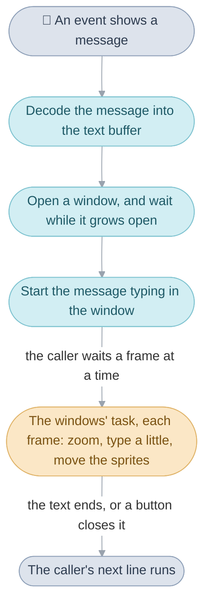
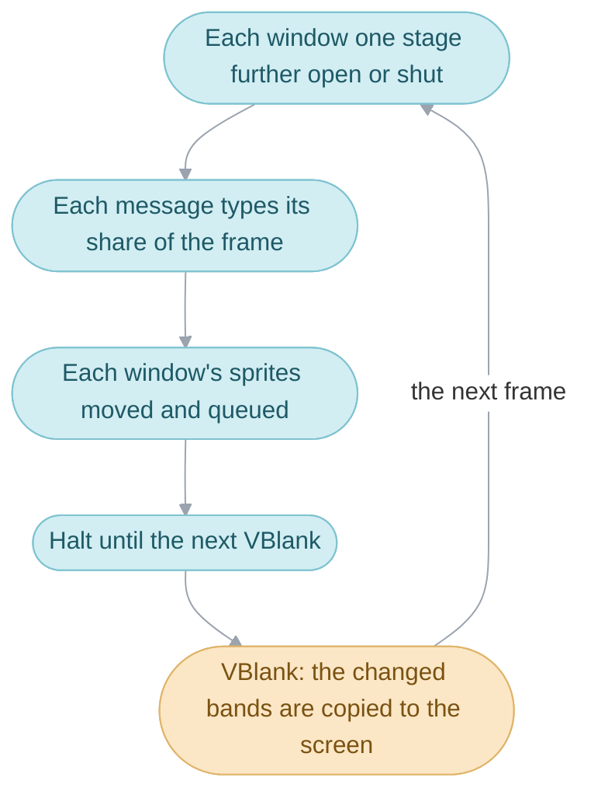
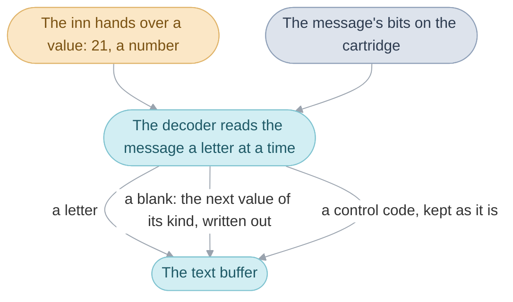
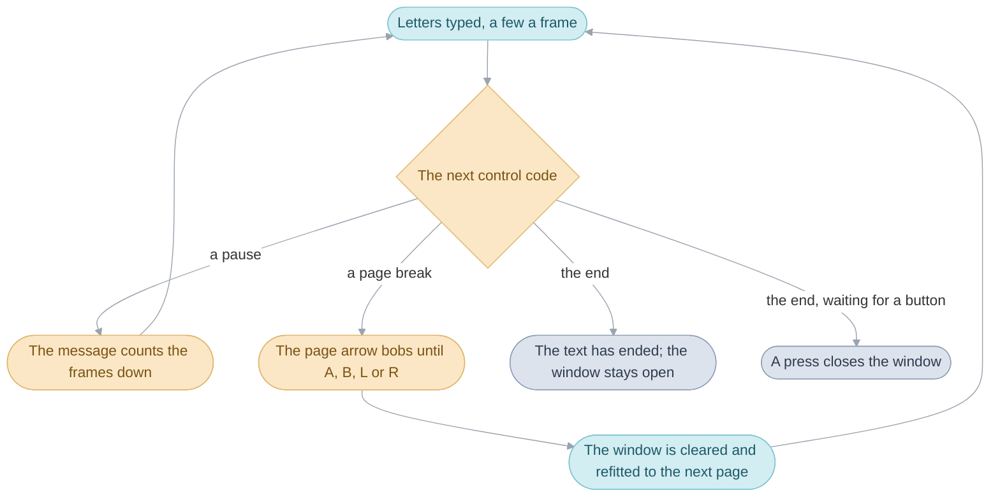
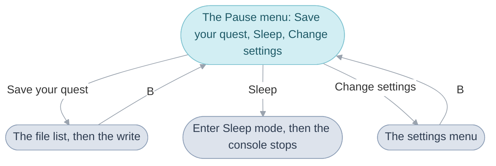

# Windows

When someone in a town speaks, a bordered box opens on the screen and their
words appear in it a few letters at a time, with a little voice blip as they
go. Every box of text in the game works this way: what people say, the field
menu's row and its figures, the Pause menu, the shop counters, the battle's
commands. The code in this folder draws the boxes, unpacks the game's stored
text, types it out over several [frames](../../glossary.md#frame) and moves
the sprites a box carries: its letters, its icons, a portrait and the page
arrow. Six mechanisms do it, each leaning on the one before:

1. The window work is one block of memory holding every window, every
   message being typed and every sprite a window carries.
2. The windows' task runs once a frame: it grows and shrinks the windows,
   types a little of each message and moves the sprites.
3. A window is opened by code that waits while the task grows it open.
4. A message is decoded whole before anything is typed: its compressed text
   is unpacked and its blanks filled in.
5. Typing reads the decoded text a few letters a frame, and acts on the
   marks between them: a pause, a new page, a colour.
6. A letter is drawn one of three ways: as a sprite riding on its window,
   into a shared canvas of tiles, or as a tile of the window itself.

Every spoken line in the game takes this one path, `Message_OpenWindow`,
and the battle's messages and the file list take it too. After the six
mechanisms come the screens built straight from windows: the area's name on
arrival, the Pause menu with saving and the settings, and name entry. The
field menu's four screens are in [Menus](../menu/README.md), the shop
counters in [Shops](../shop/README.md), and [Interface](../../interface.md)
gives the whole division in brief.

## The window work

Everything the window code remembers from one frame to the next lives in one
block of memory, its [work](../../glossary.md#work). The block holds the grid
of tiles the windows are drawn into, the windows themselves, the messages
being typed, the sprites the windows carry, the decoded text waiting to be
typed, and the values waiting to fill a message's blanks.

Each of those has a fixed number of places. Eight windows can be open at
once, three messages can be typing, and the windows can carry 64 sprites
between them. The Japanese [edition](../../glossary.md#editions) has twelve
windows and a smaller text buffer.

The block is borrowed from the [heap](../../glossary.md#heap-and-pools), the
memory the game lends out, when a [scene](../../glossary.md#scene) or a
battle starts. The [main routine](../../glossary.md#main-routine) empties
the heap before the next scene, so every scene starts with no windows open
and nothing left over from the last one. Lucky Dice and Lucky Wheels set the
block up the same way the field does.

## The windows' task

A window grows open over a few frames, its letters appear a few at a time and
its page arrow bobs, all while the code that opened it stands still at one
call. One [task](../../glossary.md#task) does all of it. Every frame, inside
[`wait()`](../../glossary.md#wait), the task goes through the windows and
moves each one's zoom a stage on, then through the three messages and types
each one's share for the frame, then through the sprites of every open
window, moving each one and queueing it to be drawn.

The windows are drawn on one
[background layer](../../glossary.md#background-layer) of the console, from
a grid of 32 by 20 tiles kept in the work, of which the screen shows 30 by
20. The task changes that copy in the work. A second, smaller task copies it
to the screen's memory during the [VBlank](../../glossary.md#vblank), when
the screen is between pictures, so the player never sees a window half
drawn. To keep the copy short the grid is divided into bands of four rows,
and only the bands that changed since the last frame are sent.

## Windows

A [window](../../glossary.md#window) is a bordered rectangle on the grid of
8-pixel tiles, 30 across and 20 down, that covers the screen. Opening, it
grows out of its centre over eight frames; closing, it shrinks back into its
centre over four. This growing and shrinking is its zoom. The
[border](../../glossary.md#border) and the filling, in the colour the
settings choose, are tiles of the window layer. The letters, portrait and
pointing hand a window carries are
[sprites](../../glossary.md#sprite-and-oam) riding on it, and they are given
back when the window is cleared or closed.

Opening a window is code that waits. The code that asks for a window gets
one of the eight places, and then waits, a frame at a time, until the task
has drawn the last stage of the zoom. Only then does it go on, so it can
write in the window straight away. Closing is the other way round: the
window is marked as closing and the code goes on at once, while the task
shrinks the window over the next four frames. A closing window keeps its
place until it has shrunk away, so for those four frames it still counts
among the eight. A window can also open and close with no zoom at all, as
the menus' windows do.

Each stage of the zoom draws the border a little further out from the
centre, by an equal share of half the width and half the height. A closing
window remembers the rectangle it last drew, so the next stage can erase it
before drawing the smaller one.

A spoken line's window is sized to fit its first page and placed above or
below the speaker, then moved back onto the screen if it would hang off it.
The speaker's portrait is a small window of its own beside it, 5 tiles by
5, opened with no zoom, with the portrait as the one sprite it carries.

## Decoding a message

The game's text is stored compressed on the cartridge, and a
[message](../../glossary.md#message) is unpacked whole, with its blanks filled
in, before its first letter is typed. The innkeeper's price is a blank: the
inn's code works out 21 coins, hands the number to the window code, and the
decoder writes `21` into the text where the message has its blank. Doing all
of this once, ahead of the typing, leaves each frame's typing a cheap read of
the next letter.

The compression is Huffman coding: a common letter takes fewer bits than a
rare one. Here the code for a letter also depends on the letter before it,
since `u` is far more likely after `q` than after `t`, which makes the text
smaller still. Each message is a string of bits, and the decoder follows a
small tree of yes-or-no branches, one bit at a time, until it arrives at a
letter; the letter it has just read decides which tree it follows next.

Marks such as a page break or a change of colour travel inside the text as
control codes, written in braces in the text files: `Your game was saved.`
ends with `{end_wait}`, which waits for a button and closes the window. The
decoder keeps those codes as they are, for the typing to act on. The codes
that stand for a blank it writes out in full: a number, a party member's
name, an item's or a class's name with the small word each language puts
before it (`a Herb`, `an Elixir`, and in English an `s` or `es` after a
plural), a [Psynergy](../../glossary.md#psynergy-and-pp) name, an area's
name.

The code that shows a message hands over each blank's value beforehand,
saying what kind it is, a number or an item or a name. The decoder fills
each blank with the first waiting value of the kind the blank asks for.
Eight values can wait at once, and a ninth is dropped.

The decoder can also change how a line reads. A person stopped by the Halt
Psynergy speaks haltingly: the decoder puts a pause of 20 frames before each
letter and breaks the line off with `...` at its first space, or after
eleven letters. The field asks for this only when the player talks to an
[actor](../../glossary.md#actor) Halt has stopped.

The text itself is in the files under `games/tbs/text`, one for each
language, and the decoder is `Message_Decode` in
[decode.c](window/decode.c).

## The text buffer

Decoded messages wait in the text buffer until they have been typed. The
buffer is a ring: each message is written after the one before, and when the
writing reaches the end it carries on from the start, over whatever was
there. Nothing has to be set aside or given back, so three windows can show
text at once, and a message stays readable until enough later text has run
over it.

The ring holds 512 letters and control codes, or 256 in Japanese. The
longest message in the game is the rules of Lucky Dice, which fills 446 of
the 512 in Italian, so no message runs over its own beginning
([Evidence](#evidence)).

## Typing

A message is typed into its window a little each frame, with the speaker's
voice blip every few letters, and the code that showed it waits a frame at a
time until the text has ended. The typing is the second step of the windows'
task. Each frame, for each message whose window is fully open, it reads the
next few codes from the text buffer. A letter is drawn at the pen, the place
the next letter goes, and the pen moves on by the letter's width. A control
code is acted on.

Outside battle a space or a control code ends the frame's share, so even at
the fast speed the text arrives about a word at a time.

Each of the three messages keeps its own place in the ring, its pen, its
colour and the frames left of a pause. A message stays in use until its
window has closed. The waiting code asks one question each frame: has every
message's text ended?

Before a page is typed, the window code measures its lines and works out,
for each line, how much wider each space must be for the line to fill the
window, so a page of several lines ends level at the right edge. In the
international editions a line that would need gaps of more than 12 pixels
is left with gaps of 2 instead. A page has at most four lines.

### How fast the letters come

The player chooses the message speed in the settings menu. At the slow speed
one letter comes a frame with a pause of 4 frames after it, which holding
any button skips; at the normal speed one letter comes a frame; at the fast
speed up to ten, though a space ends the frame's share. The voice blip comes
every letter, every third letter or every tenth. Each speaker has four blip
sounds of their own, and the letter being typed picks which of the four
plays. With Speech off in the settings there is none.

In battle the setting is left aside: 8 letters come a frame, or 13 after a
frame that took too long to finish in time
([slowdown](../../glossary.md#slowdown)), so the battle keeps its pace.

| Speed  | Letters a frame         | Frames after each letter | Letters between blips |
| ------ | ----------------------- | ------------------------ | --------------------- |
| slow   | 1                       | 4                        | 1                     |
| normal | 1                       | 0                        | 3                     |
| fast   | 10                      | 0                        | 10                    |
| battle | 8, or 13 after slowdown | 0                        | as the setting says   |

Letters go on in squares of 16 pixels, and in the international editions two
narrow letters whose widths together fit in 15 pixels share one square. So
the first frame of `You guys are so lucky, Garet.` shows `Yo`, and "one
letter a frame" is sometimes two.

### Pauses, pages and the end

A pause holds the message where it is while a countdown runs. There are
three lengths: 20 frames, 60 and 120. The shortest and the longest can be
cut short by holding A, B, L or R, and the middle one always runs its
course.

A page break shows the page arrow in the window's bottom right corner and
waits for a fresh press of one of those buttons. Then the window is cleared
and measured again for the next page's text. If the new page is wider or
narrower, the window moves by a quarter of the change in width, so that it
stays near its place, and is drawn again at its new size.

The text ends in one of two ways. It can end plainly, leaving the window
open for the code that showed it to close. Or it can end waiting for a
button, and then the press closes the window from inside the task.

The typing knows one more control code, which swells the window: the border
is drawn a tile larger on every side and the window's sprites pulse for ten
frames, then the window goes back to its size. No message in any of the six
editions uses it, so the player never sees a window swell.

## Drawing text

A letter reaches the screen in one of three ways, and the way decides what
the letter can do. A message typed on the field puts each letter on as a
sprite riding on the window, which is what lets a letter bob, shake or pop.
A battle message is painted into one shared block of tiles, the text canvas,
so the battle's long lines take no sprites from the battlefield. A label
drawn all at once, such as the Pause menu's entries or the area's name,
becomes tiles of the window layer itself, which costs nothing each frame.

A thought read with Mind Read is typed the first way, with two changes: its
window has round corners, every corner being one round tile flipped to fit,
and its letters take another colour with no shadow. In the Japanese and
English editions the window also opens two tiles wider.

### Letters as sprites

A letter typed on the field is a sprite of 16 by 16 pixels, one of the 64
the windows share. The letter is painted, with its shadow or its outline,
into the four tiles the sprite owns, and the sprite is placed at the pen and
added to its window. Lines are 15 pixels apart.

Because each letter is its own sprite, each can move by itself. The text
gives a stretch of letters a style, and the windows' task moves every sprite
by its style each frame. A wobble swings the letter along a small arc. A
shake jitters it a pixel either way every other frame, as the old man's
cough does in the recording. A pop shows the letter at double size for eight
frames, and a spin turns it while it circles its place. One more style
draws the letter a pixel wider with an outline and leaves it still. The
game's text uses only the shake and the outline.

The page arrow is a window sprite too, bobbing through eight pictures over
80 frames.

### The text canvas

The canvas is a block of 120 tiles laid out so that a letter can be painted
at any pixel, across the edges of tiles. The battle message window is a
canvas with no border along the bottom of the screen, 30 tiles wide and 4
high, which uses all 120. There is one canvas, so only one such window
shows at a time.

Its lines are 13 pixels apart. Once two lines are on the canvas, each
further line scrolls it up 12 rows of pixels over two frames instead of
starting a third, so a battle's messages run on like a log. The battle
menus' help lines are painted on the canvas as well.

### Labels as tiles

A label is drawn in one go: the message is decoded, each letter is painted
into a spare tile of the window layer, and the tile is put in the window's
place on the grid. There are 128 such tiles. The field menu's screens and
the battle's Djinn menu borrow 128 more while they are open, since their
lists hold more text than a conversation. A tile is free again when the
part of the window showing it is cleared or redrawn, which is what happens
each time the list in the recording turns a page.

## The area name

When the party arrives in a new [area](../../glossary.md#area), its name shows
in a small window near the top of the screen for 90 frames, a second and a
half. The window is a label drawn as tiles, opened with no zoom, and a task
of its own counts the frames down and closes it. Pressing A, opening a menu
or the start of any [event](../../glossary.md#event) closes it early, so a
conversation has the screen to itself.

## The Pause menu

Start on the field opens the Pause menu: `Save your quest`, `Sleep` and
`Change settings`, each with an icon that lights while the hand points at it
and dims otherwise. The menu is one window with labels drawn as tiles and
its icons and hand as window sprites. Behind it is a function that loops a
frame at a time reading the buttons, until A picks an entry or B or Start
backs out.

Sleep shows `Enter Sleep mode.`, with the L and R buttons drawn as the way
to wake the console, and then the console stops at the end of the frame
([System](../system/README.md#buttons-and-sleep)). Backing out of the file
list or the settings menu brings the Pause menu back.

In the Battle Arena, Start on the field says
`The Pause menu is not available now.` instead. In the game's
[debug mode](../../glossary.md#debug-menus) the menu has three more entries,
the Rough menu, Recovery test and Restart quest.

### Saving

The game keeps three save [files](../../glossary.md#file-and-part) in the
cartridge's backup memory, and saving asks which one. The file list opens
with the hand on the file last used. It shows each file's leader and area,
and the party and [Djinn](../../glossary.md#djinn) of the file under the
hand. When the chosen file already holds a game, the game asks
`OK to save over this file?` with a Yes and No.

Then a jingle plays, `Saving...` shows, and the game is written. A file
holds four things: the
[main routine's work](../../glossary.md#main-routines-work), which is the
party and its progress; the [game flags](../../glossary.md#game-flag); where
the scene's people stand; and a short summary. The summary is the leader's
name, level and class, the play time, the area, the coins and the Djinn of
each element. It is there so that the file list can show a file without
reading the whole of it. `Your game was saved.` ends it, or
`Failed to save.`.

The file list is the same one the File Screen's Continue, Copy and Erase
use. A file is written as two parts of 4 KB, in a way that always leaves
one whole copy of a save on the cartridge, which
[System code](../system/README.md#saving) explains.

### The settings menu

Change settings sets five things in one window: the windows' colour and
brightness on two sliders, the message speed, whether people speak with voice
blips, and auto-sleep, which puts the console to sleep after three minutes
with no button pressed. A help window above the settings says what the row
under the hand does, `Change the window's color.` for the first.

The windows take each new colour at once, so the player sees the choice on
the menu itself. The colour is one of 24 hues round a wheel and one of 15
levels of brightness. From that pair the game works out the seven colours
every window is drawn in, the filling and its lighter and darker shades, so
all the windows change together. Select steps through six ready-made pairs.

A or Start keeps the settings, and B puts the old ones back. The menu works
on a copy of the five values until the player decides, which is what makes
B possible. The kept values go into every save file with the rest of the
game.

## The name entry screen

A new game opens on name entry with the leader's name already in the name
window, beside the leader's portrait. The keyboard is a window whose tiles
are copied in from a ready-made picture of the keys, and the key under the
hand flashes in a second set of colours. The name window is a label, drawn
again after every change.

The player moves the hand over the keys: A puts the key's letter on the
name, and B or `DEL` takes the last letter off. The switch key changes
keyboards, as Select does in the Japanese edition. `END` keeps the name, and
Start jumps the hand there. A name has at most five letters, after which the
hand jumps to `END` by itself, and ending with an empty name keeps the old
one. To find out which key the hand is on, the game reads the letter back
from the keyboard's own picture.

## The screens the other folders call

The rest of this folder is screens built from windows that other code
opens:

- The party status window is the row of HP and PP figures at the top of the
  screen, one column of six tiles for each party member. The field menu and
  the battle both open it.
- An icon menu is a row of icons with a label beside the chosen one. The
  field menu's row of Psynergy, Djinn, Item and Status is one, and so are
  the File Screen's Continue and New, a shop's Buy, Sell, Artifacts and
  Repair, and every Yes and No.
- The field menu itself opens the party status window, runs its row of
  icons and calls the screen the player picks, coming back to the row when
  the screen is backed out of ([Menus](../menu/README.md#the-screens)).
- The battle's command menus are here too: the party's command row and the
  choosers for Psynergy, Djinn, summons, items and targets
  ([Battles](../battle/README.md#the-partys-commands)).
- The debug menus' scene selector and flag editor.

## Design

Every window shares one background layer because the map draws its ground,
middle and overhead layers on the other three, so a scene looks the same
however many windows are open over it.

Two routines here work bit by bit or pixel by pixel: the one that follows
the Huffman trees and the one that paints letters on the canvas. Both loop
many times for every letter, so they are written in the processor's
faster kind of instructions ([Source](../README.md#c-and-assembly)) and
copied into RAM each time they are needed, into the fast
[IWRAM](../../glossary.md#iwram-and-ewram) when it has room. The console
reads such an instruction from IWRAM in one go, where the cartridge takes
two. The field does the same with its own busiest routines
([Field code](../field/README.md#routines-run-from-ram)).

## How it fits with the rest of the game

The [field sequence](../../glossary.md#field-sequence) sets the window work
up for every scene, and answers the player's menu and Pause menu presses
with the field menu and the Pause menu
([Field code](../field/README.md#the-field-sequence-serves-requests)). The
battle sets the work up for itself and opens its command menus and the
party status window during its turn.

Events speak through the field's event commands, which come here to open
the message window and the portrait. The field menu's screens
([Menus](../menu/README.md)) and the shop counters
([Shops](../shop/README.md)) draw with these windows and labels, and keep
their own work on the heap beside this one.

The names a blank can take come from the game's units, items and areas
([Game rules](../game/README.md)). A save written here reaches the
cartridge through the Game Pak's code
([Game Pak](../gamepak/README.md#the-flash-chip)).

## Limits

- A window narrower or shorter than 2 tiles, or wider or taller than 30, is
  left undrawn, and a window's bottom row is cut at the screen's 20th row.
- Eight windows open at once (twelve in Japanese), three messages typing and
  64 window sprites.
- A ninth value for a message's blanks is dropped.
- A message longer than the text buffer would run over its own beginning;
  none is.
- Text drawn as tiles has 128 tiles, or 256 while the field menu's screens
  or the battle's Djinn menu are open.
- A name has five letters; the play time stops at 999:59.

## Words used here

| Word          | Meaning                                                                          |
| ------------- | -------------------------------------------------------------------------------- |
| window work   | the block of memory that holds all of the window code's state (`struct WindowWork`) |
| window        | [glossary](../../glossary.md#window)                                             |
| window sprite | one of the 64 sprites a window carries: a letter, an icon, a portrait, the page arrow |
| message       | [glossary](../../glossary.md#message)                                            |
| text buffer   | the ring of decoded letters and control codes waiting to be typed                |
| control code  | a mark inside a message's text that the typing acts on: a pause, a page break, a colour, the end |
| blank         | a place in a message's text that a value handed over beforehand fills            |
| text canvas   | the shared block of tiles the battle's messages are painted into                 |
| text tile     | one of the tiles a label is drawn into                                           |
| file list     | the list of the three save files                                                 |

## Evidence

Windows and window sprites are named from how the code uses them, a message
from the game's own word for its text (`Message` in the settings menu), and
the screens from the English release's text they show. Halting speech is
named from the one place that asks for it, a talk with an actor Halt has
stopped.

That `Yo` is typed on the first frame follows from the widths of the English
letters and the pairing rule in the typing code, and agrees with the
recording of the window opening.

No message is long enough to run over itself in the text buffer. Counting
each control code and line break as one code, before the blanks are filled
in, the longest message of each edition's text is the Lucky Dice rules, at
200 of the Japanese ring's 256 codes and at most 446 (Italian) of the
others' 512, except in German, whose longest is the Venus statue's speech
at 333.
