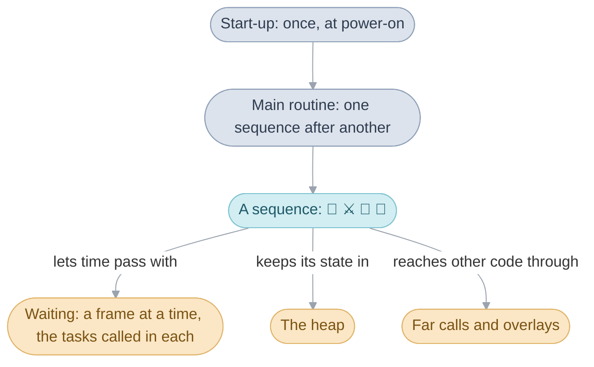

# System

Isaac climbs the steps to the Sanctum and walks through its door. The town
fades out, the hall fades in, and he is standing just inside.

To the player it is one walk with a fade in the middle. Underneath, one part
of the game has ended and another has begun. The town's code has been
cleared out of memory and the Sanctum's fetched from the cartridge. And all
the while the screen kept being redrawn, about 60 times a second, and the
music kept playing.

The System division is the code under every such moment. It wakes the
console and decides which part of the game runs next. It lets time pass one
[frame](glossary.md#frame), one image on the screen, at a time. It lends out
memory, finds code and pictures on the cartridge, plays the sound and writes
the save.

Its code is in five folders:

- [System code](src/system/README.md) holds start-up, the main routine, the
  waiting, the memory and the save.
- [The Game Pak](src/gamepak/README.md) describes the cartridge: how its
  code is laid out, how anything packed on it is found, and the chip the
  saves are written to.
- [Sound](src/sound/README.md) holds the music, the jingles and the sound
  effects, and the driver that plays them.
- [Graphics](src/graphics/README.md) holds every picture, and takes each
  from a file to the screen.
- [Debug scenes](src/debug/README.md) holds the test scenes the developers
  left on the cartridge.

## Start-up

Switching the console on runs the cartridge's first instruction. So does
pressing A, B, Select and Start together, which is why a reset starts the
game exactly as switching on does.

Start-up runs once, from top to bottom, with nothing yet moving. It clears
the memory and copies the routines that must run fastest into the console's
small fast memory. It sets up the interrupts, the console's way of running a
piece of code at a moment of its own choosing, such as the instant an image
has been drawn.

Then it starts the sound and hands over to the main routine, whose first
scene is the Title with its two logos.
[Start-up](src/system/README.md#start-up) goes through it in order.

## The main routine

The [main routine](glossary.md#main-routine) runs for as long as the console
is on, one [sequence](glossary.md#sequence) after another. A sequence is one
whole kind of play. The [field sequence](glossary.md#field-sequence) runs a
[scene](glossary.md#scene), the battle sequence a battle, and the dice and
slots sequences Lucky Dice and Lucky Wheels.

Between two of them the main routine makes a
[transition](glossary.md#transition-and-next-sequence). It clears away
everything the last sequence set up, then reads what runs next from the
[main routine's work](glossary.md#main-routines-work), the one piece of
memory every sequence shares. Walking through the Sanctum's door is a
transition, and so is going into a battle.

When a scene comes next, the main routine puts the
[game flags](glossary.md#game-flag) in order for it, chooses its music and
fetches its code. Then it runs the field sequence until the party takes an
[exit](glossary.md#exit), which names the next scene.

When a battle or a game of dice or slots comes next, that sequence returns a
result, and the result decides the scene the party goes back to. After a win
that is the place it left. After a defeat it is usually the last Sanctum.
[The main routine](src/system/README.md#the-main-routine) follows a pass
from the clearing away to the exit.

## Waiting and tasks

While a villager's line waits for the A Button, the river behind him keeps
flowing. The code that showed the line is standing still at one call,
[`wait(n)`](glossary.md#wait), which runs n frames of the game before it
returns.

Everything is written this way. A sequence, an event or a menu is
straight-line code from start to finish, and the game's loop is inside its
waits.

In each frame, `wait()` calls the [tasks](glossary.md#task), a short list of
functions that each do one frame's share of a job, such as typing a window's
letters or moving the water. Then it gathers the frame's
[sprites](glossary.md#sprite-and-oam) and stops the processor until the
[VBlank](glossary.md#vblank), the pause after the console has drawn one
image and before it starts the next. At that moment an interrupt puts the
finished frame on screen, reads the buttons and mixes the next stretch of
sound.

A task runs inside someone else's wait, so it keeps one rule: it does its
share and returns within the frame. What it notices for the waiting code, it
leaves as a note in that code's [work](glossary.md#work), the block of
memory the code keeps its state in. The code reads the note when its wait
returns.

Three sections of the folder's guide go further.
[The frame loop](src/system/README.md#the-frame-loop) has the frame's order,
with the buttons and the console's sleep.
[The task runner](src/system/README.md#the-task-runner) says how the tasks
are ranked. And
[The stack switch in `wait()`](src/system/README.md#the-stack-switch-in-wait)
explains how a wait from deep inside other code still leaves the tasks room
to run.

### Slowdown

A frame that takes too long misses its VBlank. It still finishes, and the
screen keeps the old image until the next VBlank comes.

Every wait, walk and animation is counted in frames, so they all slow down
together. The music doesn't. It is mixed at every VBlank, so it keeps its
tempo. That is the game's [slowdown](glossary.md#slowdown), and
[What VBlank does](src/system/README.md#what-vblank-does) shows why the
screen never shows half a frame.

## The heap and work

The [heap](glossary.md#heap-and-pools) lends memory to whatever is running.
It works like a pile: blocks are taken one on top of another and go back the
last taken first.

A block that other code has to find again sits in a numbered place, a
[heap slot](glossary.md#heap-slot), and most parts of the game keep their
work in one.

The main routine empties the whole heap at every transition, so nothing a
sequence took outlives it. The main routine's work sits outside the heap so
that it does. [The heap](src/system/README.md#the-heap) explains the heap's
two pools.

## Banks and far calls

Most of the game's code runs straight from the cartridge. That code, the
[main image](glossary.md#main-image), is cut into fourteen
[banks](glossary.md#bank), each starting at a fixed place with room to
spare.

A bank opens with a table of [veneers](glossary.md#veneer), tiny pieces of
code that only jump on, one for each of its functions other banks call. A
[far call](glossary.md#far-call) goes through the veneer. So one bank's code
can grow or shrink without moving anything another bank relies on.

The System's own bank is the exception. The other banks call it directly,
and only the overlays go through its table.
[Why the main image is cut into banks](src/gamepak/README.md#why-the-main-image-is-cut-into-banks)
names the banks and takes a far call apart.

## Overlays

A town's people and events matter only while the party is there, and the
code of all 201 scenes would be too much to keep in memory at once.

So each scene's code is an [overlay](glossary.md#overlay). It sits packed on
the cartridge and is unpacked into one 32 KB area of memory when the party
arrives, over the scene before. The rooms of one place often share their
code, so the 201 scenes need only 96 overlays. Only one is loaded at a time,
so each is complete in itself, with its own copy of any code several scenes
need.

An overlay meets the rest of the game at two tables. The
[entry table](glossary.md#entry-table-and-import-table) at its start answers
the field's questions about the scene: where the party arrives and leaves,
who stands there and what happens there. The import table at its end has one
entry for each function of the main image the scene calls.

The import table is there because the cartridge is too far from the overlay
area for a direct call. So the scene calls through its entry, which leads to
the function's veneer in its bank.

An overlay therefore depends only on the banks' tables, which keep their
order whatever happens to the code behind them.
[How an overlay reaches the rest of the game](src/system/README.md#how-an-overlay-reaches-the-rest-of-the-game)
describes both tables and the unpacking.

## Saving

The cartridge carries a [flash chip](glossary.md#flash-chip), a small memory
that keeps what is written to it with the power off, and the three save
[files](glossary.md#file-and-part) live there. A file holds the game flags,
the main routine's work and where the scene's people stand, kept as two
parts.

A save never writes over the copy it replaces. A new copy of a part is
written into an empty stretch of the chip, numbered one higher than the old
copy, and only then is the old copy marked empty.

So a whole copy of each part survives the power going at any moment, and the
game reads the one with the higher number.
[Saving](src/system/README.md#saving) follows a save onto the chip.

## Sound

Every [sound](glossary.md#sound) is asked for the same way, with one call
and a number, and the number's range says which kind it is. Music is one
kind. A jingle, such as the short tune of a night at the inn, silences the
music until it ends. A sound effect plays over both. Each kind has players
of its own among the sound driver's eight.

Asking for the music already playing changes nothing, so a scene can ask for
its music every time the party arrives and the music carries on.

The driver mixes the next stretch of sound at every VBlank, which is why the
music keeps its tempo through a slowdown.
[What a sound number means](src/sound/README.md#what-a-sound-number-means)
covers the kinds and their players, and
[The sound driver](src/sound/README.md#the-sound-driver) the driver.

## Images

Every picture the game shows, a [map](glossary.md#map)'s tiles, a monster, a
font, the Title, is kept as an ordinary image file with its own colours.
Each build packs it into the colours and pixels the console reads, usually
compressed, and places it on the cartridge where the code looks for it.

The console draws a picture from a palette, a list of 16 or 256 colours.
[How an image is built and placed](src/graphics/README.md#how-an-image-is-built-and-placed)
follows a picture from its file to the cartridge.

## Design

Every sequence starts cold. It builds what it needs from the main routine's
work and the game flags alone, so any scene or battle can follow any other.
The [debug menus](glossary.md#debug-menus)' scene selector relies on it
([The Broken Seal](README.md#why-every-sequence-starts-fresh)).

A task is a bare routine. It carries only its function, its priority and a
flag, so what it works on lives in the work of the code it serves. The flag
keeps it running while a menu pauses the scene's other tasks, as the Battle
Arena and Colosso ask.

Tasks, heap slots and [actors](glossary.md#actor) live in fixed tables, so
memory keeps its shape from one sequence to the next. The order blocks go
back in is kept by the code alone.
