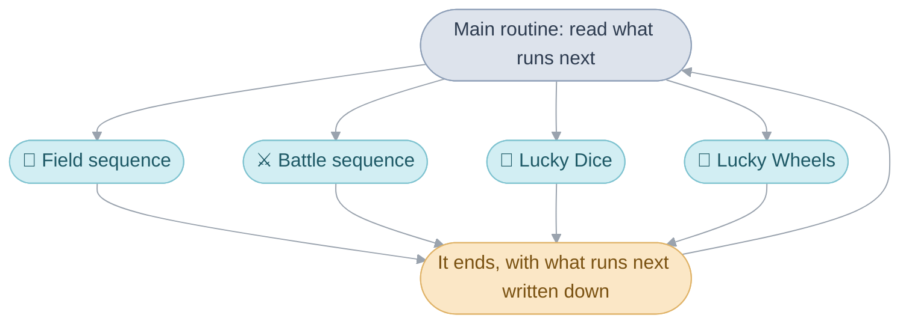
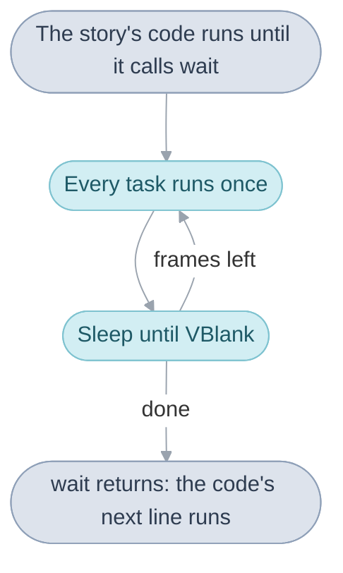

# System

The System is what every other part of the game stands on. It decides what
runs, lets time pass, loads a place's code and writes the save.

Four ideas, and you know how the whole program hangs together.

## The main routine


The game is one routine that starts when the console is switched on and
never returns. All it does is run a [sequence](glossary.md#sequence), wait
for it to end, and run the next one. There are four kinds.



The [field sequence](glossary.md#field-sequence) is one place: a town, a
dungeon floor, the World Map. It ends when the party leaves, and says where
the exit leads. The other three end with a result, such as a battle won or
lost.

Between two sequences the main routine wipes the slate. Every task is
stopped and all the memory the last sequence took is handed back. The cave
you return to after a battle is not the old cave kept waiting. It is built
again from scratch.

So a sequence can pass something on in only two places, the two things that
are never wiped:

- the [main routine's work](glossary.md#main-routines-work), which holds
  the party, their coins, what runs next and how the last sequence ended;
- the [game flags](glossary.md#game-flag), one bit for each thing the game
  remembers, such as a chest being open.

Take the three thieves in Vault's inn. The event that ends in their attack
writes two destinations into the work, one for a win and one for a loss,
asks for a battle, and lets the field sequence end. The battle knows
nothing about Vault. It runs, and writes its result. The main routine reads
the result, picks the matching destination, and starts a fresh field
sequence in the loft.

That is why any sequence can follow any other, and why Camelot's own debug
menu can drop the party into any scene in the game.
[The main routine](src/system/README.md#the-main-routine) goes through one
turn of it, and the routine itself is `MainRoutine_Run` in
[main_routine.c](src/system/main_routine.c).

## Waiting and tasks


The game has no loop at the top that turns once a frame and calls
everything else. Its frame loop is inside one function, [`wait()`](glossary.md#wait),
and this is all of its shape:

```c
void wait(s32 frames) {
  for (frame = 0; frame < frames; frame++) {
    // every task runs once
    // this frame's sprites are put in order
    // sleep until VBlank, when the frame is copied to the screen
  }
}
```

So `wait(10)` does not stand aside while something else runs the game. It
runs ten frames of the game, there and then, and returns.

One piece of code calls it at a time: the code that is telling the story
just now, a cutscene, a menu, the field's own routine. That code is plain C.
It runs once from top to bottom, and wherever it says `wait()` it stands
still while the loop inside goes round.



This is what lets a cutscene or a menu be written as a plain list, top to
bottom, in the order things happen. A night at an inn is: wait, fade to
black, play the tune and wait for it to end, wait, fade back in. No state
is kept between frames to remember how far the night has got: the place in
the code is the memory.

### Tasks

A [task](glossary.md#task) is a function on a short list, which holds 20.
Each trip round the loop calls every task on it once, highest rank first
(the code calls the rank a `priority`). A task does one frame's worth of
something and returns at once: move the actors a step, type the next
letters into a window, swap the river's tiles.

Four things about tasks are easy to get wrong:

- Tasks run only from inside `wait()`. If no code is waiting, nothing in the
  game moves. The river in the picture above flows because the villager's
  code is waiting for a button.
- A task must never call `wait()`. It is being called from inside one, and
  must return for the frame to end.
- A task is a whole piece of work, not a thing in the world. A villager is not a
  task, and neither is a footprint. They are [actors](glossary.md#actor),
  rows in a table, and one task visits all of them each frame.
- The list keeps a function and a rank and nothing else. What a task needs
  to remember lives with whatever put it on the list: the field's work, a
  window's.

Anything may put a task on the list and take it off again. The field and
the windows keep theirs there as long as they run, a scene adds its own for
a waterfall or a puzzle, and the [main routine](#the-main-routine) takes
every one off between two sequences. A few tasks are called from the VBlank
handler instead, once a VBlank: the ones that copy something to the screen.

### Two kinds of waiting

An actor has to pause too: a villager stands a while between two strolls.
It cannot call `wait()`, because the task that moves it has to return. So an
[actor script](glossary.md#actor-script) has a wait of its own, which is
only a number kept in the actor. This is the script of a villager who
wanders near home:

```c
SC_ANIMATION(2),          // walk
SC_WANDER_HOME(4, 8, 16), // pick a spot near home and head for it
SC_SYNC,                  // stay on this line until it arrives
SC_ANIMATION(1),          // stand
SC_WAIT(20),              // stand for 20 frames
```

These are numbers in a table, not code that runs (`SC_` is for script
command). Each frame the actors' task comes to this villager. If his count
is above zero it takes one off and goes on to the next actor; otherwise it
reads his script on from where he stopped. Twenty villagers can all be
part-way through a pause, each with a count of his own.

| | `wait(20)` in C | `SC_WAIT(20)` in an actor script |
| --- | --- | --- |
| What it is | a function that runs 20 frames of the game | an order that sets a count to 20 |
| Who uses it | the one piece of code telling the story | every actor, each for itself |
| Does it hold anything up? | that code stands still | no: the task passes that actor by for 20 frames |
| How many at once | one | as many as there are actors |

The second happens inside the first. The story's code is in `wait()`, the
loop there runs the tasks, one task steps the actors, and each actor counts
its own pause down.

### One waiter at a time

The game has one line of execution, so two pieces of code never wait side
by side. What does happen is one wait after another, at any depth: an event
shows a message, and showing a message waits for the A Button before it
returns.

When two things must take time together, neither of them waits. The code
tells each actor where to go, which returns at once, and then waits once
for both:

```c
Actor_WalkTo(ACTOR_PARTY_LEADER, 120, 96); // returns at once
Actor_WalkTo(ACTOR_GARET, 136, 96);        // so does this
wait(40);                                  // both walk while this runs
```

An event command whose name ends `AndWait` does the last two steps
together: it gives the order, then waits until that actor has arrived.

Because a task cannot wait, it cannot start something long, like a
conversation. It leaves a [request](glossary.md#field-request) instead, and
the field's routine, which is the code waiting, reads the requests each time
its `wait(1)` returns.

If you have used coroutines: the story's code is the one coroutine, and
`wait()` is its yield and the scheduler in one.

[The frame loop](src/system/README.md#the-frame-loop) has a frame's order
in full, and [The task runner](src/system/README.md#the-task-runner) says
which task goes first.

## Overlays

The game has 201 scenes, each with code of its own: what its people say,
what its doors and switches do. That is far more than the console's memory
holds, and a town's code matters only while the party is there.

So each scene's code is kept packed on the cartridge as an
[overlay](glossary.md#overlay), and unpacked on arrival into one fixed
stretch of memory, over whichever overlay was there before. Only one is
ever loaded. Scenes share them, so 96 overlays cover all 201.

Two things follow. The always-loaded part of the game, the
[main image](glossary.md#main-image), knows nothing about any one town: it
asks whichever overlay is loaded the same few questions through a table at
a fixed address. And one overlay can never call another, so code two of
them need is built into both.
[How an overlay reaches the rest of the game](src/system/README.md#how-an-overlay-reaches-the-rest-of-the-game)
shows both directions.

## Saving

A save is the two things that outlive a sequence, the game flags and the
main routine's work, plus where the people in the current scene stand.
Nothing else needs saving, because everything else is rebuilt from those.

That gives a simple rule for new state: if the game should remember it, it
has to live in a flag or in the work. A yes-or-no fact is a flag. Anything
larger goes in the work, which still has stretches no code uses.

The save lives in a [flash chip](glossary.md#flash-chip) on the cartridge,
written in 16 sectors. Each of the three files is two parts of one sector
each, which leaves ten sectors spare. A save writes each part's new copy
into a spare sector, reads it back, and only then retires the old one. If
the batteries die halfway, the old copy is still whole.
[Saving](src/system/README.md#saving) follows a save onto the chip.

## The rest of the System

- [System code](src/system/README.md) is the detail behind this page:
  start-up, the frame, the task list, the heap, saving and the link cable.
- [The Game Pak](src/gamepak/README.md) is the cartridge: how its contents
  are laid out and found, and the flash chip.
- [Graphics](src/graphics/README.md) is how a picture gets from a PNG to
  the screen.
- [Sound](src/sound/README.md) is the music, the jingles and the driver
  that plays them.
- [Debug scenes](src/debug/README.md) are the test rooms and menus Camelot
  left on the cartridge.
