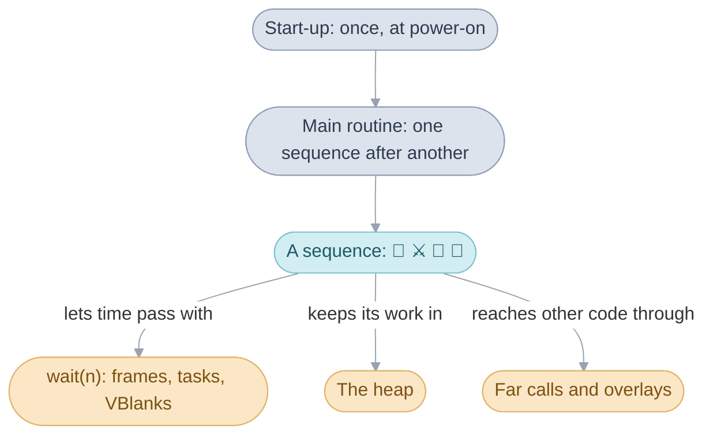
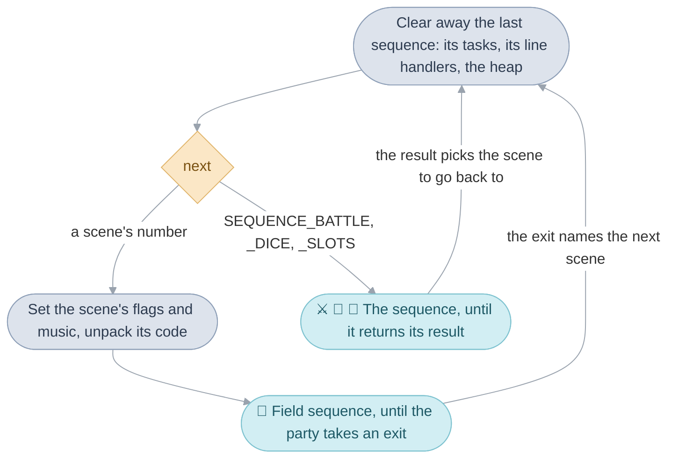
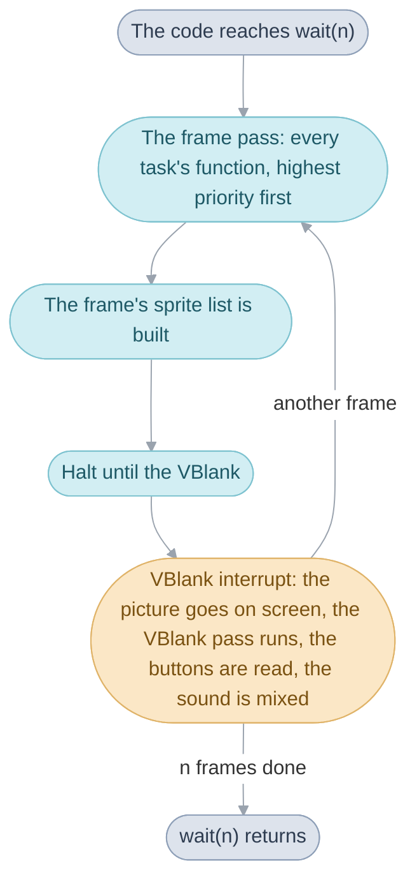
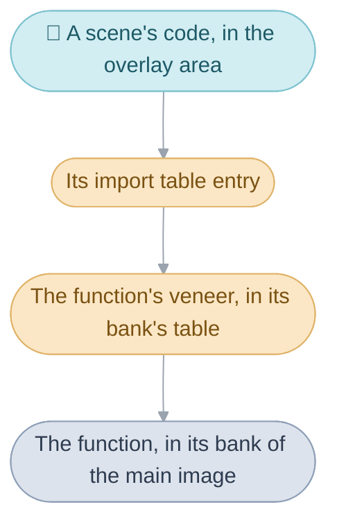
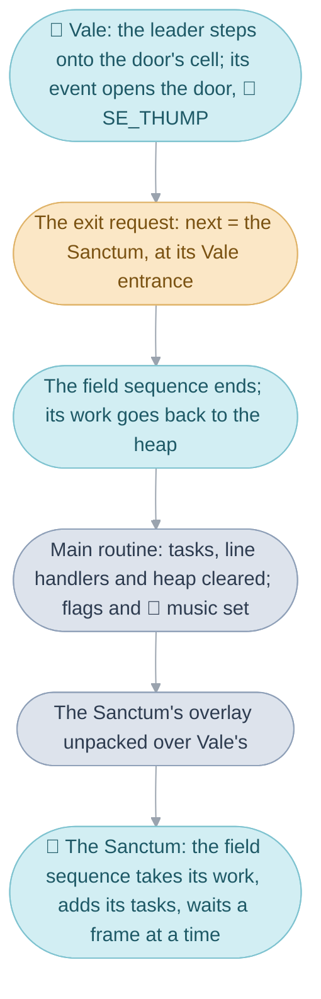

# System


Switch the console on and two logos fade in, then the Title. Press Start,
choose a file, and the party stands in Vale; walk into a cave and a battle
starts; open the Pause menu and save. Every one of those moments runs on the
same base code, the System: it wakes the console, decides which part of the
game runs next, lets time pass a [frame](glossary.md#frame) at a time, lends
out memory, finds code and writes the game to the cartridge. This page takes
the System's mechanisms in the order the console meets them:

1. [Start-up](#start-up) runs once, from the cartridge's first instruction
   to the first scene.
2. [The main routine](#the-main-routine) runs one
   [sequence](glossary.md#sequence) after another until the console is
   switched off.
3. [Waiting and tasks](#waiting-and-tasks) is how a sequence lets time pass:
   `wait(n)` runs n frames, and each frame calls the
   [tasks](glossary.md#task) and ends at a [VBlank](glossary.md#vblank).
4. [The heap and work](#the-heap-and-work) lends a sequence the memory it
   keeps its state in.
5. [Banks and far calls](#banks-and-far-calls) is how code in one part of
   the cartridge calls code in another.
6. [Overlays](#overlays) is how a scene's code reaches memory when the party
   arrives.
7. [Saving](#saving) writes the game to the cartridge's flash chip so that a
   power cut loses nothing.
8. [Sound](#sound) plays the music, the jingles and the sound effects.



The page ends by following one moment, Isaac walking from Vale into the
Sanctum, through the mechanisms in turn. [System code](src/system/README.md)
goes deeper into each.

## Start-up

Start-up puts the console in order once, from its first instruction to the
first scene, and runs again whenever the game is reset.


When the console is switched on, its own logo shows and then the first
instruction of the cartridge runs. Pressing A, B, Select and Start together
runs that same first instruction again: the recording shows Vale giving way
to Camelot's logo, since start-up runs in full both times.

Start-up runs from top to bottom with nothing yet moving. It stops any screen
effect left running, clears the fast memory, empties the
[heap](glossary.md#heap-and-pools) and the task table, copies the routines
that must run fastest into that fast memory, and installs the interrupt
handlers. An interrupt is the console's way of running a piece of code at a
moment of its own choosing: at every VBlank, or when the reset buttons are
pressed. Then it loads the windows' graphics, starts the sound driver, waits
ten frames and hands over to the main routine, which runs for as long as the
console is on. The first scene the main routine runs is the Title, whose own
code draws the two logos.

The cartridge's first instruction leads to `System_Entry`, which sets up the
stacks and calls `System_Initialize`; that ends by calling
`MainRoutine_RunFar`. The reset buttons work through the keypad interrupt,
`Input_HandleKeyInterrupt`, which only marks a reset as wanted; `wait()`
carries it out at the end of the frame. The Title's logos are
`Title_ShowCamelotLogo` and `Title_ShowIntro` in
[title_intro.c](src/menu/title_intro.c).

| Name                | Value                   | Meaning                                       |
| ------------------- | ----------------------- | --------------------------------------------- |
| `KEYCNT_SOFT_RESET` | A, B, Select and Start  | the buttons that raise the keypad interrupt   |
| `IwramResident_Rom` | 5 KB                    | the routines copied into fast memory          |
| `GAME_START_TITLE`  | 0                       | the main routine's first scene is the Title   |

[System code](src/system/README.md#start-up) goes through start-up step by
step.

## The main routine

The [main routine](glossary.md#main-routine), `MainRoutine_Run`, runs one
sequence after another and never returns; everything outside the interrupts
runs under it.


A sequence is one whole kind of play: the
[field sequence](glossary.md#field-sequence) runs a
[scene](glossary.md#scene), the battle sequence a battle, the dice and slots
sequences Lucky Dice and Lucky Wheels. The main routine runs them one at a
time, and between two of them it makes a
[transition](glossary.md#transition-and-next-sequence): it clears away what
the last one set up and reads what runs next. Walking from the World Map into
Vale is a transition, as going into a battle is: the field sequence ends on
the World Map's exit, and the main routine starts it again on Vale.

### A pass of the main routine

Each pass of the main routine's loop does the same work around one sequence.
It begins by stopping whatever the last sequence left running: it empties the
task table (`Task_ResetAll`), removes the handlers the last sequence set for
the HBlank and VCount interrupts (`Irq_SetHandler`) and empties the heap
(`Heap_Initialize`). The HBlank interrupt comes after each of the 160 lines
the console draws, and the VCount interrupt when the drawing reaches a line
the code chose; a sequence uses them for effects that change from one line to
the next, such as the battle's opening split, and a handler left behind would
go on running under the next sequence.

Then the main routine reads what runs next, `gMainRoutineWork.next`, from the
[main routine's work](glossary.md#main-routines-work), the one piece of
memory every sequence shares. A scene's number means the field sequence on
that scene: the main routine sets the scene's flags and music, unpacks its
code and runs the field sequence until the party takes an
[exit](glossary.md#exit). A number above all the scenes means another
sequence:

| Value in `next`   | Runs                                                    |
| ----------------- | ------------------------------------------------------- |
| a scene's number  | the field sequence, on that scene                       |
| `SEQUENCE_BATTLE` | the battle sequence, with the entrance as the formation |
| `SEQUENCE_DICE`   | the dice sequence, Lucky Dice, from its room in Tolbi   |
| `SEQUENCE_SLOTS`  | the slots sequence, Lucky Wheels, from its own room     |



### Arriving in a scene

Before the field sequence starts, `Scene_Arrive` reads the scene's row of the
scene table, `gScenes`, and puts the [game flags](glossary.md#game-flag) in
order for it. On an ordinary arrival it clears the flags that last for one
scene; on entering a new [area](glossary.md#area), a group of scenes sharing
a name and its music, it also clears the flags that last for one area, asks
for the area's name to be shown, as the recording shows for Vale, and makes
this entrance the place Retreat leads back to. Coming back from a battle is
the other kind of arrival, marked by `FLAG_KEEP_PARTY_POSITION`: the flags
stay as they were, and the party is put back where it stood.

Then `Scene_ChooseMusic` picks the scene's music from a rule table by the
scene, its entrance and a flag, `Scene_LoadOverlay` unpacks the scene's code
([Overlays](#overlays)), and `FieldSequence_Run` runs the scene. When it
returns, `Scene_TakeExit` turns the kind of exit it ended on into the next
destination, from the scene's exit table.

### Returning from a battle


The battle, dice and slots sequences return a result, and
`Scene_ReturnFromSequence` turns it into a scene. Sequences pass nothing to
each other directly: everything goes through the main routine's work, which
is a fixed struct beside the game flags, kept outside the heap for the whole
run, and each of its [destinations](glossary.md#destination) is written at a
known moment and read at another:

| When                       | What is written                                                                                |
| -------------------------- | ---------------------------------------------------------------------------------------------- |
| a scene starts             | the return point, this scene and entrance; the after-battle and defeat destinations are cleared |
| an event prepares a battle | the after-battle or defeat destination, where the story should continue                        |
| a random battle starts     | the battle as the next sequence, its formation as the entrance                                 |
| the battle ends            | its result: the number of enemies defeated, `BATTLE_OUTCOME_FLED` or `BATTLE_OUTCOME_LOST`     |

A win or a flight goes to the after-battle destination when an event set one,
or else to the return point with the party put back where it stood: in the
recording, the cave comes back with the party where the battle found it. A
defeat revives the leader at 1 HP and goes to the defeat destination, or else
to the restart point, which is usually the last Sanctum. The result stays in
`gMainRoutineWork.sequenceResult` for the scene that comes back. The main
routine is in [main_routine.c](src/system/main_routine.c), and
[System code](src/system/README.md#the-main-routine) follows a pass in full.

## Waiting and tasks

A sequence lets time pass by calling [`wait(n)`](glossary.md#wait), which runs
n frames of the game before it returns, and the tasks are what keeps moving
while it waits.


While the villager's line waits for A, the event that showed it is standing
still at one call, yet the letters of the next page keep appearing and the
river keeps moving. A sequence, an event or a menu screen is straight-line
code that runs from start to finish, and when time has to pass it calls
`wait(n)`. The game loop is inside that call.

### The frame

A frame is one picture. In each frame, `wait()` calls the function of every
task in the frame pass, gathers the frame's
[sprites](glossary.md#sprite-and-oam) into the list the hardware draws from,
and halts the processor until the next VBlank, the moment about 60 times a
second between one picture on the screen and the next. A task is a function
in the task table, `gTasks`, called once a frame until it is removed: the
windows' typing is one (`WindowSystem_Update`), the map's rippling water
another (`TilesetAnim_Update`). The VBlank interrupt then puts the finished
picture on screen, calls the tasks of the VBlank pass, reads the buttons and
mixes the next stretch of sound, whatever the game's code is doing. Tasks are
added with `Task_Add` and stopped with `Task_Remove`.



A task runs inside the waiting code's `wait()`, so it acts within its one
frame and returns. What it notices for the code it serves, it leaves as a
note in that code's [work](glossary.md#work), and the code reads the note
when its `wait()` returns: the leader's actor script sets the field's
`aButton`, and the field sequence's loop answers it after `wait(1)`.

A task's priority picks its pass and its place in it: the high byte says
whether the frame pass or the VBlank pass runs it, and the low byte ranks it
within the pass, higher first. A battle adds `BattleCamera_Update` at
`TASK_PASS_FRAME - 1`, one below its playback (`BattlePlayback_Run`) and its
other tasks at `TASK_PASS_FRAME`, so the camera is placed after everything
else in the battle's frame has moved.

| Name                | Value   | Meaning                                                  |
| ------------------- | ------- | -------------------------------------------------------- |
| `TASK_PASS_FRAME`   | `0xc80` | the frame pass, run by `wait()` once a frame             |
| `TASK_PASS_VBLANK`  | `0x480` | the VBlank pass, run by the VBlank interrupt             |
| `TASK_COUNT`        | 20      | tasks the table holds at once                            |

### Where the waiting code's stack goes

A wait can come from deep inside other code, when most of the stack is in
use. The stack is the scratch memory every function call takes a little of,
and the tasks that run during the wait need stack of their own. So before it
runs any frames, `wait()` looks at how far the waiting code's stack has
grown: when it has grown below a fixed line, `Ram_FrameWaitStackTop`, the
part below the line is copied aside into `gSavedStack` and the frames run
from that line; when the wait is over the copy is put back. A shallower
caller keeps its own stack. Either way the frame pass and its tasks have at
least 512 bytes, and so does the VBlank's work when the VBlank arrives during
the halt. The copy is made once, so the rule every task keeps is that it
returns within its frame; a task that waited would overwrite the copy the
first wait saved.

### Slowdown

A frame whose work runs past one VBlank still finishes, while the screen
keeps the old picture until the next VBlank. Every wait, walk and animation
is counted in frames, so they all slow down together, while the music, mixed
at every VBlank, keeps its tempo: the game's [slowdown](glossary.md#slowdown).
`gFrameVBlanks` counts the VBlanks since the frame began, and
`gLastFrameVBlanks` keeps the last frame's count, by which the text's typing
paces itself.

### Buttons and sleep


The VBlank interrupt reads the buttons once a VBlank, so a press reaches the
game's code at the start of its next frame. `wait()` turns a held button into
repeats, as when the player holds Down in a menu, and counts the frames L and
R have been held alone: after three seconds the screen turns white for a
second and the console sleeps, with the screen off, until L and R wake it.
It also counts frames with no button held, and sleeps after three minutes of
them when idle sleep is on; the released game turns idle sleep on only in
debug mode, when the File Screen finds no backup memory.

| Name                     | Value      | Meaning                                              |
| ------------------------ | ---------- | ---------------------------------------------------- |
| `INPUT_KEY_REPEAT_FIRST` | 19 frames  | a held button's first repeat, about a third of a second |
| `INPUT_KEY_REPEAT_NEXT`  | 6 frames   | each later repeat, a tenth of a second               |
| `SLEEP_COMBO_FRAMES`     | 180 frames | L and R held alone for three seconds                 |
| `SLEEP_IDLE_FRAMES`      | 10,800 frames | three minutes with no button, with idle sleep on  |

`wait()` is in [frame.c](src/system/system/frame.c), with the VBlank
interrupt's handler, `System_VBlankHandler`.
[System code](src/system/README.md#the-frame-loop) has the frame's order,
[the stack switch](src/system/README.md#the-stack-switch-in-wait) and
[the task runner](src/system/README.md#the-task-runner).

## The heap and work

The heap lends memory to whatever is running, and a sequence keeps its state
in a block of it, its work.

Blocks are taken with `Heap_Alloc` and go back with `Heap_Release`, the last
taken first. A block other code must find again lives in a
[heap slot](glossary.md#heap-slot), a numbered place in `gHeapSlots` taken
with `HeapSlot_Alloc`; asking for a slot that already holds a block returns
that block. Most systems' work, the state each keeps while it runs, is such a
slot under its own name: the field's is `gFieldWork`, a battle's
`gBattleWork`. `Heap_Initialize` empties the whole heap at every transition,
so nothing a sequence took survives it, and a sequence starts with the heap
empty. The main routine's work is the one fixed exception, since it must
outlive every transition.

| Name               | Value | Meaning                                        |
| ------------------ | ----- | ---------------------------------------------- |
| `gHeapSlots`       | 64 words | the two pools' next addresses and 62 heap slots |
| `gIwramHeap`       | 22 KB | the pool in fast memory, tried first           |
| `gEwramHeap`       | 32 KB | the pool in the larger, slower memory          |

[System code](src/system/README.md#the-heap) explains the heap's two pools and
the order blocks go back in.

## Banks and far calls

The [main image](glossary.md#main-image), the code that runs straight from
the cartridge, is cut into [banks](glossary.md#bank), and a far call is how
code in one bank calls a function in another.

Each of the fourteen banks starts at a fixed place with room to spare, and
opens with a table of [veneers](glossary.md#veneer), tiny pieces of code that
only jump on, one for each function other banks call. A
[far call](glossary.md#far-call) goes through the veneer, so one bank's code
can change size without moving anything another bank relies on; a call could
reach every bank from every other, and the tables exist for that freedom. A
veneer has the function's name with `Far` added: the main routine starts a
scene's music with `Sound_PlayFar`, which leads to `Sound_Play`. Other banks
call the System's bank 00 directly; only the overlays go through its table.

| Name           | Value | Meaning                                                 |
| -------------- | ----- | ------------------------------------------------------- |
| a bank         | 14    | stretches of the main image, each at a fixed address    |
| a veneer       | 8 bytes | a load of the function's address and a jump to it     |
| `rom_main_00`  | the System's bank | called directly by the other banks         |

[The Game Pak](src/gamepak/README.md#why-the-main-image-is-cut-into-banks)
says more.

## Overlays

Each scene's code is an [overlay](glossary.md#overlay), a packed piece of code
unpacked into one area of memory when the party arrives.


A town's people and events matter only while the party is there, and all the
scenes' code would be too much to keep in memory at once. So each scene's
code sits packed on the cartridge, and `Overlay_Load` unpacks it into one
32 KB area of memory, `gOverlayArea`, over the scene before: leaving the house
in the recording unpacks Vale's code over the room's. The 201 scenes share 96
overlays, since the rooms of one place often share their code; fourteen
scenes on and around Crossbone Isle run one. Only one is loaded at a time, so
each overlay is complete in itself, with its own copy of the code several
scenes need.

An overlay meets the rest of the game at two tables. At its start, the
[entry table](glossary.md#entry-table-and-import-table),
`struct SceneEntryPoints`, gives the field sequence the scene's set-up and
the tables of where the party arrives and leaves, who stands there and what
happens there; the rest of the game reaches a scene only through it. At its
end, the import table has one entry for each main-image function the scene
calls. A direct call reaches only a few megabytes either way, and the
cartridge lies far beyond that from the overlay area, so the scene calls
through its entry, which leads to the function's veneer in its bank's table,
and from there to the function itself. An overlay therefore
depends only on each bank's table, which keeps its order, whatever happens to
the code behind it.



| Name            | Value   | Meaning                                                |
| --------------- | ------- | ------------------------------------------------------ |
| `gOverlayArea`  | 32 KB   | the one area every overlay is unpacked into            |
| overlays        | 96      | 93 scene overlays and 3 for the debug menus            |
| the entry table | 6 entries | set-up, entrances, exits, actors, triggers, exit regions |

[System code](src/system/README.md#how-an-overlay-reaches-the-rest-of-the-game)
describes both tables and the unpacking.

## Saving

Saving writes the game to the cartridge's [flash chip](glossary.md#flash-chip)
so that a power cut during a save loses nothing.


The cartridge holds three [files](glossary.md#file-and-part), each the game
flags, the main routine's work and where the scene's people stand. A file is
kept as two parts, and a new copy of a part is written into an empty sector
of the flash chip, numbered one higher than the old copy, before the old copy
is marked free. A whole copy of each part therefore always survives, and the
game reads the one with the higher number. The Save command is
`Save_ToChosenFile`, and `Save_WritePart` writes a part.

| Name                | Value | Meaning                                      |
| ------------------- | ----- | -------------------------------------------- |
| `SAVE_FILE_COUNT`   | 3     | save files                                   |
| `SAVE_SECTOR_COUNT` | 16    | sectors of the flash chip, 4 KB each         |
| `SAVE_PART_BYTES`   | 4 KB  | one of a file's two parts, one sector        |

[System code](src/system/README.md#saving) has the sectors and how a free one
is chosen.

## Sound

Every [sound](glossary.md#sound), music, a jingle or an SE, is asked for with
`Sound_Play` and a number, and the sound driver plays it.


The number's range says which kind of sound it is: below 80 music, from 80 to
99 a jingle, such as the short tune of a night at the inn, which silences the
music until it ends, and from 100 up an SE, a sound effect. The driver has
eight players, and each kind of sound has its own, so an SE plays over the
music. Asking for the music already playing changes nothing, so a scene can
ask for its music each time the party arrives and the music carries on. A few
numbers are orders, such as fading the music out. The driver mixes the next
stretch of sound at every VBlank, inside the VBlank interrupt, which is why
the music keeps its tempo through a slowdown. The driver is Nintendo's
MusicPlayer2000, with the mixing code it copies into fast memory.

| Name                 | Value | Meaning                                   |
| -------------------- | ----- | ----------------------------------------- |
| `SOUND_JINGLE_FIRST` | 80    | the first jingle; below it is music       |
| `SOUND_SE_FIRST`     | 100   | the first SE                              |
| music players       | 8     | music, the jingles, and six for the SEs   |

[Sound](src/sound/README.md#what-a-sound-number-means) covers the players.

## From Vale into the Sanctum


Isaac climbs the steps and walks into the Sanctum's door. To the player it is
one walk with a fade in the middle; to the System it is the end of one
sequence and the start of another, and each mechanism above does its part.



### The door

The main routine is running the field sequence on Vale, and the field
sequence's loop is in `wait(1)` while Isaac walks. In one of those frames the
actors' task walks him onto the door's cell, and the field notes the step as
a request. When `wait(1)` returns, the loop finds it, and Vale's trigger
table names the door's event, `Vale_EnterSanctum`: 📣 `SE_THUMP` sounds, the
door's cells animate open, Isaac walks through, and the event asks for the
exit `VALE_TO_SANCTUM`. Each of those commands is a far call from the
overlay into the main image, through Vale's import table. The exit is a
request too, so once the event returns the loop finds it and ends the scene,
returning the kind of exit to the main routine. On its way out the field
sequence gives its work back to the heap. The main routine looks the exit up
in Vale's exit table:

```c
SCENE_EXIT(VALE_TO_SANCTUM, Sanctum, SANCTUM_FROM_VALE),
```

`Scene_TakeExit` writes the Sanctum's scene number as what runs next and
`SANCTUM_FROM_VALE` as its entrance, and the pass ends.

### The transition

The next pass begins by clearing Vale away: `Task_ResetAll` empties the task
table, the actors' task and the windows' task with it, `Irq_SetHandler` drops
any line handler, and `Heap_Initialize` empties the heap. `Scene_Arrive` then
clears the flags that last for one scene. The Sanctum belongs to Vale's area,
so the area's flags stay, and its name stays off the screen.
`Scene_ChooseMusic` picks the Sanctum's music by the story: its rules test
`FLAG_SANCTUM_QUEST_ACCEPTED` and `FLAG_SOL_SANCTUM_ERUPTED`, and the main
routine asks for the music through `Sound_PlayFar`, a far call into the sound
bank.

### The overlay

`Scene_LoadOverlay` reads the Sanctum's row of the scene table for its packed
code and `Overlay_Load` unpacks it into the overlay area, over Vale's. The
Sanctum is one scene, `SceneId_Sanctum`, holding six Sanctums, Vale's among
them, and its entry table answers for whichever entrance the party arrives
at.

### The Sanctum

`FieldSequence_Run` takes `gFieldWork` from a heap slot, loads the Sanctum's
map, places Isaac at `SANCTUM_FROM_VALE` through the entry table's
entrances, adds its tasks and calls the overlay's set-up, then fades in and
goes back to `wait(1)` a frame at a time. In each frame the frame pass moves
the actors and types any window, the sprite list is built, and the VBlank
interrupt shows the picture, reads the buttons and mixes the music. Should
the player open the Pause menu and save here, the flags and the main
routine's work go to the flash chip as they now stand, the Sanctum included.

### The same moment, mechanism by mechanism

| Step                                 | Mechanism                                                     |
| ------------------------------------ | ------------------------------------------------------------- |
| Isaac walks up the steps             | the frame: `wait(1)` runs the actors' task each frame         |
| The door's cell is reached           | the step request, answered when `wait(1)` returns             |
| The door opens and Isaac walks in    | the event's commands, far calls through the import table      |
| The field sequence ends              | the main routine: the exit table names the next scene         |
| Vale is cleared away                 | the transition: the task table, the line handlers, the heap   |
| The Sanctum's flags and music        | the main routine: `Scene_Arrive`, `Scene_ChooseMusic`         |
| The music is asked for               | a far call, `Sound_PlayFar`, into the sound bank              |
| The Sanctum's code arrives           | the overlay, unpacked into the overlay area                   |
| The field sequence starts again      | the heap: its work in a heap slot; its tasks in the table     |
| The hall fades in and Isaac walks    | the frame and the VBlank interrupt, as before                 |
| A save from here                     | saving: the flags and the main routine's work to the flash    |

## Design

Every sequence starts cold: after the transition's clearing away it builds
what it needs from the main routine's work and the game flags alone, so any
scene or battle can follow any other. A task is a bare routine:
`struct Task` holds only `func`, its priority and its flags, so what it works
on lives in its system's work, in a heap slot the same clearing empties. Bit
0 of its flags keeps it running while a menu suspends the scene's own tasks
(`Task_SuspendOverlayTasks`), as the Battle Arena and Colosso ask.

The [debug menus](glossary.md#debug-menus) use the cold start: the scene
selector, `DebugSceneSelect_Run`, sets any scene and entrance as the
destination, and the main routine starts it like any other.

Tasks, heap slots and [actors](glossary.md#actor) live in fixed tables, and
heap blocks go back newest first or all at once at a transition, so memory
keeps its shape from one sequence to the next; the order is kept by the code
alone.

## Limits

- The frame pass and its tasks have at least 512 bytes of stack, and a task
  returns within its frame.
- 20 tasks and 62 heap slots at a time.
- A scene's code fits in the 32 KB overlay area, and a bank's code ends
  where the next bank begins.
- Eight music players; sound numbers run from 0 to 4,095.
- Three files, each two parts, in the flash chip's 16 sectors.
