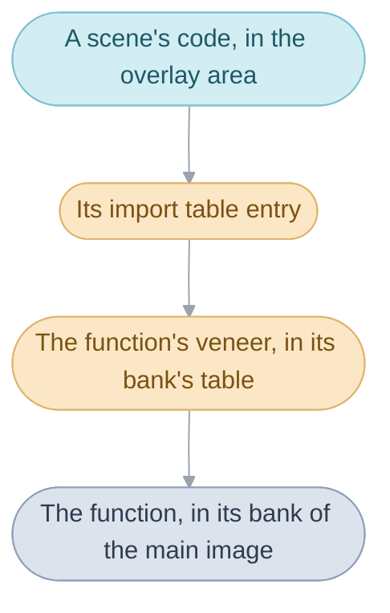

# System

The console draws its picture one line at a time, 160 lines from top to
bottom, then pauses for about as long as 68 more lines: the
[VBlank](glossary.md#vblank), about 59.73 times a second. The game prepares
one picture in each [frame](glossary.md#frame), and the sprites, scroll and
queued register writes of a frame reach the screen together, at the VBlank
after the frame is finished. The System, the first
division of Camelot's credits, is the code that keeps that beat and that
Field, Battle and User Interface stand on.

## Start-up

Before the first logo, the game puts memory in order, starts the interrupts,
the sound and the task table, copies the routines that must run fastest into
fast memory, and after ten frames starts the
[main routine](glossary.md#main-routine), whose first scene, the Title, draws
the logos (`Title_ShowCamelotLogo` and `Title_ShowIntro`). A soft reset
starts again from the first instruction, so start-up runs again in full. The
cartridge's first instruction leads to `System_Entry` and
`System_Initialize`, which ends by calling `MainRoutine_RunFar`.
`Title_ShowIntro` is in [title_intro.c](src/menu/title_intro.c), and
[System code](src/system/README.md#start-up) goes through start-up step by step.

## The main routine

The main routine runs one [sequence](glossary.md#sequence) after another and
never returns; everything outside the interrupts runs under it. Each pass
begins with a [transition](glossary.md#transition-and-next-sequence): it
empties the [task](glossary.md#task) table (`Task_ResetAll`), removes the
handlers the last sequence set for the HBlank and VCount interrupts
(`Irq_SetHandler`) and empties the [heap](glossary.md#heap-and-pools)
(`Heap_Initialize`). The HBlank interrupt comes after each of the 160 lines
the console draws, and the VCount interrupt when the drawing reaches a line
the code chose; a sequence uses them for effects that change from one line to
the next, such as the field's screen transitions and the battle's opening
split, and a handler left behind would go on running under the next
sequence. Then the main routine reads what
runs next, `gMainRoutineWork.next`, from the
[main routine's work](glossary.md#main-routines-work). A
[scene](glossary.md#scene), a row of the scene table such as Vale, the Title
or the File Screen, gets its flags and music set and its code unpacked, and
the [field sequence](glossary.md#field-sequence) runs it until the party
takes an exit. An id above the scene table's rows runs another sequence
(`SEQUENCE_NONE` runs nothing, and nothing in the game asks for it):

| Id                | Runs                                                    |
| ----------------- | ------------------------------------------------------- |
| `SEQUENCE_BATTLE` | the battle sequence, with the entrance as the formation |
| `SEQUENCE_DICE`   | the dice sequence, Lucky Dice in Tolbi's game room      |
| `SEQUENCE_SLOTS`  | the slots sequence, Lucky Wheels in the same room       |

Sequences pass nothing to each other directly. Everything goes through the
main routine's work and the [game flags](glossary.md#game-flag). The work,
`gMainRoutineWork`, is a fixed `struct MainRoutineWork` beside the flags,
never freed and in no heap slot:

| When                       | What is written                                                                                |
| -------------------------- | ---------------------------------------------------------------------------------------------- |
| a scene starts             | the return point (this scene and entrance); no after-battle or defeat destination              |
| an event prepares a battle | the after-battle or defeat destination, where the story should continue                        |
| a random battle starts     | the battle as the next sequence, its formation as the entrance                                 |
| the battle ends            | its result: the number of enemies defeated, `BATTLE_OUTCOME_FLED` or `BATTLE_OUTCOME_LOST`     |

After any sequence but the field sequence, `Scene_ReturnFromSequence` reads
the destinations back. A win or a flight goes to the after-battle destination, or else to
the return point with the party where it stood. A defeat revives the leader
at 1 HP and goes to the defeat destination, otherwise to the restart point,
which is usually the last Sanctum. The result stays in
`gMainRoutineWork.sequenceResult` for the scene that comes back. The main
routine is `MainRoutine_Run` in
[main_routine.c](src/system/main_routine.c).

## Waiting and tasks

While a villager's line types out and waits for A, the event that showed it
is stopped inside one call, yet the letters keep appearing and the river
keeps moving. A sequence, an event or a menu screen is straight-line code
that runs from start to finish, and when time has to pass it calls
[`wait(n)`](glossary.md#wait) to let n frames go by. What keeps moving
meanwhile is a task, a short routine run once a frame whatever the waiting
code is doing: the windows are one (`WindowSystem_Update`), the map's
animated tiles another (`TilesetAnim_Update`). Each frame, `wait()` runs
every task in the frame pass once, builds the frame's sprites and halts
until the VBlank. The VBlank interrupt puts the finished picture on
screen, runs the VBlank pass (`TASK_PASS_VBLANK`), reads the buttons and
mixes more sound. Tasks are added with `Task_Add` and stopped
with `Task_Remove`.

A priority's high byte picks the pass and its low byte ranks the task within
it, higher first. A battle adds `BattleCamera_Update` at
`TASK_PASS_FRAME - 1`, one below the battle's playback (`BattlePlayback_Run`)
and its other tasks at `TASK_PASS_FRAME`, so the camera is placed after
everything else in the battle's frame has run.

A wait can come from deep inside other code, when most of the stack is in
use. When the waiting code's stack has grown below a fixed line,
`Ram_FrameWaitStackTop`, `wait()` copies the part below the line aside to
`gSavedStack` and runs its frames from that line; a shallower caller keeps its
own stack. Either way the frame pass and its tasks have at least 512 bytes,
and so does the VBlank's work when the VBlank arrives during the halt. A task
runs inside `wait()`, so a task that waited would overwrite the copy the
first wait saved; no task does, and nothing checks.

### Slowdown

A frame whose work runs past one VBlank still finishes, while the screen
keeps the old picture until the next. Every wait, walk and animation is
counted in frames, so they all slow down together, while the music, mixed
each VBlank, keeps its tempo: the game's [slowdown](glossary.md#slowdown).
`gFrameVBlanks` counts the VBlanks since the frame began, and
`gLastFrameVBlanks` keeps the last frame's count, by which the text's typing
paces itself. [System code](src/system/README.md#the-frame-loop) has the
frame's order, [the stack
switch](src/system/README.md#the-stack-switch-in-wait) and [the task
runner](src/system/README.md#the-task-runner).

## The heap and work

The heap lends memory to whatever is running. Blocks are taken with
`Heap_Alloc` and go back with `Heap_Release`, the last taken first. A block
other code must find again lives in a
[heap slot](glossary.md#heap-slot), a numbered place in `gHeapSlots` taken
with `HeapSlot_Alloc`. Most systems' [work](glossary.md#work), the state each
keeps while it runs, is such a slot under its own name, as `gFieldWork` and
`gBattleWork` are. `Heap_Initialize` empties the heap at every transition,
so nothing a sequence took survives it. The main routine's work is the one
fixed exception, since it must outlive every transition.
[System code](src/system/README.md#the-heap) explains the heap's two pools, in
IWRAM and EWRAM.

## Banks and far calls

The [main image](glossary.md#main-image), the code that runs straight from
the cartridge, is laid out in fourteen [banks](glossary.md#bank), each
starting at a fixed place with room to spare. Each bank opens with a table
of [veneers](glossary.md#veneer), tiny pieces of code that only jump on, one
for each function other banks call, and a [far call](glossary.md#far-call)
goes through the veneer, so one bank's code can change size without moving
anything another relies on. Distance isn't the reason: a call can reach every
bank from every other. Other banks call the System's bank 00 directly;
only the overlays go through its table. A veneer has the function's name with
`Far` added: the main routine starts a scene's
music with `Sound_PlayFar`, which leads to `Sound_Play`.
[The Game Pak](src/gamepak/README.md#why-the-main-image-is-cut-into-banks)
says more.

## Overlays

Each scene's code is an [overlay](glossary.md#overlay), unpacked by
`Overlay_Load` into one 32 KB area when the party arrives, over the scene
before. A town's people and events matter only while the party is there, and
all the scenes' code would not fit in memory at once. The 201 scenes share
96 overlays, since the rooms of one place often share their code: fourteen
scenes on and around Crossbone Isle run one. Only one is loaded at a time, so
overlays never call each other, and each overlay has its own copy of the code
several scenes need.

At an overlay's start, its
[entry table](glossary.md#entry-table-and-import-table),
`struct SceneEntryPoints`, gives the field sequence the scene's set-up and
the tables of where the party arrives and leaves, who stands there and what
happens there; the rest of the game reaches a scene only through it. At its
end, the import table has one entry for each main-image function the scene
calls. A direct call cannot reach the cartridge from the overlay area, so the
scene calls through its entry, which leads to the function's veneer in its
bank's table. An overlay therefore depends only on each bank's table, which
keeps its order, and not on where the function itself lies.

[System code](src/system/README.md#how-an-overlay-reaches-the-rest-of-the-game)
describes both tables.

## Saving

The cartridge holds three [files](glossary.md#file-and-part), each the game
flags, the main routine's work and the actors, and a power cut during a save
cannot lose one. A file is kept as two parts, and a new copy of a part,
numbered one higher than the old, is written into an empty sector of the
flash chip before the old copy is marked free. A whole copy of each part
always survives, and the game reads the one with the higher number. The Save
command is `Save_ToChosenFile`, and `Save_WritePart` writes a part.
[System code](src/system/README.md#saving) has the sectors and how a free one is
chosen.

## Sound

Every [sound](glossary.md#sound), music, a jingle or an SE (a sound effect),
is asked for with `Sound_Play` and a number whose range says which it is:
below 80 music, from 80 to 99 a jingle (`SOUND_JINGLE_FIRST`), such as the
short tune when an item is found, which silences the music until it ends,
and from 100 up an SE (`SOUND_SE_FIRST`). The driver has eight players, and
each kind of sound has its own, so an SE never stops the music. Asking for
the music already playing does nothing, so a scene can ask for its music
each time the party arrives and the music carries on. A few numbers are
orders, such as
"fade the music out". The driver is Nintendo's MusicPlayer2000.
[Sound](src/sound/README.md#what-a-sound-number-means) covers the players.

## Images

Every image the game shows, the [maps](glossary.md#map)' tiles, the monsters,
the fonts and the Title, is kept as an indexed PNG with its own colours. Each
build packs it into the colours and pixels the console reads, usually
compressed, and places it on the cartridge under the name the code uses. The
console draws each image from a palette of 16 or 256 colours, and a 16-colour
image also carries its palette number, which picks one of sixteen palettes.
[Graphics](src/graphics/README.md#how-an-image-is-built-and-placed) shows how
an image is built and placed.

## Design

Every sequence starts cold: after the transition's teardown it builds what
it needs from the main routine's work and the game flags alone, so any scene
or battle can follow any other. A task is a bare routine: `struct Task`
holds only `func`, its priority and its flags, so what it works on lives in
its system's work, in a heap slot the same teardown empties. Bit 0 of its
flags keeps it running while a menu suspends the scene's own tasks
(`Task_SuspendOverlayTasks`), as the Battle Arena and Colosso ask.

The [debug menus](glossary.md#debug-menus) use the cold start: the scene
selector, `DebugSceneSelect_Run`, sets any scene and entrance as the
destination, and the main routine starts it like any other.

Tasks, heap slots and [actors](glossary.md#actor) live in fixed tables, and
heap blocks go back newest first or all at once at a transition, so memory
never fragments; nothing checks the order.

## Limits

- The frame pass and its tasks have at least 512 bytes of stack, and a task
  must not wait.
- 20 tasks and 62 heap slots at a time.
- A scene's code fits in the 32 KB overlay area, and a bank's code ends
  where the next bank begins.
- Eight music players; sound numbers run from 0 to 4,095.
- Three files, each two parts, in the flash chip's 16 sectors.
