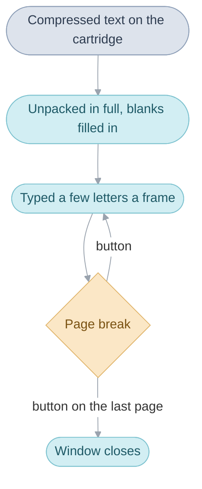

# User Interface

Everything the player reads or chooses over the field comes in a box with a
[border](glossary.md#border): what people say, the field menu and its screens,
the Pause menu, the shop, sanctum and inn counters. The
user interface draws those boxes ([windows](glossary.md#window)), types the
game's [messages](glossary.md#message) into them, runs the field menu's four
screens
([Psynergy](glossary.md#psynergy-and-pp), [Djinn](glossary.md#djinn), Item and
Status), and runs the counters where the [party](glossary.md#the-party) spends
its coins.

All the windows share one [background layer](glossary.md#background-layer),
`BG0`, and the map keeps the other three, so opening windows does not change
how the map is drawn, except on the World Map, where the tilted view is first
redrawn as a still picture ([World Map](field.md#the-world-map)). A message typed on the field, the portraits and the pointing
hand are [sprites](glossary.md#sprite-and-oam) riding on the windows.

## Windows

Opening, a window grows from its centre, and closing, it shrinks back into it;
nothing is written in a window until it has reached full size. A
closing window still counts against the eight that can be open at once
(`WINDOW_COUNT`) until it has shrunk away. `Window_Create` opens a window and
`Window_UpdateZooms` grows and shrinks them, once a
[frame](glossary.md#frame); [Windows](src/window/README.md#windows) has the
rest.

| Name | Value | Meaning |
| --- | --- | --- |
| `WINDOW_OPEN_FRAMES` | 8 | frames a window takes to open |
| `WINDOW_CLOSE_FRAMES` | 4 | frames a window takes to close |
| `WINDOW_COUNT` | 8, or 12 in Japanese | windows open at once |

## Messages

The cartridge stores the game's text compressed (Huffman-coded), and a message
is unpacked in full, its blanks (a name, a number, an item) filled in, before
the first letter appears. Doing the slow work once, ahead of time, leaves each
frame's typing cheap. The letters then appear a few at a time, with the
speaker's voice blip, and each page break waits for a button.

`Message_OpenWindow` does all of it for one message. The text itself is in
`games/tbs/text`, one PO catalog per language, and code refers to a message by
its linker symbol, such as `MsgGameSaved`.
[Windows](src/window/README.md#decoding-a-message)
goes through decoding, [the text buffer](src/window/README.md#the-text-buffer)
and [typing](src/window/README.md#typing).

## The field menu

Pressing A with nothing in front of the leader, or Select, opens a row of
icons: Psynergy, Djinn, Item and Status, the Djinn icon only once the first
Djinni has joined. Each opens a screen; backing out of it brings the icons
back. While a screen is open the scene's people are held behind it, and so
are the weather and the map's animations, with the exceptions under
[Limits](#limits).

`FieldMenu_Run` draws the row and calls the chosen screen through the menu
[bank](glossary.md#bank). The screens share one block of memory, the menu
[work](glossary.md#work), since only one runs at a time;
[Menus](src/menu/README.md#the-screens) goes through each screen.

### Closing a screen with Start

Start closes a screen at once, however many choices deep the player is. A
small [task](glossary.md#task) plays the cancel sound and raises a
[game flag](glossary.md#game-flag); every loop of the screen checks that flag
beside its own buttons and returns as if the player had backed out, so the
loops unwind one after another without any of them knowing how deep the
player was. The Djinn screen checks for Start in its own choosers instead. The
task is `Menu_UpdateCancelSound`, and the flag `FLAG_MENU_START_PRESSED`.

### Psynergy and items used on the field

Psynergy or an item used on a party member works inside the screen, but
Psynergy meant for the world, such as Move, is cast by the field after the
menu has closed. Only the running scene knows what the leader is facing and
what its own [triggers](glossary.md#trigger) do with it, and none of that
runs while the menu is open. So the screen writes down what was chosen and
closes, and the scene decides what Move does to that pillar.

The screen writes its choice into the field work (`gFieldWork`), and
`FieldSequence_Run` hands it to `Field_UsePsynergy` or `Field_UseItem`.

## The Pause menu and saving

Pressing Start on the field brings up the Pause menu: `Save your quest`,
`Sleep` and `Change settings`. Saving asks which of three files in the
cartridge's backup memory to use and writes the game into it: among the rest,
the game flags, the
[main routine's work](glossary.md#main-routines-work) and where the scene's
people stand. Sleep stops the console until L and R are pressed together, and
Change settings sets the window colour, the message speed, Speech (whether
people talk with voice blips) and Auto-Sleep. `PauseMenu_Run` runs the menu,
`Save_ToChosenFile` saves and `SettingsMenu_Run` runs the settings;
[Windows](src/window/README.md#the-pause-menu) has each.

## Shops, sanctums and inns

A town's counters are its shops, sanctums and inns, each opened by the town's
[scene](glossary.md#scene) when the player talks to the keeper. A shop sells
what its row of a stock table lists, and the rare items (artifacts), which
share one counter across the game: every shop of a kind sells a rare item once
any shop of that kind has listed it, until it is bought. A sanctum's priest revives, cures
and lifts curses for a fee. An inn restores the HP and PP of the party members
still standing, at a price for each of them.

A scene opens a shop with `Shop_Run`, a sanctum with `Sanctum_Run` and an inn
with `Inn_CheckIn`. The counters borrow the field menu's memory, since the two
are never open together. [Shops](src/shop/README.md#shops) has the stock
tables and buying, [the sanctum's services](src/shop/README.md#sanctums) their
fees and [the inn](src/shop/README.md#inns) its prices.

## Limits

- A window must be 2 to 30 tiles wide and high to be drawn, on a screen of 30
  by 20 tiles.
- Three messages being typed at once, 64 sprites carried by windows and eight
  message blanks; a ninth blank is dropped.
- The text buffer holds 512 letter codes (256 in Japanese).
- The menu work is 2,672 bytes and has room for eight party members, though
  this game's party is at most four, and 32 entries in a list; a party member carries 15 items.
- In Japanese the weather and the map's animations go on behind the Item and
  Psynergy screens, and in English behind the Psynergy screen.
- A shop sells at most 24 items and 8 artifacts.
