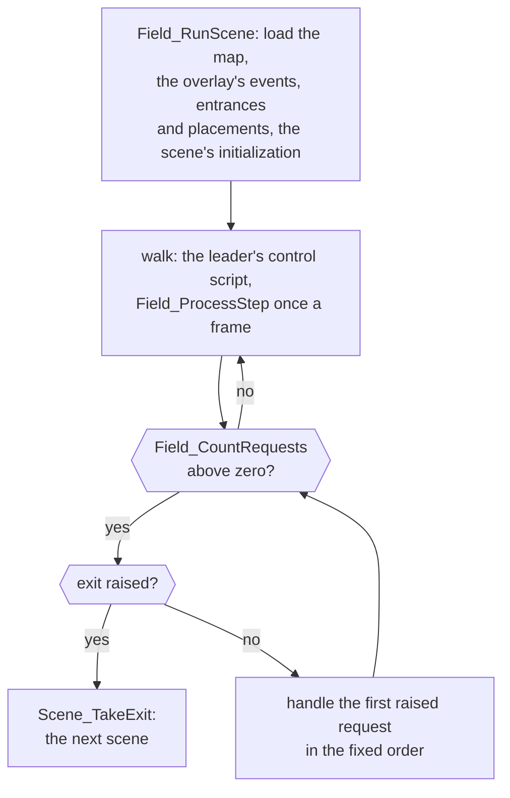

# World

The field is the layer that runs every place the party walks: towns, dungeons
and the world map. The engine in `src/field` moves objects and draws maps,
`src/object` runs a field scene and its requests, each place's overlay in
`src/scene` supplies its tables and events, and `src/map` holds the map data.
How scenes and overlays fit into the whole game is on [the front
page](README.md).

## The scene loop and its requests

A field scene is one loop that lets the leader walk until something raises a
request, and then handles the requests one at a time in a fixed order.

`Field_RunScene` runs one field scene. It loads the map, calls the overlay's
entries for its events, entrances and placements, then the scene's
initialization, which may take an exit at once. Then, while nothing is
pending, the leader runs its control script and `Field_ProcessStep` checks the
ground underfoot once a frame. Anything that should interrupt the walk (an
event cell, a random battle, the A button, a menu, an exit) raises a request,
a field of the field work, and the walk stops as soon as `Field_CountRequests`
isn't zero.

The loop then handles the requests one at a time in a fixed order, starting
again from the top after each, and `exit` is first. An exit therefore always
wins: when an event's script takes an exit, the scene ends before any other
request raised with it is handled, and `Scene_TakeExit` loads the next scene.
Because requests are fields rather than a queue, each kind holds at most one.

This shape is why scene code is written as straight-line cutscenes. A handler
runs its script to the end, waiting with `WaitFrames` as it goes, and the walk
resumes only when every request is done. Whatever must move during a cutscene
runs as a task or an object script.

A random battle is an exit too. Its handler saves the actors with
`ObjectTable_Snapshot`, sets the next scene to `SCENE_BATTLE` and raises
`EXIT_NONE`. After the battle, `Scene_ReturnFromBattle` loads the field scene
again with `FLAG_KEEP_PARTY_POSITION` set, and `ObjectTable_Restore` puts the
actors back where they stood.

| Name | Value | Meaning |
| --- | --- | --- |
| `SCENE_BATTLE` | `0x1fe` | the next scene a battle request writes |
| `EXIT_NONE` | 999 | the exit result that means the next scene is already set |
| `FLAG_KEEP_PARTY_POSITION` | `0x109` | the next field scene starts where the party was |

[Field objects](src/object/README.md#the-scene-loop-handles-requests-not-events)
lists the requests in order, with a picture of them changing as Isaac walks
through a door, and goes through each handler.

## Scene entries

A place's overlay tells the field engine everything about the place through
six functions at its start.

The six (`struct SceneEntries`) are the scene's initialization and the
functions that return its events, entrances, exits, placements and exit
regions. How an overlay is loaded and how it calls back into the main image is
in [Engine](engine.md#overlays).

They are functions rather than pointers to tables so that a scene can answer
differently as the story moves on, and the engine needs no notion of story
state. Vault's `Scene_GetEvents` returns `gVault_EventsAfterThieves` once
`FLAG_VAULT_THIEVES_JAILED` is set, and `gVault_Events` before. Placement and
exit rows also carry conditions of their own. The front page describes [how
scenes depend on the story](README.md#how-scenes-depend-on-the-story) across
the game.

`Scene_FindEvent` reads the event table from the top and runs the first row
whose kind, trigger and condition fit, so a later row for the same actor or
cell runs only where every earlier row's condition fails.

[Scenes](src/scene/README.md#the-entry-table) describes the entry table, the
tables it returns and [how an event is
chosen](src/scene/README.md#how-an-event-is-chosen), and
[Places](src/field/scenes.s) lists every scene in story order.

## Scene and place flags

A scene doesn't undo its changes when the party leaves; instead two ranges of
game flags are cleared when the party comes back.

`Scene_ResetFlagsOnEnter` clears the scene's 256 flags (`FLAG_SCENE_FIRST` to
`FLAG_SCENE_LAST`) on every ordinary entrance, and the place's 256
(`FLAG_PLACE_FIRST` to `FLAG_PLACE_LAST`) whenever the party enters a
different group of scenes. A pushed pillar kept in a `FLAG_SCENE_TEMP_xx` flag
is therefore back in place the next time the party comes in, and state that
should last while the party is anywhere in the place goes in a
`FLAG_PLACE_TEMP_xx` flag. `FLAG_KEEP_PARTY_POSITION` keeps both ranges, so
returning from a battle restores the room as it was left.

| Name | Value | Meaning |
| --- | --- | --- |
| `FLAG_SCENE_FIRST` | `0x200` | the first of the scene's 256 flags |
| `FLAG_SCENE_LAST` | `0x2ff` | the last of them |
| `FLAG_PLACE_FIRST` | `0x300` | the first of the place's 256 flags |
| `FLAG_PLACE_LAST` | `0x3ff` | the last of them |

[Scenes](src/scene/README.md#state-that-cleans-itself-up) says how a scene
uses them.

## Field objects and their scripts

Everything that moves on the field is a field object, and every object in use
runs an object script.

The objects are the 64 slots of `gObjectSlots`, each 112 bytes: the party's
characters, the people a scene places, the camera and the footprints the
leader leaves. A slot with no script is free.

A script is an array of 32-bit words: an `SC_` command from `objcmd.h`, then
its operands, run through `gScriptObject_CommandTable`. Each frame,
`Object_UpdateAllThumb` runs each live object's commands until one yields. A
command that returns 1 has finished and the next runs in the same frame, so
tests, jumps and work-value arithmetic take no frame of their own; a command
that returns 0 ends the object's frame. `SC_WAIT(n)` and `SC_SYNC` yield this
way. A jump stores no offset: `Script_FindLabel` searches the script for the
matching `SC_LABEL` word, so a script needs no assembler to fix up its
branches. `SC_END` leaves the object idling on `gScript_MainScript`; only
`SC_FREE` frees the slot.

A footprint shows an object's whole lifetime. Every 18 frames of walking, or
12 of running, the player's control creates an object of
`FIELD_SPRITE_FOOTPRINT` and starts it on `gWorldMap_FootprintActions`, the
two words `SC_WAIT(120), SC_FREE`. The player's control is itself a script
command run once a frame on the leader: `SC_PLAYER` on a layered map,
`SC_WORLD` on the world map, `SC_KEYS` while climbing.

The same 112 bytes are read through several structs (`ObjectRuntime`,
`ScriptMotionObject`, `FieldActor` and others), kept apart because the
compiler addresses a field by its declared type and each view is what its
sites match with. XXX: likely one struct in Camelot's source, because every
view describes the same block.

| Name | Value | Meaning |
| --- | --- | --- |
| `FIELD_OBJECT_COUNT` | 64 | the slots of `gObjectSlots` |
| `FIELD_SPRITE_FOOTPRINT` | 25 | a footprint's sprite, on maps that show them |

[Field](src/field/README.md#object-scripts) covers the scripts and their
commands, the sprites and [the views of one
object](src/field/README.md#one-object-many-views).

## Movement

The leader's control script sets its speed and acceleration, and probes the
ground ahead before each step so that a leader pushed into a wall slides
along it.

On a layered map the leader walks at `FIELD_WALK_SPEED`, 1 pixel a frame, and
runs at `FIELD_RUN_SPEED`, 1.5, while a dash key is held. Before each step it
probes 8 pixels ahead, then headings 22.5 and 45 degrees either side, then
further out to 67.5 degrees.

`Map_CheckObjectStep` decides each probe from the cell there:

| Name | Value | Meaning |
| --- | --- | --- |
| `MAP_STEP_TOO_LOW` | -1 | the ground there is more than 12 pixels lower |
| `MAP_STEP_OPEN` | 0 | the object can step there |
| `MAP_STEP_TOO_HIGH` | 1 | the ground there is more than 8 pixels higher |
| `MAP_STEP_WALL` | 2 | the cell there is a wall (`MAP_CELL_WALL`) |
| `FIELD_WALK_SPEED` | `0x10000` | 1 pixel a frame, in 16.16 fixed point |
| `FIELD_RUN_SPEED` | `0x18000` | 1.5 pixels a frame, with a dash key held |

[Field](src/field/README.md#player-control) has the speeds on each kind of
map and [the ground under an
object](src/field/README.md#the-ground-under-an-object).

## Cells and collision

A map is one grid of 16-pixel cells, and each cell's word gives the block
drawn there, the collision code events and walls are keyed on, and the
ground's shape.

The three layers are windows onto one grid of 128 by 128 cells, each 16 by 16
pixels, decoded into the 64 KB at `Ram_MapCellBuffer`. A cell is one 32-bit
word: its low halfword holds the block (a 2 by 2 group of 8-pixel tiles) in
its low 12 bits and the layer and priority an object standing there takes
above it; its third byte is the collision code and its fourth its ground
shape.

The collision code is what events and walls are keyed on. `MAP_CELL_WALL` is a
wall; the codes from `MAP_CELL_EVENT_FIRST` to `MAP_CELL_EVENT_LAST` belong to
the scene, whose touch and search events name them; the codes above mean the
same on every map (encounter ground, the searchable jars and barrels, ledges
and climbing spots). The shape gives the ground's height, which
`Map_GetTerrainHeight` computes from the shape's terrain kind and height
samples.

A wall need not be coded. `Map_CheckObjectStep` lets an object step at most
8 pixels up or 12 down, so ground that rises sharply stops the leader as
surely as `MAP_CELL_WALL`. Goma Cave has no wall-coded cells at all: a rim of
ground 32 pixels high runs along the foot of each cliff, some of it cut along
a cell's diagonal.

| Name | Value | Meaning |
| --- | --- | --- |
| `MAP_CELL_EVENT_FIRST` | 1 | the first collision code the scene's events name |
| `MAP_CELL_EVENT_LAST` | 239 | the last of them |
| `MAP_CELL_WALL` | 255 | a wall, whatever the heights |

[Maps](src/map/README.md#cells) gives every collision code, and goes on to the
map's tables and [how the build makes each
map](src/map/README.md#how-the-build-makes-a-map) from editable tables.

## Map layers

A town or dungeon is a layered map drawn on three of the console's four
background layers, with the actors as sprites between them.

`MAP_LAYER_GROUND` is on `BG3`, `MAP_LAYER_MIDDLE` on `BG2` and
`MAP_LAYER_OVERHEAD` on `BG1`; `BG0` is the window layer, where messages and
menus are drawn. The picture at the top of this page pulls Vale apart into
them.

Depth is left to the hardware. Each layer's priority comes from the map's
header, most maps give the three layers 3, 2 and 1, and the field draws its
sprites at priority 2. A sprite wins a tie with a background, so actors stand
in front of the middle layer and behind the overhead one. No code tests
whether an actor is hidden behind a roof or a tree; it is drawn between two
layers of the same map. A priority of 0 leaves a layer off:
`Map_LoadLayeredScene` enables only the layers whose priority isn't zero.

| Name | Value | Background | What it holds |
| --- | --- | --- | --- |
| `MAP_LAYER_GROUND` | 0 | `BG3` | the ground, at the back |
| `MAP_LAYER_MIDDLE` | 1 | `BG2` | walls and edges, under the actors |
| `MAP_LAYER_OVERHEAD` | 2 | `BG1` | roofs and tree tops, over the actors |

[Field](src/field/README.md#layered-maps-on-screen) describes how the layers
are put on screen, and [Maps](src/map/README.md#one-grid-three-layers) how
they share one grid.

## The world map

The world map is a flat map tilted into perspective by giving every screen
line its own affine scale.

`BG2` and `BG3` are affine backgrounds, and their scale changes on every
scanline, so a line higher on the screen covers more of the map than a line
lower down. `WorldMap_BuildScanlineTable` gives each screen line a width scale
and a ground distance when the world map is set up, and again only if the
camera's pitch changes, which nothing in the game does. Each frame
`Transform_UpdateVertices`, an ARM routine run from IWRAM, turns them into a
page of affine values, and `MapAnimation_ApplyAffineFrame` sets the first
line's values and starts an HBlank DMA that feeds each following line its own.
There are two pages, and alternate frames use them: the HBlank DMA reads one
page throughout a frame while `Transform_UpdateVertices` builds the other, and
a render of each page shows the one on screen alternating every frame.

Each screen line reads one straight row of the flat ground, and its affine
values set how wide that row is and where it lies. Together the 160 lines
sample a trapezoid around the party; when the player holds L to zoom out, the
lines spread so far apart that some rows of the ground are never drawn.

The world map runs in display mode 2, which has only the two affine
backgrounds. Pulled apart, the ground is `BG3`, the middle map layer of
mountains and forest is `BG2`, and the towns and the party are sprites drawn
flat over both.

When a menu or event starts on the world map, `WorldMap_StartStillView` draws
the current affine frame into ordinary tiles on `BG1` and switches the display
to `DISPCNT_MODE_0`, in which no background is affine; `Map_LoadAreaGraphics`
undoes it. The world map's own scene, its places and events, is described on
[the front page](README.md#the-world-map).

[Field](src/field/README.md#the-world-map-view) works through the scanline
table, [Maps](src/map/README.md#the-world-maps-data) the world map's data,
and [Field objects](src/object/README.md#the-world-map-screen) the still
picture R brings up.

## Random encounters

Walking fills a counter at a rate the ground under the leader decides, and a
battle starts when it is full.

Each frame the leader walks, `Encounter_SelectEnemyGroup` adds to
`gGameState.encounterSteps` an amount that grows with the zone's rate and a
random bias redrawn after each battle, scaled by the leader's speed limit. A
battle starts when the counter reaches `work->encounterThreshold`, 16 in 16.16
fixed point, and one of the zone's eight enemy groups is drawn by weight. A
field scene's zones come from the first matching rule in
`gBattle_LocationRules`, which assigns zones to the encounter grounds its
cells mark; the world map's come from `gWorldMap_EncounterRules`, by the
terrain under the leader. Each zone is a row of `src/object/encounter.tsv`.

[Field objects](src/object/README.md#random-battles) has the roll step by
step, and [Battle](battle.md#starting-a-battle) what happens once it starts.

## Field Psynergy

Field Psynergy is a request like any other: the scene's event table decides
what it does to the place, and its effect only draws it.

Choosing it from the menu or a shortcut key raises the `psynergy` request, and
`Field_UsePsynergy` checks it can be used there, pays the PP and looks up the
scene's Psynergy events for what the leader faces. It runs the
`PSYNERGY_PHASE_BEFORE_CAST` event, plays the effect for the ability's field
kind (`enum FieldKind`, from the `type` column of `src/game/actions.tsv`)
through `FieldEffect_Run`, or `FieldEffect_DispatchRequestKind` when an event names
the target, then runs the `PSYNERGY_PHASE_AFTER_CAST` event.

Whether a stone pillar slides under Move is decided by the scene's event, not
by the effect, and an event in the `PSYNERGY_PHASE_EFFECT_ACTS` phase runs
from inside the effect, where Force strikes or Frost freezes.

| Name | Value | Meaning |
| --- | --- | --- |
| `PSYNERGY_PHASE_AFTER_CAST` | 0 | after the effect |
| `PSYNERGY_PHASE_BEFORE_CAST` | 1 | once the PP is paid, before the effect |
| `PSYNERGY_PHASE_EFFECT_ACTS` | 5 | from inside the effect, where it acts on the place |

[Field objects](src/object/README.md#how-field-psynergy-reaches-its-effect)
covers the dispatch, every phase and each field kind's effect.

## Limits

- 64 field objects, and 64 sprites sharing 64 animation layer records, up to
  four each.
- 66 actor slots in the field work: the party's 8, then the placed actors.
- One overlay loaded at a time, in the 32 KB of `gOverlayArea`.
- 256 scene flags and 256 place flags, each range reused by every scene or
  place.
- 104 encounter zones of eight enemy groups each.
- 47 script commands, of which the last 11 act as `SC_END`; a label must lie
  within the first 1,024 words of its script.
- A battle snapshot keeps up to 32 actors.
