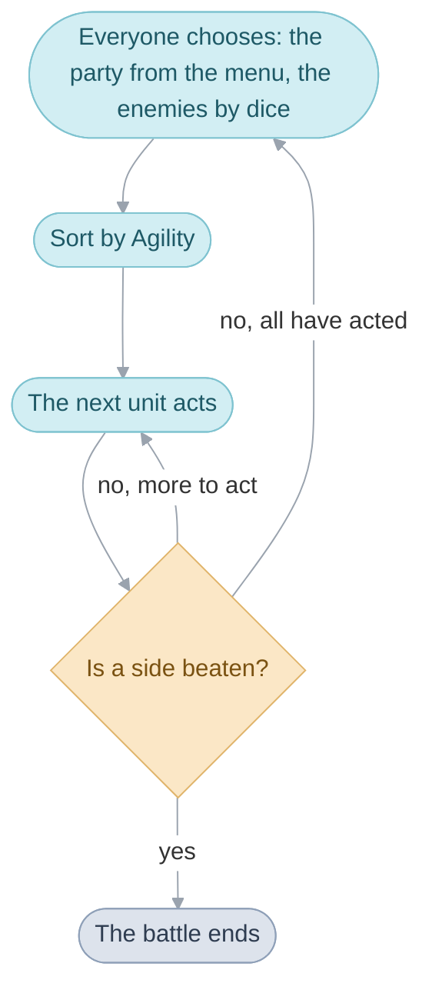

# Battle

A battle is a sequence of its own. It knows nothing about the cave or the
town it was started from, and it always goes the same way: everyone picks,
everyone acts, repeat until one side is beaten or the party runs.

## What goes in and what comes out

A battle can start two ways: a random encounter, or an
[event](glossary.md#event) that calls for one, such as Obaba's monster in
Champa or a Djinni that fights before it joins. Both do the same thing.
They write a [formation](glossary.md#formation) number, the group of
enemies to send, into the main routine's work and let the field end.

The battle reads everything it needs from that work and the party. When it
is over it writes back one answer: how it ended. That is the whole
interface, and it is why Avimander above Champa and a walk across the
Gondowan Cliffs lead to exactly the same kind of fight.

## Units and abilities

Both sides are made of the same thing. Felix and a Punch Ant are each a
[unit](glossary.md#unit): one record holding HP, PP, Attack, Defense,
Agility, Luck, and Power and Resist in each element. The party's units
persist, all eight of them; an enemy's is filled in from its row in the
enemy table when the battle starts. So the battle can ask either side the
same questions.

Everything a unit can do is an ability: Attack, Quake, a Djinni, a summon,
using an Herb. An ability's rules and its looks are kept in separate
tables. Quake, Earthquake and Quake Sphere are three abilities with three
strengths that share one picture.

## A turn

A [turn](glossary.md#turns-and-actions) is built before it is played. The
game writes down what everyone will do, sorts the list by Agility, and
plays it from the top. After every single action it checks for a winner, so
a battle can end in the middle of a turn.

The Lost Age's party can be eight strong, and four fight at once. The rest
wait behind, Switch trades one in, and when everyone in front is down the
ones behind step forward at the start of the next turn. The party has lost
only when all of them are down.
[Turns](src/battle/README.md#turns) has the order and the dice.

## An action, in three steps

Each action goes through the same three steps, and knowing them tells you
where to look for anything.

1. **Building.** Everything uncertain is decided up front: whether a weapon
   unleashes, who is reached, and every other roll that changes how the
   action will look.
2. **[Staging](glossary.md#staging).** The part the player watches: the
   attacker runs up and leaps, the caster glows, a summon takes the screen.
3. **Resolving.** Target by target, the rules turn the ability into
   damage, healing or a status.

[Building an action](src/battle/README.md#building-an-action),
[Staging an action](src/battle/README.md#staging-an-action) and
[How an ability resolves](src/battle/README.md#how-an-ability-resolves)
take one each.

## Rules and pictures run side by side

Watch the end of Quake: the first target flinches while the ground is still
shaking.

Two things run at once. The ability's picture is its
[battle effect](glossary.md#battle-effect), which draws the pillars and
knows nothing about damage. The battle knows the damage and draws no rock.
They meet at one moment: the effect gives a signal when the blow should
land, and from then on the battle shows what happened, one target at a
time.

So an effect is free to be any length and any shape, and the rules never
need to know. The Lost Age leans on that hard: it has 29 summons to The
Broken Seal's 16, and 25 of them have a handler of their own.
[How outcomes reach the screen](src/battle/README.md#how-outcomes-reach-the-screen)
shows the hand-off.

## What you are looking at

The battlefield is one flat picture on the one background layer the console
can zoom and slide, which is all the swinging camera is. The units are
sprites over it.

An effect draws on a small picture of its own, the canvas, laid over the
battle and usually added to its colours, which is what makes fire look like
light. [Battle effects](src/battle_effect/README.md) follows one effect
frame by frame.

## How it ends

A win hands out experience, then coins, then items. The ones in front get
their experience in full and the ones behind get half. A flight just fades
out. After a defeat the leader is revived with 1 HP and the party wakes at
its restart point, unless an event named another place.
[The end of the battle](src/battle/README.md#the-end-of-the-battle) has the
spoils.

## Where the code is

- [Battles](src/battle/README.md) is the fight itself: who acts when, who
  is hit, and what the party wins.
- [Game rules](src/game/README.md) is the numbers a fight uses: the tables
  of units, abilities, items, Djinn and classes, and the sums that turn
  stats into damage.
- [Battle effects](src/battle_effect/README.md) is the pictures: the sword
  swing, Quake's pillars, the summons.
