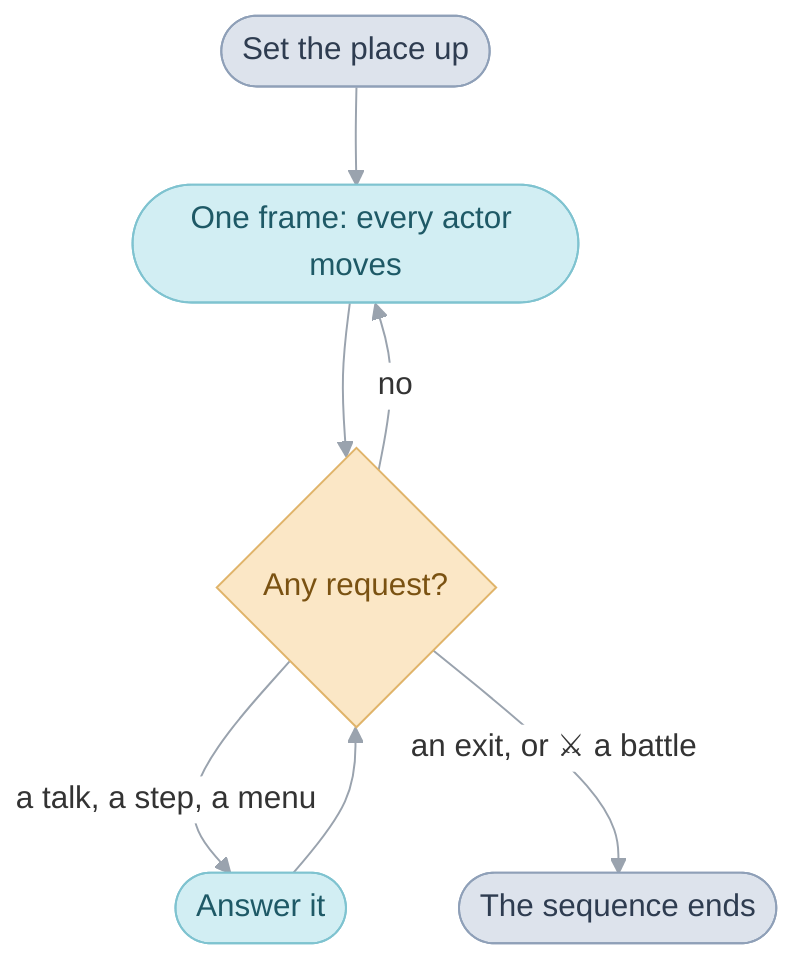

# Field

The field is everything outside a battle and outside a menu: walking round
a town, talking, opening a chest, sailing the World Map.

One piece of code runs all of it, the same in every place. Everything that
makes Daila Daila, its people, its doors and its story, is data and small
scripts that this code asks for.

## The field sequence

The [field sequence](glossary.md#field-sequence) sets a place up, then goes
round one small loop until the party leaves.

Nothing interrupts a frame. Pressing A, stepping on a doorstep or a battle
coming due only sets a [field request](glossary.md#field-request), and the
requests are read once the frame is over. So an answer always starts between
two frames, and can take as long as it likes: one line from a villager, or
a whole cutscene.

A battle is just another way out. The cave is thrown away while the battle
runs and set up again afterwards, with everyone put back where they stood.
[The field sequence serves requests](src/field/README.md#the-field-sequence-serves-requests)
goes through the set-up and each kind of request.

## Scenes and areas

Each place is a [scene](glossary.md#scene): Daila's streets, its sanctum,
the World Map, even the Title. There are 325, and one table lists them all.
A scene's row says which overlay holds its code, which map it is drawn on,
and which [area](glossary.md#area) it belongs to.

An area is a group of scenes the game treats as one place, such as Daila
with its houses. It is the unit for two things: the name the place goes by,
and what the game deliberately forgets when you leave.

## Triggers and events

The field code knows nothing about a guard. It asks the scene, and the
scene's answer to "what can happen here?" is a table of
[triggers](glossary.md#trigger). A row says what the player does (talks,
steps, searches, casts), to whom or where, a condition on the game flags,
and what runs.

The table is read from the top and the first row that fits wins. That one
rule is how the story moves. The east guard on the Madra Drawbridge has two
rows: a question about Osenia that counts until Madra has given the party
passage, and a tip about Mikasalla that always counts. Nothing anywhere
says "the guard is now in state two". The flags say what has happened, and
the tables say what that means here.

What a row runs is usually an [event](glossary.md#event): a function in the
scene's overlay that takes the party over and plays from top to bottom,
waiting as it goes. A door opening is an event, and so is a whole cutscene.
[How a trigger is chosen](src/scene/README.md#how-a-trigger-is-chosen)
shows the guard's rows as they are written.

## Exits and entrances

Leaving works the same way. Each way out of a scene is an
[exit](glossary.md#exit), and a table gives the rows it can lead to, again
with conditions, again first match wins. That is how the first way off the
Lemurian Ship leads to three different places as the story goes on.

Each row names the [entrance](glossary.md#entrance) on the other side: the
spot where the party appears, and how far the screen may scroll there.
[Exits](src/scene/README.md#exits) shows the rows for that way out.

## Actors and actor scripts

Everything that moves or changes by itself is an [actor](glossary.md#actor):
Felix, a villager, a chest, a puddle in Daila's street. A scene has room
for 64.

Every actor carries an [actor script](glossary.md#actor-script), a short
list of orders it works through a little each frame. Kraden stepping aside
on Idejima is a few lines of one.

Felix is an actor like any other. While the player steers, his script is
one order on repeat: do what the D-pad says. When an event needs him, it
swaps that script for another. That swap is all "the game takes control"
ever means. The Lost Age has one such order for each way the party gets
about: on foot, on a rope or a tightrope, as Sand, hovering, and on board
the ship.
[Everything that moves runs an actor script](src/field/README.md#everything-that-moves-runs-an-actor-script)
lists the orders.

## The ground

The ground is a [map](glossary.md#map): a grid of 16-pixel
[cells](glossary.md#cell). A cell says which picture is drawn there, how
high the ground is, a few flags, and a number for what standing there
does, its [cell behavior](glossary.md#cell-behavior).

Height does most of the work. Felix can step up a little and down a little
more, so a cliff is simply ground too high to step onto, and few walls are
marked as walls.

The flags are the things every map means the same way: water to wade
through, a ledge to hop down, a ladder to climb. The behavior numbers are
split in two. A few high ones mean the same everywhere: a wall, a jar or a
barrel to search. The rest mean nothing until a scene's trigger table
gives them a meaning, so the same number can be a different thing in every
town.

A map is drawn as three layers, ground, walls and roofs, with the actors
between them. That is how Felix walks behind a house without the game
knowing what a house is. [Maps](src/map/README.md) has the format.

## Field Psynergy and random battles

Both follow the pattern above: the field code does the general part and the
scene supplies the particular.

Cast Frost and the field code draws the cast and finds what it touches.
Only Daila knows its puddles freeze into pillars of ice to stand on, and
says so with one more kind of trigger row: Frost, on the puddle. The Lost
Age adds a dozen field Psynergies, Lash, Pound, Scoop, Sand, Burst and the
rest, and every one of them reaches the world this way.

Random battles measure distance. A counter fills as the leader walks, and
the ground he walks on says how fast it fills and which enemies come.
Running gets you there sooner, after exactly the same distance.

## The World Map

The World Map is one of the 325 scenes, with exits into towns and its own
random battles. Most of it is sea, and the party crosses it on the
Lemurian Ship, which sails it with its own random battles and, once it has
wings, flies over it with none. Its map is flat like any other. The tilt
toward the horizon is drawn by stretching the picture differently on every
line of the screen.
[The World Map in perspective](src/field/README.md#the-world-map-in-perspective)
works through it.

## Where the code is

- [Field code](src/field/README.md) is the walking itself, the same in
  every place: the sequence, actors, movement, field Psynergy and random
  battles.
- [Scenes](src/scene/README.md) is what belongs to one place: its tables
  and its events.
- [Maps](src/map/README.md) is the ground each place is drawn on.
