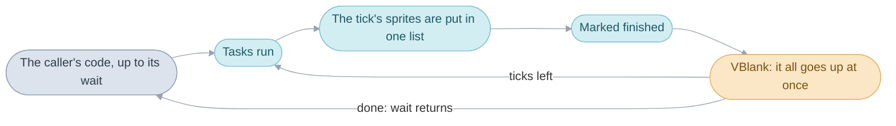

# System library code

This folder is the base the rest of the game runs on: start-up, the main
routine, the tick, events, the heap and the save.
[The system library](../../../../docs/tla/system.md) gives the four big ideas. This page goes one step
closer, so you know what each part is for before you open it.

## Start-up

Switching on and the reset with A, B, Select and Start are the same thing:
both run the cartridge's first instruction. Start-up clears memory, copies
the hottest functions into fast RAM, switches on the interrupts, and calls
the main routine, which never returns. It is `syInit`.

## The main routine

`gmMainRoutineRun` goes round three steps for as long as the console is on:
clear away the last mode, call the next one as a function, and when it
returns work out what follows. One trip is a whole mode, not a tick.
The loop that goes round once a tick is
[inside `sySynch()`](#the-tick-loop).

It also has four debug starts, which only work with debug mode on: the
Venus Lighthouse entrance, the scene after the Title, Mt. Aleph's summit,
and the Title by another way in. Nothing in the finished game asks for any
of them.

### Clearing away the last mode

Before every mode the event list is emptied, the whole heap is taken
back, looping sounds are cut off and any line-by-line screen effect is
switched off. This is what makes each mode start cold. Only what lies
outside the heap crosses from one to the next: the main routine's state, the
game flags, the characters' units and the actor snapshot, each a fixed
block of memory (`MainRoutineStateWork`, `CharacterUnits` and
`SnapshotObjects` are declared in `ewram.s`).

A scene's overlay is loaded here too, just before the field mode is
called. A battle and the three games of chance load none.

### Running another mode

A scene ends with an exit, which the main routine turns into a destination
through the scene's exit table. Anything else ends with a result, and
`gmReturnFromMode` picks the destination from it: back where the
party stood, to the restart point after a defeat, or wherever a script
named beforehand.

Besides the field there are four modes: the battle, and the three games
of chance, Lucky Dice, Lucky Wheels and Super Lucky Dice. The three games
put background palettes 14 and 15 aside while they run and back after.

## The tick loop

The tick loop is the inside of `sySynch()`. One trip round it is one tick.

The rule that shapes everything here: during a tick the game never touches
the screen. It only writes down, in ordinary memory, what the screen should
become. The console signals when it has finished drawing a picture, the
[VBlank](../../../../docs/tla/glossary.md#vblank), and in that gap everything written down
goes up at once.

One trip, in order:

1. Every event of the tick pass runs, highest rank first.
2. The sprites that were asked for are written into one list
   ([The tick's sprites](#the-ticks-sprites)).
3. The tick is marked finished.
4. The loop sleeps until the VBlank handler has run.
5. The sprite slots are emptied, the tick count goes up by one and held
   buttons are turned into repeats.

The caller's own work is part of the tick as well. What it did between its
last `sySynch()` and this one came before step 1, and is shown with what the
events do. So a tick's time is the caller's work and the events' together.

### What VBlank does

The VBlank handler, `syVBlankHandler`, does two kinds of work. If the tick was
marked finished, it copies what the tick prepared to the screen. Whether or
not it was, it runs the events of its own pass, reads the buttons and prepares
the next stretch of sound. Each VBlank ends a
[frame](../../../../docs/tla/glossary.md#frame), and the handler counts it in
`FrameCount`.

That split is the game's
[slowdown](../../../../docs/tla/glossary.md#slowdown). A tick that runs long
is simply shown one frame later, whole: it takes two frames. Everything
counted in ticks stretches together, nothing is ever shown half moved, and the
music keeps its tempo.

### Buttons and sleep

The tick loop also turns held buttons into repeats for the menus, and puts
the console to sleep: when L, R and Select are held together, when the
player picks Sleep in the Pause menu, and, if the settings allow it, after
three minutes without a button. L, R and Select wake it again.

### Waiting from anywhere

Any function may call `sySynch()`, however deep in its own calls it is, but
for an [event](../../../../docs/tla/glossary.md#event) and the VBlank handler: an event is
called from inside `sySynch()` and must return for the tick to end. Code that
an event might reach checks first (`EventsRunning`).

There is one line of execution throughout: `sySynch()` starts no second one.
The Broken Seal's `sySynch()` moves the stack before it runs the events. The
Lost Age's does not: its events run on the caller's stack.

## The event runner

An [event](../../../../docs/tla/glossary.md#event) is a function put on a list once and
called every tick until it is taken off. The list holds 24, four more
than The Broken Seal's. Each event has a rank, which the code calls its
`priority`, and higher ranks run first. That is how one event gets to see
another's finished work in the same tick.

There are two passes. Most events run once a tick from the tick loop. A
few run once a VBlank from the handler: the ones that copy something to the
screen. When a tick runs long, those few run more than once in it.
[The field's events](../field/README.md#the-fields-events) lists the ones a
town keeps on the list.

### An event's life

`sySetEvent` puts a function on the list with a rank, and sorts the list. If
the function is already there it only gets the new rank, so nothing is on
the list twice. `syCloseEvent` takes it off.

An event can also be suspended and resumed: it stays on the list and is
passed over. Opening the field menu suspends every event whose function is
in the overlay, so the scene holds still behind the menu, and a scene can
flag one of its events to keep running through that.

The main routine empties the list before every mode, and the field
mode empties it again as it sets a scene up. So each mode adds what
it needs when it starts, and a scene adds its own on top.

An entry of the list is the function, the rank and that one flag. An event
gets no arguments and no memory of its own, so what it has to remember is
in its owner's [state](../../../../docs/tla/glossary.md#state). No event adds an event, and no
event calls `sySynch()` ([Who may wait](../../../../docs/tla/system.md#who-may-wait)).

## The tick's sprites

The console draws sprites in the order of one list, and has no idea of
"in front". So the game rebuilds that list from scratch every tick.
Whatever wants a sprite shown drops it into one of 256 depth slots
(`syOAMAddSpriteAtDepth`), and the list is written from the highest slot
down.

Because the slots are emptied every tick, a sprite shows only while
something keeps asking for it, so nothing ever has to take one down.

Screen settings follow the same rule as sprites. A change to a hardware
register is queued, and the VBlank handler carries the queue out with the
tick it belongs to (`syIOWriteQueueFlushPending`).

## The heap

The heap hands out memory like a stack of plates: each block goes on top of
the last, and giving one back gives back everything above it. That makes
it nearly free, and it means blocks go back in reverse order. The main
routine empties the lot between modes.

A block that other code has to find again is kept in a numbered
[heap slot](../../../../docs/tla/glossary.md#heap-slot). The game calls such a block a
[state](../../../../docs/tla/glossary.md#state): the menu's state, the battle's state. Asking
for a slot that is already filled just returns it, so the code that sets a
state up and the code that reads it make the same call (`syHeapSlotAllocate`).

## Memory map

The console has two working memories: 256 KB that is large and slower, and
32 KB that is small and fast. The game keeps most of its state in the first
and what must be quick in the second, each with a heap of its own. Where
everything sits is fixed, and is declared in `ewram.s` and `iwram.s`.

## Saving

A save is never overwritten in place. Here each file is one part of 12 KB,
filling three sectors of the flash chip. The chip has room for five parts,
one at every third sector, and there are three files, so two places are
always spare. The new copy of a part goes into a spare place with a higher
count, is read back, and only then is the old copy retired. Every part
carries a label and a checksum, so a half-written one is recognised and
ignored.

A part holds the game flags, the main routine's state, every character's
stats and where the scene's actors stand. It is `syBupWritePart` and its
neighbours, and the Save command that uses them is in
[Windows](../window/README.md#saving).

## The link cable

Two consoles trade one small checked packet at every VBlank. Anything
bigger, such as a whole party, is cut into numbered pieces and resent from
the first one that goes missing (`sySerialStepBlockTransfer`).

The Lost Age uses it in two places. The Battle Arena's lobby trades two
players' parties for a link battle, and the scene after the Title receives
The Broken Seal's saved Clear Data: its game flags and its characters.

## How an overlay reaches the rest of the game

An [overlay](../../../../docs/tla/glossary.md#overlay) is a scene's code, unpacked into
one fixed spot when the party arrives. It and the always-loaded
[main image](../../../../docs/tla/glossary.md#main-image) find each other through two
tables:

- The [entry table](../../../../docs/tla/glossary.md#entry-table-and-import-table) at the
  overlay's start: seven functions the field engine calls to ask the scene
  about itself ([Scenes](../scene/README.md#the-entry-table) explains each).
- The import table at its end: one line for each main-image function the
  overlay calls.

Scenes share overlays, 114 for 325 scenes: the three scenes of the Suhalla
Gate are one overlay. An overlay that holds several scenes still has one
entry table. Its functions look at which scene the party is in and answer
for that one: the Suhalla Gate's hands over one list of actors for the
cliffs, another for the road and a third for the cave
([suhalla_gate.c](../scene/suhalla_gate.c)).

It works the other way too, and one scene can serve as several rooms:
[Increase item and level](../debug/README.md#the-test-scenes) becomes four
other rooms through four of its entrances.

## Where the system library comes from

The same place as The Broken Seal's:
[its system library page](../../../tbs/src/system/README.md#where-the-system-library-comes-from)
says what the system library is, why it looks like SGL, Sega's engine for the
Saturn, and how it shares the processor's registers. Three things changed by
the time of this game, which shows the system library was still being worked
on.

- **The call through a register moved into the compiler.** The Broken Seal
  reaches the multiply through a macro that returns through `ip`, so that the
  caller keeps `lr`. Here there is neither the macro nor that way in: the
  compiler calls any function through a register with `mov lr, rN` and the
  second half of a `bl`, four bytes and no helper, which no released GCC does.
- **The unit matrix macro was edited.** The system library stores it with 1.0
  built first; the battle engine still has The Broken Seal's order.
- **Function addresses are parked in the high registers.** Thumb code can
  barely use r8 to r11, but the new call takes any register, so
  `syMatrixBuildLookAt` keeps the addresses of the multiply, the divide and the
  dot product in r11, r9 and r10 by name.

## The calls

The calls are The Broken Seal's:
[its system library page](../../../tbs/src/system/README.md#the-calls) tables
them by group. No original name of any of the system library's functions is
known. Where SGL has the same call, the function takes SGL's name with `sy`
for `sl`, and the rest have names of our own. The last column names the SGL
function a Saturn programmer would have reached for to do the same job, where
there is one, and says none where there is not. This table holds only what
this game adds or does differently.

This game's ROM lists the game flags and the units in the system library's
own stub table, after the functions the two games share. The Broken Seal
keeps the same functions in the game logic's module.

| Call | What it does | SGL |
| --- | --- | --- |
| `syUnitGet` | a character's unit, or an enemy's in the current battle; null for any other number | none |
| `syGameFlagGet` | 1 when a game flag is set, 0 when it is clear | none |
| `syGameFlagSet` | sets a flag and returns its byte's number | none |
| `syGameFlagClear` | clears a flag | none |
| `syGameFlagToggle` | flips a flag and returns its new value; nothing calls it | none |
| `syGameFlagGetByte` | the whole byte a flag is in, a counter kept among the flags | none |
| `syGameFlagSetByte` | sets that byte | none |
| `syGameFlagIncrementByte` | adds 1 to it, stopping at 255; nothing calls it | none |
| `syGameFlagDecrementByte` | takes 1 from it, stopping at 0; nothing calls it | none |
| `syGameFlagGetNibble` | the four bits a flag is in; nothing calls it | none |
| `syGameFlagSetNibble` | sets those four bits; nothing calls it | none |
| `syFindEvent` | where in the table the event running a function is; nothing calls it | none |
| `syVRAMCacheCountFreeBlocks` | how many blocks of the sprite VRAM cache are free | none |
| `syOAMAddSpriteAtDepthClamped` | puts a sprite in a depth slot, kept behind the windows' sprites | none; it takes the place of `syOAMAddSpriteAtDepth` in the table |
| `syResourceReservedNoOperation` | does nothing with the resource number it is given | none; it takes the place of `syDummyNoOperationHook` in the table |
| `syMatrixSetRotateY` | makes the current matrix a turn about Y, its translation gone | none; `slRotY` multiplies the turn into the current matrix |
| `syMatrixSetTranslation` | sets the current matrix's translation and keeps its turn | none; only the battle engine's set-up calls it |
| `syTranslate` | moves the current matrix by three numbers | `slTranslate` |
| `syScale` | scales it by three numbers | `slScale` |
| `syMatrixScaleUniform` | scales it by one number on all three axes | none |

A flag's number wraps at 4,096, so a number past the last flag reaches a flag
below it rather than other memory. The Broken Seal's `syRandom16Below`,
`syDMAWait` and `DMA0_STOP` have no counterpart here.

## Where the rest is

The cartridge itself, and how its contents are found, is
[The Game Pak](../system/README.md).

## The Game Pak

The cartridge holds two chips. A 16 MB ROM has the whole game: the code and
every picture, map, tune and line of text. A small flash chip, 64 KB, can be
written to and keeps the three save files.

This page is about how things on the ROM are found, and how the code on it
is laid out. Both rest on one idea: a thing is found by its position in a
table, so tables only ever grow at the end.

### The ROM header

The first 192 bytes are the same layout on every Game Boy Advance game: a
jump to the game's first instruction, the cartridge logo, a title, a game
code and a checksum. The console checks them before it lets the game run.

Each language is a cartridge of its own, an
[edition](../../../../docs/tla/glossary.md#editions), and the last letter of its game code
names the language: `AGFJ`, `AGFE`, `AGFD` and so on.

### The resource directory and table order

Every stored thing on the ROM has a number: a map, a sprite sheet, a
battle background, a scene's code. The
[resource directory](../../../../docs/tla/glossary.md#resource-directory) is one table of
2,048 rows, and row *n* holds the address of resource *n*. Whoever wants a
resource holds its number, reads that row, and goes there. One read, no
searching.

Walking through a door is two lookups. The scene table says which resource
is the new scene's overlay. The directory says where that resource is. The
game unpacks it into memory and runs it.

A number is nothing but a row's position, so the table can never be
reordered. Put a new picture in at row 500 and every later number would
point one row off. Anything new goes at the end, and 325 empty rows are
waiting there.

Roughly, reading down the rows: the windows' pieces and fonts, the title,
the battle backgrounds, the minigames, the summons and battle effects, the
world map, the enemies, the maps with their tiles and colours, then the 114
overlays.

One of the first rows points at the build stamp, the date and time the
edition was built. A save file records it, so the game can tell a file
written by another build when it loads one.

### The flash chip

Writing a save is slow because flash is awkward. The chip is 16 sectors of
4 KB, and a sector cannot be changed in place: it is erased whole and
written again from the start, a byte at a time, each byte sent as a short
command and then read back until the chip agrees.

Cartridges were made with chips from four makers that take different
commands and need different patience. So before every save or load the
game asks the chip who made it and picks the matching functions, and every
wait has a time limit so a dead chip cannot hang the game.

How the 16 sectors are used, so that a power cut never costs a save, is in
[Saving](../system/README.md#saving).

### Why the main image is cut into modules

The code that is always loaded, the
[main image](../../../../docs/tla/glossary.md#main-image), is cut into fifteen
[modules](../../../../docs/tla/glossary.md#module), one for each large part of the game: the
battle, the sound, the windows, the menus, the shops, even Lucky Dice,
Lucky Wheels and Super Lucky Dice, one module each. Each module starts at a
fixed address. For four of them, the game, field mode, menu and shop
modules, that address depends on the edition.

Code inside a module moves whenever that module is rebuilt. So one module
never calls another's function directly. Each module opens with a table of
[stubs](../../../../docs/tla/glossary.md#stub), one for each function other modules may
use, and a call from outside goes to a position in that table. That is a
[stub call](../../../../docs/tla/glossary.md#stub-call).

It is the resource directory's idea again, for code. The table is the one
thing that does not move, callers know a function only by its place in it,
and so a table only ever grows at the end.

#### A stub

A stub is 8 bytes: "jump to the address that follows", and the address.
An overlay carries a small table of its own stubs, each pointing at a
stub in a module. So a call from a scene into the main image takes two
hops.

The first module is the exception. It holds the system library, and the other
modules call its functions directly. Only the overlays go through its table.

### Where the files are

- `rom_header.s` is the header, and `resource_directory.s` the 2,048
  rows.
- [`games/common/sdk/flash`](../../../common/sdk/flash) is the SDK's flash
  library, the flash chip's functions, one copy both games build.
- Each module's table is the `stubs.s` of its own folder, and the system
  library's own is `stubs.s` here.
