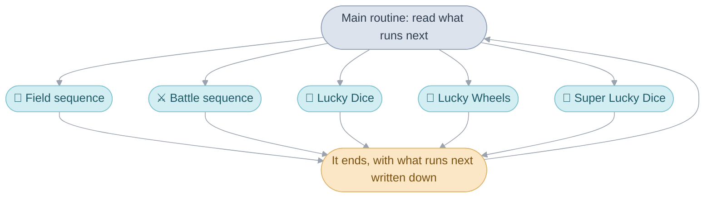
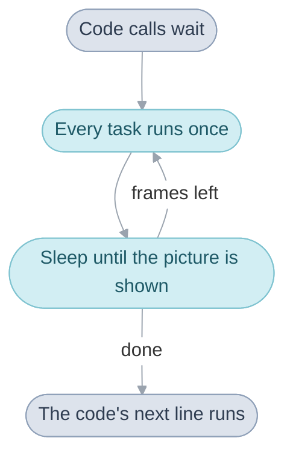

# System

The System is what every other part of the game stands on. It decides what
runs, lets time pass, loads a place's code and writes the save.

Four ideas, and you know how the whole program hangs together.

## The main routine

The game is one routine that starts when the console is switched on and
never returns. All it does is run a [sequence](glossary.md#sequence), wait
for it to end, and run the next one. There are five kinds.

The [field sequence](glossary.md#field-sequence) is one place: a town, a
dungeon floor, the World Map. It ends when the party leaves, and says where
the exit leads. The other four end with a result, such as a battle won or
lost. Super Lucky Dice is The Lost Age's own: the four-dice game in
Contigo's tent, beside the two it kept from The Broken Seal.

Between two sequences the main routine wipes the slate. Every task is
stopped and all the memory the last sequence took is handed back. The cave
you return to after a battle is not the old cave kept waiting. It is built
again from scratch.

So a sequence can pass something on in only two places, the two things that
are never wiped:

- the [main routine's work](glossary.md#main-routines-work), which holds
  the party, their coins, what runs next and how the last sequence ended;
- the [game flags](glossary.md#game-flag), one bit for each thing the game
  remembers, such as a chest being open.

Take Obaba in the caverns above Champa. She gives the party one chance to
back out, and if they stay, she sends a monster out of the forging well. The
event that ends in that fight writes two destinations into the work, one
for a win and one for a loss, asks for a battle, and lets the field
sequence end. The battle knows nothing about Champa. It runs, and writes
its result. The main routine reads the result, picks the matching
destination, and starts a fresh field sequence at the top of the caverns.

That is why any sequence can follow any other, and why Camelot's own debug
menu can drop the party into any scene in the game.
[The main routine](src/system/README.md#the-main-routine) goes through one
turn of it, and the routine itself is `MainRoutine_Run`.

## Waiting and tasks

Inside a sequence there is no loop that polls a state machine each frame.
Code that needs time to pass calls [`wait()`](glossary.md#wait) with a
number of frames and simply stands still.

The trick is that the game runs inside the wait. For every frame it is
asked for, `wait()` runs one whole frame of the game, then sleeps until the
console has shown the picture.

This is what lets a cutscene or a menu be written as a plain list, top to
bottom, in the order things happen. A night at an inn is: wait, close the
screen, play the tune and wait for it to end, wait, open the screen again.
Nothing in that list keeps the game alive. The waits do.

A [task](glossary.md#task) is the other half. It is a routine on a short
list that `wait()` calls once in every frame, highest rank first. A task
does one frame's worth of something and returns at once: move the actors a
step, type the next letters into a window. Whatever needs work done every
frame puts a task on the list and takes it off when it is done. The list
has room for 24, four more than The Broken Seal's.

If you have used coroutines, the waiting code is the one coroutine and the
tasks are the scheduler's callbacks, except that the scheduler lives inside
the yield. If you have not, think of two kinds of code: code that tells a
story and waits, and code that keeps the world moving while it does.

A task has one frame, so it cannot start something long, like a
conversation. It leaves a [request](glossary.md#field-request) instead, and
the waiting code picks it up.

[The frame loop](src/system/README.md#the-frame-loop) has a frame's order
in full, and [The task runner](src/system/README.md#the-task-runner) says
which task goes first.

## Overlays

The game has 325 scenes, each with code of its own: what its people say,
what its doors and switches do. That is far more than the console's memory
holds, and a town's code matters only while the party is there.

So each scene's code is kept packed on the cartridge as an
[overlay](glossary.md#overlay), and unpacked on arrival into one fixed
stretch of memory, over whichever overlay was there before. Only one is
ever loaded. Scenes share them, so 114 overlays cover all 325.

Two things follow. The always-loaded part of the game, the
[main image](glossary.md#main-image), knows nothing about any one town: it
asks whichever overlay is loaded the same few questions through a table at
a fixed address. The Lost Age asks seven, one more than The Broken Seal: a
scene gets a last word on its map before the camera settles. And one
overlay can never call another, so code two of them need is built into
both.
[How an overlay reaches the rest of the game](src/system/README.md#how-an-overlay-reaches-the-rest-of-the-game)
shows both directions.

## Saving

A save is the two things that outlive a sequence, the game flags and the
main routine's work, with every character's stats and where the people in
the current scene stand. Nothing else needs saving, because everything else
is rebuilt from those.

That gives a simple rule for new state: if the game should remember it, it
has to live in a flag or in the work. A yes-or-no fact is a flag. Anything
larger goes in the work.

The save lives in a [flash chip](glossary.md#flash-chip) on the cartridge.
Each of the three files is one part of 12 KB, three sectors of the chip,
and the chip has five places for a part, so two are always spare. A save
writes the file's new copy into a spare place, reads it back, and only then
retires the old one. If the batteries die halfway, the old copy is still
whole. [Saving](src/system/README.md#saving) follows a save onto the chip.

## The rest of the System

- [System code](src/system/README.md) is the detail behind this page:
  start-up, the frame, the task list, the heap, saving and the link cable.
- [The Game Pak](src/gamepak/README.md) is the cartridge: how its contents
  are laid out and found, and the flash chip.
- [Graphics](src/graphics/README.md) is how a picture gets from a PNG to
  the screen.
- [Sound](src/sound/README.md) is the music, the jingles and the driver
  that plays them.
- [Debug scenes](src/debug/README.md) are the test rooms and menus Camelot
  left on the cartridge.
