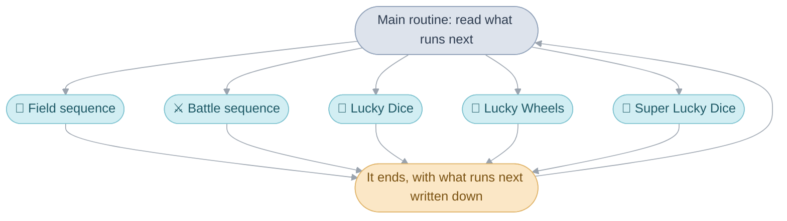
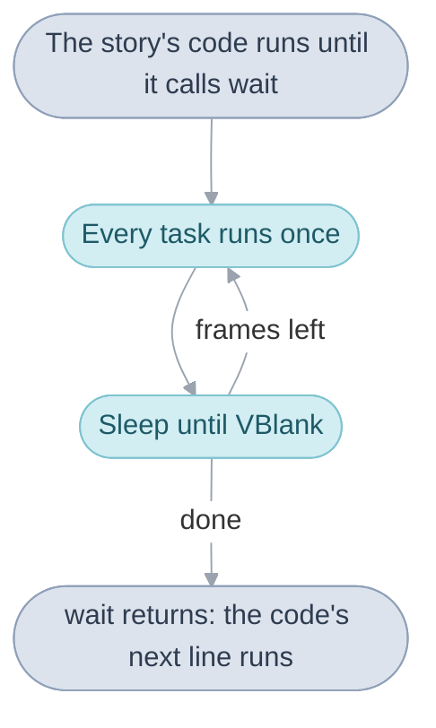

# System

The System is what every other part of the game stands on. It decides what
runs, lets time pass, loads a scene's code and writes the save.

Four ideas, and you know how the whole program hangs together.

## The main routine


The game is one routine that starts when the console is switched on and
never returns. All it does is call a [sequence](glossary.md#sequence) as
a function and, when that returns, call the next one. There are five
kinds.



The [field sequence](glossary.md#field-sequence) runs one
[scene](glossary.md#scene): a town's streets, a dungeon floor, the World
Map. It ends when the party leaves, and says where the exit leads. The
other four end with a result, such as a battle won or lost. Super Lucky
Dice is The Lost Age's own: the four-dice game in Contigo's tent, beside
the two it kept from The Broken Seal.

Everything else the player sees is inside one of the five. The Title and
the File Screen are scenes, so the field sequence runs them. A menu or a
shop is not a sequence. It is a function called from inside one, and it
returns there.

The main routine is a loop, but a slow one. One trip round it is a whole
visit to a town or a whole battle. The loop that goes round once a frame is
not here: it is inside `wait()`, which
[Waiting and tasks](#waiting-and-tasks) comes to.

Between two sequences the main routine wipes the slate. Every task is
taken off the list and all the memory the last sequence took is handed
back. The cave you return to after a battle is not the old cave kept
aside. It is built again from scratch.

So a sequence can pass something on in only four ways, the four things
the main routine leaves alone:

- the [main routine's work](glossary.md#main-routines-work), one C struct
  in a global, `gMainRoutineWork`, which holds who is in the party, their
  coins, what runs next and how the last sequence ended;
- the [game flags](glossary.md#game-flag), one bit for each thing the game
  remembers, such as a chest being open;
- the characters' [units](glossary.md#unit), `gCharacterUnits`, which
  hold the party's stats;
- the actor snapshot, `gSnapshotObjects`, where the field copies who stands
  where before it ends for a battle, so that the same scene can be set up
  again as it was.

Two short ranges of the flags do not last. One is cleared when the party
arrives in a scene and the other when it arrives in a new area, which is
how a puzzle resets
([State that cleans itself up](src/scene/README.md#state-that-cleans-itself-up)).

Take Obaba in the caverns above Champa. She gives the party one chance to
back out, and if they stay, she sends a monster out of the forging well. The
event that ends in that fight writes two destinations into the work, one
for a win and one for a loss, asks for a battle, and lets the field
sequence end. The battle knows nothing about Champa. It runs, and writes
its result. The main routine reads the result, picks the matching
destination, and starts a fresh field sequence at the top of the caverns.

That is why any sequence can follow any other, and why Camelot's own debug
menu can drop the party into any scene in the game.
[The main routine](src/system/README.md#the-main-routine) goes through one
trip round it, and the routine itself is `MainRoutine_Run`.

## Waiting and tasks


The game has no loop at the top that turns once a frame and calls
everything else. Its frame loop is inside one function,
[`wait()`](glossary.md#wait), and this is all of its shape:

```c
void wait(s32 frames) {
  for (frame = 0; frame < frames; frame++) {
    // every task runs once
    // this frame's sprites are put in order
    // sleep until VBlank, when the frame is copied to the screen
  }
}
```

So `wait(10)` does not stand aside while something else runs the game. It
runs ten frames of the game, there and then, and returns.

One piece of code calls it at a time: the code that is telling the story
just now, a cutscene, a menu, the field's own routine. That code is plain C.
It runs once from top to bottom, and wherever it says `wait()` it stands
still while the loop inside goes round.



So a frame is two stretches of work: what the story's code did since its
last `wait()`, and then the tasks. Both have to be done before VBlank, or
the frame is shown one VBlank late.

This is what lets a cutscene or a menu be written as a plain list, top to
bottom, in the order things happen. A night at an inn is: wait, close the
screen, play the tune and wait for it to end, wait, open the screen again.
No state is kept between frames to remember how far the night has got: the
line the code has reached is the memory.

### Tasks

A [task](glossary.md#task) is a function on a short list, which holds 24,
four more than The Broken Seal's. Each trip round the loop calls every task
on it once, highest rank first (the code calls the rank a `priority`). A
task does one frame's worth of something and returns at once: move the
actors a step, type the next letters into a window.

Four things about tasks are easy to get wrong:

- Tasks run only from inside `wait()`. If no code is waiting, nothing in the
  game moves. A window goes on typing because the code that asked for it is
  waiting for it to close.
- A task must never call `wait()`. It is being called from inside one, and
  must return for the frame to end.
- A task is a whole piece of work, not a thing in the world. A villager is
  not a task, and neither is a puddle. They are
  [actors](glossary.md#actor), rows in a table, and one task visits all of
  them each frame.
- The list keeps a function, a rank and one flag, and nothing else. What a
  task needs to remember lives with whatever put it on the list: the
  field's work, a window's.

Anything may put a task on the list and take it off again. The field and
the windows keep theirs there as long as they run, a scene adds its own for
whatever only it has, and the [main routine](#the-main-routine) takes every
one off between two sequences. A few tasks are called from the VBlank
handler instead, once a VBlank: the ones that copy something to the screen.

### Two kinds of waiting

An actor has to pause too: a villager stands a while between two strolls.
It cannot call `wait()`, because the task that moves it has to return. So an
[actor script](glossary.md#actor-script) has a wait of its own, which is
only a number kept in the actor. This is the script of a villager who
wanders near home:

```c
SC_ANIMATION(2),          // walk
SC_WANDER_HOME(4, 8, 16), // pick a spot near home and head for it
SC_SYNC,                  // stay on this line until it arrives
SC_ANIMATION(1),          // stand
SC_WAIT(20),              // stand for 20 frames
```

These are numbers in a table, not code that runs (`SC_` is for script
command). Each frame the actors' task comes to this villager. If his count
is above zero it takes one off and goes on to the next actor; otherwise it
reads his script on from where he stopped. Twenty villagers can all be
part-way through a pause, each with a count of his own.

| | `wait(20)` in C | `SC_WAIT(20)` in an actor script |
| --- | --- | --- |
| What it is | a function that runs 20 frames of the game | an order that sets a count to 20 |
| Who uses it | the one piece of code telling the story | every actor, each for itself |
| Does it hold anything up? | that code stands still | no: the task passes that actor by for 20 frames |
| How many at once | one | as many as there are actors |

The second happens inside the first. The story's code is in `wait()`, the
loop there runs the tasks, one task steps the actors, and each actor counts
its own pause down.

### One waiter at a time

The game has one line of execution, so two pieces of code never wait side
by side. What does happen is one wait after another, at any depth: an event
shows a message, and showing a message waits for the A Button before it
returns.

When two things must take time together, neither of them waits. The code
tells each actor where to go, which returns at once, and then waits for
both. On the Madra Drawbridge the two guards close ranks like this:

```c
Actor_WalkTo(ACTOR_WEST_GUARD, 148, 252);        // returns at once
Actor_WalkToAndWait(ACTOR_EAST_GUARD, 170, 252); // waits for the east guard
Actor_WaitForMoveById(ACTOR_WEST_GUARD);         // and then for the west
```

An event command whose name ends `AndWait` does two steps together: it
starts the walk, then calls `wait(1)` until that actor has arrived. Both
guards walk during those frames, whichever of them the code is waiting for.

Because a task cannot wait, it cannot start something long, like a
conversation. It leaves a [request](glossary.md#field-request) instead, and
the field's routine, which is the code waiting, reads the requests each time
its `wait(1)` returns.

If you have used coroutines: the story's code is the one coroutine, and
`wait()` is its yield and the scheduler in one.

### Who may wait

| Code | What calls it | May it call `wait()`? |
| --- | --- | --- |
| The story's code: a sequence, an event, a menu, a shop, a battle effect | the main routine, and each other | yes |
| A task | `wait()`, once a frame | no |
| An order of an actor script | the actors' task, once a frame for each actor | no |
| The VBlank handler, and the few tasks it calls | the console, at every VBlank | no |

No task puts another task on the list either. Adding one sorts the list
again, and that would upset the pass that is running.

### Every way of taking time

| Written as | Where | What it does |
| --- | --- | --- |
| `wait(n)` | the story's code | runs `n` frames of the game and returns |
| `Event_Wait(n)` | an event | calls `wait(n)` |
| a command that takes time, such as `Event_ShowMessage` or one ending `AndWait` | an event | starts something, then calls `wait(1)` until it is over: a window has closed, an actor has arrived |
| `SC_WAIT(n)` | an actor script | sets a count in the actor, which the actors' task takes one off each frame |
| `SC_SYNC` | an actor script | holds the script on this order until the actor has arrived |
| a count in its owner's work | a task | the task looks at it each frame and returns: a pause in the middle of a line, the time a hit flashes in a battle |

Only the first three hold any code up, and they are all `wait()`. The rest
are numbers that a task looks at once a frame. `Actor_WalkToAndWait` gives
up after 600 frames, ten seconds, and goes on with the actor still walking.

### A talk, frame by frame

Felix walks up to the man by the pond in Daila and the player presses A.
This is who runs what.

1. The field's routine is in its walking loop, which calls `wait(1)` over
   and over. It is the only code waiting.
2. Inside one `wait(1)` the actors' task comes to Felix. His script is on
   the order that reads the D-pad and the buttons, `SC_PLAYER`. It sees the
   A Button and sets a request in the field's work. The task goes on to the
   man and carries his script on by a frame as well.
3. `wait(1)` returns. The field's routine finds a request and leaves its
   walking loop. It puts Felix on the idle script, finds that the nearest
   actor in reach is the man and that the scene has a talk trigger for him,
   and turns the request into a talk. No frame has passed.
4. It answers the talk. It marks the man paused, turns the two as his row
   in the scene's list asks, and asks for a window with his line. Asking
   returns at once.
5. The same code now calls `wait(1)` until the window has closed. Over
   those frames the windows' task grows the window, types the line a few
   letters a frame, and then looks each frame for the A Button. The actors'
   task passes the man by, because he is paused, so his script stays where
   it was.
6. The player presses A. The windows' task shrinks the window and closes
   it, and the loop of step 5 ends. The man's pause is lifted, Felix's
   script is `SC_PLAYER` again, and the field's routine is back in its
   walking loop. The man's script goes on from where it stopped.

Through all six steps one piece of code was running or waiting, the field's
routine and what it called. Everything else was a task's visit.

### When nothing waits

Code that works for a long time without calling `wait()` holds the whole
game still. No task runs, so no actor moves and no window grows. The frame
it is building is never marked finished, so the picture on screen is left
as it is.

The VBlank handler is not held up. The console calls it at every VBlank
whatever the code is doing, and it goes on reading the buttons, running its
own tasks and preparing the sound. So a frame that takes two VBlanks is
[slowdown](glossary.md#slowdown), with the music at its proper speed, and
code that never waited would be a still image with the tune playing on.

[The frame loop](src/system/README.md#the-frame-loop) has a frame's order
in full, and [The task runner](src/system/README.md#the-task-runner) says
which task goes first and how a task comes and goes.

## Overlays

The game has 325 scenes, and each has things of its own: what its people
say, what its doors and switches do. All of it together is far more than
the console's memory holds, and a town's code matters only while the party
is there.

So that code is kept packed on the cartridge in
[overlays](glossary.md#overlay), and the one a scene needs is unpacked on
arrival into one fixed stretch of memory, over whichever overlay was there
before. Only one is ever loaded. An overlay often holds several scenes that
belong together, so 114 cover all 325: the three scenes of the Suhalla Gate
are one. Its code looks at which scene the party is in and answers for
that one. A battle and the three games in Contigo load none.

Two things follow. The always-loaded part of the game, the
[main image](glossary.md#main-image), knows nothing about any one town: it
asks whichever overlay is loaded the same few questions through a table at
a fixed address. The Lost Age asks seven, one more than The Broken Seal: a
scene gets a last word on its map before the camera settles. And one
overlay can never call another, so code two of them need is built into
both.
[How an overlay reaches the rest of the game](src/system/README.md#how-an-overlay-reaches-the-rest-of-the-game)
shows both directions.

## Saving

A save is the four things that outlive a sequence: the game flags, the
main routine's work, the characters' units and the actor snapshot, taken
again as the save begins so that it holds where the people in the current
scene stand. Nothing else needs saving, because everything else is rebuilt
from those.

That gives a simple rule for new state: if the game should remember it, it
has to live in a flag or in the work. A yes-or-no fact is a flag. Anything
larger goes in the work.

The save lives in a [flash chip](glossary.md#flash-chip) on the cartridge.
Each of the three files is one part of 12 KB, three sectors of the chip,
and the chip has five places for a part, so two are always spare. A save
writes the file's new copy into a spare place, reads it back, and only then
retires the old one. If the batteries die halfway, the old copy is still
whole. [Saving](src/system/README.md#saving) follows a save onto the chip.

## The rest of the System

- [System code](src/system/README.md) is the detail behind this page:
  start-up, the frame, the task list, the heap, saving and the link cable.
- [The Game Pak](src/gamepak/README.md) is the cartridge: how its contents
  are laid out and found, and the flash chip.
- [Graphics](src/graphics/README.md) is how a picture gets from a PNG to
  the screen.
- [Sound](src/sound/README.md) is the music, the jingles and the driver
  that plays them.
- [Debug scenes](src/debug/README.md) are the test rooms and menus Camelot
  left on the cartridge.
